# 02 | 工程：ChatGPT有哪些核心工程创新点？

你好，我是金伟。

上节课说的 Transformer 模型是 ChatGPT 的基础算法，这节课我们来看看 ChatGPT 在这个基础上做了哪些工程创新。这些工程创新，才是让 ChatGPT 成名的关键。

大模型领域有一个词叫智能涌现，指的是当模型数据和参数达到一定规模时，大模型自发出现新的能力或行为。这些能力或行为并不是在模型设计初期就有过明确计划或预测的，ChatGPT就是一个典型的例子。

ChatGPT 使用了约 45TB 的训练数据，生成的模型有 1750 亿个参数，发布时间是在 2022 年底。在它推出之后，人们惊奇地发现它已经具备了程序员级别的编程能力，以至于很多人都说第一个被 AI 替代的工种将是程序员。除了编程能力，ChatGPT 还涌现了可以媲美人类的其他智能，这也是 2023 年初 AI 爆火，各大模型厂商疯狂卷算力和参数的原因。

那究竟是什么推动了这种智能涌现呢？目前还没有非常明确的科学解释。这多少有点像古代的“炼丹”故事，现在的大模型厂商只是把数据和参数扔进“炼丹炉”，希望自己成为第一个炼出AGI（通用人工智能）的人。

虽然底层原理尚不清楚，但是从工程上来说，ChatGPT 却提供了一份可参考的“炼丹术”，这也正是本节课我想提炼出来分享给你的。大模型的三大核心创新点，Transformer、数据与训练、算力。

如果你想做大模型应用开发，了解这个“炼丹”过程，一定能让你更好地利用大模型的优势。


## ChatGPT 里的 Transformer

我们已经知道，Transformer 作为 ChatGPT 的核心工程创新点之一，提供了基础的模型算法。但这节课我想和你分享的是，它并不是 OpenAI 团队设计的，OpenAI 团队是发现了Transformer，并做了工程上的优化创新。

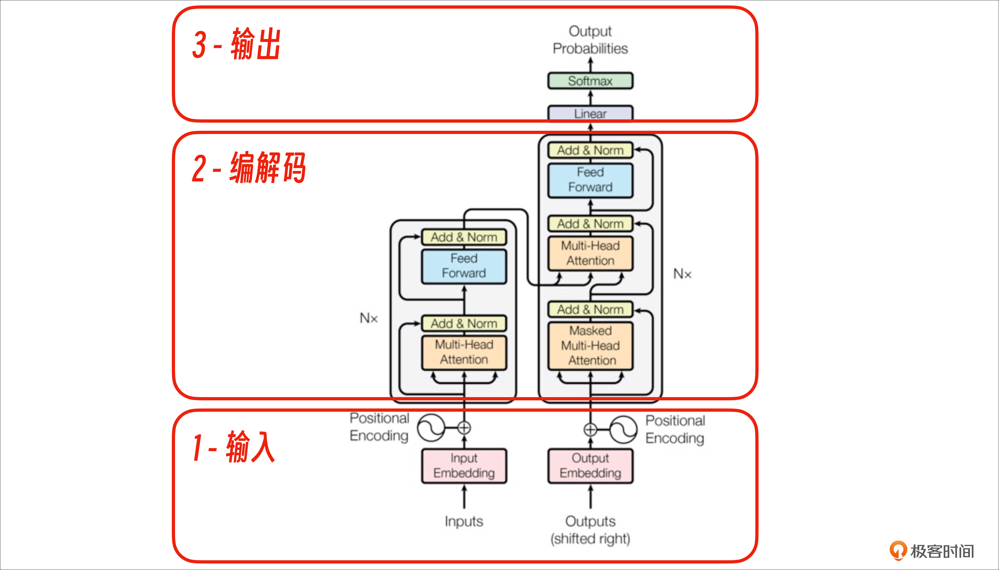

- 回顾 Transformer 架构图

### GPT 的开发历程

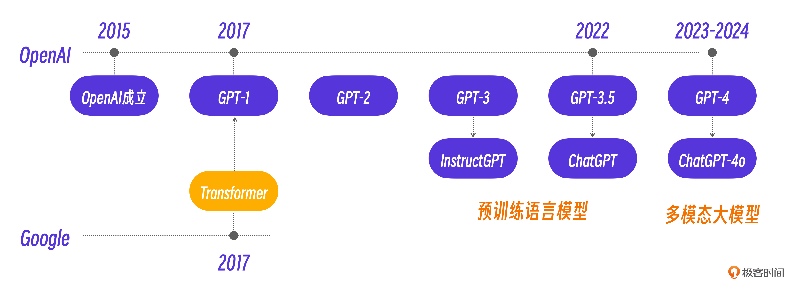

- ChatGPT 是 GPT 系列的里程碑版本

在大多数人的记忆里，ChatGPT 是在 2023 年突然引爆的，然而 ChatGPT 并不是横空出世的。在 ChatGPT 之前还有 GPT-1，GPT-2，GPT-3，GPT-3.5 等版本，可以说 ChatGPT 是OpenAI 历经多年，不断迭代、不断优化模型的结果。

GPT 的全称是 Generative Pre-trained Transformer（生成式预训练 Transformer 模型），正是OpenAI 团队在 2017 年受 Google 团队 Transformer 研究成果启发后开始研发的系列模型。

实际上，ChatGPT 没有完全遵照 Transformer 原始的 Encoder-Decoder 结构，而是在工程上做了一个创新，也就是接下来我要讲的 Decoder 架构。

### Decoder 架构

我们用示意图拆解一下 Decoder 架构。

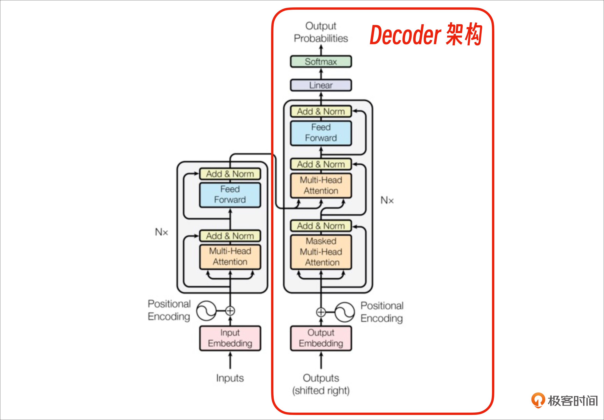

从这个架构图看到，ChatGPT 只用了 Transformer 原始架构里的解码器部分。从结果看，这种架构选择使得 GPT 模型非常擅长生成连贯的、上下文相关的文本，并在许多自然语言生成任务中表现出色。

那为什么发明了 Transformer 的 Google 团队没能做出 ChatGPT 呢？这其实和两个团队的初始目标有关。

- Google 团队发明 Transformer 的目标只是获得自然语言翻译这样的单个专有能力。

- OpenAI 成立的初衷是寻找并实现 AGI 通用能力的方法，只是碰巧在路上遇到了合适的方法，Transformer。

如果我们把训练完的 ChatGPT 模型看作一个可以入职到任何公司的“人”，那 OpenAI 改进的Transformer 可以说是一个具有人脑结构，但是不具备任何知识的“婴儿”。

ChatGPT 大模型训练用的数据就是知识，训练的过程就是将知识教给这个“人”的过程。

非常有趣的是，ChatGPT 在数据训练阶段的几个工程创新，也可以形象地对应到这个“人”的小学 - 中学阶段、大学阶段以及工作阶段。

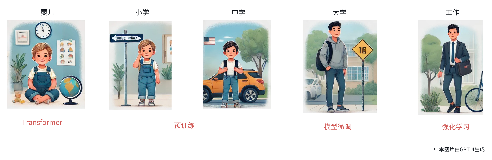

那 ChatGPT 是怎么从“婴儿”进化到“小学生”的呢？这就是我们要说的第二个核心工程，数据与训练。

## ChatGPT 的数据与训练

ChatGPT 训练消耗了 45T 数据，最终形成 1750 亿个参数规模的大模型。训练完成后的模型参数具体形式其实是若干个模型参数文件，总的文件大小也就几百 G。

我们以已经开源的 Gork-1 大模型为例，看看 Gork-1 最终的参数文件。

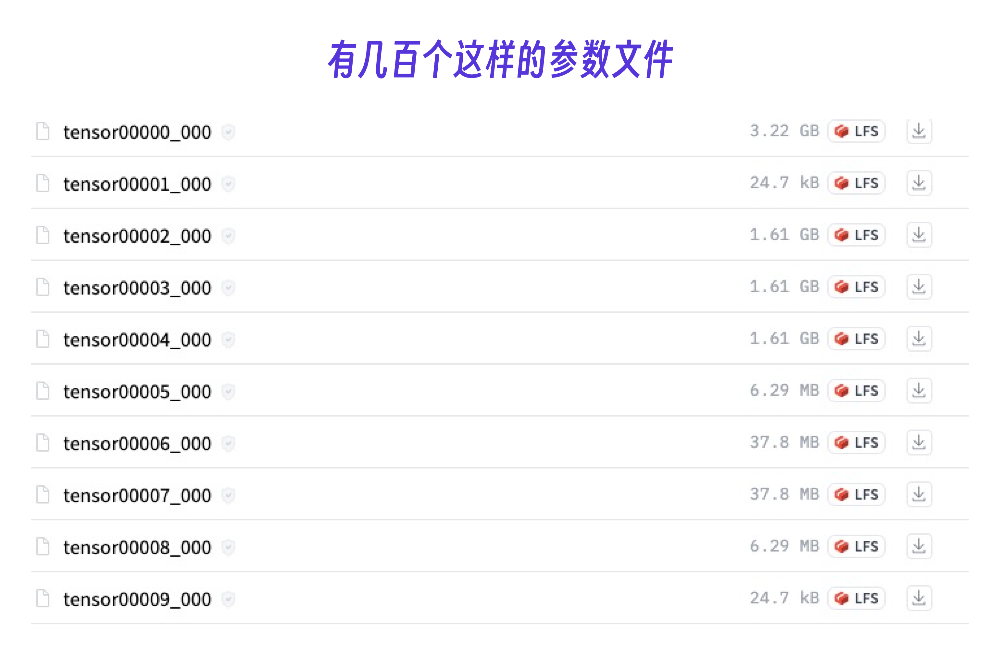

Gork-1 大模型参数文件总大小约 200G。如果你下载了这些参数文件，只要 GPU 资源足够就可以运行大模型了。仅仅需要 200G 的数据量，就可以生成几十 T 的人类知识，而且还可以创造更多知识。大模型真正做到了将整个人类的智能装进了一个只有硬盘大小的地方。

而所谓的训练，按照模型训练的先后顺序，可以分为预训练 Pre-tain，模型微调 Fine-Tuning，强化学习 RLHF 这三个阶段。

### 预训练 Pre-train

ChatGPT 的预训练过程就是拿数据集不断地输入 Transformer，调整参数的过程，本质还是利用随机梯度下降法，使用数据进行有监督训练。

监督学习的目标，是通过给定的输入（ChatGPT 的输入文本）和输出（ChatGPT 的输出文本）数据来学习一个函数（含 1750 亿参数），使得对于新的输入数据，可以预测其对应的输出。

我们知道监督学习的训练数据需要预先经过人工标注，但在 ChatGPT 预训练过程中却不需要这样预处理数据。这和 Transformer 的特性有关，Transformer 的目标本质上是一个“文字接龙”的游戏。

什么意思呢？举个例子。现在假设要训练大模型，让它学会《唐诗三百首》中的《春晓》。

- 春眠不觉晓，处处闻啼鸟。夜来风雨声，花落知多少。

因为这首诗是人写的，所以也可以说是已经经过了人工标注的数据。那么输入 Transformer 的训练数据可以直接用下面对格式。

- 输入：春眠不觉晓，输出：处……输入：春眠不觉晓，处处闻啼鸟。输出：夜……

最终经过模型训练，ChatGPT 学会了这个“文字接龙”游戏，你跟它说春眠不觉晓，它能接出下一句处处闻啼鸟。

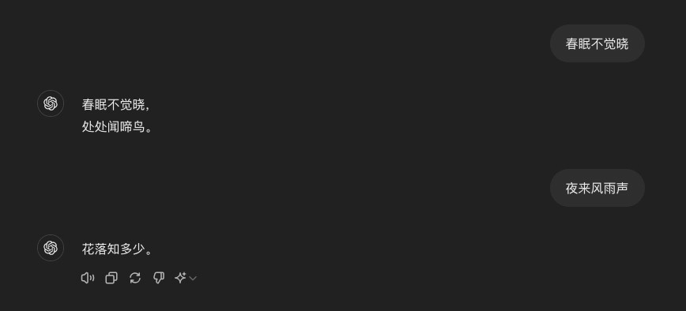

当然，仅仅学会“文字接龙”的学生还不能算拥有智能，要喂给 ChatGPT 足够的数据，它才能出现“智能涌现”。好在这些数据都可以方便地获取到，最主要的数据来源是通过爬虫获取的互联网文本数据集，专业的新闻数据集和书籍数据集，ChatGPT 类的大模型使用的都是这些公开数据集。

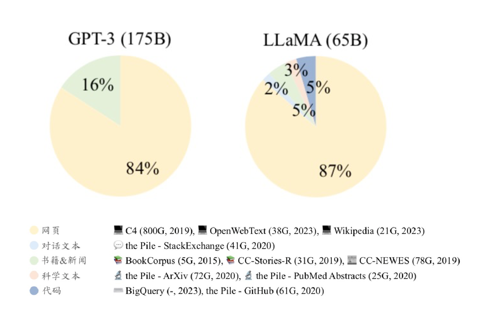

- 资料来源于网络

如果一个人要是能把全世界的互联网信息和书籍都学习一遍，并且不是简单的“死记硬背”，而是把各种知识的关联关系都梳理清楚，那么，我们就可以说这个人已经掌握了整个世界的基本知识。因此，我们可以把大模型预训练过程比作一个人的小学 - 中学学习阶段。

还是用唐诗这个题目来测试一下经过训练的 ChatGPT，我跟它说一首诗的开头，比如春眠不觉晓，让它续写。然后它会自我发挥，接出春眠不觉晓，花香飘四方，溪水潺潺流，翠鸟枝头唱。

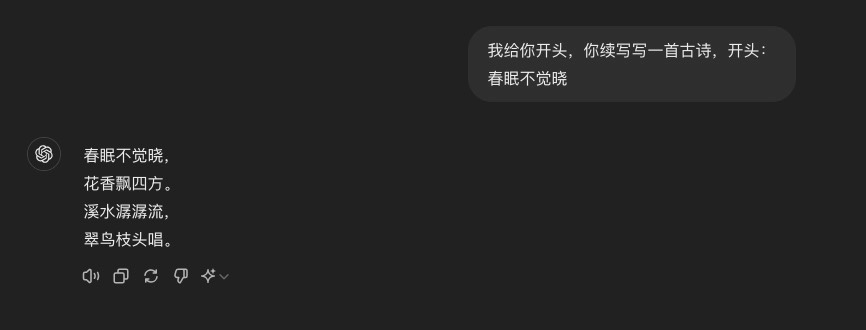

现在你能感受到“智能涌现”了吧。如果你同时使用过 ChatGPT 和其他的大模型产品，你可能会发现即使在参数规模相当的情况下，ChatGPT 也要更“聪明”一些。这是由于工程上，OpenAI 团队在公开数据集基础上做了很多数据整理工作，并形成了自己独特的高质量数据集。

特别注意，OpenAI 在发表的 GPT-2.0 论文中就已经强调，在训练模型过程中，只有高质量的数据才能让模型获得好的效果，低质量的数据只会导致模型学习到垃圾信息。

ChatGPT 对训练数据的处理包括了垃圾信息过滤、数据去重、低质语料过滤等一系列精心的数据组织和整理，最终才让 ChatGPT 做到了相对比较“聪明”的效果。

下面是历代 GPT 用到的数据集。

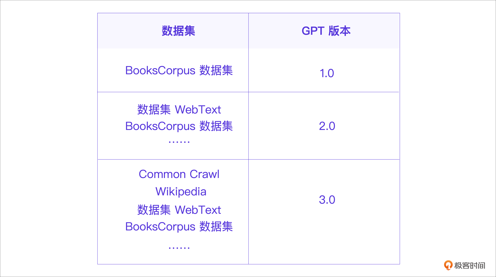

可以看到，GPT 每一次迭代都复用了前一代整理的高质量数据集，这正是导致 ChatGPT“智能涌现”的根本原因。如果说预训练是训练 ChatGPT 让它掌握世界知识，那接下来的模型微调则是训练 ChatGPT，让它具备专业能力。

### 模型微调 Fine-Tuning

关于 ChatGPT 这类大模型的实际使用效果，我身边的朋友有两种声音。有的朋友可能会说，ChatGPT 聊聊天还凑合，但是用来替代我的专业工作就有困难了。也有的朋友说过，使用ChatGPT 来做翻译太爽了，完爆其他翻译工具。

OpenAI 在 2023 年的收入估计大概是 10 亿美元。从这个收入可以看出，很多人已经用ChatGPT 辅助自己的工作，我就是其中一员，而且这种辅助已经产生了实际价值。你也可以说 ChatGPT 具备了很多专业能力。

一个典型的专业能力就是翻译能力。

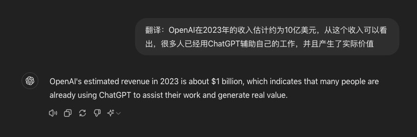

要让 ChatGPT 获得这些专业能力，就需要在预训练模型的基础上做模型微调（Fine-Tuning)，具体的模型训练过程和预训练是一样的，只是数据不同。

之前我说过 Google 团队发明 Transformer 的目的是做专业的翻译。这类技术路线已经有很多专业的数据集，现在 ChatGPT 只需要在预训练模型的基础上加入这些数据集的训练就可以了。唯一需要做的只是在数据上加入一个任务指令。

来看一个例子。

- 翻译：他每天早上六点起床，然后去跑步。He wakes up at six o’clock every morning and then goes for a run.翻译：我们需要更多的信息来做出决定。We need more information to make a decision.翻译：我们可以在下周开会讨论这个问题吗？Can we meet next week to discuss this issue?…

例子中的“翻译”指令就是大模型下面的翻译任务，因此这种微调方法被称为指令微调。经过专业数据的指令微调之后，大模型同时具备了通用的世界理解能力和专业能力。

还是用一个翻译案例来说明。

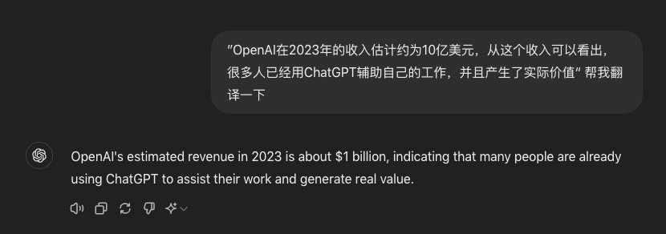

尽管我们的上下文里没有像数据集采用 “翻译”开头，但这并不影响 ChatGPT 理解这是一个翻译任务，也不影响它使用专用的翻译能力完成这个任务。

除了专业的翻译能力，ChatGPT 的编程能力涌现实际上和 ChatGPT 使用了大量 GitHub 的开源代码作为数据集有关系，这其实是 OpenAI 团队有意为之的结果。如果算力足够，ChatGPT还可以通过微调加入各种专业能力，这个过程就像学习某个大学专业一样。

不过，如果仅仅是专业能力很强，还不足以找到工作。OpenAI 在将 ChatGPT 开放给公众之前，还需要做人类对齐，其目的是要保证 ChatGPT 输出的内容对人类没有危害，使用的技术叫强化学习。

### 强化学习 RLHF

下面这个图展示了 ChatGPT 的实际训练流程以及 GPT-3.5 和 ChatGPT 的关系。

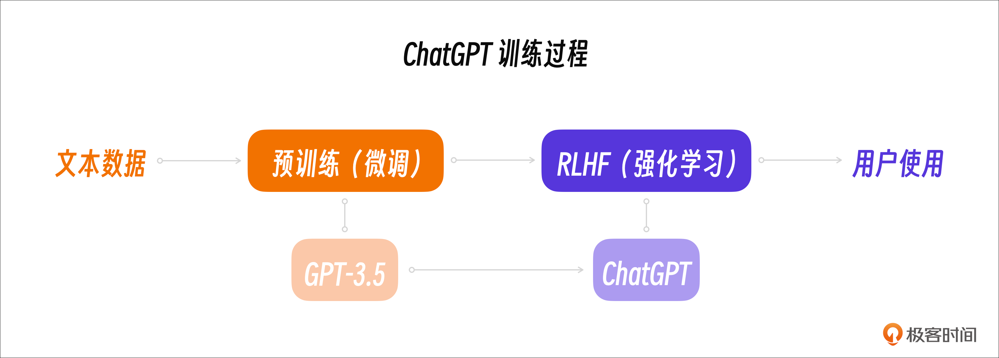

你可以把强化学习过程理解为一份工作入职前的价值观和行为规范的培训，GPT-3.5 是一个具有通用能力的“人”，ChatGPT 是一个能跟人类配合更好，更没有危害的“工作人”。

具体怎么做的呢？

显然，要对每一次用户和 ChatGPT 会话生成的内容做一个评价反馈是非常困难的。ChatGPT抛弃传统监督的方法，采用 RLHF（Reinforcement Learning from Human Feedback，人工反馈的强化学习）来克服这个难点。

第一步，OpenAI 找了很多人类数据标注员，针对常见的任务写出提问和回答。注意，这些提问和回答都是人类编写的，然后用这些数据对预训练的大模型继续指令微调。

第二步，单独制作一个神经网络模型，模拟人类，给 ChatGPT 模型的输出结果打分。大概过程是这样的，OpenAI 找了很多人不停地使用 ChatGPT，并且对同一个问题的不同回答给予评分。

- prompt1：我想去杭州玩，有哪些好玩的地点呢？response1-1：杭州是一个充满魅力和历史的城市，有很多值得一去的地方。以下是一些推荐：西湖、灵隐寺、雷峰塔、河坊街。response1-2：杭州是一个充满魅力和历史的城市，有很多值得一去的地方。以下是一些推荐：西湖、杭州植物园、京杭大运河、河坊街。response1-3：杭州是一个充满魅力和历史的城市，有很多值得一去的地方。以下是一些推荐：西溪湿地公园、千岛湖、宋城、胡雪岩故居。

通过几十万条人工标注的评价数据，就可以训练出一个 reward 模型，它相当于一个人类价值观评判员。

接下来开始 RLHF 训练。其过程可以理解为让大模型自己“左右互搏”，随机给自己提问，通过reward 模型评价自己的回答，进一步调整参数，最终获得和人类对齐的大模型。

用下面的强化学习流程图来理解这三个过程会更清楚。

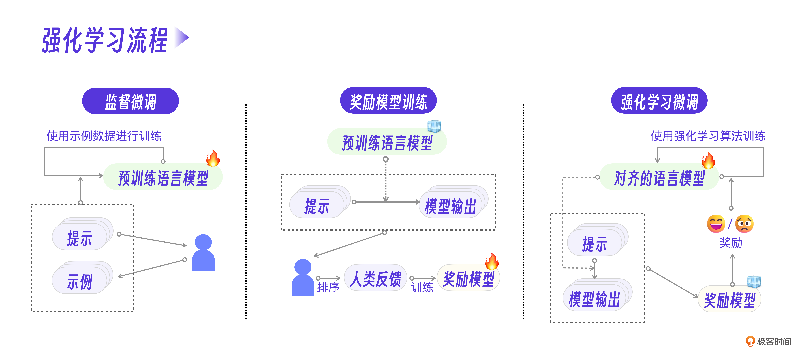

当然，RLHF 的细节还有很多，我这里只能做一个大致的过程梳理，更多算法细节可以参考社群的资料。

最后说一点，ChatGPT 还巧妙地利用了用户的反馈继续强化学习。如果你用过 ChatGPT，可能都遇到过类似下面的情况，就是 ChatGPT 会让你从两个回答中选一个，这其实就是利用你来对结果做人类评价。

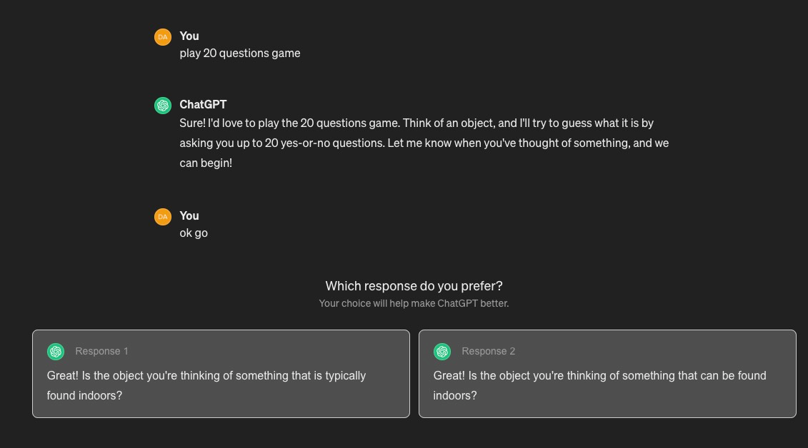

### 参考代码

如果你想自己动手尝试训练一个简单的大模型，体验这个过程，我也给你提供了三段示例代码，预训练示例代码、模型微调示例代码以及强化学习示例代码。完整的代码版本可以参考社群里提供的参考书籍《大语言模型》。这节课我们先专注在 ChatGPT 的核心工程上。

预训练示例代码：

```python
from dataclasses import dataclass
from dataset.pt_dataset import PTDataset from transformers import (
   AutoModelForCausalLM,
   AutoTokenizer,
   HfArgumentParser,
   TrainingArguments,
   Trainer,
)
from transformers.hf_argparser import HfArg
# 用户输入超参数
@dataclass
class Arguments(TrainingArguments):
# 模型结构
model_name_or_path: str = HfArg(
   default=None,
   ...
```

模型微调示例代码：

```python
import torch
from dataclasses import dataclass
from dataset.sft_dataset import SFTDataset from transformers import (
   AutoModelForCausalLM,
   AutoTokenizer,
   HfArgumentParser,
   PreTrainedTokenizer,
   TrainingArguments,
   Trainer,
)
from transformers.hf_argparser import HfArg
IGNORE_INDEX = -100
# 用户输入超参数
@dataclass
class Arguments(TrainingArguments):
# 模型结构
model_name_or_path: str = HfArg(
default=None,
       help="The model name or path, e.g., `meta-llama/Llama-2-7b-hf`",
   )
# 训练数据集
dataset: str = HfArg(
default="",
       help="Setting the names of data file.",
   )
...
```

强化学习示例代码：

```python
import torch
import torch.nn as nn
import torch.nn.functional as F
from transformers import LlamaForCausalLM,
class LlamaRewardModel(LlamaForCausalLM): def __init__(self, config):
super().__init__(config)
# 初始化线性变换层，将隐状态映射为标量，用于输出最终奖励
self.reward_head = nn.Linear(config.hidden_size, 1, bias=False)
def _forward_rmloss(self, input_ids, attention_mask, **kargs): # input_ids:输入词元
# attention_mask:与输入相对应的注意力掩码
# 将输入词元通过大语言模型进行编码，转化为隐状态 output = self.model.forward(
input_ids=input_ids, attention_mask=attention_mask, return_dict=True, use_cache=F
)
....
```

## ChatGPT 的算力挑战

那为什么 OpenAI 敢于投入几千万美元来训练 ChatGPT 模型呢？

最新的 GPT 大模型要使用几千张 GPU 来做训练，往往一次训练过程就耗时几个月，成本则达到几百万美元甚至上千万美元，万一这次训练失败了怎么办？

除了之前两个小节提到的算法创新、数据创新之外，OpenAI 团队对算力的使用经验也至关重要。

### 大模型的铁三角

这其实引出我的一个思考，在大模型训练中，算法（模型）非常重要，数据量和数据质量非常重要，但这两者的开发难度其实还好，真正的挑战反而是训练大模型的工程师如何高效利用算力。

我将这种关系总结为大模型铁三角。

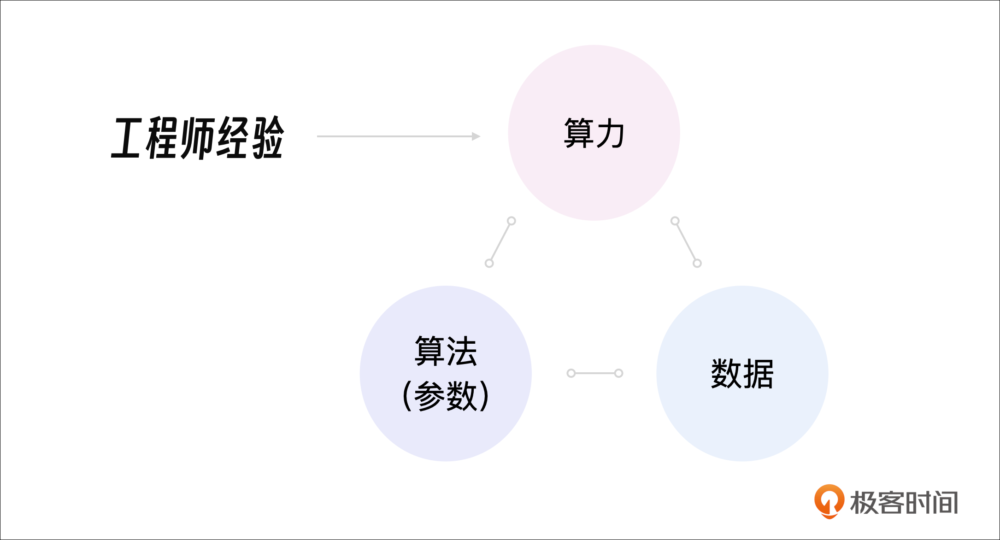

实际上，这 3 个因素是相辅相成的关系，作为大模型操控者的工程师，他们的价值在于节约成本。在 GPT-1、GPT-2、GPT-3 的训练和应用过程中，OpenAI 团队通过反复实验和优化，积累了丰富的经验，提高了训练过程的可控性。

回顾 OpenAI 的历程，在探索 AGI 的路上，一开始缺少的是合适的算法（模型），直到Transformer 的出现。接着，数据的质量成为最关键的问题。OpenAI 通过在公开数据集上花费巨大的成本整理了自己的高质量数据集，解决了这个问题。再随着模型参数的增加，算力成为首要问题，微软对 OpenAI 的投资又解决了这个问题。

而现在，算力消耗过大，又在倒逼行业继续做算法创新。

### 1750 亿参数

ChatGPT 有 1750 亿参数，往往写做 175b，1b=10 亿参数。

为什么 ChatGPT 用了这么多的 GPU，为什么有这么多参数呢？针对这个问题我还专门和ChatGPT 讨论过，它一本正经地给我列出了算式，详细计算了 1750 亿参数的具体分布，要是你有兴趣可以看课程群内的分享。

现在我的问题是，1750 亿已经是一个很大规模的参数量级了，再往上提高参数量恐怕也很难达到 AGI，关键是成本承受不了。

其实业界已经对这个问题做了很多探索，其中 MOE 架构就是一个新的算法（模型）架构。它通过训练 N 个小的专家模型、多个模型协作来达到整体上更强的智能。这种架构可以降低训练成本。具体能否解决问题还有待观望，想了解最新架构的同学不妨关注一下。

## 小结

回顾 GPT 系列大模型的发展历程，可以看出 OpenAI 团队的初心就是要打造 AGI（通用人工智能), 正是这个初心让其在遇到 Transformer 之后可以做出了远超 Google 团队的成就，让ChatGPT 实现了智能涌现，在 NLP 领域走出了一条全新的道路，这是 ChatGPT 最大的创新。

在工程实现上，别看一次 GPT 大模型训练要耗费数百万美元成本，实际上 OpenAI 团队做的每一个工程创新都是在节约成本，预训练过程可以利用现有互联网数据，省去了人工标注成本。模型微调技术，让 ChatGPT 可以用少量的数据训练实现专用 AI 的能力，比如专业翻译任务。强化学习则是用几十万条数据标注的成本，实现了对大模型的人类对齐。

这些经验对后续的大模型应用开发也很有参考价值。

经过这两节课对大模型底层原理和工程创新的拆解，可能你已经跃跃欲试，想赶快体验一下大模型了。但计算资源有限的情况下，怎么才能上手操作呢？这正是我下一节课要讨论的，如何在本地部署和体验大模型。

## 思考题

本节课提到 ChatGPT 已经具备程序员级别的编程能力，为什么很多程序员却说用大模型写代码不靠谱呢？

欢迎你在留言区和我交流。如果觉得有所收获，也可以把课程分享给更多的朋友一起学习。我们下节课见！

>> 戳此加入课程交流群
