# 17 | 评估：如何对电商客服模型专有训练进行能力测评？

你好，我是金伟。

总体而言，大模型测评才是整个项目的核心。基于电商客服对问答准确性的要求，只有发布之前测试充分，才能保证发布后不出现 bug。问题是，怎么才能通过测评保证电商客服模型的准确性呢？

很多人可能会想，直接用程序自动测试？或者用其他能力更强的大模型来测评？我的实际经验表明，最重要的是人工测评。

在真实电商客服项目中，我们采用人工测评 + 自动化测评结合的方案。

我们先从测评和训练之间的关系开始说。

## 测评过程

首先需要注意的是，为了保证测评效果，测评数据集和训练数据集要完全隔离。真实项目里，测评分为 3 类测评，分别是人工测评，通用测评和私有 task 测评。

测评和训练的关系不是先训练再测评，而是在模型训练过程中分别评分，随时根据结果调整模型训练过程。

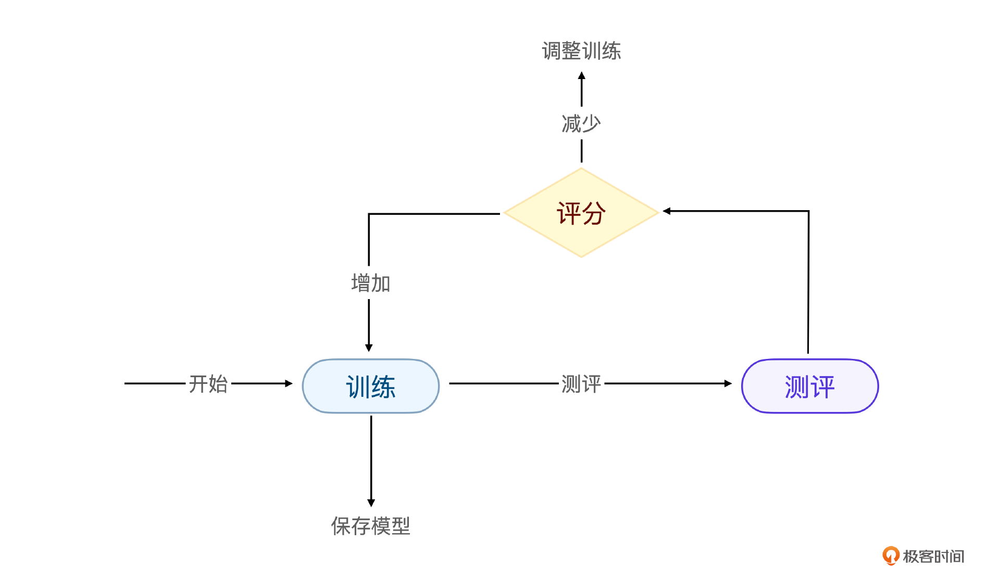

如果这 3 个测评非要做一个重要性排序的话，那么人工测评其实是最重要的。人工测评的方法是将智能客服项目最关心的能力设计为一系列问题，把问题和期望的回答写到 Excel 表格中，由人工挨个根据微调后的大模型进行评分。

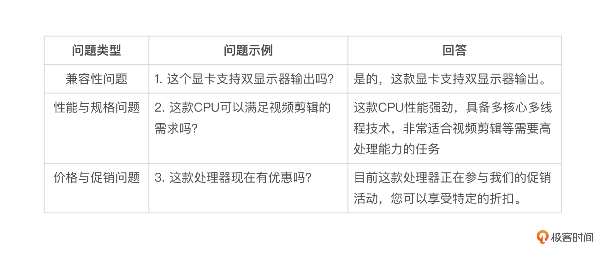

需要注意，在智能客服上线之后遇到的新问题也要补充到表格里。

如果说人工测评是测试大模型微调后有多少新能力，那么通用测试集测评则是保证大模型基础和通用能力不下降。通用测试集一般是公开的，我们只要用测试集对微调后的大模型测评，结果和原有大模型的评分对比即可。

例如下面是 Llama 系列模型在各个测试集下的通用测评结果。

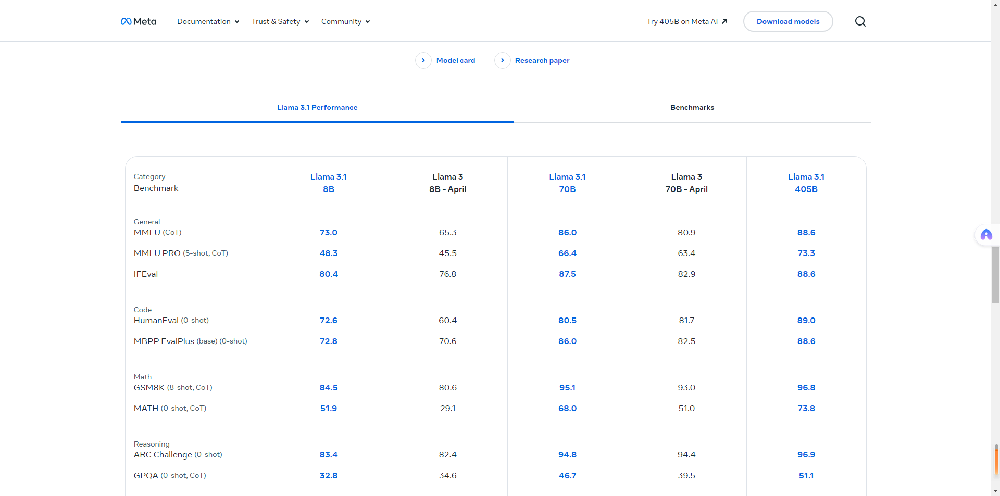

最后，私有 task 测评是人工测评的补充。怎么理解呢？比如我们之前提到的客服项目中的地址信息提取能力，是一个要通过微调大模型提升的能力，这个可以用人工测评也可以写一个自动测评程序测评，写一个自动程序就是私有 task，最终结合人工评分和私有 task 测评评分来说明这项能力。

那这些得到的不同评分结果如何判断呢？下面我用一个过程描述的例子来说一说。

比如，在模型训练中，模型训练跑了 1 万步左右，做一次人类评分，同时做私有 task 评分，此时人类评分 7，私有 task 评分 5 分，继续跑到 2 万步在做一次测评。如果私有 task 下降到2 分，大概率出问题了。如果跑到 2 万步，私有 task 增加到 6 分，则训练正常。

我把一些经验值整理成流程图，可能更有参考价值。注意，人工测评和私有 task 结合，通用测试集测评则是独立的。总体标准是，人工评分要增加，通用测试集评分不能下降得太高。


真实的人工测评也不是傻傻的靠人工挨个比对结果，有很多提高效率的方法。

## 核心：人工测评

人工测评是大模型的测评的核心环节，核心要点是问题集的设计，只列出重点关注的问题集，问题数量不用太大，随时补充生产遇到的重要问题。

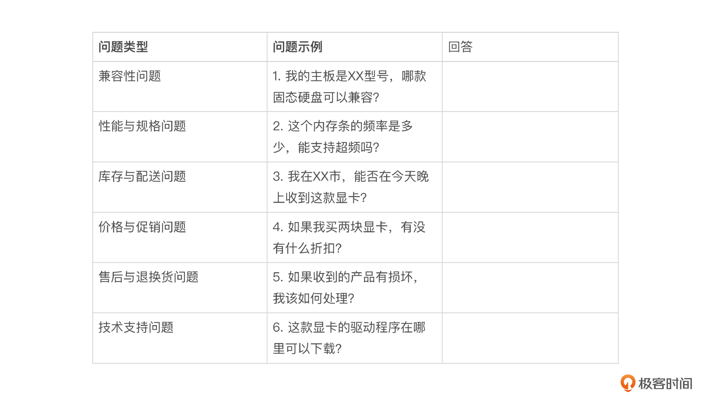

## 测评流程

在工程实践上，可以用 Python 做一个小工具，把上述问题集写在 Excel 中，在用 Python 调用模型接口自动向专有模型进行提问，将回答回填到关注的问题后面一列。

```python
import csv
# 假设你有一个模型接口函数，名称为`get_model_answer`，它接受一个问题并返回回答
def get_model_answer(question):
   # 这里调用你的模型接口，比如通过API请求获取回答
   # 这里假设返回一个示例回答
   return "这是模型生成的示例回答。"
# 读取CSV文件，处理数据
def process_csv(input_file, output_file):
   with open(input_file, mode='r', encoding='utf-8') as infile, open(output_file
       reader = csv.DictReader(infile)
       fieldnames = reader.fieldnames
       writer = csv.DictWriter(outfile, fieldnames=fieldnames)
       writer.writeheader()
       for row in reader:
           # 获取问题示例
           question = row['问题示例']
           # 调用模型接口获取回答
           answer = get_model_answer(question)
           # 将回答填充到对应的列中
           row['回答'] = answer
           # 初始评分列为空
           row['评分'] = ''
           # 写入新行
           writer.writerow(row)
# 输入和输出CSV文件的路径
input_csv = 'input.csv'
output_csv = 'output.csv'
# 处理CSV文件
process_csv(input_csv, output_csv)
```

经过程序运行后，得到的表格类似如下格式。

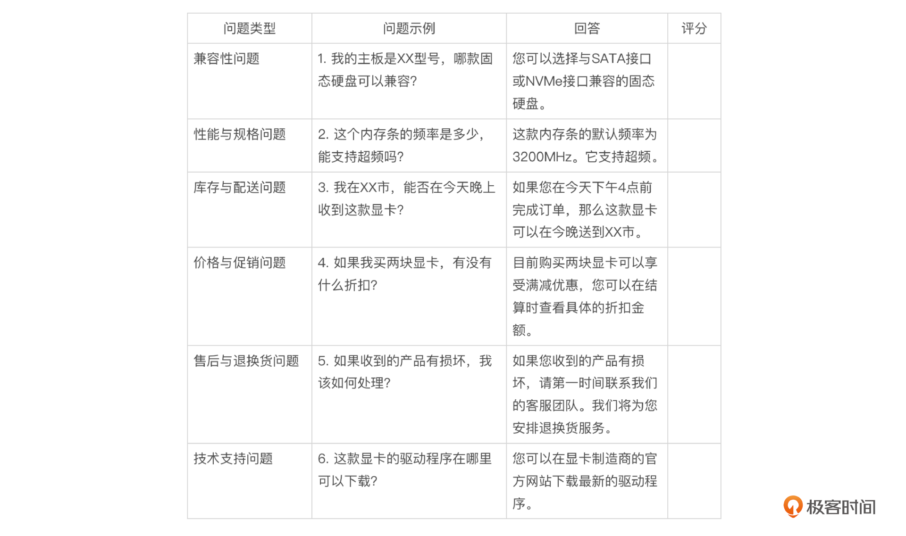

最后人工检查 Excel 里的内容，给出评分即可。

### 实测与回调

如果测评结果出现异常，比如评分降低，怎么进一步分析呢？

其实只有两个可能，代码不对或数据不对，导致参数变化不正常。而大多情况都是数据不对，最关键的前置工作，数字孪生生成的数据要经过人工检查，没错，还是人工检查，这一步不能通过程序。

例如下面的地址信息提取的数据模版。数字孪生生成的每条数据输入和输出需要检查是否完全匹配，如果错误数据过多，自然会导致微调后的大模型评分下降。

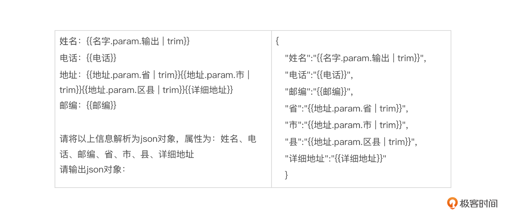

关于训练数据量经验也至关重要。一般微调小的能力，千级数据量就足够了，复杂的能力，比如例子中的地址抽取能力则需要万级别数据量。

## 通用能力评分

人工测评有一定的人工成本，通用能力测评主要是算力成本。

用通用测试集测评可以了解当前训练有没有导致模型严重劣化，如果有问题，需要找出原因从前一次导出的参数重新进行训练。经验表明，如果新开始训练没有导入原版的优化器参数，分数下跌很多是正常的。针对这种情况，你可以参入正常语料进行训练，一段时间之后，就会恢复比较正常的评分。

### MMLU 数据集

对模型的通用能力测评，核心就是要设计通用能力的测评问题和答案，然后根据大模型对这些问题的回答进行评分。

不管具体用哪个数据集进行测评，最基本的问题 - 答案数据结构都是一样的，类似下面的例子。

```json
{
 "question": "What is the capital of France?",
 "options": {
   "A": "Berlin",
   "B": "Madrid",
   "C": "Paris",
   "D": "Rome"
 },
 "correct_answer": "C"
}
```

我们在实战中采用 MMLU 数据集，这是一个通用能力测试数据集，其实不同的测评方案就是数据集不一样，每一个数据集有自己的测评方法，不需要单独编写程序。

MMLU（Massive Multitask Language Understanding）数据集包含了来自 57 个不同领域的大量多选题，主要特点就是多学科覆盖，包括 STEM（科学、技术、工程、数学）、人文科学、社科、法律、医学等，评估模型在不同领域的知识掌握情况。而且他还具备多任务学习能力。可以说，MMLU 的设计目的就是评估模型的多任务学习能力，也就是让模型在不同任务之间切换并保持高水平表现的能力。

下面是这个数据集 57 个数据的截图展示。

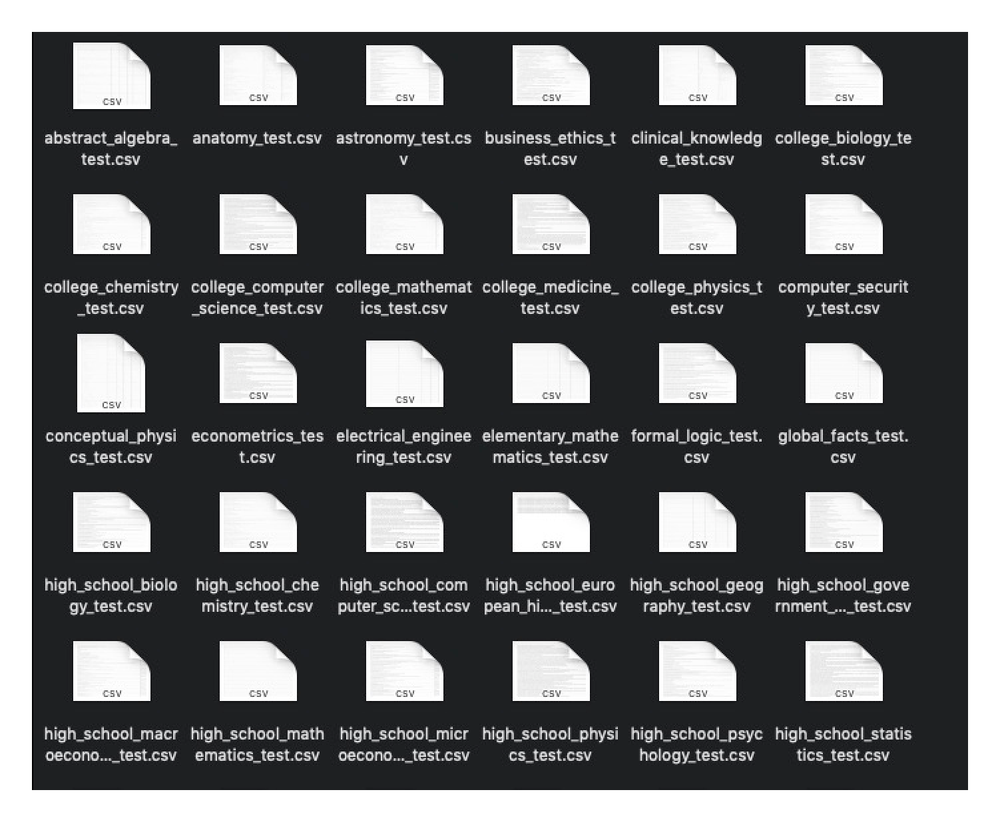

那我们做通用能力测评需要 57 个任务全部跑一遍吗？其实只要跑子任务就行，核心思想是对客服场景的相关能力评估，运行流程是自动化的。

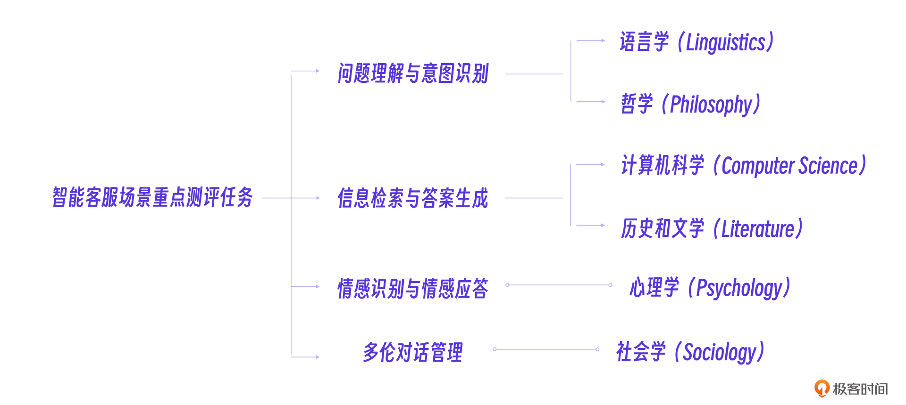

### 自动化流程

具体的测评工具可以用 LM-Evaluation-Harness 框架，LM-Evaluation-Harness 是一个用于评估和比较语言模型（Language Models, LMs）性能的工具包。

```bash
首先，克隆并安装 lm-evaluation-harness 库。
git clone https://github.com/EleutherAI/lm-evaluation-harness.git
cd lm-evaluation-harness
pip install -e .
在运行之前，需要明确几点，lm-evaluation-harness 框架可以直接测评各种开源的大模
```

型，也可以使用各种公开数据集来测评。在我们客服项目中，被测评的模型选择私有的大模

```
型，而数据集选择 mmlu。
```

使用以下命令进行评估。

```
lm_eval \
   --model hf \
   --model_args pretrained="your-hf-model-name-or-path" \ #私有模型路径
   --tasks mmlu \ #数据集
   --device cuda \
   --output_path ./results.json
```

参数说明：

```
your-hf-model-name-or-path 替换为你的微调模型的名称或路径。
--tasks 指定要评估的任务，这里是 mmlu。
--device 指定设备（如 cuda 或 cpu）。
运行完毕可以在results.json中查看结果，lm-evaluation-harness 也会在终端显示
```

模型的评估结果，包括准确率等指标。

下面是我的模型评估命令和结果。

```
lm_eval \
   --model hf \
   --model_args pretrained="/root/autodl-tmp/outs/jinwei01" \
   --tasks mmlu \
   --device cuda \
   --output_path ./results.json
```

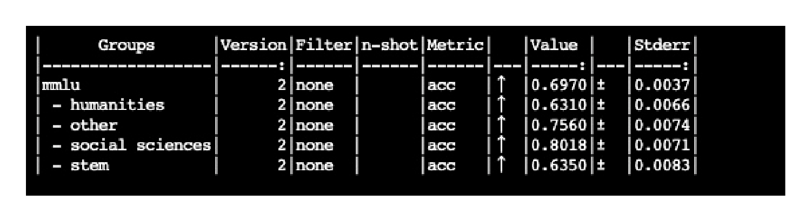

这套流程可以帮助你快速评估微调后的模型在 MMLU 数据集上的表现，而不需要进行复杂的代码修改。

这里有一个重要的问题，测评的 results 是一个准确率数值，并不是评分。我们怎么做呢？工程实战中可以用这个准确率作为基准和微调前对比，微调中对比。不用纠结于模型评分。


另外，关于数据集大小，MMLU 数据集包含 57 个任务，每个任务中有数百到上千个问题。如果评估所有任务，时间会比较长，不用担心，很正常。

还有一个重要的问题，你可能会想，MMLU 是英文测试集，我们的智能客服场景是中文，这种测评方法能评估中文通用能力表现吗？实际情况是英文数据集就可以评估中文能力，也就是说如果微调导致英文通用能力下降，中文能力也随之下降。不过你要把 MMLU 翻译为中文或干脆用中文测评集也没问题。

## 私有 task 评分

通用数据集是全自动测评，私有 task 评分也是全自动测评，基本思想是针对我们的智能客服项目，设计关键的问题和标准答案，用自动化测评的方法来评估这些问题，并得到评分。

私有 task 评估的目标和人工评估其实是一样的，都是为了测试模型微调后的新能力有没有提升，那为什么不用私有 task 评估完全替代人工呢？这个问题你跟着我做一遍项目的私有 task测评就清楚了。

还是使用 LM-Evaluation-Harness 工具包。这里有必要再理解一下这个工具的核心思想是什么。

LM-Evaluation-Harness 实际上提供一套测评框架，可以自定义测评任务，在电商客服中，可以理解为：将一些我们要通过微调完成的任务，写出测评任务，这些任务就是私有 task，用框架重点测评这些 task，评估我们模型的微调的效果。

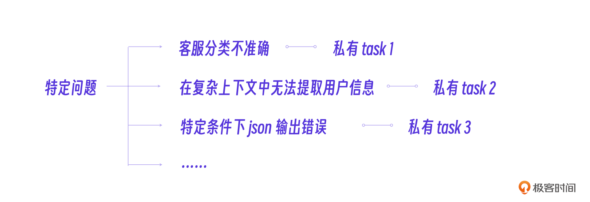

### 私有 task 设计

要做好私有 task 测评，一定要先搞清楚私有 task 的关键概念，我把这些概念整理到一张图中了，供你参考。

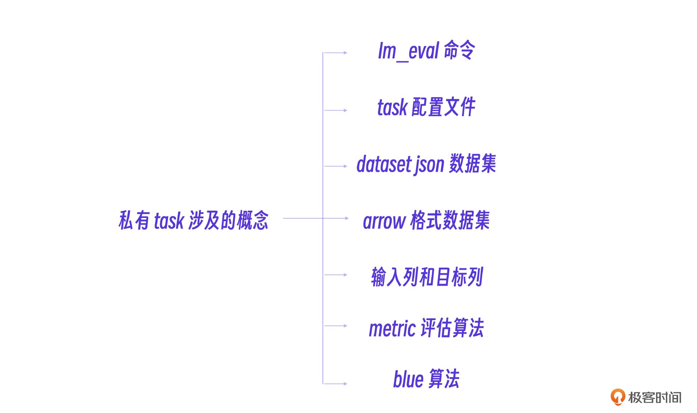

你跟着我把私有 task 全过程运行一次，就能理解这些关键概念了。下面的配置、运行、评估过程包含了几个关键的工程经验，是我们实战过程中的总结。

```
运行私有 task 评估和通用能力测评命令是一样的，唯一的不同就是 tasks 参数要配置为我们
```

自己的 task 配置文件。

```
lm_eval \
   --model hf \
   --model_args pretrained="/root/autodl-tmp/outs/jinwei01" \
   --tasks /path/my_custom_task.yaml \ #task配置文件
   --device cuda \
   --output_path ./results.json
```

这条命令看起来非常简单，但要实际运行成功，需要注意的细节特别多，第一个注意点，私有task 的 task 配置要在 lm_eval 的 tasks 目录下。我们就曾经因为把这个配置文件放在别的目录，导致命令运行一直失败。

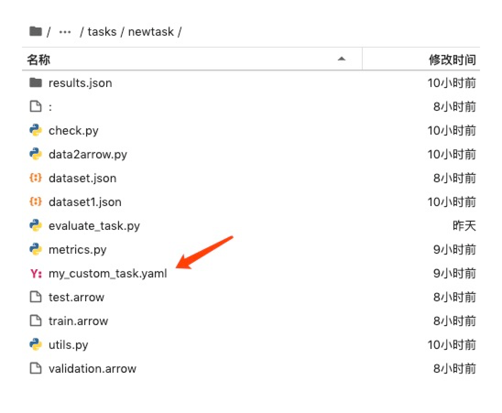

```
如上图所示，我这里的私有 task 名字叫 my_custom_task，建立的配置文件
my_custom_task.yaml，这里 yaml 配置的第一项 task 也必须写为 my_custom_task，
```

千万不要填别的名字，我们也曾经掉到这个坑里。

```
task: my_custom_task
... ...
```

第二项重要工作就是数据工程了。既然是私有 task 测评，那数据集也需要自己创建，也就是

```
平常说的数据工程。至于数据格式，因为我们只用来做测评，只要完善 test 这一段的数据即
可，采用问答格式，具体可以看下面数据集中的 test 部分。
{
 "train": [
   ... ...
 ],
 "validation": [
   ... ...
 ],
 "test": [
   {
     "question": "1+1=",
     "answer": "2"
   }
 ]
}
针对智能客服场景的 test 数据格式，要看具体评估功能来确定，比如评估地址提取能力的就
```

应该是如下的格式。

```
"test": [
   {
     "question": "从以下信息中提取地址：XX省XX市XX区XX街道XX号",
     "answer": "{\"province\": \"XX省\", \"city\": \"XX市\", \"district\": \"XX区
   }
   ... ...
 ]
数据集文件的创建过程分为两步，第一步是建立一个 dataset.json 数据集，具体格式就是
上面例子里的格式。这里涉及到第二个重要的注意点，dataset.json 数据集必须包含
train 和 validation 模块，即使它们在评估中用不到。
```

我们刚才建立的数据集是 json 格式的，在私有 task 测评中，我们的经验是要讲 json 格式的数

```
据集转化为 .arrow 格式，这就是数据集创建的第二步。
```

单独写一个 Python 数据处理的脚步，完成这个转化。

```python
import json
import pyarrow as pa
import pyarrow.parquet as pq
def json_to_arrow(input_json, output_arrow_file, data_split):
   # 读取 JSON 数据
   with open(input_json, 'r', encoding='utf-8') as f:
       data = json.load(f)
   ... ...
# 示例用法
json_to_arrow('dataset.json', 'train.arrow', 'train')
json_to_arrow('dataset.json', 'validation.arrow', 'validation')
json_to_arrow('dataset.json', 'test.arrow', 'test')
最后才是完善 my_custom_task.yaml 配置文件，其核心是数据集的配置。也就是
training_split、validation_split、test_split 这几项配置。
task: my_custom_task
dataset_path: arrow
dataset_name: null
training_split: train
validation_split: validation  # 如果你有验证集，指定其名称
test_split: test  # 如果你有测试集，指定其名称
dataset_kwargs:
   data_files:
       train: ./train.arrow
       test: ./test.arrow
       validation: ./validation.arrow  # 指定本地数据集文件的路径
doc_to_text: "{{question}}"  # 输入列
doc_to_target: "{{answer}}"  # 目标列
metric_list: #评估算法
 - metric: bleu
   aggregation: mean
   higher_is_better: true
```

还有一点需要注意，配置文件中年的 输入列 和 目标列 需要和数据集字段对应。

```
现在就可以运行评估程序了吗？还不行，你注意配置文件的最后一项 metric_list，表示评
```

估算法，什么意思呢？我们先看一个实际运行的问答数据例子。

- 问：这个内存条的频率是多少，能支持超频吗？

```
答：这款内存条的默认频率为3200MHz。它支持超频
answer：这款内存条的默认频率为3200MHz。是的支持超频
```

现在最核心的问题是，怎么评估这个回答是不是准确呢？在智能客服项目中，我们要自定义个评估算法，你接着看我分析。

### 评分算法

最简单的算法就是完全匹配算法，如果回答和 answer 完全一样记 100 分，否则 0 分。当然针对大模型这个场景，使用更灵活的评估方法，而不是简单的字符串匹配。常见的方法包括使用相似度评估（例如 BLEU、ROUGE、BERTScore 等）或 模糊匹配。

```
我们选用的是 BLEU 算法，下面的 bleu 和 agg_bleu 分别是单个数据的 bleu 计算和整体的
```

bleu 评分。

```python
import evaluate  # 导入 evaluate 库，用于加载 BLEU 评估函数
def bleu(predictions, references):
   # 定义一个简单的 BLEU 函数，只返回第一个预测和参考
   return (predictions[0], references[0])
import sacrebleu  # 导入 sacrebleu 库，用于计算 BLEU 分数
def agg_bleu(items):
   # 聚合多个预测和参考，计算整体的 BLEU 分数
   predictions, references = zip(*items)  # 将预测和参考分离成两个列表
   bleu_score = sacrebleu.corpus_bleu(predictions, [references])  # 使用 sacreble
   return bleu_score.score  # 返回 BLEU 分数
def agg_bleu1(items):
   # 另一个计算整体 BLEU 分数的函数，使用 evaluate 库的 BLEU 评估函数
   bleu_fn = evaluate.load("bleu")  # 加载 BLEU 评估函数
   predictions, references = zip(*items)  # 将预测和参考分离成两个列表
   return bleu_fn.compute(predictions=predictions, references=references)["bleu"
```

为什么我们要自己实现 bleu 算法呢？这就是私有 task 项目中的第四个注意点，也是工程经验，如果你在配置文件中写默认的 bleu 评估配置，评估程序会一直报错，我们甚至去修改了框架的源代码都无法解决。

```
metric_list:
 - metric: bleu
    aggregation: mean
    higher_is_better: true
```

最简单的解决方案就是自己写一个 bleu 的算法模块，修改 task 的配置文件，把评估算法配置到自己的评估算法上。

```javascript
metric_list:
 # - metric: bleu
 #   aggregation: mean
 #   higher_is_better: true
 - metric: !function metrics.bleu
   aggregation: !function metrics.agg_bleu
   higher_is_better: true
```

下面是这个私有 task 的最终运行效果。

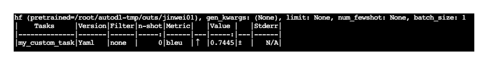

我们可以回过头分析一下，这种基于相似度的评估算法实际上还是不够准确的，因此私有 task评估也只适合有标准答案的测评，主要是答案要完全精准的。

## 小结

真实的大模型微调项目中，测评过程和数据工程一样重要，一个大模型不可能一次微调成功，往往要经过数据 -> 训练 -> 评估 -> 修改数据，这样循环往复的过程才能微调完成。

之前课程也提到，只有当大模型遇到问题的时候才需要微调，因此评估的重点是看微调后的大模型是否具备新的特性，其方法是人工测评 + 私有 task 测评，其中核心参考人工测评的结果，私有 task 可以完全实现自动化，其评分作为辅助参考。

另外一方面，大模型微调之后，原有基础能力不能下降，如何评估呢？可以通过通用测评数据集的测评来完成，这一步和私有 task 一样，都可以通过 LM-Evaluation-Harness 测评框架自动化完成。

最后怎么根据这些评分来调整你的训练和数据呢？我整理了一张图供你参考。

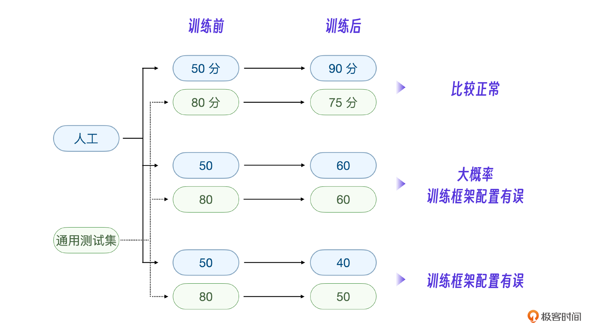

## 思考题

在私有 task 评估中，我们提到评估算法的好坏决定了私有 task 的评估水平，那么可以用大模型来作为评估算法吗？具体怎么做？

欢迎你在留言区和我交流。如果觉得有所收获，也可以把课程分享给更多的朋友一起学习。我们下节课见！

>> 戳此加入课程交流群
