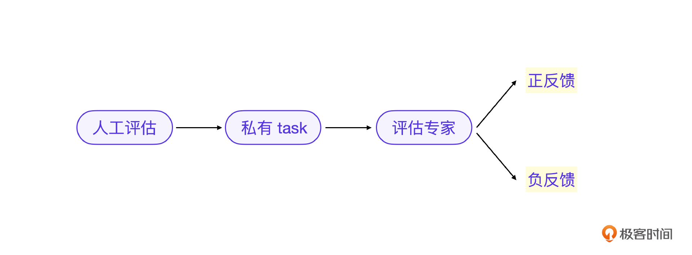
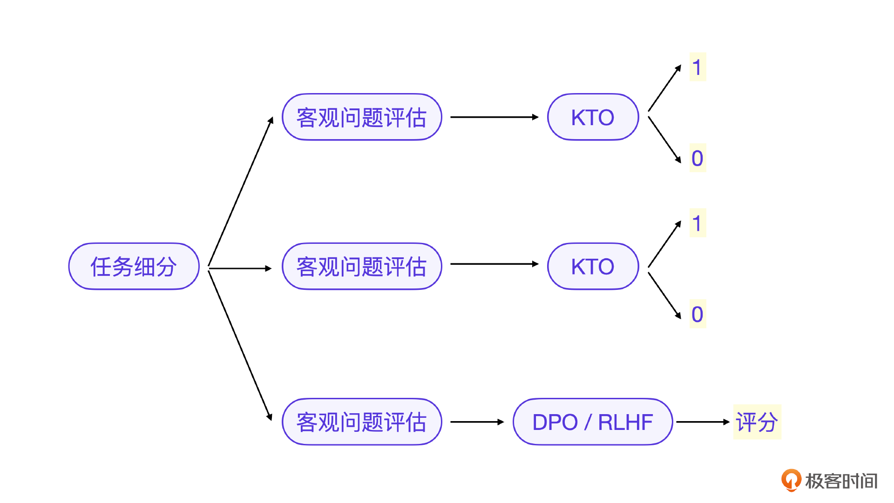
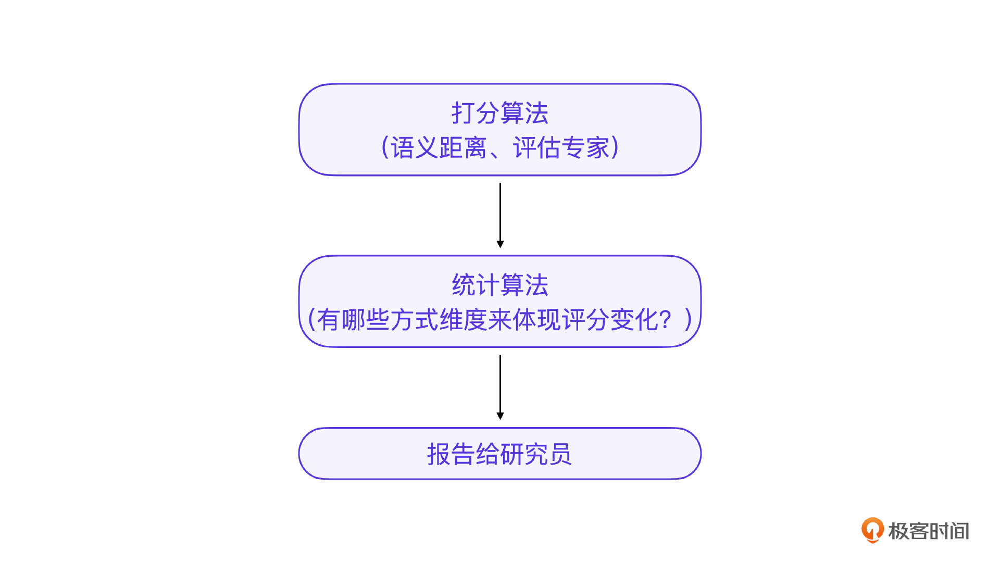
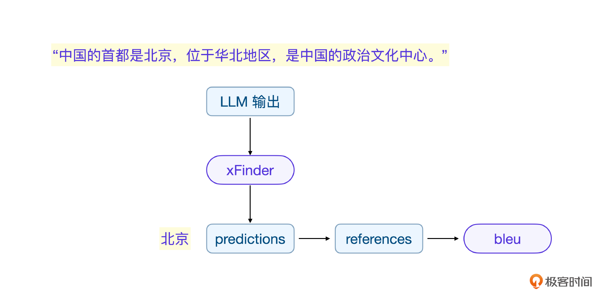
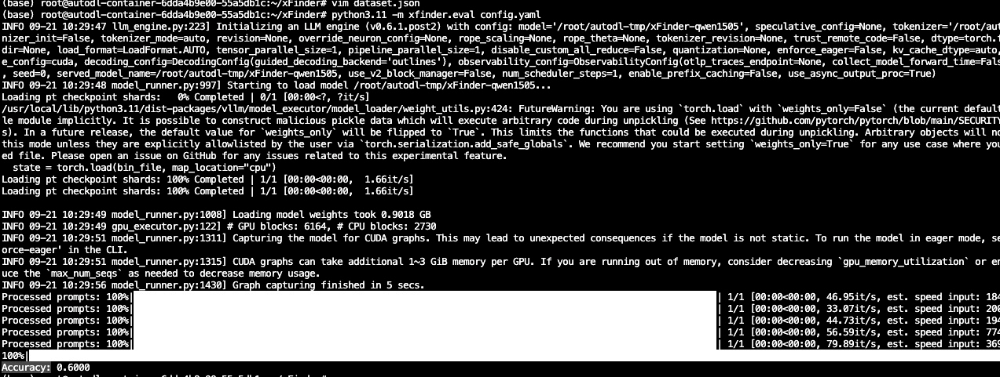
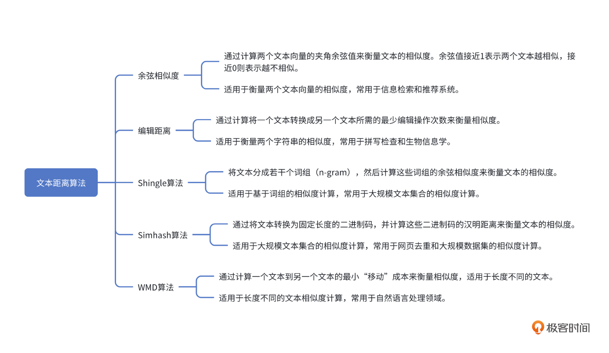
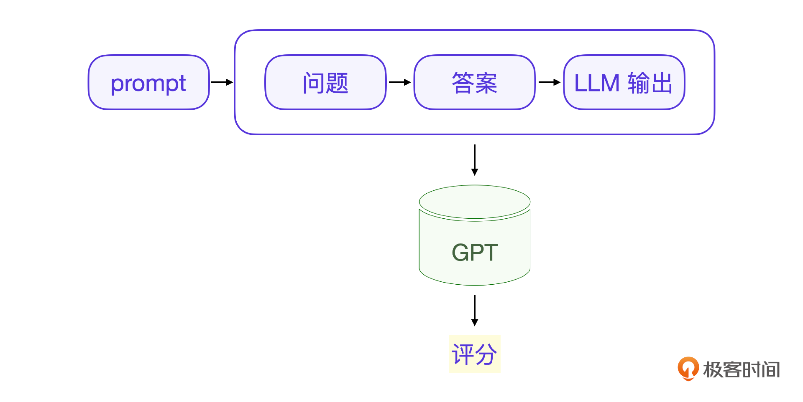
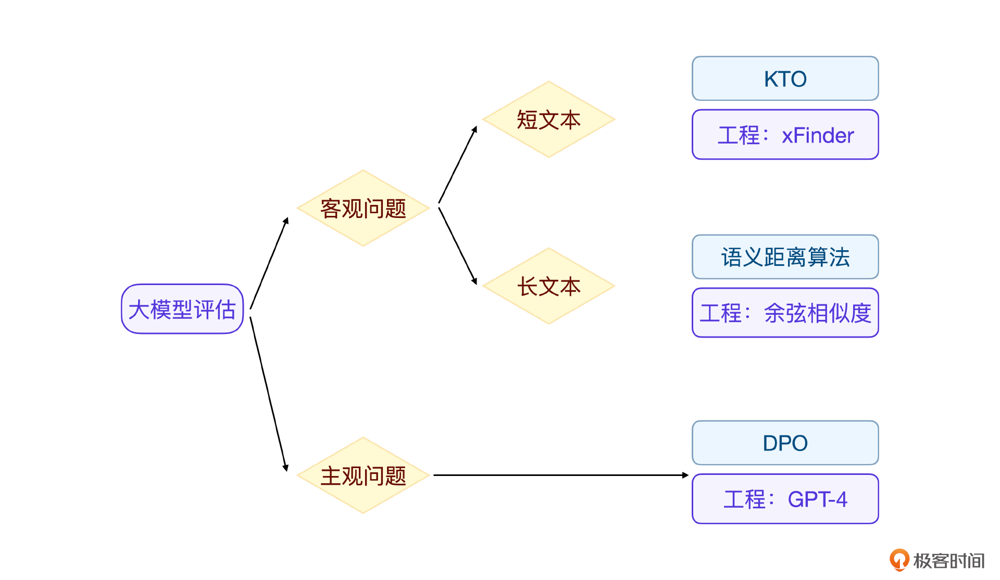

# 21 | 正反馈和负反馈：如何将评估专家应用到大模型测评中？

你好，我是金伟。

上节课说的数字孪生的数据质量好坏判断，是一个典型的符合预期 / 不符合预期的二值评估场景，那在大模型最核心的结果测评步骤里，基于私有 task 结合评估专家的评估则可以转为一个典型的二值倾向性评估。这个过程如何实现完全自动化呢？这就是这节课的主要内容了。

我们知道，一个 DPO 的倾向性评估意味着需要在两个输出之间选择倾向性，那对大模型结果而言，可以用前后两个版本的大模型输出比较，也可以在大模型输出和人类答案之间比较。这个问题的核心还是在测评算法的选择上。

## 评分算法

我们先来看一下不同的评估方法的核心原理。之前的课程提到，传统的大模型评估主要依赖人工评估的评分，人工评估就是对大模型训练完成后形成输出做出好和不好的打分，具体分值是1 分和 0 分。

如果是评估专家来做评估，则是大模型替代人类评估判断，得出评分 1 还是 0。私有 task 传统的方式是用语义距离等算法来判断评分 1 还是 0，如果将语义距离算法改为评估专家算法，还是判断评分 1 还是 0。

这里的评分 1 就是正反馈，评分 0 就是负反馈。



当然，具体项目里的大模型评估要根据实际需求来做评分算法，也不都是 1 和 0 这样的二值评分。比如我们要微调的大模型能力是对文章的分类，那大模型的输出是一个明确的值，可以用 KTO 类的输出判断方法，也就是输出符合预期 / 不符合预期。

如果微调的大模型能力是一个写文章的能力，那就更适合 DPO 的评估方法，或者采用 RLHF的方法，因为写文章的大模型输出评估的主观性更强，需要在两个以上的结果中做倾向性选择。

不同场景和需求下的大模型评估可以用下面的图来选择。



你要是仔细观察这些场景的话，会发现任何场景都可以用上面的评估方法来覆盖。只不过每个模型评估里一定要将评估任务进一步细分，从 3 种情况里选择对应的评估方法单独评估一个细分能力。这也是工程里的真实经验。

另一个重要经验是，不管你的评分算法是人工还是评估专家的，评分只是第一步，真的核心在于评分的统计细化，最好是多维度的分析不同类问题的评分变化，这样才能准确地反馈给大模型工程师去做进一步调整。



那接下来，如果你已经将问题细分，则只需要针对一类问题做自动化的私有 task。我会就每类问题先给出具体的开发流程图，再用案例来详细说明。

## 客观问题评估

客观问题就是以事实为依据，有标准答案的问题，或者从选项 A、B、C、D 中选择的问题。

```
数学问题：
  “5的平方是多少？”
  答案是25。
```

- 地理问题：

```
  “中国的首都是哪个城市？”
  答案是北京。
```

- 历史问题：

```
  “第一次世界大战是在哪一年开始的？”
  答案是1914年。
  选项【A】1900【B】1914【C】1925【D】1937
```

对于客观问题的开发流程有五步：


这个过程就是私有 task 评估的过程。我们先回顾一下私有 task 评估的最后一步，也就是自定义评估算法部分。

```python
import evaluate  # 导入 evaluate 库，用于加载 BLEU 评估函数
def bleu(predictions, references):
   # 定义一个简单的 BLEU 函数，只返回第一个预测和参考
   return (predictions[0], references[0])
import sacrebleu  # 导入 sacrebleu 库，用于计算 BLEU 分数
def agg_bleu(items):
   # 聚合多个预测和参考，计算整体的 BLEU 分数
   predictions, references = zip(*items)  # 将预测和参考分离成两个列表
   bleu_score = sacrebleu.corpus_bleu(predictions, [references])  # 使用 sacreble
   return bleu_score.score  # 返回 BLEU 分数
```

看起来这个算法没有什么问题，但是在实际工程中，往往大模型的输出和答案相差很多，举例来说：

```
比如首都问题，“中国的首都是哪个城市？”
```

- 答案：北京

```
llm输出：“中国的首都是北京，位于华北地区，是中国的政治文化中心。”
```

由于大模型输出的随机性，一般很难和答案完全一致，因此在评估算之前，一般会对 LLM 输出答案做关键信息抽取。

### 用 xFinder 解决抽取问题

传统关键信息抽取方案一般用正则表达式（RegEx），实战中我选择的是 xFinder，这是一个比较新的选择，xFinder 解决了把 LLM 输出的关键信息抽取的问题，这样只需要抽取后的比对，就容易多了。

我们以常见的 MMLU 里的一个问题分类为例理解一下：



评估过程的收集测试用数据集、规范为私有 task 测试数据集，这两步之前课程讲过，这节课重点说说评估算法的前置步骤，如何利用 xFinder 做 LLM 输出的信息抽取。

```
xFinder 的底层实际上是基于大模型针对信息抽取问题做的微调大模型，比如 xFinder-
qwen1505 就是微调后的 xFinder 模型，你可以通过提示词（Prompts）直接调用 xFinder 微
```

调的大模型来进行答案抽取。

示例提示词：

```
请从以下文本中提取出唯一的答案：'法国的首都是巴黎。其他城市如马赛和里昂虽然重要，但不是首都。'
通过 Hugging Face 等平台加载微调后的 xFinder 模型（如 xFinder-qwen1505），并使用你
```

的提示词进行推理。模型会根据提示词生成相关的输出，你可以通过自定义逻辑从中提取出唯一的答案。

下面是示例代码（使用 Hugging Face 的 Transformers 库）：

```python
from transformers import AutoTokenizer, AutoModelForCausalLM
import torch
# Load tokenizer and model from the Hugging Face Hub
tokenizer = AutoTokenizer.from_pretrained("xFinder-qwen1505")
model = AutoModelForCausalLM.from_pretrained("xFinder-qwen1505")
# Example prompt for answer extraction
prompt = """
<|System|>:You are a help assistant tasked with extracting the precise key answer
<|User|>:I will provide you with a question, output sentences along with an answe
First, you need to determine whether the content of the output sentences is relev
Otherwise, ignore the parts of the output sentences that have no relevance to the
Below are some special cases you need to be aware of:
   (1) If the output sentences present multiple different answers, carefully det
   (2) If the answer range is a list and the key answer in the output sentences
Question: "中国的首都是哪座城市？"
Output sentences: 中国的首都是北京。"
Answer range: ['北京', '上海', '广州', '深圳']
Key extracted answer:
<|Bot|>:
"""
# Tokenize input
inputs = tokenizer(prompt, return_tensors="pt")
# Generate model output
with torch.no_grad():
   outputs = model.generate(**inputs, max_length=20, num_beams=1)
print("生成的文本：", tokenizer.decode(outputs[0], skip_special_tokens=True))
# Decode the generated output
answer = tokenizer.decode(outputs[0], skip_special_tokens=True)
print(f"抽取的答案: {answer}")
注意这段代码里的 prompt 比示例的提示词要复杂，实际上是我从 xFinder 源代码里分析出来
的，你也可以尝试用其他prompt 让模型做答案抽取，还可以直接调用 xFinder 项目里的
Extractor.py 模块，其核心思想都是一样的，利用已经训练好的 xFinder-qwen1505 来
```

做答案抽取。

```
现在，用抽取的 LLM 输出 answer 和答案做比对，回到私有 task 的评估算法 bleu 上，最终
```

计算正确率 = 正确答案 / 总数。经过 xFinder 信息抽取之后，正确率的计算会非常准确。

xFinder 除了单独作为信息抽取算法使用之外，还可以作为整体评估工具来用。

### 用 xFinder 来做评估

注意，xFinder 也支持完全的评估整个结果，可以替代私有 task 的方法，也是工程中常用的方法。

首先，安装 xFinder。

```bash
# 克隆 xFinder 的 GitHub 仓库
git clone https://github.com/IAAR-Shanghai/xFinder.git
cd xFinder
# 创建并激活 Python 虚拟环境
conda create -n xfinder_env python=3.11 -y
conda activate xfinder_env
# 安装 xFinder 依赖
pip install -e .
```

安装完成之后我们进行核心工作，数据集准备。你需要创建一个包含问题、LLM 输出和正确答案的 JSON 文件。这是 xFinder 使用的核心数据集，xFinder 可以在这个数据集上直接对LLM 输出进行评估。

```json
{
   "model_name": "xFinder-qwen1505",
   "dataset": "GeneralQA",
   "key_answer_type": "short_text",
   "question": "中国的首都是哪座城市？",
   "llm_output": "中国的首都是北京。",
   "correct_answer": "北京",
   "standard_answer_range": ["北京", "上海", "广州", "深圳"]
}
在运行之前需要编写一个配置文件（config.yaml），用于指定模型和数据集的位置。
xfinder_model:
 model_name: "xFinder-qwen1505"  # or "xFinder-llama38it"
 model_path: "/path/xFinder-qwen1505"  # Optional if you're using a local model
batch_size: 32
learning_rate: 0.0001
num_epochs: 10
evaluation_data_path: "/path"
output_path: "/path"
data_path: dataset.json
```

最后运行 xfinder 评估脚本，使用以下命令运行 xFinder 对 LLM 输出进行评估。

```
python -m xfinder.eval config.yaml
```



```
注意，这里的 xfinder.eval 是计算答案准确性的命令，path/to/config.yaml 是你的
配置文件路径。输出的 Accuracy 标表示准确率。再补充一句，直接用 xFinder 工具也可以
```

完成整体的评估。

## 长文本评估

对于长文本客观问题，其挑战在长文本的处理上，方式和短文本客观问题会有不同。一样的，我还是先给出具体的开发流程图。


注意，这里的长文本指的是答案是长文本，此时简单的抽取不起作用，评估算法上需要调整。

```
问题：
"请描述北京成为中国首都的历史演变过程。"
答案：
北京成为中国首都的历史可以追溯到元朝。1267年，元世祖忽必烈将大都（今北京）设为元朝的首都。这是北京
进一步巩固了其首都地位。此后，北京成为明、清两朝的首都，延续了中国封建王朝的统治。1912年，中华民
直到1949年中华人民共和国成立，北京再次被选为中国的首都，延续至今。
LLM生成的输出：
北京成为中国首都的历史可追溯至元朝。1267年，元世祖忽必烈将大都（即今天的北京）设为首都，这是北京首
随后在1403年，明朝永乐皇帝朱棣将首都从南京迁到北京，进一步确立了其在国家中的核心地位。明清两代，北
1912年中华民国成立后，北京一度失去首都地位。然而，1949年中华人民共和国成立后，北京再次被选定为首
```

我想收集测试用数据集，规范为 task 测试数据集，答案生成（one shot、few shot），正确率= 正确答案 / 总数。

整个评估开发过程我们就不说了，这节课聚焦在最核心的评估比较算法，在长文本客观题的场景下，要用到文本距离算法。

先看都有哪些可选的算法。



在工程实战中，一般余弦相似度用得比较多。下面有几个例子，你可以参考。

```python
from sentence_transformers import SentenceTransformer, util
# 加载预训练的BERT模型
model = SentenceTransformer('paraphrase-MiniLM-L6-v2')
# 定义文本
text1 = """
北京成为中国首都的历史可以追溯到元朝。1267年，元世祖忽必烈将大都（今北京）设为元朝的首都。这是北京
进一步巩固了其首都地位。此后，北京成为明、清两朝的首都，延续了中国封建王朝的统治。1912年，中华民
直到1949年中华人民共和国成立，北京再次被选为中国的首都，延续至今。
"""
text2 = """
北京成为中国首都的历史可追溯至元朝。1267年，元世祖忽必烈将大都（即今天的北京）设为首都，这是北京首
随后在1403年，明朝永乐皇帝朱棣将首都从南京迁到北京，进一步确立了其在国家中的核心地位。明清两代，北
1912年中华民国成立后，北京一度失去首都地位。然而，1949年中华人民共和国成立后，北京再次被选定为首
"""
# 使用BERT模型编码句子
embeddings1 = model.encode(text1, convert_to_tensor=True)
embeddings2 = model.encode(text2, convert_to_tensor=True)
# 计算余弦相似度
cosine_sim_bert = util.pytorch_cos_sim(embeddings1, embeddings2)
# 打印结果
print(f"文本的余弦相似度: {cosine_sim_bert.item()}")
```

这里需要补充一点，这个代码是用预训练的 BERT 模型将文本转化为向量，计算它们的余弦相似度的。因为 BERT 的语义理解能力更强，能够更好地捕捉句子之间的语义相似性。

## 主观问题评估

现在来看看主观问题，主观问题没有完全比较的标准答案，往往需要人来评估，这种场景就可以用评估专家，当然，在工程实战中，也可以直接用比你训练的模型更强的模型来评估，实际上大模型本身已经具备多数问题的评估能力了。

开发流程如下，评分算法和客观问题评估略有不同。


现在以一个客服模型里的日常会话为案例，来说明这个评估过程。聚焦到最后的评估算法部分，你可以训练自己的评估专家，不过工程实战中往往是用更强的大模型。

- 问题：

```
“你觉得我应该选哪款手机更好呢？我平时主要用来拍照和玩游戏。”
```

- 参考答案：

```
"根据您提到的需求，如果您平时主要用来拍照和玩游戏，我推荐以下两款手机供您参考：
iPhone 15 Pro：这款手机拥有顶级的相机性能，尤其是在拍照和视频录制方面表现出色。此外，它的A17 P
三星 Galaxy S23 Ultra：它配备了1亿像素的主摄像头，能够拍摄非常细腻的照片。同时，它的Snapdrag
这两款手机在拍照和游戏性能上都有很好的平衡，可以根据您的品牌偏好或预算来选择。"
```

用大模型来评估，其实就是将问题，答案和 LLM 输出一起提交给大模型做出评价。



下面是用 GPT 来评估我们的大模型的一个例子。

- 提示词：

```
"你将扮演一个评估专家的角色，评估大模型（LLM）生成的答案与给定问题和参考答案之间的相似度。以下是
1. 准确性：大模型的输出是否正确回答了问题，是否包含正确的事实。
2. 一致性：大模型生成的答案与参考答案的匹配程度如何，是否有不一致或遗漏的信息。
3. 表达清晰度：大模型输出的表达是否清晰、易懂、逻辑流畅。
4. 详尽度：大模型的输出是否充分回答了问题，是否涵盖了必要的细节。
```

- 请根据这些标准对大模型生成的输出进行评分，并简要解释为什么给出了该分数。

```
问题：{问题内容}
参考答案：{参考答案}
大模型输出：{大模型输出}"
---
```

- 评估输出：

```
评分：{0-10}
解释：{简要解释为什么给出该分数}
---
```

## 小结

怎么实现大模型评估的全自动化呢？这个问题在之前的评估课程提出过，现在我们有了方法，也就是利用评估专家来代替人工评估。当然，实际工程中，并不是针对我们微调后的大模型用某一个评估专家来评估，而是将评估任务细分为三类：客观问题短文本、客观问题长文本、主观问题，然后分别用对应的评估专家来解决。

对于客观问题短文本，评估可以基于答案的明确性，例如通过语义距离算法或 KTO 类方法进行二值评分（1 或 0）。这类问题通常有标准答案，评估的自动化相对容易。在工程实战中，则可以采用 xFinder 模型来对答案做关键信息抽取，然后再进行评分，这样准确率能提高到 90%以上。

对于客观问题长文本，由于答案复杂度的增加，传统的二值评分方法不适用。这里通常采用余弦相似度或者 BERT 之类的语义匹配算法，通过计算模型输出和标准答案之间的文本距离，来评估输出的准确性。

对于主观问题，例如写作类任务，倾向性评估更为适合。可以使用 DPO 或 RLHF 等方法，通过比较多个模型输出，选择最符合预期的答案。这类问题的评估主观性较强，因而需要更复杂的评估算法来模拟专家评估的过程。在工程实战中，往往采用比训练的大模型更强的大模型来做这类问题的评估专家，效果也足够好。



## 思考题

在客观问题评估中只用到了简单的字符串比对算法，为什么不用评估专家? 请你思考一下。

欢迎你在留言区和我交流。如果觉得有所收获，也可以把课程分享给更多的朋友一起学习。我们下节课见！

>> 戳此加入课程交流群
