# 24 | 跟踪分析了100个AI创业项目，我看到了什么？

你好，我是金伟。

上节课我们分析了一个创业项目的技术部分，这节课我们来看看创业项目的业务模式。

我们都知道，一个创业项目最重要的是商业模式，在过去的 2023-2024 年，我不仅自己做了多个 AI 创业的项目，而且还对一百多个市场上的 AI 项目做了持续跟踪和分析，如果你对 AI创业感兴趣，这节课，就跟我一起从我的角度来分析这些项目，看能不能总结出一些商业模式方面的普遍规律。

看过一百多个 AI 创业项目之后，总结来说，AI 创业项目无非就那么几类，那它们都有什么规律呢? 我从这个问题开始分析。

## 创新项目 vs 传统项目

我先把跟踪的一百多个项目用列表的形式写出来了，而且，我给每个项目都做了一篇分析报告，并且把每个项目最核心的特点用标题总结出来了，你可以看一看。

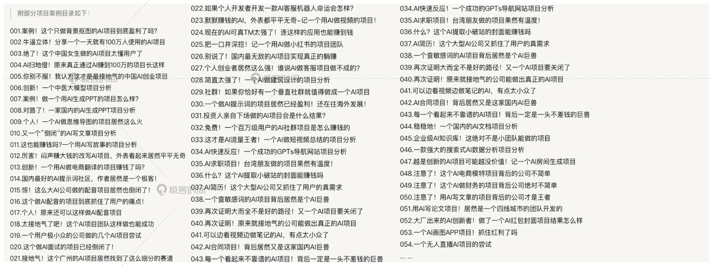

从这些项目的分析我们发现，一共就两类 AI 创业项目，分别是传统项目和创新项目。

什么是传统项目呢？你可以理解为一个团队原来已经有成熟的业务场景，现在可以用 AI 对这个业务做升级，或者一个团队原有业务模式已经很成熟，现在用 AI 技术做一个全新的关联业务模块。

什么是创新项目呢？一般是个人或小团队踩中了 AI 这个风口，想用 AI 颠覆原有业务逻辑的项目，下面给你一些具体例子一起来感受一下。

## 案例一：论文降重

我们先看一个偏传统的案例，这个项目的产品功能看起来没那么性感，就是一个简单的改写功能，我们一起看看它的功能界面。

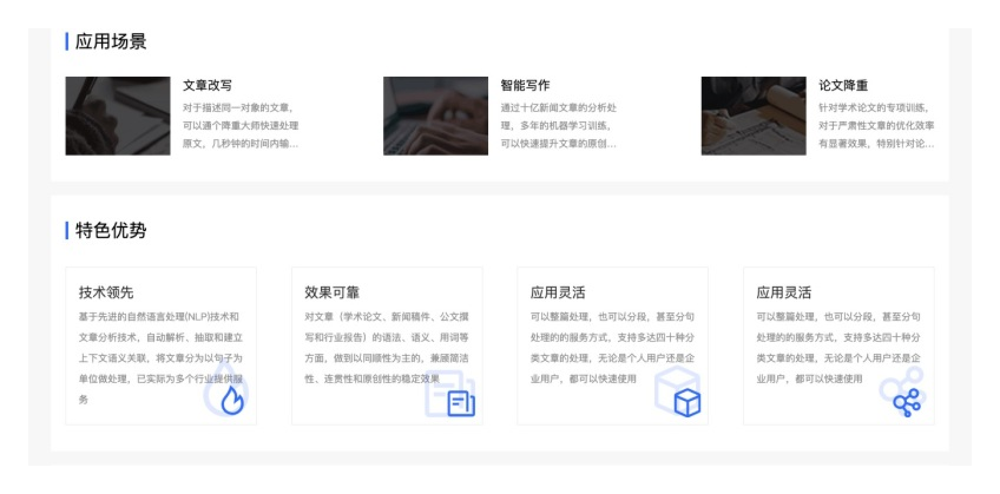

下面是一个更具体的文章改写的功能。

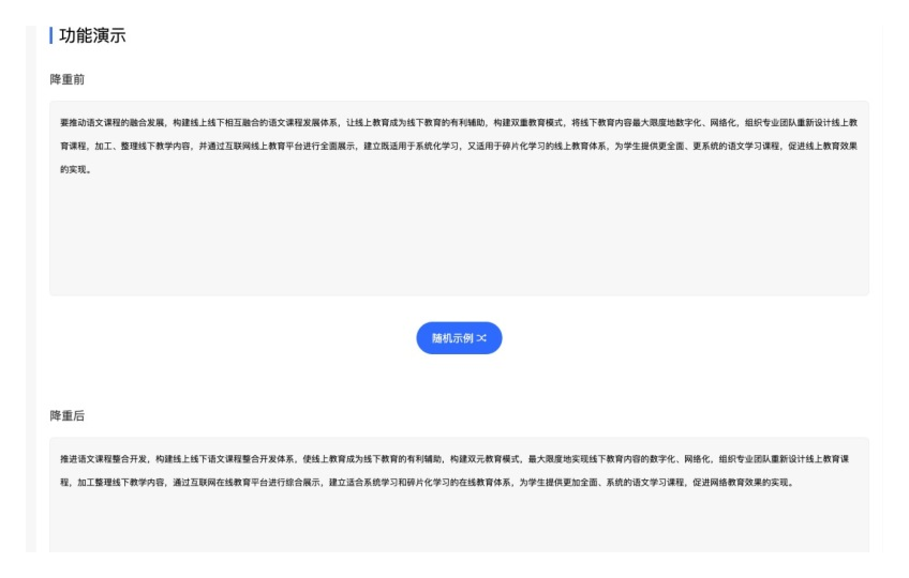

你第一次看这个项目的话，也许跟我是一个感受，就这样的改写功能，我分分钟拿 GPT 就能实现一个，对吧？那为什么市面上那么多的具有改写功能的 AI，偏偏这个项目能做到闷声发大财呢？

我们看一看它的付费方式。

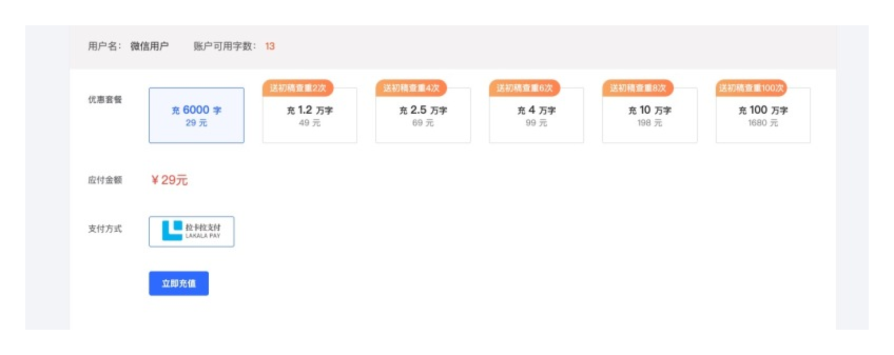

要是单单一个改写 AI，我想一般项目是断然不敢直接收费的。要搞清楚这个项目为什么能盈利，你需要回到该项目的功能上。

特别注意 “论文降重”这个功能，原来这个项目最开始的核心功能是论文降重，这样就不难理解了，因为该项目在论文降重这个功能上已经做到了头部，现在 AI 浪潮来了，这个功能很快就可以转到 AI 改写上，现在这个网站也不仅仅提供论文降重，也提供文章改写、AI 写文章等，而论文降重仍然是它核心盈利的功能。

你绝然不会想到，这样一个在细分领域的头部项目，是一个地方小团队做出来的，所以说 AI项目并不一定是技术优先的，更重要的是谁先抓住一个细分领域的客户，比如这个网站的用户就是围绕论文的，而且它的核心功能一直就是论文查重和降重，这是多么巨大的一群用户和痛点需求，付费是必然的。

在 AI 风口起来的时候，根本就不是 AI 创新让新人一飞冲天，反而是这种接地气的项目可以借助风口来拓展用户。

## 案例二：小红书爆文

再来看另一个我跟踪了一年多的 AI 创新项目，我自己正好也是这个产品的用户，所以感受更直观一些。这个项目的核心功能点是帮用户写爆款小红书。这也是我去年看到的比较接近传统互联网创业做法的一个团队。

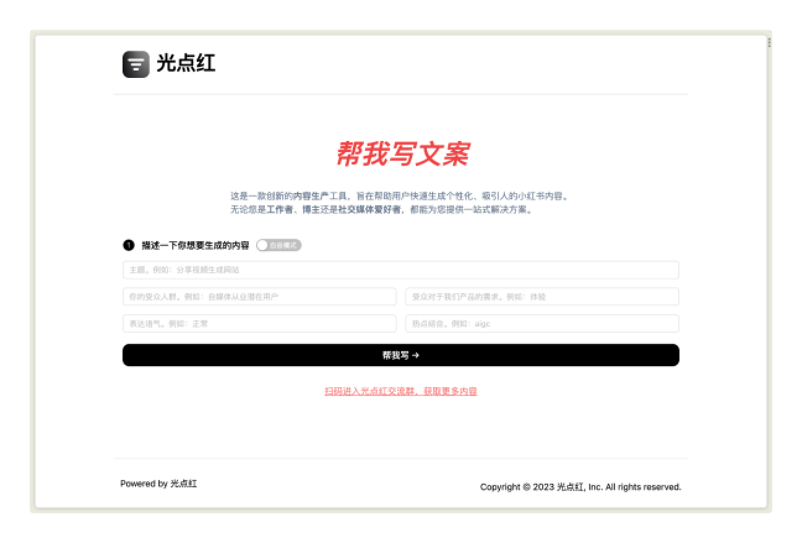

如果你第一次听说一个项目可以帮你自动用 AI 写爆款小红书，而且你正好在做小红书运营，你会不会立马去尝试一下？实际上我就是被这样的噱头吸引到这个产品上的。

可以说，在 2023 年，通过这种 AI 宣传，很多产品都很容易吸引到第一波用户。这个做爆款小红书的 AI 项目不仅利用了这个风口，而且还选择了一个非常合适的细分市场，在所有人都做抖音的时候，它选择专做小红书平台。

当然，如果仅仅靠一个 AI 噱头，用户来得快，走得也快，就像很多 AI 项目一样。那这个项目能持续运营一年多有什么独特的方法呢?

我想第一点跟这个团队的运营基因有关，该团队本身擅长小红书运营，而吸引的用户正好又是不会小红书运营的用户。因此该团队对每一个用户都做了足够的运营，不仅提供社群服务，还提供课程服务。

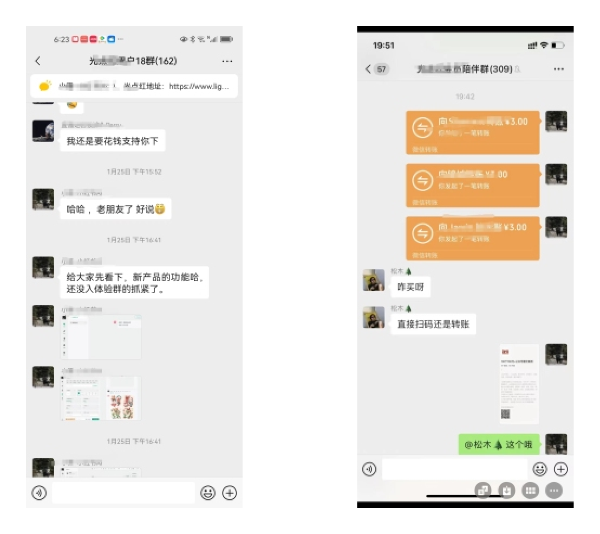

这两个服务实际上是非常有普遍意义的，实际上 AI 工具本身离不开人，因此要真正输出价值还是要靠人的服务，这也是很多其他 AI 项目所忽略的。

该团队另外一个比较成功的点在于产品侧的迭代。如果只是第一版的 AI 爆款小红书功能，根本运行不了一年时间，因为期望 AI 自动做出爆款是不可能的，因此该团队在深刻理解 AI 的特性之后，实际上是开发了一套可以同时结合人工经验 +AI 生成式能力的爆款小红书编辑器。

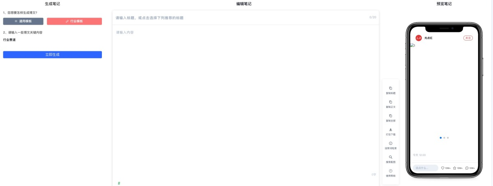

总结一下这个项目的经验，小团队找准一个细分的用户功能点来做 AI，只要用的时间足够，抓住一波核心用户去迭代功能就可以打造出一个领域的 AI 平台，个人和小团队做 AI 的核心是要找到足够细分的赛道，避免和大公司竞争，深挖一个领域就能形成足够的势能。

## 案例三：面试押题

用 AI 写爆款文章显然是一个颠覆性的想法，那用 AI 押大厂面试呢？是不是表面看起来也很有创意？现实中就有一个叫面试押题王的 AI 项目，不过运营几个月之后就关闭了。

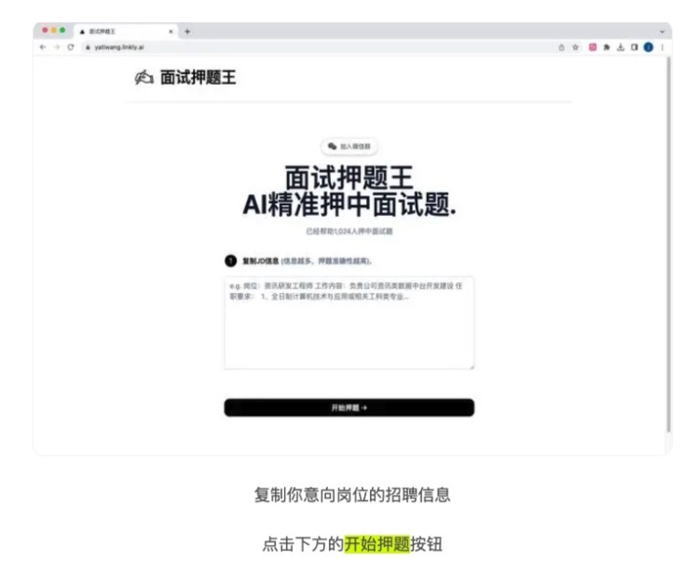

这个项目一上线我就开始关注，表面看起来项目完全没问题，显然，面试是一个刚需，如果AI 能押中大厂的面试题，看起来付费也不成问题。为什么项目还是失败了呢？

不妨先来看看创始人对这个项目的复盘。

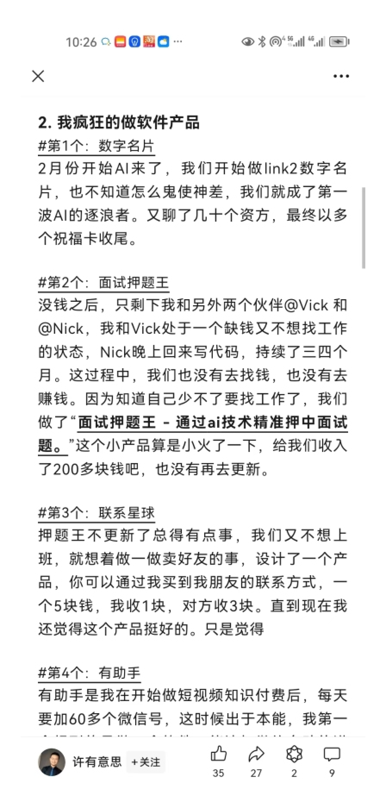

不知道你对这个复盘有什么感想，我从这里获得的信息是这样的，这个项目的创始人是大厂中层出身，这种创业者有一个特点，做项目一定要做大的，也就是不断融资成为独角兽级别。一旦做不起来就马上会放弃寻找新的“独角兽”。

面试这个项目就非常符合这个特点。当然，谁能真的把面试招聘这个问题解决了，当然配得上独角兽这个称号。

AI 面试这个项目，和很多 AI 项目类似，第一眼看上去需求非常大，比如：AI 做视频的 Pika，sora 等项目，听起来就非常性感，但是要注意，这些一眼就能看出是热点的项目，如果要成功，必须做到听起来惊艳，用起来也要惊艳，这样才能具备传播性。

但是 AI 面试这个项目，显然只有听起来惊艳，实际效果恐怕不惊艳，这才是项目失败最大的原因。

看了一百多个这样的 AI 创业项目，我也在尝试寻找最基本的规律，从结果来看，如果你是一个有传统业务，并且已经有成熟的用户和业务模式，结合 AI 能力提升产品价值，风险要小一些，成功概率反而更大。

但你可能会想，我现在只是个人或小团队，没有传统积累，只能做创新项目，那怎么提高成功率呢？下面分享一个我们自己的项目历程，也许对你有一定的帮助。

## AI 招聘助手项目

上一节说到一个招聘相关的 AI 项目，在 2023-2024 年我们也做了 AI 招聘助手项目。

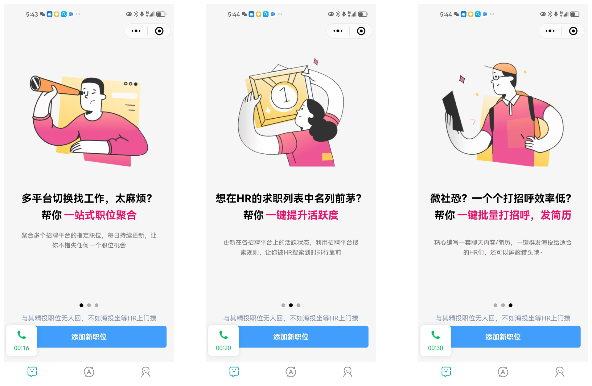

你站在一个求职者角度，特别是一个刚失业着急找到工作的角度看，这些功能确实有吸引力，实际我们运营数据也说明了这一点，基本上 80% 的用户都是好评。

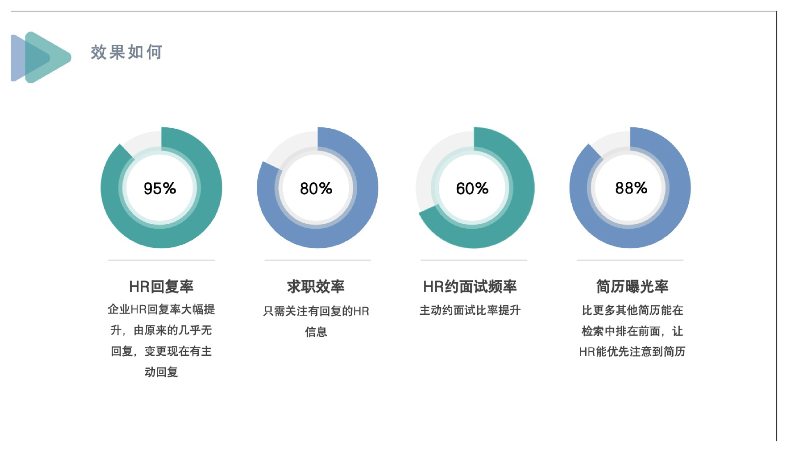

然而，当我们向用户收费的时候，付费率却不到千分之一，投入 10 几万研发费用，回收不到几百。为什么会这样呢？

实际上我们犯了大部分 AI 创业项目常见的错误，招聘是一个很大的市场，我们的应用也很有效果，但是有付费意愿的企业不会单独为此付费，而找工作的人又没有付费意愿，换句话说是在一个貌似有很大市场的领域做了一个鸡肋的 AI 应用。也就是说如果你的 AI 应用没办法把效率提升 100 倍的话，很难向用户收费。

面对问题，我们也没有止步于此，在运营过程中，我们发现 ToC 这个路径走不通，果断地转向了 ToB 的渠道。最终找到了高校这个细分领域，我们发现在高校里学生找工作，求职是最大的痛点，而我们的系统可以提高求职效率，虽然不能提升 100 倍的效率和效果，但是学生求职的痛点太大了，学校实际上愿意为有效果的软件付费，哪怕只是提升一部分效率。

总结这个项目经验，你可能会发现，传统的互联网的免费 - 收费的商业模式在 AI 项目上很难走通。

到底什么和传统互联网打法有差别呢? 实际上就是大模型成本的问题，传统互联网的计算成本很低，即使有大量免费用户也没多少成本，但是 AI 项目，每个用户都会消耗大量的大模型计算成本，这就导致大部分项目还没到收费阶段就失败了，因为前期成本太大。

那对于大模型成本问题，有没有解决方案呢？下面我将带你看一个模式比较完美的案例，也许你可以从中获取一些经验。

## 一个完美的案例

这个项目名称叫：BibiGPT，一开始这个 AI 项目就完成了一个简单的功能，做 B 站视频的总结，整理成思维导图，发展了一年之后已经成为一个可以总结，整理和编辑所有互联网视频的编辑平台。为什么我说这个项目非常成功呢？你可以看看它最新的更新日志。

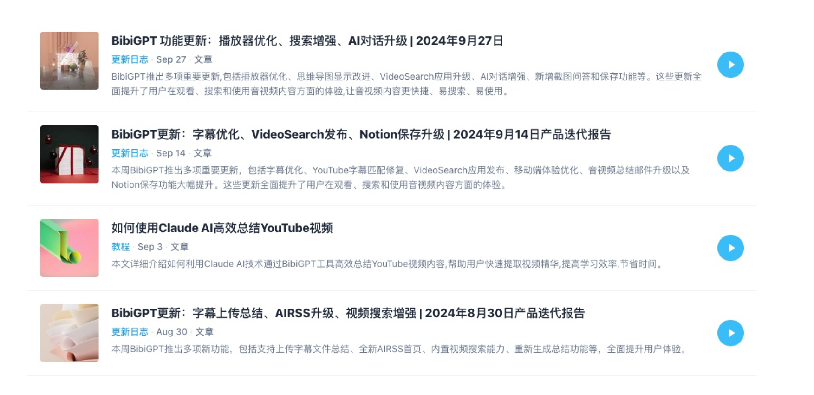

我写这篇文章的时候是 10 月 2 号，我发现它 9 月底还在更新，如果从项目上线开始算，它已经运营了 2 年左右，功能也越来越丰富。你要注意，这还是一个超级个体做的项目，并没有大规模投资。

所以我专门对这个项目做了研究，看看它是怎么实现整个运营闭环的，特别是如何控制成本的。

先说说第一个规律，BibiGPT 是怎么减少 Token 费用的。BibiGPT 处理 B 站视频内容时，内容量是固定的，比如每天免费用户产生 10 万条内容，实际上大部分内容只要处理过一次，后续使用者就能直接拿结果而不需要再走一次大模型付出 token 费用。

再看 BibiGPT 另外一个核心逻辑。在用户使用 BibiGPT 做总结的过程中，BibiGPT 可以把视频内容转为文本内容，这相当于大模型生成的第一次内容。这个内容除了给用户使用，BibiGPT 还会把内容做成一个关键词的网页，这个内容是可以被搜素引擎 SEO 收录的。这个逻辑下，免费用户每使用一次 BibiGPT 实际上都在帮 BibiGPT 生产营销内容，完美地利用了大模型生成式。

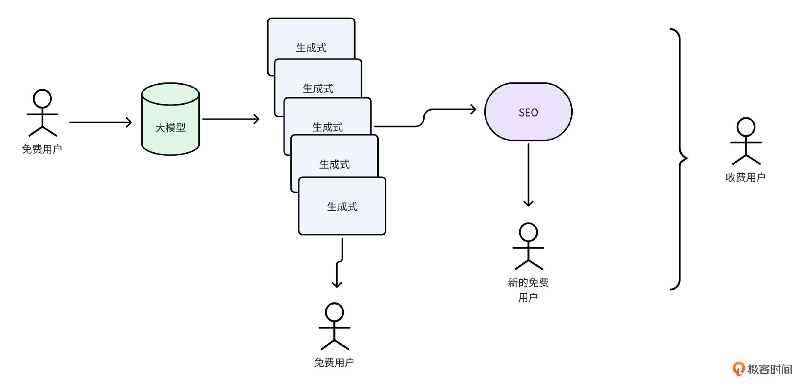

在这个运营模式之下，因为免费用户基数可以足够大，即使收费率再低，也可以把项目持续运营下去。

总结一下，如果可以做到大模型生产的内容可以复用，甚至可以带来新的用户，这部分成本自然被抵消，也就做到了和传统互联网项目一样，边际成本为零，这才是 AI 创业项目真正的完美模式。

## 小结

2023-2024 我观察了很多 AI 创业项目的业务模式，它们都有哪些普遍规律呢？首先，AI 创业项目可分为两类：传统项目与创新项目。传统项目通常基于现有业务，通过 AI 升级或扩展业务模式，而创新项目则是利用 AI 颠覆原有的业务逻辑。

那什么样类型的项目更容易成功呢？类似论文降重这种已经有传统业务模式，只是做 AI 升级的项目成功概率更高。如果要做全新的项目，最好选择一个细分赛道持续运营，而不是在一个看起来具备颠覆性的功能点上浪费时间，小红书爆文项目和 AI 面试押题就是这类项目的两个极端案例。

如果你也想做 AI 创业，那我强烈建议你看我分析的最后一个案例，在 BibiGPT 这个案例里，解决了免费用户的成本问题，真正理解了大模型生成式的核心范式，你在运营自己的 AI 项目的时候，建议参考这个项目好好设计你的模式，达到一个免费 -> 降低成本 -> 付费 -> 收入的良好循环。

## 思考题

这节课提到的大模型成本的问题，随着时间推移，成本会越来越小，那将来的创业项目还会卡在这个问题吗？请你思考一下。

欢迎你在留言区和我交流。如果觉得有所收获，也可以把课程分享给更多的朋友一起学习。我们下节课见！
