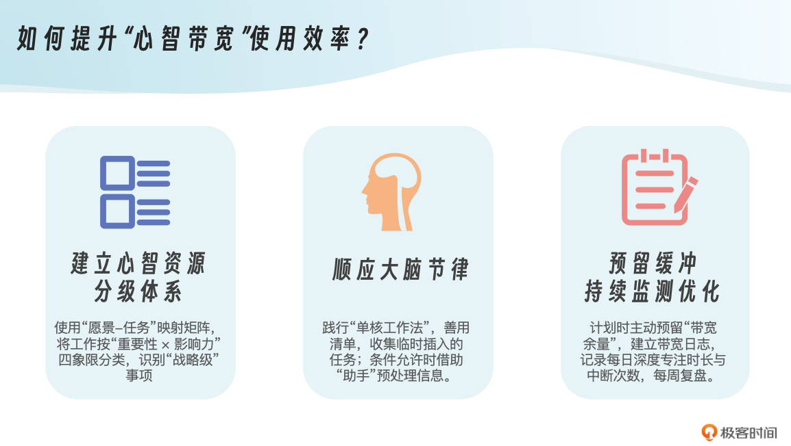
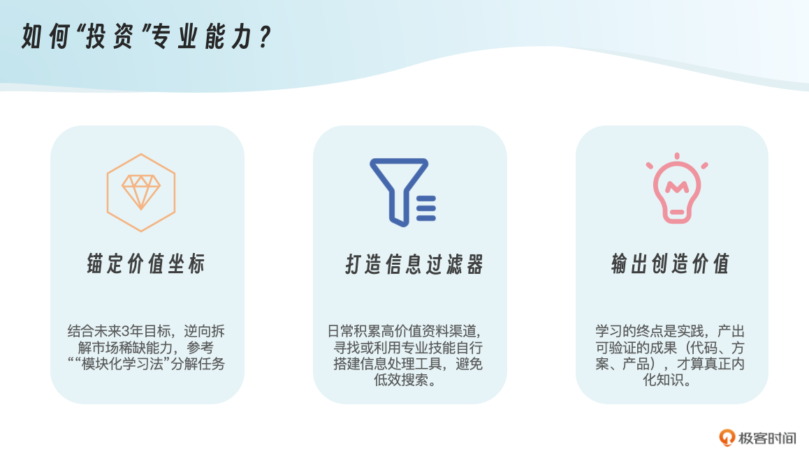
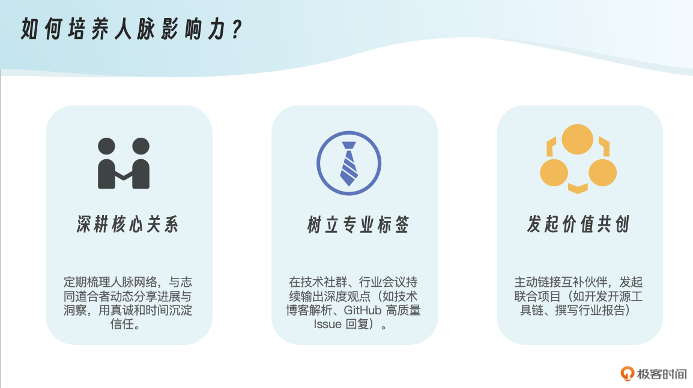

# 02 | 构建增长系统：用公司逻辑，让每一分努力指数增值

- “知识工作者必须成为自己的首席执行官。”——德鲁克 《21 世纪的管理挑战》

你好，我是 Brook。

上节课我们总结了当前 IT 从业者，机遇与挑战并存的现状。一面是时代的机遇——改变世界、财务自由，可以自由追寻人生的价值；另一面是行业竞争加剧、中年危机。

同样在一家公司工作，为何有人工作 10 年就能步入高管行列，有人仍在基层踟蹰不前？当 AI浪潮颠覆行业，为何有人华丽转身创建独角兽企业，有人却被房贷绑架，不敢离开夕阳赛道？

问题的核心是有没有使用“系统思维”规划自己的成长，将自己的每一分努力沉淀下来。对于初入职场的 IT 从业者，如何把自己当成一家公司来经营，在汹涌的时代浪潮中打造一艘坚固的船，既能乘风破浪奋勇向前，也能在风暴来临时稳如磐石？这就是今天这节课我们要讨论的话题。

## 定义“人生公司”的核心愿景

管理大师史蒂芬·柯维在《高效能人士的七个习惯》中提出，“任何事务都需要两次创造”，第一次是智力创造，即在头脑中完成规划与设计；第二次是体力创造，即付诸行动，将构思转化为现实。我们的人生亦是如此，通过我们自己“智力创造”明确的人生愿景、规划的人生路线，通常会好过随波逐流、被动接受的人生。

明确愿景的起点是“认识你自己”。每个人都需要定义：“对我而言，什么是成功？”桥水基金创始人瑞·达里欧在《原则》中给出了一个精炼的思考框架。

想象一条一维坐标轴：

- 一端是“享受生活”（追求个人幸福、平衡）。

- 另一端是“改变世界”（追求宏大影响、成就）。

那么你希望自己的人生，定位在这条坐标轴的哪个位置？

没有标准答案，只有真实的选择。无论是“让世界没有难做的生意”还是“为自己和周围人提供时间与选择的自由”，只要遵从内心，都是合理的愿景。成为你想成为的人，成就你渴望的事业。这份真实的使命感，将成为你日常面对挑战时，最强大的驱动力和稳定器。

## 盘点你的“核心资产”

确定了愿景就有了努力方向，而构建你的人生增长系统，第一步是“资产盘点”。认清自己可投入的“核心资产”，决定了你将如何“投资”自己的未来。

### 三项“核心资产”

作为初入职的 IT 从业者，在既定的专业能力、人脉资源下，时间、心智带宽、金钱这三大资产，是你此刻最宝贵的“启动燃料”。

时间，对每个人绝对公平——每天 24 小时。但拉开差距的，是你如何分配它。是否把黄金时间投入真正重要的事项？这直接决定了效率高低。稍后讨论“投资方向”时，我们会具体分析什么是值得投入的“重要事项”。

金钱，通常入职初期有限，但未来潜力巨大。对大部分新人，优先投资自己，提升专业技能夯实“人力资本”是当务之急。理财带来的“乘数效应”虽诱人，但它更像是中后期的加速器。我们将在第四章详细展开。

心智带宽，是你在单位时间内能调用的专注力、决策力和自控力总和。神经科学研究表明，它像大脑的“带宽”，有严格上限——每秒仅能处理约 120 比特信息，相当于同时理解两句话，且极易被情绪波动、多任务和琐碎选择消耗殆尽。

### “心智带宽”核心特征

时间与金钱尚有迹可循，而心智带宽——这项看不见的“认知内存”，才是多数人效率坍塌的隐形瓶颈，常被忽视却最为稀缺。这里我们重点聊一下“心智带宽”。

心智带宽的威力与代价并存。

当心智带宽聚焦于高价值任务，你能像启动“认知护盾”（卡尔·纽波特在《深度工作》中强调的理念）那样，主动屏蔽社交媒体等干扰，进入深度状态，产出效率指数级提升。

想想这个场景：任务截止日尚远时容易拖延；Deadline 逼近时，却能奇迹般专注，游戏、音乐都难让你分心。这就是心智带宽被“危机”强行聚焦的体现。

但高度聚焦也伴随“管窥效应”——你的视野会变窄，对焦点外事务反应迟钝。举个例子，2022年，某电商公司运维工程师早间花费 3 小时手动处理大量“磁盘使用率超 70%”的次要告警（紧急但不重要），期间未对“数据库主节点内存泄漏”的严重预警（重要且紧急）引起足够重视。下午业务高峰时，主库崩溃导致全站宕机，直接损失超 300 万元。

那么，我们应当如何提升“心智带宽”这项资产的使用效率？我提供三个实用策略。

首先是建立心智资源分级体系。你可以使用“愿景 - 任务”映射矩阵，将工作按“重要性×影响力”四象限分类，识别“战略级”事项。

仅对高价值区如技术攻坚、职业能力突破开放深度心智通道，通过“目标 + 复盘”机制，提前规划、定期复盘目标进展。对于例行事项，建立自动化流程或固定处理时段，如自动话费充值、每日设置 30 分钟固定时间处理例行邮件，最小化其心智成本。

第二，顺应大脑节律。早晨精力充沛时攻坚复杂任务，午后疲倦时处理行政事务。践行“单核工作法”——每 90 分钟聚焦单一战略目标，期间物理隔离干扰，如关闭非必要通知。用清单系统收集临时插入的任务，释放大脑缓存；决策时直接调用清单选项，避免重新思考。条件允许情况下，让“助手”对原始信息进行综合处理，简化选择并使其清晰可见，而非罗列堆砌原始信息，以助于自己高效决策。

第三，预留缓冲，持续监测优化。计划时主动预留“带宽余量”，如每天 1 小时应急时段，防止突发琐事导致“重新决策”，挤占核心任务心智资源。建立带宽日志，记录每日深度专注时长与中断次数。每周复盘，战略事项投入是否充足？哪些低价值事务可自动化或删除？

## 明确“投资方向”，构建增长系统

构建持续增长的人生系统，关键在于明智投资四个核心方向：专业能力、人脉影响力、财务资本、身心健康。正如职场常言：“25 岁拼体力与智力，35 岁靠智力加经验，45 岁则倚重经验与人脉”。这四个方向，就是支撑你穿越不同阶段的引擎。

### 专业能力，终身增值的护城河

在 IT 这个工科领域，扎实的专业能力是立足之本。它让你在“独立贡献者”阶段脱颖而出，更是后续构建人脉、打造个人品牌的基石。没有过硬技能形成的“交换价值”，即使能够通过兴趣爱好等机遇链接到关键人脉，也难以持续深化。

那么应当如何“投资”专业能力，实现能力跃升呢？其本质遵循“一万小时定律”。下硬功之外，有以下几点技巧可以供大家参考。

第一，锚定价值坐标。你可以结合未来 3 年目标，如晋升架构师 / 转型 AI 研发，逆向拆解市场稀缺能力，如云原生设计、大模型蒸馏。参考 Linux 之父林纳斯·托瓦兹的模块化学习法：将大目标分解为季度里程碑，每周聚焦 1 个可验证的子技能，例如 Q1 掌握 Kubernetes 故障排查，并输出开源解决方案文档。

第二，打造信息过滤器。避免被“信息洪流”淹没，通过日常积累与工作相关的 GitHub 万星项目源码、知名厂商官方架构白皮书、顶会顶刊论文作为高质量资料来源，寻找或利用专业技能自行搭建（多语种）视频分析总结、论文高效阅读工具（已有的诸如：coolpaper；必要时基于 dify 或 coze 自行搭建 Agent），把时间留给深度消化，而非低效搜索。

第三，输出创造价值。学习的终点是实践。学编程？去解决真实工程难题。研究 AI 应用？从动手搭建能用的 Agent 开始。正如《刻意练习》强调的“成果导向反馈”，只有产出可验证的成果（代码、方案、产品），才算真正内化知识，而这一点刚好与计算机行业“实践导向”相符。

### 人脉影响力：突破瓶颈的战略杠杆

职业早期，个人能力决定执行效率。但当你承担更大职责（跨部门协作、生态整合），人脉与影响力就是破局关键。它能拓宽认知边界、促成共赢合作为你突破职业瓶颈。此外，多元人脉触发的跨界碰撞，常孕育第二增长曲线机遇，如创业引荐、转型指导等。

提升自己的影响力、构建自己的朋友圈，可以从以下几个方面进行。

第一，深耕核心关系。定期梳理人脉网络，参考“邓巴数字”理论，维护约 150 人核心圈，与志同道合者动态分享进展与洞察，用真诚和时间沉淀信任。

第二，树立专业标签。在技术社群、行业会议持续输出深度观点，如技术博客解析、GitHub高质量 issue 回复。像红帽 CTO 克里斯·赖特那样，用专业见解建立“可信赖专家”形象。

第三，发起价值共创。主动链接互补伙伴，发起联合项目，如开发开源工具链、撰写行业报告。共同成果是最牢固的信任纽带——正如 LinkedIn 创始人里德·霍夫曼所说：“人际关系，要用互利行动去激活”。

### 财务资本：梦想的“减震器”与“助推器”

我们前面说过，IT 行业高薪背后，潜藏着技术迭代带来的收入波动风险。缺乏规划，易引发焦虑甚至短视决策，如为短期利益损害长期合作。反之，充足储备是应对风险的“减震器”，更是抓住机遇（如技术创业、人生转型）的“助推器”。

当关键机遇降临，无论是颠覆性技术爆发，还是发现现有路径与人生目标错位，充足的财务储备能赋予你追逐梦想的底气。

系统规划方法我还会在第四章和你详细讨论，此处只需记住：持续的现金流，是支撑长期主义的必需品。

### 身心健康：一切成就的底层操作系统

健康水平（包括身体健康与精神状态）是维系职业续航与人生质量的底层操作系统。技术债务尚可重构，“健康债务”累积却会导致系统崩溃。即使从职业发展角度，关键时刻能否扛住高压（如大版本发布、线上事故抢救），本质是体力与精力的终极考验。从人生的角度，身心健康更是一切的根本。

因此，我们必须将身心健康放入人生公司“资产负债表”的核心位置，以投资心态储蓄：

- 身体维护：规律作息、均衡营养、定期运动（如晨跑 / 游泳）不是“养生建议”，而是职业续航的基础设施。避免像某大厂 CTO 在项目攻坚期突发心梗的悲剧。

- 心理滋养：冥想减压（参考谷歌正念课程）、主动社交、培养非功利兴趣（音乐 / 登山），及时清理焦虑“内存”。健康的心理状态，是你日常“精气神”的能量源——它决定了你面对挑战时的韧性。

人生最精明的投资，是在风暴来临前就建好避风港，同时为远航储备足够燃料。当行业红利退潮、年龄焦虑袭来，那些提前布局多元资产、构建系统韧性的人，反而能在逆境中开辟新航线。真正的安全感，并非来自某个职位或公司，而是来自你不断增值的能力、稳健的财务护城河和滋养灵魂的支点。成为自己的首席执行官，让每一份努力得到沉淀并伴随时间复利增长，将让你更加从容的掌舵自己人生的航向。

## 课程总结

IT 战场，机遇与挑战如浪潮翻涌。想要在技术更迭与竞争压力中稳健前行，我们需要像经营公司一样，用系统思维构建“人生算法”，运营自己的人生增长引擎。

- 首先，我们需要从“认识自己”开始，定义人生公司的“战略目标”，用“愿景罗盘”锁定方向。无论是类似阿里“让天下没有难做的生意”的宏大愿景，还是“为自己和周围人提供时间与选择的自由”的小确幸，真实的目标才是持久动力的源泉。

- 其次，我们要识别手上的核心资产，包括时间、心智带宽与金钱。其中“心智带宽”，常被忽视却最为稀缺。通过将资源分配到正确的事情，提升三项资产“投资的收益率”；

- 最后，我们提供了四项“投资方向”建议，助你构建增长系统。以身心健康为基础，用专业能力构建价值底座，借助人脉与影响力持续突破瓶颈，通过财务资本构建追逐梦想的底气与抗风险能力，让人生公司的价值持续增长。

## 思考题

结合你的“内心渴望”与当前核心竞争力，思考你的人生愿景。可以从以下维度出发：你的什么能力，能达到全球或者身边竞争者的前 10%？做什么事情会让你忘记时间的流逝？如果墓志铭上只能用 3 个词语来描述自己的一生，你希望是什么？欢迎分享在评论区，我们共同讨论。

恭喜你完成第二节课打卡，欢迎你在留言区与我交流讨论。如果今天的内容让你有所收获，也欢迎转发给有需要的朋友，我们下节课再见！
