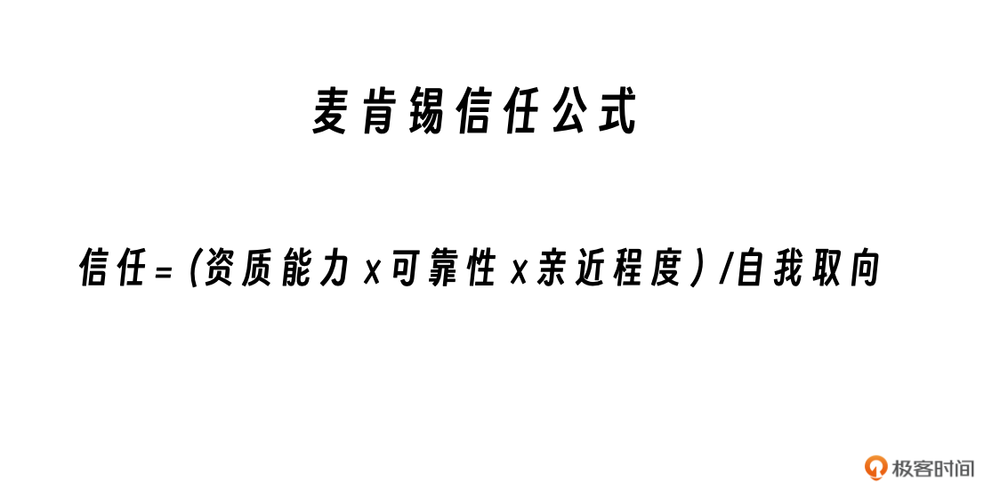
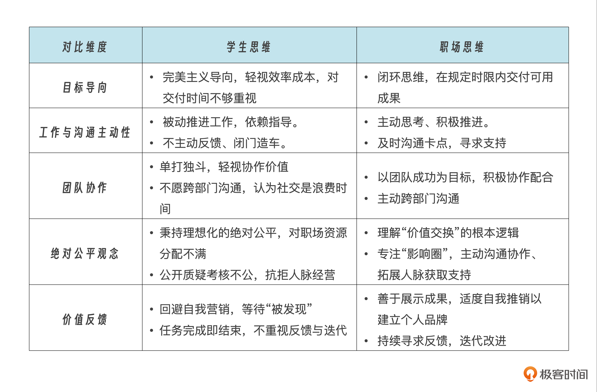
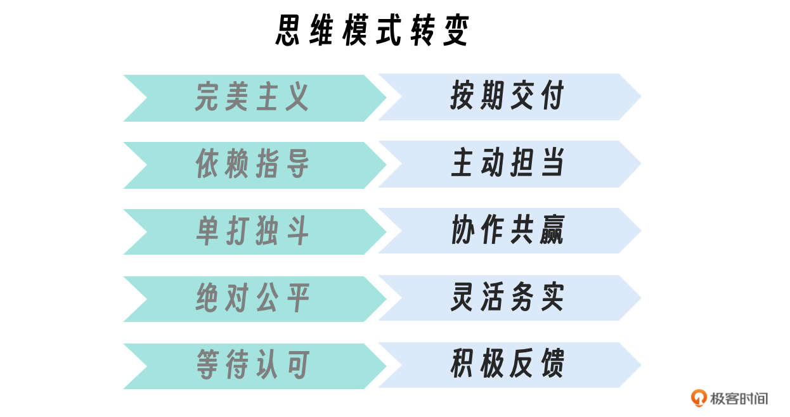

# 06 | 职场新人进阶攻略：五大思维转变，加速职业成长

你好，我是 Brook。

从校园到职场是人生的关键转折，对于互联网新人，这不仅关乎技能学习，更是思维模式的根本升级——我们必须从“学生思维”转向“职场思维”。为了让你更加“身临其境”，今天我们就来看看职场新人小 A 的故事。

小 A 入职之后，充满热情地投入到日常工作中。然而一段时间后，他感到自己陷入了困境。

- 持续负责非核心模块：由于部门人数众多，入职后持续负责非核心功能研发，无法接触到核心模块。

- 建议难被采纳：自己在子功能研发中，发现原有代码基于虚拟机运行框架老旧，认为可以通过容器等新技术进行优化，但由于代码是内部系统不直接面向客户，且持续稳定运行，建议并未被技术主管采纳。

- 资源分配不均：在算法研发核心 GPU 资源分配中，在规则未明确的模糊区域，老员工明显享有更加优先的资源分配权。

## 困境分析

小 A 的困境并不少见，其本质是信任资产薄弱与思维转换迟滞的双重作用。当技术热情遭遇组织现实时，我们需要清醒认识到：

- 在信任层面，入职初期持续负责边缘模块不是能力否定，而是信任验证的必经过程。

- 在思维层面，容器化建议被拒和资源分配困境，恰恰暴露了学生思维的惯性：过度追求技术完美而忽视业务场景成本，未能主动将“优化建议”转变为可观测产品价值；期待绝对公平却未看懂价值兑换规则。

困境的根源，在于学生时代与职场时代的根本目标差异，导致在校园中让你取得高排名的部分习惯，成为职场发展的阻碍。学生阶段的核心是系统构建认知地基，确定性专业知识的学习与竞争性人才选拔是主线；而职场阶段的核心是价值创造，需要在不确定性的动态环境中，多角色协同探索解决客户实际问题的方案。

## “麦肯锡信任公式”的启示

在探讨如何切换到职场思维之前，我想先强调一下，小 A 的困境在现实里相当常见，其本质是忽略了“信任”的力量。我们借助前面讲过的“麦肯锡信任公式”，就可以更好地理解这一点。

结合小 A 的现状，他的资质能力（如系统熟悉度）通常有待提升，可靠性（任务交付稳定性）尚未验证，亲近程度（团队联结深度）需要积累，因此，管理者用非核心项目检验新人，是合理且必要的。

作为职场新人，等待时间验证是一种策略。若想加速突破，关键在控制公式的分母——降低“自我取向”（即减少自我中心意识）。

具体行动上，主动承担非核心项目（比如在沟通后接手模块文档优化）、跨领域补位协作（例如协助测试同事排查基础 BUG），是行之有效的方法。

这些行动看似微小，却能让我们在实践中快速构建业务认知，同时自然积累团队信任。当我们将注意力从“证明自己”转向“创造团队价值”时，会产生积极的连锁反应：通过非核心任务深化对业务系统的理解，在协作中建立可靠的工作形象，更重要的是用实际交付降低他人对自己的评估风险。

这种“低自我取向，高价值输出”的状态，正是职场新人打开成长加速度的钥匙。

## IT 行业关键思维转换

讨论完“信任”的重要性，接下来我们从 IT 行业“成功标准”出发，探讨从学生踏入职场，需要做出的“关键思维转换”。

从学生时代踏入职场，成功标准从考试排名变为对业务的实际贡献；协作逻辑从竞争排位转向共生共赢；资源获取从被动接受变为主动争取。因此，在学生时代行之有效的思维模式，在踏入职场后需要尽快转换。

我为你系统解析了学生思维与职场思维的五大核心差异——包括闭环思维、责任边界、反馈机制等关键维度。你可以参考这张表，构建完整的职场思维框架。接下来我们会详细拆解这五个维度的内容。

### 从完美主义，到按期交付

在项目实践中，部分新入职人员对于项目开发像对待考试一样追求尽善尽美，认为只有完全掌握相关技能之后再动手实践，希望交出“100 分”的答卷。这种心态在学校里是优点，因为作业和考试有明确的评分标准和充裕的时间。

然而在 IT 行业职场中，过度的完美主义可能成为绊脚石，核心原因有以下两点：

- 首先，技术迭代速度远超学习周期。等待"准备充分"往往错过机会，而真实问题只能在业务流量中暴露，这正是"小步快跑胜过完美起跑"的行业智慧。

- 其次，产品交付是多方协作的精密齿轮。研发环节的过度打磨会引发市场、运营等环节的连锁延误，消耗的沟通成本远超想象，更将损害团队信誉，甚至错过宝贵的市场机会。

因此，多数情况下 IT 行业的行动准则是——在保障核心模块质量的前提下，通过优先级排序平衡优化深度与交付速度。

当你挣脱完美主义的枷锁，在价值的交付上持续发力，在时间的赛道上按时抵达，团队看到的不仅是高效的执行力，更是可靠队友的优秀品质。这比看似“完美”但交付延期的“答卷”，更能得到青睐。

### 从依赖指导，到主动担当

学生思维的另一个典型表现是过度依赖他人指导。在学校里，老师会制定教学大纲、布置具体作业，学生习惯于在明确的框架下按部就班完成任务。因此许多新人刚入职场时，常会期待上级像老师般提供详尽指南。

甚至任务要求稍不明确，就容易陷入等待模式：被动等待工作安排，回避不确定性。或者遇到重大阻塞、风险，仍然闭门造车不敢求助。

在互联网行业，这种“等靠要”心态会面临双重挑战。

- 技术层面，瞬息万变的环境罕有标准答案，若路径清晰早被自动化实现。

- 协作层面，停滞等待会拖慢整个业务齿轮的运转节奏。

如何化被动为主动呢？关键在于三步行动。

1. 任务破局：接到需求先理解目标，自主拆解方案，提出解决方案雏形。

2. 高效求助：必要时，带着初步方案而非空口提问（例如：“我计划用 X 方法实现，但 Y 环节有风险，您看是否调整？”）。

3. 进程透明：至少每周通过邮件或站会同步进展，让风险提前暴露。

当你能在模糊中开辟路径，在阻碍时推动进程，团队看到的不仅是能力成长，更是值得托付的担当精神。这比任何简历都更能赢得信任。

### 从孤立作战，到协作共赢

学生时期，我们需要依靠自己完成考试、论文等关卡与测试。这使得一些新人进入职场后依然习惯单打独斗，以“竞争大于合作”的角度看待周边事务。他们可能把团队沟通视为负担，认为自己一个人做效率更高；还有人秉持“各人自扫门前雪”的心态，只关注自己的一亩三分地，对团队其他事务不闻不问。

然而这种孤立模式对职业发展有三重隐形成本。

首先，它会扼杀系统性创新。个人或许能解决技术单点问题，但涉及多模块的创新（如新功能开发）必须跨团队协同——从技术融合到客户价值验证，再到灰度发布与反馈收集，每个环节都需要多方配合。缺少这种协作，创新效率将断崖式下跌。

更关键的是，它会削弱个人在组织中的价值杠杆。专业技能虽是立身之本，但在 AI 加速替代标准化工作的时代，“创造共赢环境并高效解决问题”能放大个人对组织的价值——这包括发现系统性问题的眼光、推动跨部门协作并顺利闭环问题的执行力。

最后，孤立作战会影响职业声誉的长期积累。当晋升评审采用 360 度评估时，同事对你协作意愿的评价，往往和技术能力同等重要。闭门造车的工作方式，可能让你在关键节点失去宝贵的信任票。

认识到危害，接下来我给你提供三招最容易见效的改善方式。

首先是协作规则的认知。入职初期要关注并识别团队合作氛围，理解组织中“权、责、利”的协同机制。感知团队更加注重“把事做成”还是“分工清晰”，观察项目如何跨部门推进，是正式立项，还是私下协调。理解这些规则是构建共赢协作的基础。

接着就是调整协作视角。在日常工作中观察业务全链路，理解市场、产品、研发等环节的咬合逻辑；初期摆正心态，像珍视个人成功一样关注团队成功，在事项负责人主动提出，且个人力所能及的情况下予人以必要协助；在协作中筛选能够互利共赢的合作伙伴，拓宽未来通过“协同共赢”解决组织系统问题的可能性。

最后还有升级沟通策略，能够了解在不同语境下如何清晰表达自己的观点（汇报工作说结果、请示工作说方案、总结工作说流程、布置工作说标准等），遇到问题时尝试问"如何平衡 A 需求和 B 限制"，而非争论对错。

当你把协作视为增值杠杆，而非消耗成本时，便打开了职场成长的指数级空间。

### 从绝对公平，到灵活务实

学生时代的环境相对公平透明。成绩由客观标准评定，机会对每个学生大致均等。因此不少新人带着对绝对公平的执念进入职场，认为职场也应该“机会均等”。

典型表现包括抱怨资深员工在算力资源分配时具备优先权、骨干员工在承接项目时有核心项目选择权，或因自己的贡献未被“公正”评价而愤愤不平。这种行为极有可能会消耗管理耐心，被标签化为“团队负能量源”，影响个人后续发展。

思维转型的关键，在于以下三点。

首先要理解“价值 - 资源”的兑换逻辑。资源分配优先权背后可能是高绩效产出，与其纠结“为什么他可以我不可以”，不如思考“我如何做才能获得同样的信任和自由度”。

其次需要我们在价值创造中重塑规则。对于资源分配的不均，我们要以项目预期价值为入口，主动沟通自己的需求。必要时，通过协助运维同事开发资源调度预测工具等方法获取专属弹性资源池，使用技术能力兑换资源特权。

理解评价标准，沟通留有余地。如果觉得项目贡献评估不公，不会当众发牢骚，而是私下与上级沟通，了解评价原因、标准。

这正契合《高效能人士的七个习惯》的精髓：聚焦“影响圈”而非“关注圈”——把精力投入能改变的事（技术突破 / 项目交付），而非纠结短期无法改变的环境。

当你参透价值与资源兑换的内在规律，能够在规则中守正出奇、在价值创造中重塑资源使用权限，就完成了从“公平索取者”到“规则共建者”的蜕变，为你持续突破成长瓶颈奠定坚实的基础。

### 从等待认可，到积极反馈

学生时代，很多人习惯了被动等待：等老师布置作业、等考试结果公布、有了好的 GPA 等待国奖等对应激励“自动上门”。学生时代被动等待成绩的习惯，可能延续为职场中的“沉默模式”——以为“只要默默把工作做好，领导自然会发现我的成绩”。

于是他们以代码提交为结束，未能主动跟踪成果与影响，寻求反馈；在团队中沉默寡言，等待别人来关注自己。

然而在职场中，酒香也怕巷子深。如果你不主动沟通和展示，别人可能并不了解你的贡献和想法。但在高速迭代的 IT 矩阵组织中，这种被动可能导致双重困境，你的价值在信息洪流中隐形，工作陷入低水平重复的漩涡。

职场思维要求我们主动构建反馈飞轮。

1. 成果追踪：代码上线后主动询问产品 / 运营同事：“这个功能对用户留存有提升吗？遇到了哪些体验问题？”把每次交付变为经验燃料。

2. 进程同步：重要项目用"现状 - 方案 - 建议"框架向上级同步当前进展，带着方案寻求下一步推进意见（例如：“目前完成接口优化，吞吐量提升 40%，建议下周灰度测试，这是风险预案…”），看是否能与组织目标更加紧密的结合。

3. 价值显性化：当工作取得了好的成果，在适当的时机通过公司技术创新评奖、内部博客输出等方式输出你的经验与见解，同时打造专业形象、体现个人贡献。

要牢记，主动反馈不是炫耀，而是对工作成果的负责。分享时保持谦逊，永远在功劳簿上留出合作者的位置。

回归到小 A 的场景，新人入职后由于资质能力、可靠性、自我取向等均有待验证，因此工作通常需要从非核心事项开始。从团队整体最优角度，小 A 的遭遇并非孤例。小 A 首先需要做的是多些耐心，理解职场价值 - 资源互换的基本逻辑，尽快完成从学生思维到职场思维的认知转变，并采取对应方法与行为，快速融入团队。

## 课程总结

新人初入职场，初期可能会遭遇不受重视边缘项目居多、项目既有代码框架老旧、资源分配优先级低等诸多问题，从而感到满腔抱负难以施展、陷入个人成长焦虑。这种焦虑的本质，是未能理解“信任”在团队协同中的作用，过于急迫以至混淆了“能力圈”与“影响圈”。

从目标而言，“受教育”与“工作”存在本质区别。学生时代注重构建认知地基，通过确定性知识吸收实现人才的“选拔”。职场注重价值转化，面向客户问题在不确定中探索解决方案，实现价值创造。

由于二者在成功标准、协作逻辑、资源分配等多维度存在的区别，在学生时代助力你成长的诸多思维模式，在职场可能不再适用。

今天我们先从“麦肯锡信任公式”出发，探讨了小 A 所遭遇的问题诞生的合理性。随后，从认知- 方法 - 行动三个维度，给出亟需转变的思维模式，供读者参考，具体包括后面这五条。

1. 完美主义 vs 按期交付：以决策优先级驱动研发，保障核心模块质量前提下在迭代中持续优化。

2. 依赖指导 vs 主动担当：拒绝“等、靠、要”，敢于在模糊地带自拓解法路径，用方案同步构建信任链。

3. 单打独斗 vs 协作共赢：以代码为杠杆撬动集体智慧，在协同共赢中彰显个人价值。

4. 绝对公平 vs 灵活务实：理解职场“价值 - 资源”兑换的根本逻辑，在价值创造中重塑规则。

5. 等待认可 vs 积极反馈：将隐性贡献编译为可观测指标，用持续反馈铸就可信度资产。

掌握以上职场思维并加以实践，相信一定能加速你的团队融入与个人成长。

## 思考题

假如你是小 A，在学完这节课程之后，应当如何调整自己的认知、心态与行为？你在初入职场时有什么困惑？

恭喜你完成第 6 节课的打卡，欢迎你在留言区与我交流讨论。如果今天的内容让你有所收获，也欢迎转发给有需要的朋友，我们下节课再见！
