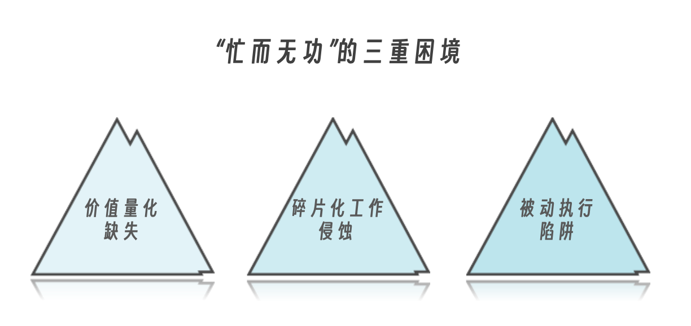
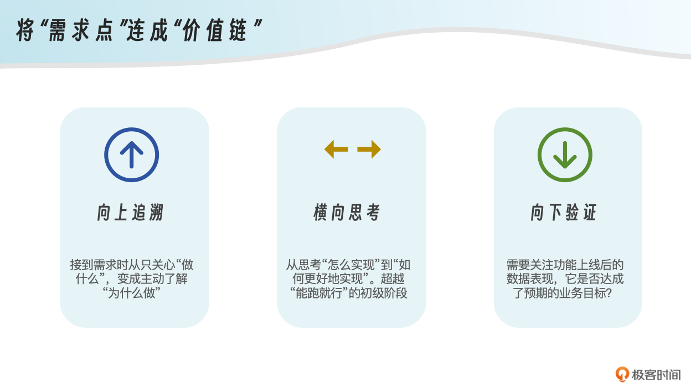
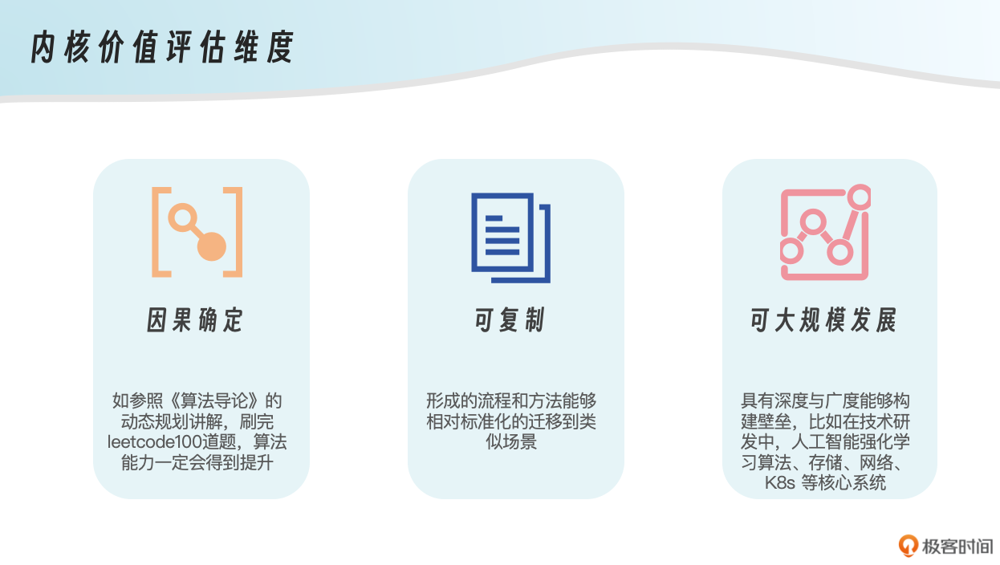
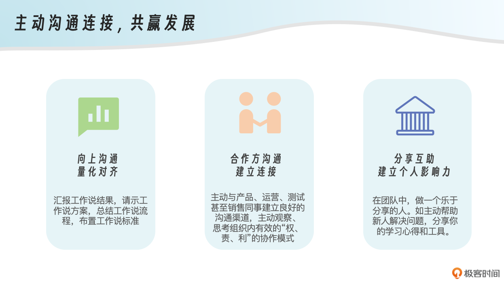

# 07 | 破解忙而无功陷阱：让每一份努力得到回报

你好，我是 Brook。

这节课，我们聊一聊“团队骨干”这个职业发展阶段，应当如何彰显日常工作的价值，平衡好短期任务与长期核心竞争力培养之间的关系。

小 A 入职工作两年，伴随对业务代码的快速熟悉以及职场思维转换，逐步与上级、协同方建立了初步信任，成为了团队骨干。但伴随时间推移，在日常工作中他感觉自己陷入了“需求 - 交付”的循环，新特性需求开发、线上 bug 修复等各类任务应接不暇，精力被碎片化。与此同时，重复性工作挤压学习时间，技术栈迭代缓慢。

尽管每天加班到很晚，但在绩效评定中连连拿中等绩效，这让他感到很挫败和无力。工作两年多，当晋升答辩的时候他再次被评委认为“工作缺乏技术深度与亮点”，最终没有成功晋升。他静心反思，如何让日常工作产出更具价值？又如何才能在完成短期任务的同时，为长期发展积蓄能量？怎样才能运用系统性思维，将眼前需求转化为个人竞争力的基石？

## 困境分析

小 A 的困境并非个例，而是许多互联网技术同学发展的缩影。我们不妨先梳理一下，有哪些原因造成了小 A 的困境？

面对“劳而无功”的需求 - 交付循环，你可能首先想到的是要统计一下工作成果，比如修复了多少 bug，完成了多少需求。面对时间碎片化、工作感到乏味，可能想到要像苦行僧一般坚定自己的信念、与人性作斗争。

这些分析虽然也有道理，但并没有触及小 A 困境的本质。那么根源性的原因究竟有哪些呢？

### 价值量化的缺失

无法用业务的语言来翻译技术的贡献，并举证量化，是绩效平庸的核心原因。在绩效面谈时，许多新人的工作总结往往停留在“我这个周期完成了 15 个需求”“修复了 30 个 Bug”等过程指标上。很少有人能清晰地将这些技术工作与关键业务指标（如用户日活提升、付费转化率增长、服务器成本降低）建立直接或间接的关联。

而互联网公司的绩效评估本质上是结果导向和价值导向的。当领导无法从你的汇报中看到你对业务的实际影响时，他看到的只是一个“听话的执行者”，而非一个“有潜力、能驱动业务的价值创造者”。

### 碎片化工作的侵蚀

碎片化工作分散精力，知识技能获取零散、技能增长无序，是能力增长受限的根源。

互联网行业快节奏的特性，日常工作时间非常容易被各种紧急但不一定重要的事务所切割。今天修复一个紧急 Bug，明天支持一个临时运营活动，后天又投入一个短平快的需求。这种碎片化的工作状态，让新人几乎没有整块的时间进行系统性学习和深度思考。

后果是知识获取变得零散，难以形成结构化的知识体系和方法论。这种不成体系的技能增长，让人难以从“解决眼前问题”中抽离，所以也就很难提升“构建长效系统、预防未来问题”的能力。

### 被动执行的陷阱

习惯于“需求 - 交付”的循环，养成被动执行的惯性，为长期晋升发展埋下“地雷”。

对于新人而言，最常见的工作模式是“需求来了就做，做完就提测”。这种模式看似高效，实则是一个巨大的陷阱。新人往往被动地接收来自产品经理或上级的指令，埋头于代码实现，却鲜少追问需求背后的业务价值与商业逻辑。

直接后果是，个人逐渐沦为代码实现的“工具人”，无法建立起项目的全局观。在这种模式下，短期来讲可能会出现由于个人理解问题，导致开发功能背离需求设计目标；长期而言，个人的成长曲线将与公司业务发展逐渐脱钩，价值仅被限定在“完成任务”的执行层面，而非“创造价值”的战略层面。

要充分理解，互联网行业的职级晋升更多是“事后追认”而非“事前奖励”。因此想要晋升到对应岗位，首先应当体现出你已经具备了对应的能力。

## 如何摆脱困境？

前面我们分析了小 A 困境的三大根源，不难发现它们相互关联，且每一条都很“危险”。接下来我们就来看看，想要解决这些问题，都有哪些行之有效的做法。

### 第一招：将“需求点”连成“价值链”

由于互联网行业需求的快速迭代，一个战斗力强的团队通常能够在界限清晰的前提下相互补位。作为需求闭环者，我们在使用专业能力解决关键技术问题的基础上，还需要额外掌握三项关键技能。

第一个是向上追溯的能力。具体做法就是接到需求时从只关心“做什么”，变成主动了解“为什么做”。

接到一个需求时，多问几个“为什么”：这个功能服务于哪类用户？旨在解决他们的什么核心痛点？预期的业务收益是什么（例如，提升用户留存率 2%）……这能让你从源头理解任务的价值。

第二就是横向思考，从思考“怎么实现”到“如何更好地实现”。在技术实现层面，要超越“能跑就行”的初级阶段。思考当前的技术方案是否为最优解？它对现有系统的耦合度、性能、可维护性有何影响？

第三点也很关键，那就是向下验证，从“交付功能”到“交付价值”。功能上线不是终点，而是验证的开始。你需要关注功能上线后的数据表现，它是否达成了预期的业务目标？持续交付的核心理念正是为了在“最终用户”和“研发团队”之间建立紧密的反馈环，通过快速迭代来验证和衡量改动对软件价值的影响。

特别的，面向个人能闭环的初级事务，常见踩坑情况有以下四类，我们应当特别注意（非个人能完成的更广阔的事项，成功要素后续展开）。

1. 判断失误，事情本身做不到。技术决策本身具有较强的不确定性。一方面我们要积累经验与提升专业能力，尽可能减少类似事项出现的频率，另一方面一旦遇到这类情况，要先努力尝试、积极沟通，如果的确不可为，要带着进展积极反馈。对于创新型组织，失败并不可怕，证伪关键假设也是组织的收获。

2. 个人能力不足，关键点无法突破，无法做到。如果一旦出现此类情况，要加倍勤学多问，相信自己被录用进企业并不会有很大差距，更多的可能是对架构、模块的熟悉不足导致的问题。其次从态度上，更要做到积极主动，在实在难以突破的问题点上，请求有经验同事的帮助。受挫时能否积极思考、愈挫愈勇，是组织评价一个人能否担当重任的一个重要维度。

3. 不愿“把手弄脏”。很多优秀的同学认为自己被高薪聘请，希望聚焦在前沿算法、核心系统。但工作后发现，前沿技术只占到工作的 20%，大量低挑战功能、边界情况处理，才是更为日常的工作。在工作初期一定要避免这种情绪，否则可能由于无法完整闭环问题而被评价为“眼高手低”，丧失未来负责更重要项目的机会。

4. 完美主义。性能优化希望把每个路径都尝试一遍，达到最优；模型效果调优希望尝试每一种算法、添加进更多边界数据，取得效果最优……这种钻研精神固然可贵，但在企业，通常“遵守承诺、按时保质保量交付”要比“延期 20% 交付，效果优于目标 10%”更加重要。完美主义容易让事情陷入拖沓的境地，阻碍事情闭环。

### 第二招：“寻找内核”，构建核心竞争力

在日常工作中我们的时间和精力是最宝贵的职业资本，我们需要思考如何将其配置以获得最大回报。工作事务纷繁复杂，公司业务多变。如果仅按照短期工作绩效需要随项目调整而没有发力的主线，很难形成自己的核心技术竞争力。

因此找到自己的内核并进行深耕，让每一份努力沉淀在“增长系统”之中，是效率最高的提升个人价值的方法。为了实现以上目标，有四个关键事项需要关注：找到自己的内核、主动规划争取内核相关机会、识别高杠杆任务、平衡短期与长期。

那么应当如何寻找自己长期积累的方向？首先，长期积累的“内核”，一定要是你热爱的事情。从个人角度“干着不累、被虐不苦”，才能心甘情愿的持续积累。每个人性格迥异，有人追求为周围人带来好的生活条件，有人追求改变世界。寻找内核时要遵循自己内心的渴望。

其次，从内核价值角度，要考虑“因果确定，可复制、可大规模发展”三个维度。

- 因果确定很好理解。比如参照《算法导论》的动态规划讲解，刷完 leetcode 上 100 道动态规划题目，那么算法能力一定会得到提升；而与之相对，买彩票就是完全随机事件，很多人耗费心力研究彩票规律，通常就无法奏效。

- 可复制指的是，形成的流程和方法能够相对标准化地迁移到类似场景。比如端到端完成了一个场景的大语言模型微调，并取得实际效果，那么这一过程中所积累的工具、方法，即使切换场景也仍然能够适用。

- 大规模发展指的是具有深度与广度，通过专业能力能够构建壁垒。比如在技术研发中，人工智能强化学习算法、存储、网络、K8s 等核心系统，具备长期深耕的潜力；相对而言，某项特定的前端技术，则不具备这类特质。

在选定内核之后，我们如何才能将工作时间与精力更多应用于内核呢？

“主动规划、争取投资”是行之有效的方法。例如你希望深耕的领域是存储性能优化，在工作中你可以结合产品实际需求，主动设置性能埋点，识别产品性能问题并提出瓶颈优化建议。只要问题是真实存在且影响到用户感知，大概率会作为“技术需求”获得投资。这短期内可能需要你付出额外努力，但长期来看，它会成为你技术深度和影响力的最佳证明。

在长期内核聚焦外，日常工作中也可以通过“识别高杠杆任务”提升日常工作单位时间所获得的价值。审视你的工作内容，区分重复性的手动配置、简单的 Bug 修复这类消费型任务和重构一个陈旧模块、引入新技术提升团队效率、沉淀可复用的工具或方法论这类投资型任务。前者消耗你的精力，后者则能为你带来长期的复利效应。

最后，在工作中要有意识地平衡短期与长期事项，用 80% 的精力高效、可靠地完成日常的交付任务，这是你立足的根本。同时，一定要挤出 20% 的时间，投入到“重要但不紧急”的内核领域，比如技术深耕、知识体系构建和对高价值问题的探索，并通过知识体系构建，将碎片日常转化为体系认知，通过博客、个人知识库记录等方式以输出，来倒逼自己理清思路、发现盲点。

### 第三招：主动沟通连接，共赢发展

很多技术同学常常忙于响应需求，低头做事，容易忽略沟通的重要性。

这可能会导致很多问题：功能研发时因为没能真正洞悉功能点背后的用户需求导致频繁返工、延期交付；晋升答辩的时候无法清晰阐述个人创新工作为产品带来的用户价值，导致不良评价；跨部门协同时，由于无信任关系，导致各自为政、协同困难。

主动沟通、构建共赢环境是破解这一问题的关键，具体体现为以下三点。

第一，向上沟通，量化对齐。积极理解团队目标以及与公司目标的承接关系，学会站在主管的视角思考问题，切实理解个人与团队所负责工作，对于产品整体的价值，以及是如何支撑上层战略落地的。在做好手上需求的同时，定期与基层主管对齐工作方向与目标进展，主动获取反馈，穿破需求的迷雾理解与战略的关联。

同时也要注意必要的沟通技巧，常见的包括汇报工作说结果，请示工作说方案，总结工作说流程，布置工作说标准等。

第二，合作方沟通，建立连接。主动与产品、运营、测试、销售同事建立良好的沟通渠道。理解他们的工作目标和痛点，这能让你获得更全面的业务视野，从而在技术决策时做出更周全的考虑。

在跨体系合作时，主动观察、思考组织内有效的“权、责、利”的协作模式。后面这几个问题能帮你快速理解所在组织的协作模式：

- 协作天然顺畅，还是牵头部门四处救火，其他部门被动参与？

- 依靠传统的加强沟通、增进感情、明确分工、责任到人是否能很好地解决问题？

- 如果无法解决，通过上级领导牵头的“关键项目立项承诺”“专项工作组”方案能否更好地推进？

- 在项目推进期间，有什么权限需要争取，事情做好了各个部门希望得到什么收益？

必要时在规则下主动构建权、责、利的平衡，将“你来帮我干活”转变成“我们一起干一件对大家有利的事情”，从而搭建共赢舞台，实现为端到端结果负责。这部分我们将在第三章中详细展开。

第三，分享互助，建立个人影响力。在团队中，做一个乐于分享的人。主动帮助新人解决问题，分享你的学习心得和工具。这不仅能巩固你所学的知识，更能帮助你建立个人影响力，这是从一个优秀的“个体贡献者”走向“技术负责人”的必经之路。

回顾小 A 的困境，根源不在于“忙”，而在于将立体的工作变成了一维的“答卷”，盲目地执行，而缺乏系统的思考与个人积累的方向。

作为职场骨干，我鼓励大家尽早思考自己的“内核”，并在日常工作中从小事开始积累，形成专业能力的“长坡厚雪”。与此同时，提升自己的战略理解与闭环能力，在接到下一个需求时，多问一个“为什么”；在写完每一模块代码时，多思考一层“如何更好”；在每周结束时，多花半小时复盘“价值何在”。将每一次任务，都看作一次成长的投资和价值创造的机会，从而打破“忙而无功”困局，为后续发展打好基础。

## 课程总结

经过新人的锻炼成为团队骨干，你已经主导过模块级项目研发，对负责项目模块及底层组件非常熟悉，能够快速定位并解决问题；然而，日复一日的开发工作可能让你感觉到挑战性不足、没有时间进行技术积累；在不确定的上升空间面前，如何破解忙而无功困局并保持工作激情，是每一个职场人需要面临的课题。

造成 IT 行业从业者“忙而无功”困局的核心因素有哪些？这节课我们归纳了三点。

首先，价值量化的缺失使个人工作成果无法与业务价值挂钩，导致在绩效评估中被低估；其次，碎片化工作，导致个人技能增长不成体系，难以让自己在特定领域构建壁垒；最后，“需求 - 交付”循环的陷阱容易让人形成被动执行的惯性，为长期晋升“埋雷”。

为了破解这一困局，建议你试试后面这三招。

- 闭环问题：将需求点连接成“价值链”，用数据展现专业能力所带来的业务价值；

- 寻找内核：找到自己希望深耕的核心竞争力，并投入时间与精力带宽，以深耕构建个人壁垒；

- 主动沟通：穿透需求迷雾，用沟通搭建共赢环境，为长期发展蓄势充能。

要牢记，互联网行业的职级晋升更多是“事后追认”而非“事前奖励”。在持续做好手中需求同时，通过以上几方面能力为长期发展蓄势充能，才能精准把握机遇。

## 课后思考

今天我们从个体成长角度，讲解了技术骨干如何破解忙而无功困局。你不妨转换视角，结合你的经历或者观察，聊聊大厂、中厂、创业公司、央国企 IT 部门，对于基层骨干是如何定位的，希望他们具备哪些关键能力？

恭喜你完成第 7 节课的打卡，欢迎你在留言区与我交流讨论。如果今天的内容让你有所收获，也欢迎转发给有需要的朋友，我们下节课再见！
