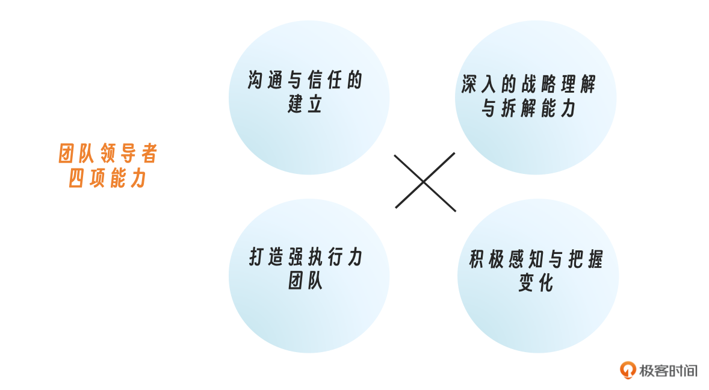
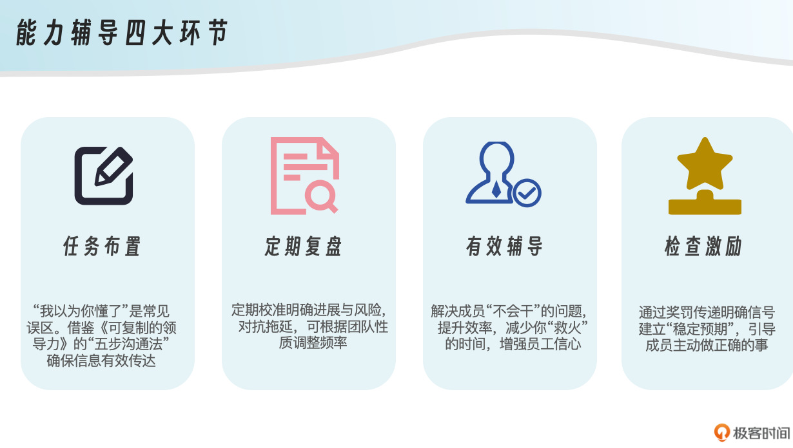

# 08 | 从独立闭环到带队成功，基层管理者如何开展工作？

你好，我是 Brook。

这节课，我们来聊一聊带领队伍“打胜仗”的技术主管（TL），需要具备哪些能力。

小 A 通过价值链串联、技术内核竞争力积累与协同部门成功配合，逐步成为公司的“研发明星”，在职级评审中晋升为专家岗位，并被任命为技术组长。踌躇满志的他，坚信凭借自己过硬的经验能力，一定能带领团队持续成功。

但挑战很快接踵而至：

- 个别团队成员能力与自驱力不足，技术成长缓慢；感到“指导他不如自己干更快”，自己频频加班救火，交付延期。

- 上级目标压力大，团队既有人员规模和能力，加班加点也难以按时交付。上级目标达成度低，自己所带领团队氛围消沉，成员缺乏动力；他感觉自己成了“夹心饼干”，对上对下沟通都倍感压力。

- 同时跟进多个项目，曾经专注写代码的时间被各种会议、协调、救火占据，个人产出效率反而下降。

夜深人静时，小 A 不禁问自己：个人技术过硬、成果突出，为何带团队却仍然手忙脚乱？怎样才能让团队持续打胜仗？

## 困境分析与能力跃迁

以上困境，来源于“独立贡献者”与“团队领导者”能力模型的差异。

对技术人而言，晋升为基层技术主管，是从团队骨干迈向更高岗位至关重要的一步。但就像《领导梯队》强调的，不同层级需要完全不同的工作理念和技能。如果初期处理不当，容易给人留下难以胜任的印象。

从“独立贡献者”走向“团队领导者”，需要尽快提升四项能力。

1. 沟通与建立信任：主动构建与上级的互信，理解公司部门战略，承接关键任务，争取必要资源，避免“小马拉大车”，打破跨部门协作壁垒。

2. 深入的战略理解与拆解能力：把宏大的业务 / 技术战略解码为团队可执行的战术动作，确保团队做正确的事（根据组织情况，个人主导或协助主管 / 架构师完成）。

3. 打造强执行力团队：指导团队正确的做事，在精通技术的基础上，打破“自己动手更快”的执行惯性，学会为团队赋能。在完成目标同时，更要关注成员成长与利益，激发他们的积极性和创造力。

4. 积极感知与把握变化：定期重复以上三个步骤（沟通、战略、团队执行）并审视实践效果，持续提升对技术趋势、业务价值和团队环境的敏锐度，更好地驱动产品成功。

沟通与信任（第 3 节课已经探讨）和积极感知变化（本质是前三项能力的持续复盘）我们不再展开。这节课我们将聚焦于“深入的战略理解能力”与“打造强执行力团队”这两项核心能力的提升路径。

## 深入战略理解能力，带领团队“做正确的事”

很多技术人认为“战略是高层的事”，这是一个需要突破的关键误区。理解并连接公司战略，带领团队“做正确的事”，恰恰是基层技术主管工作价值的重要杠杆，也是能力升维的核心。

为什么一线视角如此关键？ 我们来看看真实案例。

- 美团王兴复盘“千团大战”时曾指出，最终胜负手并非 CEO 的 PPT，而是地推团队在签约商户时，对本地消费趋势变化的敏锐洞察。这些来自一线的信号，直接影响了公司战略资源的投放。

- 抖音推荐算法团队发现下沉市场用户对“同城探店”内容停留时长激增，这个关键数据洞察，反向推动了公司对本地生活服务战略优先级的重要调整。

- 某厂商产品发布前，没有重视基层研发人员提出的“功能逻辑未充分灰度测试，存在误报风险”的警告，坚持按期上线。功能发布后造成关键客户业务系统中断。

基层团队，往往是战略落地的“传感器”和最前线的“探测器”。真正的战略洞察，常常源于那些听得见“弹片呼啸”的人——他们最清楚哪里需要炮火支援，哪里需要加固“盾牌”。

那么，基层管理者应当如何提升战略理解力？这里我提供两个对我帮助最大的方法。

第一，构建信息管道，主动链接战略。利用好我们之前说的沟通、链接、分享技巧，如上级沟通、定期参加业务会议、阅读行业报告、与技术布道者交流，建立获取战略信息和前沿技术动态的稳定管道。仔细梳理上级组织（部门 / 公司）的 OKR，理解背后的战略意图，比如接到“通过存储带宽预测，提升 I/O 效率”的任务，要主动了解目的是支撑部门打造面向 AI 训练的高效存储系统，还是面向通用场景的存储系统能力提升？这决定了项目的核心方向以及约束条件。

第二，建立业务视角，基于价值决策优先级。就像《领导者的战略思维》所强调的，技术决策必须服务于商业目标。尝试将你的团队视为一个“微型业务单元”，思考团队目标如何实质性地为客户创造价值？比如说，某一次的技术优化，如何具体提升用户留存率或者商业效率。对于技术选型、技术债解决、新工具投入等重要的技术决策，我们要习惯放在业务价值的坐标系评估。想清楚这对核心业务目标有什么贡献？长期收益与短期成本如何平衡？要牢记，技术本身不是终点，为业务结果负责才是关键。

## 打造强执行力团队，激发并指导团队“正确地做事”

技术主管要带好团队，除了自身专业过硬，两大核心杠杆至关重要：点燃团队愿景与系统化能力辅导，我们分别来看看。

团队愿景远不止是口号，它深刻影响着战斗意愿，有助于我们把团队的内驱力充分调度起来。就像全球第一 CEO 杰克·韦尔奇说的：“工资让你雇佣人手，使命感让你赢得战士。”这印证了管理学经典“双因素理论”——薪资是基础保障，而意义感才是卓越的驱动力。

那为什么愿景这么关键呢？人生如逆水行舟，主动努力本来就不容易。一个清晰、共识的愿景，能让成员在困境中坚守，理解每天的付出都在向共同目标靠近。它让宏大目标可视化，让努力有明确原因。

在团队中树立大家共同认可的愿景，有三点要素。

第一步，清晰描绘“伟大事业”并拆解目标。向团队清晰同步：我们正在创造什么价值？目标是什么？比如“樊登读书”在创业初期，树立了“帮助 3 亿国人养成阅读习惯”的愿景，并通过背景板展示当前公司服务的用户量，用以可视化目标进度，激励团队朝着共同目标努力。

第二步，洞察个体动机，链接个人与团队。这需要技术主管理解成员的核心诉求：是追求高收入、技术精进、行业影响力、工作生活平衡，还是创造社会价值？

结合个人诉求，合理运用有限的正向激励资源与负向激励手段，可以更大程度激发员工的驱动力。比如，除了常见的职级晋升、奖金激励之外，对于希望“被看到”的成员，用公司荣誉进行激励；对于希望追求行业影响力的人员，可以鼓励其参加行业技术分享；对于希望技术精进的成员，让其有机会聚焦关键方向进行深耕。通过链接个人与团队目标，可以很好的激发员工内在驱动力。

第三步，善用关键时机，持续培养“愿景追随者”。新员工入职初期，是“锚定”黄金期。可以在这一时期，通过积极引导和清晰阐述愿景，建立正向连接。

另外，绩效沟通也是影响力窗口。技术主管作为“权威”角色，在 OKR 设定 / 回顾、日常辅导时，结合员工动机重申愿景，是强化认同的有效时机。

愿景驱动态度，能力则决定日常战斗力。能力辅导的核心是弥补差距——认识到成员能力提升需要过程。

我们需要系统解决任务布置、复盘反馈、有效辅导、检查激励四部分。

首先来看任务布置。“我以为你懂了”是常见误区。成员可能因各种原因没有暴露理解偏差，导致交付成果和预期差得很远。必要时，可借鉴《可复制的领导力》的“五步沟通法”，确保信息有效传达。

- 交代任务 -> 成员复述 -> 探讨目的（对齐价值与方向）-> 预案分析（什么情况需汇报？什么可自主决策？）-> 听取建议（鼓励成员提出想法，激发思考与主动性）

其次要重视定期复盘。通过定期校准明确进展与风险，对抗拖延。实践中，可以根据团队性质调整频率。对于特性开发团队，建议高效日会简洁说明进度、风险与未来事项，并通过周会来系统总结当周问题；对于创新研发团队，频率适当放缓，例如每周 1 次进度 / 风险对齐、1 次技术深度讨论等。

而有效辅导可以解决成员不会干的问题，提升效率，减少你救火的时间，增强员工信心。

对于聚焦型团队，通过“我说你听、你说我听、我做你看、我带你做、你做我看、你自己做”这六个步骤进行辅导。对于业务分散团队，可以通过团队内技术分享以及部门技术竞赛等方式，提升团队人员战斗力。

最后是检查激励，通过奖罚传递明确信号，建立“稳定预期”，引导成员主动做正确的事。具体的技巧包括：

- 加强目标互锁，持续做大个人与团队利益交集。

- 以身作则，提升规范“权威性”；奖励要让人感受到价值，处罚要起到警示作用。

- 如果组织氛围是“做大蛋糕”，而非稳字当头，应当避免绩效评价中的“削峰填谷”（打压优秀换取组织低绩效者满意度）和“委屈创新者”。对于超出职责的创新贡献（如引入提效工具），应给予特别认可与奖励。

现在，让我们回到小 A 的故事。他所经历的挑战，几乎是每一位技术精英迈向管理岗位的必经成长阶梯——从“独立贡献者”蜕变为“团队引领者”。

这条路的本质，是影响力的不断扩展与深化：

- 你不再只是写好代码，而是开始塑造团队如何协作、如何解决问题；

- 你不再只对个人产出负责，而是致力于激发团队成员的潜能，帮助他们成长；

- 你不再只关注眼前任务，而是逐渐支撑起更宏大的业务目标，见证团队合力创造的成果。

当你看到成员因为你的辅导而成长，团队因为你建立的机制而高效运转，共同赢得个人与团队的双赢时，你将体会到一种全新的、更深层次的成就感：这不再是你个人的技术创新，而是点燃他人、凝聚力量、共同创造价值。见证并推动一个集体走向卓越，是引领者独有的满足。

## 课程总结

成为技术主管，意味着开启一段全新的成长旅程。这节课，我们先明确了完成跃迁所需要的关键能力，也就是沟通与信任的建立、更深入的战略理解能力、打造强执行力团队、积极感知与把握变化。

我们重点探讨了如何培养更深入的战略理解能力、打造强执行力团队。

1. 通过更深入战略理解能力，带领团队“做正确的事”：核心是主动链接战略、建立业务视角、评估决策价值、构建信息管道。

2. 打造强执行力团队，激发并指导团队“正确的做事”：在态度层面，通过愿景引领，点燃团队内驱力；在能力层面，通过必要辅导，提高团队战斗力。

管理的独特成就感在于：你不再仅聚焦于个人代码的完美，而是点燃团队潜能、塑造协作系统、支撑业务图景，并见证集体智慧创造的价值——这是一种关于引领与共同成就的深远满足。这项能力的具备，将为你职业生涯的发展，打开新的篇章。

## 课后练习

1. 你是否能清晰地向团队成员同步你们团队的愿景、目标与路径，并像樊登读书初期用背景板展示用户量增长一样，找到适合你团队的可视化方式，比如关键指标看板、里程碑庆祝。

2. 你是否清楚你团队核心骨干，他的核心诉求排序？（收入更高、专业技术更精进、事情有意义、行业影响力更高、公司内管理面与被尊重、工作生活平衡）

3. 请你选取团队内核心骨干，通过沟通了解动机，利用 OKR/ 绩效管理等工具，将个人发展目标与团队愿景对齐，最大化“团队利益”与“个人利益”的交集，提升内在驱动力。跟踪记录，观察效果。

恭喜你完成第 8 节课的打卡，欢迎你在留言区与我交流讨论。如果今天的内容让你有所收获，也欢迎转发给有需要的朋友，我们下节课再见！
