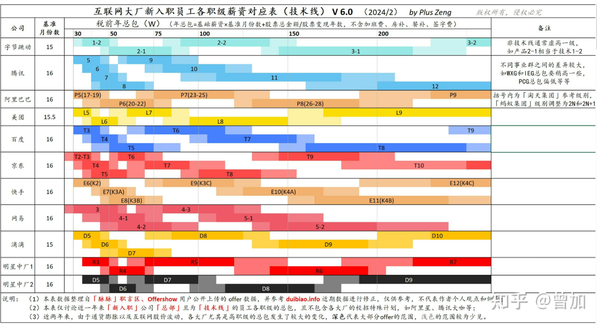
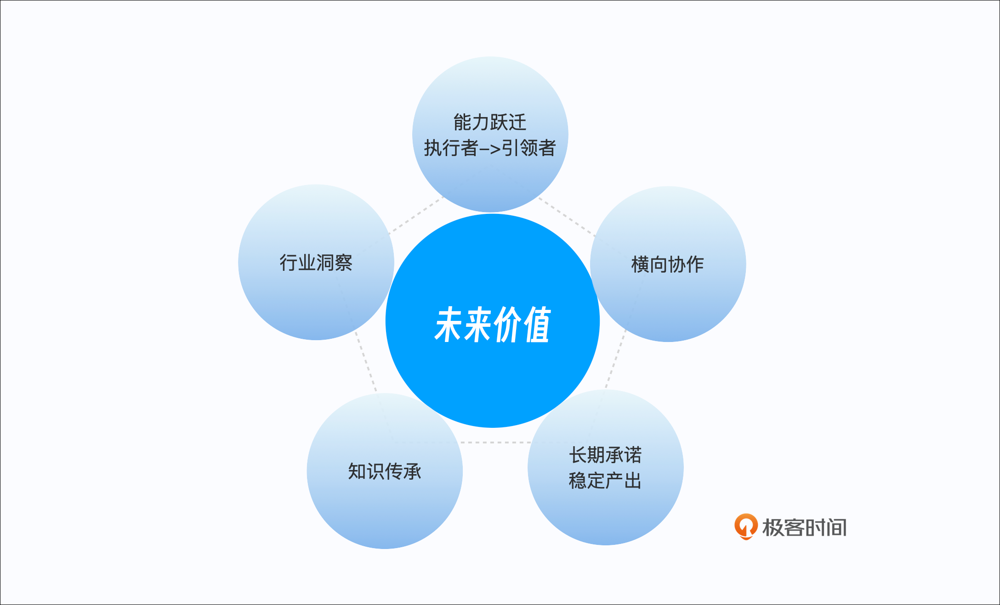
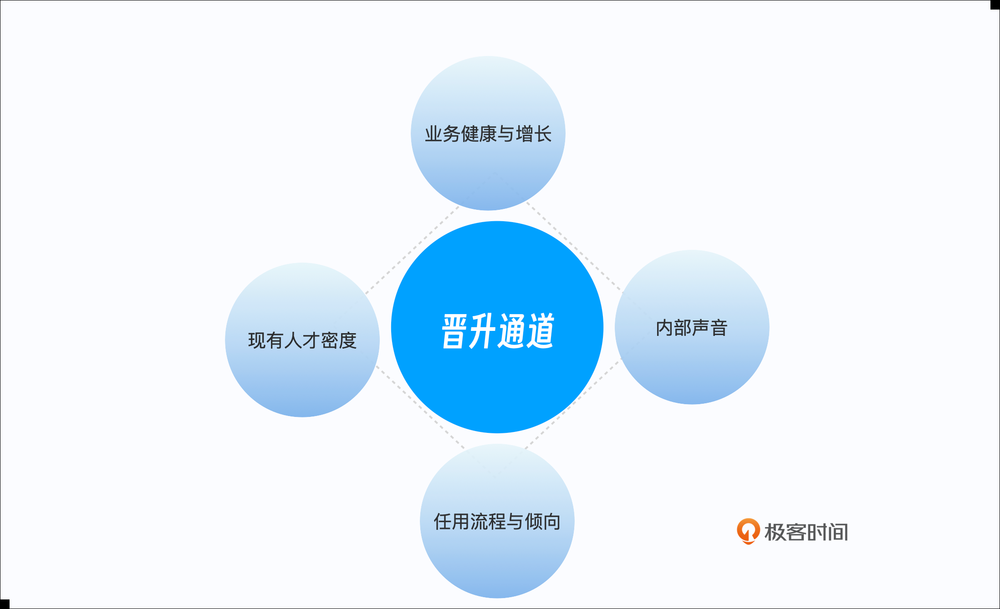

# 10 | 职级晋升指南：解锁技术人晋升密码（上）

你好，我是 Brook。

基于前面的学习，相信你已经对于 IT 从业者不同岗位所需的关键能力有了直观了解。今天我们就来聊聊职级晋升的方法论，我会从认知、能力、技巧三个角度，对晋升逻辑、平日与晋升季准备策略、晋升后注意事项逐一展开。

在互联网企业的职场生态中，晋升体系构成了技术人员职业发展的核心框架。下图来自知乎的@曾加，根据脉脉数据整理的大厂职级对应关系。以阿里为例，5-9 级分别对应工程师、高级工程师、技术专家、高级技术专家、总监岗位。

正如《领导梯队》中强调的，每一次晋升都要求工作理念、时间分配和核心技能的转型，从“管理自我”到“管理他人 / 项目”再到“管理业务 / 职能”。为了让论述更加清晰，我选取了技术人员“思维跨度”较大的“高级工程师到技术专家”这一阶段的晋升”，和你探讨具体的晋升方法。其他职级晋升，你可以参考前面章节提到的岗位能力，并参考这节课的思路进行准备。

- 图片来源：https://zhuanlan.zhihu.com/p/110443296

## 理解公司晋升逻辑

职级晋升，在互联网公司并不只是对“过往成果的奖励”。它本质上是一场基于价值的双向奔赴。公司通过晋升为你提供更多资源（包括参与战略决策、带团队、薪资增长等），核心逻辑在于看到了你身上超越当前职级的潜力。公司期待晋升后你能为组织创造更大的未来价值，因此希望与你建立更加长期与深入的合作关系。理解这一点，是后续所有准备工作的基石。

那么，具体到从高级工程师迈向专家岗位，公司最看重哪些“未来价值”呢？

区别于对高层人员战略视野、前沿技术产品落地领导力，以及基层人员的扎实的专业基础和高效的执行能力，对于高级工程师到专家岗位晋升的技术人员，公司通常有以下核心期待。

第一，能力跃迁，从“执行者”成长为“引领者”。在领域专业能力层面，要能以专家身份主导高影响力的技术创新或复杂项目的设计落地；并能够在他人遇到领域问题时，给与指导。同时在交付方面，能够从“任务思维”走向“价值思维”，与干系人合作交付业务价值；在协作层面，承上启下做好信息传递；包括对下传递必要的业务目标与战略方向，对上传递执行过程中具体的经验与风险。

第二，行业洞察力提升，理解行业发展，形成规划洞察。对所负责的子领域技术发展路线有洞察认知，对行业友商的实现方法与技术演进有深入理解；能够通过专业分析与数据洞察，对技术演进进行一定预判，并为战略规划提供有价值的建议。

第三，在团队中加速知识传承，分享经验，培养人才。通过经验分享、内部课程等方式，在组织中传承和沉淀知识；培养团队成员，有意识地通过辅导、授权、反馈等方式培养和赋能下属。

第四，长期承诺，主动拥抱战略，稳定产出。深刻理解并认同公司的核心战略方向，你的工作重心和努力方向能自觉与之对齐，展现出高度的战略定力与稳定性（忠诚度）。

除以上期待，一项常被忽略却至关重要的能力是“横向跨部门目标协同力”。它虽然不会直接写入晋升标准，却深刻影响结果。该项能力难以直接衡量，但可能通过日常业绩、评委打分（答辩前，找到自己部门与你熟悉的人了解情况）等隐式体现。作为骨干以上人员，对这一点一定要重视。

## 计划你的晋升

晋升不是临时冲刺的结果，日常积累与“项目式准备”都必不可少。日常工作中的能力、成果与口碑是晋升的基础，在计划晋升的初期，你需要拿到公司近年的晋升标准、了解晋升流程，像准备一个项目一样，筹备你的晋升。

具体的，从高级工程师迈向技术专家，日常工作中专业能力的提升与组织影响力构建逻辑，我们在第 6～9 节课中已经充分讨论。除此之外，有两项与晋升密切相关的外部环境因素，需要你特别关注。

### 晋升通道，是否敞开？

晋升，光有个人意愿和能力远远不够。公司本身必须提供清晰的路径和真实的机会。正如我们第三节课提到的“新人发展快车道”，在实际工作中，后面这几个因素可能影响晋升窗口的宽度。

第一，是业务（产品）健康度与增长性。公司或你所在的业务线是否处于上升期或稳定盈利期？

高速扩张的业务往往急需人才填补新岗位，晋升机会自然多；而持续收缩、盈利困难的业务，晋升名额可能极其有限，甚至冻结。关注公司财报（如果是上市公司）、内部战略沟通、产品 /市场人员交流，可以对业务基本面有更好的认知。

第二，要看现有人才密度。你不妨试试观察你目标职级的同事和上级，上一次目标职级的晋升是什么时间？

如果团队里资深专家“扎堆”且流动率低（“老人”不走），或者公司有大量外部空降高管，可能意味着内部晋升空间被挤压。反之，如果公司有明确的“内部提拔优先”文化，且看到同级别同事成功晋升案例（尤其是近 1-2 年），则是积极信号。

第三，要看任用流程与倾向。公司是否有公开、可预期的晋升机制？如每年固定时间窗口、明确的职级体系、公开的评审标准。过往成功晋升者，他们做了什么？业务价值几何？内外部评价如何？我们可以推测晋升背后的逻辑，以及管理层偏好的人才画像。

第四，听听“内部声音”。与信任的、已晋升的同事或导师坦诚交流，了解他们经历的流程、遇到的挑战以及公司对目标职级的真实期待。这通常比官方文件都更具参考价值。

在实际带团队过程中，我曾看到一位优秀且具备潜力的高级工程师，由于所服务产品质量不佳，日常工作反复救火，价值难以清晰呈现，尽管有不错绩效，但在高级工程师岗位数年无法晋升。因此，如果判断晋升窗口不通畅，应当再次判断个人与环境的适配度；若决定继续坚持，则应把更多精力放在提升综合实力（技术实力、内部影响力）上。

需要注意的是，当下无晋升通道 ≠ 立即离场信号，可能是黎明前的“价值重组”。阿里云在创立前三年，业务面临严峻挑战。因项目长期无进展、内部质疑声浪高涨，员工离职 / 转岗率接近80%，技术故障频发，连内部客户阿里金融都险些弃用。但走到 2013-2014 年，得益于产品质量的持续改善，阿里云的口碑开始逆转，坚持下来的核心员工获得超额回报；王坚先生也在2019 年被评为中科院院士。

类似的故事在创业公司中更是鳞次栉比，多数公司在发展过程中会经历阵痛甚至收缩。当下没有晋升通道，未必是离开的信号，而可能是“价值重组期”。若你所在企业仍具技术积淀、战略定力或市场潜力，不妨以“创业者心态”参与其转型——你的坚持，或许正孕育了下一轮爆发。

### 公司价值观与培养模式，个人是否认同？

晋升意味着你将在更高层面代表公司，承担更大责任，也必然更深地卷入其文化、战略甚至潜在问题中。

尤其对于中小型公司，在晋升前建议你考虑一下后面几个问题。

- 核心价值观认同吗？你是否真正认同公司的使命、愿景和核心价值观？晋升后，你将成为这些理念更重要的“布道者”和践行者。如果内心对公司追求的目标（比如“唯增长论”、“狼性文化”、“特定商业模式”）有强烈抵触，晋升后的角色会让你倍感煎熬。

- 长期战略看好吗？你是否看好公司未来几年的发展方向和战略路径？晋升是一种长期承诺的信号。如果你对公司战略心存疑虑（如技术路线选择、市场判断、商业化策略），或者认为其正在偏离正确轨道，那么接受晋升可能意味着未来面临更大的价值观冲突或职业风险。

- 文化氛围适应吗？你是否能适应并愿意融入公司当前的工作氛围、协作方式和领导风格？晋升后，你不仅是被动适应者，更要主动塑造和维护这种文化。如果公司的文化与你的工作风格、生活追求（如极度追求效率牺牲生活平衡）格格不入，晋升带来的压力可能远超收益。

- 信任核心管理层吗？你是否对公司的核心管理层（至少一位与你密切相关的上级，以及公司老板）的品格、能力和决策有基本的信任？晋升后你将与他们更紧密合作，甚至成为“利益共同体”。缺乏信任的基础，合作将充满猜忌和摩擦。

晋升不是终点，而是更深绑定关系的起点。它要求你不仅在能力上达标，更在心理和价值观层面做好准备，愿意与这家公司共赴下一段旅程。如果内心有强烈的“不认同感”或“不信任感”，需要审慎判断，是否要花费时间成本，推进晋升事宜。

## 课程总结

职级晋升是一场基于未来价值的“双向奔赴”，公司看重的是你超越当前职级的潜力。以迈向“技术专家”为例，核心是实现四大跃迁：从执行到引领、形成技术洞察、主动传承知识、并与战略长期对齐。此外，“横向协同”能力虽常被忽略，却至关重要。

个人努力是基础，但外部环境同样关键。需理性判断：业务是否在发展？团队有无晋升空间？公司文化是否支持内部提拔？最后，晋升意味着更深度的绑定。它不仅是能力的认证，更要求你对公司的价值观和战略有真正的认同。这是一场需要能力与意愿双重准备的旅程。

在充分了解“晋升季”前所需的准备的基础上，下一节课我们将围绕“晋升季”准备与答辩、晋升后复盘与总结两个方面，进行展开。完整的“职级晋升”总结与课后练习，也将在下节课中给出。

恭喜你完成第 10 节课的打卡，欢迎你在留言区与我交流讨论。如果今天的内容让你有所收获，也欢迎转发给有需要的朋友，我们下节课再见！
