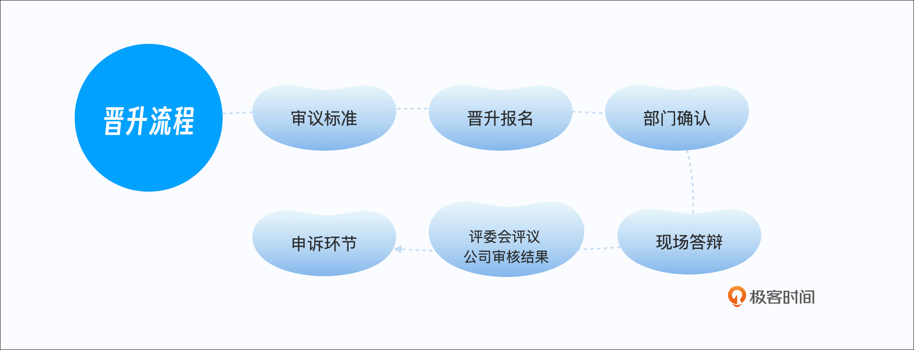
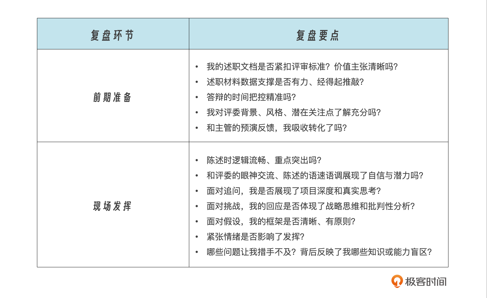

# 11 | 职级晋升指南：解锁技术人晋升密码（下）

你好，我是 Brook。

上节课我们围绕“理解公司晋升逻辑”“计划你的晋升”两部分，讨论了“晋升季”前所需的准备。这节课我们将围绕“晋升季”准备与答辩、晋升后复盘与总结两个方面展开。

## “晋升季”准备与答辩

当公司进入晋升周期（“晋升季”）时，候选人需要集中精力准备晋升材料和答辩。接下来，我们就看看晋升季中需要注意的几个关键环节。

### 获取晋升资格

大中型公司的晋升流程相对稳定，通常包括以下环节。

- 审议标准：HR 部门与业务部门，（成立委员会）审议晋升标准并组织评委，获得公司批准。

- 晋升报名：下发流程启动通知，员工根据标准向主管（正常途径）或公司（自主申报，为与部门相处不愉快但特别优秀员工留有通道）报名。

- 部门确认：HR 与部门合议晋升答辩名单、与评委确认答辩时间，邮件或直接主管通知参与答辩晋升，并给出晋升答辩材料模板。

- 现场答辩：员工进行现场述职、评委问答；部分公司有直接主管介绍、评委现场建议等环节。

- 评委会评议，公司审核结果：对争议情况、整体晋升人数与预期有明显差异的情况，进行拉通审议；报公司审核结果，邮件通知。

- 申诉环节：如特别不满，可以申诉。但实际操作更多是情绪安慰。

作为待晋升专家岗位的员工而言，获得部门推荐晋升资格通常有这几方面的要素：绩效、横向口碑和部分关键加分项。

绩效是硬通货。过去 1-2 年，你的绩效必须稳定在中等偏上（前 50% 或更高）。这证明你持续解决了真实问题，交付了可靠结果。与直接主管、间接主管建立了稳固的信任协作关系是隐形门槛。就像《关键对话》强调的，信任是高效协作的基础。

横向口碑是润滑剂，兄弟部门主管或关键合作伙伴对你的评价不能是负面拖累。积极正面的评价（靠谱、专业、好合作）是加分项。评委提前获知名单后，如果人员刚好与自己部门有合作，很可能会在答辩前咨询对接人待晋升者在合作中的表现。

另外还有部分关键加分项，包括担任过核心项目的核心成员（证明抗压能力与价值贡献）、具备带人经验（带领员工发展良好）、获得过公司级技术或组织奖项（如技术创新奖、优秀项目奖、跨部门合作奖等）。

### 晋升材料的准备

接下来就是重头戏——晋升材料的准备。晋升材料是你价值的“可视化报告”。评委时间有限，你必须精准传达核心信息。

关于材料准备，建议参考以下四条原则。

第一，紧密围绕打分规则。务必吃透公司提供的评分维度，主动找主管或当过评委的同事请教，理解评委评分标准（基本是围绕评分维度）与答辩侧重点。

在我参与的真实的晋升答辩中，有候选人上来花费了接近 10 分钟深情回顾“成长心路”，导致45 分钟答辩时间里很多关键要点没来得及充分展示讨论。这种情况评委会认为候选人主次不分，很难打出高分。

第二，价值导向，拒绝流水账。材料核心在于阐述你为公司创造的核心价值。围绕评分标准，选择最能体现你达到甚至超越目标职级能力的 2-3 个关键项目深入展开。这里的典型反例是，把答辩材料写成“工作清单”。简单的列举，会让评委认为你只是被动执行者，缺乏主动思考和深度贡献。

第三，量化佐证，穿透表象。用具体、可衡量、有对比的数据证明你的成果，并分析为何达到此指标是一件了不起的工作。

比如你的工作是提升了 30% 系统性能，节省了百万级成本，还是驱动用户增长 15%？提升之后，和国际、国内友商相比指标是否领先？为什么提升 30% 性能是一个合理的指标，而非提升 50%，或者提升 20%？

注意部分候选人材料准备上没有充分的数据佐证，评委不得不会后找人确认你所述关键数据的真实性。这种情况极容易节外生枝，为答辩结果带来不必要的变数。

第四，演练打磨，从容呈现。在我做评委评审职级晋升时，时常遇到候选人为了佐证，粘贴了部分自己并不熟悉的业务材料，当评委提问时，发现价值逻辑无法闭环，比如，材料能够证明业务价值，但无法证明业务价值是由于自己优化功能带来的；也有候选人答辩时因紧张语速过快、逻辑混乱，或 PPT 文字密密麻麻只能低头念稿。

这些细节，都体现出答辩人事前准备并不充分。所以建议你在答辩前充分练习，避免 PPT 堆满文字和照着文本念稿。最好可以提炼出关键词句，用图表辅助理解。练习时注意眼神交流、语速平稳、展现自信。此外可以录音录像回看调整，条件允许的情况下，主动邀请你的直属上级进行模拟答辩与问答，以便答辩现场呈现更加从容、自信。

### 答辩时的问题应答

职级晋升评委致力于为公司选拔高潜人才，因此会带着挑战的目光，直指核心的问题考验你的思维深度。

答辩提问可以分为以下几种类型，我们依次来看看其中的典型的问题和应对思路。

第一类属于基础信息追问，目的是深挖细节，验证真实性。

典型问题包括：“翻到第 X 页，详细讲讲你克服 XX 技术难点的具体步骤？”“这个创新点，业界有没有类似方案？你们的差异在哪？”“你提到带了新人，具体怎么辅导的？他成长如何？”

应对这类问题，要满足诚实、具体、结构化这三大要素。 基于事实回答，展示你对项目的深度参与和思考。用 STAR 原则（情境、任务、行动、结果）组织答案更清晰。注意如果评委问到你并不了解的问题，建议如实陈述“了解不深”并讲述为何对你现阶段贡献并不重要，接下来会深入学习了解。已读乱回并被评委当场识破，是回答此类问题的大忌，会让评委质疑你之前所有内容的真实性，基本意味着答辩无法通过。

第二类是要点延伸的提问，相对更有挑战性，这是为了向答辩人施加压力，考察思考深度。

典型问题包括：“为何采用此种技术路线？对比其他路线我们的优劣势在哪？”“你的技术创新，如何直接支撑了部门的季度业务目标？”“提升 5% 就够了吗？为什么不是 10% 或更高？瓶颈在哪？”

这类问题，我们的应对思路是以价值为基，以数据为锚，展现战略思维与批判性思考。明确将你的工作与更高层目标（团队 / 部门 / 公司 OKR）挂钩。例如：“优化 XX 性能，直接支撑了产品 XX 功能的稳定上线，该功能是部门本季度提升用户留存的关键举措，上线后留存率提升了 Y%。”

注意，回答此类问题时，一味强调“领导 / 部门安排的”并无法讲出自己对安排的理解与思考，会暴露缺乏全局观和深度思考，通常是重要减分项。针对评委对数据的质疑，要清晰解释指标选择的合理性、局限性及上下文。坦诚瓶颈，并说明后续优化思路。

第三类是未来情景假设的问题，用意是考察你的潜力与应变力，以及未来能力就绪度。

典型问题有这样几个：“假如让你负责 XX 创新技术研发，你的初步思路是？”“如果你负责 XX方向，如何基于当前产品技术路线、组织规模，将 AI 技术与该领域结合？” “如果在跨部门合作中遇到强烈阻力，你会怎么办？”

对于这类问题，更多靠我们的平日积累，毕竟你还没处在对应岗位上，因此体现你的思考，逻辑清晰言之有理，通常评委不会过度苛求。

对于新业务思路、解决冲突这类复杂的问题，要注意快速构建一个逻辑框架，方便你向评审展现系统思考能力与逻辑思维。比如先分析问题核心，再明确目标，随后列出可行方案，之后评估风险、收益，最终选择最优解。

## 晋升后复盘与总结

晋升结果揭晓，无论是喜悦还是遗憾，此刻的复盘与沟通，才是真正决定你未来能走多远的智慧之举。它帮你将一次性“事件”，转化为持续成长的“燃料”。

总结可以从个人复盘和与上级沟通这两个维度进行。

个人复盘主要关注材料准备是否充足，临场发挥是否得当，后续应当如何改进？

复盘的目的是为了让我们进步，根据前面的复盘分析，你可以明确 1～3 个自己最需要提升的核心点，再相应制定具体、可衡量的改进计划，帮助自己持续提升能力。

另一方面，上级沟通也很重要，这能让我们巩固信任、明确未来方向。真诚致谢，表明态度：无论结果，首先感谢主管给予的晋升答辩机会，和在准备过程中的支持（如指导、资源协调）。

另外，建议你主动询问主管从评委处获取的具体反馈（哪些能力被认可？哪些是短板？）以及主管看法，并借此机会交流未来发展期望。询问反馈时，注意倾听，不辩解，只求清晰理解；对齐未来时，将个人发展目标与团队 / 部门目标进行链接，明确自己下一步如何更好地为团队创造价值。

## 课程总结

这两节课我们就“技术人员如何晋升”这一话题展开讨论。公司晋升的本质是“未来价值预购”，核心是看到了你身上超越当前职级的潜力，希望与你建立更加长期与深入的合作关系。作为技术人员，如果判断有晋升机会并希望完成晋升，可以从以下维度准备：

1. 获取晋升答辩资格：深耕专业能力，在核心领域建立竞争优势；主动担责，争取核心项目，拿到关键价值并锻炼领导力；沉淀组织影响力，通过内部分享、合作，提升个人在组织的影响力；基于以上价值，拿到好的绩效结果，获取晋升答辩资格。

2. 答辩材料“可视化个人贡献”：紧密围绕打分规则，通过严密、量化的数据穿透表象，佐证个人工作为公司或产品创造的价值。条件允许情况下，提前与上级进行答辩模拟，提前识别问题。

3. 答辩现场自信应对挑战：对于现场评委问题进行提前预演，基础信息追问类问题，诚实、具体、结构化回应；要点延伸挑战类问题，以价值为基，以数据为锚，展现战略思维与批判性思考；未来情景假设类问题，提前预设回应框架，逻辑清晰应答体现个人潜力与能力就绪。

4. 答辩结束积极复盘总结：无论结果是否通过，通过个人复盘、上级沟通将整个晋升准备过程，沉淀为你未来能力提升的养分。

## 课后练习

1. 回顾你过去半年主导或深度参与的核心项目，尝试用“价值闭环”方法进行提炼：“我的工作（具体技术动作）” → “解决了什么关键问题 / 创造了什么独特价值（量化数据支撑）” → “如何直接支撑了团队 / 部门 / 公司的哪个战略目标（OKR/KPI 关联）”？如果难以清晰表述其中任一环节，你认为最大的障碍是什么？（是缺乏数据意识？对上层目标理解不清？还是价值提炼能力不足？）

2. 回顾你上次职级晋升答辩，进行复盘：除“材料优化”、“表达提升”等显性动作外，评委追问或挑战中最让你措手不及的一个问题，暴露了你哪项底层能力的不足？针对这项能力，制定一个包含“90 天具体行动 + 可衡量里程碑”的攻坚计划。

恭喜你完成第 11 节课的打卡，欢迎你在留言区与我交流讨论。如果今天的内容让你有所收获，也欢迎转发给有需要的朋友，我们下节课再见！
