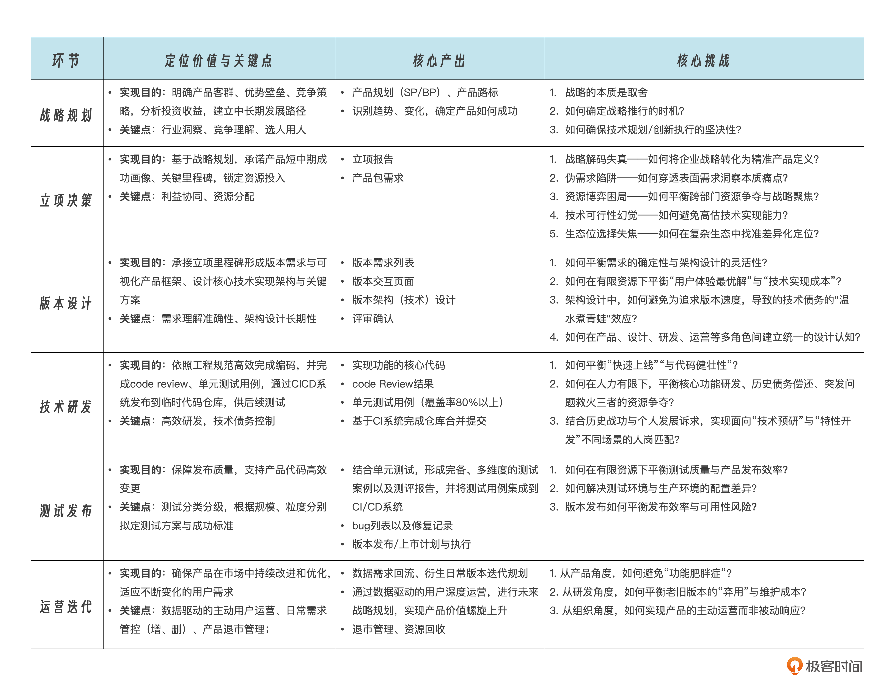
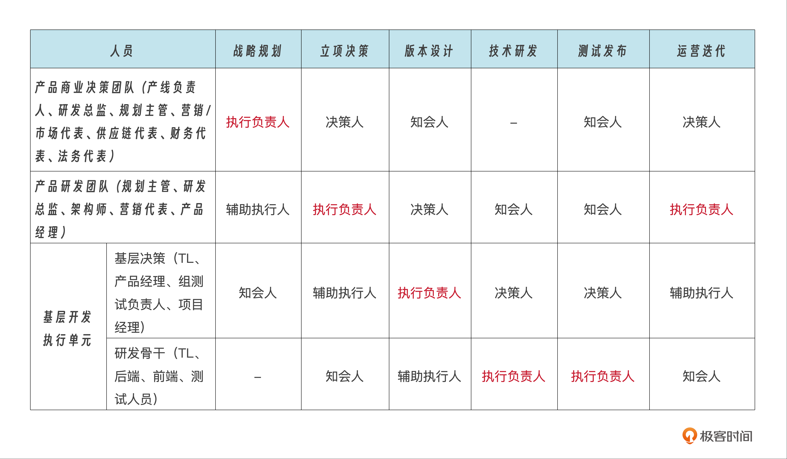

# 14 | 业务理解力，是中高级研发人员的核心竞争力

你好，我是 Brook。

上一章中，我们借助小 A 从职场新人成长为架构师或研发总监的案例，分析了职业发展各关键阶段的岗位能力变化，以及如何突破决策困境、实现跃迁。这一章，我们将聚焦“业务理解”这一核心协同能力，带你系统理解业务思维的本质，助你在 AI 的时代洪流中，锻造不可替代的核心竞争力。

我们会一起拆解业务理解能力的关键维度，分析技术、产品、运营等角色在价值创造链条中的不同分工与目标。你将看到一款优秀产品从战略规划、实施落地到持续运营的全过程，理解产品生态中不同职能如何协同共赢。最终目的是帮助你跳出单一职能视角，在协作中更精准地定位自身价值，放大专业贡献。

## 业务理解力的重要性

在代码与商业的交界处，单纯的技术能力可以帮你获得晋升，但真正决定你发展上限的，是对业务的深刻理解。

Netflix 很早就在文化准则中明确提出：“每个程序员都必须理解公司的业务”。华为的任正非也一再强调，研发创新必须对准企业的核心价值，否则就是纯粹的浪费。这些行业巨擘的共识揭示了一个现实：只懂技术的研发者，更像“高级技工”，在 AI 时代面临巨大挑战；而真正能够将技术转化为业务动能的人，才是组织真正需要的，会承担更重要的角色。

就像支付宝的工程师将防控“资损率”，转化为“一年为公司避免了数十亿级的损失”；抖音团队从用户短视频停留时长中，敏锐捕捉到本地生活的业务机遇；这些背后都是业务理解力在发挥作用。

这种能力并不只是高层专属的。它是技术负责人争取资源，突破工具人角色的关键筹码，也是每一位希望从执行走向决策的研发人员的必备素养。当你能用“库存周转率”来论证缓存方案，用“用户终身价值（LTV）”评估算法优先级，技术的价值就不再隐藏在日志里，而是会真正转化为你的团队资源与个人贡献。

## 技术人员提升“业务理解力”的挑战

尽管意识到了提升“业务理解力”的重要性，但许多技术人员在从代码走向商业的过程中，也会遇到认知、时间和组织等多重阻力。

第一个常见挑战，是技术思维与业务视角之间的认知差异。尤其在成熟公司，战略和立项流程对技术团队来说，有时就像一个“黑盒子”。不少技术负责人容易陷入“实现优先”，而忽视价值来源。比如，团队可能投入大量精力为分库分表的优雅方案争论三天，却忽略了看似不起眼的“排序算法”，导致支付转化率降低 0.1%，这背后可能是千万级别的 GMV 损失。

第二重挑战来自时间分配和激励体系的错位。研发工作本身已经非常碎片化了，设计、开发、调试、应急处理占据了大量精力，很难抽出整块时间深入业务。更现实的是，很多部门对研发的绩效，仍然只考核技术指标，如接口耗时、测试覆盖率等，却很少关联用户留存或商业贡献。

我们不妨想象这样一个场景，某短视频团队的工程师本想分析 CDN 加速对用户跳出率的影响，却被临时安排处理三个紧急 BUG——这种“业务探索让位于技术救火”的局面并不罕见。时间和激励的双重缺失，很大程度上压缩了技术人员在业务理解方面的成长空间。

此外，组织架构与数据权限也会形成信息壁垒。很多关键业务数据，比如客户投诉、用户画像、营收模型等，常常散落在不同系统中，甚至被权限隔离。如果技术团队无法接触到真实的客户反馈和市场数据，“理解业务”便无从谈起。

## 技术人员如何提升“业务理解力”？

要有效提升业务理解力，作为研发，我们可以聚焦两个实用方法，并在实际工作中逐步实践。

首先，主动了解公司的产品构建体系，并结合自身岗位“向前多跨半步”。这意味着你需要有意识地去理解产品从战略规划、需求分析，到资源分配、版本迭代和最终运营效果评估的全流程。了解产品团队是如何工作的、他们关注什么指标、决策依据是什么，这些会极大帮助你找到技术工作与业务目标之间的连接点。

其次，基于所找到的结合点，有意识地与产品、运营等角色建立协同共赢关系。例如，可以通过目标互锁、定期沟通和项目协作，主动融入业务决策的早期环节。这样不仅能让技术方案更贴近实际需求，也能让你的专业贡献更清晰地被看到。

接下来，我们以践行 IPD 流程的企业产品研发场景为例，具体聊聊刚才的方法如何应用。

### Step 1：了解公司产品构建体系

很多公司都在借鉴成熟的产品开发框架来提升协同效率，其中最具代表性的是 IBM 提出的并被华为等企业成功本土化落地的 IPD（集成产品开发）流程。

这一体系将产品研发明确划分为多个阶段和决策评审点，并定义了不同角色的职责与协作方式。

具体来说，IBM 将产品研发分为 6 个阶段、4 个决策评审点、6 个技术评审点、9 类角色；再结合战略规划系统，形成体系化产品构建方案。关于这一体系的详细介绍，业界有大量专门的书籍。如果公司想要完整导入体系，通常需要专门的流程部进行跟踪。

你不需要完全掌握 IPD 的所有细节，但理解其中的核心阶段非常有助于你融入业务语境。这里我整理了一张表格，把产品的完整生命周期划分为 6 项关键动作，分别是战略规划、立项决策、版本设计、技术研发、测试发布，以及运营迭代。

表里面每个阶段都有明确的输出物、责任人与关键挑战。你可以大致看一下，先留个印象，后面课程里我还会详细展开。

同时，参与这些流程的角色一般分为：商业决策团队、产品研发团队和开发执行单元，并进一步区分出决策人、执行负责人、辅助执行人和知会人四种类型，具体人员与流程对应关系你可以参考我给出的表格。

这个框架可以帮助我们看清自己工作在全局中的位置，知道该与谁沟通、何时介入、输出什么价值。我们不需要成为流程专家，但要能用业务语言对话，用技术能力支撑业务结果——这才是提升业务理解力的根本目的。

### Step2：建立协同共赢关系

在理解了公司的产品构建体系之后，下一步的关键就是主动与对应流程负责人建立高效协作，通过持续沟通和共同实践，逐步培养自己的业务思维。具体可以分三步来落实。

首先，采用逆向需求分析法，从理解到内化。接到需求的时候，不要急着投入开发，而是应该先与产品接口人深入沟通，搞清楚用户实际的使用场景和背后的业务目标。发布前，不妨以用户身份完整走一遍流程，记录体验上的卡点，进一步理解功能对用户的价值。功能上线后，主动跟进用户反馈和数据变化，尝试测算这个功能的投入产出比。

这些动作不需要占用大量时间，却能帮你逐步建立起对产品价值的直觉反应，熟悉业务的语言和节奏。

其次，有意识地构建共赢协同机制，使自己从被动的“需求接收方”转变为“价值共创者”。当你逐渐能用产品视角看问题，就可以更主动地参与前期讨论，甚至推动建立更协同的工作流程。

例如，把技术债务转化为产品能理解的“潜在故障损失”，协助产品同事将需求按业务价值量化并排序。你们还可以共同设计数据埋点，主动挖掘新的用户痛点。如果条件允许，尝试推动产研双方在绩效目标上实现互锁，把原来各自独立的 OKR，转变为共同承担业务结果的联合目标。

最后，争取参与完整的项目周期，通过实战积累业务体感。在一些先进团队，高阶技术角色本身就要深度参与从战略规划到运营推广的全流程。例如，架构师可以在规划阶段分享技术趋势洞察，在立项阶段评估资源投入，在开发阶段主导关键设计，并协助产品团队拜访客户，实现产品推广和迭代。每一次跨职能的实践，都是将技术能力转化为业务影响力的机会，也会实实在在地提升你的业务理解力。

随着 AI 技术的快速发展和企业智能化转型的不断深入，技术与业务之间的边界变得越来越模糊。基于大模型的辅助编码工具，乃至低代码平台，正在改变传统的开发模式。

在这样的背景下，既懂技术又懂业务的复合型人才，会成为组织中越来越受重视的核心资产。无论是互联网大厂还是传统企业的数字化团队，都更青睐那些能用自己的技术能力推动业务增长的人。

技术人提升业务理解力，不是一个短期任务，而是一个需要持续投入的长期过程。它要求我们从思想上真正重视，更要在日常工作中主动实践。这个过程不仅能够让你更好地支持企业的创新与增长，也会让你个人逐渐跳出“执行者”的角色，走向更广阔的职业空间。

## 课程总结

业务理解力，已经成为中高级研发人员不可或缺的核心竞争力。它远不止于“知道业务是做什么的”，而是指技术人能够穿透需求表象，洞察用户痛点与商业目标，并将技术能力精准转化为业务价值的能力。

这节课，我们探讨了技术人员在提升这项能力时常见的挑战，包括认知视角的差异、时间与激励体系的错位，以及组织内部的信息壁垒。面对这些挑战，有效的方法包括逆向分析需求、与产品运营共建共赢协同机制，以及尽可能参与完整项目周期，积累跨职能实战经验。

就像 Netflix、华为等领先企业所实践的那样，技术与业务深度融合已经是明确趋势。真正的技术成长，不仅在于更快的实现与更优的架构，也体现在将技术动能转化为业务势能，让技术价值被看见、被需要、被依赖。

培养业务思维，不但意味着个人竞争力的突破，更是一条走向更高影响力和更宽职业道路的关键路径。但这个过程并非一蹴而就，而是需要长期投入。后续课程里，我还会继续结合案例与你探讨业务思维的养成，敬请期待。

## 思考题

为了帮助你将课程内容转化为实际能力，我们设计了以下两项练习。建议你根据自身角色选择一项完成。

练习一：为你的代码写一份“价值说明书”（主要面向：技术骨干）

在下一次开发需求时，不要立刻开始写代码。请先尝试回答以下问题，并找你对应的产品接口人聊一聊。

1. 这个功能期望解决的核心用户问题是什么？

2. 上线后，怎样才算“成功”？请尝试列出 1-2 个可衡量的业务指标（例如：用户留存率、下单转化率、投诉量降低比例等）。

3. 你的技术方案（比如引入缓存、选用异步流程、进行代码抽象等）会如何直接影响这些业务结果？

练习二：设计一个“产研互锁 OKR”草案（主要面向：基层 TL / 研发总监 / 架构师）

回顾你或你的团队当前的技术性目标（如优化性能、降低故障率等）。思考并尝试起草一个与业务方“捆绑”的联合 OKR。

【O】（共同目标）：例如“提升 XX 核心场景的用户转化率”

【KR1】（产品关键结果）：“优化商品下单路径，减少 2 步操作”

【KR2】（技术关键结果）：“确保核心接口 P99 耗时＜200ms，系统 SLA > 99.99%，保障流程流畅性”

恭喜你完成第 14 节课的打卡，欢迎你在留言区与我交流讨论。如果今天的内容让你有所收获，也欢迎转发给有需要的朋友，我们下节课再见！
