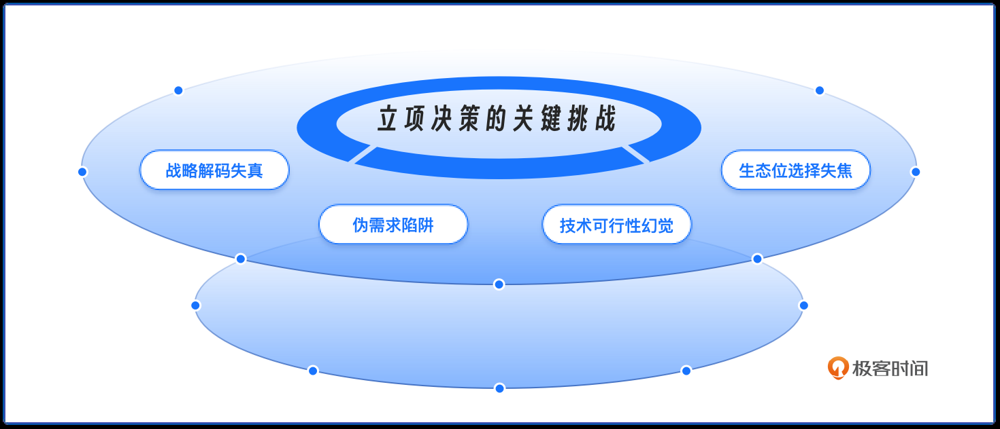
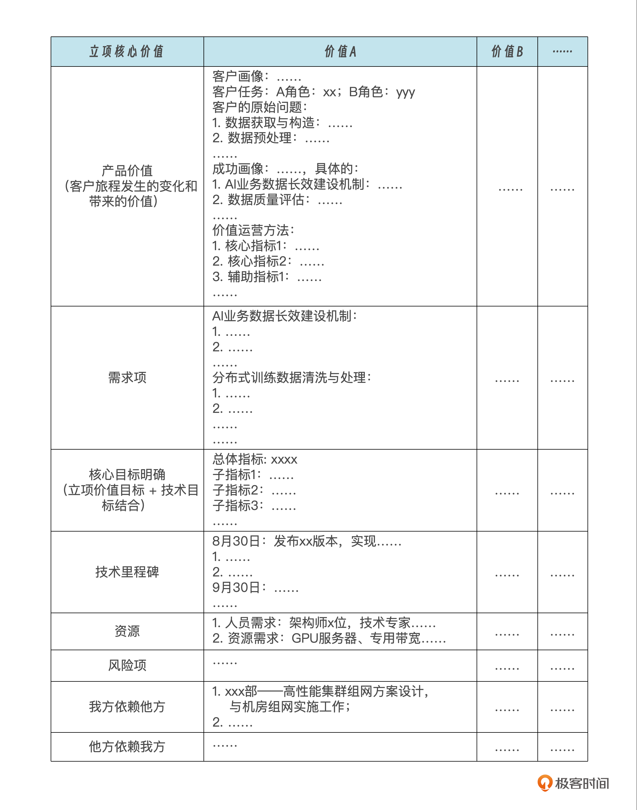
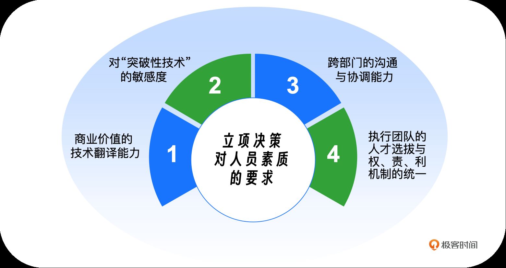

# 16 | 立项决策：需求澄清，价值锁定

你好，我是 Brook。

上节课我们介绍了战略规划的重要性、关键挑战、核心方法、对人员素质的要求，以及 AI 发展对战略规划的影响。这节课我们将聚焦产品“立项决策”环节，共同探寻如何将“战略意图”转化成可执行的路线图。

## 立项决策的本质与重要性

产品立项是战略规划转化为实际开发的关键枢纽，它直接影响产品的节奏安排、实现路径与资源投入。这一环节向上承接战略的核心价值主张，向下接轨执行层的功能模块设计，正如雷军所说：“找准风口只是开始，能否将战略转化为可执行的作战地图，决定了企业是在造飞机还是放风筝。”通过严谨的商业论证，产品立项将企业战略拆解为可落地的产品路线图，有效避免资源被消耗在伪需求或非战略机会点上。

产品立项的关键交付，是推动团队在整体目标上达成共识，并构建一套“风险过滤系统”（覆盖财务、业务、技术、营销、销售、法律及道德等维度）。产品立项聚焦于回答以下三个核心问题：

- 产品是否带来足够高的用户价值，以覆盖其迁移成本？

- 团队是否能在时间窗口内完成产品构建？

- 产品方案是否有助于战略愿景的长期实现？

字节跳动 2016 年对抖音的立项论证，是一个经典案例。尽管当时快手已占据短视频赛道先机，团队仍从三个维度展开深度推演：一是通过数据挖掘发现下沉市场对“潮酷内容”存在需求缺口；二是验证了 15 秒竖屏形式有助于提升注意力捕获率；三是测算出推荐算法每周需迭代3 次才能构筑壁垒。这种立体化的评估，使抖音在开发前就明确了“潮流文化＋智能分发”的差异化定位，最终仅 12 个月实现 DAU 破亿，重塑行业格局。

同样，2019 年京东健康在独立运营前的立项过程中，系统绘制了“医药电商－互联网医疗－健康管理”三层价值网络，预估供应链数字化可降低 28% 的药品流通成本，并提前验证医保在线支付的政策可行性。这一结构化分析，不仅规避了早期京东大药房面临的处方流转难题，也精准推动“医＋药＋险”闭环的形成，助力其上市首日市值突破 3000 亿港元。

根据 IDC 的研究，严格执行立项评审的企业，产品成功率可提升 65%，开发周期缩短 30%。尤其在 AI 原生应用兴起的当下，立项阶段更需要融入对技术可行性的预判。只有当团队在立项时便完成技术成熟度评估、数据资产盘点与伦理风险预判，才能真正实现战略与产品落地之间的无缝衔接。

立项决策的关键挑战

在产品立项阶段，企业往往会遇到几类非常典型的挑战。能否有效应对，常常决定了产品最终的成败。

第一个常见挑战，是战略解码失真。张小龙强调：“产品经理要有能力把战略翻译成用户可感知的最小功能单元。”如何将看似抽象的企业战略，精准转化为清晰、可执行的产品定义，是一大难题。比如 2017 年，一家 AI 独角兽公司在立项智能客服系统时，误将“产业智能化”简单理解为技术堆砌，最终开发出一套同时集成 NLP、知识图谱等 8 种技术的臃肿系统。臃肿的系统看似满足需求，但使用体验不佳，最终无法实现规模化复制，被阿里、华为等云厂商“垂直场景深度适配”的策略后来居上。

第二个挑战，是伪需求陷阱。王慧文在《清华产品课》中讲到，大部分“需求”是不值得被满足的（需求 -> 可被满足的需求 -> ROI 为正的需求 -> 支持一个团队规模化运作的需求 -> 能让一个公司有竞争力的生存的需求）。优秀团队的做法，是基于愿景和目标，通过观察用户行为、分析使用数据，结合技术趋势，来识别真实问题，避免在“伪需求”中耗费大量资源。

字节跳动在立项飞书时，就曾遇到类似情况：初期调研中，86% 的企业用户表示“需要更强大的会议录制”，但深度数据分析显示，真痛点其实是“跨时区团队的异步协同”。团队果断砍掉20 项表面需求，聚焦“时间轴 + 评论批注”这一核心，最终实现年度经常性收入增长 300%。

第三项挑战，是技术可行性幻觉。在各大成熟公司的 IPD 流程中，规划与立项必须要有技术人员的深度参与，部分公司要求技术路线图必须包含三个版本：理想版、现实版和保底版，就是为了应对这一挑战。典型例子是某智能硬件团队在立项 AI 翻译机时，高估了端侧算力发展速度。原计划的实时同声传译功能因硬件性能不足，被迫降级为“语音输入 + 云端翻译”，结果错失市场窗口，被科大讯飞抢先。

第四项挑战，是生态位选择失焦。《从优秀到卓越》的作者吉姆·柯林斯提出，表现良好的公司跨越瓶颈、实现卓越的关键，是践行“刺猬理论”，将复杂的世界简化为一个单一而核心的指导理念。在产品立项中，面对已有竞争格局，要围绕战略愿景中的“核心理念”持续强化优势。比如拼多多基于下沉市场优势，在立项“多多买菜”时，没有照搬美团模式，而是通过“农产区直连社区”，用产地分拣仓替代中心仓，将损耗率从行业平均 15% 降到 6%，成功实现差异化卡位。

立项决策挑战应对方法

面对这些常见挑战，一套结构化的四维决策框架往往能带来更清晰的思考路径。它从战略一致性、需求真实性、资源可行性和技术可实现性这四个关键维度，系统性地引导团队做出更稳健的立项决策。

为了帮你把这些原则落地，我准备了一套“立项需求澄清工作表”，用来引导需求调研过程中的关键动作。具体每部分确认，可能需要通过多个子步骤完成。

表格的第一行，是产品价值。产品价值发现的核心思路是：** 产品价值 =（用户迁移体验 / 成本 - 用户原有体验 / 成本）- 用户迁移成本。** 客户访谈是发现产品价值的首要步骤。客户访谈主要解决以下问题：

1. 明确调研用户画像（eg：是产品使用者还是购买者？例如儿童玩具，有时两者并不相同）、客户当前痛点。

2. 客户当前是如何面对这个痛点的，解决方法是什么（判断是否真的痛，当前方案是否有显著优化空间）？

3. 在当前解决方案下，用户核心期望是什么（“成功解决痛点”的画像是什么，判断当前差距）？

4. “产品解决方案”价值预判：预期我们能做什么，能给用户带来多大收益？为了这部分收益，用户需要付出怎样的成本？对他来讲，性价比是否高，是否会买单？

在针对用户原始痛点进行初步筛选、明确具备解决价值之后，我们需要深入用户旅程拆解具体需求。以 AI 开发平台中数据子平台构建为例，我们将场景大类分为数据获取与构造、数据预处理、数据质量评估等场景大类，每个大类进一步拆分场景、典型用户问题，清晰描述每一个旅程点中用户痛点，从而为后续规划产品关键价值、拆解功能奠定基础。

在充分整理分析用户旅程的基础上，通过提炼总结关键价值目标、优先级排序形成成功画像，并明确成效指标与检视方法，同时产出需求项。到这里，我们就完成了衡量产品价值的各项子指标，如产品增益、用户迁移成本的深入分析，并明确了迭代成功后的画像与后续主要特性需求（用户故事 - 用户特性）。

接下来需要产品团队与研发团队紧密共创，看是否能在时间窗口内达成。首先，产品团队负责人需要与技术负责人（架构师、研发主管等）将业务目标拆解映射成可衡量的技术目标。其次，技术负责人需要与 Tech leader、资深技术专家协作，将技术目标拆分为技术里程碑，同时识别其中的技术创新项，必要时提前发起预研。同时，将完成技术里程碑所需要的资源（包括开发人员、软硬件设施等）、风险以及跨部门依赖项进行明确，提前与协作方对齐。

## 立项决策对人员素质的要求

尽管创新型产品与成熟型产品在能力画像上有所差异，但立项工作主导人员通常需要具备以下素质：

第一，是商业价值的技术翻译能力，能将清晰的业务目标，准确转化为技术可执行、可衡量的指标和方案框架。

比如，基于对产品用户的充分了解与运营数据分析，将“用户留存提升 15%”的业务目标，转化为“首屏加载时间 <1 秒”的技术目标，进而判断出“可采用 QUIC 协议优化弱网体验”来实现它（此时不需要找出最优解，但必须确保有可行路径，从而控制风险）。类似的，将“运营成本降低 30%”转化为“自动化运维覆盖率大于 80%”，从而引入 K8s 弹性伸缩方案；或者把“构建开放生态”落地为“API 接口日均调用量超过 100 万次”，进而驱动更符合用户习惯的接口设计。

第二，是对“突破性技术”的敏感度。在互联网领域，真正的竞争壁垒往往来自于技术或效率的“数量级领先”。《创新者的窘境》深刻揭示：许多成熟企业之所以失败，并非源于技术落后或管理不善，恰恰是因为它们过于专注服务于现有市场和主流客户，持续推行“渐进式创新”而忽视了那些初期性能较低、却具有十倍潜力的颠覆性技术。例如，亚马逊 AWS 推出的云计算服务，以其弹性扩容和按需付费的模式，在资源获取效率和成本上实现了十倍改进，不仅颠覆了传统 IT 基础设施市场，更开启了全新的云原生生态。

正是这种颠覆性，要求产品立项团队必须具备识别和评估这类技术的战略眼光。团队需跳出仅满足当前需求的思维惯性，主动关注那些看似边缘却可能带来范式变革的技术趋势。只有在立项早期敏锐捕捉并果断引入这样的技术，才能避免陷入同质化竞争，为企业建立起难以撼动的先发优势与护城河。

第三，是跨部门的沟通与协调能力。产品立项过程本质上是不断协同和博弈的过程，需要主导者能在市场、规划、技术等不同角色之间高效转换语言、互锁目标。其中最典型的挑战就是跨部门沟通——它涉及资源争夺与成果分配，更像是一种长期、多轮的动态博弈。应对这类沟通，《逆势谈判》一书提供了一个面向多轮动态博弈、致力于获取共赢的沟通框架，供你参考：

- 筹划阶段：需明确各方核心诉求、潜在冲突点、限制条件与妥协空间，准备好备用方案；

- 开局阶段：应直面困难、积极营造良好沟通氛围，管理好各方预期；

- 切入阶段：通过开放性问题深入了解对方限制与灵活性，交叉验证信息，为给出双赢提案做准备；

- 提案阶段：给出初步方案，设定“沟通锚点”，应避免不切实际导致谈判倒退；

- 糅合阶段：将对方需求与我方资源重新配置，争取双赢；

- 推进阶段：运用重新提案、让步、备用条款等方法推动进展，必要时分段锁定成果；

- 协定阶段：耐心收尾，排除不可落地条款，锁定协议；

- 实践阶段：确保约定被有效执行，达成谈判的真正闭环。

第四，是“执行团队”的人才选拔与“权、责、利”机制的统一。不同于“战略规划阶段”一定要选拔最优秀的人，让优秀的人通过强大的“主观能动性”获取成功，对于执行团队人才选拔，通常会受到既有人才梯队资源受限、成员思想难以真正统一等诸多条件限制。此时一方面要尽可能选拔优秀的同事，通过有挑战的目标冲刺上限，另一方面要通过权、责、利制度的构建，控制风险、保障下限。具体方法我们在第二章“基层团队管理”等章节已经涉及，此处不再展开。

LLM 时代，对产品立项的影响

大语言模型（LLM）的快速发展，正深刻改变着互联网产品从零到一的立项环节。它大幅降低了产品假设验证和需求形成的门槛，为团队带来了前所未有的效率提升和可能性拓展。

最显著的变革体现在“快速概念验证”上。过去，验证一个产品想法通常需要投入大量工程资源来开发可交互的原型。而现在，利用 LLM 强大的自然语言理解与生成能力，产品团队可以在几乎没有后端逻辑的情况下，快速构建出高保真的原型系统，供后续与用户确认需求价值。

例如，一个旨在提供个性化旅行规划的产品概念，可以通过 Cursor 等编码工具，在几小时内通过 Prompt 工程构建出一个能理解用户偏好、模拟推荐路线并回答常见问题的交互原型。这使得团队能够以极低的成本，在立项前期与真实用户进行概念测试和数据收集，大幅降低了立项决策的风险。

另一方面，LLM 正在成为产品经理的 “需求撰写与组织加速器” 。立项阶段往往需要产出大量结构化文档，包括市场分析、用户故事、功能清单和非功能性需求等。LLM 能够协助团队快速生成、概括和润色这些内容，甚至根据团队固有的模板自动填充框架。例如，只需输入几个核心功能点，AI 助手就能快速生成一份格式规范、要素齐全的需求描述草案，将产品经理从繁琐的文书工作中解放出来，让他能更专注于思考核心逻辑与用户体验。

与此同时，LLM 也能够辅助进行“需求竞争分析” 。通过让 LLM 快速分析海量的市场报告、用户评论和竞品信息，团队可以在立项初期就获得更全面的洞察，从而更精准地定位产品差异化和需求价值主张。

可以说，大语言模型的出现，极大地前置并加速了产品立项中的验证与设计环节。它要求产品责任团队不仅要保持对技术可行性的判断力，更要善于将 AI 作为一种核心的协作伙伴，用它来拓宽思考的边界、加速创意的迭代，最终做出更敏捷、更数据驱动，也更贴近用户需求的立项决策。

课程总结

这节课我们深入探讨了在技术快速迭代的今天，如何系统性地完成一个可靠的产品立项。

我们首先识别了立项环节常见的五大挑战：从战略解码失真、伪需求陷阱，到资源博弈和技术误判。应对这些挑战，需要依靠结构化的思维框架，包括：战略一致性、需求真实性、资源可行性和技术可实现性四个维度。通过对以上维度的综合评估，避免盲目启动和主观决策。

更重要的是，我们强调了立项责任团队的关键素质：不仅要有将商业目标“翻译”为技术方案与里程碑的能力，更要具备对“十倍效率提升”的颠覆性技术的敏感度。《创新者的窘境》提醒我们，许多企业的失败，恰恰是因为过于专注现有市场，而忽视了那些起初不成熟却具有变革潜力的技术。优秀的立项者，必须是持续的信号捕捉者与范式转换的推动者。

最后，我们探讨了像大语言模型这样的前沿技术如何重塑立项过程。它允许团队以极低成本快速构建原型验证概念，并辅助梳理需求与撰写文档，极大提升了前期决策的效率和置信度。

一个好的立项，始于对用户与市场的深刻洞察，成于对技术趋势的清醒判断和果断行动，它要求团队既脚踏实地验证假设，又始终保持对创新边界的敏锐探索。希望这节课的内容为你提供了可落地的方法与启发。

课后练习

用 AI 工具辅助完成一次“需求概要”撰写，亲身体验 LLM 如何提升需求梳理效率，同时培养对其结果批判性思考的习惯。

选择一项你希望验证的产品功能点（如“为电商 App 增加 AI 导购助手”），借助大语言模型工具（如 ChatGPT、DeepSeek、Cursor 等）完成以下任务：

1. 生成一份用户故事地图（User Story Map），包含至少 5 个关键用户任务。

2. 基于模型输出，提炼该功能的三个最主要价值假设。

3. 人工审核并修改模型生成的内容：指出其中可能存在的偏差、逻辑漏洞或过度承诺。

恭喜你完成第 16 节课的打卡，欢迎你在留言区与我交流讨论。如果今天的内容让你有所收获，也欢迎转发给有需要的朋友，我们下节课再见！
