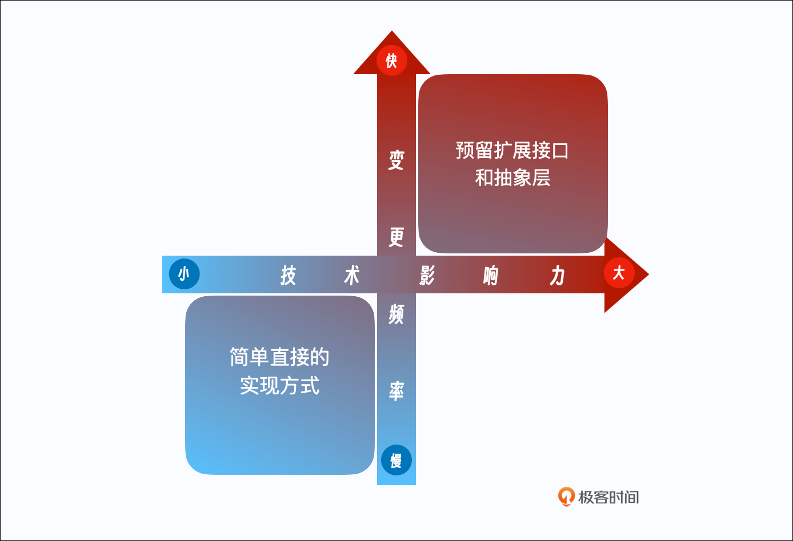
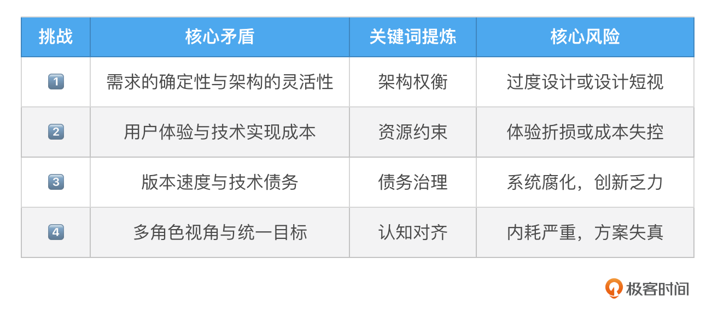

# 17 | 版本设计：蓝图勾勒，架构雕琢

你好，我是 Brook。

上两节课我们介绍了战略规划与立项决策的重要性、关键挑战、核心方法、对人员素质的要求，以及 AI 发展对二者的影响。战略规划解决“为何做”，立项决策确定“做什么”；在立项决策之后，产品研发正式进入了技术落地阶段，版本设计是这一阶段的开始，需要回答“怎么做”的问题。这节课，我们将聚焦产品“版本设计”环节，共同探寻如何将产品路线图转化为代码架构。

## 版本设计的本质与重要性

版本设计是战略规划从概念走向实体的关键环节，是产品从抽象的价值主张与路线图，到具象技术载体的关键转化器。版本设计的本质，是将产品立项所确定的商业目标与用户需求，转化为清晰、可执行的产品需求方案与技术实现架构。

这一阶段不仅决定了产品如何被构建，更深远地影响了系统的扩展性、团队的开发效率与产品的长期演进路径。正如软件工程专家 Martin Fowler 所强调：“软件的核心复杂性并不在于代码本身，而在于设计决策之间的相互作用及未来的可变更性。”版本设计阶段重要性在于：

- 确保需求理解的系统性与准确性：避免因需求歧义或关键场景缺失导致开发返工。

- 确立技术方案的长期适配能力：优秀的架构设计不仅能支持当前版本需求，还应该具备应对未来业务扩展与技术变革的弹性。

## 版本设计的关键挑战与应对

第一个挑战，是如何平衡需求的确定性（如用户场景收敛）与架构设计的灵活性（适应未来需求变化），避免过度设计或设计短视。

一方面，我们需要围绕当前版本的核心目标，收敛用户场景，避免需求蔓延；另一方面，又必须为未来的产品演进预留适当的技术扩展能力。许多团队常陷入两难：过度设计，会浪费资源、延迟上线；设计短视，则可能导致架构无法适应变化，后期改造成本巨大。

微信的早期架构设计，为我们提供了一个正向范例。它的第一版极度聚焦核心通讯能力，但在技术实现上，却采用了模块化和插件化的设计思想。这种架构允许系统在不重构核心模块的情况下，通过新增服务或模块来支持如支付、小程序等未来功能。这种对灵活性的前瞻性投资，使微信在激烈的竞争中保持了长期的迭代活力。

相反，某款社交应用则经历了教训。初期为了追求功能的丰富度，团队将用户关系、动态发布和消息系统紧密耦合在一个单体架构中。当短视频风口兴起，他们发现这种僵化的架构难以支持高并发、低延迟的视频流需求，最终不得不重构，投入资源远超初期，还错失了市场时机。

为了应对这一挑战，我们可以借助两种实践工具。其一是 MVP 架构验证法，即用最小可行产品思路来设计架构——仅对最核心的需求进行充分的技术实现，并确保其承载能力，而不是一开始就构建大而全的系统。其二是需求波动率评估矩阵，它帮助我们理性判断应在何处投入弹性设计的努力。团队可以按需求变更的频率和变更可能带来的技术影响度，将功能划分到四个象限中。例如，对那些变更频率高且一旦变更技术影响大的功能，需要预留扩展接口和抽象层；而对低频低影响的部分，则可采用更简单直接的实现方式，从而有的放矢，在资源与灵活性之间找到最优平衡。

第二项常见挑战，是如何在有限资源下平衡“用户体验最优解”与“技术实现成本”（包括开发周期延迟、兼容版本故障率等）。

实践中，团队常会落入两类典型陷阱。一是“过度设计陷阱”。例如，某知名电商 App 曾为了追求极致动效流畅度，采用了大量高耗能渲染方案，结果导致中低端机型崩溃率上升 23%，反而严重影响了核心用户的交易完成。另一个极端是“开发成本优先陷阱”：比如某工具类产品为了缩短开发时间，大幅简化功能交互路径，结果因体验粗糙令用户困惑，月度用户留存率直接下降了 15%。这两个案例说明，单向度的决策往往带来业务价值的实际损失。

要平衡这两者，可借助一些实用的决策工具。例如 UX-Tech ROI 评估，通过估算体验提升带来的留存和长期价值，对比技术与运维成本，辅助判断投入合理性。另一方面，可采用灰度分层发布，先面向高端机型或核心用户开放新功能，验证价值与稳定性后，再逐步向下适配，实现体验与风险可控的创新。

第三项挑战，是如何避免为追求版本速度，导致的技术债务的"温水煮青蛙"效应。许多团队过度追求短期发布速度，采取妥协性的技术方案。这种做法在初期看似高效，但随着时间推移，会导致系统可维护性急剧下降，最终使得迭代效率不升反降，甚至引发严重的稳定性问题。

典型的场景包括两类：一是妥协性设计，例如为了赶工期，直接在代码中大量使用复杂的数据库硬编码查询，绕过本应进行的抽象设计。这虽然加快了当前版本的交付，却让后续的分库分表改造变得极其困难。二是复制性开发，不同功能模块重复实现相似逻辑，导致代码复用率低，为后续项目迭代和维护埋下不一致的隐患。

防控技术债务不能仅依赖开发人员的自觉，更需要机制性的保障。应对这一问题，可引入轻量但有效的防控机制。例如建立技术债务记账系统，对债务分类、记录影响并设定优先级，使其可见可管理。同时，设定“债务偿还日”，在迭代节奏中预留固定时间用于偿还债务：大中型团队可分配约 20% 工时持续清理，中小团队则可定期安排整轮迭代集中重构，从而保持系统长期健康与团队开发效率。

面对新合作团队，第四项挑战，是如何在产品、设计、研发、运营等多角色间建立统一的设计认知，避免各执一词导致方案失真。

由于专业背景和关注点的差异，不同角色对同一需求的解读往往大相径庭，这种“各执一词”的现象很容易导致最终交付物与初始目标严重偏离。举个例子，Tech Leader 面对“给出架构设计图”这个需求，产品规划主管关注的是功能与体验（如何支持秒杀、预售、拼团等多种玩法快速上线），架构师则聚焦于技术风险与长期扩展（系统高可用、统一可扩展的组件库），运营人员关注如何实时看到活动数据（如销量、用户来源）以便及时调整策略。

为了解决这一协作断层，一些团队采用了三维需求透视图的方法，也就是说在需求评审阶段同步产出用户故事地图（产品视角）、交互流程图（设计视角）和技术实现图（研发视角）。这种方式能系统呈现一个需求的多元面向，帮助团队早期识别和理解分歧。另外研发人员“需求反讲”也是行之有效的方法之一，研发人员在充分理解产品人员需求基础上，反向向产品人员讲解需求、回答疑问，从而提早识别理解偏差。

## 版本设计对人员素质的要求

在版本设计环节，团队人员的能力素质直接决定了产品方案的可行性与长期生命力。其中，架构师或技术负责人需要具备的核心能力是系统思维与前瞻预判。这不仅要求他们深入理解当前的产品需求，更要能预见未来可能的业务演变方向，并将其转化为可扩展、易维护的技术架构。

具体来说，优秀的架构师会遵循“低耦合、高内聚、按需拓展”的原则对系统进行模块化分解。例如，他们能够根据功能特性的迭代频率差异，将系统划分为不同层次：将相对稳定的架构底座、频繁变动的功能特性以及需要快速迭代的算法模块进行有效解耦。这样做的好处是，当某个模块需要变更或调试时，不会牵一发而动全身。一个前瞻性的案例是，即使在第一版产品中AI 能力还在预研阶段，并不计划上线，团队也会提前规划，并预留出标准化的模型接入接口和插件机制，为未来的智能化升级铺平道路。

与此同时，对技术债务的有效管理也是架构师的关键职责。这不仅要求他们能够识别和记录债务，包括架构设计缺陷、代码重复率、自动化测试覆盖率不足等问题，也需要在合适的时机推动团队进行修复和优化，例如启动“技术债修复”版本，避免债务不断累积成为系统演进的绊脚石。

除了技术负责人的能力，整个团队能否用数据驱动决策，并具备跨职能的高效协作能力也至关重要。每一个需求是否值得做、优先级如何排列，都应尽可能基于数据进行分析和判断，例如通过估算功能上线后可能带来的用户留存提升或收入增长，使其价值可衡量、可讨论，从而让团队的决策达成共识，更加高效。

在协作过程中，不同职能需要具备“翻译”思维：产品人员要能够将用户故事转化为清晰的功能模块，设计师需要通过原型具象化体验流程，研发人员应深入理解业务意图而非被动实现，测试人员则需围绕核心价值设计验证方案。熟练使用需求管理、协同设计和持续集成等工具，是支持这一高效协作流程的基础。最终，一个能够在版本设计阶段就将技术、产品与业务目标对齐的团队，才能持续交付真正创造价值的产品。

## LLM 时代，对版本设计的影响

大语言模型的快速发展，正在深刻影响产品立项环节的效率与工作模式。它不仅改变了需求分析和方案设计的传统流程，更在技术架构的初始构建阶段提供了实质性的辅助，显著降低了复杂项目的启动门槛和前期投入成本。

一个典型的应用场景是在数据库设计阶段。传统意义上，架构师或技术负责人需要仔细研读产品需求文档，人工识别其中的业务实体、属性与关系，进而设计数据模型并编写 SQL 语句。当业务复杂、表字段多达几十个时，这一过程不仅繁琐耗时，还容易因人为疏忽导致设计偏差。而现在，LLM 能够快速理解需求文档，自动提取关键实体与业务属性，生成符合范式要求的数据库表结构甚至优化的分库分表建议，极大提升了数据架构设计的效率和一致性。

除了数据建模，LLM 也对设计文档的撰写提供了强大支持。系统设计文档通常需要结构化地描述架构决策、模块划分、接口定义及非功能性需求等内容。利用 LLM，设计人员可以依据输入的系统特征和关键架构选择，自动生成符合团队规范的文档初稿，包括架构概述、核心流程说明、技术选型理由等部分。这不仅大幅减少了文档编写中的重复性劳动，也提高了技术文档的逻辑一致性和内容完整性。

另一方面，LLM 也在迅速成为技术图表绘制的强大辅助工具。可视化表达在产品立项和系统设计中至关重要，一图胜千言，架构图、实体关系图、流程图等能够高效传递设计意图，减少沟通歧义。但在实际协作中，团队常因绘图工具不一（如 Draw.io、PPT，或基于代码的Mermaid）面临效率瓶颈。尤其像 Mermaid 这类基于文本的绘图语言，虽然能产出规范可复用的图表，但语法学习成本不低。

随着如 DeepSeek-R1 等先进推理模型的出现，技术作图流程变得高效而直观：架构师只需用自然语言描述作图意图——包括图表类型和核心组成元素，LLM 即可自动生成准确、可执行的 Mermaid 代码。设计者无需深究 Mermaid 具体语法，只需将生成的代码粘贴至支持工具，便可一键生成图表，随后只需微调内容及样式细节。这样，团队成员就能将精力完全聚焦于逻辑设计与架构优化，而非陷入工具使用的琐碎细节中。

## 课程总结

这节课我们深入探讨了版本设计在产品研发中的核心作用。我们可以用这样一个比喻来理解：如果产品战略是“目的地”，立项是“路线规划”，那么版本设计就是绘制出一张清晰、可执行且预留了灵活调整空间的“执行地图”。

版本设计的核心挑战在于如何平衡多方诉求：既要控制技术债务，避免为追求短期速度而牺牲长期健康度；又要权衡体验与成本，在资源约束下做出最优解；同时还要促进产品、设计、研发等多角色达成共识，确保大家对“要建造什么”和“如何建造”有一致的认知。

面对这些挑战，对团队人员也提出了更高要求。架构师需要具备前瞻性的系统思维，能够预判产品演进方向，并设计出“低耦合、高内聚”的弹性架构。而整个团队则需要养成“用数据说话”的决策习惯，并掌握高效的跨职能协作工具与方法，将沟通成本降至最低。

值得注意的是，大语言模型等 AI 工具正在成为版本设计阶段的强大助力。无论是辅助生成数据模型、自动化绘制技术图表，还是快速撰写设计文档，它们都能极大地解放团队的精力，让我们能更专注于最核心的创新与决策，从而提升整个设计流程的效率与规范性。

最终，卓越的版本设计，输出的不仅是一份需求文档，更是一个可持续、可演进的产品基石。它确保了我们的产品既能快速响应市场变化，又能沿着清晰的技术路径稳步构建长期竞争力。

## 课后练习

选择你正在推进或曾经参与过的一个产品需求，分别从三个视角输出设计表述：

- 产品视角：用用户故事地图（User Story Mapping）梳理核心用户流程与功能列表；

- 设计视角：绘制关键界面的交互流程图或原型草图；

- 技术视角：用架构框图或模块依赖图描述实现方案。

完成后，思考这三个视角之间是否存在理解差异？哪些地方最容易出现沟通歧义？结合你的实际工作经验，描述应如何避免这类偏差。

恭喜你完成第 17 节课的打卡，欢迎你在留言区与我交流讨论。如果今天的内容让你有所收获，也欢迎转发给有需要的朋友，我们下节课再见！
