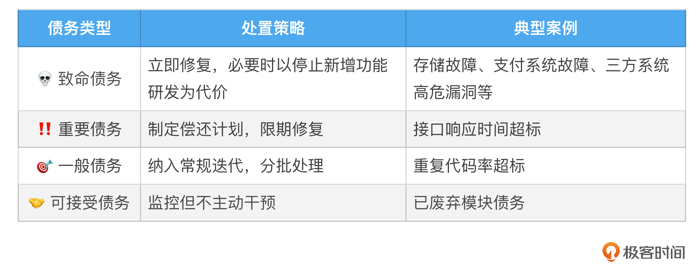
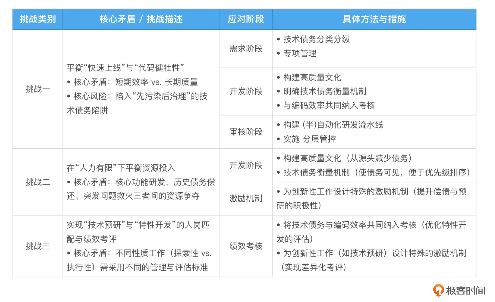

# 18 | 技术研发：精耕细作，代码筑型

你好，我是 Brook。

在上一节课中，我们探讨了版本设计的关键挑战与应对。在完成版本架构设计后，需要通过技术研发，实现理念到代码实际的转换。

## 技术研发的本质与重要性

技术研发是产品构想最终落地的核心实践环节，是将经过精心设计的版本蓝图，转变为可运行、可交互的实体产品的建造过程。它的本质，是一次将确定性的方案与不确定性的挑战相结合的高度创造性劳动，核心任务是编写出稳定、高效且易于维护的代码，从而精准实现产品设计所定义的功能与体验。

这一阶段就像建筑中的主体施工，它的质量直接决定了产品的稳定性、性能表现以及未来维护的成本。Gartner 研究显示，技术研发阶段的工程效能差异，可使同类产品的市场响应速度相差 3-5 倍，维护成本差距高达 10 倍。在数字化转型深水区，技术研发已从“成本中心”跃升为“价值引擎”，直接决定企业能否在代码层面构筑竞争护城河。

清晰规范的代码与文档，构成了团队最重要的知识资产与协作语言。它降低了新成员的上手门槛，保障了项目在人员更替下的长期可维护性；反之，若技术研发阶段只求速度而忽视质量，仓促堆砌的代码会迅速积累“技术债”。这如同高利贷，在未来的迭代中将以数倍的工时和更高的风险来偿还，严重时甚至会拖垮整个产品。

技术研发的关键挑战

技术研发阶段的核心团队通常是技术 leader 与技术研发人员，包括后台工程师、算法人员（如涉及）、前端开发人员等。结合头部公司实践与行业痛点，技术研发阶段的关键挑战可提炼如下：

挑战 1：如何平衡“快速上线”与“代码健壮性”，避免陷入“先污染后治理”的技术债务陷阱？

市场的窗口期转瞬即逝，业务方对“快”的追求是天然的。但技术团队深知，为了速度而牺牲代码质量，就如同为了赶工而简化建筑地基，短期看似高效，长期却必然陷入“技术债”的泥潭，早期的“便利”会以数倍的利息在未来的迭代中偿还，表现为系统越来越难以修改、bug 频发、新功能开发举步维艰。

挑战 2：如何在人力有限的情况下，平衡“核心功能研发”“历史债务偿还”“突发问题救火”三者的资源争夺？

开发当前版本的核心新功能（创造未来价值）、偿还历史遗留的技术债务（修复过去的问题），以及响应线上突发问题（处理当下的危机），三者优先级如何排布；尤其在大公司产研多角色分工清晰情形下（产品同事更关心新功能迭代，研发同事更关注产品质量），如何平衡三者的资源投入，可能成为争论的焦点。

挑战 3：如何实现面向“技术预研”与“特性开发”不同场景的人岗匹配与绩效考评。

版本中既有需要快速交付的业务特性，也有需要深度钻研的技术预研。将擅长快速实现业务逻辑的工程师放在需要技术攻坚的岗位上，可能会进展缓慢，让他感到受挫；反之，让喜欢钻研底层技术的工程师去完成大量重复性的界面功能，同样是一种人才浪费。

## 技术研发挑战的应对方法

清晰识别挑战之后，我们来看一看有哪些行之有效的应对方法，能够帮助团队在复杂的权衡中做出更明智的决策，构建起可持续的高效研发体系。

1. 需求阶段，对技术债务进行分类分级、专项管理。

研发资源是有限的，如果希望完全规避技术债务，对交付效率的影响通常是致命的。但忽视技术债务导致关键系统故障，如交易系统金额错误、存储系统数据丢失，造成的灾难性后果更是不可挽回。就像软件工程经典著作《重构》的作者 Martin Fowler 所提出的“技术债象限”理论，并非所有“快”都是鲁莽的。关键在于区分是“鲁莽的债务”（明知故犯）还是“谨慎的债务”（主动权衡后记录在案）。

需求导入阶段，需要将技术债进行分类分级，并建立一套共识机制，让业务与技术双方能基于客观数据（如预估返工成本、未来迭代影响度）进行对话，而不是陷入“质量”与“速度”的抽象争论中。常见的技术债，可以分为架构债务（模块耦合度、新技术带来的更优实现方案等）、代码债务（重复代码率、代码走读问题应对）、测试债务（代码是否具备较高的测试自动化覆盖率）；对于每一类债务，我们可以进一步分级，定期评估。

在资源分配上，管理者需要有意识地为技术债务偿还和应急响应预留专属的时间，例如推行“20% 时间”原则，固定预留风险时间消除技术债，或设立固定的“技术减债版本”进行技术债务偿还。

2. 开发阶段，构建高质量文化，明确技术债务衡量机制，与编码效率共同纳入考核标准。

“考核标准”是指挥棒，在执行阶段，要将质量要求切实嵌入研发流程和衡量体系之中。例如谷歌 DORA（DevOps Research and Assessment）效能度量模型，它强调将“部署频率、变更前置时间、变更失败率、服务恢复时间”四项指标作为核心，后三项均直接关乎质量与稳定性。具体执行层面，团队可以结合业务需求进一步细化内部指标，例如将千行代码缺陷率、技术债务修复工时占比、代码审查通过率等，与需求交付吞吐量共同作为衡量团队健康度的“北极星指标”。

其次，为不同类型的风险预设应对机制。对于支付、存储等核心模块的 P0 级故障风险，应提前构建热修复能力和影子发布流程，确保问题出现时能快速响应，最大限度降低对用户的影响。同时，通过建立“代码责任制”或“模块负责人”制度，确保核心代码库有专人长期负责，有助于培养团队对代码长期质量的使命感和主人翁意识，从“雇佣军”心态转向“建筑师”心态。最后，通过设立“代码整洁奖”、“质量先锋”等正向激励，并将质量表现与晋升、培训机会强关联，才能最终形成“质量即效率”的团队共识与文化。

3. 审核阶段，构建（半）自动化研发流水分层管控。

常见审核管控，有以下形式：

- 集成前审查：Code Review 是代码合入主干前的关键质控点。有效的 Code Review 不仅在于发现缺陷，更是知识共享、设计讨论和统一编码风格的最佳实践。在代码正式提交仓库主线之前，架构师或 Tech Leader 进行 Code Review，可以进一步降低代码质量问题。

- 发布前验证：在 CI/CD（持续集成 / 持续部署）管道中，通过自动化的单元测试、集成测试、安全扫描和性能测试等层层关卡，确保只有符合标准的代码才能进入生产环境。之后，再通过预发布环境或 A/B 测试进行最终验证，密切监控核心业务指标是否正常（这部分我们将在下一节“测试发布”中，进一步展开）。

4. 为创新性工作设计特殊的激励机制。

要充分意识到，“技术预研”与“特性开发”是性质完全不同的工作，需要差异化的管理方式和激励机制。技术预研具有高度的不确定性和创新性，其成功高度依赖于研发者的主动性、创造力和专业判断。

因此，最有效的策略是选派那些既有深厚技术功底，又对技术充满好奇心和使命感的“优秀人才”来承担（过往绩效与个人性格，是重要参考）。更重要的是，管理者需要设计一套能够包容失败、激励成功的特殊政策。例如，实行“绩效保底”机制，明确预研项目即使未能达到预期目标，只要过程规范、结论清晰，就不会对个人绩效产生负面影响；同时，对于取得突破性成果的预研，应给予“跨级奖励”，如重大项目提名、特殊奖金或晋升机会。这种“安全网”与“高激励”并存的机制，能最大限度地激发创新者的勇气与潜力，让他们能够心无旁骛地探索技术无人区。

技术研发对人员素质的要求

不同于战略阶段的路线图勾勒、立项阶段的里程碑确立、版本设计阶段设计蓝图，在技术研发环节主要是高效执行。这一环节要求技术研发团队 Tech Leader，以及开发人员所需要具备的能力，包括基层主管的管理能力、独立贡献者的执行力。这两部分前面的课程中我们已经充分讨论过了，这里不再重复。

## LLM 时代，对技术研发的影响

大语言模型与 AI 智能体（AI-Agent）技术的崛起，正在将技术研发从一门高度依赖个人经验和技艺的手艺，转变为一种人机深度协同的现代化工程实践。它并未取代工程师的核心思考能力，而是极大地提升了将思考转化为可靠代码的执行效率，并重塑了代码质量保障的范式。

首先，在代码生成环节，LLM 是一位不知疲倦的结对编程伙伴。 传统开发中，工程师需耗费大量时间在重复性的基础代码编写、API 接口调试或常见算法实现上。如今，借助如 Cursor、GitHub Copilot 等工具，开发者只需用自然语言描述功能意图，或甚至仅写出函数名，LLM 就能实时生成高质量的代码或建议。这意味着，工程师可以将更多精力集中于更具创造性的系统架构、复杂业务逻辑设计等核心任务上。

其次，在代码审查（Code Review）这一关键质控环节，AI 带来了规模化与一致性保障。 传统 Code Review 高度依赖评审者的经验、专注度和时间，难免存在疏漏，且标准不易统一。现在，AI-Agent 可以充当“第一轮评审员”，协助架构师或 Tech Leader 识别出潜在的安全漏洞、性能瓶颈、代码风格不符，甚至是隐藏的逻辑错误，让人工评审者可以从繁琐的规范性检查中解放出来，更专注于代码设计的合理性、可维护性、关键安全问题以及与业务需求的契合度等更高层次的讨论。

更进一步，AI-Agent 将文档维护工作大大简化。编写和维护各类文档（常见的包括 API 详细设计文档、用户使用文档等），是重要但常被开发者视为负担的任务。现在可以由 AI 高效辅助完成。开发者只需提供核心代码与文档格式，AI 能够解析代码变更，自动生成或更新相应的技术文档，确保文档不与实际代码脱节，彻底解决“文档滞后”这一老大难问题。

## 课程总结

这节课我们首先明确了，技术研发的本质，是将确定的产品蓝图转化为可运行、可交互的实体产品的创造性建造过程。 它的重要性，不仅在于实现功能，更在于为产品体验构筑坚实可靠的地基，其质量直接决定了产品的长期生命力。

随后，我们深入剖析了技术研发过程中最现实的几个挑战：如何在“快速上线”的商业压力与“代码健壮性”的技术原则之间取得平衡；如何在有限的人力下，明智地分配“新功能开发”“偿还技术债”和“应急救火”这三者的资源；以及如何根据“技术预研”和“特性开发”的不同性质，实现最有效的人岗匹配。

面对这些挑战，我给出了一套系统的应对方法，包括需求阶段实现技术债“分类分级”，并建立多角色共识；开发阶段构建高质量文化，将质量体现在开发者绩效；审核阶段实现“人机共智”，构建编码到发布的分层管控流水线。同时，对于创新性的预研工作，需要设计特殊的激励机制，以包容失败、激励成功。

最后，我们展望了 LLM 与 AI-Agent 时代为技术研发带来的范式变革。AI 正在成为一位强大的“结对编程伙伴”，显著提升代码开发和代码审查的效率与一致性。这标志着技术研发正从高度依赖个人经验的“手艺活”，转向人机深度协同的现代化工程实践。

## 课后练习

请你在当前或最近参与的项目中，进行一次小范围的技术债务梳理，培养主动管理技术债务的意识。

1. 识别：列出 5 个你或团队公认的、待解决的技术债务项。

2. 分类与分级：参考我们讲过的分类（架构、代码、测试债务），并尝试评估它们的影响级别。

3. 制定行动计划：针对其中一项“高”或“中”级别债务，思考：你的具体修复方案是什么？预期的收益（如：预计能减少多少 bug，或提升多少开发速度）是什么？需要多长时间完成？

恭喜你完成第 18 节课的打卡，欢迎你在留言区与我交流讨论。如果今天的内容让你有所收获，也欢迎转发给有需要的朋友，我们下节课再见！
