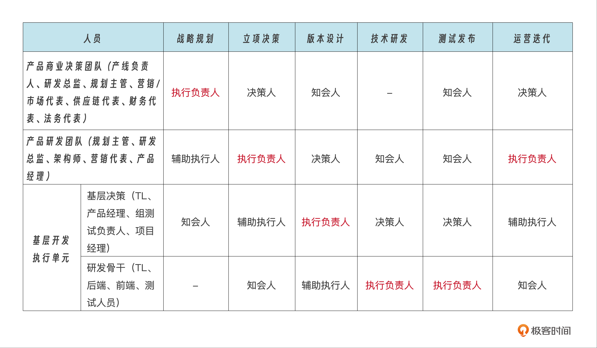
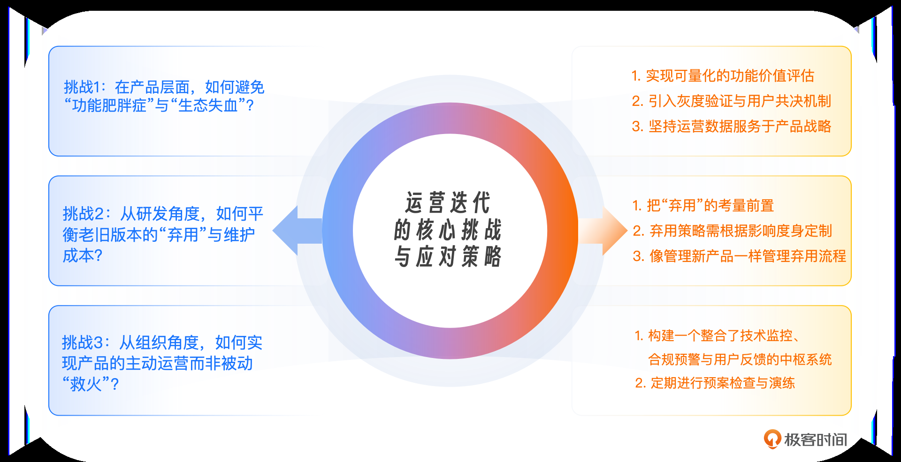

# 20 | 运营迭代：吐故纳新，生态长青

你好，我是 Brook。

在上一节课中，我们探讨了测试发布环节的关键挑战与应对策略。这节课我们将进入本章内容最后一节，“运营迭代”环节的学习。

## 运营迭代的本质与重要性

运营迭代是产品正式推向市场后，持续创造和放大价值的核心环节。它不仅是修复缺陷或增加功能的“被动响应”，更是一个通过真实用户反馈和数据洞察，驱动产品不断进化、适配变化的需求与市场的主动成长过程。这一阶段既需淘汰枯枝败叶（低价值功能），更要培育新物种（创新服务），直接决定了产品能否在竞争中建立长期优势与壁垒。

运营迭代的本质在于将用户行为数据与业务结果紧密连接，形成“验证 - 学习 - 优化”的闭环。正如《精益创业》所倡导的“构建 - 衡量 - 学习”循环，每一次迭代都应基于明确的假设，并通过发布后的用户数据予以验证。例如，亚马逊、淘宝首页通过持续的 A/B 测试优化页面布局与推荐策略，极小比例的点击率提升，在巨大流量基数下仍能持续带来显著的收入增长。

与之相对，产品发布后由于轻视运营迭代，导致产品竞争力下降的案例屡见不鲜。这类问题通常集中在两个层面：基础维护缺失与功能迭代失焦。在基础维护层面，对安全漏洞和证书更新的忽视可能引发严重后果。例如，某美国大型信用评级机构就曾因未及时修复 Apache Struts框架的已知漏洞与更新数字证书，导致 1.45 亿用户的个人信息遭到泄露，并导致加密流量无法被有效监测，攻击者得以长期潜伏而不被发现。

在功能迭代层面，缺乏精准导向的更新容易造成资源浪费。某上市公司产品负责人曾透露，2023 年上线的迭代需求中，约 80% 在次年因使用率过低或偏离用户真实需求而被下线。这种“为迭代效率而迭代”的开发模式，不仅消耗团队精力，也使产品逐渐丧失核心聚焦，让用户困惑。这些案例提醒我们，运营迭代不是“有做就行”的流程动作，而是需要持续洞察、精准投入的价值创造过程。

## 运营迭代的核心挑战与应对

产品研发团队（详见 14 节表格）通常是版本运营核心责任团队，包括规划主管、研发总监、架构师、营销代表、产品经理（及各自下属，作为信息来源或者助手）；运营过程中常见挑战如下：

### 挑战 1：在产品层面，如何避免“功能肥胖症”与“生态失血”？

“功能肥胖症”指盲目添加新功能导致产品臃肿、核心体验被稀释。例如，尽管数据可能显示某个花哨功能的点击率高，但若它与产品追求的极简理念相悖，盲目添加反而会伤害长期用户忠诚度。反之，“生态失血”则是指过早砍掉，仍有核心用户依赖的传统功能，导致忠诚用户流失。

面对“功能肥胖症”与“生态失血”的风险，核心对策是建立一套数据驱动与战略校准相结合的功能生命周期管理机制。首先，实现可量化的功能价值评估。团队需要为关键功能设置数据埋点，持续追踪如用户使用率、价值贡献和满意度等核心指标。这为决策提供了客观依据，而非依赖主观猜测。

其次，引入灰度验证与用户共决机制。在决定淘汰某一功能前，通过小范围用户调研、A/B 测试等方式小范围验证替代方案的可行性。这不仅能收集更直接的反馈，也是对用户尊重的一种体现，避免“粗暴下线”引发的抵触。

最重要的是，坚持运营数据服务于产品战略。要警惕数据可能导向的“局部最优解”，例如某功能引发用户“猎奇”，虽然提升了短期点击率，却可能模糊产品的核心定位。当数据与战略出现矛盾时，应将其视为重新审视战略的契机，而非简单地盲从数据。正如《启示录》中强调的，优秀的产品经理善于利用数据做论证，但不被数据牵着鼻子走，以此守护产品的长期价值。

### 挑战 2：从研发角度，如何平衡老旧版本的“弃用”与维护成本？

产品发展过程中，随着版本累积，维护过多老旧版本会带来失控的迭代与维护成本，并限制新技术的引入。但若激进弃用传统版本，又可能引发产品质量倒退和用户不满。如何对老旧版本进行合理“弃用”，是产研人员面临的关键挑战。

针对以上问题，可以借鉴资产密集型行业的“弃置预算”理念，对版本弃用进行主动管理。管理的第一步，是。在版本立项以及架构设计时，就应思考产品与架构未来的可弃用性。若早期未能第一时间考虑，也需将其明确为技术债务，并规划资源偿还。

其次，弃用策略需根据影响度身定制。对于侵入性强的底层变更，可能需采取“强制迁移”（例如：window 版本更新，对 XP 等老旧版本放弃维护）；对于用户体验层面的功能，则更适合“小步快跑、逐步引导”的温和方式。策略的选择取决于对用户影响和系统复杂度的综合判断。

最后，要像管理新产品一样管理弃用流程。要明确，“弃用”本就是产品生命周期组成部分之一。阶段推进时，要明确项目负责人与绩效目标，制定从“建议性提示”到“强制性弃用”的清晰路线图并纳入考核，以确保责任人时间与精力投入，通过有序的里程碑确保弃用过程平稳、可控，将用户体验的干扰降至最低。

### 挑战 3：从组织角度，如何实现产品的主动运营而非被动“救火”？

在紧张的团队功能迭代周期中，团队不能仅满足于响应已知问题，更要建立机制以应对突发风险（如安全漏洞、证书更新或政策变更）；对于影响用户满意的重大问题，要在大规模舆情爆发前主动识别。

做到主动运营的核心，是构建一个整合了技术监控、合规预警与用户反馈的中枢系统。这套系统有明确的责任人与运行周期，能够结合产品特点，对技术风险、合规争议、社会事件突发影响等潜在风险形成 checklist 定期复核，并为已识别的关键风险制定预案，以实现问题的早期洞察与主动运营。其次，定期进行预案检查与演练，确保在突发状况下团队能够快速、有序地响应，而非陷入混乱。

## 运营迭代对人员素质的要求

运营迭代，直接关系产品的持续成功。负责人或核心团队，需要在多个维度上构建起独特的能力组合。

1. 敏锐的数据洞察力：能够深入理解各类运营数据，精准地从中提取有价值的信息，识别出数据背后的用户行为模式、需求变化及潜在问题，为迭代方向提供坚实依据。例如，通过分析用户在不同功能模块的停留时间、点击路径等数据，挖掘出用户对特定功能的潜在需求或现有功能的优化点。

2. 风险预判与应对能力：对运营迭代过程中可能出现的风险有敏锐的预判能力，如市场风险、竞争风险、技术风险等。提前制定相应的风险应对策略，以降低风险对产品迭代和业务发展的影响。例如，在规划重大功能改版上线时，除了评估预期价值达成与用户接受度，还需预判可能的技术兼容性问题、客服团队的支持压力、甚至可能引发的媒体或社群争议，并结合既往运营经验帮助团队提前制定预案。

3. 深刻的用户需求理解与挖掘能力：深刻的用户理解能力，是避免产品脱离实际的根基。运营责任人不仅要收集显性的用户反馈，更要善于挖掘用户未明确表达的深层需求和痛点。这要求运营人员能够站在用户角度，深入洞察用户在使用产品过程中的体验细节，以及在不同场景下的潜在期望，从而为产品迭代提供更具前瞻性和针对性的方向。

4. 商业思维与价值导向：最后，所有运营迭代都必须以商业价值为最终导向。运营负责人需要具备清晰的商业思维，能够在复杂的决策中，始终锚定产品的长期健康与可持续发展。当面临“是否要为一个短期创收功能牺牲部分用户体验”的抉择时，这种能力尤为重要。它要求运营者能超越局部 KPI，从用户生命周期价值、品牌声誉和生态健康度的角度进行综合判断，确保每一次迭代都服务于提升产品的核心竞争力和商业生命力。

## LLM 时代，对运营迭代环节的影响

大语言模型与 AI 智能体技术的成熟，正推动产品的运营迭代从“经验驱动”迈向“智能驱动”。这一转变的核心，是 LLM 对海量数据的实时解析能力、对用户行为的深度洞察力，以及 AI-Agent 在复杂任务中的自主协作能力。以上能力结合运营人工经验，显著提升了运营监控、故障应对与策略优化的效率。

首先，在智能监控与优化建议方面，LLM 实现了从“数据展示”到“语义解读”的跨越。传统运营监控依赖人工设定阈值告警，往往在问题爆发后才能响应。LLM 的出现，赋予了监控系统理解业务语义的能力。例如字节、阿里等互联网大厂在各类实验平台中引入 LLM 分析与对话，使平台能自动理解实验指标的业务含义。这意味着，运营人员可通过自然语言直接查询“今日北美地区新用户转化率下降原因”，系统自动关联订单、流量、用户行为等多维数据，生成可视化报告与归因分析。

其次，在故障预警与根因分析方面，AI-Agent 展现出强大的预测与溯源能力。以复杂分布式系统的故障定位为例，通过基于多 LLM 的多 Agent 的协同，正构建起一套跨模态数据融合的根因分析体系。例如，当支付服务超时率飙升时，系统能自动关联风控服务超时、缓存命中率下降等隐性线索，精准定位到数据库连接池泄漏，而非简单归因于“资源不足”。这一关联分析能力使用得当（配合人员经验提供的系统拓扑等预置信息），可以极大地缩减无效告警，显著提升故障预警准确率与故障排查效率，并在故障时缩短系统平均修复时间。

与此同时，LLM 进一步推动了运营流程的端到端自动化，显著提升了需求挖掘规模与深度。在售后客服等场景，基于 LLM 的智能客服不仅能理解用户意图，还能结合业务知识库生成个性化应答，如句子互动打造的专属 GPT 客服，支持全自动或人机协作模式，大幅降低人工干预；在内容运营层面，ChatGPT 可帮助团队快速生成多版本营销文案。

## 课程总结

这节课我们深入探讨了产品研发的最后一个关键阶段——运营迭代。我们需要清晰地认识到，产品上线并非终点，而是与用户共同创造价值的全新起点。运营迭代的本质，远不止于修 bug或加功能，而是一个以数据和用户反馈为驱动，推动产品持续进化、适配市场的战略核心。忽视它，将可能导致产品竞争力衰退，甚至引发重大安全事件等严重后果。

我们剖析了迭代过程中的三大核心挑战，及其系统性对策。运营团队面对产品层面的挑战，需建立科学的功能代谢体系，平衡数据洞察与战略定力，避免“功能肥胖症”与“生态失血”；面对技术债务的挑战，要像管理资产一样，系统化规划版本的“弃用”流程，平衡创新与稳定；面对组织能力的挑战，目标是构建主动的“预测 - 响应 - 进化”机制，从被动救火转向主动防火。

借助挑战与应对方法，我们展望了运营迭代的团队人才画像以及 LLM 与 AI-Agent 技术带来的范式革新。成功的运营迭代，要求负责团队兼具数据洞察力、风险预判力、用户共情力和商业思维，成为连接用户价值与商业价值的战略枢纽。在这一过程中，AI 工具在智能监控、故障根因分析、运营流程自动化等方面，可以协助运营团队显著提升效率。

## 课后练习

请你为正在研发的版本（或其中的核心功能），设计一个“弃用”方案。考虑如下维度：

1. 当发生何种情况，会决定弃用该版本或功能？

2. 弃用过程中，为用户提供哪些过渡支持（如数据迁移工具、专属客服通道等），如何推进弃用流程以保障平滑、顺利进行？

3. 你会通过哪些渠道（应用内通知、邮件、社群公告）告知用户，沟通文案要点是什么？

恭喜你完成第 20 节课的打卡，欢迎你在留言区与我交流讨论。如果今天的内容让你有所收获，也欢迎转发给有需要的朋友，我们下节课再见！
