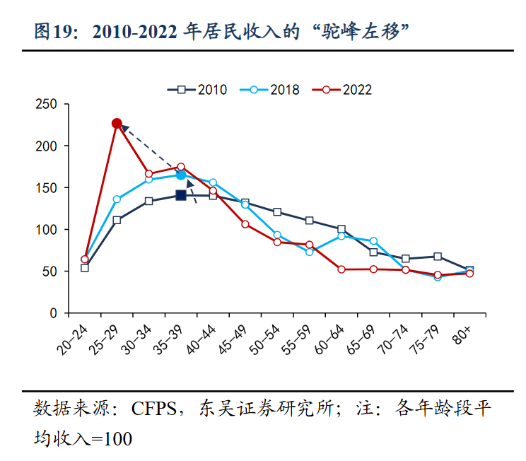
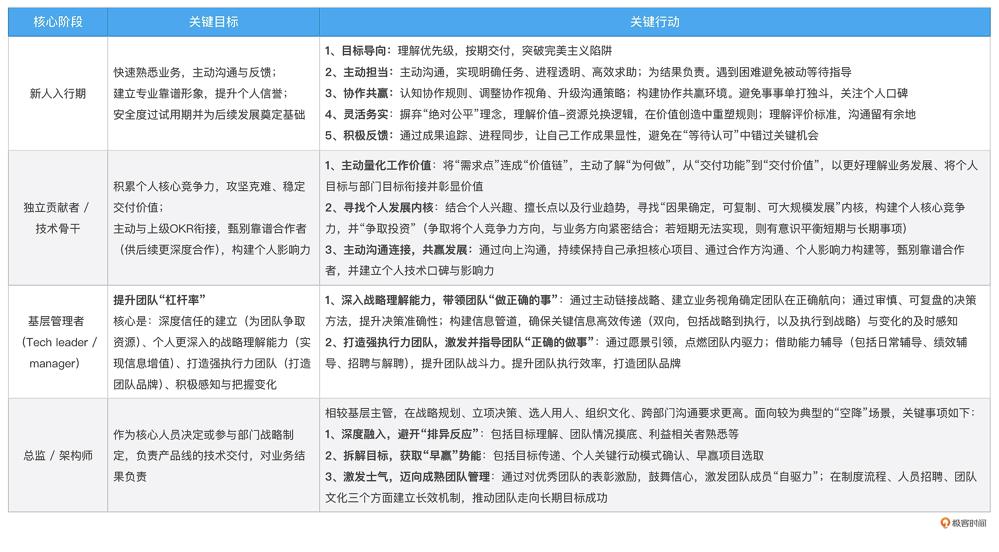

# 21 | 工作收入：IT行业的工作收入曲线与潜在风险

你好，我是 Brook。

在第二、第三章中，我们针对职业发展的关键节点，以及业务协同的关键角色进行了讨论，致力于让大家在 AI 时代中职业发展“领先一步”。本章中，我们将站在财务安全的视角，展开聊一聊，如何基于 IT 从业者收入曲线特性，设计“职业收入 + 投资复利”双通道财富体系，以基本面投资策略为锚，打造非工资依赖的财富安全网，以此来获取追逐人生理想的自由。

## 职业发展与财务安全的“增长飞轮”

在规划互联网时代的职业与财富路径时，我们常常面对一个核心命题：如何平衡职业成长与财务安全？这两者并非对立，而是相辅相成、彼此促进的动态组合。从人生整体的视角来看，一个被验证有效的策略是：在职业生涯早期，将主要精力投入于专业能力的提升与职业发展；随后，逐步将重心向构建“资产收入”倾斜。这是一种分阶段聚焦的智慧。

最理想的状况，当然是像许多早期加入知名科技公司的员工那样，实现“毕其功于一役”——既能通过技术创新推动社会进步，又能借此达成胡润报告中所定义的、6000 万人民币的“财富自由”门槛，同步实现个人使命与财务自由。然而，对于大多数人而言，这样完美的同步实现是小概率事件。这时需要将“个人价值实现”与“财富安全”分为两个阶段，在第一阶段，全力提升职业高度：

- 职业生涯初期的快速成长，能直接带来岗位与收入的跃迁，这无疑会显著加速你原始资本的积累速度。

- 更重要的是，当你走向更高的岗位，你将有机会广泛接触产品从战略规划到运营迭代的全流程。这种全局视野，正是未来实现“技术认知套利”的宝贵基础。

第二阶段则是构建的财务安全体系，其价值远不止于金钱本身，它为我们买下了至关重要的“战略选择权”。

- 它为我们供养着“创新火种”。让你更有底气离开那种“高薪但持续损耗职业生命力”的现状，去探索心中真正的理想与热爱，为长期的技术创新留下宝贵的容错空间。

- 它像一道“焦虑防火墙”，让你在纷繁的事务中，有能力保护自己最宝贵的“认知带宽”，将其专注于能力突破与长远思考，而非日常生存的内耗。

归根结底，职业发展为你创造价值变现的舞台，而财务安全则为你守护探索未来的勇气。二者共同构成一个正向循环，支撑我们在漫长的职业生涯中，既走得稳健，又行至远方。

## “财务安全”策略回顾与现状分析

在第 4 节课程中，我们讨论的财富安全的目标，即：财富收益的能力超出生活成本。具体步骤是，首先通过工作收入积累“第一桶金”，而后通过理财收益，覆盖生活成本。实现的关键有两条：“第一桶金”的积攒，以及“在权益市场一轮牛熊周期内，年化 10% 的收益能力”。这节课我们先聚焦第一点，讨论工作收入，助你识别工作收入曲线与潜在风险，探讨如何通过提升“人力效能”赚得第一桶金。

在聚焦到 IT 行业收入特征之前，我们首先看下近年来的社会整体趋势。东吴证券分析师芦哲等在 2025 年 5 月发布的“谁是消费领头羊：人口周期改变消费模式”的行研报告中指出，我国居民在 25-45 岁达到一生的收入高峰，并且在 2010 - 2022 年出现居民收入的“驼峰左移”（如下图），居民收入高峰期前移到 28-40 岁，近 10 年“收入高峰”年轻化趋势明显。

- 数据来源：CFPS，东吴证券研究所

当我们把目光回归到 IT 行业，会发现这一趋势表现得更为突出和典型。IT 从业者的职业生涯，呈现出鲜明的两阶段特征。首先是高速增长期，这个阶段具体长度会受到个人认知与能力、行业周期、市场政策变化、关键机遇与人脉、公司平台与组织发展等影响。在这个黄金窗口期，工程师们通过快速提升技术能力、承担核心项目职责，往往能够实现岗位与薪酬的快速跃迁。

紧随其后的便是稳定平台期。当专业能力趋于成熟，而岗位职级及管理面难以持续提升时（无论是主观，还是客观原因），收入涨幅会逐渐放缓，转入平稳区间。这时，许多从业者会面临一个清晰的“收入天花板”。在稳定期持续多年，如果没有等到新的机会“能力”提升持续陷入瓶颈，伴随“潜力”（很多公司视角下，等价于年龄）持续降低，以及第一章中提到的价值经验缩水、人力成本与产出性价比失衡、体力负荷隐形淘汰等因素，可能会被迫进入“转型期”，出现浮动收入大幅下降或人员汰换。

理解这两个阶段的划分，对我们规划职业与财富具有关键意义。它解释了为什么在 IT 行业，把握住职业生涯最初几年的“高速增长期”显得如此重要；同时，认识到“平台期”的必然存在，也提醒我们需要提前布局。正如经典理财书籍《穷爸爸富爸爸》中所倡导的理念，不能仅仅依赖“主动收入”，而应尽可能在平台期到来前，开始思考与构建自己的“资产收入”体系。

## 工作收入提升方案

这一部分核心事项，我们在第二章、第三章已经做过充分论述，此处我们用表格进行简要回顾：

在核心骨干阶段，是月薪快速提升期。通过承担关键职责、展现技术价值和业务影响力，在绩效评估中拿到高评分，为升职加薪或跳槽涨薪积累硬资本。在基层主管（或技术专家）阶段，年终奖与期权等浮动部分比例显著增加，通常是整体薪资提升的第一次跃迁；进入公司中层管理者序列（总监 / 架构师），薪酬与团队 / 部门的整体绩效强相关可能会切换成年薪制，高绩效前提下包含可观的年度奖金和长期激励（如股票 / 期权），是薪资提升的第二次跃迁。

## 工作收入风险与应对策略

正如价值投资鼻祖本杰明·格雷厄姆在《聪明的投资者》中强调的“安全边际”原则：我们不仅要追求回报，更要为不确定性预留缓冲空间。这个原则，同样适用于管理我们的劳动收入。在劳动收入风险方面，有三个关键审视点：

第一是家庭对单一收入来源的依赖度。如果一个家庭的绝大部分开支都依赖于某一位成员的一份工资，这就构成了一个高风险的单点故障。一旦这份主业发生变动，比如遭遇行业裁员或公司降薪，整个家庭的财务体系就会受到巨大冲击。

第二是非稳定收益的占比。很多 IT 从业者的收入包里，年终奖、绩效奖金、项目提成等浮动部分占了不小的比例。需要清醒地认识到，这部分收入是存在不确定性的。在现实中，一些公司在进行业务调整或希望引导人员流动时，往往会首先大幅削减甚至取消这部分浮动收入。

第三是公司期权 / 股权的变现风险。这是互联网行业特有的“甜蜜的烦恼”。创业公司的股权可能因无法上市而一文不值；即便是上市公司的限制性股票，其价值也随市场剧烈波动，并且套现周期漫长。有时还会出现股价跌破行权价，导致期权“潜水”而无法产生收益的情况。

让我们通过两个真实的行业案例，直观感受“浮动薪资部分”存在的风险：

案例 1：X 君在 A 公司工作近 20 年，期间享受到了公司发展的红利。伴随年龄增长以及家庭责任的提升，工作热情与产出趋于平缓。身居公司中台产线，遭遇公司降本增效，公司认为该人员潜力有限，在年终绩效评估处于 50%-80% 分位情况下，年终以及股权授予这部分浮动收入低于同等绩效入职 1-2 年的员工，基本归零。

案例 2：Y 君在 2021 年从 A 公司跳槽到 B 公司，总包涨薪 20%，在 B 公司负责某战略创新项目。薪资部分分为：基本工资 60%、绩效工资 20%（含平日绩效 + 年终）、股权工资20%，浮动部分相对原始收入提升 20%。然而，他加入后恰逢行业进入下行周期，公司业绩不佳，导致他的绩效奖金几乎归零。同时，公司股价也持续下跌，使得他的期权失去了行权价值。在此情况下，其浮动薪资部分所占收入比例从预期的 40% 下降到不足 5%，实际总包相比跳槽前降薪 15%-20%。

以上案例给我们带来了启示：在公司选择上，技术人员应优先选择业务处于上升期、核心部门、技术被重视的公司。避免加入业务萎缩、技术团队地位低下、或内部混乱（频繁架构调整）的公司，即使薪资给得高。在现有岗位技能成长曲线明显平缓、或晋升通道受阻时，应结合自身情况，考虑跳槽。跳槽目标应基于能力提升和职位提升，而不仅仅是薪资涨幅。

## 课程总结

这节课我们介绍了 IT 行业的工作收入曲线与潜在风险，致力于为你建立 IT 从业者劳动收入的认知。

在正式探讨工作收入之前，我们首先建立了一个核心认知：职业发展与财务安全并非孤立，而是彼此促进的“增长飞轮”。一个经过验证的智慧策略是，在职业生涯早期，将主要精力投入职业发展，全力提升职业高度。这不仅是为了加速原始资本积累，更是为了获取未来实现“技术认知套利”所必需的全局视野。

回顾第一章提出的“财富安全策略”居民收入高峰“年轻化”趋势在 IT 行业尤为明显。我们的职业生涯清晰地分为“高速增长期”和“稳定平台期”。理解工作收入的这两个阶段，是财富规划的前提。借助早期的高收入，完全可以像《穷爸爸富爸爸》中所倡导的那样，尽早开始构建不依赖于工资的“资产收入”体系，以保留创新火种，并在必要场景下“赎买”自由，具有拒绝高薪但葬送职业生涯与人生理想工作的底气。

随后，我们系统回顾了在职业各阶段提升工作收入的关键路径，从新人期的建立信任，到独立贡献者的攻坚克难，再到管理层的杠杆提升。收入的提升为我们积累了宝贵的“第一桶金”。与此同时，我们借鉴了本杰明·格雷厄姆的“安全边际”原则，警示大家必须关注工作收入中的潜在风险，包括对单一收入来源的过度依赖、不稳定的浮动收入以及股权期权的变现风险。通过 X君和 Y 君的真实案例，我们直观看到了这些风险如何影响实际总收入。

## 课后练习

进行一次“第一桶金”积累的财务推演，将职业收入与长期财务目标挂钩，建立量化概念。具体的：

1. 设定目标：定义你的“第一桶金”金额（可参照我们第一章提出的框架，每 160 万对应 10 年后每月 1 万的资产收益，金额等比增减）。

2. 收入测算：基于你当前的薪资和预期的晋升 / 跳槽节奏，乐观、中性、保守地估算未来 3-5年的税后总收入。

3. 路径可视化：制定“第一桶金”的储蓄计划，实现路径可视化。

核心注意事项：在职业生涯前期，不要因为储蓄计划，耽搁对个人职业发展有益的学习交流（参与行业论坛、与行业顶尖人员、长期合作者餐叙等）。

恭喜你完成第 21 节课的打卡，欢迎你在留言区与我交流讨论。如果今天的内容让你有所收获，也欢迎转发给有需要的朋友，我们下节课再见！
