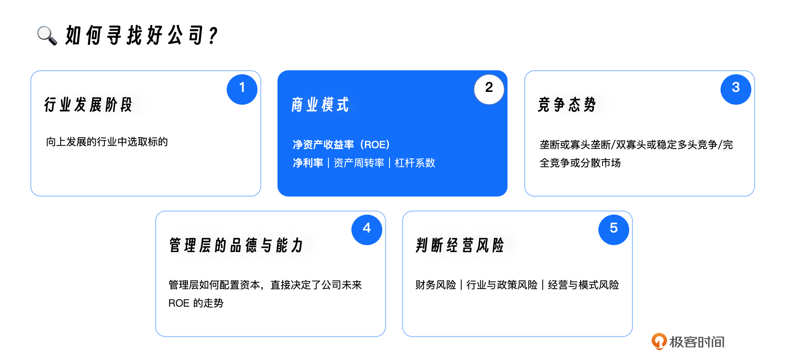

# 23 | 基本面投资核心三原则：如何找到好公司，并在好价格买入？

你好，我是 Brook。

上一节我们探讨了市场中的主要投资流派、不同流派背后的关键假设，并得出了建议：“基本面投资”（包括价值投资、成长投资）适用于多数 IT 从业者。这节课我们将讨论基本面投资的关键原则。

在价值或成长类投资（后续我们统称为：基本面投资）中，你是否遇到过以下问题：

1. 感觉某个股行情将至，担心不立刻下手会错过机会，于是在没有充分了解公司情况下，匆忙下手？

2. 理解并认同“不懂不投”的概念，但不知如何识别好的公司？

3. 通过行业积累与审慎分析，识别了好公司，却不知如何判断是否是好的价格，无法识别买入、卖出时机？

这节课我们就围绕这些问题，分析基本面投资的原则、策略与方法。

## 正确的收益观

步步高创始人段永平曾在雪球分享中讲过，“看懂一家公司需要多年的观察和思考，就像读大学需要系统学习一样，没有捷径可走”。通过学习掌握正确的认知和必要的知识，是成功投资的第一步。

权益投资的收益来自于以下三点：公司分红的钱、公司成长的钱、公司估值波动的钱。价值投资更关注公司显著低估的机会，主要在公司估值回归中赚取收益；成长类投资聚焦公司未来成长性，致力于在公司未来增长中获取收益。这两者的共性，强调理解生意本质、关注长期竞争优势，从而先于市场发现公司潜力。

投资市场永远风险与收益并存。以“技术派”为代表的部分专业投资人士会将获取期望收益最大作为目标，借助各类金融工具“刀尖上跳舞”致力于在波动中获取最大收益。尽管其短期收益亮眼，但长期也不乏资深从业者马失前蹄。被誉为“投机之王”的华尔街传奇投资家杰西·利弗莫尔，人生大起大落，数次从巨富到破产，并最终在 1940 年自杀身亡，身后财产不足 1 万美元。

与此同时，以巴菲特、段永平等为代表的人员则致力于实现财富的稳健增值。早在 1998 年佛罗里达大学的演讲中，沃伦·巴菲特便提出对“一生只需富一次”这一理念的明确认同，并于2025 年伯克希尔·哈撒韦年度股东大会上予以重申。段永平在 2025 年 1 月浙江大学分享中提到“不要用你需要的钱，去赌你不需要的钱”，表达了类似观点。

以上分享揭示了基本面投资的核心收益观：不追求利润期望的最大化，追求资产稳步提升，控制风险大于绝对收益。用必需的生活资金（如房贷、教育费）去博取非必需的高收益，本质是风险与需求错配。

基于此基本原则，衍生出对应的投资策略以及约束，举例如下：

1. 不加杠杆：在价格合理的前提下买入权益资产，即使价格波动，归零的概率也极低。但如果加了五倍杠杆，只要价格波动 20%，资产就可能归零。当然，有些投资者在充分评估未来收入和标的（目标投资品，例如股票）稳定性的基础上，使用低杠杆投资债券或高股息资产，这属于审慎决策的范畴，但如何权衡仍需每个人自己把握。

2. 不做空、谨慎投资期货产品：由于资产价格向下有底、向上无顶，做空是一种收益有限、风险无限的操作，错误的做空可能导致重大资产损失。类似的，期货操作由于有明确的交割时间，交割机制与瞬时流动性的崩溃也会带来投资风险。

“中行‘原油保’客户倒欠保证金”事件是一个典型案例。2020 年 4 月 20 日：WTI 原油 5 月合约结算价暴跌至 -37.63 美元 / 桶，为 1983 年原油期货交易以来首次负值。其根本原因，是期货合约到期流动性枯竭，导致大量对冲基金因杠杆叠加价差损失遭遇“灭顶之灾”，个人投资者血本无归。这个真实案例提醒我们，有些市场波动，远超出普通投资者的预期范围。

- 事件还原：2020 年 4 月，想“抄底”原油的中行“原油宝”投资者，撞上了史无前例的灾难。全球油库爆满，导致期货合约在最后交易日成了没人敢接的“烫手山芋”。持有者为了平仓，恐慌性抛售，甚至愿意“倒贴钱”请人接手，导致油价史无前例地跌成负数。而中行“原油宝”因产品设计缺陷，没能及时跑掉，最终按 -37.63 美元的价格结算。导致投资者不仅本金赔光，还倒欠了银行巨款，酿成一场惊天穿仓惨案。

## 寻找好的公司

巴菲特和段永平的投资哲学，听起来非常简洁，即：找到好公司，在好价格时买入，然后长期持有。但真正实践起来，门槛却非常高。其中最关键的一点，就是他们都严格遵循“能力圈”原则，也就是“不懂不做”。他们会把大量时间和精力，投入到深度理解少数几家公司上，而不是试图去追逐市场上的每一个机会。那么，如何在投资市场中看懂并找到好的公司？依据基本面投资核心观点，**“高净资产投资收益率（ROE） + 可持续 + 经营安全”的公司，通常就是好公司。** 而找到这样的标的，需要考虑以下因素：

首先是行业发展阶段（未来市场容量）。在未来市场容量萎缩的行业中选取标的，注定其成长性会受到限制，甚至可能为负。基本面投资核心是“做时间的朋友”，因此要尽量在向上发展的行业中选取标的。有一个被广泛认同的观点，不要在向下的市场趋势中寻找向上的短期收益，除非是稳健收益行业并且极度低估。诸如在 2021 年面临新生人口显著下降、房价伴随居民负债率持续走高趋势，某地产公司负责人喊出“我们市盈率只有 4 倍，投资我们是价值投资”。如果我们相信了他的话，那么迎接我们的将是股价从二十多元跌到两毛的百倍跌幅。

其次是商业模式。我们需要问自己：这家公司究竟靠什么赚钱，是“苦生意”还是“印钞机”？净资产收益率（ROE） 是一个至关重要的核心指标。它衡量的是公司利用股东投入的每一元资本，能够创造出多少净利润。巴菲特曾多次强调，他偏爱那些能持续提供高 ROE 的公司，因为这直接反映了公司为股东创造价值的效率。

ROE 是商业模式盈利能力的“成绩单”。其计算方式为：

## ROE = 净利润/净资产= （净利润÷ 销售收入）× （销售收入÷ 总资产）

三个比值，分别代表三种盈利模式，对应了三类企业：净利率高、资产周转率高、杠杆系数高。三类中，净利润率高是最理想的长期投资模式；高周转受管理层影响很大，高杠杆容易受到周期影响遭遇重大经营风险。

- 净利润率（净利润 / 销售收入）高：通过品牌溢价赚钱，“现金奶牛”。例如贵州茅台、美的、格力，附加值很高；分析这类企业，主要观察利润率变化。

- 总资产周转率（销售收入 / 总资产）高：通过高周转赚钱；例如沃尔玛、京东、苏宁易购、地产企业等，分析这类企业，重点关注资产周转率变化。

- 杠杆系数（总资产 / 净资产）高：银行模式，通过杠杆将利润放大；重点关注是否杠杆下降、筹资困难。

如果以上三者均不高，则需要考虑这家公司的投资价值。对于资产收益率长期无法跑赢无风险收益率的公司，除非看到了明显的反转机会（比如周期反转、技术突破等）或资产价格显著低于净资产（PB<<1），否则应当避免投资。这类公司未来现金流（折现后）逐年递减，是时间的敌人。

第三是竞争态势。公司在竞争中处于何种地位，是我们判断一家公司能否在行业中保持优势、持续获得高 ROE 的关键。我们需要思考：这个行业的竞争格局是清晰还是混乱？公司是处于主导地位的“定价者”，还是被动跟随的“接受者”？这种格局是会长期稳固，还是正在被打破？

一个行业的竞争态势，大致可以分为几种典型的类型，而不同类型的参与者，其命运也截然不同：

- 垄断或寡头垄断：这是最理想的投资格局。行业内只有一家或少数几家公司主导，它们往往拥有“定价权”，竞争压力小，利润率有保障。例如，腾讯在社交领域、早期的谷歌在搜索领域，都近乎于此。分析这类公司，关键在于判断其垄断地位是否稳固，是否会受到政策监管或技术颠覆的挑战。

- 双寡头或稳定多头竞争：这是一种健康的平衡状态。少数几个主要玩家共同主导市场，它们之间可能形成默契，竞争不再聚焦于价格战，而是品牌、服务和产品创新。最经典的例子是可口可乐与百事可乐，它们共同教育了市场，共同享受了行业增长的红利。分析这类格局，需要关注竞争是否会恶化，或者是否有联手扩大整体市场的可能。

- 完全竞争或分散市场：这是投资者需要警惕的格局。行业内参与者众多，产品和服务同质化严重，没有任何一家有定价权，最终极易陷入无休止的价格战，侵蚀所有参与者的利润。大多数餐饮、零售和制造业都处于这种状态。分析这类公司，需要寻找那些能够通过独特优势成功“突围”，实现市场份额集中的潜在赢家。

在分析竞争态势变化方面，如果伴随产品服务用户量（或交易额）增大，能够让“服务单位客户的成本下降，或者同样成本下满意度提升”，证明该产品的“规模效应”好，能够持续提升经营护城河。举例而言，微信伴随用户量持续增长，单用户的满意度得到显著提升（由于使用微信的朋友更多），这种商业模式的规模效应可以让微信在日常运营中护城河不断加深，有利于企业市场集中度提升。与之相反，中餐酒店的规模效应并不显著（伴随用餐人数增加，单用户满意度反而可能下降），这种生意不利于单一企业市场集中度的提升。

特别指出，“加盟”模式（对应 ToB 经营中的“渠道”模式）是一种很好的放大规模效应的方法。应用此模式，可以将高规模效应的产品要素（诸如：品牌、供应链、研发）留给“总部”，将低规模效应的产品要素（诸如：单店管理、地推获客、启动资金垫付）分给“加盟商”，为总部加固壁垒与防火墙。如果仔细观察，通过加盟模式运作的公司，在各行各业均非常普遍，横跨便利店、健身、金银饰品等几乎一切领域。

第四，管理层的品德与能力。公司产生的丰厚利润，管理层会如何处置？是明智地再投资于高回报项目，或通过资产回购 / 分红回报股东，还是盲目扩张，挥霍在昂贵并购或者不了解的新产业，还是通过关联公司、融资融券等中饱私囊？管理层如何配置资本，直接决定了公司未来ROE 的走势。

最后，需要判断经营风险。 这是我们评估一家公司能否在不确定性中持续生存、避免重大损失的防护网。一个生动的案例是光伏产业。这个行业前景广阔，但十几年来历经数次惨烈的周期洗礼。期间，无数企业因技术路线突变、行业产能过剩、海外贸易政策变动等风险而破产消亡。这告诉我们，即便在一个充满希望的行业中，缺乏对风险的抵御能力也同样致命。公司的经营风险，可以从几个关键维度进行梳理：

- 财务风险：这是最直接的风险。公司的债务负担是否过重？现金流能否覆盖利息支出？过高的财务杠杆在市场繁荣时能放大收益，但在下行周期中可能成为“催命符”。2008 年金融危机中的雷曼兄弟，以及一些高杠杆运行的房地产企业，都是因此类风险而倒下。分析这类公司，需密切关注其资产负债率和现金流的健康状况。

- 行业与政策风险：公司所处的赛道本身是否面临颠覆或管制？技术路径的变革可能让曾经的巨头一夜崩塌，正如数码相机颠覆了柯达的胶卷帝国。同样，政策的转向也可能重塑整个行业生态，例如近年来对教培等行业的规范，就对相关公司的经营产生了深远影响。

- 经营与模式风险：这关乎生意本身的脆弱性。公司的产品是否易受经济周期影响？其商业模式是否依赖持续的大额资本开支，像个“资本黑洞”？例如，航空业和高端制造业通常受宏观经济波动影响显著；而一些需要不断投入研发的科技公司，则面临技术路线押错、投入无法变现的风险。

识别风险的关键，在于理解公司的“脆弱点”。 例如，对于一家严重依赖单一客户或单一产品的公司，其风险显然高于客户和产品结构多元的公司。同样，对于一家处于激烈竞争行业中的公司，价格战就是其时刻面临的短期风险；而对于一家处于技术快速迭代行业中的公司，技术被颠覆则是其长期的生存性风险。

## 等待合理的价格

投资大师霍华德·马克斯在《周期》中反复强调：“买得好，是成功的一半。”即便是一家极其优秀的公司，如果你在市场极度乐观、价格高耸入云时买入，也可能需要忍受长期的横盘甚至下跌来消化估值。反之，当一家好公司因为暂时的困境或市场的悲观情绪而被低估时，往往提供了最佳的投资窗口。

那么，如何判断价格是否合理呢？一个根本性的方法是自由现金流折现法（DCF 模型）。巴菲特曾这样描述它：“企业的内在价值，就是其在经营周期内可以产生的现金流的贴现值。”这个模型的核心理念是：一家公司的价值，不取决于它过去赚了多少钱，也不完全取决于它明年赚多少钱，而是取决于它在整个未来生命周期里，能够为股东创造的可自由支配现金流的总额，再折算成当下的价值。

- 贴现值是什么？因为通胀等各种原因，“未来的钱”需要打一个折扣，才能和“现在的钱”放在同一个天平上比较。这个折扣的过程，就叫做“贴现”。计算出来的“现在的价值”，就是“贴现值”。

因为要对未来十年甚至更久的现金流做出估算，你需要对公司几个关键变量进行假设，比如高速增长能持续多久、增长率是多少，以及进入成熟期后的表现等等。而要做出这些有信心的假设，就必须对公司的核心要素有穿透性的理解。DCF 模型的主要价值，并非在于得出一个精确的数字，而在于它提供了一套严谨的思考框架。自由现金流估值理论网络上有充分的材料，gurufocus 等网站也提供了“DCF 估值计算器”可直接使用。接下来我们通过一个实例感受下思考框架的内容。

案例：某公司当年自由现金流为 1000 万人民币，应当如何进行估值？

关键假设：未来 10 年为该公司增长期，期间现金流平均年化增长为 15%；接下来 20 年为“消亡期”，企业逐步走向衰落消亡，其年均增长率为 4%。现金折现率按照 10% 计算（无风险利率 2% + 风险补偿 8%）。

估值计算：基于自由现金流折现法，该公司的估值约为 31,094 万人民币（可采用数学公式直接计算，或 excel 逐年推演；实际应用中，gurufocus 网站工具等直接填入关键参数自动计算即可）。具体计算方法如下：

- 10​ × (1 + g​)1 t

## [

## ]

## FCF

## ∑

- 0​ =

## PV

- growth

## (1 + r)t

- ​​t=1

- 20​ × (1 + g​)2 k

## [

## ]

## FCF

## ∑

- 10​ =

## PV

- decline

## (1 + r)k+10

- ​​k=1

- PV_growth 的公式中 t 从 1 到 10，带入关键假设数据后，PV_growth = 1000 × 12.866 =12,866 万人民币

- PV_decline 的公式中 k 从 1 到 20，带入关键假设数据后， PV_decline ≈ 18,227.5 万人民币；

- 总价值 = PV_growth + PV_decline = 12,866 + 18,227.5 = 31,093.5 万人民币

完成上述思考后，最后的步骤就变得清晰了：将你估算出的内在价值区间，与当前的市场价格进行对比。当市场价格远低于你最保守估算的价值底线时，即是投资良机。要牢记，“等待合理的价格”本质上是一种纪律。它要求你保持耐心，在市场贪婪制造泡沫时保持警惕，在市场恐惧抛售优质资产时拥有识别的智慧与行动的勇气。

## 课程总结

这节课我们系统地探讨了基本面投资的三大关键原则，为你构建了一个完整、可执行的投资决策框架。

1. 树立正确的收益观：基本面投资的底层逻辑，不是追求短期暴富的投机游戏，而是通过深度研究实现财富稳健增值的长期过程。不追求利润期望的最大化，追求资产稳步提升，控制风险大于绝对收益，可以帮助我们从源头上避免毁灭性风险。

2. 寻找好的公司：我们拆解了识别优质公司的五个核心维度，提供了一套优秀公司识别的“体检清单”。从行业发展、商业模式、竞争态势、管理层、经营风险等多个维度，在市场中寻找“好的公司”。

3. 等待合理的价格：我们以自由现金流折现（DCF）模型作为思考框架，通过具体案例演示了如何估算企业内在价值。关键在于理解：DCF 不是精确计算的工具，而是帮助你建立价值锚定的思维方式。当市场价格显著低于估值时，才是真正的投资良机。

成功的投资往往是“枯燥”的。它不需要频繁交易，而是要求我们在充分研究的基础上，做出少数高质量的决策，然后耐心等待。正如巴菲特强调的：找到“即使股票交易所关门也愿意持有”的企业并与企业共同成长，从而让自己不被市场中的“鬼故事”左右。

这里需要注意，计算过程中我们引入了较高的“风险补偿”折现，是为了留有充裕的风险边界（对冲公司突然衰落的风险）。伴随对公司了解的更加深入，折现率更加合理的设置是你的“资金成本”。该项对于普通投资者，十年期国债收益是合理的初始设置。

## 课后练习

使用本课程中学习的方法，在你熟悉的行业中分析 3 家企业，并致力于找到至少 1 家“好公司”，采用自由现金流折现法为其估值。

恭喜你完成第 23 节课的打卡，欢迎你在留言区与我交流讨论。如果今天的内容让你有所收获，也欢迎转发给有需要的朋友，我们下节课再见！

## 推荐阅读

投资理财里面的学问很深，就像有些同学说的，随便拿出一个流派就能构成一个专栏，我们这门课的主要目的是帮助你构建个人增长飞轮，而投资理财是其中的一环，课程篇幅有限，我们也无法继续深入地探讨，所以如果你读完这几节课，觉得对投资理财感兴趣的话，我推荐你从以下几个方面进一步了解：

书籍方面，在道的层面，芒格的穷查理宝典，巴菲特致股东的信（有时间的话也可以直接看每年股东大会视频），以及段永平投资问答录（不是段永平写的，但总结了他的观点，出版前征得了他的同意。或者直接跟踪段永平先生雪球账号的观点），都值得反复看。

术的层面就非常多了，比如商业模式，推荐“王慧文清华产品课”，本意是教高级产品经理思考，但用在投资理解商业模式也很不错（如结束语，本身也是触类旁通）。当然如果想要更加深入，从优秀到卓越、启示录等等都可以看。

建议你还是从道开始，逐步建立框架，之后再开始分析公司，以“理解牛人分析”作为第一目标，发现理解不了的情况下缺什么补什么（比如，段永平为何说 A 股茅台美股苹果港股腾讯）。 另外有些财经博主，在具体实践层面会针对每天新闻做分析，如果没有太多时间跟踪新闻，可以选取一位关注。
