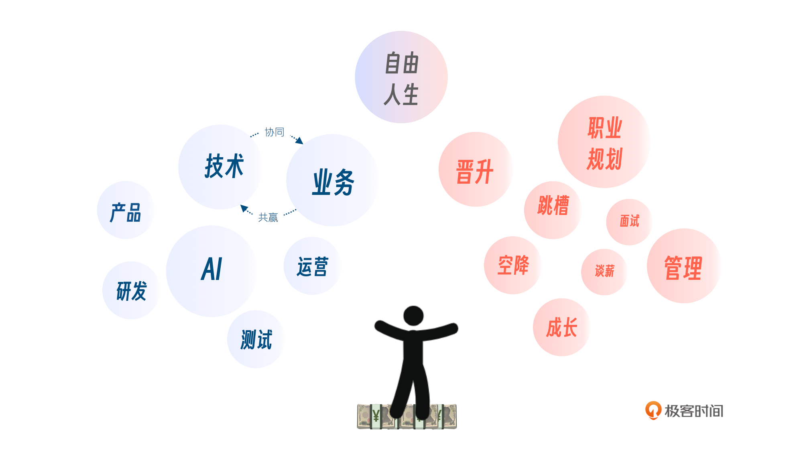
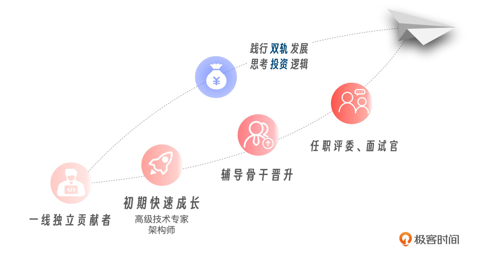
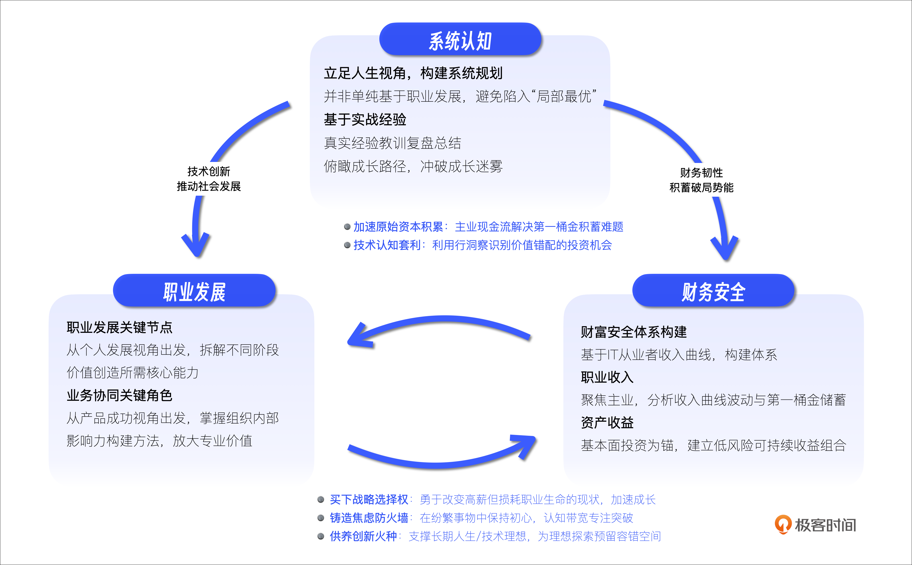

# 开篇词 | 在AI时代洪流中，锻造不可替代的竞争力

你好，我是 Brook，欢迎加入程序员职业发展的学习之旅。

当深夜的代码提交提示音响起，你是否也曾思考：

- AI 浪潮汹涌而来，作为技术骨干与技术管理者，应当如何让自己的核心价值“持续增值”而非贬值？

- IT 行业技术人员应当如何规划自己的职业生涯，从职场新人到研发总监可能遭遇的关键问题，如何破局？

- 你为 40 岁后的自己准备了什么？——当看到爆发机会时，如何避免“想用科技改变世界，却被生存现实压得不敢冒险”的困境？如果到达职业生涯的瓶颈，你如何确保接下来的收入是平滑的“高原”，而不是陡峭的“悬崖”？

这门课程就是解决方案。它不是一套基于理论推演的职场鸡汤，而是用亲身经历验证的生存框架。当技术周期波动时，你既要有攀登职业高峰的锐气，更需守护人生底牌的智慧。

## AI 技术革新与职业生涯挑战

就拿近几年大热的 AI 技术来说吧，你应该已经真切地感受到它正实实在在地重塑着我们的职业环境。或许你已经在身边看到了这些变化：

- “一人创业公司”概念兴起，架构师或资深技术 leader，在 AI 的协助下开发提效显著，3 人团队堪比过去 7 人团队的产出。

- 技术部门重组，前端团队被整体优化，后端岗位削减 30%，相关工作由 AI 接手完成。

- 各类公司的基础岗位，社招、校招名额大幅缩减；招聘新增岗位要求“熟练使用 AI 编程、设计工具”成为标配，AI 相关岗位数量增长迅猛。

- ……

一面是掌握 AI 技能、深挖业务价值的复合型人才身价飙升、百万年薪频现，另一面传统开发岗位的需求加速萎缩。这种剧烈的人才需求重构与技能门槛的提高正在提醒着我们，IT 从业者需要积极拥抱技术变革，持续锻造核心竞争力。

但这种“锻造”远不止于技术维度。理解技术之外的挑战，对 IT 从业者的长期发展同样至关重要。学校教会我们写代码的逻辑，却未曾传授人生算法的设计。在成长过程中，我亲身见证了部分同事的快速发展，抓住 AI 等技术风口，一举实现了技术理想与财富自由的双重跨越；也目睹了很多能力出众的技术骨干或技术管理者，深陷“劳而无功”“逃避式跳槽”“空降阵亡”等陷阱，迟迟无法晋升，走到职业发展的瓶颈。

因此，我们需要明确每个职业阶段的目标与重心、了解组织与协作中如何实现多方共赢，将职业、学习与生活视为整体进行人生系统规划。这些更像是一个“认知开关”。如果能够提前意识到问题所在，花费少量时间精力接通开关，就能拨云见日，让职业发展走上快车道。如果始终意识不到问题，即便能力出众，也很可能在惯性迷茫中事倍功半，严重迟滞甚至断绝更进一步发展的可能。

## 我为什么能帮你破局？

和对面的你一样，我在工作中也有过迷茫期。当真正走出来的那一刻，才深刻感受到：每个阶段的发展就像登山，站在山顶俯视时路径清晰可见，但自下而上攀登时，却常被眼前的陡坡遮蔽全局。

回顾曾经的焦虑、迷茫，也希望把曾经困扰自己的难题以及个人感悟分享给你。你可以看看我一路走来的一些经历。

- 一线独立贡献者：从某中厂（上市公司，子领域龙头）起步，从独立贡献者做起。

- 初期快速成长：一年半的时间破格晋升 7 个小职级，成为公司校招人员中，最快晋升高级技术专家、最快晋升架构师的人，并且这项记录保持到了现在。

- 辅导骨干晋升：作为直接主管，培养了多位技术骨干，2 年跨越 12 个小职级（3 个大职级），从工程师晋升为技术专家，并担任 Tech Leader 的岗位。

- 洞悉用人逻辑：作为研发任职专委会成员、职级晋升评委，参与公司 AI 岗晋升标准制定，与各职级人员晋升答辩，包括架构师、高级技术专家、技术专家、高级工程师评审，每年数场到 20 余场不等。作为企业终面面试官，面试 100+ 人，在这个过程中我也对企业的用人逻辑有了更深的了解。

- 践行双轨发展：我在工作之余常常思考投资逻辑，构建稳健低波价值投资组合，近两年半收益跑赢大盘核心指数 25%+（对比对象：沪深 300、中证 500），期间仓位最大回撤仅为中证 500 最大回撤 60%（中证 500 最大回撤 33.94%，个人组合最大回撤 17.90%）。

这一路走来我收获了很多成功的经验，也有不少失败的教训，我想通过这门课程整理出来，一是为自己做一个阶段性的总结复盘，二是希望能够帮助同样迷茫的你，提前看清 IT 从业者人生爬坡路线图，用科学规划替代临时抱佛脚，用战略思维减少无效内耗，把省下的精力聚焦科技创新与价值创造。

## 课程路线图：三步构建发展护城河

我会从“IT 从业者个体”角度出发，通过“系统认知 -> 职业发展 -> 财务安全”这样循序渐进的路径给出发展建议，帮助你在 AI 时代“领先一步”，从人生全局出发，整合技术、业务与财务思维，构建属于你自己的、坚实而系统的人生算法，真正掌握人生选择权。

第一章：系统认知

这一部分我会分享职业发展的一些基本认知，以俯瞰视角，明晰我们 IT 从业者如何“做正确的事情”。带你洞悉 IT 行业波动性、技术迭代规律等核心特质，建立“顺境科技创新改变世界，逆境财务稳健藏器待时”的动态发展观，构建可应对顺逆周期的个人增长系统。

第二章：职业破局

这一部分聚焦 IT 从业者职业发展关键节点的决策困境，覆盖从 Offer 选择到架构师 / 研发总监的全周期关键问题，如破解“忙而无功”困局、晋升 TL 关键事项、空降管理岗如何平稳落地等，提供可落地的破局方法论，避免职业路径的被动性。

第三章：AI 时代的业务协同

业务理解是 AI 时代技术人员必不可少的一项能力，这一部分我会带你理解产品生态中的角色共赢逻辑，拆解技术、产品、运营等角色，在价值创造链中的分工与目标，了解优秀产品从战略规划到落地运营全过程，理解“技术方案到商业结果”的映射，掌握业务价值翻译术，以及高效协作的底层逻辑，放大你的专业价值。

第四章：财务安全

这里我们会展开聊一聊，如何基于 IT 从业者收入曲线特性，设计“职业收入 + 投资复利”双通道财富体系，以基本面投资策略为锚，打造非工资依赖的财富安全网，以此来获取追逐人生理想的自由。

正所谓“凡事预则立，不预则废”。希望你能通过这门课程，洞悉 IT 从业者发展路径，绘就自己人生的路线图。既能抬头仰望技术星空的浩瀚，也能低头构建财富人生的稳固基石，在时代的浪潮中藏器于身，待时而动，从容走向属于你的职业巅峰与人生自由。

最后，我也很想了解一下你当前的情况和疑问，欢迎你在留言区与我交流。
