# 06-颠覆者扩散模型：直观去理解加噪与去噪

你好，我是南柯。

上一讲我们结识了旧画师 GAN，提到了扩散模型在内容精致度、风格多样性和通用编辑等能力上弥补了 GAN 的不足之处。如果说 GAN 是旧画师，扩散模型无疑就是当下最受追捧的新画师。DALL-E 2、Imagen、Stable Diffusion 这些大名鼎鼎的模型，它们背后的魔术师都是扩散模型。

用过 Midjourney 的同学也许都注意过这样的现象，随着图像生成的进度条推进，图像也是从模糊到清晰。你可以点开下面的图片查看这个过程。

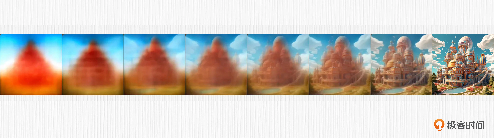

聪明的你应该猜到了，这背后的技巧大概率也是扩散模型！之所以说大概，是因为 Midjourney并没有对外公布其背后的算法原理，后面我们会用专门的一讲带你推测 Midjourney 背后的技术方案，这里先卖个关子。

那么，扩散模型的工作原理是怎样的呢？算法优化目标是什么？与 GAN 相比有哪些异同？这一讲我们便从这些基础问题出发，开始今天的扩散模型学习之旅。

## 初识扩散模型

扩散模型的灵感源自热力学。我们可以想象一下这样的过程，朝着一杯清水中滴入一滴有色碘伏，然后观察这杯水。

你会发现，碘伏在水中会有一个扩散的过程，最终完全在水中呈现出均匀的状态。扩散效应代表从有序到混乱的过程。比如下面这张图，把一滴红色的液体滴入清水中，颜色会逐渐扩散开，最终整杯水都变为红色。

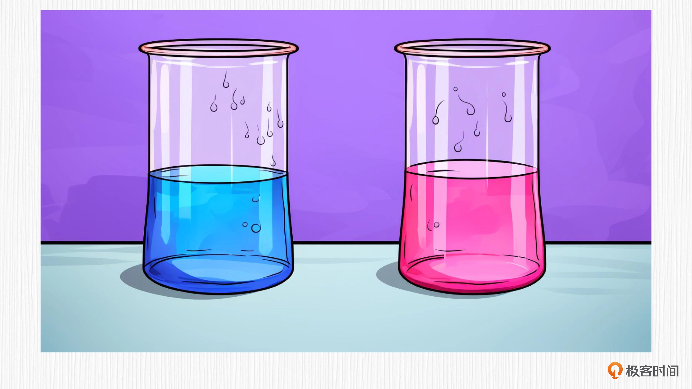

AI 绘画中的扩散模型和上面的例子类似，对于一张图片，逐渐加入噪声，最终图像将变成一张均匀的噪声图。我在下面放了一张图例，展示了这个过程。

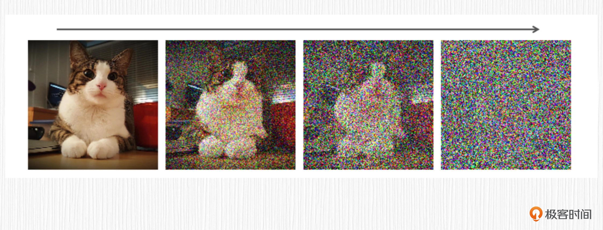

如果把这个过程反过来，从一个随机噪声图出发，逐步去除噪声，可以生成一张高质量的图片，这便达成了 AI 绘画的目的。基于扩散模型实现 AI 绘画的精髓就在于，如何实现这个逐步去除噪声的过程。在每一步的去噪过程中，起作用的是一个需要训练的神经网络，也就是一个UNet。UNet 的细节我们下一讲再展开，这里你可以先把它当成一个黑盒子。

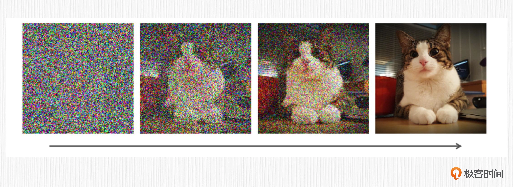

从上面的过程我们可以知道，基于扩散模型实现 AI 绘画包括两个过程——加噪过程和去噪过程。

无论是把一张图片加噪到纯噪声（即全是噪点的图片），还是把纯噪声做去噪处理，生成一张干净的图片，都需要多次操作。为了衡量转化过程到底需要多少步操作，就要引入一个时间步t 的概念。t 的取值为 1-1000 中的一个整数，代表加噪声的步数。

实验中整个加噪过程中需要 1000 次加噪操作。直觉上，从纯噪声去噪得到图像也需要 1000次去噪操作来完成。不过，实际使用中，通过数学推导的方式可以证明并不需要 1000 步，比如我们第 1 讲中用到的 Eular 采样器，只需要 20~30 步去噪，便可以从纯噪声去噪得到清晰的图片。

对于 Diffusion 模型的加噪过程，每一步加噪依赖于时间步 t。t 越接近 0，当前加噪结果越靠近原始图像；t 越接近 1000，当前加噪结果越靠近纯噪声。

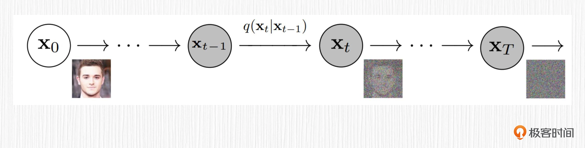

当我们通过训练得到神经网络 UNet 后，从原始噪声图出发，时间步取 1000，UNet 便可以预测第一次要去除的噪声值。然后，采样器便可以根据原始噪声图去除当前噪声值得到一张清晰一点儿的带噪声图像。反复重复这个过程，便完成了 AI 绘画的过程。

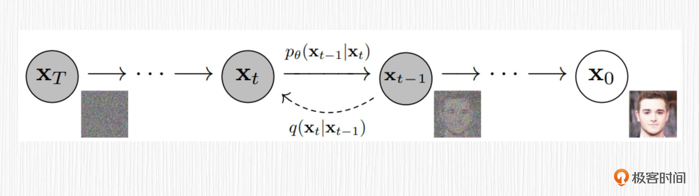

你可能已经注意到了，每一步的加噪结果仅依赖于上一步的加噪结果和一个加噪过程，而这个加噪过程依赖于当前时间步 t，因此整个加噪过程可以看成参数化的马尔科夫链。

马尔可夫链是一种数学模型，用于描述随机事件的序列，其中每个事件的概率仅取决于上一个事件的状态，而与过去的事件无关。关于马尔可夫链的更多知识，你可以点开链接了解。

## 细节探究

理解了扩散模型的整体思路，我们再来探究下加噪和去噪的算法细节。

### 加噪过程

对于加噪过程，每一步的加噪结果是可以根据上一步的加噪结果和当前时间步 t 计算得到的，计算公式如下所示。

- ​ =​ +

## 1 −α

## x

- ​x

## α

- ​ϵt−1t​t​t

## x

## x

## α

- 表示第 t 步的加噪结果；表示第 t-1 步的加噪结果；是一个预先设置的超

公式中，

- t−1​t​t​

## α

## α

## ϵ

参数，用于控制随时间步的加噪强弱，你可以理解为预先设定从

- 到1000 个参数；​11000​

表示一个随机的高斯噪声。

## x

## x

- 也可以从原始图像一次计算得到，你可以看下面的公式。

经过数学推导，

- ​0​t

- ​ +​ =

## α^t

## 1 −

## α^t

- ​ϵ

## x

- ​x0t​​

## α^t

## x

## α

## α

公式中

- 表示原始干净的图像，表示从到的乘积。​0​1​t​

如果你对推导过程感兴趣，可以点击链接去看看原始论文。到这里，你只需要记住一个事情，对于一张干净的图像，可以通过一次计算得到任意 t 步加噪声的结果。

### 去噪过程

学习完加噪的过程，我们再来看看去噪。去噪的过程包括两层含义。

第一，如何根据当前时间步的噪声图预测上一步加入的噪声？

第二，如何在当前时间步的噪声图上去除这些噪声？

先看第一层含义，如何根据加噪结果和时间步 t 预测噪声呢？这里深度学习模型就能派上用场了！我们希望得到这样一个模型，输入第 t 步加噪结果和时间步 t，预测从第 t-1 步到第 t 步噪声值。

主流的方法是训练一个 UNet 模型来预测噪声图。因为噪声值和输入图的分辨率是一致的，而UNet 模型常用于图像分割任务，输入输出的分辨率相同，使用 UNet 来完成这个任务再合适不过了。

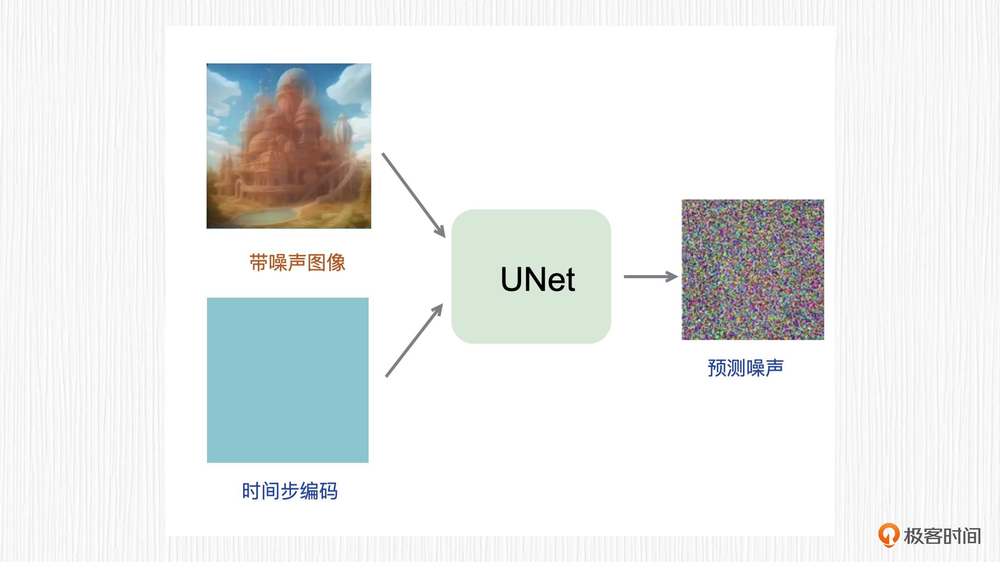

接下来是第二层含义。假定我们能够成功预测出这个噪声图，又如何去除噪声呢？

答案是采样器，你可能已经从 WebUI 中见到过各种各样的采样器，比如 DDIM、Eular A 等。采样器的作用便是根据加噪结果和噪声值，准确地去除噪声。

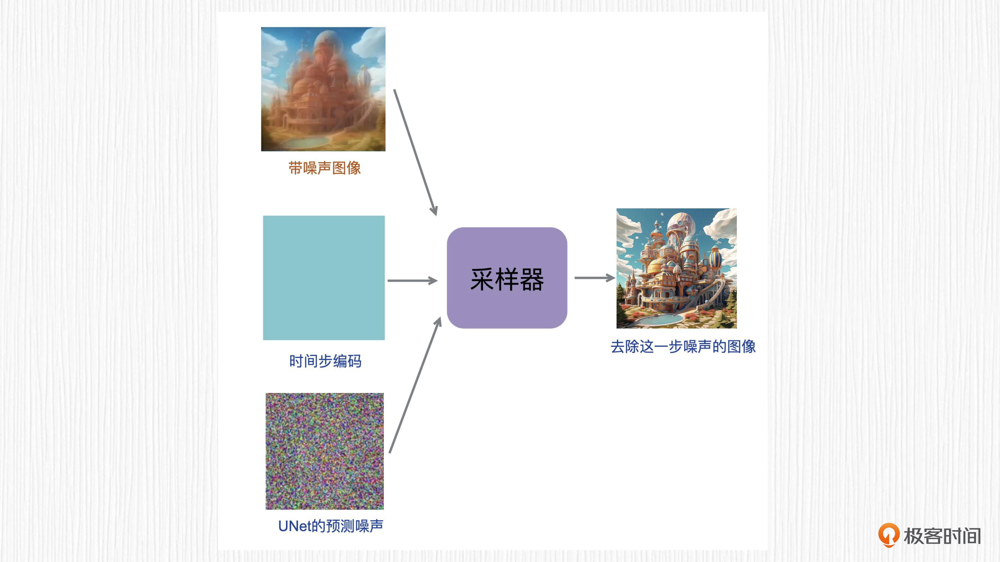

### 训练和推理

知道了加噪和去噪的过程，我们再来看看扩散模型的训练和推理环节，这里的训练针对的是刚刚提到的 UNet 黑盒，推理环节指的是从一个高斯噪声出发得到一张干净的图片。

你可以点开下面的图片查看原始论文中给出的总结，图片中推理环节对应的采样器为 DDPM采样器，我们用这个采样器来帮助我们理解算法原理。

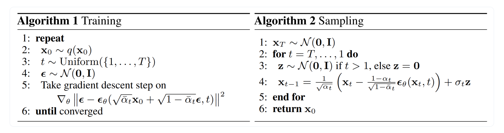

这个总结是不是看着有点懵？我来为你稍作解释。

首先对于训练过程，假定我们已经收集了一个用于训练扩散模型的训练集，整个训练过程便是不断重复下面这六个步骤。

1. 每次从数据集中随机抽取一张图片。

2. 随机从 1 至 1000 中选择一个时间步 t。

3. 随机生成一个高斯噪声。

4. 根据上述加噪环节的公式，一次计算直接得到第 t 步加噪的结果图像。

5. 将时间步 t 和加噪图像作为 UNet 的输入去预测一个噪声值。

6. 使用第五步预测的噪声值和第三步随机生成的噪声值，计算数值误差，并回传梯度。

计算数值误差的公式如下图所示，细心的你一定已经发现了，这里用到的正是 L2 损失。

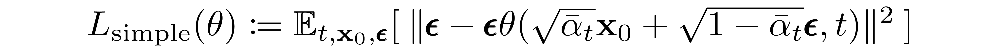

当我们反复循环上面的过程，直到 UNet 的损失函数逐渐收敛到较小的数值时，比如观测一段时间，损失函数的数值不再降低，就代表我们的扩散模型就训练完成了！

训练过程的理论学完以后，我们不妨趁热打铁，再看一下训练的代码，加深理解。

```
for i, (x_0) in enumerate(tqdm_data_loader):
   # 将数据加载至相应的运行设备(device)
   x_0 = x_0.to(device)
   # 对每一张图片随机在1~T的扩散步中进行采样
   t = torch.randint(1, T, size=(x_0.shape[0],), device=device)
   # 取得不同t下的 根号下alpha_t的连乘
   sqrt_alpha_t_bar = torch.gather(sqrt_alphas_bar, dim=0, index=t).reshape(-1,
   # 取得不同t下的 根号下的一减alpha_t的连乘
   sqrt_one_minus_alpha_t_bar = torch.gather(sqrt_one_minus_alphas_bar, dim=0, i
   # 从标准正态分布中采样得到 \epsilon
   noise = torch.randn_like(x_0).to(device)
   # 计算x_t
   x_t = sqrt_alpha_t_bar * x_0 + sqrt_one_minus_alpha_t_bar * noise
   # 将x_t输入模型 unet，得到输出
   out = net_model(x_t, t)
   loss = loss_function(out, noise) # 将模型的输出，同添加的噪声做损失
   optimizer.zero_grad()  # 优化器的梯度清零
   loss.backward()  # 由损失反向求导
   optimizer.step()  # 优化器更新参数
```

训练好了 UNet 模型以后，我们就可以用它来进行推理了，也就是从噪声开始生成图像。一次去噪过程包括三步。

1. 我们随机生成一个高斯噪声，作为第 1000 步加噪之后的结果。

2. 将这个噪声和时间步 1000 作为已经训练好的 UNet 的输入，预测第 999 步引入的噪声。

3. 使用采样器在步骤 1 的高斯噪声中去除步骤 2 预测的噪声，得到一张干净一点的图像。

这样我们就完成了一次去噪，然后以刚得到的干净一点的图像作为起点，重复第二步、第三步，便可以得到进一步去噪的图像。对于 DDPM 这个“黑盒”采样器来说，将上述过程重复1000 次，我们便完成了从高斯噪声得到清晰图片的过程。

我们看一下推理的代码。

```
for t_step in reversed(range(T)):  # 从T开始向零迭代
   t = t_step
   t = torch.tensor(t).to(device)
   # 如果t大于零，则采样自标准正态分布，否则为零
   z = torch.randn_like(x_t,device=device) if t_step > 0 else 0
   """这里作为示例，按照DDPM采样器公式计算"""
   x_t_minus_one = torch.sqrt(1/alphas[t])*
          (x_t-(1-alphas[t])*model(x_t, t.reshape(1,))/torch.sqrt(1-alphas_bar[t
          +torch.sqrt(betas[t])*z
   x_t = x_t_minus_one
```

到此为止，我们已经知道了扩散模型的算法原理。

## 扩散模型 vs GAN

你可以参考后面的对比图，来理解扩散模型和 GAN 的原理。

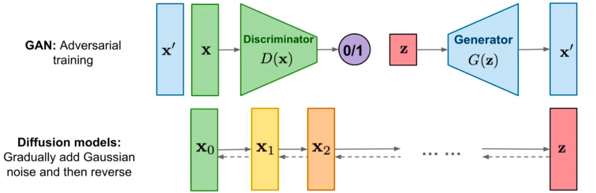

GAN 是通过生成器、判别器对抗训练的方式来实现图像生成能力的，本质上是神经网络的左右互搏。而这一讲的扩散模型，则是通过学习一个去除噪声的过程来实现图像生成的。

通过对比的方式进行学习有助于我们加深理解，整合知识。所以我们这就来从多个维度，对比一下 GAN 和扩散模型的特点，你可以参考后面的表格。

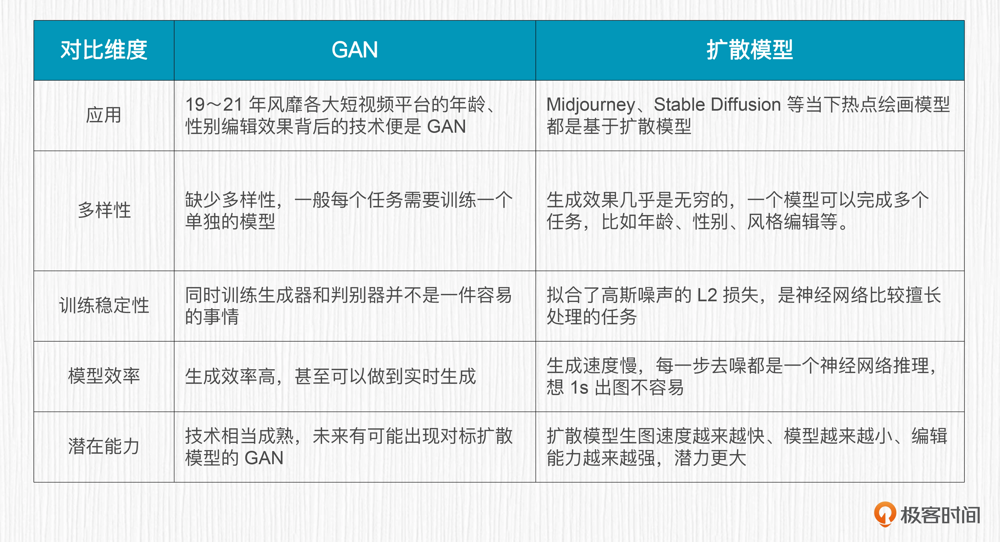

## 总结时刻

这一讲，我们从热力学中的扩散过程出发，理论结合实践，建立起对图像扩散模型的整体认识。

加噪过程的是通过参数化马尔可夫链将干净的图片逐步变为纯噪声；去噪的过程就是从噪声出发，逐步预测噪声并去除噪声。神经网络 UNet 被用于预测噪声，各式各样的采样器则用于去除噪声。

之后我们一起探究了扩散模型的算法细节，包括如何从干净图片通过一步计算到达任意步数的噪声图，如何通过 DDPM 采样器将噪声去除。之后还了解了如何训练一个扩散模型，以及如何使用扩散模型进行推理的过程。后面第 12 讲里，我们还会一起动手，从头开始训练一个扩散模型，这里先埋个伏笔。

课程最后，我们结合上一讲的内容，对于扩散模型和 GAN 做了对比，现在你应该对新旧两代画师各自的优缺点有了更深的认识。这里我还想提示你一下，在学习扩散模型的学习过程中，如果有不懂的概念，这时我非常鼓励你去和 ChatGPT 聊一聊！

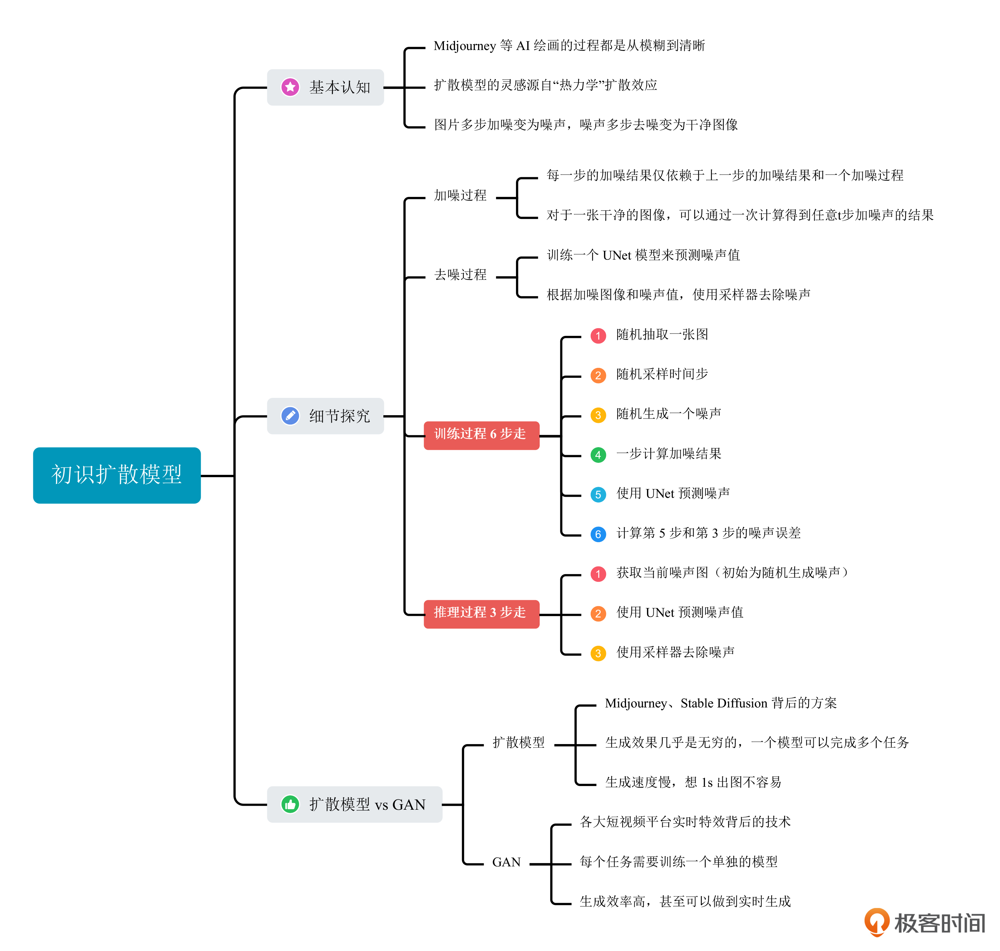

## 思考题

扩散模型生成速度慢是当前的痛点之一。了解了扩散模型的整体思路，你认为扩散模型的推理可以怎样加速呢？

欢迎你在留言区和我交流互动，也推荐你把这节课分享给有需要的朋友，说不定就能帮他更好地理解扩散模型。
