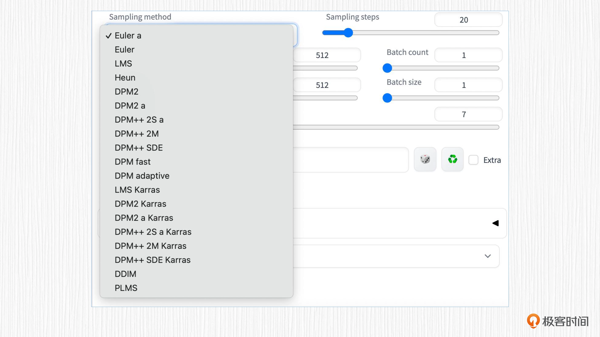
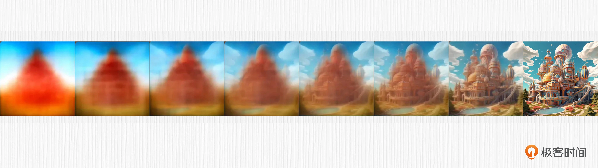
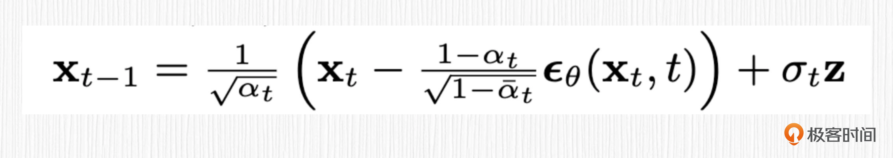
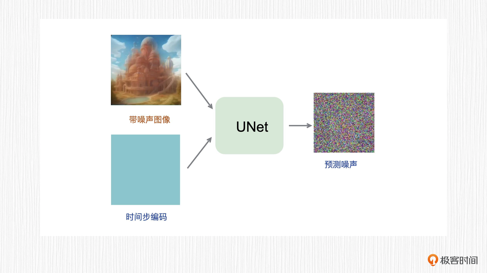
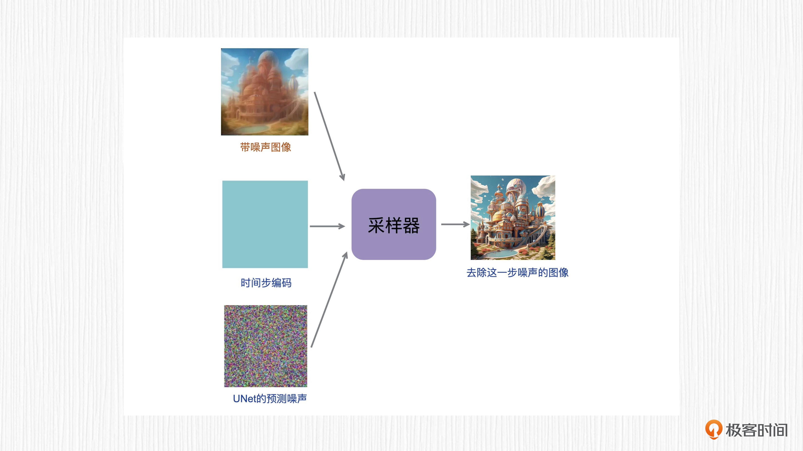
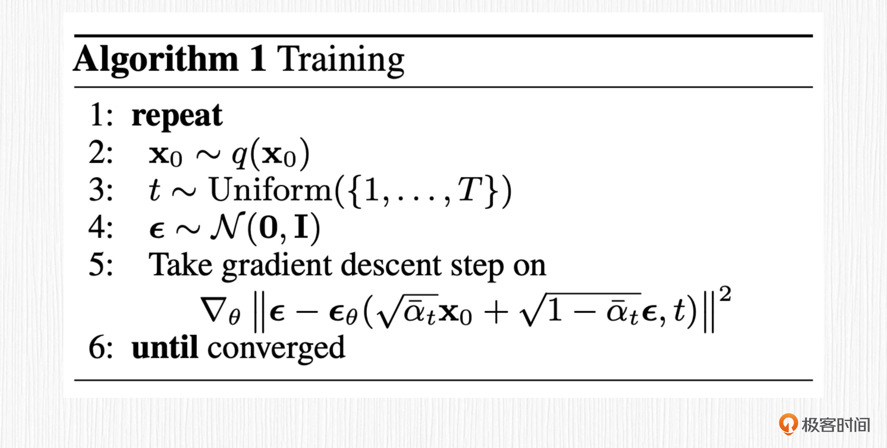
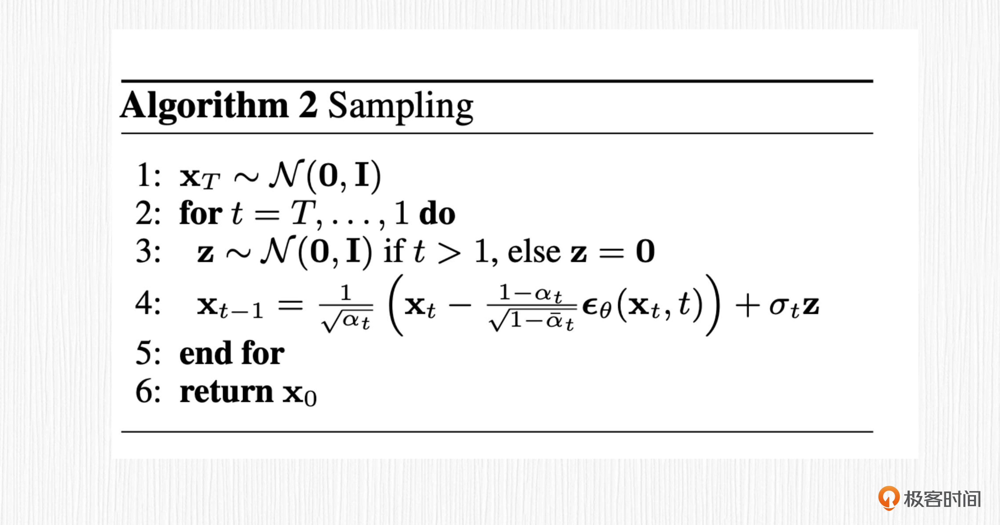
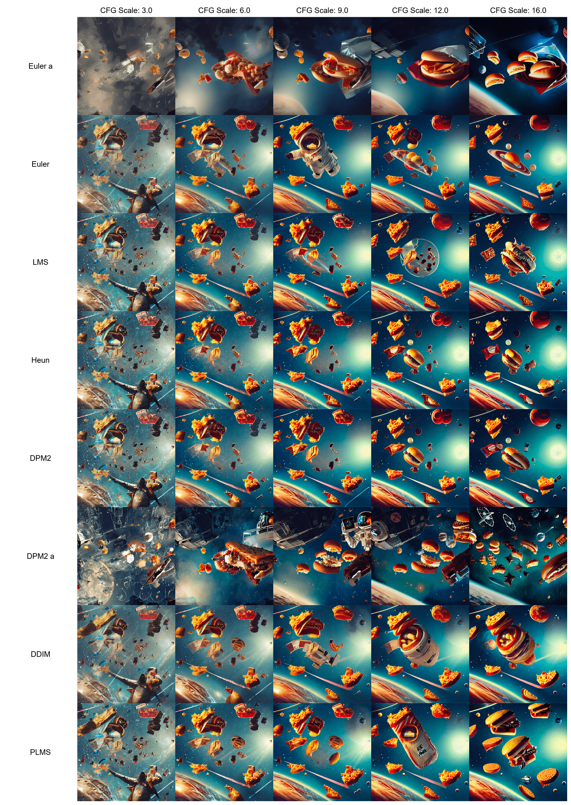
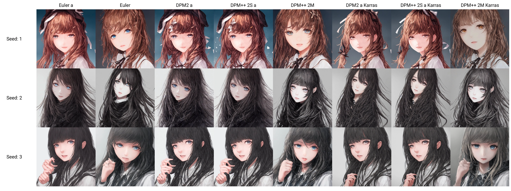
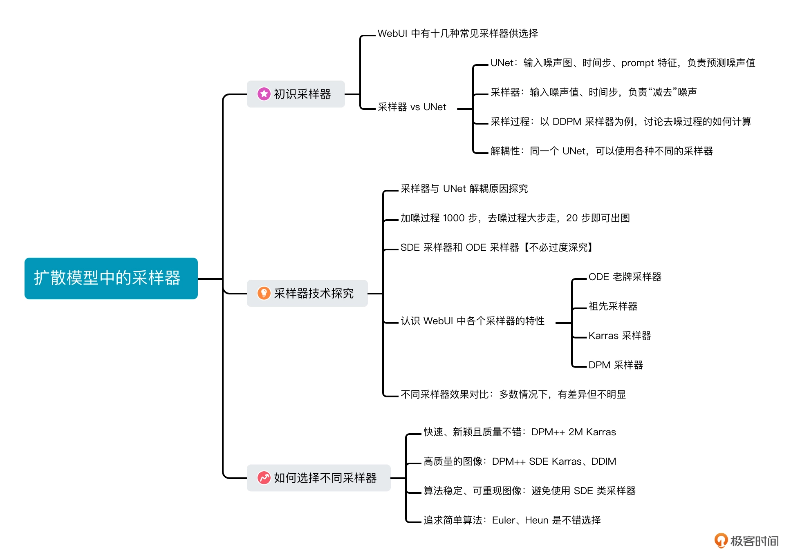

# 09 | 采样器：龟兔赛跑，如何选择更好更快的采样器？

你好，我是南柯。

热身篇我们学习过 WebUI，你会发现里面有多种可供选择的采样器方法，包括 Euler a、DPM、DDIM 等等。

我们已经多次使用 Stable Diffusion 进行 AI 绘画，采样器存在的价值就是从噪声出发，逐步去噪，得到一张清晰的图像。比如下面这张图，展示的便是采样器如何大显神威。

那么，采样器到底是什么？它们是如何运作的？它们之间又存在哪些区别呢？今天这一讲，我们就来详细探讨这些问题，让你对采样器有一个清晰的认识。了解了不同类型的采样器以后，我还会带你做个综合测评，这样你就能结合绘图需求去选择“最佳采样器”了。

## 采样器基本原理

在第 6 讲扩散模型的学习中我们已经知道，任何图像都可以通过不断添加噪声，变成完全被噪声覆盖的图像。反过来，一张噪声图像通过逐步去除噪声，可以变得清晰可辨。

在这个去除噪声的过程中，起到关键作用的正是今天课程里的“主角”——采样器。

为了搞清楚采样器是如何起作用的，我们要先回顾一下第 6 讲的内容。对于从噪声生成图像的

## t

扩散模型，UNet 模型负责预测要去除的噪声。UNet 模型的输入是时间步 对应的噪声图像

## t −1

## x

## t

- 和时间步 的编码。UNet 的输出的不是上一个时间步的噪声图像，而是上一个时间

​t

## ϵ

步添加的噪声值

- 。t−1​

## t −1

## t −1

## x

## ϵ

这时候，我们需要结合噪声图像

- ，时间步的噪声，去获取上一个时间步t−1​t​

## x

## x

## ϵ

的噪声图像

- 。将有噪声的图像减去 UNet 预测的噪声，便能恢复出上一步有噪声t−1t−1​t​​

## x

## x

的图像

- 。现在就是采样器发挥作用的时候，对于经典的 DDPM 采样器而言，可以t−1t−1​​

通过下面的公式来进行计算。

## α

## σ

## z

公式中的

- 和 都是已知的数值。整个过程重复多次，最终你将获得一个干净的图像。，​t​t

这个去噪过程称为采样，采样中使用的方法被称为采样器或采样方法。在 DDPM 的论文中使用大量篇幅推导采样器的计算公式，感兴趣的同学可以翻阅原始论文。

对于绝大多数 AI 绘画的工作场景，我们只需要掌握各种采样器的特性即可，不需要熟练掌握采样器背后的推导过程。

## x

我们开头提到的各种不同的采样器，在表现形式上便是不同的

- 计算公式。在实际使用t−1​

中，针对同一个训练好的 UNet 噪声预测模型，我们可以使用各种不同的采样器去除噪声。

现在，你对 UNet 和采样器的分工是不是很清晰了呢？我通过两个图例来说明。

对于 Stable Diffusion 模型而言，UNet 的输入还多出一个文本条件的特征信号，便于我们用prompt 控制绘画结果。

简言之，UNet 负责预测噪声，采样器负责“减去”噪声。这个过程反复迭代，我们就能从噪声

## x

## x

## x

## x

图

- 得到，然后得到，最终得到，也就是清晰可辨的图像。t−1t−2​0​t​​

## 采样器技术探究

了解了采样器的基本工作模式，你可能会提出这样的疑问——为什么相同的 UNet 模型可以使用不同的采样器？

要回答这个问题，我们需要重新看一下扩散模型的设计和训练过程。我们已经知道 UNet 模型

## ϵ

## x

真正预测的是上一个时间步增加的噪声值 ，而不是上一个时间步的噪声图像

- 。t−1​

你可以点开流程图复习下扩散模型的训练。

- 图片来源：https://arxiv.org/pdf/2006.11239.pdf

一旦我们得到训练好的 UNet，便可以使用它进行 AI 绘画。还是以 DDPM 算法为例，在推理过程中，采样器会在下面流程图中的第四步发挥作用。仔细观察你会发现，采样器与 UNet 模型的能力是不冲突的。这便解释了为什么在 WebUI 中我们使用同样的 AI 绘画模型，却可以任意选择采样器。

- 图片来源：https://arxiv.org/pdf/2006.11239.pdf

提到任意选择采样器，我们知道，加噪的过程有 1000 步，那么是不是去噪过程也需要 1000步呢？为什么在 WebUI 中不同采样器设置的步数会不同呢？

我们进一步探讨一下。如果我们使用训练过程的逻辑进行采样，也就是每次只去噪一步，那么在扩散模型中生成清晰图像确实需要进行 1000 步的采样，也就是 UNet 的运算要重复 1000次。这种方法非常耗时且占用资源。

实际上，如果我们使用更“快速”的采样方法，例如 Euler a、DPM 等，只需要进行 20 步采样就能得到清晰的图像。在这种情况下，模型每次去噪的间隔时间步是 50，相当于一次去掉 50

## x

个噪声，以跳跃的形式生成清晰的图像

- 。​0

因此，较少的步数意味着每个去噪步骤跨度更大。这种方法可以更高效地生成清晰图像，减少了计算量和时间消耗。在编写这一讲时，WebUI 提供了 19 种可用的采样器。随着时间的推移，这个数字在不断增加。

相信你已经明白，不同采样器之间的去噪过程就像是龟兔赛跑，有的步子迈得大、有的迈得小。那跑得快的采样器是如何更快实现这个过程的呢？其实也并不神秘，有点像我们高中看到一道复杂的应用题，经过一些数学变换，就变成更容易解决的“数学题”了

学术界也确实发现，这个工程问题经过一系列数学变换，实际无非是解决一些随机微分方程（stochastic differential equations，SDE）和常微分方程（ordinary differential equations，ODE）的问题。

随机微分方程描述的是一种或多种随机成分影响到系统的情况，系统的行为带有随机性。一个典型的例子是布朗运动，液体中的小颗粒在各个方向上不断经受随机碰撞，从而使它的运动路径变得难以预测。

而常微分方程描述的是只含单一自变量的连续变化系统，系统状态转移是确定的，没有随机性。一个典型的例子是热传导，因为在确定的条件下（比如初始温度、边界条件、系统物理性质等），热量在物体中的传播过程是可以预测的。简而言之，随机微分方程研究的是随机系统，常微分方程研究的是确定性系统。

是不是觉得刚才说的这些名词听着就头大？放轻松，其实你需要知道的结论就是——这个问题已经有了不少数学解决方案，这也是这些采样器的主要差异和由来。其实列表中的一些采样器早在一百多年前就被发明出来了。

## WebUI 中怎样选择合适的采样器

弄明白了采样器的底层原理，我们再逐一认识下 WebUI 中这些采样器。

首先认识下用于求解常微分方程的老派采样器。

- Euler，可以看作是最简单的求解器。

- Heun，比欧拉法更准确但速度较慢。

- LMS (Linear multi-step method)，与欧拉法速度差不多，但（据说）更准确。

除了这三个老派采样器，你可能注意到还有一些采样器的名称中也有一个字母 a 呢？比如Euler a、DPM2 a、DPM++ 2S a、DPM++ 2S a Karras，它们都属于祖先采样器（ancestralsamplers）。祖先采样器会在每个采样步骤中向图像添加噪声。因为采样结果有一定的随机性，所以它们是随机采样器。

接下来我们看看带有 “Karras” 标签的采样器。它们采用了 Karras 文章中推荐的噪声策略。在接近去噪过程结束时，将噪声步长变小。研究人员发现这可以提高图像的质量。

而 DDIM（去噪扩散隐式模型）和 PLMS（伪线性多步方法）是最初发布的 SD 模型 v1 中附带的采样器。不过，这两个采样器目前通常被认为已经过时，并且不再广泛使用。所以在WebUI 中的位置也比较靠后。

DPM（扩散概率模型求解器）和 DPM++ 采样器是 2022 年发布的专为扩散模型设计的新采样器。带有 DPM 标志的采样器代表了一系列具有相似架构的求解器。

说了这么多理论知识，还是得学以致用印象才更深刻。在实战中，这些采样器到底有怎样的区别呢？我们来看看社区的网友提供的一些样图。

- 图片来源：https://preview.redd.it/7cc1xdy5swba1.png?width=1472&format=png&auto=webp&v=enabled&s=47fd5ad4e168b0fa9bf270ec90f6965c45b86a14

- 图片来源：https://github.com/AUTOMATIC1111/stable-diffusion-webui/discussions/4363

看起来这些采样器有一些差异，但并不是非常明显。举个例子，虽然带有 “a” 的祖先采样器引入了更多的变化，但这并不意味着它们的质量更高。一些采样器的最终结果可能相似，但也有一些差别非常大。

那么我们在实践中，该如何选择采样器呢？我给你提供几个选择采样器的建议。

- 如果你想使用快速、新颖且质量不错的算法，最好的选择是 DPM++ 2M Karras，设置20~30 步。

- 如果你想要高质量的图像，那么可以考虑使用 DPM++ SDE Karras，设置 10~15 步，但要注意这是一个计算较慢的采样器。或者使用 DDIM 求解器，设置 10~15 步。

- 如果你喜欢稳定、可重现的图像，请避免使用任何原始采样器（SDE 类采样器）。

- 如果你喜欢简单算法，Euler 和 Heun 是不错的选择。

## 总结时刻

这一讲，我们学习了不同类型的采样器和它们在图像生成中的应用。

首先，我们了解了采样器通过去除噪声的方式来生成图像。接着，我们详细对比了这些采样器之间的差异，包括早期的 ODE 采样器、带有祖先采样的采样器以及基于 Karras 论文的采样器策略。

结合这些采样器的特点，我为你梳理了一些建议，帮助你在实际应用中选择合适的采样器。总的来说，选择合适的采样器需要综合考虑速度、生图质量和个人偏好。了解不同采样器的特点和应用场景，可以帮助我们在图像生成过程中做出明智的选择。

## 思考题

你在使用 WebUI 的过程中，选择采样器有哪些具体的心得？比如，追求生成速度与效果，该如何选择采样器？不同采样器在你的任务中有怎样的差异？

期待你的分享，积极讨论有助于你更好地消化课程内容。如果这一讲对你有帮助，也推荐你把课程分享给更多朋友。
