# 10 | CLIP：让AI绘画模型乖乖听你的话

你好，我是南柯。

今天我们要学习的是 OpenAI 在 2021 年提出的 CLIP 算法。在 AI 绘画的过程中，CLIP 的作用是理解我们给到模型的 prompt 指令，将 prompt 指令编码为模型能理解的“语言”。

但你可能不知道，最早提出 CLIP 模型并不是帮助 AI 绘画模型理解 prompt 指令，而是用于连接图像和文本这两种模态。如今，随着 AIGC 技术的大爆发，CLIP 模型又在 AI 绘画、多模态大模型等方向发挥了巨大价值。

这一讲，我们就一起来搞清楚 CLIP 这个算法背后的奥秘！只有真正理解了 CLIP，你才能知道为什么 prompt 可以控制 AI 绘画生成的内容。在设计你自己的 AI 绘画模型的时候，便可以根据你的需求选择各种 CLIP 模型或者其变体模型，得到更好的绘画效果。

## 追本溯源：CLIP 的提出背景

在学习 CLIP 之前，我们有必要先理解模态（Modality）的概念。在深度学习领域，模态可以用于描述输入数据的不同形式，比如图像、文本、音频等。不同的模态可以提供不同的特征，使模型能够从更多的角度理解和处理数据。在实践中，通过整合多种模态的信息，通常能够帮助模型获得更好的性能。

我们常说的 NLP（Natural Language Processing），即自然语言处理，解决的就是文本模态的任务，比如文本问答、文本对话、文本情绪分析等任务。

和它并列的是 CV（Computer Vision），即计算机视觉，解决的是图像模态的任务，当然广义上也包括视频、红外图像等信息输入。CV 算法解决的问题包括图像分类、图像目标检测、图像生成等。音频处理算法，比如语音识别、语音合成、声音情感分析等能力解决的便是音频模态的任务。

我们最近常常讨论的 AI 绘画和 ChatGPT，就分别是 CV 领域和 NLP 领域的明星技术。而GPT-4，则是同时使用了文本模态和图像模态两种输入信息。了解了模态概念，我们再来梳理一下 CLIP 是在怎样的背景下被提出的。

在 NLP 领域，早在 2020 年，OpenAI 便已经发布了 GPT-3 这个技术，证明了使用海量互联网数据得到的预训练模型可以用于各种文本类任务，比如文本分类、机器翻译、文本情感分析、文本问答等，GPT-3 的工作直接衍生出后来大火的 ChatGPT。

那时在 CV 领域里，最常见的模式还是使用各种各样既定任务的数据集，通过标注员的标注获得训练样本，针对特定任务来训练。比如我们熟知的图像分类数据集 ImageNet，就包括 1000个类别和超过 100 万图像样本。

CV 任务千千万，便催生了各式各样的数据集，比如图像分类、目标检测、图像分割、图像生成等。不过，在每个训练集上得到的模型通常只能完成特定的任务，无法在其他任务上推广。

我们来总结下，CLIP 被提出之前主要有这样两个痛点。

第一，CV 数据集标注是个劳动密集型任务，标注成本高昂。

第二，每个 CV 模型通常只能胜任一个任务，无法轻易迁移到新的任务。

## CLIP 解决方案

能否将 GPT-3 的经验迁移到图像领域，使用海量互联网数据做一个大一统的模型，同时能够很好地支持各种图像任务，比如图像分类、文字识别、视频理解等等？这就是 CLIP 工作的初衷！

要达成这个目的，有两个关键点，一是怎么利用海量的互联网数据，二是如何训练这样一个模型。

### 数据来源

首先，为了解决数据的问题，OpenAI 选定了 50 万条不同的查询请求，从互联网上获取到 4亿图像 - 文本对，来源包括 Google 这类通用搜索引擎和 Twitter 这类垂直领域社区。

这些数据不需要人工标注，比如我们在任意搜索引擎搜索图像，这些图像都会自带文本描述。下面的图中我展示了在搜索引擎中搜索柯基犬的结果截图。可以看到，图像自带的文本描述与图像具有较强的语义一致性，说白了就是图文对应。这种关联信息就是用于训练的监督信号！

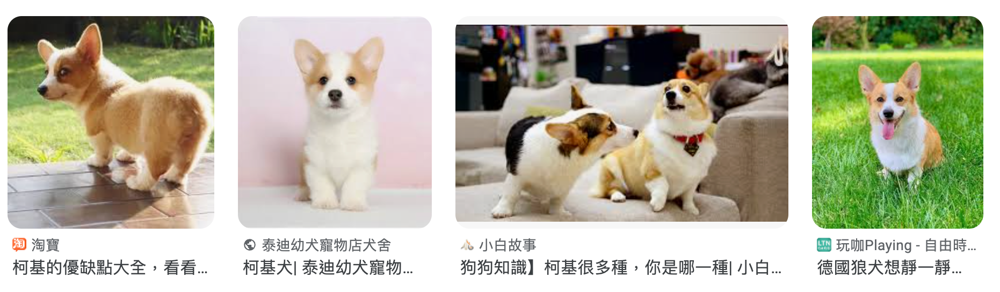

也就是说，互联网上天然就存在已经标注好的 CV 数据集，而且每天还在飞速新增。此外，使用互联网数据的另一个优势是它的数据非常多样，包含各种各样的图像内容，因此训练得到的模型自然就可以迁移到各种各样的场景。

放在当时，4 亿图文对是个很大的数据量，但技术发展到今天，用于训练各种多模态模型的数据早已突破 10 亿大关。比如人们常说的 LAION 5B 数据集，包括 50 亿图文对。

### 监督信号

好，现在我们拥有了海量图文数据，文本信息成为我们要用的“监督信号”，还得解决第二个问题——这些数据如何用于模型训练呢？

CLIP 通过巧妙的设计利用了图像模态和文本模态的对应关系。CLIP 分别构造了一个图像编码器和一个文本编码器，将图像及其文本描述映射到一个特征空间，比如我们可以映射到 512维度的特征空间。简言之，一张图或者一个文本描述，经过映射都是 512 个浮点数。

那么此时，我们需要设计一个监督信号，利用图文成对的关系，驱动两个编码器模型学习到有效的特征提取能力。该怎么做呢？

答案是对比学习。具体思路是这样的。我们可以计算图像特征向量和文本特征向量之间的余弦距离，余弦距离的范围是 -1 到 1，越大表示距离越接近。CLIP 的训练目标是让对应的图像、文本得到的特征向量靠近，也就是余弦距离越大越好，让不对应的图像、文本得到的特征向量远离，也就是余弦距离尽可能小。

你可以结合后面的图片来理解这个过程。

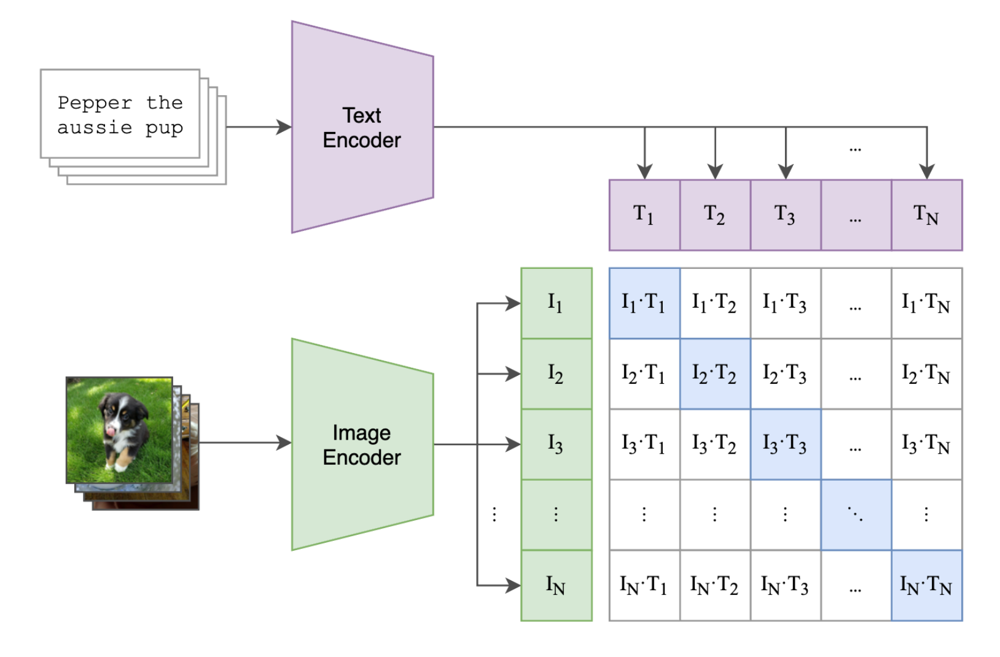

- 图片来源：https://openai.com/research/clip

下面这张图是这个过程的伪代码，可以帮你进一步强化理解。

```
# image_encoder - 图像编码器可以使用ResNet或者Vision Transformer结构
# text_encoder - 文本编码器可以使用CBOW或者Text Transformer结构
# I[n, h, w, c] - 一个训练批次的图像
# T[n, l] - 一个训练批次的对应文本图像
# W_i[d_i, d_e] - 可学习的图像特征投影层权重
# W_t[d_t, d_e] - 可学习的文本特征投影层权重
# t - 一个可学习的温度系数
# 第一步，提取图像和文本模态的表征
I_f = image_encoder(I) #[n, d_i]
T_f = text_encoder(T) #[n, d_t]
# 图像表征和文本表征分别映射到共同的多模态空间 [n, d_e]
I_e = l2_normalize(np.dot(I_f, W_i), axis=1)
T_e = l2_normalize(np.dot(T_f, W_t), axis=1)
# 计算余弦相似度 [n, n]
logits = np.dot(I_e, T_e.T) * np.exp(t)
# 计算损失值
labels = np.arange(n)
loss_i = cross_entropy_loss(logits, labels, axis=0)
loss_t = cross_entropy_loss(logits, labels, axis=1)
loss = (loss_i + loss_t)/2
```

可以看到，训练过程分为四步：提取表征、映射和归一化、计算距离和更新模型权重。

首先，使用图像编码器提取图像表征 I_f，使用文本编码器提取文本表征 T_f。

然后，分别引入一个线性投影（Linear Projection），将图像表征和文本表征分别映射到共同的多模态空间。这里线性投影的参数对应伪代码中的 W_i 和 W_t，然后将投影后的特征向量分别进行归一化，归一化后的表征平方和等于 1。

之后，我们要计算这批图文归一化表征两两之间的距离，距离范围是 -1 到 1，然后再乘以一个温度系数相关的数值项（伪代码第 18 行），这里的温度系数是一个可学习的参数。

最后，通过交叉熵损失函数进行模型监督，匹配的图文对距离拉近、不匹配的图文对距离拉远。

你可以结合后面的动态图来理解 CLIP 完整的训练过程。

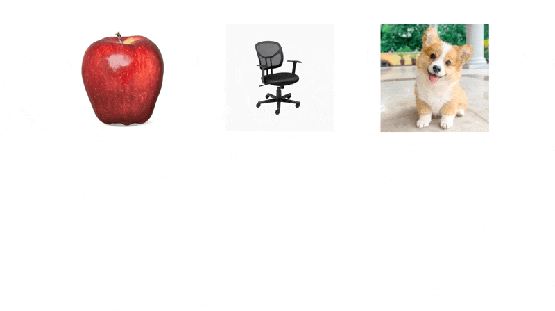

- 图片来源：https://www.assemblyai.com/blog/how-dall-e-2-actually-works/

## CLIP 进阶探索

了解了 CLIP 的海量数据获取和对比学习的训练方式，相信你一定也会感叹这个算法设计的巧妙。

那么，CLIP 都有哪些应用呢？在众多的 CLIP 模型的版本里，该如何选择合适的模型呢？我们这就来探讨这些问题。

### CLIP 应用

在 4 亿图文数据上完成训练后，我们便得到了一个图像编码器和一个文本编码器。

- 图片来源：https://openai.com/research/clip

回顾下 CLIP 设计的初衷，是为了解决 CV 模型的效果问题。所以，CLIP 工作在最开始主要是将训练得到的图像编码器用于处理各种图像下游任务。之后，在 AI 绘画过程中，CLIP 文本编码器用于理解我们给出的 prompt。

图像中最常见的下游任务便是图像分类任务。经典的图像分类任务通常需要使用人工标注的标签数据来训练，训练完成后只能区分训练时限定的类别。由于 CLIP 见过 4 亿图文，拥有海量的知识，我们便可以直接通过跨模态检索的方式直接进行分类。具体来说，我们可以设计后面这样的文本。

```
A photo of a <class>
```

这里的 class 可以是 ImageNet 的 1000 个既定类别，也可以是你自己设计的目标类别。以ImageNet 的 1000 类别为例，我们复用上面模板，得到 1000 个不同的 prompt。这 1000 个prompt 经过预训练得到的文本编码器之后，便得到 1000 个文本表征；对于输入图像，我们经过预训练的图像编码器可以得到 1 个图像表征。

将图像表征和 1000 个文本表征线性投影、归一化之后计算余弦距离，余弦距离最大的 prompt对应的类别便是 CLIP 模型预测的类别。

细心的你可能已经发现了，这并不是经典的分类方案，更像是检索的方案。是的，这种方法我们可以称之为跨模态检索。检索方案的扩展性要强于分类方案，比如上面这个任务的候选类别，你可以随意设计。

再举个人脸识别的例子，如果我们把人脸识别当做是分类任务，那么每次系统中录入一个新人，都需要将分类类别数加一，然后重新训练模型；如果我们将人脸识别建模为检索任务，我们只需要像 CLIP 这样，对每个人脸提一个特征，然后通过检索的方式进行身份定位即可。这样就不需要重新训练模型了。

关于 CLIP 通过检索为图像分类的整体过程，你可以参考后面这张图来加强理解。

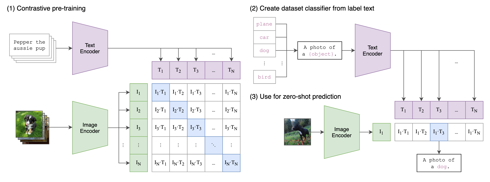

- 图片来源：https://openai.com/research/clip

对于我们 AI 绘画这门课，CLIP 模型便是让 AI 绘画模型听我们话的关键！在 CLIP 的训练过程中，图像表征和文本表征被线性投影到共同的多模态空间，在文本生图的过程中，prompt信息便可以通过 CLIP 抽取特征，然后指导模型作画。

以 Stable Diffusion 为例，我们前面已经了解了 Stable Diffusion 模型的 UNet 和 Transformer结构设计，CLIP 提取得到的文本表征经过交叉注意力（Cross Attention）的方式进行信息注入，便可以将我们的指令传递给模型。关于交叉注意力机制的技术原理，你可以回看第 7讲。

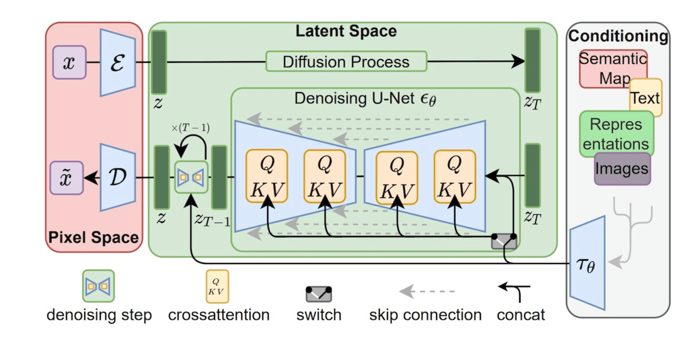

- 图片来源：https://arxiv.org/abs/2112.10752

后面的课程里，我们还会学习 DALL-E 2 模型，它在 CLIP 的基础上进一步扩展，提出unCLIP 结构，不仅能够用文本指导图像生成，还能输入图像生成多个相似变体。

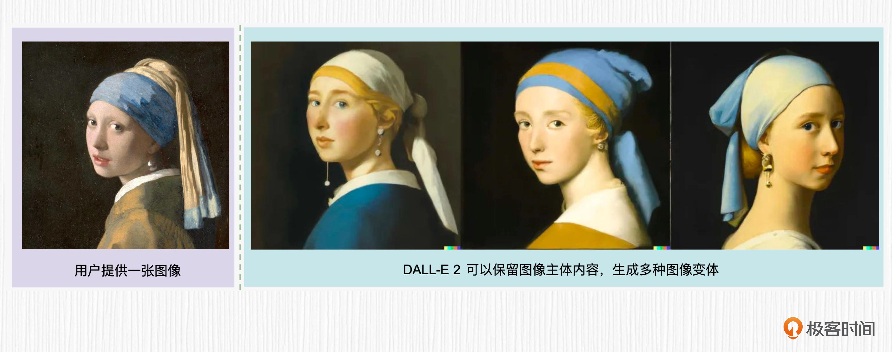

### CLIP 增强版

OpenAI 只是开源了 CLIP 模型的权重，并没有开源对应的 4 亿图文对。后来的学者便开始复现 OpenAI 的工作。比较有代表性的工作包括 OpenCLIP、ChineseCLIP 和 EVA-CLIP。

OpenCLIP 基于 LAION 公司收集的 4 亿开源图文数据训练而成，相当于是对 OpenAI 的CLIP 模型的复现。公开的 LAION 5B 数据集和开源的 OpenCLIP 代码库，打破了此前OpenAI 的“数据垄断”。你可以点开这个链接了解更多细节。

ChineseCLIP 的目标是用中文的图文数据完成 CLIP 训练，强化文本编码器的中文理解能力。比如说，ChineseCLIP 模型可以帮助 AI 绘画模型更好地理解中文。ChineseCLIP 使用大约 2亿中文图文对数据进行训练，你可以点开这个链接了解更多细节。

EVA-CLIP 是 2023 年 3 月由北京智源研究院提出的模型，通过提高训练效率和优化模型设计，取得了比传统 CLIP 更好的性能。感兴趣的同学可以点开这个链接了解更多细节。

## 如何使用 CLIP

了解了 CLIP 的原理和各种应用场景，我们不妨来动手用 CLIP 完成一个图像分类任务。

你可以点开我的 Colab 链接运行一下现成的案例，按照猫和狗的目标类别给一张图片做分类，点进去以后的样子如下图所示。

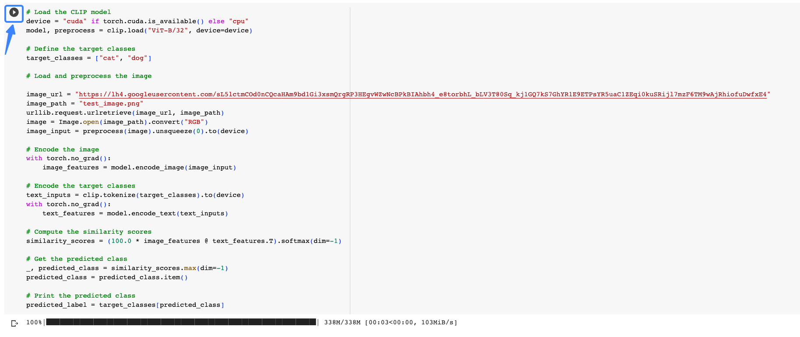

点击播放按钮，就能生成后面这样的图片分类结果。

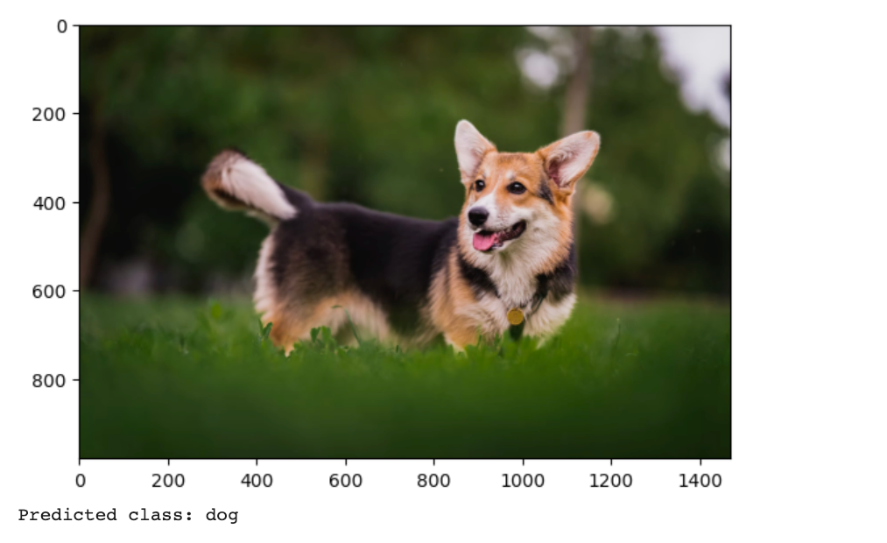

当然，我更推荐你自己用科学上网的方法注册一个 Google 账号，熟悉一下 Colab 的用法。我们的课程后面的实战项目也都会在 Colab 上完成。

注册好 Google 账号以后，你可以访问文稿后面这个链接。进入后点击文件菜单下面的新建笔记本。


之后，我们需要连接 GPU 环境。点击左上方的修改选项，选择笔记本设置。使用 GPU 作为硬件加速器，并完成一系列确认操作。

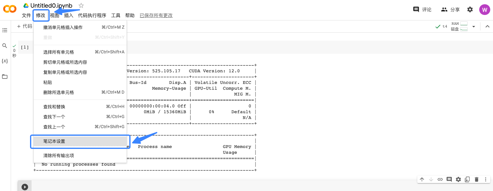

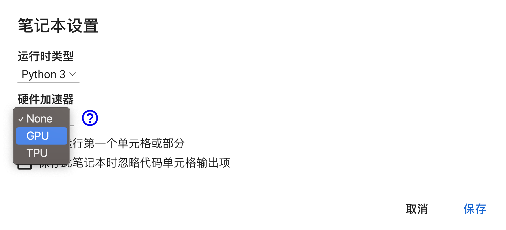

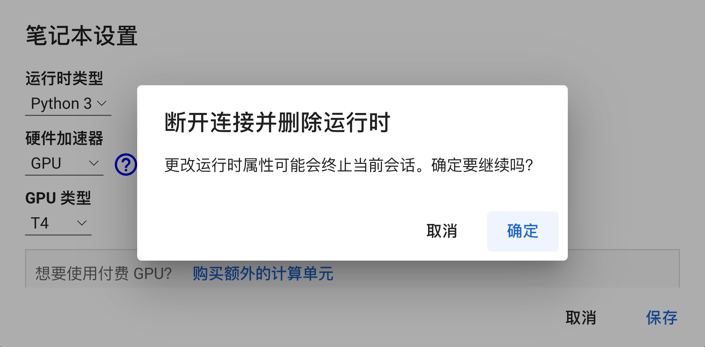

我们可以通过下面这行指令，确认是否已经获取到 GPU 资源。

```
!nvidia-smi
```

点击播放按钮，我们可以看到，我们“获得”了一张 T4 显卡，显存大小为 15GB。这样一张显卡足够我们完成本课程中的各种运算。

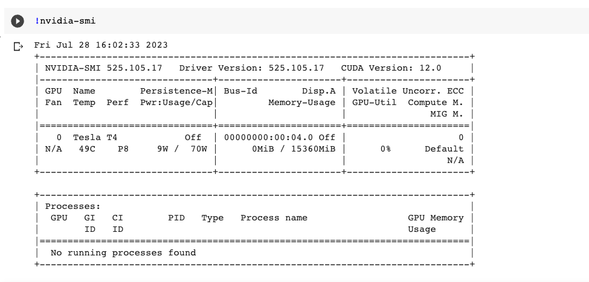

接着在新建好的笔记本页面，输入后面的指令安装 OpenAI 的 CLIP 工具包。

```
!pip install git+https://github.com/openai/CLIP.git
# 参考教程：https://github.com/openai/CLIP
```

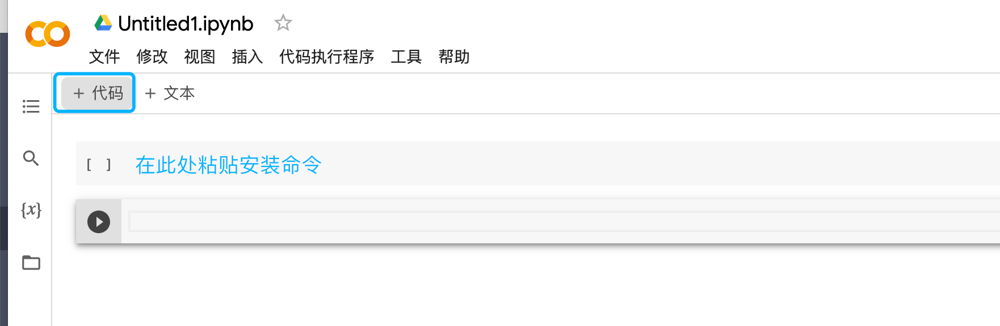

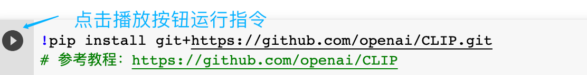

稍等片刻，出现后面截图里安装成功的字样，就表示成功安装 CLIP。

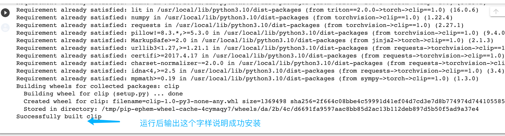

然后在 Colab 中粘贴后面的代码，并点击播放按钮运行，对 image_url 中的图片进行分类。

```bash
import torch
import clip
from PIL import Image
import urllib.request
import matplotlib.pyplot as plt
# Load the CLIP model
device = "cuda" if torch.cuda.is_available() else "cpu"
model, preprocess = clip.load("ViT-B/32", device=device)
# Define the target classes
target_classes = ["cat", "dog"]
# Load and preprocess the image
image_url = "https://lh4.googleusercontent.com/sL5lctmCOd0nCQcaHAm9bd1Gi3xsmQrgRP
image_path = "test_image.png"
urllib.request.urlretrieve(image_url, image_path)
image = Image.open(image_path).convert("RGB")
image_input = preprocess(image).unsqueeze(0).to(device)
# Encode the image
with torch.no_grad():
   image_features = model.encode_image(image_input)
# Encode the target classes
text_inputs = clip.tokenize(target_classes).to(device)
with torch.no_grad():
   text_features = model.encode_text(text_inputs)
# Compute the similarity scores
similarity_scores = (100.0 * image_features @ text_features.T).softmax(dim=-1)
# Get the predicted class
_, predicted_class = similarity_scores.max(dim=-1)
predicted_class = predicted_class.item()
# Print the predicted class
predicted_label = target_classes[predicted_class]
plt.imshow(image)
plt.show()
print(f"Predicted class: {predicted_label}")
print(f"prob: cat {similarity_scores[0][0]}, dog {similarity_scores[0][1]}")
```

这里代码 16 行的图片可以换成你想测试的图片。不过要注意，Google 只能读 url 图片，如果想测试你的本地图片，需要先通过图床（比如这个链接）上传该图片，获得 url 链接再替换。

运行之后，得到的结果也是后面这张图。可以看到，分类成表格和猫的置信度为 0，而分类成狗的概率为 1。

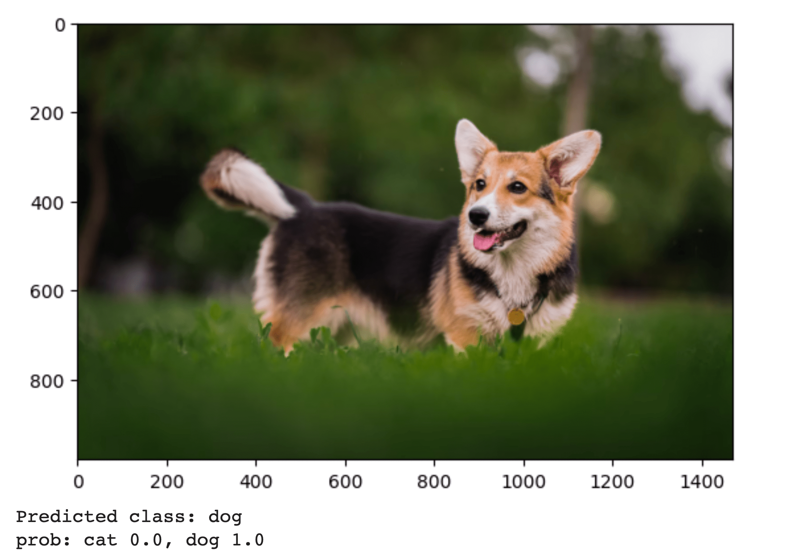

很多 AI 绘画的文本理解任务也会用到 OpenCLIP，所以这里我们也体验下 OpenCLIP 的效果。

首先需要安装对应 python 包。

```
!pip install open_clip_torch
```

同样是上面的柯基犬图片，我们可以通过下面这段代码提取 CLIP 的图像表征和文本表征。这里我们不妨提供三个类别选项，分别是图表、猫和狗。我们运行后面这段代码后，OpenCLIP模型预测为狗这一类别的概率是 99.9%。你可以点开我的 Colab 链接运行一下，也可以试试你自己想测试的图片。

```python
import torch
from PIL import Image
import open_clip
import urllib.request
import matplotlib.pyplot as plt
model, _, preprocess = open_clip.create_model_and_transforms('ViT-B-32', pretrain
tokenizer = open_clip.get_tokenizer('ViT-B-32')
image_url = "https://lh4.googleusercontent.com/sL5lctmCOd0nCQcaHAm9bd1Gi3xsmQrgRP
image_path = "test_image.png"
urllib.request.urlretrieve(image_url, image_path)
image = Image.open(image_path).convert("RGB")
image = preprocess(image).unsqueeze(0)
text = tokenizer(["a diagram", "a dog", "a cat"])
with torch.no_grad(), torch.cuda.amp.autocast():
   image_features = model.encode_image(image)
   text_features = model.encode_text(text)
   image_features /= image_features.norm(dim=-1, keepdim=True)
   text_features /= text_features.norm(dim=-1, keepdim=True)
   text_probs = (100.0 * image_features @ text_features.T).softmax(dim=-1)
plt.imshow(Image.open(image_path))
plt.show()
print(f"prob: a diagram {text_probs[0][0]}, a dog {text_probs[0][1]}, a cat {text
```

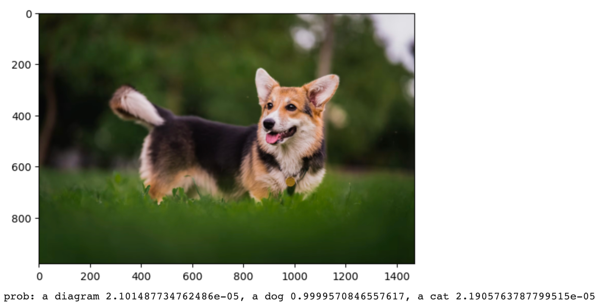

## 总结时刻

总结一下，今天我们学习了 OpenAI 在 2021 年推出的 CLIP 模型。

CLIP 模型使用 4 亿互联网图文数据，结合对比学习的方式进行训练，得到了一个通用的视觉特征模型。CLIP 的训练目标是在多模态空间中，成对图文的图像文本特征尽可能靠近，不成对图文的图像文本特征尽可能远离。

然后，我们了解了 CLIP 模型的两种常用用法，分别是基于检索的方式为图像分类，以及实现AI 绘画模型的 prompt 信息提取。

之后，在原始 OpenAI CLIP 模型的基础之上，我们认识了 CLIP 模型的系列变体，如OpenCLIP、ChineseCLIP、EVA-CLIP 等工作，了解了这些模型该如何选用。

最后，我们通过一个实际的代码示例学习了如何基于 CLIP 的图像、文本表征进行跨模态检索。

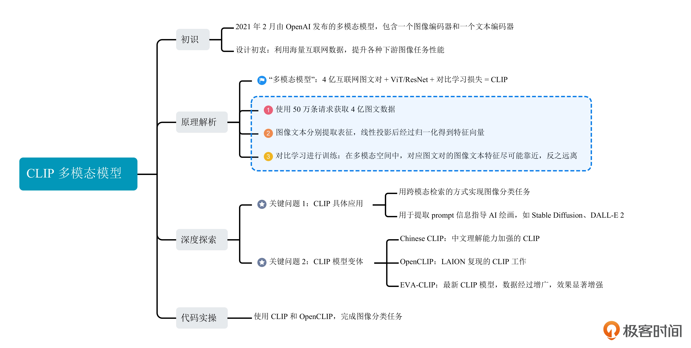

掌握了 CLIP 模型的工作原理，对于我们理解之后的 AI 绘画模型、设计我们自己的 AI 绘画模型至关重要，相关概念和用法在之后的课程还会频繁被提到。非常鼓励你课后去读读原始论文、看一些开源代码实现来加深对 CLIP 的理解。

## 思考题

第一道题，除了今天我们提到的 CLIP 应用场景，还有哪些实际应用中，可以用到 CLIP 模型的图像和文本编码能力呢？

第二个是练习题，你可以试着用 CLIP，给后面这两张图片分个类。图像你可以点击超链接获取：链接 1、链接 2。

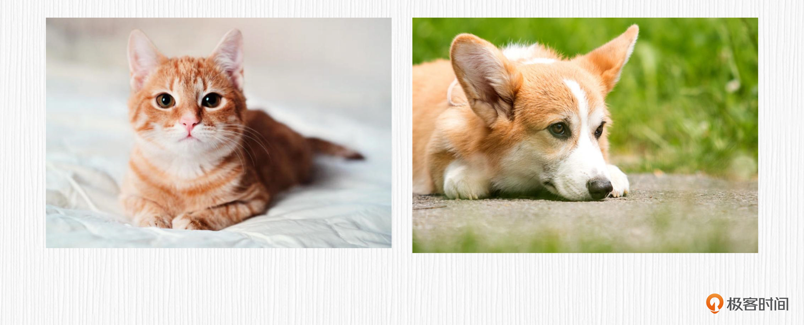

欢迎你在留言区和我交流互动，如果这一讲对你有启发，别忘了分享给身边更多朋友。
