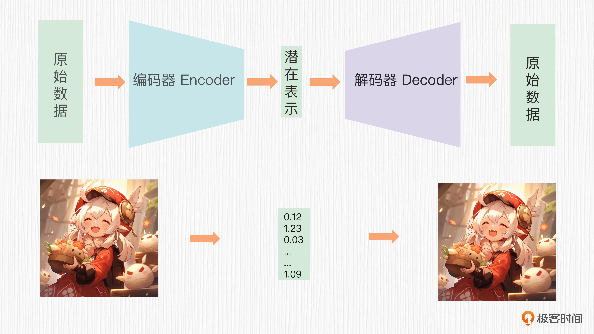
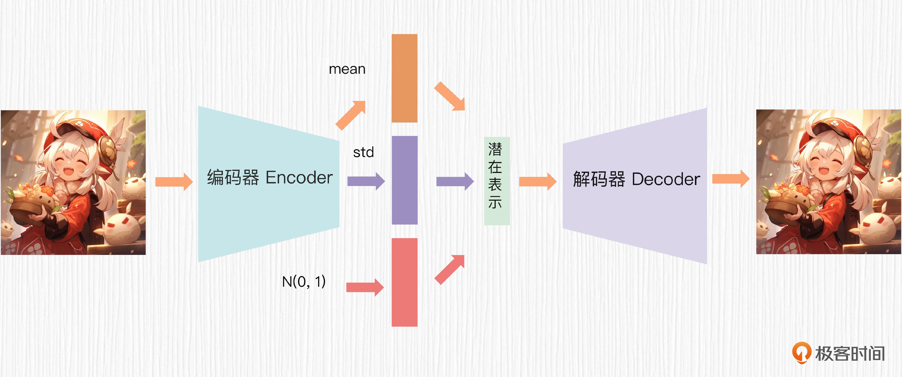
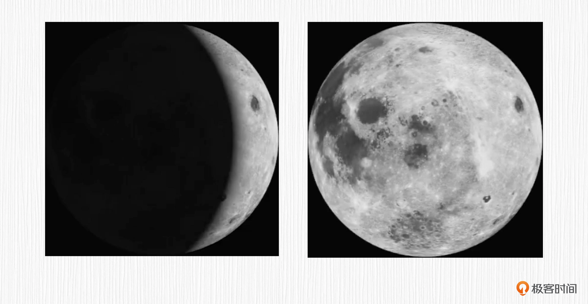
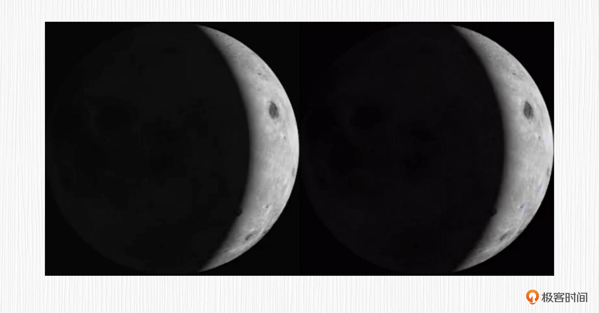
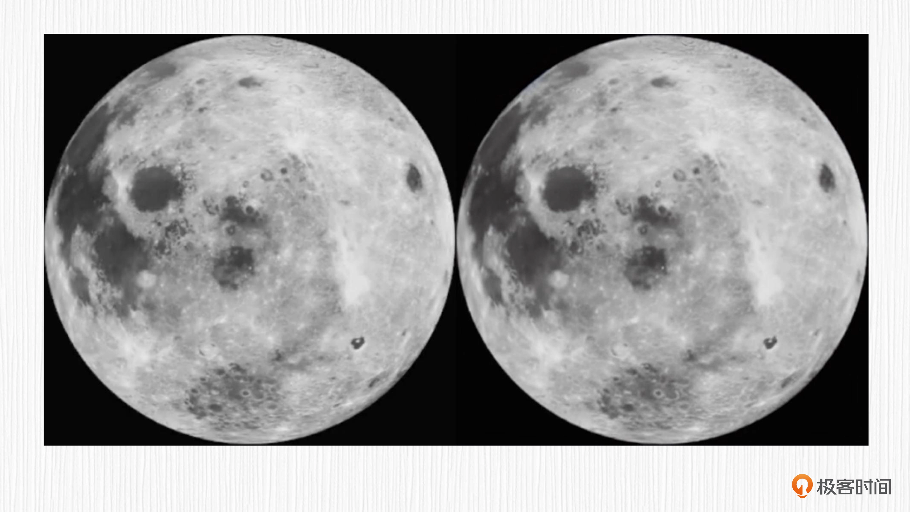
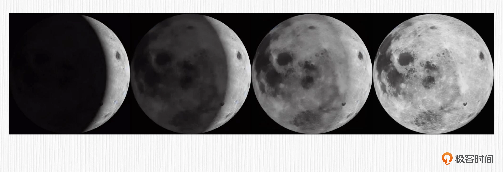
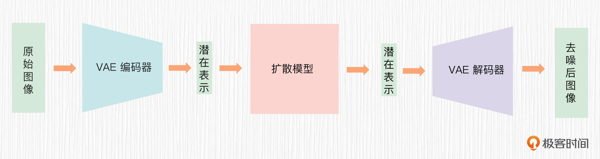
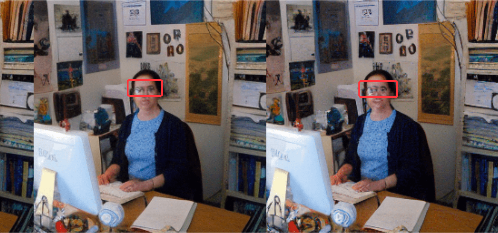
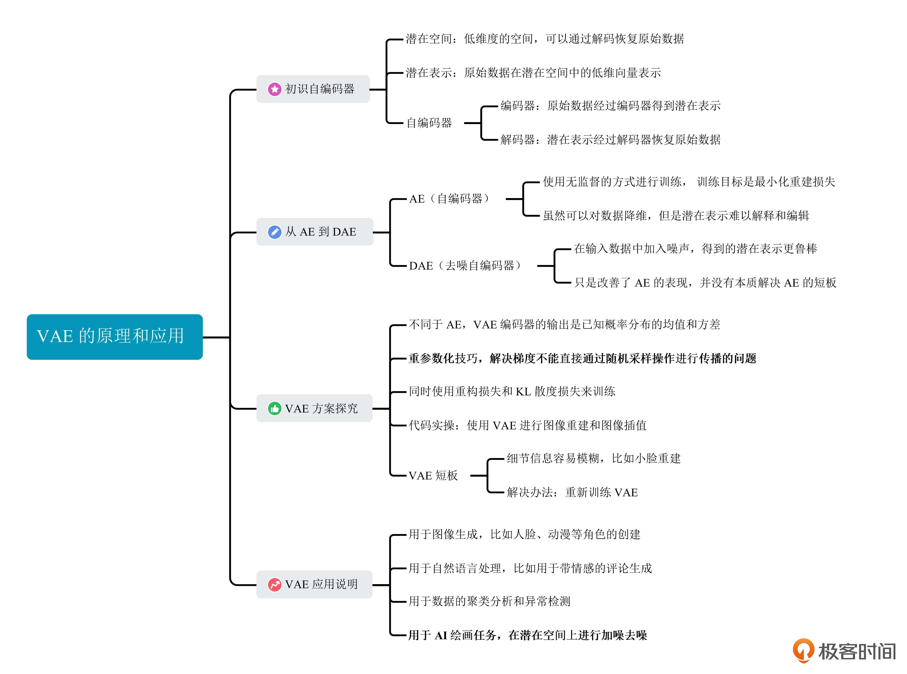

# 11 | VAE系列：如何压缩图像给GPU腾腾地方

你好，我是南柯。

在前几讲中，我们已经学习了 Transformer、UNet、Clip 三个关键模块。在 Stable Diffusion的知识地图上，还差最后的一环，便是今天的主角 VAE 模块。

在 Stable Diffusion 中，所有的去噪和加噪过程并不是在图像空间直接进行的。VAE 模块的作用便是将图像“压缩”到一个特殊的空间，这个空间的“分辨率”要低于图像空间，便于快速地完成加噪和去噪的任务。之后，还能便捷地将特殊空间“解压”到图像空间。

这一讲，我们将一起了解 VAE 的基本原理。学完 VAE，我们便了解了 Stable Diffusion 模型的全部核心模块。之后我们训练自己的 Stable Diffusion 模型时，也会用上 VAE 这个模块。

## 初识 VAE

VAE 的全称是变分自动编码器（Variational Autoencoder），在 2013 年被提出，是自动编码器（AE，Autoencoder）的一种扩展。你可能听过很多不同的名词，比如 AE、VAE、DAE、MAE、VQVAE 等。其实这些带 “AE” 的名字，你都可以理解成是一个编码器和一个解码器。

提到编码器和解码器，你也许会联想到我们在第 7 讲中学过的 Transformer 结构。这里我需要提醒你注意，尽管术语一样，但是 VAE 和 Transformer 中的编码器、解码器解决的是不同类型的问题，并具有不同的结构和原理。

在正式学习 VAE 之前。我们先要了解潜在空间的概念，也就是开头我们提起的“特殊空间”。我们可以通过神经网络，在保留原始数据的关键信息的条件下，将输入的原始数据压缩到一个更低维度的空间，得到一个低维的向量表示，并且这个低维的向量表示可以通过解码恢复出原始的数据。

这里的低维空间就是潜在空间（latent space，也称为隐空间），低维的向量也叫潜在表示（latent representation）。你可以这样理解，潜在空间是较低维度的空间，用于表示原始数据的结构和特征。潜在表示便是原始数据在潜在空间中对应的特征向量。

以 VAE 为代表的 “AE” 系列工作，都是希望编码器将原始数据编码成低维的潜在表示，并且这个潜在表示可以通过解码器近乎无损地恢复出原始数据。这里的原始数据，可以是图像、文本等多种模态。



对于 AI 绘画任务而言，潜在空间的维度通常是原始图像的 1/8 大小。例如，原始图像的分辨率如果是 512x512，潜在空间的大小就可以是 64x64。我们在 64x64 的空间上进行加噪和去噪，自然比在原始图像分辨率上进行加噪和去噪要快得多。得到去噪后的潜在表示，只需要经过解码器便可以获得 AI 绘画的最终输出图像。

## VAE 细节探究

仅仅了解 “AE” 类工作的整体思路，还不足以帮助我们区分各个 “AE” 的能力，也不足以解决AI 绘画实操中遇到的相关问题。我们不妨深入探究其中的关键技术点。

### AE 的长处和短板

首先是 AE 结构（自编码器）。AE 结构使用无监督的方式进行训练，以图像任务为例，使用大量的图像数据，依次经过编码器和解码器得到重建图像，训练目标是最小化原始数据与重构数据之间的差异。实际操作中，损失函数可以是 L1 损失或者 L2 损失。

为了帮你加深理解，我在后面提供了一个 AE 训练过程的伪代码供你参考。

```
for epoch in range(epochs):
   for batch in dataset_loader.get_batches(training_data, batch_size):
       # 清零梯度
       optimizer.zero_grad()
       # 将本批次数据传递给自动编码器
       encoded_data = autoencoder.encode(batch)
       reconstructed_data = autoencoder.decode(encoded_data)
       # 计算损失，比如使用L2损失
       loss = loss_function(reconstructed_data, batch)
       # 反向传播
       loss.backward()
       # 更新参数
       optimizer.step()
```

之所以说 AE 结构是无监督学习，是因为损失函数的计算只依赖于输入数据本身，而不涉及任何标签或类别信息。

AE 结构虽然可以对数据降维，也存在明显的缺点。

第一，潜在表示缺乏直接的约束，在潜在空间中一个个孤立的点。如果对于输入图像的潜在表示稍加扰动，比如加上一个标准高斯噪声，解码器便会得到无意义的输出。

第二，潜在表示难以解释和编辑。我举个例子来说明，比如我们想得到“半月图像”的潜在表示，但手里又只有满月和新月图片。

那我们很自然就会觉得，满月和新月的中间状态应该是“半月”状态，而满月和新月图片对应的潜在表示分别是潜在空间中的一个点。如果对这两个点取平均，是不是就会得到一个新的潜在表示，来代表“半月图像”的信息。接着把这个新的潜在表示给到解码器，是不是就可以输出半月图片了？

这样想，从逻辑推导似乎没问题，但我们将插值后的潜在表示给到 AE 的解码器，我们甚至无法得到一张有意义的图片。

针对第一个缺点，DAE（去噪自编码器）的改进方式就是故意在输入数据中加入噪声，这样得到的潜在表示更加鲁棒。训练目标仍然是最小化原始引入噪声前的数据和重构数据之间的差异。你可以参考后面的伪代码来理解。不过我想强调一下，DAE 只是改善了 AE 的表现，并没有真正补全 AE 的短板。

```python
# 添加噪声函数
def add_noise(data, factor):
   noise = factor * np.random.normal(size=data.shape)
   noisy_data = data + noise
   return noisy_data.clip(0, 1)
# 开始训练循环
for epoch in range(epochs):
   for batch in dataset_loader.get_batches(training_data, batch_size):
       # 给本批次数据添加噪声
       noisy_batch = add_noise(batch, noise_factor)
       # 清零梯度
       optimizer.zero_grad()
       # 将带噪声的本批次数据传递给降噪自动编码器
       encoded_data = denoising_autoencoder.encode(noisy_batch)
       reconstructed_data = denoising_autoencoder.decode(encoded_data)
       # 计算损失
       loss = loss_function(reconstructed_data, batch)
       # 反向传播
       loss.backward()
       # 更新参数
       optimizer.step()
```

### VAE 的工作原理

真正解决 AE 两大痛点的工作就是 VAE。在 VAE 中，编码器的输出不再是潜在表示，而是某

## μ

## σ

种已知概率分布的均值 和方差 ，比如最常用的高斯分布。根据均值、方差和一个随机噪

## ϵ

声 ，我们便可以根据下面的公式计算出最终的潜在表示，给到解码器。

- σ

## z = e ×

## ϵ + μ

VAE 中计算潜在表示的过程便是大名鼎鼎的重参数化技巧，解决了梯度不能直接通过随机采样操作进行传播的问题。关于 VAE 的整体过程，你可以查看下面的图片。



那么 VAE 训练的目标函数是什么呢？你可能已经想到，需要使用类似 AE 模型的重构损失，

## μ

## σ

## σ

还需要对均值 和方差 进行约束，避免方差 优化到负无穷。

你可以查看后面的伪代码，我们同时使用重构损失和 KL 散度损失来训练 VAE。对于 VAE 损失函数，我们掌握到这个程度就足够了。至于背后更复杂的数学推理，有兴趣的话你可以课后查阅资料了解更多细节。

```python
# 定义损失函数
def loss_function(reconstructed_data, original_data, mean, log_variance):
   reconstruction_loss = mean_squared_error(reconstructed_data, original_data)
   kl_loss = -0.5 * torch.sum(1 + log_variance - mean.pow(2) - log_variance.exp(
   total_loss = reconstruction_loss + kl_loss
   return total_loss
# 定义优化器（如梯度下降）
optimizer = optimizer.Adam(variational_autoencoder.parameters(), lr=learning_rate
# 开始训练循环
for epoch in range(epochs):
   for batch in dataset_loader.get_batches(training_data, batch_size):
       # 清零梯度
       optimizer.zero_grad()
       # 将本批次数据传递给变分自动编码器
       mean, log_variance = variational_autoencoder.encode(batch)
       # 重参数化技巧
       z = mean + torch.exp(log_variance * 0.5) * torch.randn_like(log_variance)
       # 解码
       reconstructed_data = variational_autoencoder.decode(z)
       # 计算损失
       loss = loss_function(reconstructed_data, batch, mean, log_variance)
       # 反向传播
       loss.backward()
       # 更新参数
       optimizer.step()
```

### 用 VAE 做图像插值

讲了这么多原理，也是在为 VAE 的应用做铺垫。VAE 不仅可以有效地压缩和重构图像，它得到的潜在表示还可以进行插值编辑。我们分别动手来验证这两个功能。我为你准备了一个Colab 代码，你可以点开后运行。

使用 VAE 做图像重建的效果怎样呢？首先我在网上找到两张月相图。



然后我们使用 Stable Diffusion 中使用的 VAE 权重进行重建验证，下面我贴出重建部分的代码。

```python
from PIL import Image
import numpy as np
import torch
from diffusers import AutoencoderKL
device = 'cuda'
# 加载VAE模型
vae = AutoencoderKL.from_pretrained(
   'CompVis/stable-diffusion-v1-4', subfolder='vae')
vae = vae.to(device)
pths = ["test_imgs/new.png", "test_imgs/full.png"]
for pth in pths:
   img = Image.open(pth).convert('RGB')
   img = img.resize((512, 512))
   img_latents = encode_img_latents(img) # 编码
   dec_img = decode_img_latents(img_latents)[0] #解码
```

你可以点开图片看看 VAE 的效果，左边是原始图像，右边是 VAE 重建图像。





看完以后，有没有发现从我们视觉来看，几乎是 100% 复原？在上面的代码中，潜在表示（img_latents）的“宽高”只有原始图像的 1/8，可见 VAE 编码器对原始数据的压缩能力。

我们前面提到，VAE 的潜在表示可以进行插值。这里我们也通过代码实现一下，帮助你加深理解。

```
   num_steps = 4 # 假定插值得到中间的2张图
   interpolation_weight = np.linspace(0, 1, num_steps)
   for weight in interpolation_weight:
       interval_latents = (1 - weight) * all_img_latents[0] + weight * all_img_l
       dec_img = decode_img_latents(interval_latents)[0]
```

你同样可以点开图像查看插值的结果。利用 VAE 的潜在表示插值这个功能，我们可以合成很多有趣味的图像。



## VAE 的应用

VAE 技术在很多领域得到了成功应用，既包含一些经典的机器学习任务，也包含我们要学习的 AI 绘画模型。

### VAE 与经典任务

VAE 可以用于图像生成，比如人脸、动漫等角色的创建。以动漫角色生成为例，VAE 可以用来创建具有独特外观和特征的全新动漫角色。为此，我们首先需要使用现有的动漫角色数据集训练 VAE 的编码器和解码器。完成后，我们在潜在空间中采样，便可以得到新的角色图像。

VAE 可以用于自然语言处理，比如用于带情感的评论生成等任务。假设我们有一个餐馆评论数据集（包含正、负评论），我们可以使用第 7 讲提到的时序模型设计 VAE 的编码器，比如RNN、LSTM、Transformer 等，得到潜在表示，然后再把潜在表示与特定情感信息（如正面或负面）一起传递至解码器进行训练。

训练完成后，我们便得到了一个能够控制情感倾向的餐馆评论生成模型。下面我提供了实现评论生成任务的伪代码，推荐你课后实验一下，训练一个某某餐厅的评论“机器人”。至于训练用的数据，可以考虑用 GPT 来生成。

```python
# 导入所需的库
import torch
from torch import nn
from torch.nn import functional as F
# 定义VAE模型
class SentimentVAE(nn.Module):
   def __init__(self, input_dim, hidden_dim, latent_dim, sentiment_dim):
       super(SentimentVAE, self).__init__()
       # 编码器 - 我们可以使用RNN，LSTM，Transformer等时序模型
       self.encoder = nn.LSTM(input_dim, hidden_dim)
       # 将编码器的输出转换为潜在空间的均值和方差
       self.fc_mu = nn.Linear(hidden_dim, latent_dim)
       self.fc_var = nn.Linear(hidden_dim, latent_dim)
       # 解码器
       self.decoder = nn.LSTM(latent_dim + sentiment_dim, hidden_dim)
       # 最后的全连接层
       self.fc_output = nn.Linear(hidden_dim, input_dim)
   def reparameterize(self, mu, log_var):
       std = torch.exp(0.5*log_var)
       eps = torch.randn_like(std)
       return mu + eps*std
   def forward(self, x, sentiment):
       # 编码器
       hidden, _ = self.encoder(x)
       # 得到潜在空间的均值和方差
       mu, log_var = self.fc_mu(hidden), self.fc_var(hidden)
       # 重参数化技巧
       z = self.reparameterize(mu, log_var)
       # 将潜在表示和情感信息拼接
       z = torch.cat((z, sentiment), dim=1)
       # 解码器
       out, _ = self.decoder(z)
       out = self.fc_output(out)
       return out, mu, log_var
```

VAE 还可以用于聚类分析和异常检测。比如，在数据的潜在空间中把具有相似结构和内容的数据聚集在一起，为后续的聚类分析提供便利，或者用于识别潜在空间中明显异常的数据。

### VAE 与扩散模型

原始的扩散模型需要在原图上进行加噪和去噪操作，过程非常耗时。

学完今天的知识，我们自然会想到，为什么不在 VAE 的潜在空间上进行加噪和去噪呢？没错，Stable Diffusion 就是这么做的。



通常情况下，VAE 模型是按照我们前面讲的 VAE 训练过程预先获得的。我们使用 LoRA 等技术训练自己的 AI 绘画模型时，并不会改变 VAE 模型的权重。但这并不意味着 VAE 对图像质量没有影响。其实在某种程度上，VAE 代表了 AI 绘画生成质量的上限。

虽然我们上面新月满月的例子证明了 VAE 的图像重建能力几乎无损，但如果是更困难复杂的场景，VAE 重建的图像会存在明显的模糊。

比如下面这个例子中，红框内人脸区域的重建效果明显变差。



- 图片来源：https://openaccess.thecvf.com/content_ICCV_2019/papers/Wang_CARAFE_Content-Aware_ReAssembly_of_FEatures_ICCV_2019_paper.pdf

如前面的图所示，即使图像没有经过 UNet，仅经过编码和解码过程，我们也会发现人脸的细节信息非常模糊。

这也很容易理解，因为输入图像经过 VAE 编码器后，会降低 8 倍采样率。512x512 分辨率图像的潜在表示“分辨率”只有 64x64。在如此小的潜在表示上恢复人脸细节确实是一项挑战。所以，我们见到的 AI 绘画模型如果小脸生成效果不佳，可能是 VAE 解码器本身无法生成高清的小脸图像。

那么如何解决这个问题呢？最直接的方法就是重新训练 VAE，使用更高的 VAE 潜在表示的分辨率。你可以参考后面的例子，对照图片可以看出，微调后的 VAE 可以明显提升生成图像的质量。


- 图片来源：https://github.com/cccntu/fine-tune-models/tree/main

## 总结时刻

这一讲我们深入学习了 Stable Diffusion 中的核心模块 VAE。

各种 AE 的功能就是对输入数据进行编码和解码。我们探讨了 AE（自编码器）、DAE（去噪自编码器）和 VAE（变分自编码器）三种深度学习模型，学习了这些模型的基本原理、网络结构和损失函数，明确了 AE 和 DAE 的设计短板。

而 VAE 在 AE 的基础上加入了更复杂的概念，解决了 AE 的潜在表示难以解释和编辑的缺陷。我们详细解读了重参数化这个技巧，并分析了 VAE 训练的损失函数。之后，我们通过多个实例介绍了 VAE 的应用，如图像重建和插值、加速 Stable Diffusion 模型的训练过程等。此外，我们列举了一个 VAE 用作餐厅评论机器人的趣味例子。

需要关注的是，VAE 对原始图像进行压缩，会出现小脸无法有效重建等问题。所以在配合 SD模型进行 AI 绘画任务时，我们需要尽可能选择重建效果更好的 VAE。

关于这一讲的知识点，你可以查看下面的知识导图进行回顾、查漏补缺。



## 思考题

VAE 和 Transformer 中的编码器、解码器，在结构、原理、功能上有怎样的不同？

欢迎你在留言区和我交流讨论。如果这节课对你有启发，也推荐你分享给身边更多朋友。
