# 15 | 显微镜下的StableDiffusion（一）：惊艳效果下的关键技术揭秘

你好，我是南柯。

我们之前已经学习了 Stable Diffusion 的核心组成模块，比如 CLIP、VAE、UNet、注意力机制、采样器等等。在第二个实战项目（可以回顾 12 讲复习），我们已经动手训练了自己的扩散模型，也基于基础模型微调了我们自己的 Stable Diffusion。

为了方便表述，后面我们就用 SD 指代 Stable Diffusion。对于我们来说，SD 已经不再是黑盒子了。但其实除了我们已经知道的内容，SD 能够生成精美构图的背后，还有很多黑魔法在起作用。

今天，我会带你尝试用“显微镜”解析 SD，深入探索其中的技术细节，比如文本引导的原理、注意力机制的实现细节等。学完这一讲，你会对 SD 的工作原理有更深刻和全面的理解，并将这些知识灵活地应用到你自己的项目中。

## SD 模型的演化之路

你也许在社交媒体或者 Hugging Face 等论坛上，看到过各种各样的 SD 模型版本，从早期的SD1.4 到近期的 SDXL 1.0。SD 版本号演化的背后，其实是技术路线的改变或者训练数据的优化，搞清楚 SD 的演化路径能帮助我们理解 AI 绘画的发展趋势。

当前开源社区流行的 SD 模型有多个版本，比如 SD1.4、SD1.5、SD2.0、SD2.1、SDReimagine、SDXL 等。表面看起来眼花缭乱，但其实这些模型之间存在或多或少的“亲缘关系”。你可以点开下面的图，看一下这些模型的演化历程。

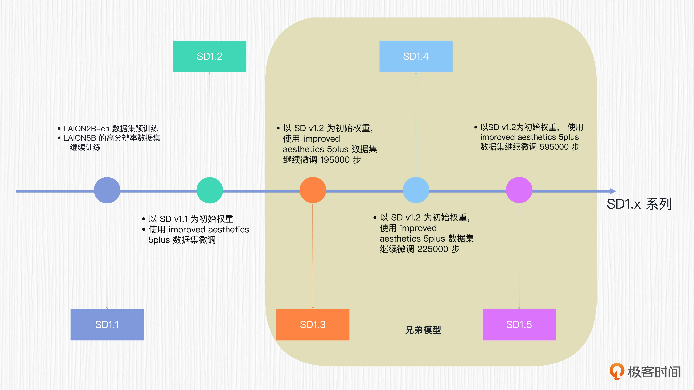

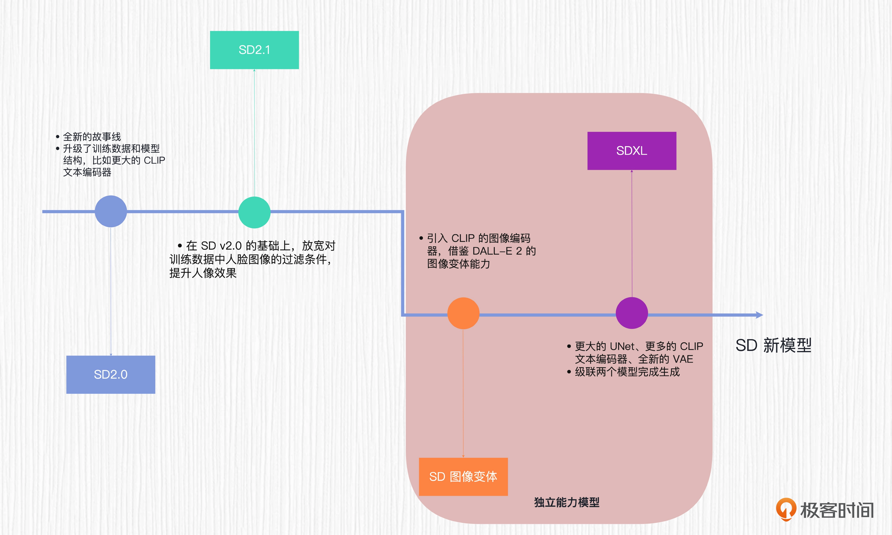

仔细观察这张图你会发现，SD 的演化过程中，最主要的变化就是模型结构和训练数据的变化。SD1.x 系列，大多数是在 SD1.2 的基础上继续微调得到的，包括我们使用最多的 SD1.4和 SD1.5 模型；SD2.x 系列则是新开的故事线，使用了全新的模型结构。而 SD Reimagine和 SDXL 模型则是 SD 系列两个独立能力的模型，这两个模型的细节我们在下一讲详细讨论。

我们熟悉的 Hugging Face 和 Civitai 这两个开源社区里的绝大多数 AI 绘画模型，都是基于上面这些 SD 模型在特定数据集上微调得来的。可以预见，未来 SD 模型会继续发展，我们也期待看到更多更炸裂的能力。

## SD 模型简单串联

SD 的技术思路来自一篇名为潜在扩散模型的论文（2021 年底发表）。

我们已经知道，原始扩散模型有两个短板。第一是不能通过 prompt 指令来完成 AI 绘画，而是从纯噪声出发，绘画过程有点类似于开盲盒。第二是加噪和去噪的过程都是在图像空间完成，使用高分辨率训练扩散模型，会占用较多的显存。

潜在扩散模型的前身便是扩散模型，它一方面将扩散过程从图像空间转移到了潜在空间，通过使用 VAE 变分自编码器来压缩和恢复图像，大大提高了速度和效率；另一方面利用 CLIP 等模型的文本编码器，将文本信息转化为文本表征，并通过交叉注意力机制将这些文本信息融入到图像信息空间中，最终实现文本生图。

整体方案你可以参考后面这张图，想要了解更多细节也可以课后阅读原论文。

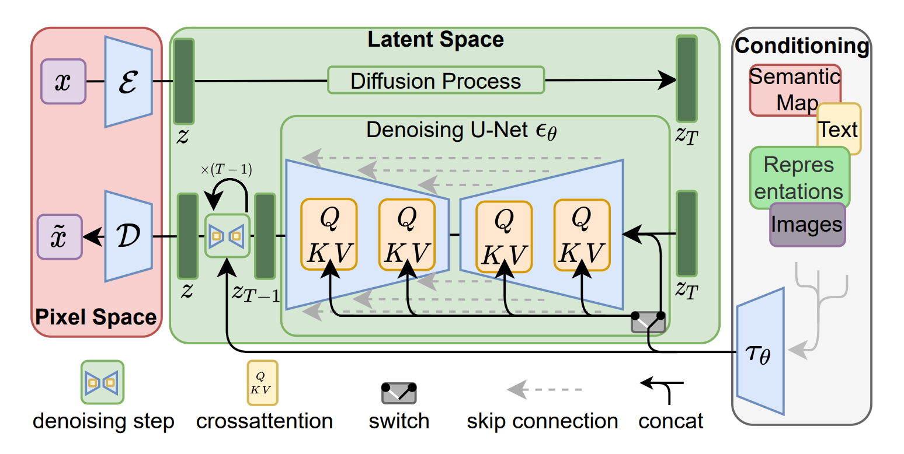

这张图看着很劝退，为了方便你理解，我帮你做一些简化。实际上，我们熟悉的 AI 绘画模型仅仅由三个模块组成：VAE、UNet 和 CLIP 文本编码器。

我来帮你重新整合一下整体方案，示意图是后面这样。

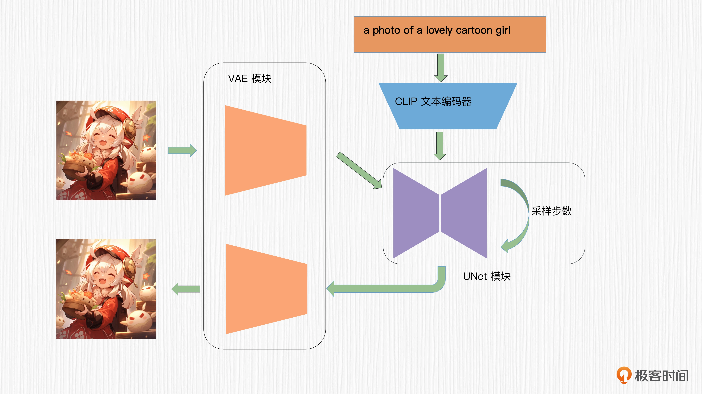

是不是清爽了很多？当然如果我们希望通过其他条件控制图像生成，比如图像分割信息或者其他语言模型，只需要替换掉 CLIP 的部分即可。

我们在学习 DALL-E 2 和 Imagen 的时候都曾经说过，AI 绘画模型最初的分辨率是 64x64，经过两个连续的扩散模型超分模块，依次将分辨率提升至 256x256、1024x1024。

SD 模型常用的潜在空间分辨率为 64x64，解码后得到的图像便是 512x512。所以，在无需超分模块的情况下，SD 模型能轻松生成 512x512 分辨率的图像。这也能体现 SD 引入 VAE 模块实现高效计算的优势。

串联完 SD 模型的整体思路，我们再来分析下 SD 模型的参数量，这样你才能对 SD 模型的参数规模有个整体认识。以我们熟悉的 SD1.x 系列模型为例，它的 VAE 参数量为 0.084B，CLIP 文本编码器为 0.123B，UNet 为 0.86B，全部加起来大概 1B 的参数量。

这显然是个很大参数量的模型，而且我们知道，在文生图的过程中，UNet 要反复预测噪声多次。做一个比较，上一讲我们学过的 DeepFloyd IF 模型，它的 UNet 参数量有 4.3B，显然比SD 模型的 UNet 大很多。插一句题外话，今天业界常说的大语言模型，动辄就是 10B 参数量起步。

## 文本引导原理探秘

除了前面课程里咱们讲过的 CLIP、VAE、UNet、注意力机制、采样器等模块，SD 模型还有很多黑魔法，其中最让我们好奇的，就是 prompt 文本引导 SD 画图的算法原理。我们这就来看看文本引导原理的奥秘。

现在主流的 AI 绘画模型，文本引导图像生成的过程采用了无分类器引导（Classifier FreeGuidance）。这个技巧对应的就是 WebUI 中我们常用的 CFG Scale 参数，它不仅在 AI 绘画过程中很实用，也是面试中常常会问到的知识。

我们要弄清楚这个技巧，首先需要搞懂的是有分类器引导（Classifier Guidance）和无分类器引导（Classifier Free Guidance）的区别。

我们已经知道，原始的扩散模型从随机噪声出发，并不能用文本控制内容。于是，OpenAI 在论文中便提出了有分类器引导。考虑到数学推导难度比较大，如果你有兴趣可以课后看看论文，这里我重点带你把握整体思路。

具体做法是训练一个图像分类器，这个分类器需要在加噪之后的数据上进行训练。在文生图的过程中，每一步去噪都需要使用这个分类器计算梯度，用该梯度修正预测的噪声（对应 DDIM采样），或者用来修正去噪后的图像（DDPM 采样）。

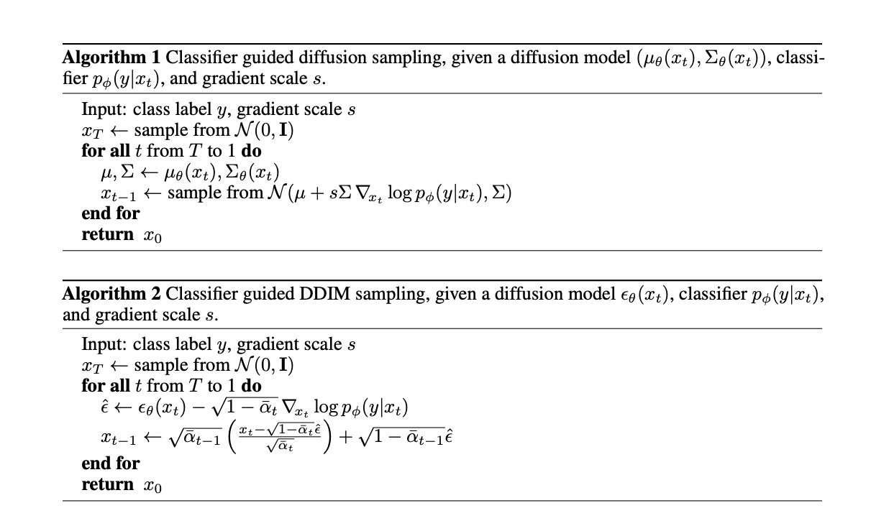

- 图片来源：https://arxiv.org/pdf/2105.05233.pdf

有分类器引导的方案需要训练额外的分类器，并且文本对于图像生成的控制能力不强，因此，它逐渐被无分类器引导的方法取代。我们熟悉的 DALL-E 2、Imagen 以及 SD 模型使用的方案都是无分类器引导。

无分类器引导技术巧妙地引入了一个 Guidance Scale 参数，无需训练额外的分类器，就能实现文本对图像生成的控制。具体来说，在每次扩散模型预测噪声的过程中，我们需要使用UNet 预测两次。

为什么要做两次预测呢？这是因为两次预测有着不同的目的：一次完成有条件的预测，一次完成无条件的预测。我们通过控制有条件预测和无条件预测的插值，便能更好地平衡生成图像的随机性、多样性和图文一致性。

不过，天下没有免费的午餐，相比有分类器引导，无分类器引导的计算成本几乎是翻倍的！

接下来，我们具体看看这两次预测做了什么。

第一次预测是用 prompt 文本表征预测噪声结果，我们称之为条件预测。第二次则是使用空字符串的文本表征预测噪声结果，我们称之为无条件预测。

这里我需要补充说明一下无条件预测的训练过程。在训练过程中，我们以一定的概率（比如10%）将 prompt 设置为空字符串，而不是用原本图像对应的 prompt。

那为什么要这样做呢？你可以这样理解，因为我们的训练数据是图文成对的，如果整个过程都使用对应的图片、文本训练扩散模型，扩散模型就会变得过于“听话”，从而失去创造力。如果使用 10% 的空字符串策略，就能给扩散模型留出一定的创新空间。

当训练完成后，文生图的采样过程会用到有条件预测和无条件预测。然后通过引导权重 w（即Guidance Scale）进行插值。在 WebUI 中，这个参数被称为 CFG Scale，就是 ClassifierFree Guidance 的缩写。无分类器引导模式下，扩散模型每一步噪声可以按照后面这个公式来计算。

- 最终噪声 = w * 条件预测 + （1 - w） * 无条件预测

引导权重越大，生成的图像与给定的文本越相关。一般来说，引导权重取 3-15 这个范围。继续加大权重，生成的图像容易出现各种不稳定的问题，如图像过饱和（颜色过于鲜艳以至于失真）。当引导权重设置为 0 时，相当于输入的文本信息对于 AI 绘画结果不产生任何作用，产生的图像内容是完全随机的。

下面的图中，我使用 ToonYou 这个模型，比较了三组不同的引导权重效果。你也可以选择一个喜欢的 AI 绘画模型，感受下不同的引导权重。

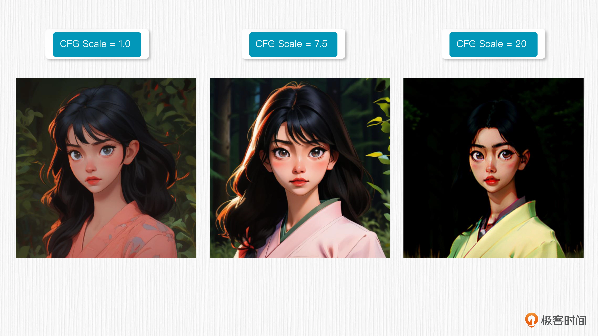

这里图片的 prompt 信息如下。

```
Prompt：photorealistic, Japanese woman, (thin:0.5), (skinny:0.5), portrait, long
Negative Prompt：large breasts, big head, distortion, deformities, extra limbs, m
采样器：Eular a
随机种子：1025
采样步数：20
分辨率：512x512
```

## 注意力机制是如何起作用的？

搞懂了无分类器引导的技巧，我们再来看看 SD 中的注意力机制是如何起作用的。

SD 的扩散模型是一个 0.86B 的 UNet，我们在第 11 讲曾经说过，对于 512x512 分辨率的训练数据，经过 VAE 模块之后，我们可以得到 64x64x4 维度的潜在表示。

使用这个潜在表示作为 UNet 的输入，可以得到同样维度的输出，预测的是需要去除的噪声值。你可以点开图片了解这里的 UNet 结构。

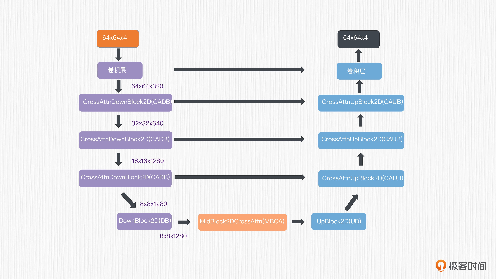

对于 UNet 的编码器部分，潜在表示分别经过 3 个连续的 CADB（CrossAttnDownBlock2D）模块，分辨率从 64x64x4 降采样到 8x8x1280，得到了对应的特征。

接着，这些特征被送入一个不带注意力机制的 DB（DownBLlock2D）模块和一个 MBCA（MidBlock2DCrossAttn）注意力模块。这样，就完成了 UNet 的特征编码。

UNet 的解码器部分与编码器部分完全对应，只不过用上采样计算替代了编码器部分的降采样计算。编码器和解码器之间存在跳跃连接，这是为了进一步强化 UNet 模型的表达能力。

那么，prompt 的文本表征和时间步 t 的编码是如何起作用的呢？要回答这个问题，我们需要用显微镜看看 CADB 模块的内部结构。

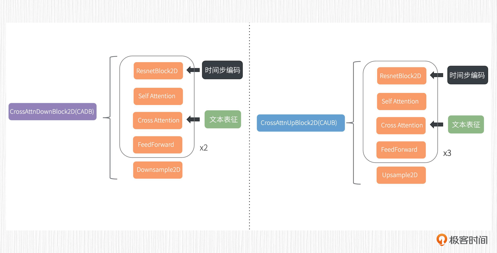

对照图解可以看到，CADB 模块包括自注意力模块和交叉注意力模块。我们可以把每个 CADB中从 ResNetBlock2D 到 FeedForward 的部分，理解成是一层 Transformer，那么图中的 x2就表示有两层 Transformer 结构。

在实际操作中，prompt 的文本表征通过交叉注意力模块完成信息注入，用于计算得到对应的K、V 向量。而 Q 向量源自 CADB 模块中自注意力模块输出的结果。关于注意力机制的计算细节，你可以复习一下第 7 讲。

我们知道，除了 prompt 文本表征，UNet 还需要接收时间步 t 的编码信息。在 SD 模型中，时间步 t 的编码是直接作用于 ResnetBlock2D 这个模块的。这样，时间步 t、prompt 文本表征便完成了对图像生成的引导。在文生图过程中，我们可以通过设置采样步数和 CFG Scale 这个参数，控制生成结果与 prompt 的匹配程度。

## 重新探讨图生图

有了前面的基础知识，我们便可以重新思考图生图是怎样的过程了。

对于 SD 模型而言，图生图的过程只需要在文生图的基础上做一点改变。在文生图中，我们选择一个随机噪声作为初始潜在表示。在图生图中，我们对原始图像进行加噪，通过重绘强度这个参数控制加噪的步数，然后以加噪的结果作为图像生成的初始潜在表示。

这里有个重点我想提示你关注一下，去噪过程的步数要与加噪过程步数一致。换句话说，你在原始图像上加了多少步噪声，就要去除多少步噪声。如果去噪步数过少，有可能会得到“不干净”的图片；如果去噪步数过多，得到的结果和原图之间的相似度会有折损。

整个过程你可以看下面这张图加强理解。

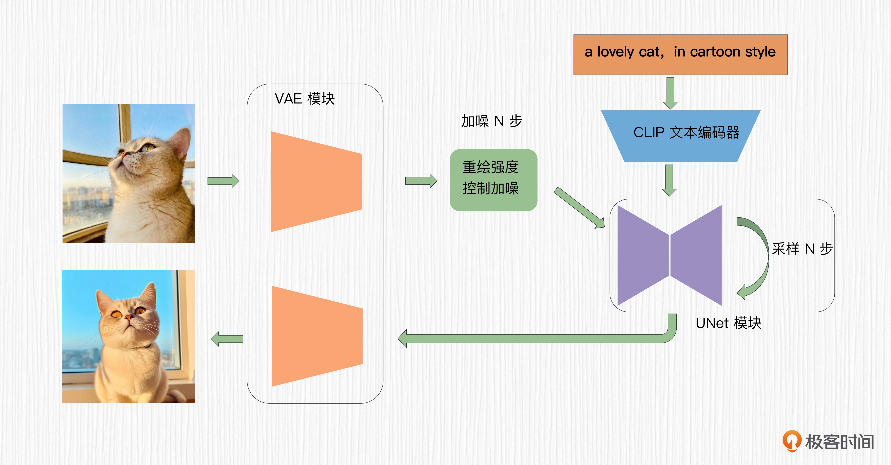

听了这么多原理是不是有点枯燥？但正是这些枯燥的原理，才支撑了我们看到的各色丰富多彩的 AI 绘画效果。

在各种社交媒体上，我们经常会看到人像全图风格化的效果，既能够保持图像的整体构图结构，又能够将图片转化为各种新奇的风格，比如漫画风、油画风等等。这类效果往往就是通过我们前面提到的过程来完成的。只不过，用于去噪的模型应该是一个擅长生成目标风格的 SD模型。

## Negative Prompt 和 CLIP Skip

在我们进行 AI 绘画的时候，还有一些关键魔法参数，比如反向描述词（Negative Prompt）、CLIP Skip 两个操作。我们逐一来揭秘。

首先是反向描述词。其实当我们理解了无分类器引导，反向描述词的作用就非常好理解了。我们知道，正常的无条件预测使用的是空字符串作为 UNet 的输入。我们只需要把无条件预测中的空字符串替换成反向描述词，就能告诉模型不要去生成什么。这时候，最终的噪声可以通过下面的公式来计算。

- 最终噪声 = w * 条件预测 + （1 - w） * 反向描述词预测

通常我们的引导权重大于 1，比如取 7.5 这个数值，使用反向描述词便可以引导模型避免生成我们不想要的内容。

另一个常见魔法操作是“CLIP Skip = 2”这个设置。我们知道，CLIP 文本编码器是一个深度学习模型，拥有多层神经网络结构。研究表明，使用文本编码器倒数第二层获得的特征要比使用最后一层输出的特征效果更好。这个问题该怎么理解呢？

我们曾经在第 10 讲学过，对于 CLIP 而言，训练的目标是成对数据的图文表征距离靠近、反之远离。这种训练模式下，为了更好地对齐图像特征，CLIP 文本编码器最后一层的文本特征容易丢失掉原始语义信息。

毕竟我们也知道，CLIP 的训练语料是从互联网获取到的成对图文数据，这些数据肯定存在一些图文不对应的情况（比如下图），这就意味着文本并不能 100% 描述图像。

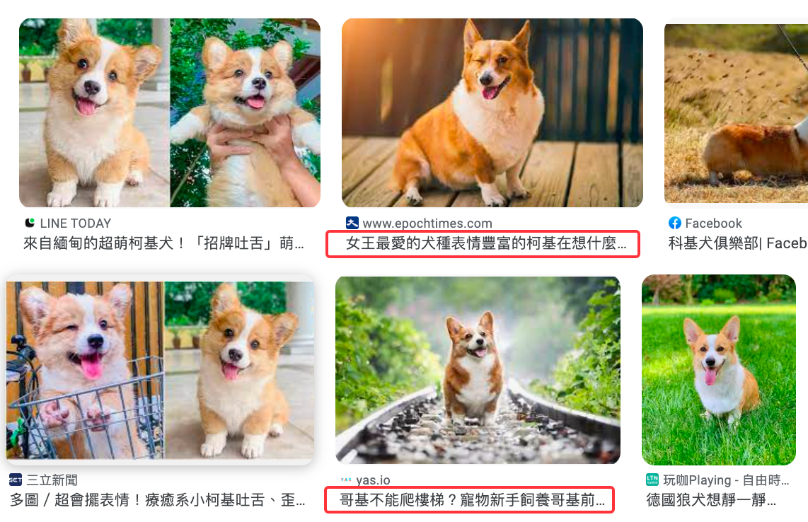

这种情况下，设置“CLIP Skip = 2”等同于使用 CLIP 文本编码器倒数第二层的文本表征，目的是获得更靠近原始文本的特征。这个技巧在 WebUI 中应用非常广泛，实测下来能让 AI 绘画模型更听话。

## 总结时刻

我们今天一起探讨了 SD 模型的技术细节，包括文本引导原理、注意力机制原理、图生图的计算过程、反向描述词作用机制等。下次别人谈起 SD 模型的时候，相信你一定会更有发言权。

对于文本引导而言，最开始文生图过程使用有分类器引导来完成，但是这种方法存在需要训练、引导能力弱等缺点。后来出现的无分类器引导逐渐成为技术主流，在 DALL-E 2、Imagen、SD 等模型中都发挥了作用，对应于我们经常使用的 CFG Scale 这个参数。CFGScale 数值越大，模型越听我们的话。

对于注意力机制，我们探究了 SD 模型的 UNet 结构，知道了时间步 t 编码和 prompt 文本表征的作用位置。

之后，我们重新学习了图生图的算法过程，搞清楚了重绘强度这个魔法参数背后的技术原理。相信搞懂了这些，你也能给自己的照片带上各种不同的风格。

最后，我们还探讨了 AI 绘画中的反向描述词如何指挥模型不要生成哪些内容，了解了为什么要设置 CLIP Skip 这个神奇的超参数。搞懂了算法背后的原理，我们再使用 AI 绘画模型的时候，就更加随心所欲了。

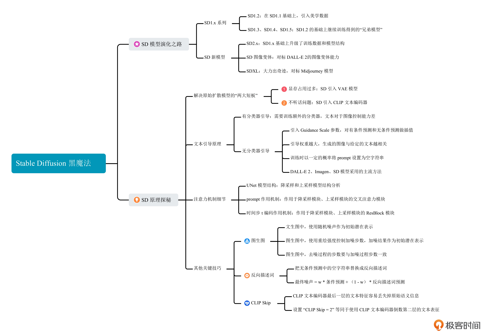

## 思考题

除了标准的图生图，SD 模型还有一种常见用法，是图像补全。根据今天学到的知识，你能推测一下图像补全这个功能是怎么实现的么？

期待你在留言区和我交流互动。如果这一讲对你有启发，推荐你把它转发给身边更多朋友。
