# 16 | 显微镜下的StableDiffusion（二）：从图像变体到神雕侠侣（SDXL）

你好，我是南柯。

在上一讲，我们详细探讨了 Stable Diffusion 模型的核心技术，包括无分类器引导、UNet 模块构成、负向描述词原理等。

事实上，随着 AI 绘画技术的不断发展，Stable Diffusion 模型也在持续进化，比如 2023 年 6月刚刚发布的 SDXL 模型。参考上一讲的叫法，为了方便，我们还是将 Stable Diffusion 简称为 SD。

在 SD 模型家族中，有两个具有特殊能力的模型，也就是我们今天要探讨的 SD 图像变体（Stable Diffusion Reimagine）和“神雕侠侣”（SDXL）。SD 图像变体模型用来对标 DALL-E 2的图像变体功能，SDXL 模型则用来和 Midjourney 这个最强画师掰掰手腕。

在我看来，生成图像变体和生成通用高美感图片，是当前多数开源垂类模型都做不好的事情。所以这一讲，我们把这 SD 中的两个特殊模型单独拿出来，用显微镜分析它们的能力和背后的算法原理。理解了这些之后，也会给我们向自己的 SD 模型引入新能力带来启发。

## SD 图像变体

你是否还记得，在关于 DALL-E 2 的解读中（可以回顾第 13 讲内容），我们提到了一种名为图像变体的图像生成策略。

我带你快速回忆一下这个策略的设计理念。用户输入一张图像，使用 CLIP 的图像编码器提取图像表征作为图像解码器的输入，这样就实现了生成图像变体的能力。图像变体能力在实际工作中能快速生成相似图像效果，激发我们的设计灵感。

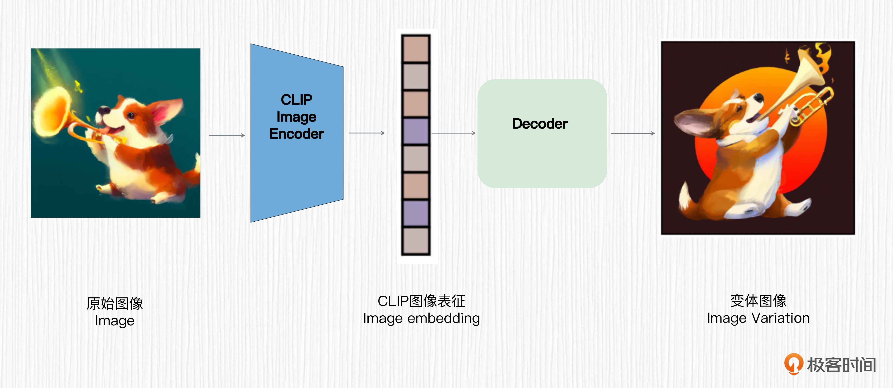

提到图像变体，你也许会联想到 SD 模型的图生图模式。但实际上，SD 的图生图和我们今天要继续探讨的图像变体，在原理上和效果上是完全不同的。

在 SD 模型中，图生图能力通过重绘强度这个超参数向原始图像添加噪声，并根据 prompt 文本描述重新去噪得到新图像。这种方式生成的新图像在轮廓上会和原始图像非常接近，而内容和风格上则会更接近文本引导。

而图像变体，生成的图像与输入图像在色调、构图和人物形象方面具有相似性。你可以参考后面的图片，来看看图生图和图像变体的效果对比。

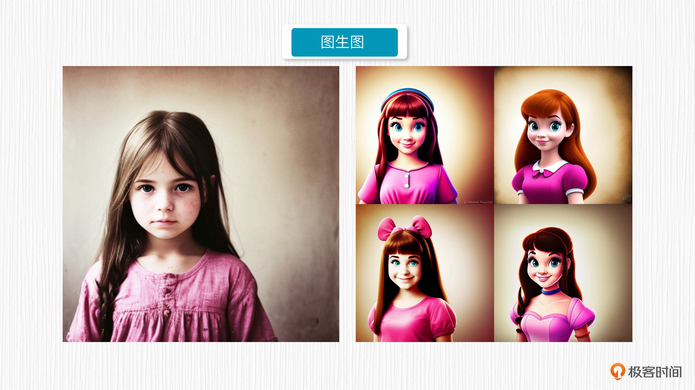

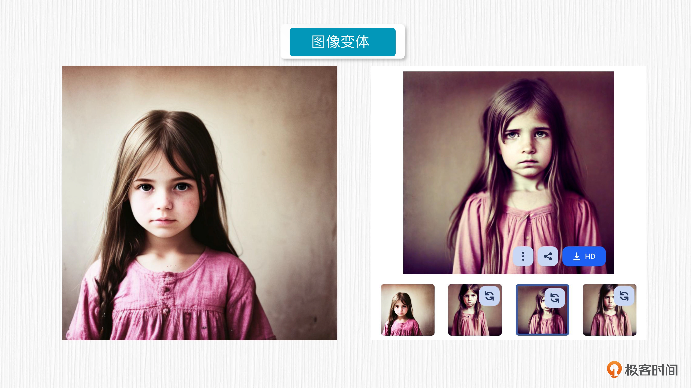

分析了这么多，我来给你稍微归纳一下。图生图和图像变体，它们都是以图像为主进行变化。图生图本质是依赖于 prompt 来引导相似轮廓下的内容变化；图像变体则以输入图像为基础，生成具有相似内容但不同样式的图像，过程不需要描述语句的引导。

### SD 图像变体的使用

那么，这种有趣且神奇的图像变体能力，是否只有 DALL-E 2 才具备呢？

事实上并非如此。接下来，我们就来看看如何利用 SD 模型实现图像变体，即 SD 图像变体能力（Stable Diffusion Reimagine）。

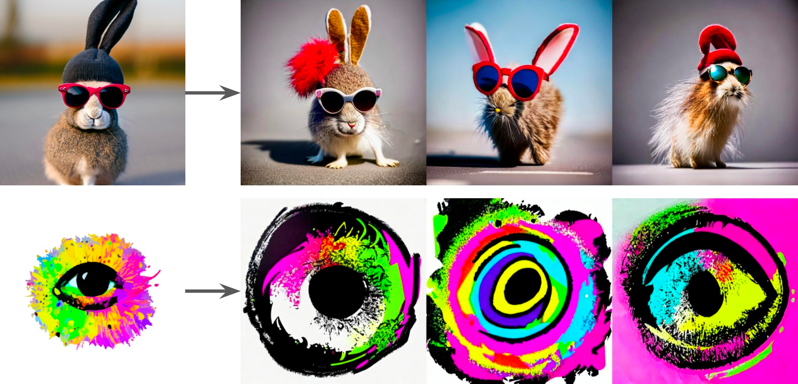

- 图片来源：https://huggingface.co/stabilityai/stable-diffusion-2-1-unclip

不需要复杂的 prompt，SD 图像变体功能从图像中提取需要使用的信息，帮助用户生成输入图片的多种变化。那么，相比标准 SD 模型（比如 SD1.5 等），SD 图像变体模型究竟有何区别呢？

不妨拿出我们的显微镜来看一看。SD 图像变体实际上是一个全新的 SD 模型，其官方名称为Stable unCLIP 2.1。没错，与 DALL-E 2 一样，它也属于 unCLIP 模型，也就是我们第 10 讲CLIP 模型的扩展版。我们回顾下 CLIP 和 unCLIP 的算法原理。

CLIP 通过 4 亿图文对数据进行对比学习，得到一个图像编码器和一个文本编码器。在使用CLIP 时，成对的图像文本经过对应模态的编码器后，得到的特征会更接近。

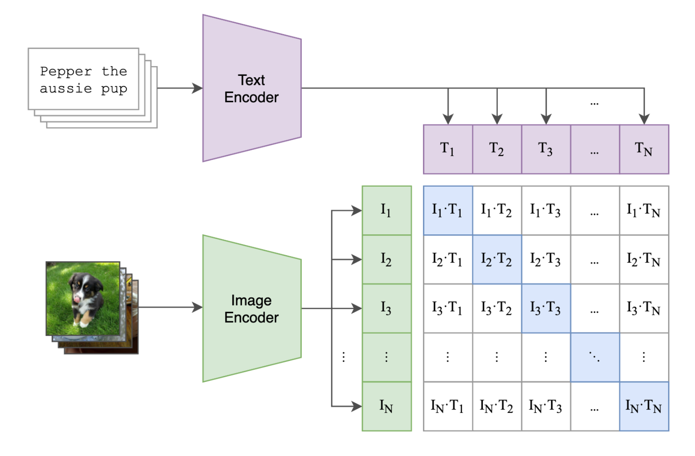

- 图片来源：https://openai.com/research/clip

而 DALL-E 2 利用 CLIP 图像编码器提取图像表征，得到的图像表征直接通过扩散模型解码器生成变体图像。这个过程被称为 unCLIP。

了解了这些，我们再来看 SD 图像变体的能力。SD 图像变体模型是基于 SD2.1 模型微调而来的，能生成 768x768 分辨率的图像。在我编写这一讲的内容时，WebUI 尚未集成 SD 图像变体模型。如果你想使用这个模型，可以使用官方平台Clipdrop试试效果，或者按照Hugging Face中提供的代码示例进行操作。

首先，我们看一下如何通过官方平台实现图像变体功能。打开Clipdrop后，我们只需上传图像，耐心等待一会，便可以看到 SD 图像变体模型生成的新图像。

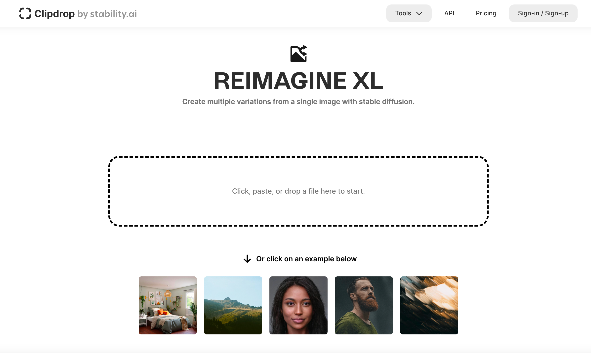

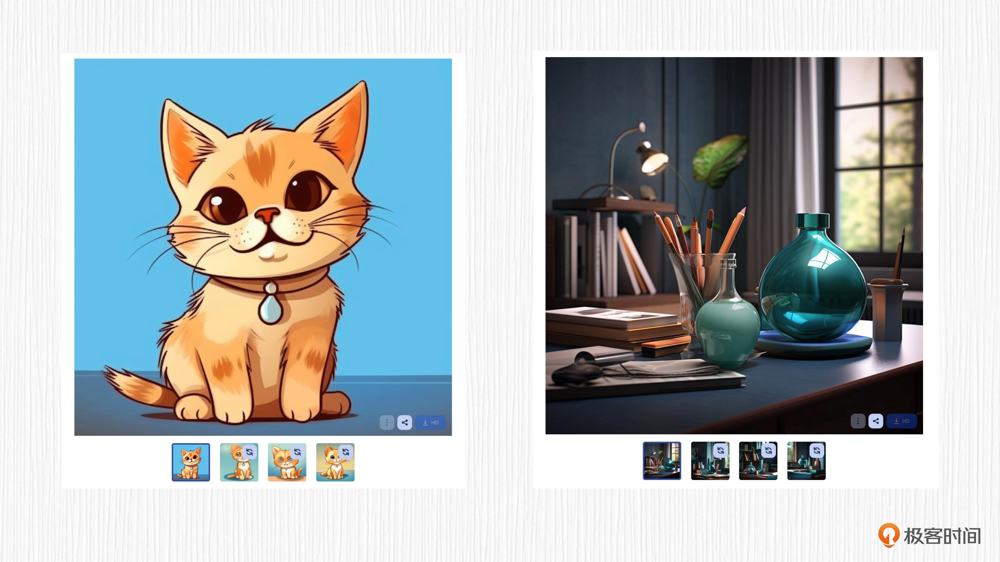

为了看图更直观，我们可以将变体图像下载到本地查看。

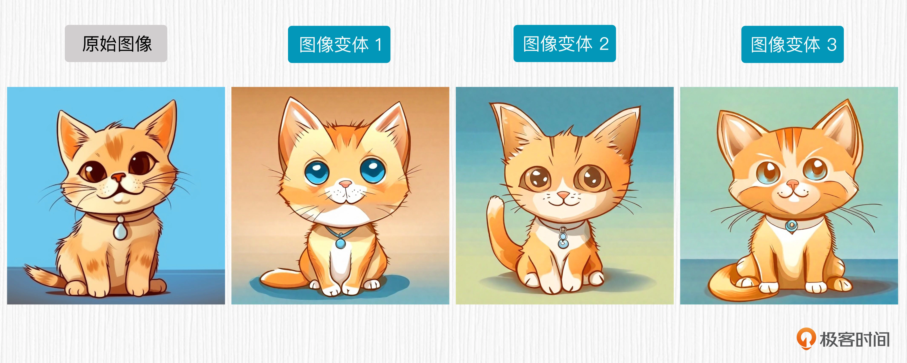

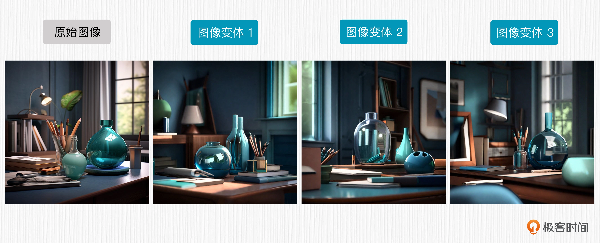

虽然在平台上使用图像变体功能非常方便，但如果想调整参数和批量生成图像变体，更推荐你用写代码的方式调用。

标准的 SD 图像变体用法，我们可以采用后面的方式来调用。你可以点开 Colab 一起进行操作。

```python
from diffusers import StableUnCLIPImg2ImgPipeline
from diffusers.utils import load_image
import torch
pipe = StableUnCLIPImg2ImgPipeline.from_pretrained(
   "stabilityai/stable-diffusion-2-1-unclip", torch_dtype=torch.float16, variati
pipe = pipe.to("cuda")
# 这里的url可以换成你想测试的图片url链接
url = "https://ice.frostsky.com/2023/08/13/ec9539fef32052dac71f19c11d76ab6c.png"
init_image = load_image(url)
images = pipe(init_image).images
images[0].save("variation_image.png")
```

我来给你解释下这段代码。首先，我们从官方仓库下载 SD 图像变体模型。然后，我们使用一张“在祈祷的猫咪图像”作为输入，调用 SD 图像变体模型完成图像生成。这里，你也可以使用自己的图像替换掉上面第 10 行代码中的图片链接。

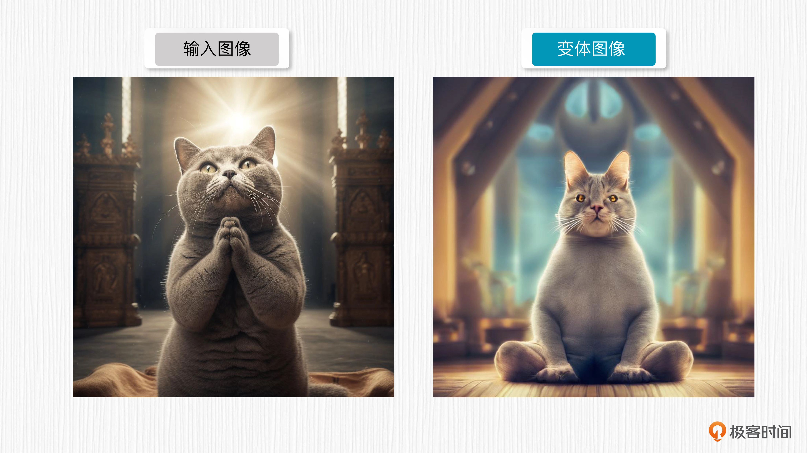

图中两只猫咪在“气质上”确实比较相似。你应该已经注意到，在上面的生成过程中，我们并没有使用 prompt。也正因此，生成图像变体的过程并不是很可控，比如上面的猫咪没有呈现出祈祷的姿势。

为了更好地控制图像变体，我们也可以设置 prompt 语句。你可以参考后面的代码。

```python
from diffusers import StableUnCLIPImg2ImgPipeline
from diffusers.utils import load_image
import torch
pipe = StableUnCLIPImg2ImgPipeline.from_pretrained(
   "stabilityai/stable-diffusion-2-1-unclip", torch_dtype=torch.float16, variati
)
pipe = pipe.to("cuda")
url = "https://ice.frostsky.com/2023/08/13/ec9539fef32052dac71f19c11d76ab6c.png"
init_image = load_image(url)
images = pipe(init_image).images
images[0].save("variation_image.png")
prompt = "A praying cat"
images = pipe(init_image, prompt=prompt).images
images[0].save("variation_image_two.png")
```

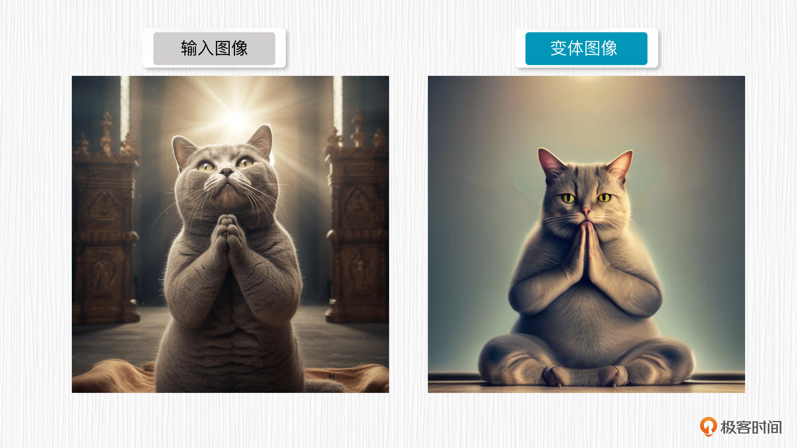

使用 prompt 引导图像变体生成的关键在于前面代码的第 18 行。在生成过程中，我们引入了新的参数 prompt。

我们已经知道，DALL-E 2 的图像变体功能是不能使用 prompt 的，那么问题来了，为什么 SD图像变体却可以使用 prompt 呢？接下来，我就带你探索一下这背后的原因。

### 技术细节探究

带着我们前面的疑问，咱们从源代码入手来“破案”。

根据 SD 图像变体的源代码（StableUnCLIPImg2ImgPipeline ），我们发现输入的图像首先会进入 _encode_image 这个函数，这个函数负责将输入图像转为图像表征。

```
# 4. Encoder input image
noise_level = torch.tensor([noise_level], device=device)
image_embeds = self._encode_image(
   image=image,
   device=device,
   batch_size=batch_size,
   num_images_per_prompt=num_images_per_prompt,
   do_classifier_free_guidance=do_classifier_free_guidance,
   noise_level=noise_level,
   generator=generator,
   image_embeds=image_embeds,)
```

接下来，我们分析一下图像表征的注入方式。实际上，图像表征是在 UNet 模型每次预测噪声的过程中引入的。

我们已经知道，标准 SD 中 UNet 的输入包括文本表征、上一步去噪后的潜在表示以及时间步t 的编码。而在 SD 图像变体方案里，除了刚提到的三项标准输入，代码中多了 “class_labels= image_embeds” 这一项（第 6 行），这正是它与其他 SD 模型不同之处。

你可以这样理解，SD 图像变体模型的 prompt 作用机制和其他 SD 模型是相同的，而参考图像的信息是额外新增的。

```
# predict the noise residual
noise_pred = self.unet(
   latent_model_input,
   t,
   encoder_hidden_states=prompt_embeds,
   class_labels=image_embeds, # 破案的关键，输入了图像的表征
   cross_attention_kwargs=cross_attention_kwargs,
   return_dict=False,
)[0]
```

为了更深入了解这个过程，我们可以进一步探究 SD 图像变体模型 UNet 预测噪声的代码，这里我只截取了关于图像表征（image_embeds）使用方式的部分。在代码最后一行，SD 图像变体模型将图像表征与时间步的编码做了相加处理。通过这种方式，参考图像便可以直接影响我们的生成结果。

```
emb = self.time_embedding(t_emb, timestep_cond)
if self.class_embedding is not None:
   if class_labels is None:
       raise ValueError("class_labels should be provided when num_class_embeds >
   if self.config.class_embed_type == "timestep":
       class_labels = self.time_proj(class_labels)
   class_emb = self.class_embedding(class_labels).to(dtype=sample.dtype)
   emb = emb + class_emb
```

至此，我们找到了关键所在。SD 图像变体模型不仅可以输入参考图生成变体，同时还能使用prompt 进行引导。这个过程与 DALL-E 2 的图像变体能力是截然不同的。

## “神雕侠侣”

除了 SD 图像变体模型外，SD 系列最近亮眼的更新莫过于“神雕侠侣”（SDXL）这个模型了。

我们已经知道，标准 SD 模型和 SD 图像变体模型，都是 StabilityAI 这家公司推出的开源 AI绘画模型，在 Hugging Face、Civitai 这些论坛备受追捧。但遗憾的是，Midjourney 在 AI 绘画生成效果上始终一骑绝尘。

可能是为了证明 SD 模型同样拥有无限的 AI 绘画潜力，StabilityAI 决定大力出奇迹，开发一款能与 Midjourney 效果相匹配的模型。于是，SDXL 便应运而生。

### 初识 SDXL

2023 年 6 月，Stable Diffusion XL 0.9 正式发布，我们先来看看它的 AI 绘画效果。当我写这一讲的时候，SDXL1.0 版本也已经正式发布。

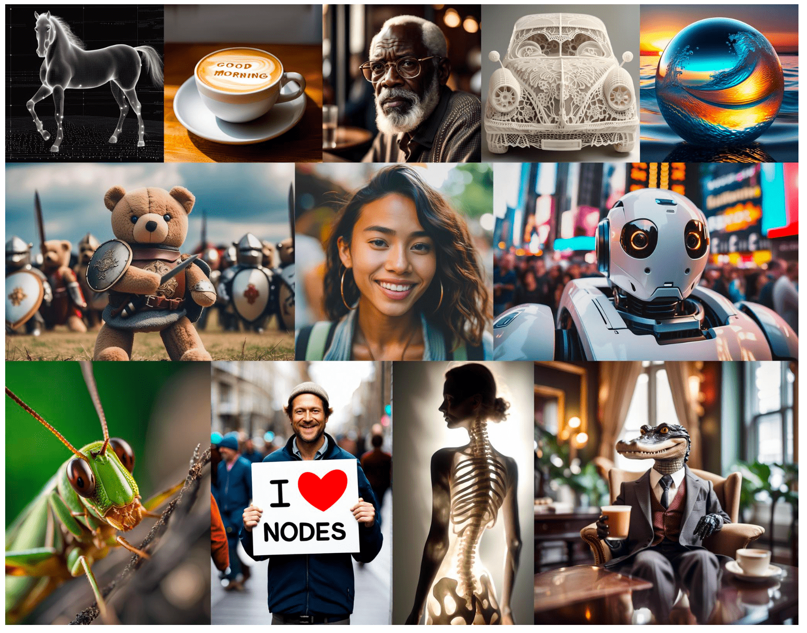

- 图片来源：https://arxiv.org/abs/2307.01952

论文中也将 SDXL 和 DeepFloyd IF、Midjourney v5.2、DALL-E 2 等方案做了对比。这个比较很有意思，在相同 prompt 下测试了当下各个最强的 AI 绘画模型。你可以点开大图做一下对比，选择你心中的 top1。

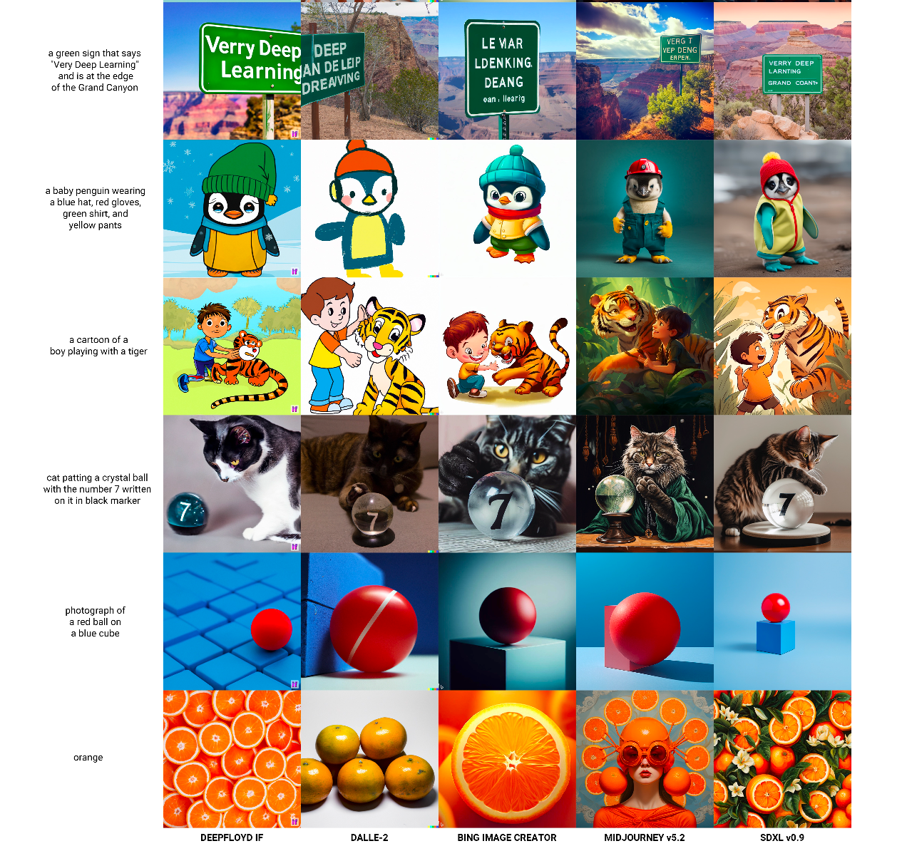

- 图片来源：https://arxiv.org/abs/2307.01952

我们可以看出相比于其他版本的 SD 模型，比如 SD1.5、SD2.1 等，SDXL 的提升也非常明显的。不仅生成的图像瑕疵更少，图片被裁切的情况也得到明显改善。你可以点开图片查看。

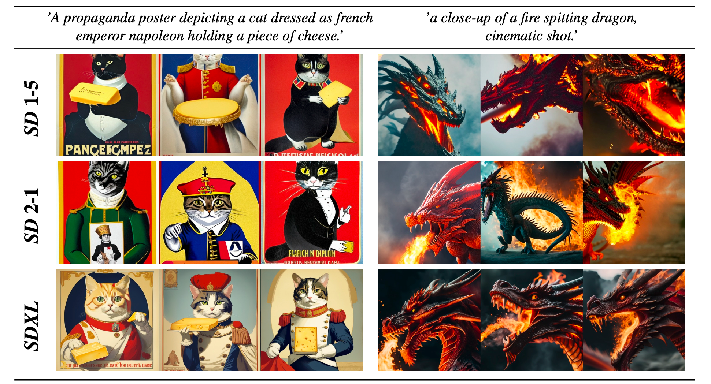

- 图片来源：https://arxiv.org/abs/2307.01952

看了这么多效果，你一定也很好奇，这是怎么做到的呢？我们这就来探索一下 SDXL 背后的技术细节！

### SDXL 的整体方案

SDXL 采用级联模型的方式完成图像生成。所谓级联模型，就是将多个模型按照顺序串联，目的是完成更复杂的任务。

SDXL 将 Base 模型和 Refiner 模型进行串联，整体方案你可以参考后面这张图。

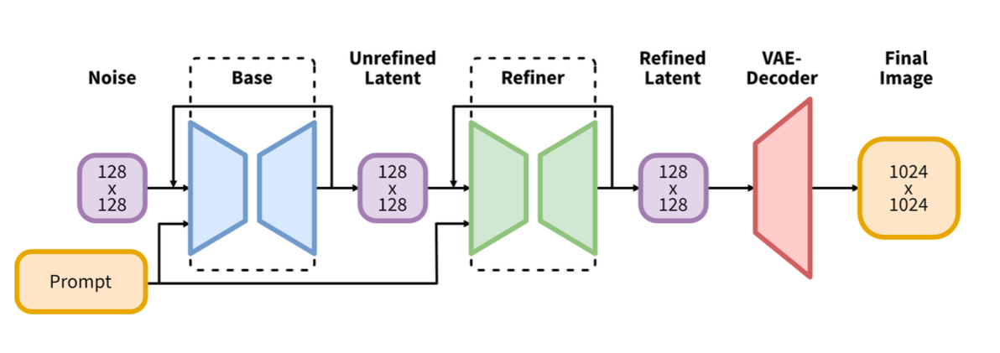

- 图片来源：https://arxiv.org/abs/2307.01952

我们知道 SD1.x 系列模型的潜在表示是 64x64 维度，而 SDXL 为了生成更高清的图像，直接在 128x128 维度的潜在表示上进行去噪计算。Base 模型的整体思路和 SD 模型一致，不过它更换了更强的 CLIP、VAE 模块，使用了更大的 UNet 模型。

Base 模型去噪后的潜在表示，也使用了较低的加噪步数（比如 200 步）进行加噪，对Refiner 进行训练。

Refiner 模型的作用有点类似于我们的图生图功能。该怎么理解呢？

Base 模型已经生成了我们要的图像，默认分辨率是 1024x1024。然后我们给这张图像加上少许噪声，Refiner 模型负责二次去除这些噪声。较低的加噪步数类似于我们知道的重绘强度，避免加噪到纯粹的噪声，那样的话就很难保持第一阶段图像的“绘画成果”了。总之，引入Refiner 这个模型，可以进一步提升 AI 绘画的效果。

经过 Refiner 得到的潜在表示，经过 VAE 解码后，便可以直接得到 1024x1024 分辨率的图像。

### 新的 VAE、CLIP 和 UNet

SDXL 模型没有沿用 SD1.x 和 SD2.x 模型中使用的 VAE 模型，而是基于同样的模型架构，使用更大的训练 batch_size 来重新训练 VAE。

我们在第 11 讲也提到过，VAE 决定了 SD 模型生成图像的上限，未经过单独调优的 VAE并不擅长处理小脸和细节的重建。而 SDXL 单独训练的 VAE 模型，在各种图像生成评测任务上都有明显提升。

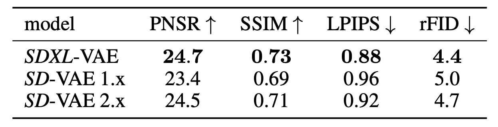

- 图片来源：https://arxiv.org/abs/2307.01952

说完 VAE，再来看 CLIP。SD1.x 系列使用的是 CLIP ViT-L/14 这个模型，该模型来自OpenAI，参数量是 123M。而 SD2.x 系列将文本编码器升级为 OpenCLIP 的 ViT-H/14 模型，参数量是 354M。

SDXL 更进一步，使用了两个文本编码器，分别是 OpenCLIP 的 ViT-G/14 模型（参数量694M）和 OpenAI 的 ViT-L/14 模型。在实际使用中，分别提取这两个文本编码器倒数第二层的特征，将 1280 维特征（Vit-G/14）和 768 维特征（ViT-L/14）进行拼接，得到 2048 维度的文本表征。

我们在 Imagen 那一讲已经提过，拥有更强的文本表征能力，就意味着 AI 绘画模型更能听懂我们的指令。

我们再来看看 SDXL 中的 UNet 模型结构。相比于上一讲标准 SD 模型的 UNet，SDXL 的CADB 模块（CrossAttnDownBlock2D）只有两层，UNet 最终的潜在表示维度也从 8x8 提升到了 32x32。同时，在 CADB 内部，SDXL 也使用了更多层的 Transformer 结构。

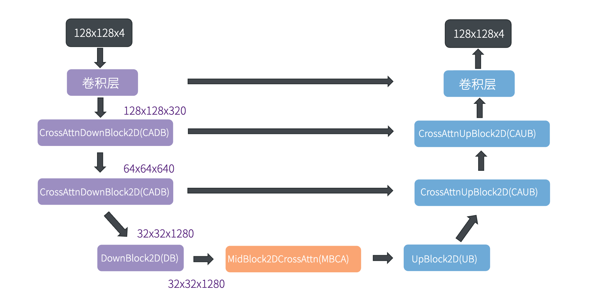

了解完这些技术细节，相信你会对“大力出奇迹”背后的含义理解更深刻。值得一提的是，SDXL 的 UNet 有 2.6B 参数量，相比于 DeepFloyd IF 模型的 4.3B 参数量，还是“小巫见大巫”。

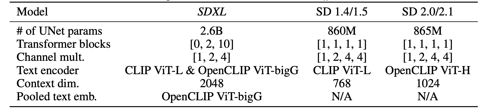

- 图片来源：https://arxiv.org/abs/2307.01952

### SDXL 的使用

最后我们上手体验一下，看看 SDXL 这个模型怎么用。最简单的方法依旧是使用官方平台clipdrop 或者 dreamstudio。比如我们在中心区域输入我们想要生成的图像，“一只长着鹿角的彩虹色柯基犬”。

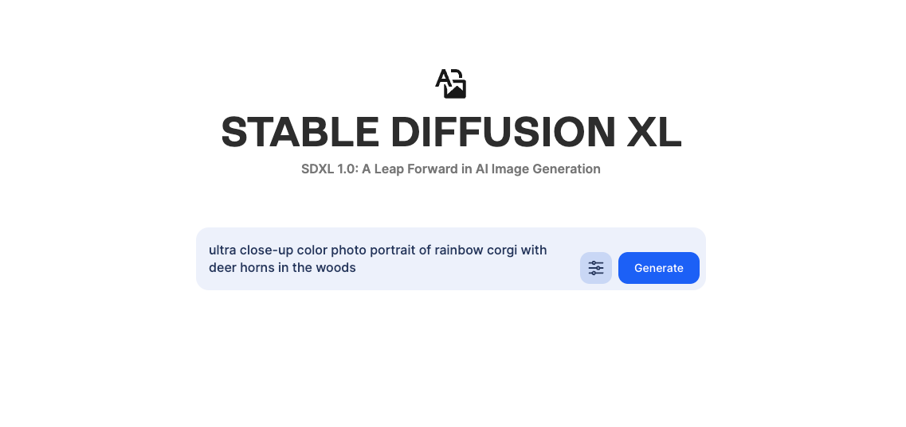

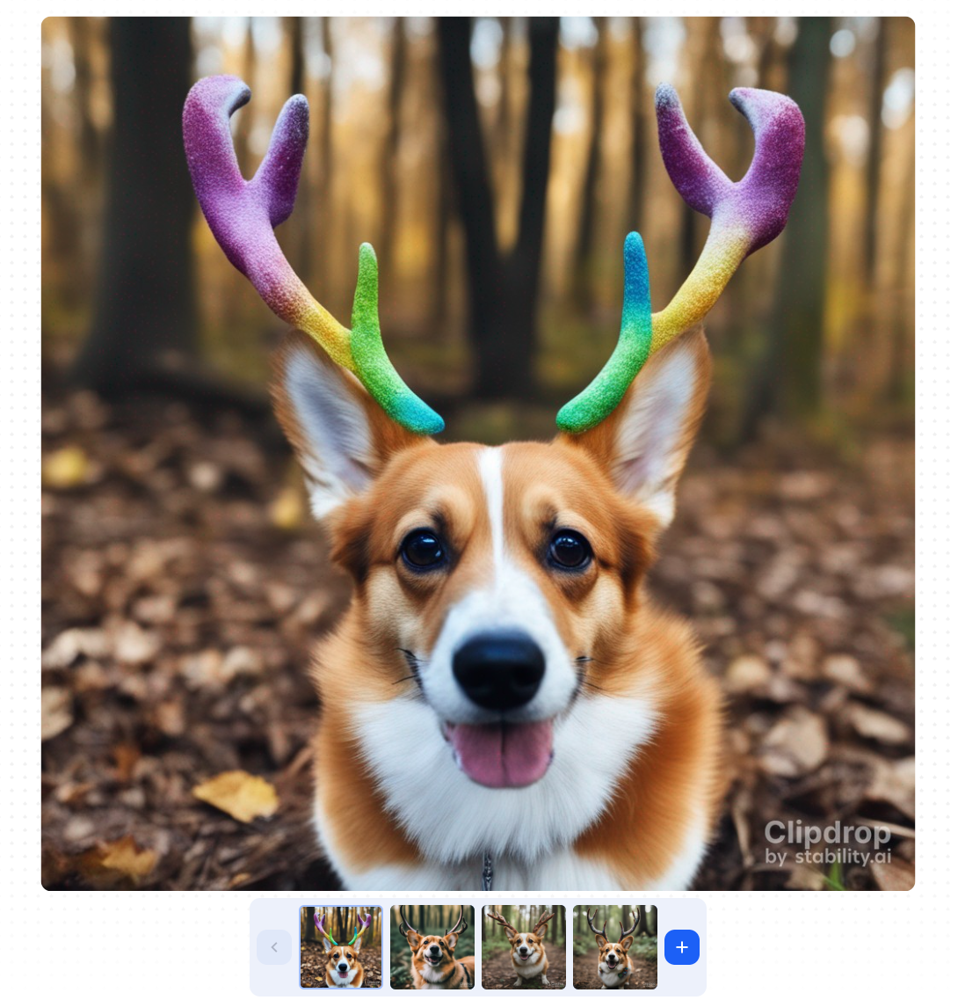

我们还可以测试一下 SDXL 在图片中写文字的能力，比如我们要求其绘制这样一幅画：一个飞行在天空的热气球，挂着一个边缘镶嵌满鲜花的木板，木板上写着“Geekbang”。

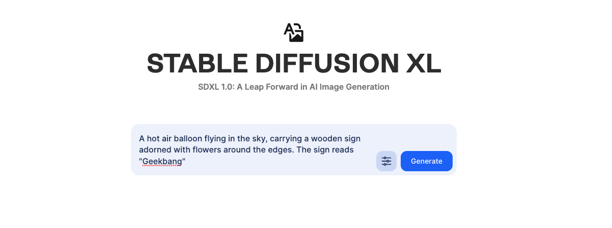

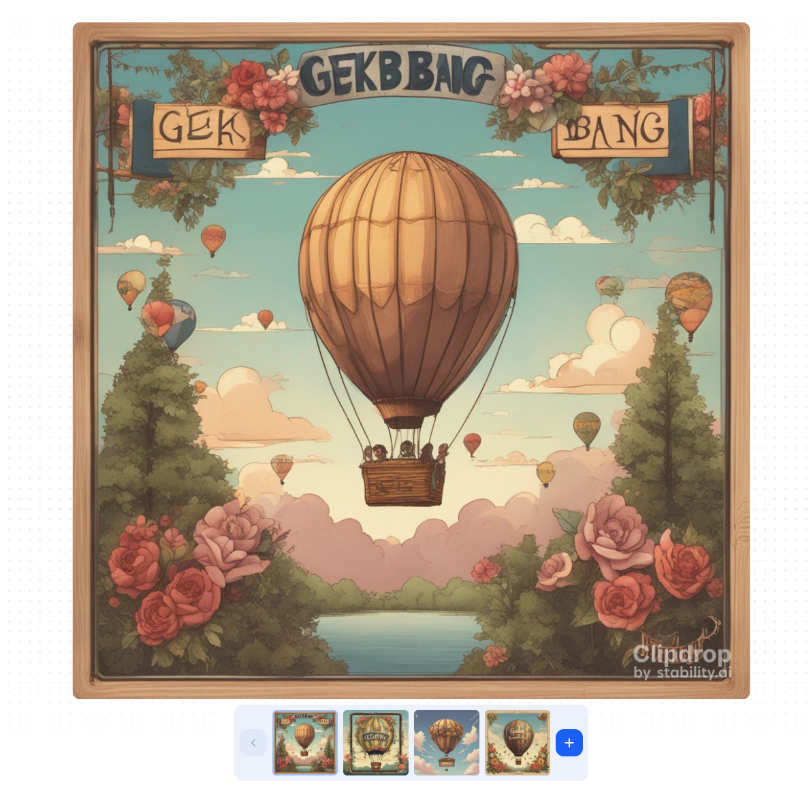

从图片结果看，并不理想。你还记得这个 prompt 下 DeepFloyd 模型的表现么？DeepFloyd 模型是可以胜任这个任务的。从这个测试我们可以知道，SDXL 的文本编码器还有一定的提升空间。

当然我们也可以通过写代码的方式使用 SDXL 模型批量生成图像。你可以点开 Colab 链接，了解更多的代码细节。需要说明，使用 SDXL 的 Refiner 模型生成 1024x1024 分辨率的图片，需要较多 GPU 显存，Colab 15G 的 T4 显卡不能胜任这个任务。推荐使用 V100-32G这个性能的显卡来运行这个 Colab。

可以看到，代码中我们加载了 Base 和 Refiner 两个扩散模型，AI 绘画的过程也是使用这两个模型通过“接力”的方式生成的。

```python
from diffusers import StableDiffusionXLPipeline, StableDiffusionXLImg2ImgPipeline
import torch
# 下载并加载SDXL1.0的Base模型，未来SDXL模型更新新版本，需要根据实际情况替换版本号
pipe = StableDiffusionXLPipeline.from_pretrained(
   "stabilityai/stable-diffusion-xl-base-1.0", torch_dtype=torch.float16, varian
)
pipe.to("cuda")
# 下载并加载SDXL1.0的Refiner模型，未来SDXL模型更新新版本，需要根据实际情况替换版本号
refiner = StableDiffusionXLImg2ImgPipeline.from_pretrained(
   "stabilityai/stable-diffusion-xl-refiner-1.0", torch_dtype=torch.float16, use
)
refiner.to("cuda")
prompt = "ultra close-up color photo portrait of a lovely corgi"
use_refiner = True
# Base模型生成图像
image = pipe(prompt=prompt, output_type="latent" if use_refiner else "pil").image
# Refiner模型生成图像
image = refiner(prompt=prompt, image=image[None, :]).images[0]
```

我们对比下 Base 模型和 Refiner 模型生成的图像效果，可以发现，Base 模型和 Refiner 模型生成的图像效果都不错，而 Refiner 在细节上更胜一筹。

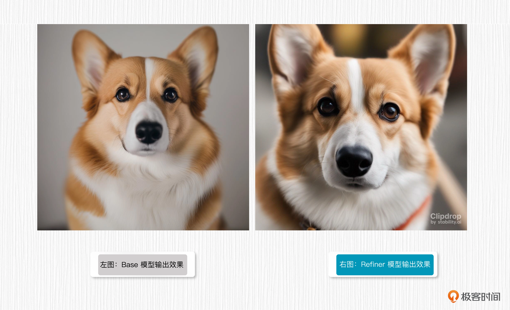

左边的图片是 Base 模型输出效果，详情你可以参考 Colab 代码链接。右边的图片则是Refiner 模型输出效果，是通过 Clipdrop 平台生成的。

事实上，6 月底发布的 SDXL0.9 版本相当于测试版，StabilityAI 这家公司根据用户体验反馈针对性补充了训练数据，同时还引入了 RLHF 技术（人类反馈强化学习），才完成 SDXL1.0 模型的优化。下面这张图对比了 0.9 和 1.0 版本的 AI 绘画效果，直观感受上差别不大。

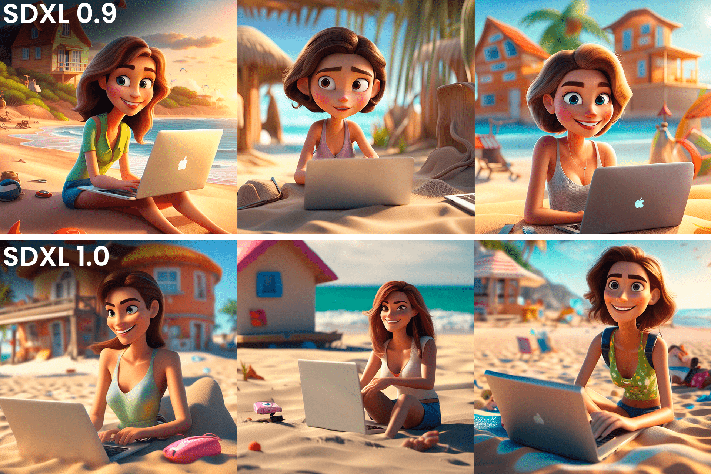

- 图片来源：https://www.reddit.com/media?url=https%3A%2F%2Fi.redd.it%2Fh74i8386gceb1.png

到这里，我们已经掌握了 SDXL 的算法原理和使用方法，现在你可以在 clipdrop 上使用SDXL 创作更多有意思的 AI 绘画作品了。

## 课程小结

这一讲，我们学习了 SD 系列两个有意思的模型，分别是 SD 图像变体和 SDXL 模型。

SD 图像变体和 DALL-E 2 有异曲同工之妙，都可以输入一张图像产生多张变体，从而帮我们完成相似图像的生成任务。不同之处在于，SD 图像变体可以使用额外的 prompt，引导模型生成图像变体，而这一点，DALL-E 2 是无法做到的。我们详细探讨了这背后的原因。

SDXL 是 SD 系列“大力出奇迹”的结果，目标是在 AI 绘画效果上挑战 Midjourney。SDXL 用了两个强大的 CLIP 文本编码器，重新训练了 VAE 模型，而且引入了更多参数的 UNet 结构。与此同时，SDXL 还使用级联模型的方式进一步提升 AI 绘画效果。

今天学到的两个模型都可以通过官方平台 clipdrop 进行体验。在这些新能力的加持下，也期待你能生成出更多有趣的作品。

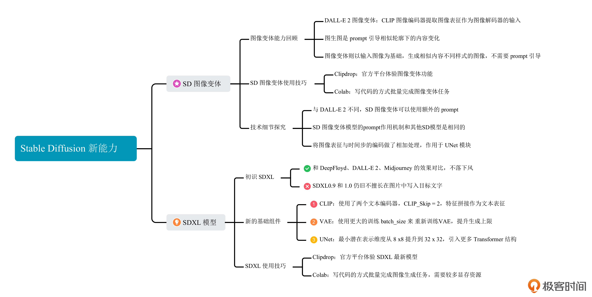

## 思考题

SD 图像变体与 SDXL 分别具有哪些优势和特点，可以应用于哪些场景中？

期待你在留言区和我交流互动，如果这一讲对你有启发，也推荐你发给身边更多朋友。
