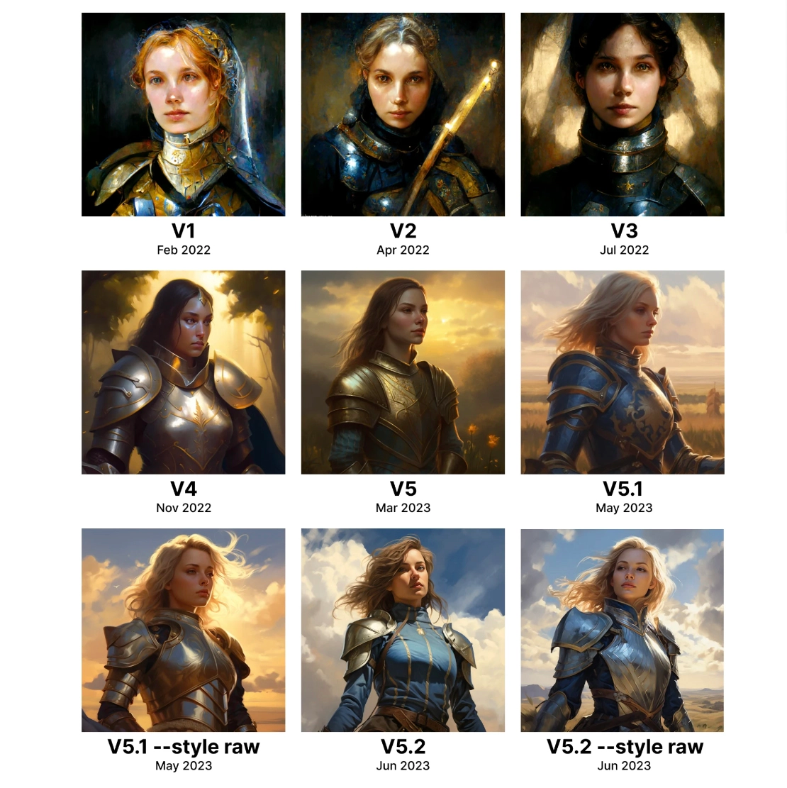
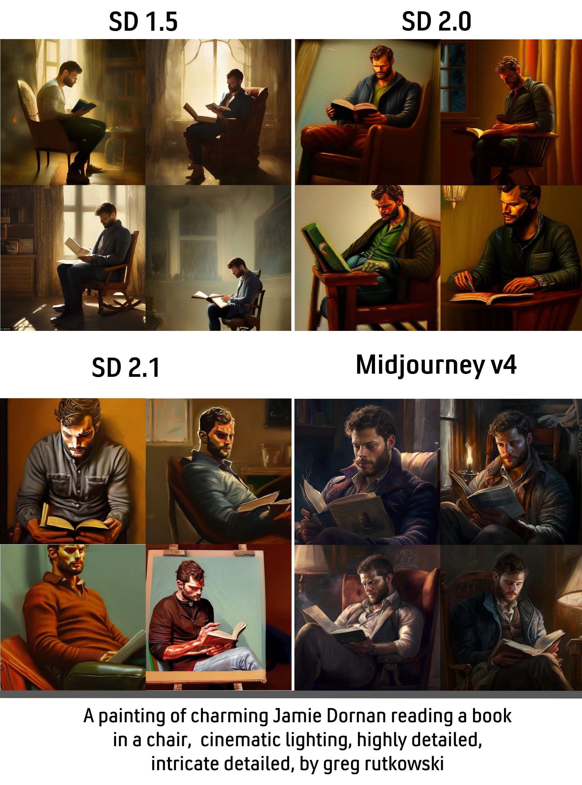
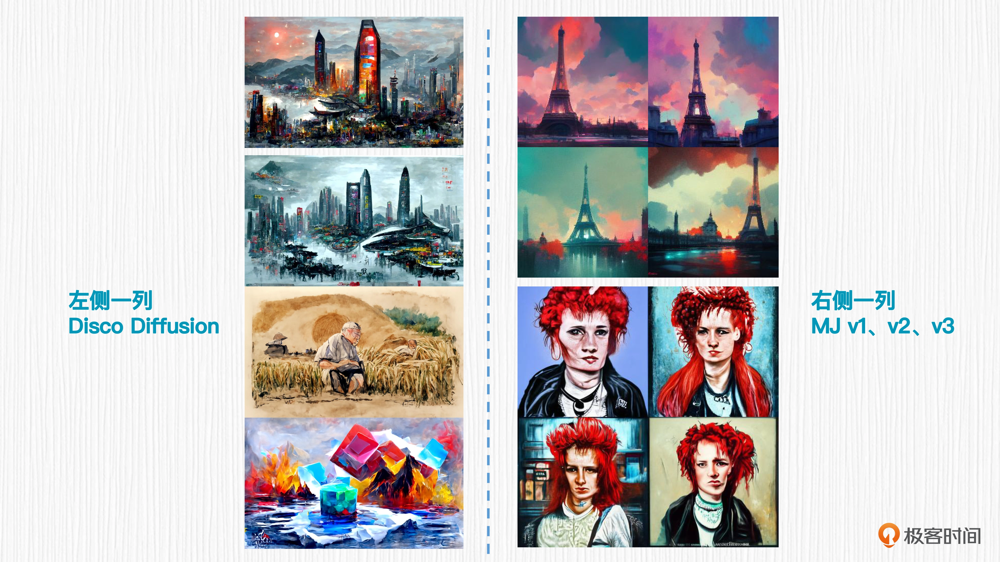
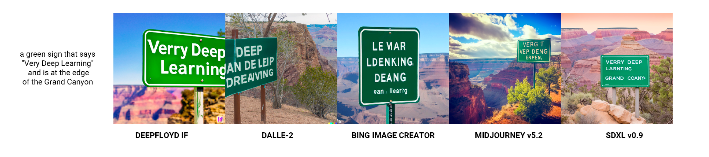
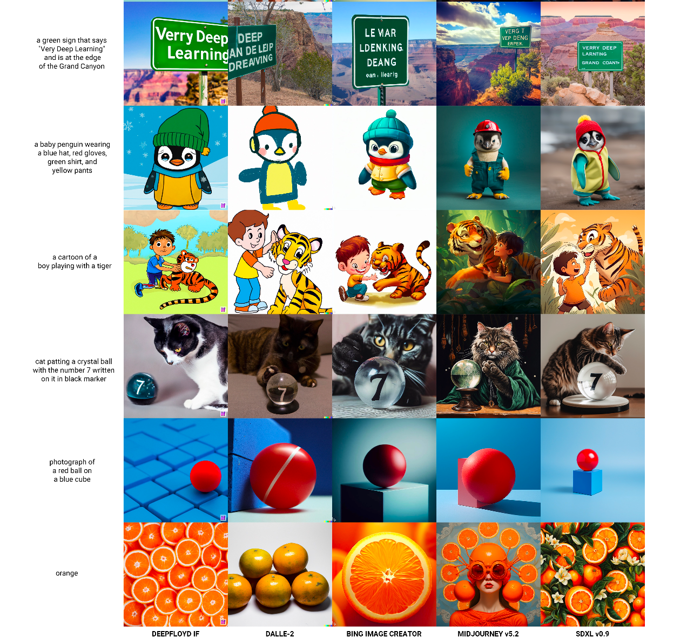
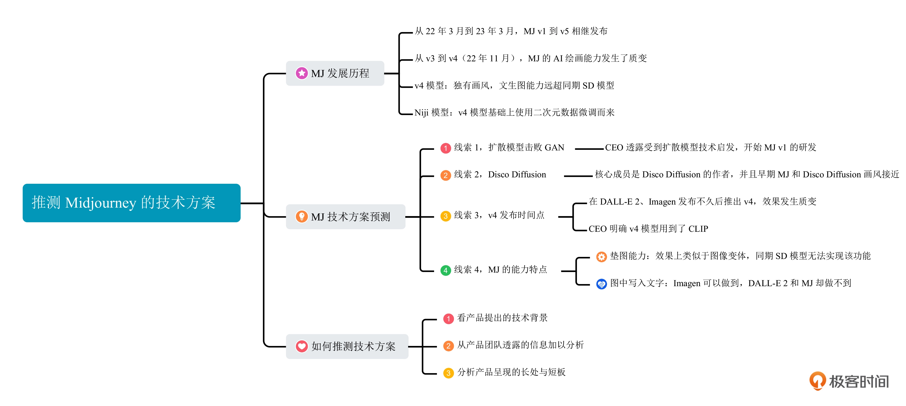

# 17 | 巅峰画师Midjourney：一起来猜猜年入1亿美元背后的技术方案

你好，我是南柯。

前面我们已经学习了 DALL-E 2、Imagen、DeepFloyd、SDXL 这些 AI 绘画的明星模型。这一讲我们就一起来探讨 Midjourney，它是当下公认的 AI 绘画最强模型。

在第 3 讲，我们便已领略过 Midjourney 的文生图、图像融合和垫图生成能力。从 22 年 11月的 Midjourney v4、Nijijourney，到今年 3 月的 Midjourney v5，MJ 凭借其高质量的生成效果、30 美元一个月的付费服务，实现了非常可观的收入。因此，训练出对标 Midjourney 的模型也成为了很多大企业追求的目标。

在我写这一讲内容的时候，Midjourney 背后的技术并没有公开。今天这一讲，我们不妨一起猜猜看，Midjourney 这个 AI 绘画圈子里最值钱的“技术方案”是怎样的。

特别提示一下，我们这一讲的分析会涉及很多进阶篇的背景知识，比如 DALL-E 2、Imagen、SD 模型背后的技术原理等，推荐你课前进行温习。

## 回顾 Midjourney 的发展

不知道你是否思考过这个问题：做一个 Midjourney 这样的产品，需要多少人？

国内的互联网公司可以轻松投入数百人去做类似的项目。实际上呢，在 Midjourney v4 发布的时期，这个公司只有不到 20 名全职员工。

2019 年的时候，David Holz 卖掉了手中的 Leap Motion 公司，创建了 Midjourney。David 上一家公司做的是手部跟踪器，与我们今天要聊的 AI 绘画没有直接关系。但他的技术背景和创业精神为 Midjourney 的发展奠定了基础。

到了 2022 年 2 月，Midjourney v1 模型正式推出。紧接着 4 月，v2 版本正式推出；7 月，v3版本正式推出；11 月，我们熟悉的 v4 版本正式推出；2023 年 3 月，v5 版本正式推出；6月，v5.2 版本正式推出。我们惊奇地发现，从 v1 到 v5，其实只用了一年时间。

参考后面的图片，你就能看到在过去的一年里，Midjourney 在以怎样的速度狂飙。

- 图片来源：https://aituts.com/midjourney-versions/

通过观察 MJ 的 AI 绘画效果，查阅和分析公开资料，我们可以总结一下从 v1 到 v5 版本的模型升级思路。

首先是 MJ v1，生成细节和真实感上都存在明显缺陷，在今天看来 v1 是一个可用性很低的 AI绘画模型。

然后是 MJ v2，图文一致性得到提升，生成图像的质量也得到了一定的提升，但脸部、手部等细节的生成还是有明显的瑕疵。

之后是 MJ v3，引入了新的超分算法，在高分辨率生成能力上得到加强，并且模型开始支持风格化强度的调节，用来满足不同用户的审美需求。

再之后就到了我们熟悉的 MJ v4。我个人认为，从 v3 到 v4，MJ 的 AI 绘画能力发生了质变。

这体现在 MJ 模型不仅找到了一种独有的画风，而且在处理细节的能力上，也远超同时期的Stable Diffusion 模型。你可以看后面这张图感受下这种差异。

- 图片来源：https://www.reddit.com/media?url=https%3A%2F%2Fi.redd.it%2Fndqmnl0brf4a1.png

最后就是最新的 MJ v5。这个模型的生成质量再次提升，对于手部、脸部细节的处理都有明显改善，并且图像和 prompt 指令的一致性也更强。

值得一提的是，在 2022 年 11 月 MJ v4 推出后不久，MJ 公司引入大量二次元数据微调 v4 模型，于是得到了 Nijijourney 这个专注于动漫垂类生成的模型。

## 猜测 Midjourney 的方案

毫无疑问，Midjourney 的技术方案只有少数人知道。但我们仍然可以在已经披露的信息中寻找线索。

### 四条关键线索

线索 1，Diffusion Beats GAN

在 2022 年 11 月的一次关于 Midjourney CEO 的访谈中，他透露出公司受到扩散模型技术的启发，在 2021 年 7 月开发了第一个模型。我们在第 5 讲中提到过一篇名为 “扩散模型在图像生成领域击败了 GAN” 的文章，最早就是在 2021 年 5 月放出的。我个人觉得，Midjourney公司最早很有可能是受这篇论文的启发，才开始了 AI 绘画之路。

线索 2，Disco Diffusion

Midjourney 公司的核心成员之一，Somnai，也是开源 AI 绘画程序 Disco Diffusion 的作者。Disco Diffusion 是一个使用 CLIP 模型作为文本引导的扩散模型项目。这里我们可以比较下Midjourney 早期版本和 Disco Diffusion 的效果，风格上是不是有点接近呢？

线索 3，Midjourney v4 发布的时间点

在采访中，Midjourney 的 CEO 表示 v4 版本采用了全新的代码实现，但并非所有模块都是从头开始训练的。而且他也明确表示基础模型是扩散模型，并且用到了 CLIP。

我们可以回顾下同期其他一些工作的时间线。DALL-E 2 的论文发布于 2022 年 4 月，Imagen发布于 2022 年 5 月，Stable Diffusion 于同年 8 月开源。再加上 v4 相比 v3 在 AI 绘画质量上有了质的飞跃，我们可以做一个大胆的推测，Midjourney v4 直接借鉴了 DALL-E 2 和 Imagen的设计思路。

线索 4，Midjourney v4 的能力特点

除了前面 3 条线索，Midjourney 本身的 AI 绘画能力也能带给我们一些信息。你可能听说过MJ 模型的垫图能力，举例来说，我们把衣服的图片叠放在一张全身照片上，使用第 3 讲我们说过的 MJ 图生图功能，便可以生成这个人穿着这件衣服的图片效果。SD 模型的图生图能力是无法实现这个效果的，但图像变体能力应该可以实现。

另外，即使最新的 MJ v5 模型，仍然不能完成在图片中写入文字的功能。你可以点开后面的图片查看各种经典 AI 绘画算法的“Text-in-Image”能力。在第 14 讲中我们已经知道 Imagen和 DeepFloyd 使用的是大语言模型 T5，因此这两个 AI 绘画模型能够胜任图片写入文字的能力。

- 图片来源：https://arxiv.org/abs/2307.01952

你可能会问，Midjourney 背后的方案是否会是 Stable Diffusion 呢？SD 模型也能实现图像变体，并且 SD 模型也不擅长图中写文字。

我个人的看法是 Midjourney 当前没有使用 Stable Diffusion 的技术方案。主要原因有两个，第一，SD 图像变体能力发布的时间晚于 MJ v4，而 MJ v4 就已经实现了垫图功能。第二，早期SD 模型的 VAE 解码器生成小脸、复杂背景等图像有明显瑕疵。

相信分析到这里，MJ 背后最可能的技术方案已经呼之欲出了。

### 演化历程

如果将这些信息串联起来，我推测 Midjourney 的技术演化历程是这样的。

2021 年 5 月，扩散模型的生成效果首次超过 GAN。于是，Midjourney 公司注意到这个技术，并基于这个技术开始了 v1 版本模型的研发。

2022 年 2 月，经过半年多的数据积累和技术实践，并吸纳了 Disco Diffusion 的作者，Midjourney 推出了 v1 版本的模型，并且后来的 v2 和 v3 也都是基于相似的技术方案来做的。

2022 年 4 到 5 月，DALL-E 2、Imagen 等 AI 绘画模型陆续发布，并且背后的技术也随之曝光。在未来的几个月里，Midjourney 公司及时调整技术方案，利用已经积累的海量数据和训练经验，快速复刻了 DALL-E 2 等论文的方案。v4 版本的模型很有可能是这样得到的。

2022 年 11 月到次年 3 月，随着 Stable Diffusion 技术的开源，各种 AI 绘画模型层出不穷，Midjourney 吸取了其中有用的经验、继续积累高质量数据，延续 v4 的技术方案，得到了 v5模型。

理清了 Midjourney 的发展历程，相信你也和我一样，受到了很多启发。

第一个启发是关于数据的价值。毫无疑问，Midjourney 公司在过去的几年时间里收集、标注了海量的高质量数据，这些数据是保证 AI 绘画效果的基础。对于后来者而言，想在短时间内收集、筛选和标注出海量的高质量数据是非常有挑战的。

第二个启发是保持对新方法的关注。Midjourney 显然有持续在关注最新的 AI 绘画方案，无论是最早的 “扩散模型击败 GAN” 的论文，抑或是后来的 DALL-E 2 和 Imagen。从 DALL-E 2到 SDXL，技术方案都是透明的。Midjourney 可以轻松地将这些方法借鉴过来，在自己的海量优质数据上进行模型训练的任务。

第三个启发是聚焦与坚持。Midjourney 的成功也证明了做一个行业第一的 AI 绘画模型，不需要上百人的算法团队。真正需要做的，是聚焦好 AI 绘画这一件事，持之以恒地收集数据和验证新方案。

对于当前仍在致力于追赶 Midjourney 的企业而言，也能从 MJ 的发展中总结一些经验。

想要训练一个高质量的 AI 绘画模型，最关键的便是数据和方法。可以想象，即使是同一套代码，使用 LAION 5B 这种互联网爬取数据和使用海量的“高颜值”数据，得到的 AI 绘画模型也是有天壤之别的。如果希望做出高质量垂类 AI 绘画模型，当前的建议仍是找到最强开源 AI 绘画模型，收集高质量数据去做模型微调。也就是我们在实战 2 已经尝试过的任务。

## Midjourney 的长处与不足

我们在第 3 讲曾经学过 Midjourney 的文生图功能、图生图功能和多图融合功能。在当下最新的 Midjourney5.2 中也支持了图像外扩的能力。如果你想了解更多 Midjourney 使用技巧，我推荐你参考后面这个教程。

推测了 Midjourney 可能的技术原理，也体验了 Midjourney 各种功能。我们不妨对照其他 AI绘画模型，来分析一下 Midjourney 的优缺点。

- 图片来源：https://huggingface.co/stabilityai/stable-diffusion-2-1-unclip

相比于其他 AI 绘画模型，Midjourney 生成的图片效果很少翻车，图像美感很强。但从上面的图中也可以看出它的不足。

第一行“Text-in-Image”的任务，MJ v5.2 就不能完成。第二行的任务中，MJ v5.2 无法正确地处理帽子颜色和手套颜色。同样，最后两个任务中 MJ v5.2 的表现也没有满足 prompt 的要求。

根据我们第 14 讲对于 CLIP 和 T5 模型的表现分析，Midjourney 大概率使用的是类似于CLIP 这样的“小模型”。

从这个对比也能看出，其他 AI 绘画模型追赶 Midjourney 的速度很快。也许很快就会出现一个能超越 Midjourney 的开源模型，让我们拭目以待。

## 总结

今天这一讲我们对 Midjourney 背后的技术方案做了很多有意思的猜想。不排除这样的可能性，随着开源模型的效果逼近，Midjourney 背后的技术真相也会浮出水面。也可能对于像我们这样的众多用户而言，它的技术方案永远是个谜。

之后也许还会有 Midjourney 这类“技术方案不透明”的方法涌现，比如近期出现的一些创意头像类相机。我们在分析背后的技术方案时，可以参考下这一讲我们的推理思路。

首先看产品提出的技术背景，有哪些技术是时下最受追捧的、已经开源实现的。然后从产品团队透露的产品细节中获取有效信息，帮助我们进一步缩小范围。最后也是最关键的一点，看产品所呈现效果的长处与短板，定位最有可能的算法方案。

当然这一切，都需要我们对 AI 绘画模型背后的技术原理充分了解，才能举一反三做分析。希望我们 AI 绘画的课程，能帮助你更好地理解 AI 绘画背后的逻辑。

## 思考题

1. 除了我们已经介绍过的 Midjourney 的使用功能，你还了解哪些有趣的用法？或者你希望Midjourney 未来能加入哪些能力呢？

2. 尝试参考今天课程里的思路，分析一下妙鸭相机的技术方案？

欢迎你在课程留言区和我交流互动，如果今天的内容对你有启发，也推荐你分享给更多朋友。
