# 19 | 实战项目（三）：动手做一个自己的LoRA模型

你好，我是南柯。

上一讲我们已经学习了 LoRA 的算法原理，搞懂了引入 LoRA 技术减少可学习参数的技巧。

如今 LoRA 几乎家喻户晓，我们在 Civitai 或者 Hugging Face 上，也能找到各种各样的 LoRA模型。这些 LoRA 模型既可以代表人物形象、动物形象或者某个特定物体，也可以代表水彩风、油画风这种特定的风格。

这一讲我们不妨自己动手，从零开始训练自己的 LoRA 模型。我们会以宝可梦生成和彩铅风格生成为例，完成两个模型的训练，借此探索 LoRA 模型表达内容和表达风格的能力如何实现。

## 如何训练一个 LoRA

在我们动手训练 LoRA 前，我先为你预告一下整个流程。

对于 LoRA 的训练，我们首先需要考虑两个问题：数据集获取和基础模型选择。幸运的是，我们已经熟悉了 Hugging Face 和 Civitai 这两个强大的开源社区，可以免费获取到海量数据集和基础模型。

### 数据准备

我们可以使用 Hugging Face 上现有的数据集，完成宝可梦的生成任务。这个数据集中包含800 多张训练图片。从后面的数据集说明中你可以看到，每一张图，我们都可以获取到它对应的 prompt。

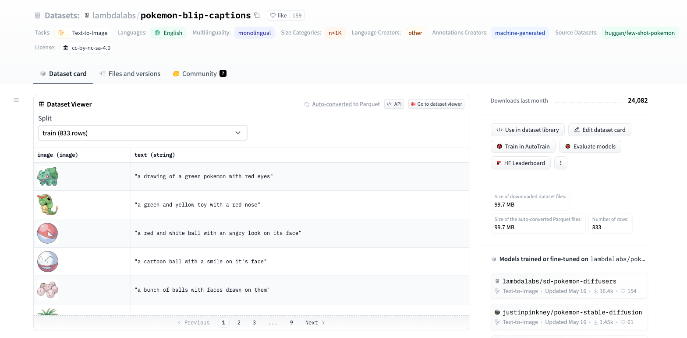

首先，我们可以通过后面这两行代码下载并加载数据集。

```python
from datasets import load_dataset
dataset = load_dataset("lambdalabs/pokemon-blip-captions", split="train")
```

接着，我们便可以通过后面这几行代码，可视化数据集中的图片和对应 prompt。

```python
from PIL import Image
width, height = 360, 360
new_image = Image.new('RGB', (2*width, 2*height))
new_image.paste(dataset[0]["image"].resize((width, height)), (0, 0))
new_image.paste(dataset[1]["image"].resize((width, height)), (width, 0))
new_image.paste(dataset[2]["image"].resize((width, height)), (0, height))
new_image.paste(dataset[3]["image"].resize((width, height)), (width, height))
for idx in range(4):
 print(dataset[idx]["text"])
display(new_image)
```

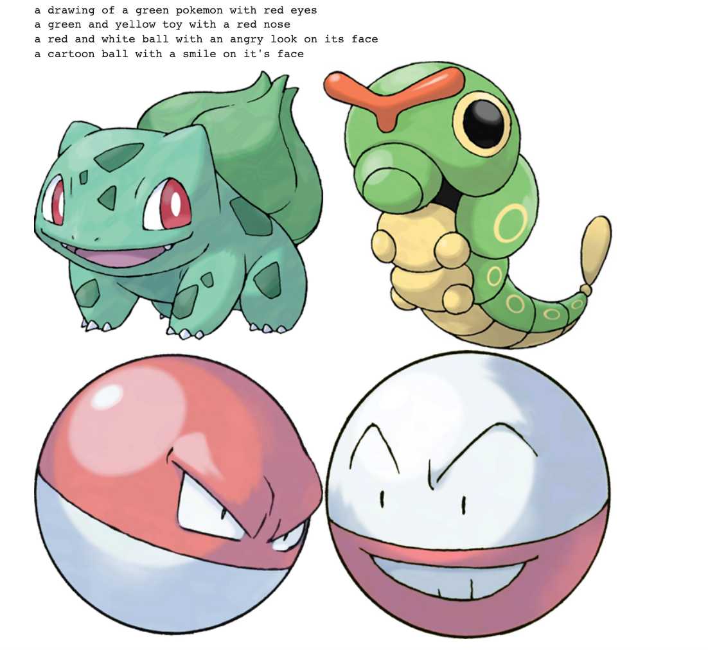

当然，你也可以使用自己手中的图片做一个原创 LoRA。如果你是一个插画师，那么你可以用自己曾经的作品，来训练一个贴近你自己风格的专属 LoRA 模型，帮助你进行创作。

SD 模型的微调需要同时使用图片和 prompt。如果我们手中的图片没有 prompt，那么还需要使用一些方法为图片生成 prompt，这里我们选择使用名为 BLIP 的模型完成这个任务。

提到 BLIP 这个名字，你难免会联想到我们已经学过的 CLIP。虽然名字差不多，但它们还是不一样的。你可以这样来区分记忆，CLIP 模型提取图像和文本表征，用于跨模态理解任务。而 BLIP 从图像生成 prompt，用于跨模态生成任务。

我以 Hugging Face 上的彩铅风格数据为例，说明一下怎么用 BLIP 为每一张彩铅图片生成prompt。后面的图展示的就是这批彩铅图像的样例。

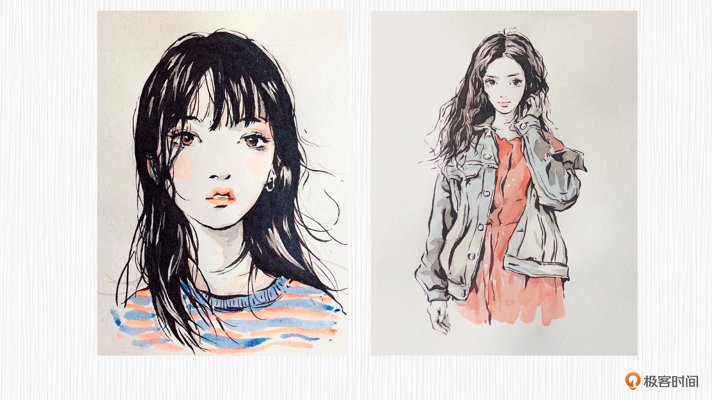

我们要在彩铅模型训练的 Colab 中，运行 make_captions.py 这个脚本，并指定原始图片的路径。这样脚本就会自动下载好 BLIP 模型，并针对提供的每张图依次进行模型推理生成prompt。你可以点开图像查看 prompt 的生成效果。

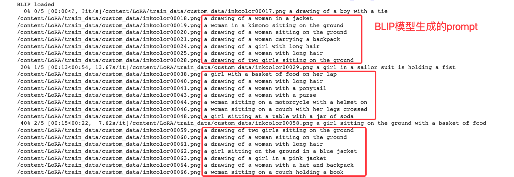

到此为止，我们已经完成了本次实战课两个数据集的准备工作。你可以根据自己想要完成的LoRA 训练任务，参考上面的过程准备训练数据。

### 基础模型选择

搞定了训练数据，我们再来看怎么选基础模型。想要训练出理想的 LoRA 效果，选择一个与训练目标风格接近的基础模型，会大大降低训练难度。

比如说我们要训练某个二次元形象的 LoRA 模型，选择擅长动漫生成的 Anything 系列模型，相比于选择擅长写实人像风格生成的 Chilloutmix 模型而言，就是更好的选择。

这一讲我们的目标是宝可梦和彩铅风格这两个任务，我们可以选择 Anything V5 模型作为基础模型。你可以在 Civitai 中找到这个模型的权重，按照下面图中展示的方法把模型下载到本地，或者右键复制链接地址。

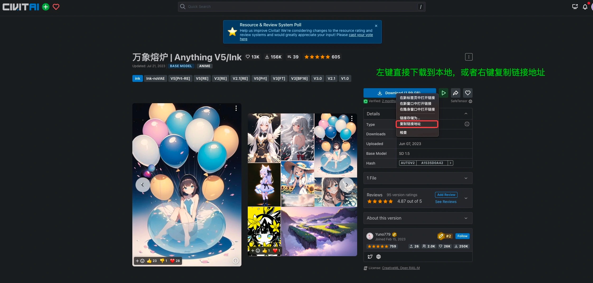

我们运行后面这条指令便可以完成基础模型的下载。

```
# -O 用于制定文件的存储路径
!wget -c https://civitai.com/api/download/models/90854 -O anything_v5.safetensors
```

你也可以在 Civitai 或者 Hugging Face 中找到其他模型的下载路径，替换上面脚本中的下载链接即可完成基础模型下载的任务。比如，如果你想下载 ChilloutMix 模型，就可以使用后面这行指令。

```
# -O 用于制定文件的存储路径
!wget -c https://huggingface.co/Linaqruf/stolen/resolve/main/pruned-models/chillo
```

### LoRA 训练过程

准备好数据和基础模型之后，我们再来看一下训练 LoRA 模型的核心代码逻辑。我们在第12 讲已经学过如何微调一个 Stable Diffusion 模型，这里我们来回顾一下 SD 训练的核心代码。

```bash
for epoch in range(num_train_epochs):
    for step, batch in enumerate(train_dataloader):
        # VAE模块将图像编码到潜在空间
        latents = vae.encode(batch["pixel_values"].to(weight_dtype)).latent_dist
        # 随机噪声 & 加噪到第t步
        noise = torch.randn_like(latents)
        timesteps = torch.randint(0, noise_scheduler.config.num_train_timesteps)
        noisy_latents = noise_scheduler.add_noise(latents, noise, timesteps)
        # 使用CLIP将文本描述作为输入
        encoder_hidden_states = text_encoder(batch["input_ids"])[0]
        target = noise
        # 预测噪声并计算loss
        model_pred = unet(noisy_latents, timesteps, encoder_hidden_states).sampl
        loss = F.mse_loss(model_pred.float(), target.float(), reduction="mean")
        optimizer.step()
```

其实这也正是训练一个 LoRA 模型的核心代码。这里该怎么理解呢？

我带你回顾一下 SD 模型的几个关键模块：VAE、CLIP 文本编码器、UNet，通常只有 UNet的权重是需要更新的。在使用 LoRA 微调 SD 的过程中，LoRA 模型影响的是 UNet 中注意力模块的投影层权重，也就是后面示例代码中的 W_Q、W_K 和 W_V。

```
# 从同一个输入序列产生Q、K和V向量。
Q = X * W_Q
K = X * W_K
V = X * W_V
# 计算Q和K向量之间的点积，得到注意力分数。
Scaled_Dot_Product = (Q * K^T) / sqrt(d_k)
# 应用Softmax函数对注意力分数进行归一化处理，获得注意力权重。
Attention_Weights = Softmax(Scaled_Dot_Product)
# 将注意力权重与V向量相乘，得到输出向量。
Output = Attention_Weights * V
```

我们以 UNet 模型中某一层的某一个交叉注意力模块投影矩阵为例来看看。我们已经知道，prompt 的文本表征通过交叉注意力模块完成信息注入，用于计算得到对应的 K、V 向量，而Q 向量源自带噪声的图像潜在表示。

下面图片展示的就是这个过程，红框中的部分就是我们要训练的 LoRA 模型权重。

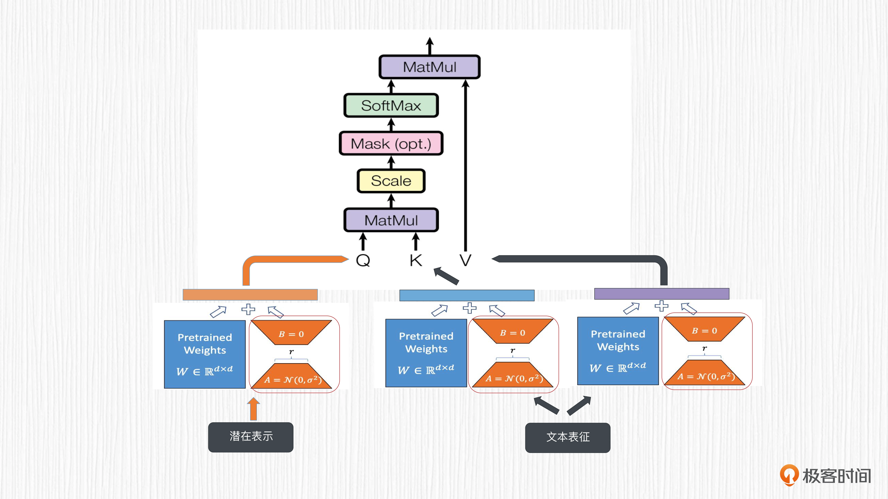

W 原始投影矩阵的权重，维度是 dxd。根据我们预先设置矩阵的秩 r，我们可以得到随机初始化的权重矩阵 A 和权重矩阵 B，把它们作为要训练的 LoRA 模型，维度分别是 dxr 和 rxd。

在训练过程中，W 保持固定，要优化的部分是矩阵 A 和矩阵 B。如果 X 作为输入，Y 作为模型输出，使用 LoRA 的情况下，计算过程大致是后面这个公式。

## Y = （W + A ⋅B）⋅X

在 UNet 模型中，有几十处这样的注意力模块投影矩阵，我们需要逐一优化对应数量的权重矩阵 A 和权重矩阵 B。当 LoRA 模型训练完成后，我们只需要保存这里的几十处 LoRA 权重即可，这些权重参数一般只占用几十 M 的存储空间。

如果前面的公式推理你暂时没法理解也不要紧，你只需要记住：训练 LoRA 的过程仍旧是更新 UNet 模块，只不过代码中注意力模块的投影层权重会保持不变，更新的是对应的 LoRA 模型权重。

### LoRA 权重作用

了解了 LoRA 的训练，我们再来看看 LoRA 模型使用时候的技巧。你也许还记得，在 WebUI中，我们会给 LoRA 模型设置一个权重值，比如 0.7。这个权重值会直接决定 LoRA 模型发挥作用的强弱，你可以参考后面截图，红框里就是这个参数的位置。

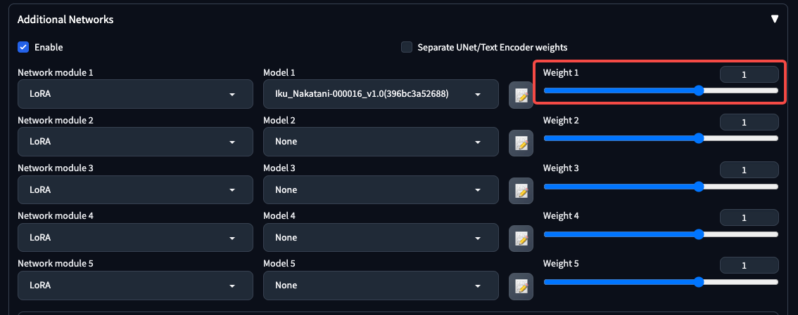

那么，这个参数是如何起作用的呢？我们来看下面的公式。公式中的 weight 就是 LoRA 与基础模型组合时的权重（比如前面 WebUI 截图红框中的 1），A 和 B 代表的是 LoRA 模型的权重参数。

## Y = （W + weight ∗A ⋅B）⋅X

如果我们同时使用多个模型，本质上就是下面这种计算方式。

## Y = （W + weight

- ​ ∗​ ⋅​ +​ ∗​ ⋅​ +​ ∗​ ⋅​）⋅

## A

- 1 B

## weight

## A

- 2 B

## weight

## A

- n B

## X

- 1122nn

这样一来，你是否就了解了多个 LoRA 组合的算法原理了呢？比方说，三个 LoRA 同时用，就相当于模型要听“三个上司”的话，每个上司都会影响输出结果 Y，很可能这些影响会相互干扰。

没错，我们实际操作时，如果发现多个 LoRA 混用生成的图像效果并不好，其实是因为各个LoRA 模型的权重值都被加到了基础模型上，导致最终 AI 绘画模型参数有点“四不像”。

## 代码实战

搞懂了上面的知识，我们这就来来实战演练一下，开始 LoRA 训练任务。GitHub 上有不少LoRA 训练的代码仓，比如 diffusers 的 LoRA 训练代码量较少，阅读起来压力小，适合初学者作为参考。

### 一次完整的训练

使用这个代码仓的训练也非常简单，但需要你拥有独立的 GPU 环境。没有独立 GPU 的同学也不用担心，我后面会讲解怎么用 Colab 完成训练。

首先，你需要先在你的命令行环境下，登录 Hugging Face 账号，保证你的代码能够访问到Hugging Face 服务器上的数据和基础模型。

```
huggingface-cli login
# 密码在你的Hugging Face账号Setting页面获取
```

然后你只需要将上面的训练代码拷贝到你的机器上，然后创建一个 run.sh 文件，写下后面的启动指令。

```bash
export MODEL_NAME="CompVis/stable-diffusion-v1-4"
export DATASET_NAME="lambdalabs/pokemon-blip-captions"
accelerate launch --mixed_precision="fp16" train_text_to_image_lora.py \
 --pretrained_model_name_or_path=$MODEL_NAME \
 --dataset_name=$DATASET_NAME --caption_column="text" \
 --resolution=512 --random_flip \
 --train_batch_size=1 \
 --num_train_epochs=10 --checkpointing_steps=5000 \
 --learning_rate=1e-04 --lr_scheduler="constant" --lr_warmup_steps=0 \
 --seed=42 \
 --output_dir="sd-pokemon-model-lora" \
 --validation_prompt="cute dragon creature"
```

然后我们运行这个启动脚本，便可以完成宝可梦的 LoRA 模型训练。

```bash
sh run.sh
```

需要注意，上面启动脚本中的基础模型是 SD1.4，你可以在 Hugging Face 中获取其他基础模型的 model_id 进行替换。比如可以通过一行代码，把基础模型替换为 Anything V5 模型。

```bash
export MODEL_NAME= "stablediffusionapi/anything-v5"
```

耐心等待 20 分钟（这里使用的是 A100 资源 + 预先下载的模型，不同 GPU 会有差异），我们就完成了 LoRA 模型的训练。

接着，我们不妨使用我们训练好 LoRA 生成图片，看看效果如何。你可以参考后面的代码完成这一步。第七行代码的 prompt 你可以按自己的想法灵活更换。

```python
from diffusers import StableDiffusionPipeline
import torch
model_path = "你的LoRA路径/sd-model-finetuned-lora-t4"
pipe = StableDiffusionPipeline.from_pretrained("stablediffusionapi/anything-v5",
pipe.unet.load_attn_procs(model_path)
pipe.to("cuda")
prompt = "A pokemon with green eyes and red legs."
# prompt = "Girl with a pearl earring"
image = pipe(prompt, num_inference_steps=30, guidance_scale=7.5).images[0]
image.save("pokemon.png")
```

现在，你可以点开图片查看我们 LoRA 模型的生成效果，可以看到，我们的 LoRA 模型学到了宝可梦风格的“精髓之处”，图片的配色和线条都和宝可梦风格相似。

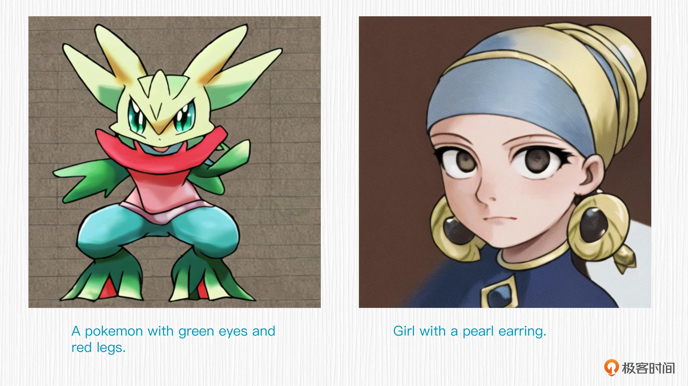

### 推荐一个 Colab

除了 diffusers 官方的 LoRA 实现，GitHub 上有一些效果更好的 LoRA 实现。这里我推荐一个可调参数更多的 Colab 链接。根据我们这一讲要完成的 LoRA 任务，我对原始的 Colab 进行了一些定制化的改造。

宝可梦风格的 LoRA 训练任务，你可以点开这个 Colab 链接做练习。

而彩铅风格的 LoRA 训练任务，你可以点开这个Colab 链接来练习。在彩铅风格的 Colab 代码中，我们会使用 BLIP 模型给每一张图片生成 prompt。

为了方便你体验效果，在配置好 Colab 的 GPU 环境后，你可以直接点击全部运行，这样就能“一键”完成 LoRA 的训练。

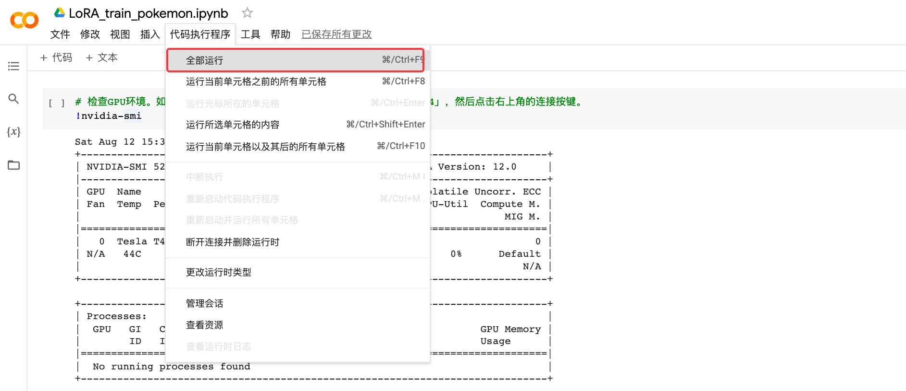

耐心等待 LoRA 训练完成后，我们便可以看到 LoRA 模型的生成效果。以宝可梦的效果为例，能直观的感受到，在相同的测试 prompt 下，我们 Colab 的生成效果要优于使用 diffusers 代码仓的训练效果。

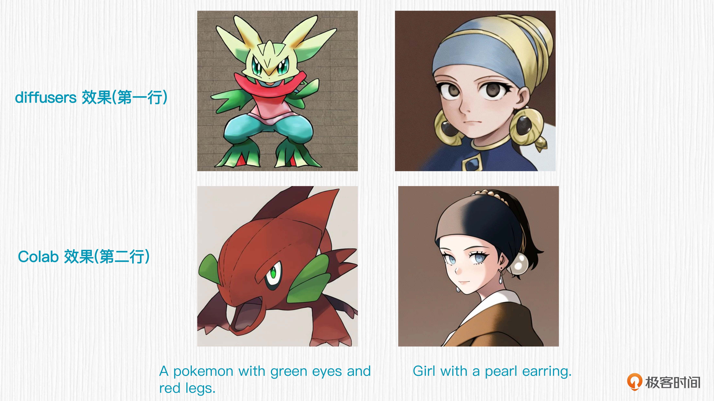

这里我们用到的 prompt 信息如下。

```
Prompt：A pokemon with green eyes and red legs
Prompt：Girl with a pearl earring
Negative Prompt：lowres, bad anatomy, bad hands, text, error, missing fingers, ex
采样器：Eular a
随机种子：1025
采样步数：20
分辨率：512x512
CFG Scale: 7
LoRA：pokemon.safetensors [使用Colab训练]
LoRA weight：1.0
```

我们可以再感受下彩铅 LoRA 的效果。从后面两张的图片可以看出，我们的 LoRA 模型学到了一种 “2D 感” 的铅笔画风格。

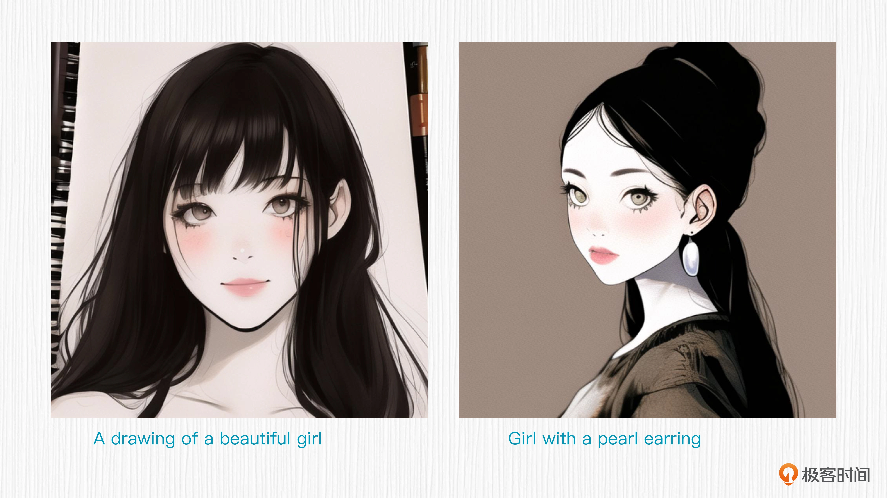

这里这里我们用到的 prompt 信息如下。

```
Prompt：A drawing of a beautiful girl
Prompt：Girl with a pearl earring
Negative Prompt：lowres, bad anatomy, bad hands, text, error, missing fingers, ex
采样器：Eular a
随机种子：1025
采样步数：20
分辨率：512x512
CFG Scale: 7
LoRA：pencil.safetensors [使用Colab训练]
LoRA weight：1.0
```

以彩铅风格为例，我在 Colab 代码中为你增加了一些注释，来辅助你理解每个模块都负责做哪些事情，建议你课后阅读一下。如果你需要更换自己的训练数据，只需要替换掉代码中的训练图像拷贝部分即可。

```
# 将我们的训练数据拷贝到训练路径下
# 如果你需要使用自己准备的图片，需要将你的数据拷贝到
# /content/LoRA/train_data/custom_data路径下
os.system("cp -r /content/caiqian_style/* /content/LoRA/train_data/custom_data")
```

## 配合 WebUI 使用

搞定了 LoRA 模型的训练，咱们再把它加入到 WebUI 上试试效果。

我们可以将训练得到的 LoRA 模型下载到本地，放在 WebUI 的 LoRA 文件夹中，然后就可以在 WebUI 直接使用我们刚刚训练的 LoRA 模型了。

```
# LoRA模型放置路径为：
/你的WebUI安装路径/extensions/sd-webui-additional-networks/models/lora
```

把模型放到相应位置后，别忘了刷新 WebUI 的 LoRA 模型库，加载我们刚刚放置的 LoRA 模型。

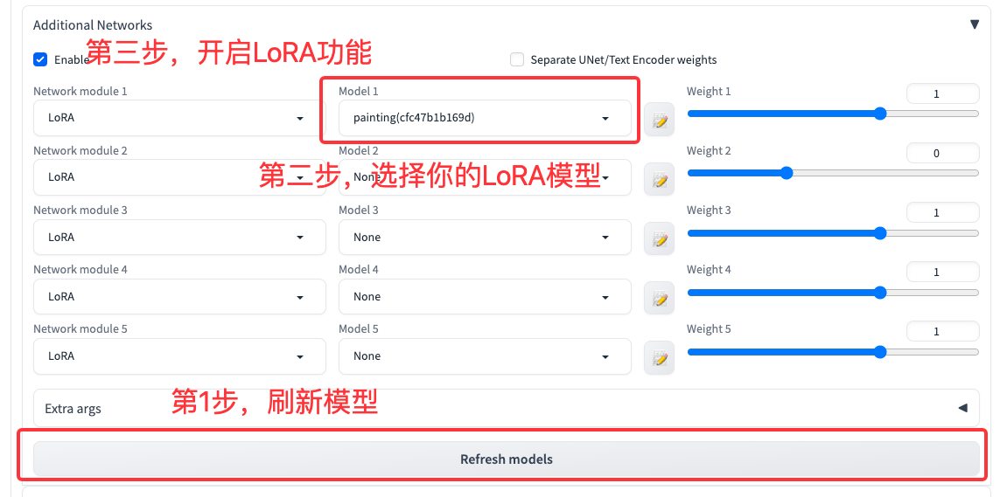

一切准备完毕，我们这就来测试下 WebUI 的使用效果，可以使用下面这组 prompt 来测试宝可梦模型。

```
Prompt：A pokemon with red eyes, big ears
Negative Prompt：lowres, bad anatomy, bad hands, text, error, missing fingers, ex
采样器：Eular a
随机种子：1025
采样步数：20
分辨率：512x512
CFG Scale: 7
LoRA：pokemon.safetensors [使用Colab训练]
LoRA weight：1.0
```

后面的图片就是对应的生成结果，一只有点模糊的“宝可梦”呈现在我们眼前。

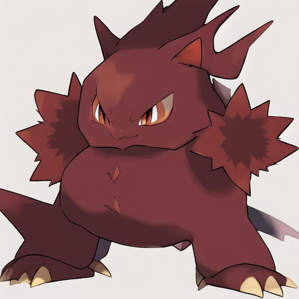

效果还可以，但清晰度不够。这时我们可以利用 WebUI 的超分模块，得到更高清的图片。你可以点开图片查看超分后的宝可梦精灵效果。

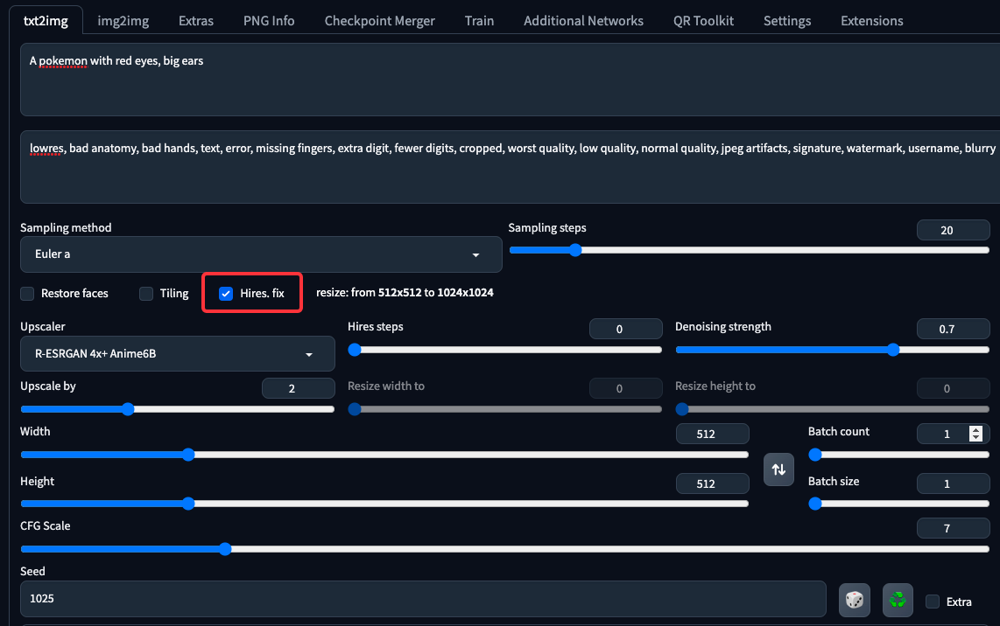

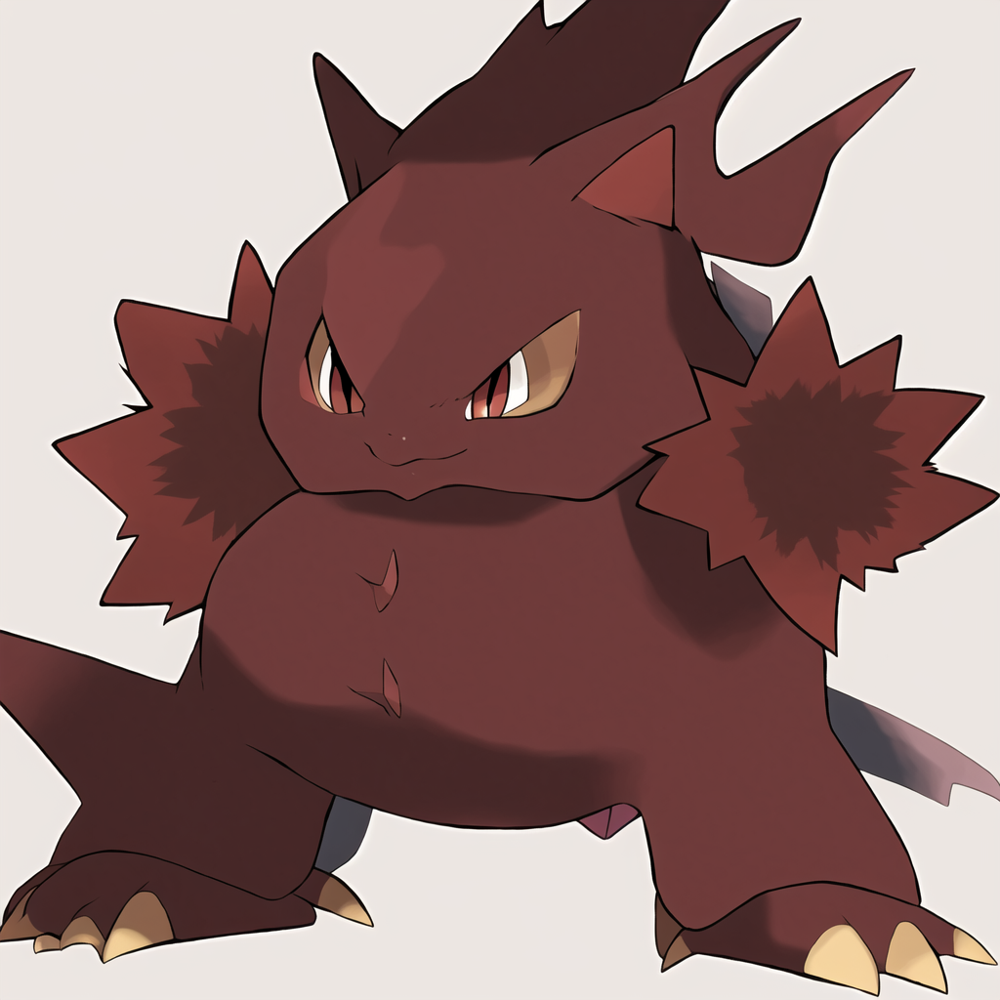

- 重绘强度 0.3，超分后图像效果

到此为止，我们已经走通了准备训练数据、图像 prompt 生成、基础模型选择、LoRA 训练、LoRA 本地使用、超分功能修复生成效果的完整流程。

关于 LoRA 模型，我们还可以做两个有意思的效果测试。第一个测试是将我们得到的两个LoRA 模型组合使用。你可以在 WebUI 中按照图中的方式进行操作。

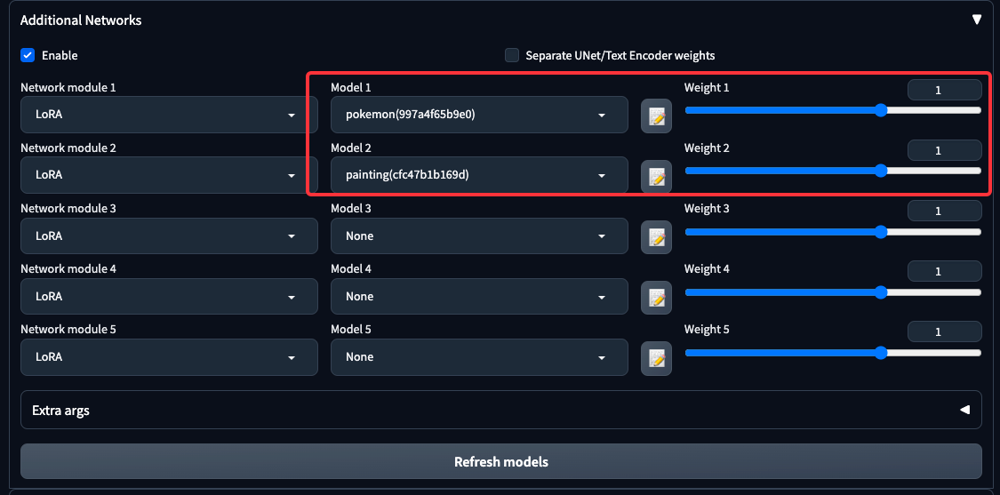

我们使用后面的 prompt 信息进行测试。

```
prompt: A pokemon with red eyes, big ears
prompt: a drawing of a beautiful girl
Negative Prompt：lowres, bad anatomy, bad hands, text, error, missing fingers, ex
采样器：Eular a
随机种子：1025
采样步数：20
分辨率：512x512
CFG Scale: 7
```

得到的效果是下面这个样子。可以看到，左面的宝可梦同时带上了彩铅的风格，右面的女孩子带上了宝可梦的“画风”。通过不同的 LoRA 权重配比，我们就能“调制出”我们心仪的风格。

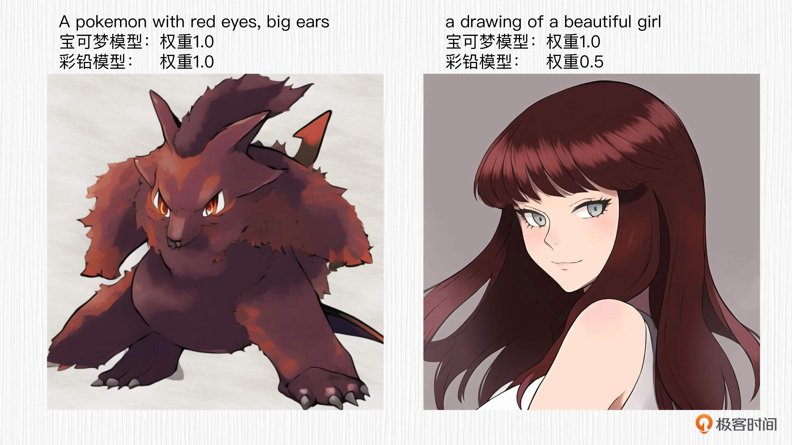

第二个测试是将 LoRA 与其他基础模型搭配使用。比如我们训练宝可梦 LoRA 和彩铅风格LoRA 的基础模型是 Anything V5，我们可以试试将这两个 LoRA 与 Realistic V3.0 模型搭配使用。你可以点开图片查看结果，可以看到，生成效果并不符合我们预期的风格。这个测试说明，LoRA 模型与其他基础模型搭配使用时需要谨慎处理。

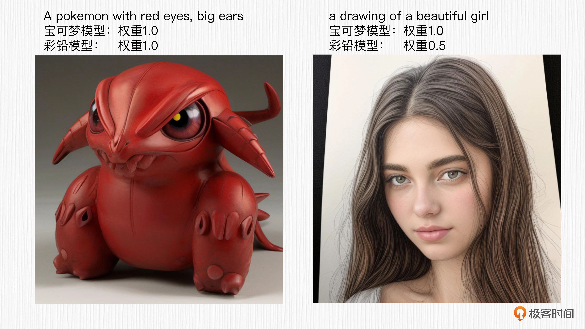

其实我们常用的各种基础模型，通常都是基于各种 SD 模型微调来的，有的模型甚至是基于微调后的模型再次微调。因此，我们可以将这些基础模型想象成一个大家族，不同模型之间存在一定的亲缘关系。也正是因为这个原因，我们训练得到的 LoRA 模型，和亲缘关系近的基础模型组合往往更容易实现预期的效果。

## 总结时刻

今天我们通过实战的形式加深了对 LoRA 模型的认识。我们从零到一，完成了宝可梦 LoRA 和彩铅 LoRA 两个模型的训练。

训练 LoRA 有两个基本前提：图文数据和基础模型。对于图文数据，我们可以从 HuggingFace 上直接获取，也可以用 BLIP 模型对我们自己的数据进行 prompt 打标。而基础模型，我们可以从 Hugging Face 或者 Civitai 上按需选择。

之后我们分析了在 SD 模型中 LoRA 权重的作用位置，也就是 UNet 模型的注意力模块，并进一步了解了 LoRA 权重的作用机理。然后，我们分别使用 diffusers 官方 LoRA 代码仓和一个改造后的 Colab，完成了我们的 LoRA 训练任务。这部分的重点是理解 Colab 中的 LoRA 代码实现。

最后，我们将训练得到的 LoRA 模型导入 WebUI，完成了图像生成、图像超分、多 LoRA 组合、更换基础模型测试等任务。建议你课后自己多练习，也可以将自己训练的 LoRA 模型发布到开源社区，供其他朋友体验和分享，这样学习效果会更好。

这一讲的重点，你可以点开下面的导图复习回顾。

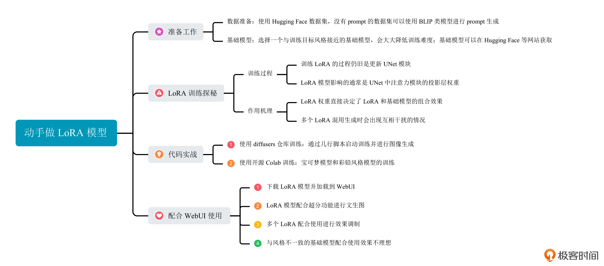

## 思考题

选择你一个你喜欢的物体或者一种你喜欢的风格，使用 diffusers 代码仓或者我们的 Colab 链接，完成你自己的 LoRA 模型训练。

期待你在留言区和我交流讨论，也推荐你把今天的内容分享给身边更多朋友，和他一起尝试训练 LoRA 模型。
