# 21 | 实战项目（四）：用ControlNet给你的创意上色

你好，我是南柯。

上一讲我们已经学习了 ControlNet 的算法原理，也了解了它在 AI 绘画中强大的控制能力。今天我们一起来完成 ControlNet 的实战任务。

在这一讲中，我们将通过写代码的方式使用 ControlNet，一起完成后面这三个任务。

1. 认识官方已经发布的 ControlNet 模型以及社区传播的第三方 ControlNet 模型。

2. 实现 ControlNet 论文中的控图生成任务，掌握 ControlNet 的基础能力。

3. 探索 ControlNet 的趣味生成功能，包括图像风格化、二维码生成、创意文字和线稿上色。

掌握了这些技巧，你也一定能够发挥创意，做出很多结构鲜明的作品。让我们开始吧！

## 模型获取

在 Hugging Face 上，我们不光可以获取到海量 AI 绘画基础模型，还能找到各种开发者训练的 ControlNet 模型。正式使用之前，我们先来认识下这些模型。

### 官方发布的模型

首先是 ControlNet 论文作者在 ControlNet1.0 和 1.1 中发布的 22 个模型。

ControlNet1.0 的 8 个模型可以通过后面这个 Hugging Face 链接获取。我们可以看到ControlNet1.0 各个模型的命名规则，以第一行的 “control_sd15_canny.pth” 为例，sd15 表示用于训练这个 ControlNet 的基础模型是 SD1.5，Canny 便是 ControlNet 的控制条件是 Canny算子，也就是提取原始图像的边缘。

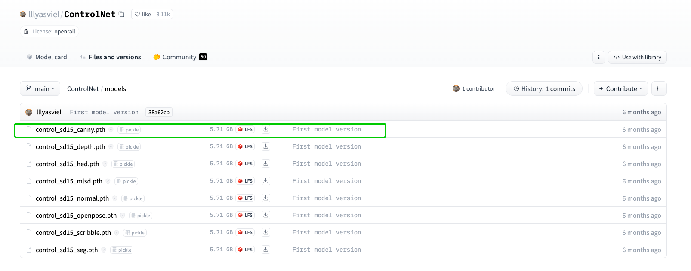

关于前面图中的八个控制条件，我们依次认识下。

首先来看 Canny 条件，它使用图像处理的 Canny 算子来提取图像的边缘信息，可以用于通用物体的可控生成。

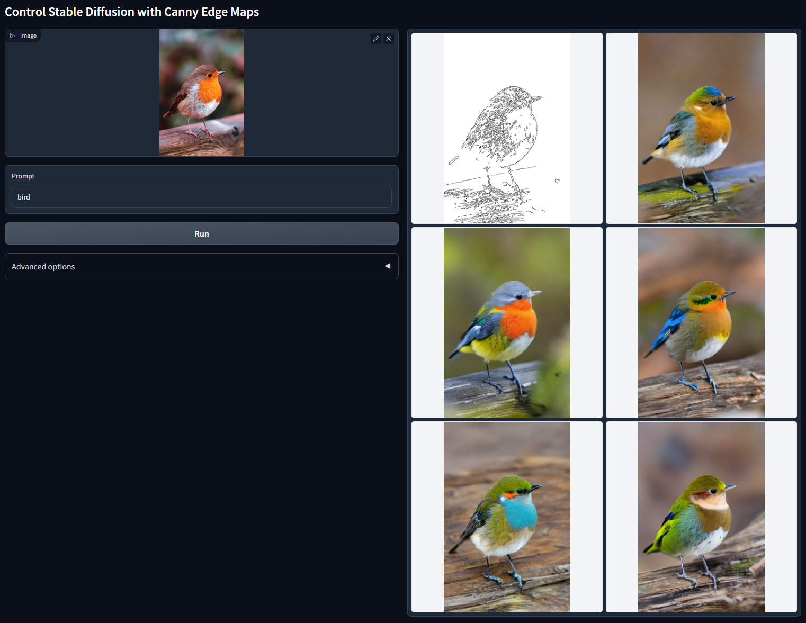

- 图片来源：https://github.com/lllyasviel/ControlNet

接下来是 HED 条件。如果说前面提到的 Canny 算子是一种经典的、“上古的”边缘检测算法，HED 则是一种基于深度学习方案的“现代化”边缘检测算法。HED 条件可以看成 Canny 条件的升级版，适用于更复杂场景的精细化边缘提取。

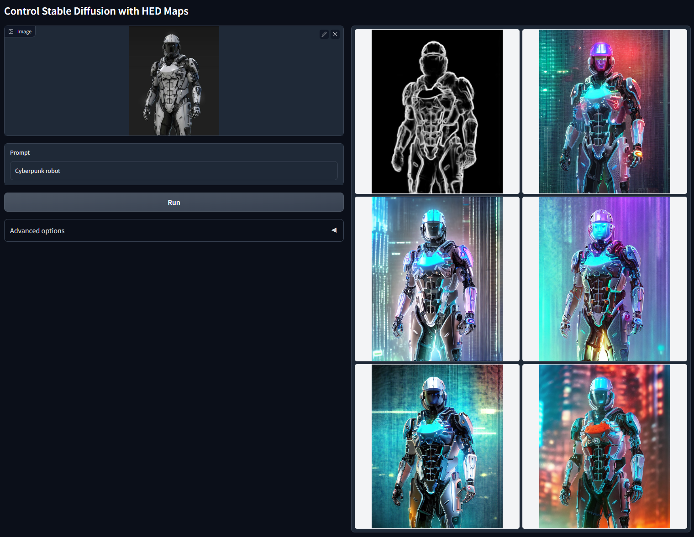

- 图片来源：https://github.com/lllyasviel/ControlNet

下一个是 MLSD 条件，它使用 M-LSD 算法 提取图像的直线轮廓，可以用于各种建筑图像和室内装饰场景的可控生成。

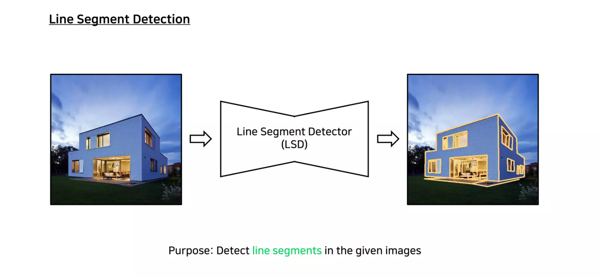

- 图片来源：https://www.slideshare.net/ByungSooKo1/towards-lightweight-and-realtime-line-Segment-detection

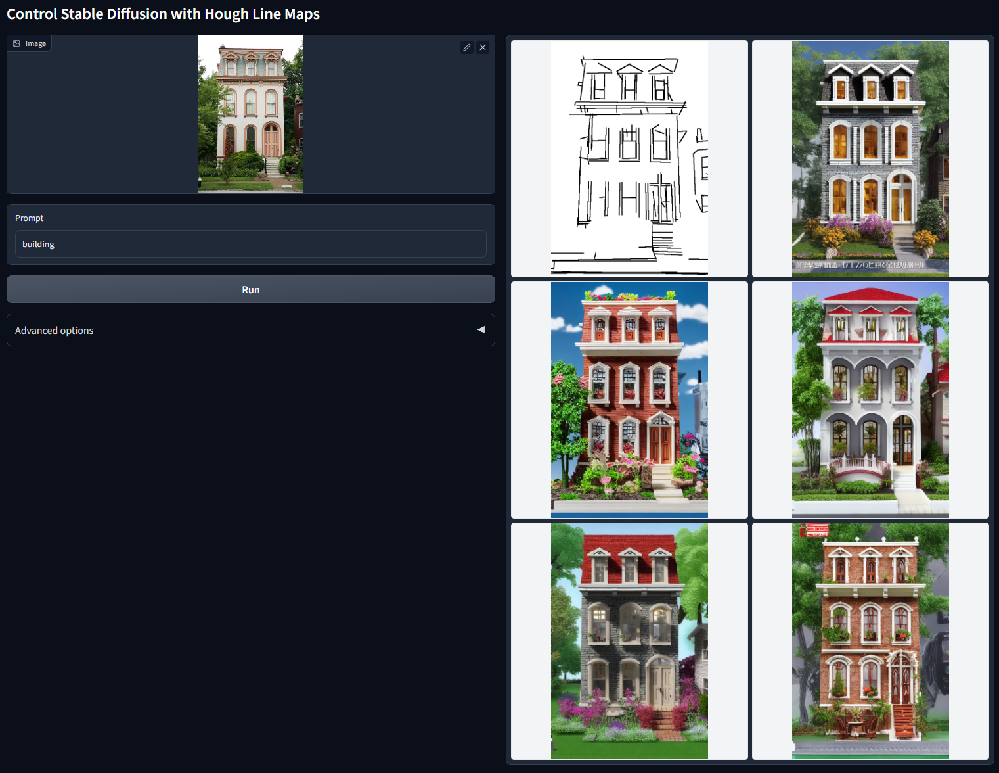

- 图片来源：https://github.com/lllyasviel/ControlNet

接下来要说的是 Scribble 条件，能根据我们的随手涂鸦生成图像。这也是我个人最喜欢的控制条件，简单几笔就能生成出丰富的细节。

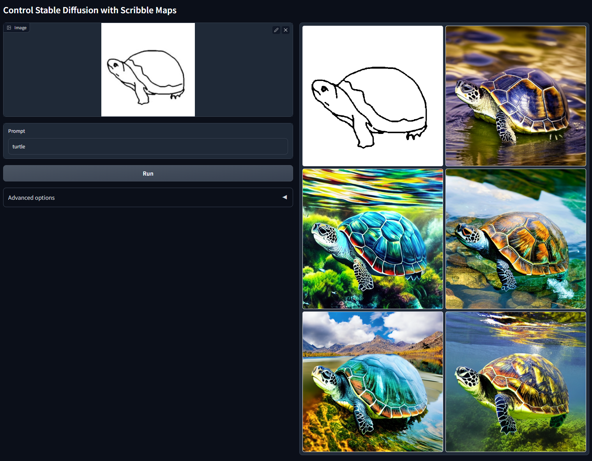

- 图片来源：https://github.com/lllyasviel/ControlNet

下一个是 Normal 条件，Normal 代表图像的法线，也就是与图像中物体表面切平面垂直的向量，通常用红、绿、蓝三个通道来表示法线向量在 X、Y 和 Z 方向的分量。从后面这个例子可以看出，Normal 条件能够帮我们从 2D 图像中推断出 3D 几何信息，用于 ControlNet 的图像生成任务上。

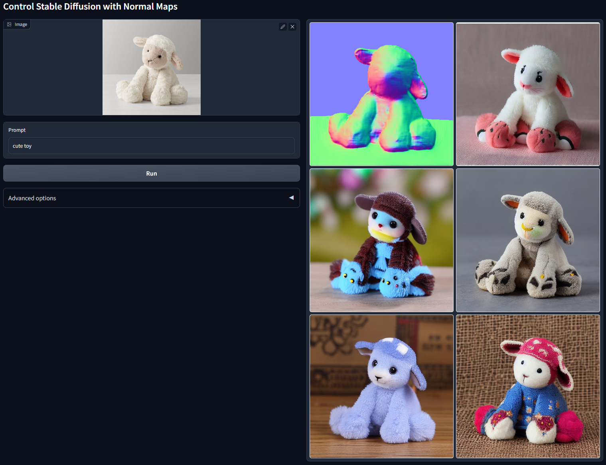

- 图片来源：https://github.com/lllyasviel/ControlNet

接着是 Depth 条件。图像的 Depth 指的是图像的深度信息，可以理解为图像中每个像素距离我们的远近。和 Normal 条件一样，Depth 条件也是包含 3D 信息的控制条件。

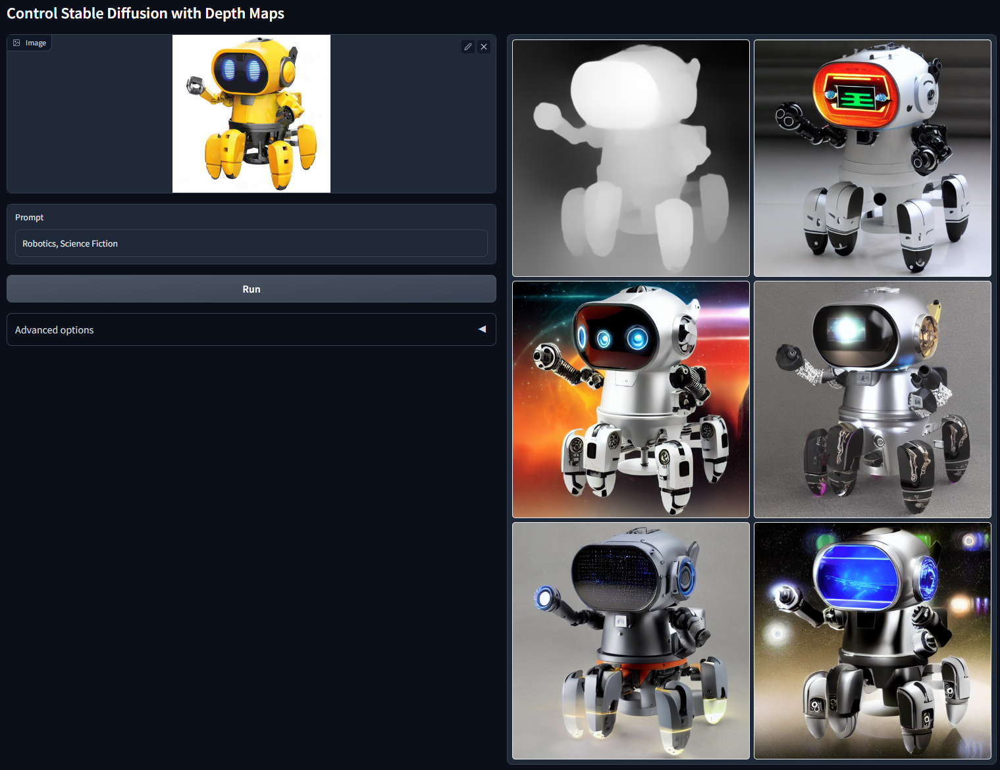

- 图片来源：https://github.com/lllyasviel/ControlNet

接下来是 OpenPose 条件，它的思路是使用人体关键点算法提取肢体关键点，使用关键点的连线图作为控制条件。OpenPose 条件经常用在通过 ControlNet 做换装的任务上。

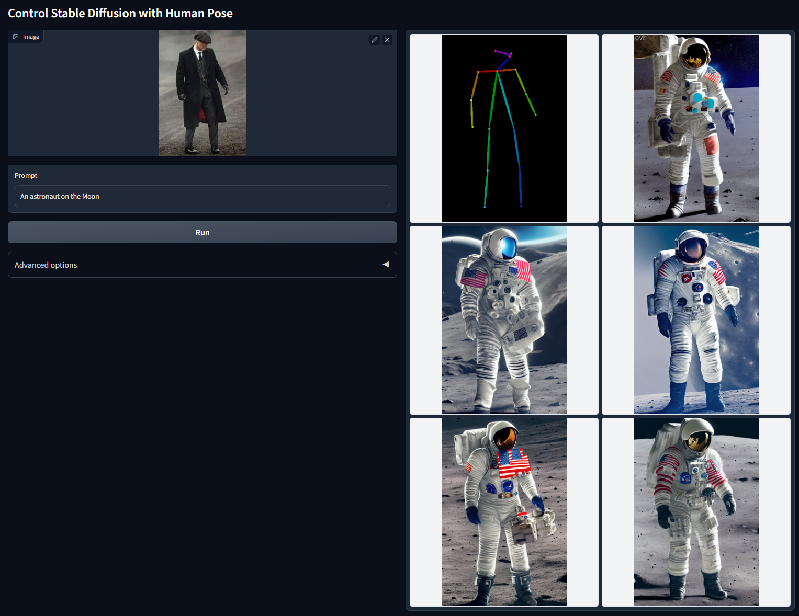

- 图片来源：https://github.com/lllyasviel/ControlNet

最后一个模型是 Seg 条件，作用是使用图像分割算法对原图进行分割处理，将分割的结果用作控制条件。

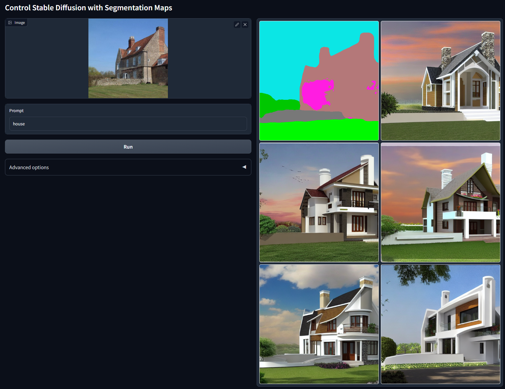

说完了 ControlNet1.0 的 8 个模型，我们再来看看 ControlNet1.1 的 14 个模型。这些模型可以通过后面的 Hugging Face 链接获取。除了 1.0 中的 8 个控制条件，1.1 中新增了指令级修图、Tile 功能等能力，这些知识我们在上一讲中已经学过了。

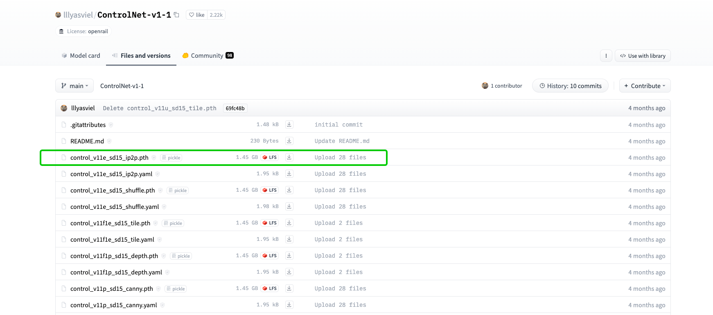

ControlNet 1.1 模型的命名做出了规范，避免和 1.0 版产生混淆。

具体来说，可以看后面这张图，模型名称中的四个部分分别代表项目名、模型版本号、基础模型、控制方式。在模型版本号部分，你需要关注质量标签部分 p、e、u 三个字母的不同含义。p 表示正式版（product-ready），e 表示测试版（experimental），u 表示未完成版（unfinished）。有时候我们还会看到 f 这个质量标签，它表示修复版（fixed）。

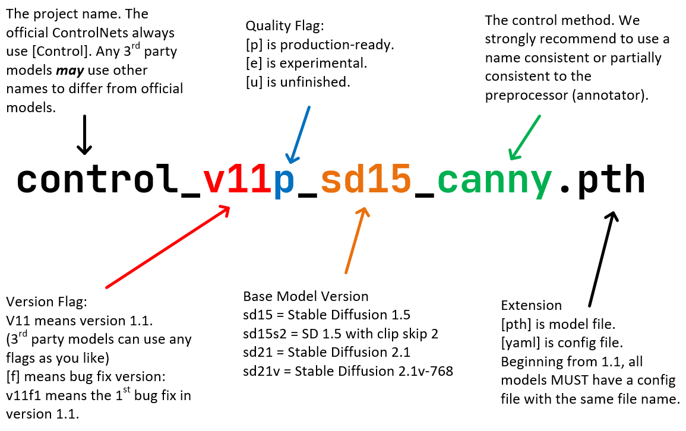

- 图片来源：https://github.com/lllyasviel/ControlNet-v1-1-nightly

值得一提的是，随着 SDXL 的大火，有很多针对 SDXL 训练的 ControlNet 模型也逐渐流行。稍后的代码实战中，我们就会用到基于 SDXL 的 ControlNet 模型。

### 有趣的第三方模型

除了上面的官方模型，开源社区中也涌现了很多有意思的模型。

Civitai 社区中的 QR Code Monster 模型可以用于生成创意二维码。具体来说，我们使用Canny 或者 HED 等边缘检测算法提取原始二维码的边缘，用作 ControlNet 的控制条件，然后写一个 prompt 进行创意二维码的生成。

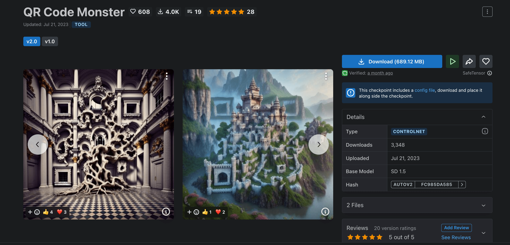

- 图片来源：https://civitai.com/models/111006/qr-code-monster

Hugging Face 中实现类似二维码功能的模型还有很多，比如我们稍后实战用的 qr-pattern-v2 模型，可以先感受下它的二维码效果。

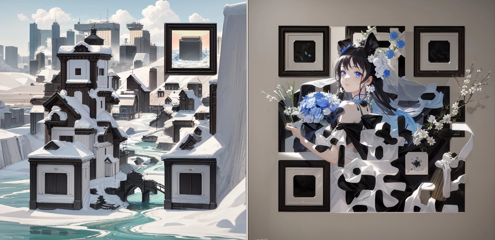

- 图片来源：https://huggingface.co/Nacholmo/controlnet-qr-pattern-v2

另一个要推荐的 ControlNet 模型专门用于控制表情生成。通过提取人脸的关键点信息，并把这些信息用作控制条件，配合 prompt 就可以生成各种有意思的效果。

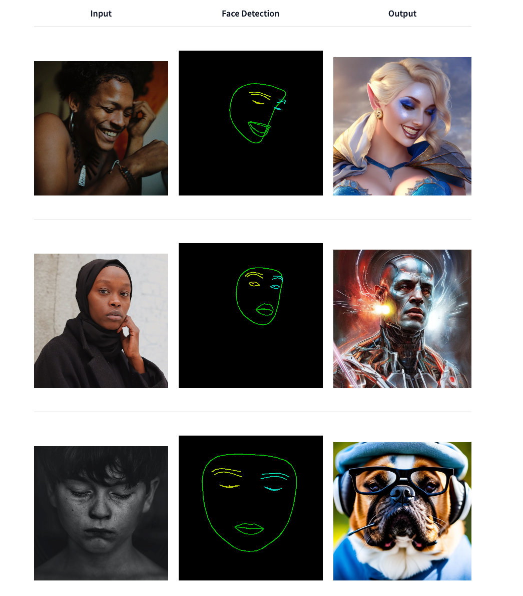

- 图片来源：https://huggingface.co/CrucibleAI/ControlNetMediaPipeFace

你可以点开这个链接，获取更多开源社区的 ControlNet 模型。

## 经典技能

了解了如何获取模型，现在我们可以使用这些模型完成 AI 绘画任务了。你可以点开我的Colab 链接，和我一起感受 ControlNet 的各种趣味技能。

我们使用蒙娜丽莎作为输入图片，使用 ControlNet 的 Canny 控制条件进行 AI 绘画。

```python
# 导入需要使用的库
import cv2              # OpenCV库，用于图像处理
from PIL import Image   # PIL库中的Image模块，用于图像读取和处理
import numpy as np      # NumPy库，用于数组和矩阵等的运算
from diffusers import StableDiffusionControlNetPipeline
from diffusers.utils import load_image
# 使用蒙娜丽莎的图片用作原始图片提取Canny轮廓。你也可以替换为你自己的图片链接；或者上传本地图片到
image = load_image(
   "https://ice.frostsky.com/2023/08/26/2c809fbfcb030dd8a97af3759f37ee29.png"
)
# 转化图像为NumPy类型的数组（矩阵），方便后续操作
image = np.array(image)
# 设置Canny边缘检测算法的低阈值和高阈值
low_threshold = 100
high_threshold = 200
# 使用Canny算法进行边缘检测。图像中灰度超过阈值的点，OpenCV会标记为边缘点
image = cv2.Canny(image, low_threshold, high_threshold)
# 因为Canny边缘检测后的输出是二维的，所以在第三维增加一个维度，以便转化为RGB图像
image = image[:, :, None]
# 将单通道图像复制三次，生成三通道(RGB)图像
image = np.concatenate([image, image, image], axis=2)
# 使用PIL库中的Image模块, 将NumPy的array类型转化为Image类型，方便后续图像保存与显示等操作
Canny_image = Image.fromarray(image)
```

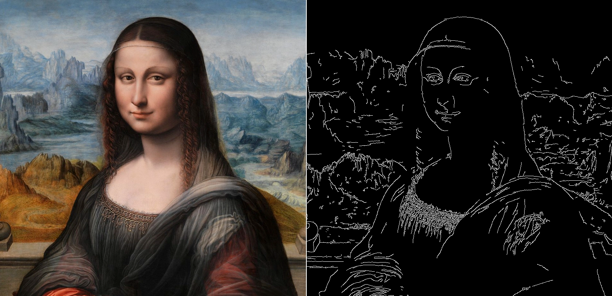

然后依次加载 SDXL 模型和 Canny 控制条件对应的 ControlNet 模型。

```
controlnet = ControlNetModel.from_pretrained(
   "diffusers/controlnet-Canny-sdxl-1.0-small",
   torch_dtype=torch.float16
)
vae = AutoencoderKL.from_pretrained("madebyollin/sdxl-vae-fp16-fix", torch_dtype=
pipe = StableDiffusionXLControlNetPipeline.from_pretrained(
   "stabilityai/stable-diffusion-xl-base-1.0",
   controlnet=controlnet,
   vae=vae,
   torch_dtype=torch.float16,
)
```

之后，我们就可以使用蒙娜丽莎的 Canny 边缘轮廓，通过 prompt 引导模型生成不同的人像效果。你可以修改代码中的 prompt 描述，生成更多趣味效果。

```
# 可以替换你的prompt
prompt = ["a photo of a girl, best quality, super photorealistic"]*2
generator = torch.manual_seed(1024)
# 使用ControlNet完成AI绘画
controlnet_conditioning_scale = 0.6
images = pipe(
   prompt, num_inference_steps=50, negative_prompt=["monochrome, lowres, bad ana
   image=Canny_image, controlnet_conditioning_scale=controlnet_conditioning_scal
).images
image_grid(images, 1, 2)
```

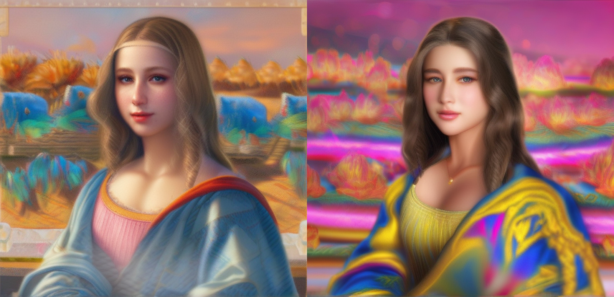

体验完 Canny 控制的强大，现在我们再来动手完成基于 OpenPose 条件的 ControlNet 绘画过程。想要使用 OpenPose 控制，我们首先需要提取原始图片的肢体关键点，代码是后面这样。

```python
from controlnet_aux import OpenPoseDetector
from PIL import Image
# 加载OpenPose提取模型
model = OpenPoseDetector.from_pretrained("lllyasviel/ControlNet")
# 提取肢体姿态
image = load_image(
   "https://huggingface.co/datasets/huggingface/documentation-images/resolve/mai
)
pose = model(image)
```

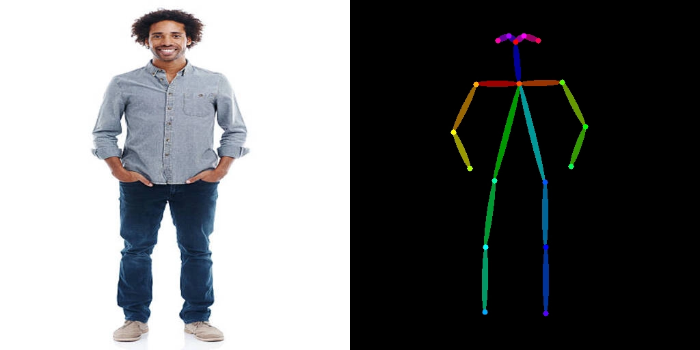

之后，我们依次加载 SDXL 模型和 OpenPose 条件的 ControlNet 模型，使用 prompt 要求模型根据原始图片的姿态，生成一组星球大战维德的形象效果。

```
# 加载ControlNet-OpenPose
controlnet = ControlNetModel.from_pretrained("thibaud/controlnet-OpenPose-sdxl-1.
pipe = StableDiffusionXLControlNetPipeline.from_pretrained(
   "stabilityai/stable-diffusion-xl-base-1.0", controlnet=controlnet, torch_dtyp
)
pipe.enable_model_cpu_offload()
# 可以更换为你想使用的prompt
prompt = "Darth vader dancing in a desert, high quality"
negative_prompt = "low quality, bad quality"
images = pipe(
   prompt,
   negative_prompt=negative_prompt,
   num_inference_steps=25,
   num_images_per_prompt=2,
   image=pose.resize((1024, 1024)),
   generator=torch.manual_seed(97),
).images
image_grid(images, 1, 2)
```

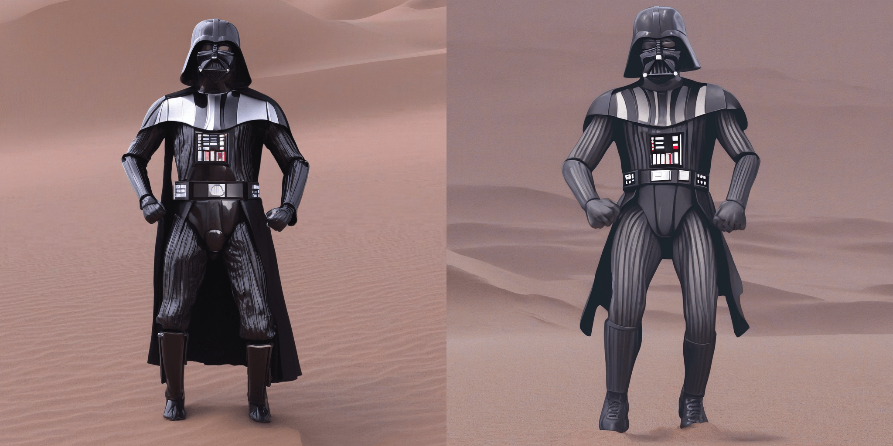

通过上面两个例子，相信你已经感受到了 ControlNet 功能的强大之处。也推荐你课后探索下更多控制条件的生成效果。

## 趣味玩法

事实上，除了 ControlNet1.0 和 1.1 官方仓库中提供的用途外，ControlNet 还可以帮助我们完成很多创意用法，比如图像风格化、二维码生成等等。我们逐一来进行代码实现。

### 图像风格化

在第 15 讲中，我们曾经探讨过，使用图生图来实现图像的风格化效果。具体做法就是通过重绘强度这个参数的控制，对输入图片加入少量步数的噪声，然后使用一个擅长生成风格图片的 SD 模型进行图片去噪。在 ControlNet 出现之前，大多数图片风格化效果都是采用类似这种方法实现的。

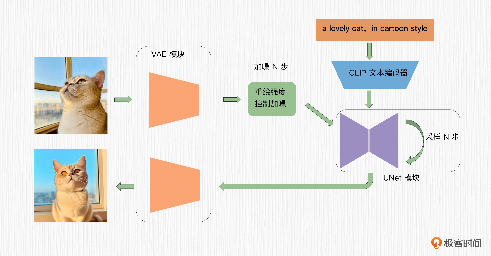

但是，这种风格化方法有一个缺陷，就是重绘强度这个参数的选择不好控制，可能要多次“抽卡”才能达到满意效果。如果重绘强度选择过小，最终生成的图片无法呈现目标风格效果。如果重绘强度选择过大，最终生成的图片就会丧失原始图片的构图，从而看不出与原图的关联。

ControlNet 的出现弥补了这个缺陷。我们只需要提取原始图片的构图信息，比如使用Canny、HED、Depth 等控制模块，便可以保证 AI 绘画效果与输入图片的构图一致。我们继续通过代码实现这个过程。你可以点开 Colab 进行操作。

```python
from diffusers import StableDiffusionControlNetPipeline, ControlNetModel
import torch
from transformers import pipeline
# 提取图像的Depth信息
image = load_image(
   "https://ice.frostsky.com/2023/08/19/7a93c14f96e2ea8b3a4b6911fff134a1.png"
)
Depth_estimator = pipeline('Depth-estimation')
image = Depth_estimator(image)['Depth']
image = np.array(image)
image = image[:, :, None]
image = np.concatenate([image, image, image], axis=2)
control_image = Image.fromarray(image)
# 加载ControlNet1.1的Depth模型
controlnet = ControlNetModel.from_pretrained("lllyasviel/control_v11f1p_sd15_Dept
pipeline = StableDiffusionControlNetPipeline.from_pretrained(
 "runwayml/stable-diffusion-v1-5", controlnet=controlnet
)
# 使用ControlNet完成风格化
prompt = ["a praying cat, cartoon style, best quality, (8k, best quality, masterp
generator = torch.manual_seed(0)
image = pipe(prompt, num_inference_steps=30, generator=generator, image=control_i
```

后面的图片里，前两张图片分别展示了原始输入、我们提取的 Depth 信息。第二行则是我们ControlNet 生成的效果。我们可以将文生图视作重绘强度为 1.0 的图生图，可以看到，利用ControlNet，我们可以在保持原有构图的前提下，将猫咪转换为卡通风格。

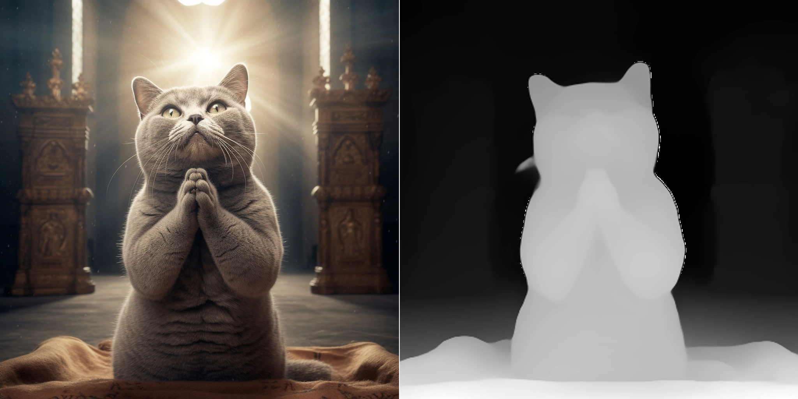

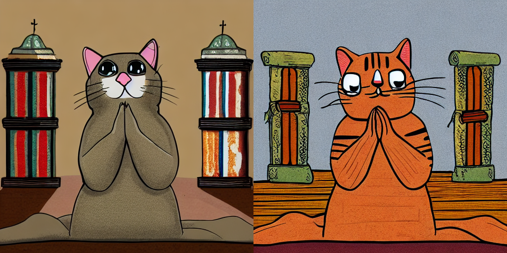

### 二维码

创意二维码生成是 ControlNet 非常亮眼的一个功能，比如我们这门课程的二维码，便是通过ControlNet 来设计的。

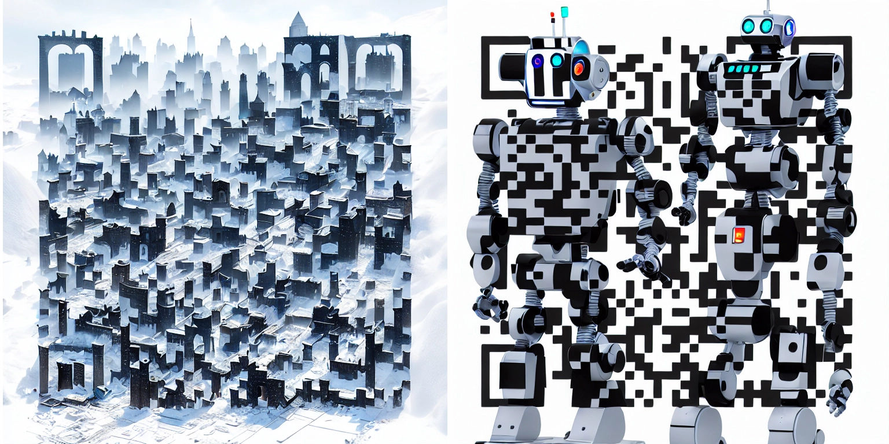

这样的二维码该如何设计呢？首先需要准备一个原始的二维码图像。比如对于我们的课程链接，我们可以任意选择一个二维码生成工具，生成一张二维码。比如这里我使用链接中的工具，生成了两款原始二维码。

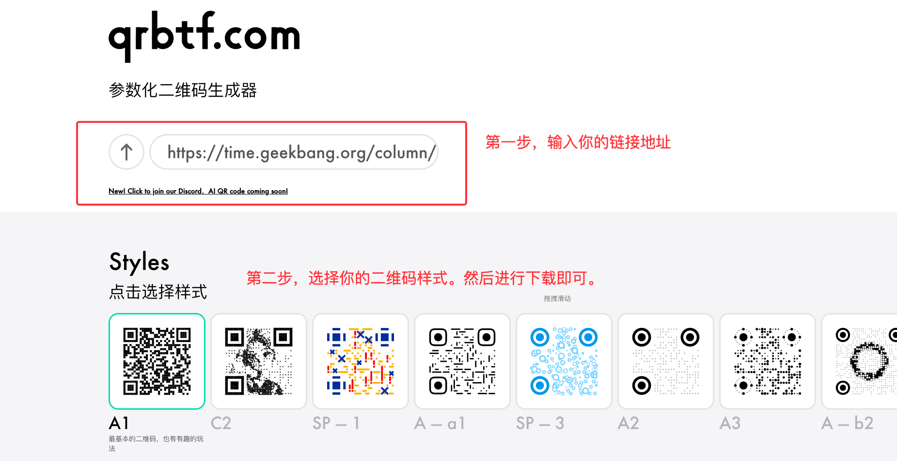


搞定了原始二维码，我们便可以用 ControlNet 来发挥我们的创造力了。你可以点开Colab链接和我一起操作。

首先加载生成二维码专用的 ControlNet 模型和对应的 SD1.5 基础模型。

```python
from diffusers import ControlNetModel, StableDiffusionControlNetPipeline
# 加载二维码生成对应的ControlNet模型
controlnet = ControlNetModel.from_pretrained("Nacholmo/controlnet-qr-pattern-v2")
pipeline = StableDiffusionControlNetPipeline.from_pretrained(
 "runwayml/stable-diffusion-v1-5", controlnet=controlnet
)
```

然后，我们使用原始二维码图像作为输入条件，并提供一个 prompt 用于引导 AI 绘画的生成过程。比如后面的代码中，使用我们课程的二维码作为控制条件，目标是生成两张创意二维码，分别是机器人风格和丛林风格。

```
# 处理原始二维码图像，可以使用你的二维码链接，或者将本地二维码图片上传到Colab
# 这里我们将二维码图片上传到图床获取图片链接
init_image = load_image("https://ice.frostsky.com/2023/08/19/38705b43b70b00af8d1a
# 可以替换成你的prompt
prompt = ["robot costume, best quality, extremely detailed", "masterpiece, forest
generator = torch.Generator("cuda").manual_seed(1025)
# 生成二维码
output = pipeline(
   prompt,
   init_image,
   negative_prompt=["ugly, disfigured, low quality, blurry, nsfw"] * len(prompt)
   generator=generator,
   num_inference_steps=20,
)
```

如果你想上传自己手里的原始二维码，可以进入这个链接，参考后面的示意图上传二维码图片，然后复制 url 链接，替换到后面截图位置的代码里。

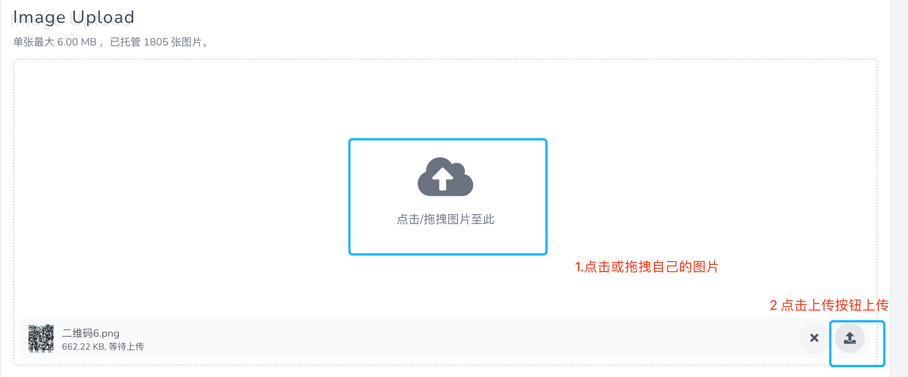

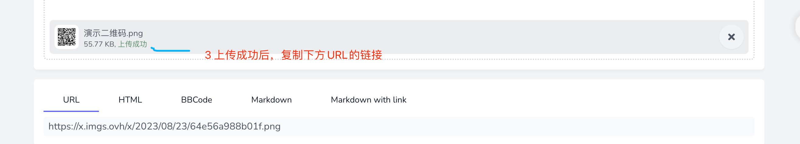

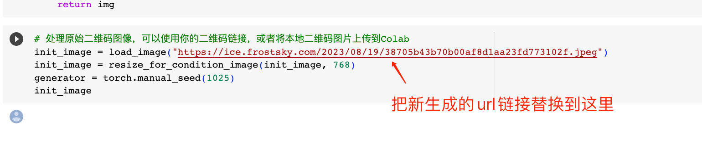

你可以点开图片查看我们生成的二维码效果，确认可以扫码成功便大功告成。

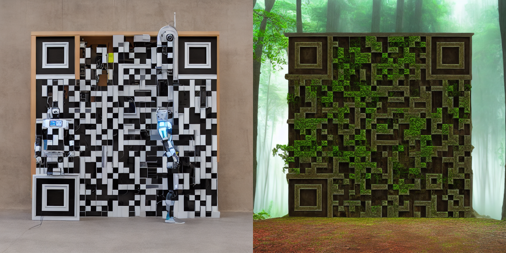

### 创意文字

与二维码类似，我们还可以在照片中写入我们希望的文字。比如我们希望实现一张写着“极客”的创意图片。

注意，我们要做的并不是全新的字体设计，而是用已有的字体来生成创意文字。比如我们可以在文档中选择“手札体”写下目标文字，然后截图保存。将这张图片上传到 Colab 或者图床后，我们便可以生成创意文字了。你可以点开 Colab 链接和我一起完成操作。

```
image = load_image(
   "https://ice.frostsky.com/2023/08/19/f9a6a52b210fb8dbc0fe347efbb22d9f.png"
)
# 将图像黑白颜色反转，得到的效果会更好
inverted_image = ImageOps.invert(image)
inverted_image
```

对于创意字体这个任务，我们要使用 Depth 控制条件的 ControlNet 模型。这是因为 Depth 条件中包含 3D 信息，用于指导生成有 3D 感的图片效果更好。

在提取 Depth 信息前，我们需要将图片黑白通道反转，实测下来效果会更好。然后，我们使用黑白通道反转的图片，来提取 Depth 控制信息。

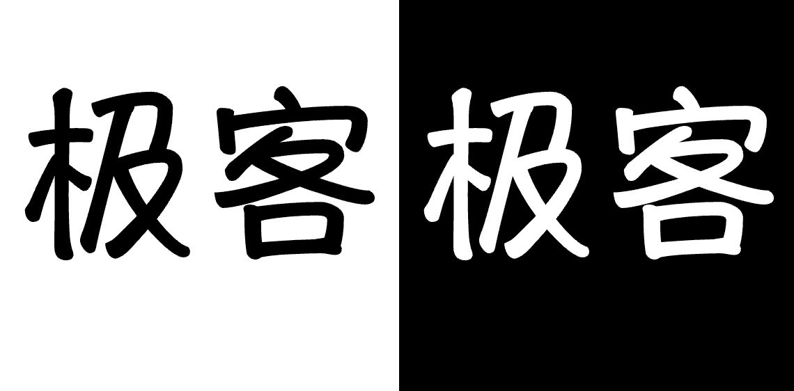

```
image = inverted_image
Depth_estimator = pipeline('Depth-estimation')
image = Depth_estimator(image)['Depth']
image = np.array(image)
image = image[:, :, None]
# 将单通道图像复制三次，生成三通道(RGB)图像
image = np.concatenate([image, image, image], axis=2)
control_image = Image.fromarray(image)
```

你可以点开后面的图片，查看我们得到的 Depth 控制条件。

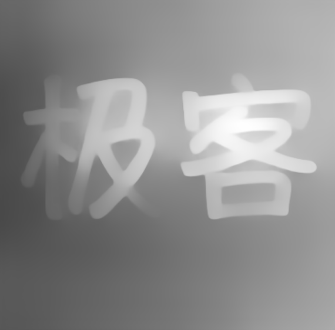

搞定了控制条件，我们就可以加载 ControlNet1.1 的 Depth 模型以及 SD1.5 基础模型，指定prompt 要求模型生成指定场景，比如树叶、白云等，完成我们的创意字体生成任务。

```
# 使用ControlNet1.1的Depth模型
checkpoint = "lllyasviel/control_v11f1p_sd15_Depth"
controlnet = ControlNetModel.from_pretrained(checkpoint, torch_dtype=torch.float1
pipe = StableDiffusionControlNetPipeline.from_pretrained(
   "runwayml/stable-diffusion-v1-5", controlnet=controlnet, torch_dtype=torch.fl
)
pipe.scHEDuler = UniPCMultistepScHEDuler.from_config(pipe.scHEDuler.config)
pipe.enable_model_cpu_offload()
generator = torch.manual_seed(0)
image = pipe(prompt, num_inference_steps=30, generator=generator, image=control_i
```

你可以点开图片查看生成效果。可以看到，图像中的各个场景都呈现出“极客”的样式。当然，这里也可以选择其他和 SD1.5 亲缘关系接近的基础模型，实现更多有意思的效果。

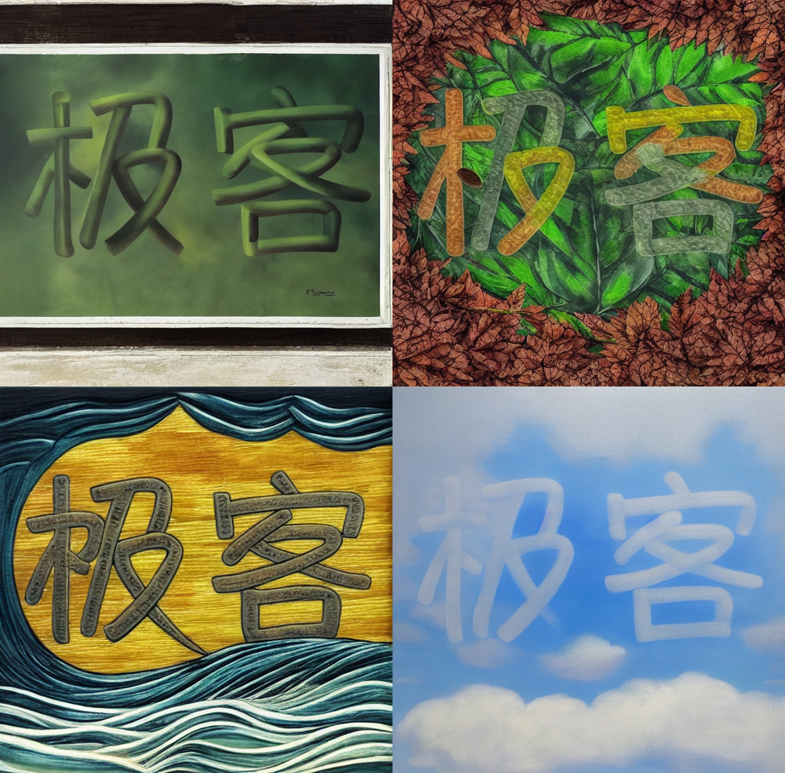

### 线稿上色

现在我们再来尝试一下线稿上色的任务。如果你手中有现成的线稿图片，可以在 Colab 中直接使用你的线稿来进行 AI 绘画。如果手上没有线稿，可以挑选一张喜欢的动漫图片，使用链接中的工具进行线稿提取。你可以点开 Colab 链接和我一起进行操作。

在这个任务中，我们使用最新的 SDXL 模型和它对应的 ControlNet Canny 模型。我们可以通过下面的代码进行模型加载。

```
# 特殊说明：模型计算量较大，需要使用Colab的高RAM模式，否则Colab容易Crash
# 高RAM模式需要点击「修改」-「笔记本设置」进行修改
controlnet = ControlNetModel.from_pretrained(
   "diffusers/controlnet-Canny-sdxl-1.0-mid",
   torch_dtype=torch.float16
)
vae = AutoencoderKL.from_pretrained("madebyollin/sdxl-vae-fp16-fix", torch_dtype=
pipe = StableDiffusionXLControlNetPipeline.from_pretrained(
   "stabilityai/stable-diffusion-xl-base-1.0",
   controlnet=controlnet,
   vae=vae,
   torch_dtype=torch.float16,
)
pipe.enable_model_cpu_offload()
```

之后我们需要读取图床的图片链接，或者读取上传到 Colab 的图片线稿。然后我们使用OpenCV 的 Canny 轮廓提取函数获得图像的 Canny 边缘。后面图片展示的就是原始线稿和提取的 Canny 边缘。

```
# 你可以根据实际需求替换为你自己的图片
image_original = load_image("https://ice.frostsky.com/2023/08/26/3995bd36b16e2c65
image_original
# 提取Canny边缘
image = np.array(image_original)
image = cv2.Canny(image, 100, 200)
image = image[:, :, None]
image = np.concatenate([image, image, image], axis=2)
image = Image.fromarray(image)
image
```

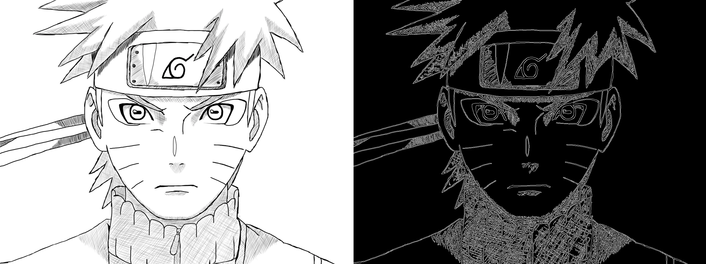

一切准备就绪后，我们写一个 prompt 描述目标图像，比如“一个黄头发、红眼睛、红衣服的卡通男孩”。利用 SDXL 的文生图能力，配合 ControlNet 的 Canny 轮廓控制，便可以给我们的线稿自动上色。后面代码展示的就是文生图的过程。

```
# 结合ControlNet进行文生图
prompt = "a handsome cartoon boy, yellow hair, red eyes, red clothes"
generator = torch.manual_seed(1025)
negative_prompt = "lowres, bad anatomy, bad hands, text, error, missing fingers,
controlnet_conditioning_scale = 0.6
images = pipe(
   [prompt]*4, num_inference_steps=50, negative_prompt=[negative_prompt]*4, imag
).images
```

在前面的代码中，我们一口气生成了 4 张效果图，耐心等待一会，便得到了下面图像中的效果。

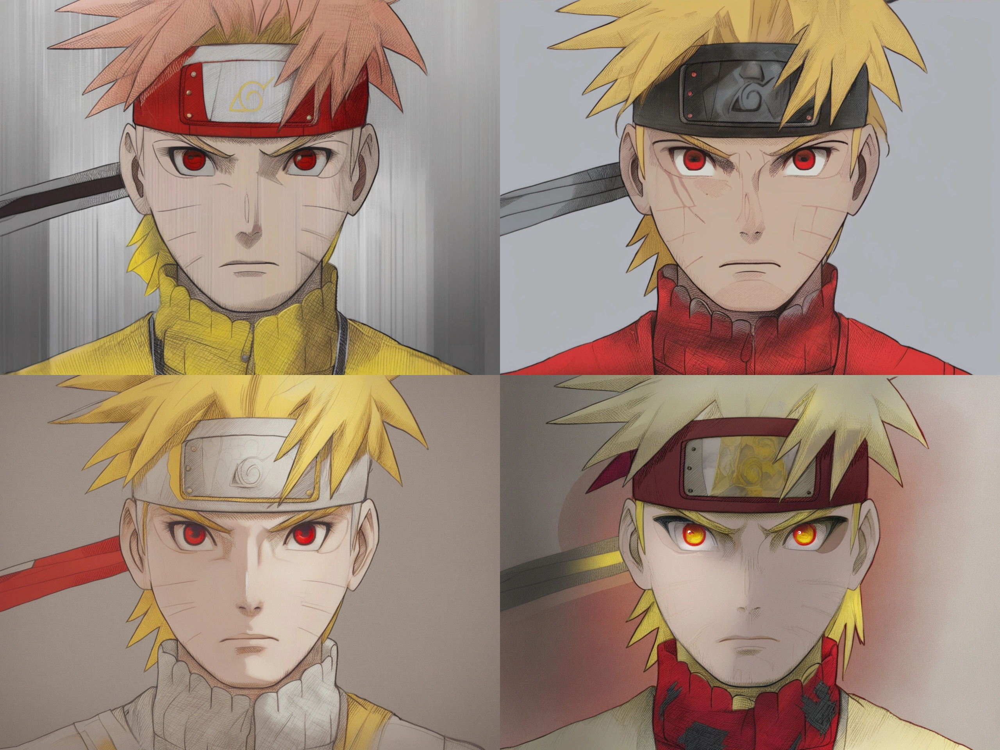

使用同样的方法，我们可以给下面图像中的房屋简笔画进行上色。这里我们用到的 prompt 描述是“一张高质量、有细节的专业图片”。你可以点开图片查看上色效果。

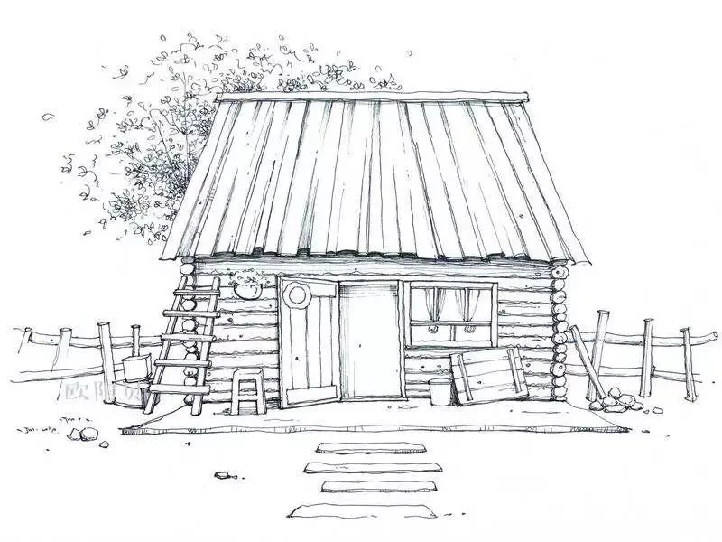

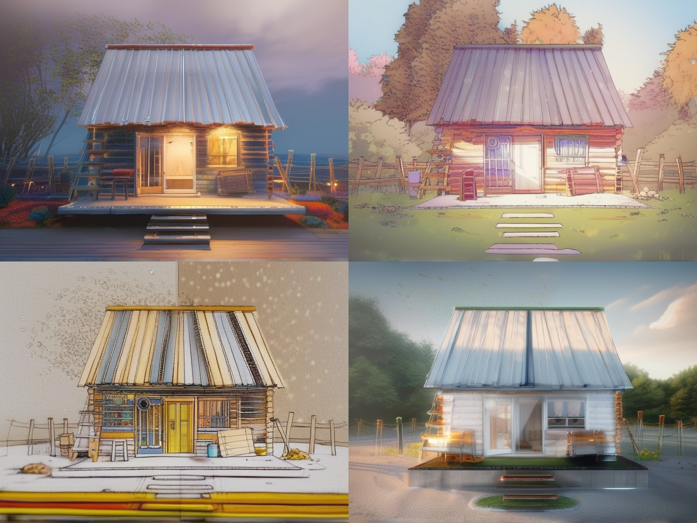

如果你手中有线稿，也期待你使用 ControlNet 为线稿实现染色效果。如果你有喜欢的动漫角色，也可以先提取线稿，然后试着为“他们”重新上色。

## 总结时刻

今天这一讲，我们一起完成了不少实战项目，一起认识了 ControlNet 各种控制条件的特性，还用 ControlNet 完成了一些有趣的创作。

首先我们了解了 Canny、HED、Scribble、MLSD 这几种控制条件，它们的思路就是用不同形式的轮廓线实现 AI 绘画的可控生成。Normal、Depth 这两种控制条件，能够帮助我们从 2D图像中推断出 3D 几何信息，生成的图片 3D 空间感更强。而 Seg、OpenPose 这两种条件，则分别从分割结果和人体姿态的角度控制构图。

然后我们以实战的形式，体验了如何使用 Canny 和 OpenPose 作为控制条件实现 AI 绘画效果，并使用 ControlNet 完成了图像风格化、创意二维码生成、创意文字生成和线稿上色等趣味用法。

实际上，ControlNet 的能力还远不止于此。比如我们还可以用 ControlNet 完成动漫人物转真人、在人像照片中写入不违和的文字等任务。这些功能背后的原理都是 ControlNet，不过需要更精心地选择控制条件、ControlNet 模型和基础模型。

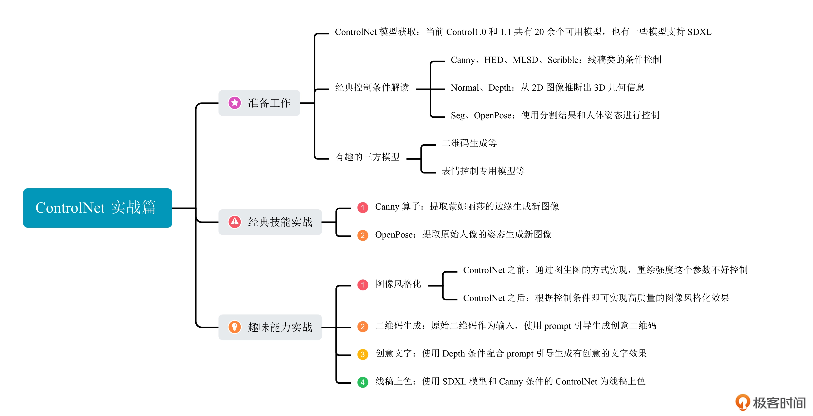

## 思考题

除了今天实战篇中学习的各种 ControlNet 用法，ControlNet 还能实现哪些有趣的功能？欢迎你在 Colab 中实现出算法效果，并把你的 Colab 链接分享出来。

期待你在留言区和我交流讨论，也推荐你把今天的内容分享给身边更多朋友，和他一起探索ControlNet 的多种玩法。
