# 22 | AI图像编辑：如何用Prompt2Prompt实现“言出法随”

你好，我是南柯。

前面，我们已经掌握了以 DreamBooth 为代表的定制化图像生成技术，也学习了使用ControlNet 控制 AI 绘画的构图。这两种技术都是从整体上控制图像的生成。

今天，我们来探究微调图像的技术，也就是指令级修图——使用 prompt 实现对图像的局部修改。这一讲的学习我们将围绕 Prompt2Prompt、InstructPix2Pix 和 Null-Text Inversion这三项技术展开。这三项技术就像是金庸先生笔下的“射雕三部曲”，有着千丝万缕的联系。

在我看来，头部企业最想拥有的 AI 绘画能力，无非是媲美 Midjourney 的 AI 绘画模型、超越LensaAI 的定制化图像生成技术以及指令级修图能力。

学完今天这一讲，你就能对这些最热门的 AI 绘画技术有一个清楚的认识。而且你掌握了指令级修图的技术之后 ，就算不会用 Photoshop 也能随心所欲地编辑图像。

## Prompt2Prompt：用 Prompt 修图

我们熟知的 DALL-E 2、Imagen 和 Stable Diffusion 等技术虽然可以实现出惊艳的文生图效果，但是用来做图像编辑却很困难。即使是在 prompt 上做一点细微的改动，得到的结果也会截然不同。这种情况下，如果我们想要做图像局部编辑，就需要使用图像补全的方式，先手工画一个遮罩（mask）区域，然后使用 prompt 引导图像生成。

显然，这种方式并不方便。为了更便捷地实现图像编辑，在 2022 年 8 月，Google 在提出Imagen 不久之后，推出了 Prompt2Prompt 这个技术。

它的作用非常明确——对于一个通过 prompt 生成的 Imagen 图像，可以通过修改 prompt 的方式实现精细化的图像局部编辑。你可以点开图片感受下效果。

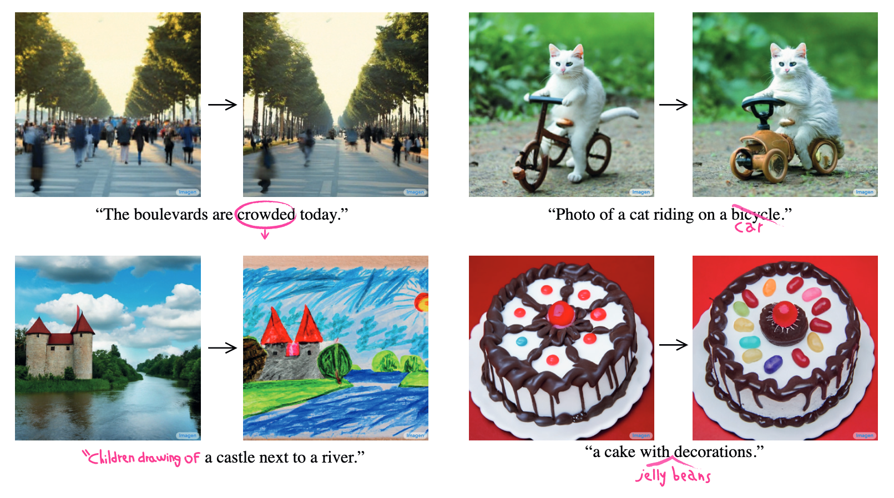

- 图片来源：https://arxiv.org/abs/2208.01626

可以看到第一张图中，我们降低“拥挤”（“crowded”）这个词的权重，图片中的人数明显减少了，从而不再“拥挤”。第二张图中，将 prompt 中的自行车换成了汽车，猫咪的“座驾”便得到了调整。第三张图中，写实照片变成了儿童的蜡笔画。第四张图则是将蛋糕加上了果冻质感的豆子。

我们再来看看后面这个例子。通过原始 prompt “A car on the side of the street”得到一张图像，然后可以通过修改 prompt 将汽车变成跑车、报废的车等等。不仅如此，改改 prompt 甚至可以改变图像的场景和季节，图中的车却保持不变。

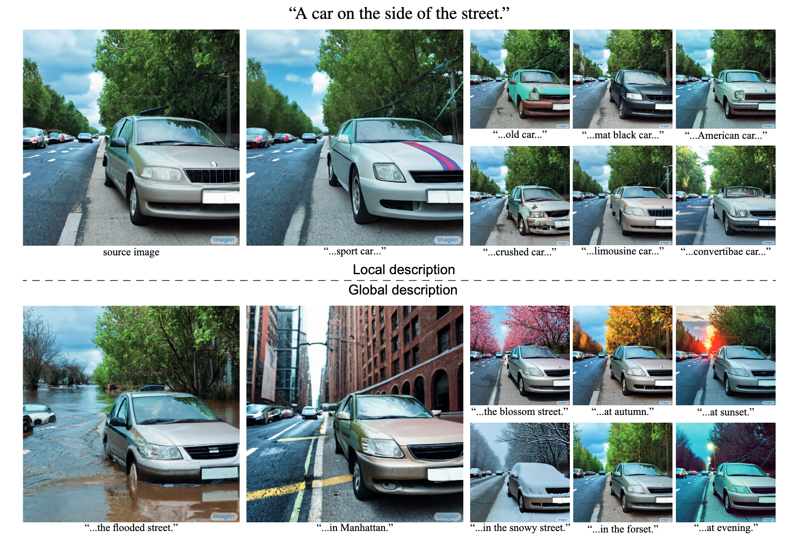

- 图片来源：https://arxiv.org/abs/2208.01626

这便是 Prompt2Prompt 这项技术的神奇之处！也是这一讲“修图三部曲”的开端。那么这种神奇效果背后的原理是怎样的呢？

我们这就来揭秘。为了方便你理解，我们以 Stable Diffusion 模型为例，说明 Prompt2Prompt是怎样实现的。

要搞懂 Prompt2Prompt，我们需要先回顾一下 AI 绘画中的交叉注意力机制。在第 7 讲和第 16 讲中我们详细讨论过 SD 模型的交叉注意力机制，我们知道文本表征会通过交叉注意力的形式，引导 AI 绘画生成目标内容。

具体来说，我们通过文本表征计算交叉注意力的 K 和 V 矩阵，通过 UNet 的图像特征计算 Q矩阵，然后根据后面的公式来计算交叉注意力。

## Softmax(Qim

## Attention(Q

- ​, K​, V​) =

## AttentionMap(Q

- ​, K​)V​ =imgtxttxtimgtxttxt

你可以参考后面的伪代码来复习回顾。

```
# 通过文本表征计算交叉注意力的K和V矩阵，通过UNet的图像特征计算Q矩阵
Q = image_sequence * W_Q
K = text_sequence * W_K
V = text_sequence * W_V
# 计算Q和K向量之间的点积，得到注意力分数。
Scaled_Dot_Product = (Q * K^T) / sqrt(d_k)
# 应用Softmax函数对注意力分数进行归一化处理，获得注意力权重。
Attention_Weights = Softmax(Scaled_Dot_Product)
# 将注意力权重与V向量相乘，得到输出向量。
Output = Attention_Weights * V
```

对于 SD 1.x 模型来说，UNet 最初输入到第一个 CADB（CrossAttnDownBlock2D）模块的分辨率是 64x64x64，作用于 CADB 模块的文本表征维度为 77x768。

需要指出，这里的 77 代表 prompt 的 token 长度，如果我们输入的 prompt 很短，算法在预处理时也会补全一些无关紧要的 token，来保证文本表征长度的统一。UNet 的结构和交叉注意力的作用位置，你以回顾后面这两张图。

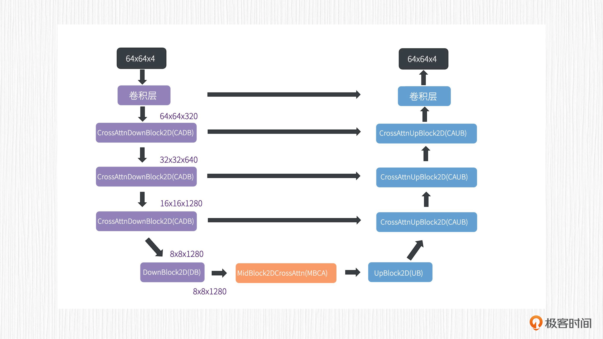

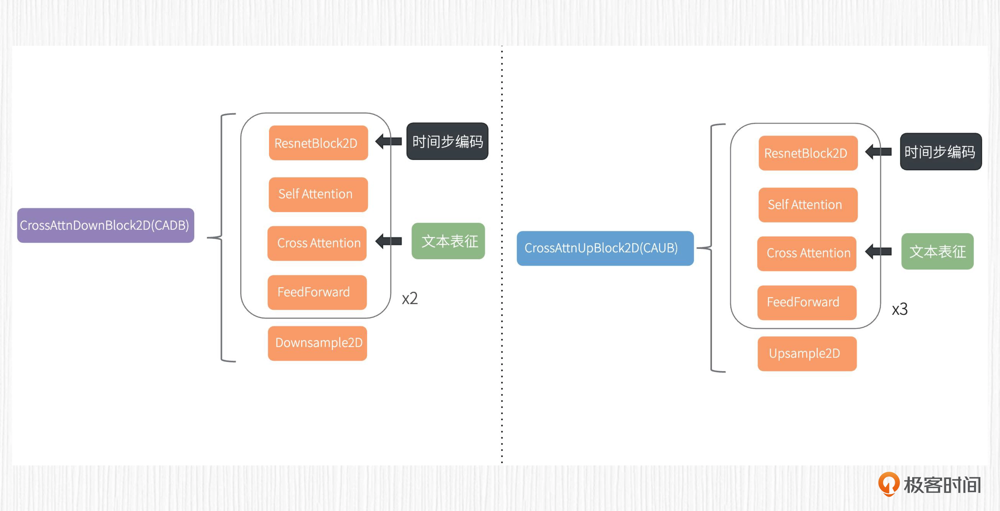

为了便于理解，我从特征维度的角度，为你解释一下交叉注意力的计算过程。

对于第一个 CADB 模块，交叉注意力模块输入的 Q 矩阵维度是 64x64xC，C 可以看作是经过ResnetBlock2D 后的特征通道数。文本表征得到的 Q 和 V 矩阵维度是 77xC。接着将 Q 与 K的转置相乘，得到矩阵 M 的维度是 64x64x77。然后再将 M 矩阵与 V 矩阵相乘，便得到了与原始图像特征相同维度的输出，也就是交叉注意力模块的输出。

整个过程你可以看后面的图加深理解。

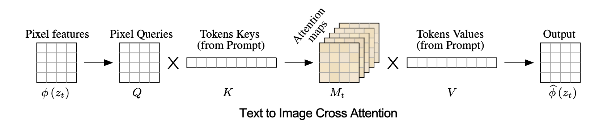

- 图片来源：https://arxiv.org/abs/2208.01626

理解了这些，我们再来看 Prompt2Prompt 这个算法就非常简单了。在刚刚的交叉注意力计算过程中，我们得到了一个 64x64x77 的注意力权重矩阵 M，可以看作是 77 张 64x64 分辨率的注意力权重图。每张权重图对应 prompt 中的一个 token。

后面这张图片展示的便是每一个 token 对应的注意力权重图，为了看得更清楚，作者对所有时间步的注意力权重图计算了平均值。

最左侧的小熊是模型生成的图像，仔细观察，我们会发现每个 token 的注意力权重图指明了这个 token 的作用范围。比如 bear 和 bird 的注意力权重图，和最终生成图像中 bear 和 bird的位置是一一对应的。

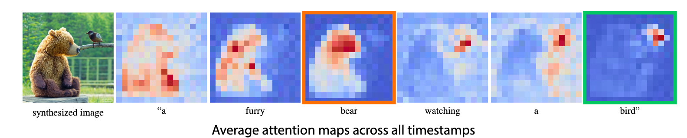

- 图像来源：https://arxiv.org/abs/2208.01626

上面这些是不是有些复杂？对照前面这张图，我再用大白话说明下 Prompt2Prompt 的算法原理，比如我们想把图里的小熊变成一只狗，那就要找到我们提供的 prompt 中小熊这个词的注意力权重图，然后把这个图换成狗的注意力权重图。

了解了这些，我们便可以实现指令级修图了。我们以 “Photo of a cat riding a bicycle” 为例加以说明，我们希望将 prompt 中的 bicycle 换成 car。该怎么做呢？

整个过程分四步。

## z

第一，和常规的文生图任务一样，我们随机生成一个 64x64x4 的随机噪声

- ，将原始T​

## z

## M

## z

prompt、时间步 t 的编码和

- 输入到 UNet，得到注意力权重图和噪声。T−1TT​​​

- ∗

## z

## M

第二，将目标 prompt、时间步 t 的编码和

- 输入到 UNet，得到注意力权重图。TT​​

- ∗

## M

## M

第三，将

- 中 bicycle 对应的注意力权重图替换为中 car 对应的注意力权重图，得到TT​​

## ^

## M

修改后的

- 。T​​

## ^

- ∗∗

## M

## M

## z

第四，使用

- 替换第二步中的，得到噪声。TT−1T​​​​

- ∗

## z

## z

然后将我们得到的

- 和作为下一轮去噪的初始值，分别用于原始 prompt 和目标T−1T−1​​

prompt 的图像生成。经过完整的去噪过程和 VAE 解码器后，我们便可以得到后面两张图像。

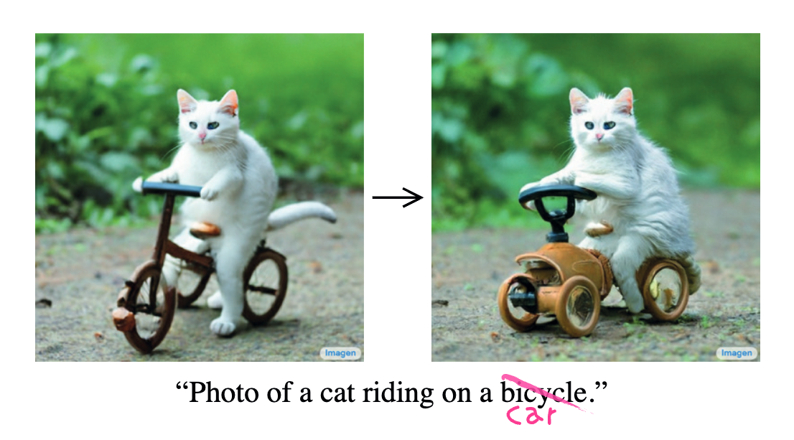

这便是 Prompt2Prompt 这个算法的作用原理。你应该也已经注意到了，这种方法有一个局限性，那就是我们只能编辑 AI 绘画模型根据 prompt 生成的图像。

如果是真实图像，比如我们手中的某张自拍照，就无法通过 prompt 用 SD 模型来生成，这种情况下，Prompt2Prompt 也就无能为力了。该怎么解决这个问题呢？这便引出了“修图三部曲”的第二篇——InstructPix2Pix。

## InstructPix2Pix：用指令修图

2022 年 11 月 UC 伯克利的学者提出了 InstructPix2Pix 这项技术。它的作用非常明确：用户提供一张图片，然后使用指令（instruction）来进行图像编辑。你可以点开图片先感受下“指令”的魔力。

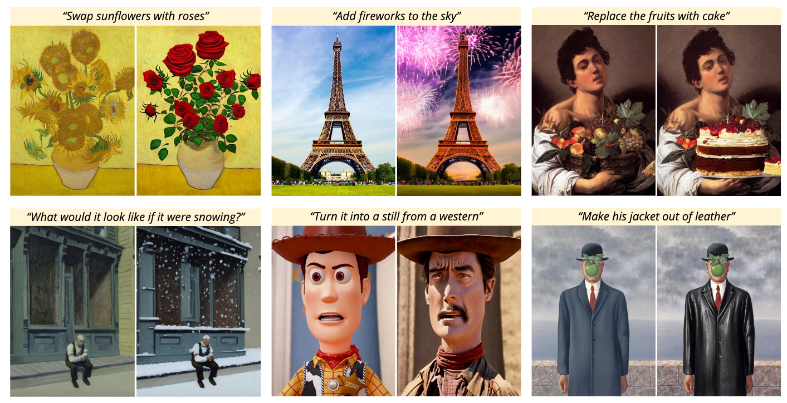

- 图片来源：https://www.timothybrooks.com/instruct-pix2pix

整个指令级修图的过程，你只需要上传一张图片和一句指令，SD 模型经过一次“文生图”的过程，便可以完成修图。这个算法是怎么实现的呢？当我们了解了 Prompt2Prompt 能达成的效果以后，想要理解 InstructPix2Pix 就并不困难了。

实现 InstructPix2Pix 算法需要两个步骤，分别是合成数据集和训练指令修图模型。我们先来看合成数据集。

为了训练一个指令修图模型，我们需要准备成对训练数据，也就是原图、指令以及对应的修图效果。作者使用 GPT-3 这个模型，根据原始 prompt 和修图指令生成一个目标 prompt。

有了原始 prompt 和目标 prompt 以后，怎么构造成对数据呢？答案正是我们刚刚讲过的Prompt2Prompt！通过这种方式，我们可以构造海量的训练数据。

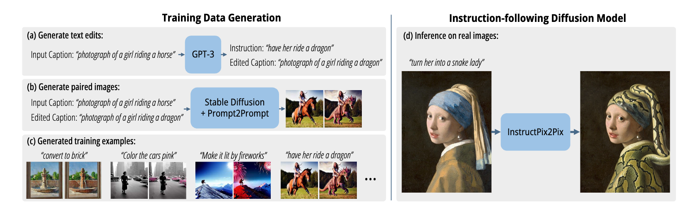

- 图片来源：https://www.timothybrooks.com/instruct-pix2pix

搞定了训练数据，剩下的任务便是对 SD1.5 这样的开源 AI 绘画模型进行微调了。这里我们需要对原始 UNet 的结构做出一些修改。具体来说，原始 UNet 的输入包括当前时间步的噪声图、时间步 t 的编码、prompt 的文本编码。而 InstructPix2Pix 的 UNet 输入新增了原始图像的 VAE 编码，并且将 prompt 设置为我们的修图指令。

这样训练得到的 SD 模型，便可以帮助我们完成指令级修图的功能。值得一提的是，我们在第 20 讲中学习过 ControlNet 的指令级修图能力，便是基于 InstructPix2Pix 模型合成的数据训练得到的。

## Null-Text Inversion：修改你手中的图片

InstructPix2Pix 通过构造成对训练数据，并重新微调 SD 模型的方式实现了指令级修图。有没有无需数据构造和模型训练的方式呢？答案是肯定的。

现在我们来看看“修图三部曲”的第三篇，2022 年 11 月 Google 提出的 Null-Text Inversion。Null-Text Inversion 的作用就是解决真实图像上，如何运用 Prompt2Prompt 修图的问题。

为了帮你理解这个算法，我们需要先来搞懂 Inversion（重演）这个概念。我们熟悉的 AI 绘画算法比如 SD 模型，是从噪声生成图像的过程。而 Inversion 正好相反，是为图像增加噪声的过程，并且要求得到的潜在表示能恢复出原始图像。

在第 9 讲学习采样器时，我们提到了采样器背后的数学原理是解决常微分方程或者随机微分方程的求解问题。我们知道，DDPM 采样器背后是求解随机微分方程，而 DDIM 采样器背后是求解常微分方程。

对于随机微分方程的求解器，从噪声生成图像的过程是一个不确定的过程。既然我们的目标是能够恢复原图，自然需要选择 DDIM 这种常微分方程求解器。与 DDIM 采样器配套的Inversion 算法，就是 Null-Text Inversion 中用到的 DDIM Inversion。

一句话概括，DDIM Inversion 的目的是得到真实图像加噪后的潜在表示，这个潜在表示配合DDIM 采样可以生成出原始图像。

搞懂了 DDIM Inversion 的目的，我们回到真实图像编辑的任务。为了完成 Prompt2Prompt 图像编辑，我们需要知道真实图像的 prompt 和扩散模型初始的潜在表示。

为图像生成 prompt 这件事情通过前面实战篇的实验，我们已经很熟悉了，可以使用 BLIP 等模型来完成，或者我们可以自己来编写图像描述。图像初始的潜在表示可以通过 DDIMInversion 算法来获得。

不过，仅仅拿到 prompt 和初始潜在表示就够了么？你是否还记得，我们在第 15 讲中学习过无分类器引导（Classifier-Free Guidance）的策略么？我们来回顾下这个公式。

- 最终噪声 = w * 条件预测 + （1 - w） * 无条件预测

这个公式中，条件预测的部分用的是 prompt 文本表征，无条件预测的部分用的是空字符串的文本表征，w 是引导权重。DDIM Inversion 并没有考虑无条件预测的过程，因此，当引导权重不等于 1 时，仅仅用上面的 prompt 和初始潜在表示无法顺利重建出图像。

而 Null-Text Inversion 算法的本质就是用 DDIM Inversion 的输出作为基准条件，优化空字符串对应特征向量（Null-Text Embedding），补偿无分类器引导带来的重建误差。

对于真实图片，Null-Text Inversion 算法可以根据 prompt、引导权重、初始潜在表示，计算得到一组替代空字符串对应特征向量的向量表示。这样一来，我们就可以通过 prompt 和空字符串特征向量这两个输入，配合无分类器引导生成真实图片。搞定了从 Prompt 到真实图片的生成，我们就可以对 prompt 稍作修改，利用 Prompt2Prompt 实现图像局部编辑了。

你可以点开图片看看后面的例子，我们输入一张原始婴儿图片、一句原始 prompt 和各种目标prompt，经过 Null-Text Inversion 和 Prompt2Prompt 的连续处理，便可以实现有趣的编辑，比如修改婴儿的肤色、背景等。

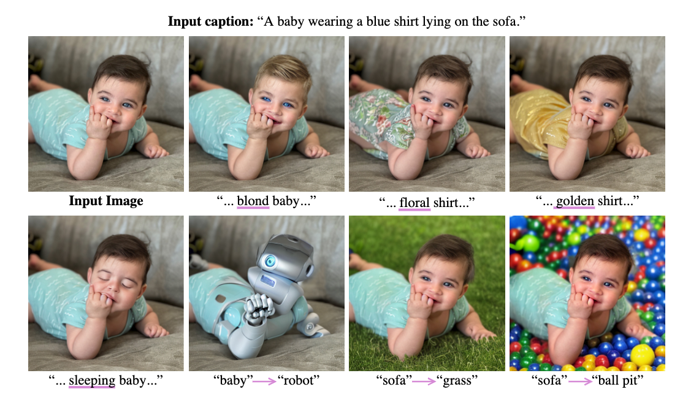

- 图片来源：https://null-text-inversion.github.io/

那么 Null-Text Inversion 是怎样实现的呢？后面这张图展示了 Null-Text Inversion 的计算过程。

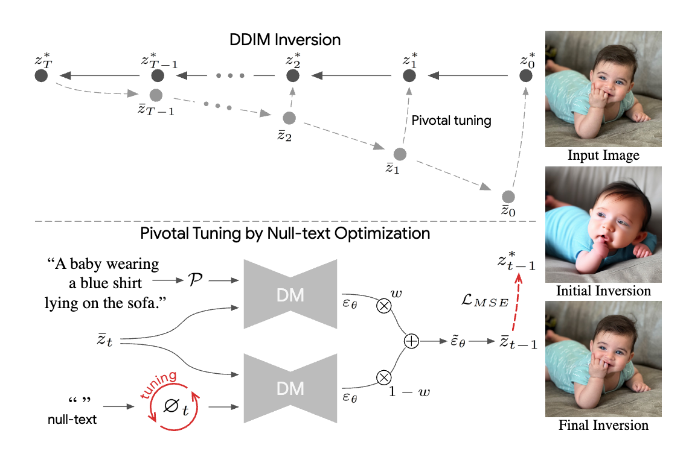

- 图片出处：https://null-text-inversion.github.io/

## ϕ

图中标记有 “tuning” 的

- 就是我们要优化的空字符串对应特征向量，两个标记有 DM 的漏斗​t

表示的是无分类器引导中的条件预测和无条件预测。

可以看到，对于无分类器引导，仅使用 DDIM Inversion 得到的潜在表示进行 AI 绘画，恢复出的图像（第二个婴儿）和原始图像（第一个婴儿）差别还是很大的。这是因为由于无分类器引导的作用，每一个去噪后的潜在表示轨迹发生了“偏移”。

Null-Text Inversion 算法采取的方法就是优化空字符串的特征向量，去纠偏图像的恢复过程。

## ϕ

## ϕ

经过反复迭代计算，最终得到优化后的空字符串特征向量

- 。搞定了，即使是无分类器引​t​t

导，我们也能通过 DDIM 采样器恢复出原始图像。拿到了 prompt、初始潜在表示、引导权重

## ϕ

和新的空字符串特征向量

- ，Prompt2Prompt 自然能用来完成局部编辑的任务了。​t

## 图像编辑方法对比

到此为止，我们已经基本了解了图像编辑算法的设计思路。我们学过的的编辑算法包括inpainting 图像补全、Prompt2Prompt、InstructPix2Pix、ControlNet 的指令级修图、Null-TextInversion 这五种。

我们可以从后面的四个维度对比这些编辑算法，分别是能否编辑真实图像、是否需要提供待编辑区域的遮罩（mask）、是否需要微调 SD 模型以及局部编辑的效果。理想的编辑算法应该能在无需遮罩、无需微调 SD 的前提下，实现对于真实图像的局部编辑，并且算法耗时尽可能少。

后面我列了个表格，对比了五种算法的整体表现。可以看到，这五种算法各有优劣，Null-TextInversion 除了编辑速度较慢，基本满足我们对于编辑算法的预期。

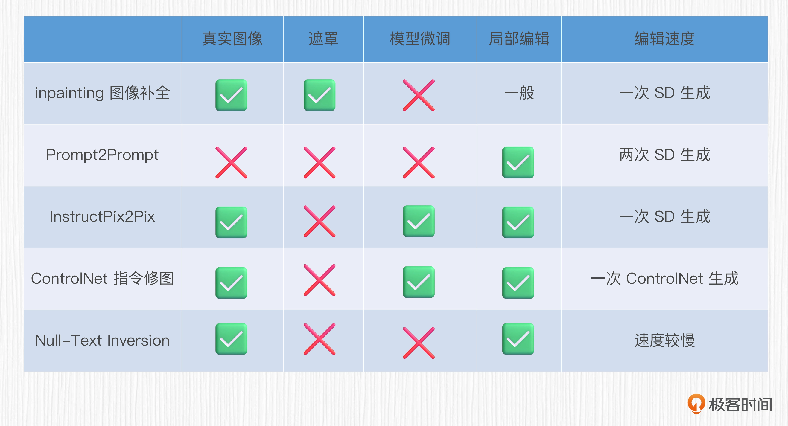

## 总结

今天这一讲，我们学习了“修图三部曲”：Prompt2Prompt、InstructPix2Pix 和 Null-TextInversion。这一讲比较烧脑，如果具体推导细节你暂时没搞懂也没关系，了解这三个算法能够实现的效果即可。

Prompt2Prompt 可以根据我们提供的两个 prompt，生成一张原始图像和一张局部修改后的图像。InstructPix2Pix 则会利用 GPT-3 和 Prompt2Prompt 来构造“原图、指令到目标图”的成对数据，通过微调 SD 模型的方式得到了一个能够听指令修图的 SD 新模型。而 Null-TextInversion 则是直接通过求解的方式计算特征向量，使用用户提供的 prompt 实现目标图像生成，配合 Prompt2Prompt 完成图像的局部编辑。

在实际工作中，我们可以使用 InstructPix2Pix 或 ControlNet 的指令级修图能力实现“言出法随”效果，对于算法从业者而言，使用 Null-Text Inversion 和 Prompt2Prompt 则能提供更大的编辑自由度。

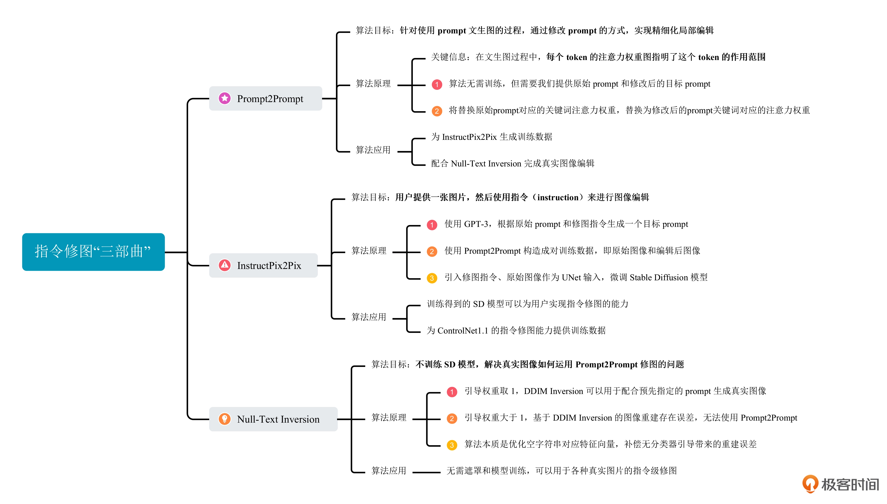

## 思考题

假如你手中有一张图片，是一个站着的女孩子抱着一只宠物狗，希望改变女孩子黑发为红发，同时将宠物狗变成猫咪，该如何实现？可以说说你的思路，也可以在评论区贴出你的 Colab 实验链接。

欢迎你在留言区记录自己的收获或者疑问，也推荐你把这一讲分享给身边更多朋友。
