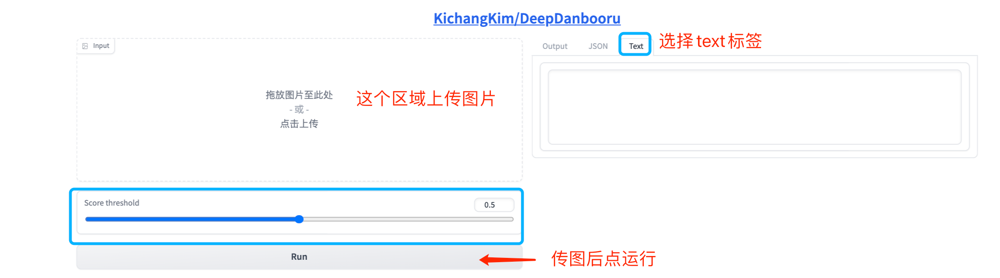
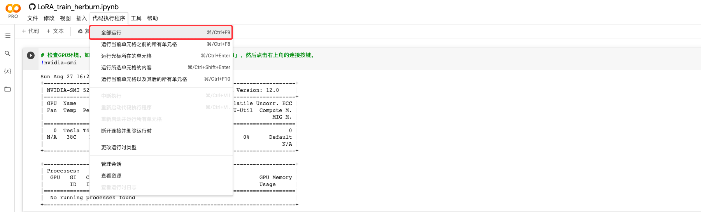
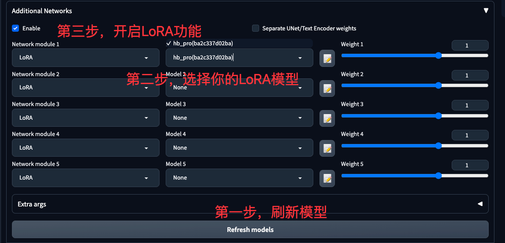
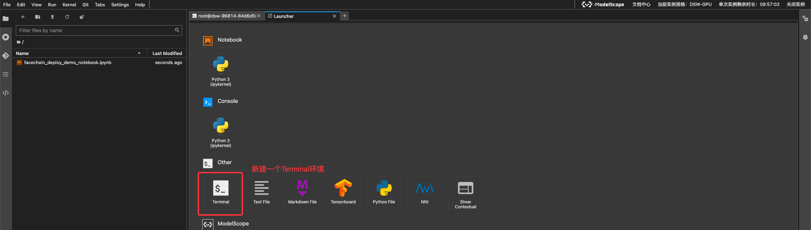
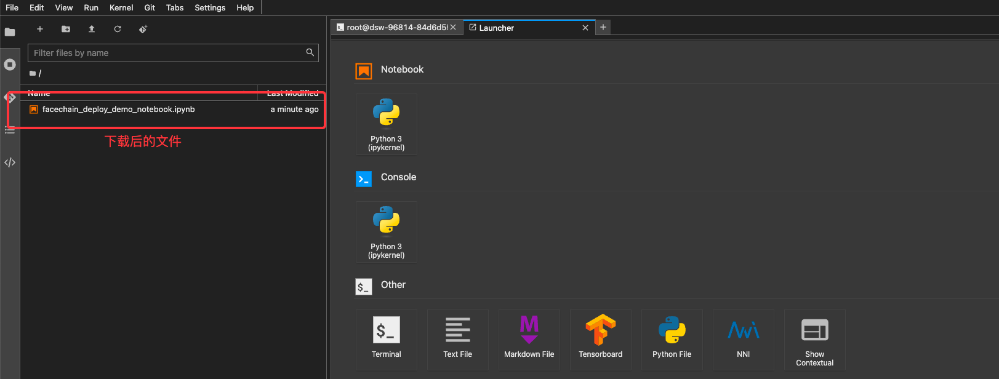
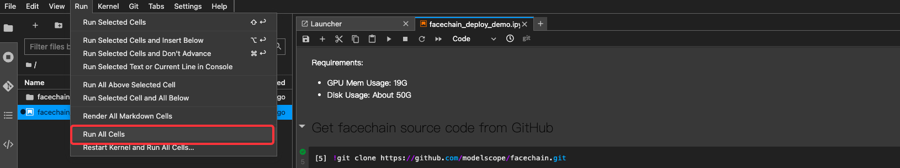
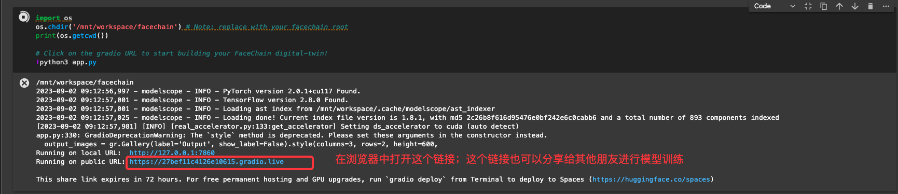
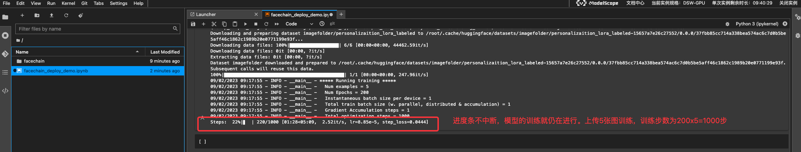
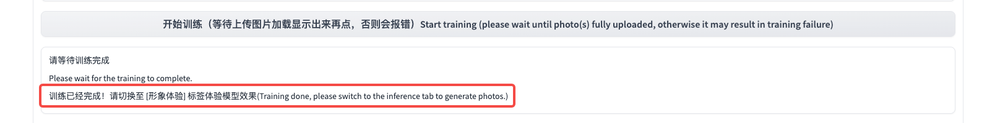
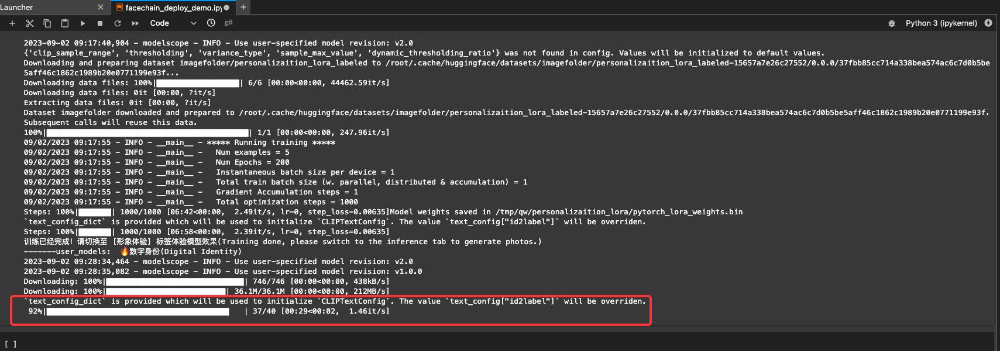

# 23 | 实战项目（五）：做一个类似LensaAI的梦幻照相馆

你好，我是南柯。

第 18 讲和第 19 讲我们学习了定制化图像生成的常见方法，初步了解了如何训练LoRA，得到代表内容和风格的定制化模型。经过训练 LoRA 模型的实战，我们发现训练一个LoRA 并不困难，但是想实现 LensaAI 或者妙鸭相机类似的效果却并不容易。

今天这一讲，我们将目光聚焦到人像生成上，继续探讨使用 LoRA 进行定制化图像生成的技巧。你可不要小看这些技巧，它们正是很多商业产品惊艳效果下的黑魔法。

通过这一讲的实战，我们的 LoRA 模型效果也会大为改观。最后，我们会训练出一个能高度还原人像效果的 LoRA 模型，有了这个模型，你就能实现一个梦幻照相馆的项目。课程讲解里的目标形象我们设置为奥黛丽赫本，当然你也可以使用自己的几张照片或者是宠物的照片来制作你的专属照相馆。

## 如何做一个梦幻照相馆

在正式开始实战前，按照惯例，我们需要先准备训练数据，并选好基础模型。

### 模型和数据

和上一个实战项目不同，今天我们要做的梦幻照相馆希望呈现出真人风格，我向你推荐一个名为“墨幽人造人”的模型，你可以点开 Colab 通过图中的方式获取下载链接。当然你也可以尝试自己喜欢的其他基础模型。

在 Colab 中，我们可以通过后面这两行代码指定模型的保存路径，并下载模型。

```
pretrained_model_name_or_path = "/content/pretrained_model/moyou.safetensors"
!wget -c https://civitai.com/api/download/models/143001 -O $pretrained_model_name
```

搞定了基础模型，我们再来看训练数据。我准备了 10 张赫本的图片，你可以通过后面这两行代码拉取数据。你也可以使用自己手中图片来训练模型，5~10 张图片即可。为了保证我们能得到理想的效果，训练图片中的人脸需要清晰可辨。

```
# 下载赫本的图片
!wget https://github.com/NightWalker888/ai_painting_journey/raw/main/live/herburn
# 将赫本图片解压到目标训练路径
!tar -xvf herburn_images.tar -C /content/LoRA/train_data/
```

解压完成后，我们通过后面几行代码实现图片可视化，检查一下图片中的人像是否正面无遮挡。

```
pths = glob(r"/content/LoRA/train_data/herburn_images/*")
imgs = []
for pth in pths:
 img = Image.open(pth)
 imgs.append(img.resize((512, 512)))
image_grid(imgs[:4], 1, 4)
```

### 解读 tags

在实战项目三 (第 19 讲)，我们已经学习了如何使用 BLIP 这个模型为每一张图片生成prompt 描述。在这一讲的代码部分，我们可以用同样的方法给图片生成 prompt 描述。

如果使用我们课程中用到的 BLIP 模型或者 BLIP2 模型 生成 prompt。我们得到的 prompt是一些完整的句子，比如后面这个例子，BLIP 打标的结果是 “a picture of the starry night inblue and yellow”。

其实，除了使用 BLIP，我们还有很多其他选择。在一些关于 LoRA 训练的教程中，我们经常看到关于 tags 的使用技巧。所谓 tags，本质上就是我们给图片生成标签式的 prompt。

DeepDanbooru 等模型经常用于生成标签式的 prompt。你可以点开超链接，在截图左侧的相应区域上传图片，然后点击 “run” 按钮，即可得到图片对应的 prompt。这里右侧需要选中“text”标签，方便我们复制 prompt 文本。



这里我说明一下，图中的分数阈值（Score threshold）表示我们对于每个 tag 的过滤强度。DeepDanBooru 模型在预测每一个 tag 时会同时输出一个置信度，范围是 0-1，分数越高越置信。因此在实际使用中，阈值设置越高，得到的 tag 会越少。这里我们选默认的 0.5 就行。

仔细观察你会发现，和 BLIP 模型的打标效果不同，这里我们生成的 prompt 是一系列标签短语，也就是人们常说的 tags。在 LoRA 的训练中，我们可以对这些 tags 进一步处理。

以生成人物的 LoRA 模型为例，我们可以将 tags 中的人物外在特征删除，比如黑头发、帽子、耳环等，而保留一些诸如 1girl、solo 这类通俗的描述词。这是因为，我们利用 LoRA 想固定的是人物本身的特征，你可以理解成“素颜状态”下的人物，而不是人物的装饰品。

在此基础上，我们还可以给每一个生成的 prompt 加上我们自定义的关键词，比如 <sks>。这样，我们训练的 LoRA 便可以被 1girl、solo、<sks> 这样的关键词来触发。

这里我还想提醒一下你，如果使用 BLIP 系列模型生成 prompt，得到的 prompt 是完整的句子，也就不需要删除特定描述词，否则句子会不通顺。但是，我们仍然可以在句子开头加上<sks> 这样的自定义触发词。

## 代码实战

在代码实战环节，我为你准备了三种不同的训练方式。

- 方式 1：使用上个实战篇改造后的 Colab 代码进行训练。

- 方式 2：使用开源妙鸭相机的 NoteBook 代码进行训练。

- 方式 3：使用开源妙鸭相机项目的 python 代码在 GPU 环境下进行训练。

第一种训练方式使用 Colab 提供的免费 T4 显卡即可完成，第二种方式需要大约 19G 的 GPU资源，课程中我们使用阿里云 NoteBook 的免费计算资源，第三种方式需要你拥有一张显存大于 19GB 的显卡。

如果想做一个人像或者宠物的“梦幻照相馆”，利用免费的 Colab 资源通过方式 1 来进行模型训练就可以。如果想要体验“妙鸭相机”的效果，实现出海马体的风格，推荐使用方式 2。如果希望用 python 代码来实现“妙鸭相机”，并做出进一步的算法改进，比如替换基础模型、增加更多人脸美化处理或者部署一个自己的服务，推荐使用方式 3。

接下来，我们就具体看看这三种训练方式，要怎么实现。

### 训练方式 1：Colab 训练

首先我们使用第一种方式进行训练。你可以点开 Colab 链接和我一起操作。

为了方便你进行操作，在配置好 Colab 的 GPU 环境后，你可以直接点击全部运行，这样就能“一键”完成 LoRA 的训练。



耐心等待 LoRA 训练完成，我们便可以看到 LoRA 模型的生成效果。我们使用后面的 prompt来测试一下得到的 LoRA 模型。

```
Prompt：masterpiece, best quality, 1girl moyou (ink sketch) fantasy, surreal muted
Negative Prompt：lowres, bad anatomy, bad hands, text, error, missing fingers, ex
随机种子：1024
采样步数：20
分辨率：512x768
CFG Scale: 7
LoRA：hb_pro.safetensors [使用Colab训练]
LoRA weight：1.0
```

我们在 prompt 中指定了 ink sketch 这样的风格要求，希望模型帮我们生成赫本的墨水素描照片。你可以点开后面的图看一下我们的 LoRA 效果。你也可以发挥自己的创造力，生成更多独特的图像。

搞定了 LoRA 模型的训练，咱们再把它加入到 WebUI 上试试效果。

我们可以将训练得到的 LoRA 模型下载到本地，放在 WebUI 的 LoRA 文件夹中，然后就可以在 WebUI 上，直接使用我们刚刚训练的 LoRA 模型了。

```
# LoRA模型放置路径为：
/你的WebUI安装路径/extensions/sd-webui-additional-networks/models/lora
```

把模型放到相应位置后，别忘了刷新 WebUI 的 LoRA 模型库，加载我们刚刚放置的 LoRA 模型。



一切准备完毕，我们这就来测试下 WebUI 的使用效果，使用下面这组 prompt 即可测试赫本模型。

```
Prompt：1girl bubbles fog water long hair Paolo Roversi (best shadow, dramatic li
Negative Prompt： (worst quality, greyscale)
采样器：DPM++ SDE Karras
随机种子：603579159
采样步数：20
分辨率：512x768
CFG Scale: 7
LoRA：hb_pro.safetensors [使用Colab训练]
LoRA weight：1.0
```

- 超分功能：打开

```
重绘强度：0.38
```

你可以点开图片查看生成效果。可以看到，配合上人脸修复、图像超分功能，得到的赫本图像还是非常美观的。

### 训练方式 2：开源妙鸭的 NoteBook

facechain 是阿里达摩院给出的“阉割版妙鸭”相机的代码实现，我们可以通过阅读这份代码了解妙鸭相机的技术思路。

总的来说，“阉割版妙鸭”相机使用一个达摩院提供的基础模型，通过 3~10 张图进行 LoRA 模型的训练。在模型训练完成后，使用一系列图像后处理技术提升图像生成的效果。

运行“阉割版妙鸭”的 NoteBook 文件需要 19G 左右的显存，使用 Colab 的同学需要付费后选择 A100 显卡才能运行。如果想免费体验这个 NoteBook 功能，可以使用阿里云ModelScope 的计算资源，你可以点开链接进行操作，首次登录需要进行账号注册。

当我写这一讲时，官方的 NoteBook 还有一些 bug，你可以下载我修正后的 jupyter 文件，具体方式是在 Notebook 中新建一个 Terminal 环境，然后输入后面的指令即可。



```bash
wget -c https://raw.githubusercontent.com/NightWalker888/ai_painting_journey/main
```

我们点开下载完成的文件，就可以像 Colab 一样点击全部执行。





运行完 NoteBook 中全部代码后，你会获得一个 url 链接。在浏览器中输入这个链接，就可以进入妙鸭相机交互式操作的界面。



然后，我们上传 3 到 10 张图片，耐心等待上传完成，便可以点击模型训练。后台运行的代码会自动完成图片的 prompt 打标、基础模型下载等工作。

如果训练过程中，窗口中提示 “Error”，我们需要检查下 NoteBook 是否在正常运行。如果模型的训练仍在继续，那我们便可以忽略训练面板中的 “Error”，耐心等待 NoteBook 中的模型训练完成即可。默认的训练步数是图片数 x200，比如我们上传 5 张图，训练步数就是 1000 步。



大约等待 10 分钟，就能完成 LoRA 模型的训练。



最后，我们可以使用一个自己的 prompt 进行模型效果测试。比如我们测试后面文稿中的prompt。具体操作方法可以查看后面图片中的标记。

```
prompt：1girl bubbles fog water long hair Paolo Roversi (best shadow, dramatic li
风格权重：0.25
生成图像数量：3
```

图像生成过程中，你可以通过 NoteBook 查看图像生成的进度。耐心等待大约 1 分钟便可以完成图像生成，你可以点开图片查看模型的生成效果。



### 训练方式 3：妙鸭相机代码训练

现在我们再来看看如何通过写代码的方式，在你的 GPU 环境下进行妙鸭相机的训练。这里我们仍旧使用 facechain 这个达摩院官方的代码实现。

首先，你需要在你的命令行环境下，将这个代码仓库拉取到本地，并创建一个用来存放训练图片的文件夹路径。

```bash
git clone https://github.com/modelscope/facechain.git
# 跳转到安装路径
cd facechain
# 为了避免由于代码更新引出新的bug，我们使用我测试有效的一次代码提交
git checkout bd1ff6ffad16e11febd4d319817c70dcc391964d
# 创建图像文件夹
mkdir -p images/upload_source
```

然后，我们需要安装运行 facechain 的运行环境。以 Anaconda 虚拟环境的使用为例，在你的命令行环境下，需要依次执行后面的指令。

```
conda create -n facechain python=3.8    # Verified environments: 3.8 and 3.10
conda activate facechain
pip3 install -r requirements.txt
pip3 install -U openmim
mim install mmcv-full==1.7.0
```

然后我们将赫本的图像下载到本地，解压后将其放置到刚刚创建的训练数据文件夹中。

```
# 下载赫本的图片
!wget https://github.com/NightWalker888/ai_painting_journey/raw/main/live/herburn
```

接下来，我们在 facechain 路径下创建一个名为 image_processing.py 的文件，并拷贝后面的代码。这段代码的主要作用是统一上传图片的格式，并使用 BLIP2 模型生成 prompt。

```python
import os
from PIL import Image
from glob import glob
from facechain.train_text_to_image_lora import get_rot, data_process_fn
from facechain.inference import data_process_fn
if __name__ == "__main__":
   instance_images = glob(f"images/upload_source/*")
   # 确保提供3~10张训练图片
   if len(instance_images) == 0:
       raise Exception
   # 将图片格式和命名统一
   output_dataset_dir = "images/train_images"
   os.makedirs(output_dataset_dir, exist_ok = True)
   for i, temp_path in enumerate(instance_images):
       image = Image.open(temp_path)
       image = image.convert('RGB')
       image = get_rot(image)
       out_path = f'{output_dataset_dir}/{i:03d}.jpg'
       image.save(out_path, format='JPEG', quality=100)
   # 为图像生成训练用prompt
   data_process_fn(output_dataset_dir, True)
# 在Terminal中运行Python代码
python image_processing.py
```

搞定了数据，我们创建一个名为 train.sh 的文件，并拷贝后面的代码。这段代码的含义是启动模型训练，并指定基础模型、训练数据路径等关键参数。

```bash
export MODEL_NAME='ly261666/cv_portrait_model'
export VERSION='v2.0'
export SUB_PATH="film/film"
export OUTPUT_DATASET_NAME="images/train_images"
export WORK_DIR="logs/experiment"
accelerate launch facechain/train_text_to_image_lora.py \
   --pretrained_model_name_or_path=$MODEL_NAME \
   --revision=$VERSION \
   --sub_path=$SUB_PATH \
   --output_dataset_name=$OUTPUT_DATASET_NAME \
   --caption_column="text" \
   --resolution=512 --random_flip \
   --train_batch_size=1 \
   --num_train_epochs=200 --checkpointing_steps=5000 \
   --learning_rate=1e-04 --lr_scheduler="cosine" --lr_warmup_steps=0 \
   --seed=42 \
   --output_dir=$WORK_DIR \
   --lora_r=32 --lora_alpha=32 \
   --lora_text_encoder_r=32 --lora_text_encoder_alpha=32 \
   --mixed_precision="no"
# 在Terminal中启动训练任务
sh train.sh
```

耐心等待 10 分钟，我们就完成了妙鸭相机模型的训练。细心的你可能已经发现，妙鸭的训练代码就是我们在第 19 讲中已经学过的 diffusers 的 LoRA 训练代码。

接着，我们可以用自己训练好 LoRA 模型来生成图片，看看效果如何。你可以参考后面的代码完成这一步。

```
python run_inference.py
```

你可以点开图片查看我们 LoRA 模型的生成效果，可以看到，我们的 LoRA 模型能够为赫本生成“海马体”效果的证件照。你也可以用自己手中的其他图片完成模型的训练和测试。

你觉得上面证件照的效果如何呢？其实 facechain 在生成 AI 绘画图像后，会做一些图像后处理提升算法效果（具体代码你可以参考后面的截图）。

具体做法就是先分析原始训练图像的质量分，选择一张最高质量的人脸，把它和生成的 LoRA图像做人脸融合。这一步有点作弊的成分了，但确实让最终的图像和赫本更相似了。

然后，我们要对融合后的人脸进行姿态矫正和人像风格化。

## 总结时刻

今天我们通过实战的形式完成了自己的梦幻照相馆。

和第 19 讲不同，我们今天的实战任务是真人形象生成，所以我们选择了一个名为“墨幽人造人”的基础模型。之后我们详细探讨了 prompt 生成的两种模式：使用 BLIP 类模型和使用DeepDanbooru 类模型。对于后者，我们会得到一系列 tags，为了保证 LoRA 模型的生成能力，我们需要对 tags 进行针对性删减。

之后我们提供了三种方式来实现我们的梦幻照相馆。具体来说，分别是使用之前实战篇改造后的 Colab 代码进行训练、使用开源妙鸭相机的 NoteBook 代码和使用“阉割版妙鸭”相机项目的python 代码。我们也将训练的 LoRA 模型与 WebUI 结合，验证了梦幻照相馆的生成效果。

此外，经过分析我们发现，“阉割版妙鸭”相机的本质是在 diffusers 的 LoRA 训练代码基础上，换了专用基础模型，并增加了人脸融合等图像处理技巧。这对我们的启发是，一款成功的产品背后往往搭配使用了多种技术，即使是有了扩散模型这个大杀器，我们仍旧可以使用人脸融合、美颜算法等后期处理方法，进一步提升我们的产品效果。

建议你课后自己多练习，也可以将自己训练的 LoRA 模型发布到开源社区，让其他朋友也能参与体验和分享，这样学习效果会更好。

这一讲的重点，你可以点开后面的导图复习回顾。

## 思考题

今天我们的课程实战是以赫本的任务为例设计的。我为你预留了两个实战任务。

1. 希望你选择一个课程外的基础模型，选择一个自己的图片、偶像的图片或者宠物的图片，利用现有的计算资源，完成你的 LoRA 模型训练。

2. 希望你使用标签类 prompt 生成工具，完成赫本的 LoRA 训练。在 prompt 生成时，需要对tags 做针对性地删减，也可以增加你的专用激活词。

欢迎你在留言区记录自己的收获或者疑问，也推荐你把这一讲分享给身边更多朋友。
