# 24 | 实战项目（六）：妙用SD，如何给你的照片带上千百种风格？

你好，我是南柯。

今天我们要探讨的是图像风格化技术。在社交媒体或者短视频平台上，我们经常会看到各种流行一时的风格化特效，比如卡通风格、中国风等，背后使用的其实就是图像风格化技术。

我在文稿里准备了两张图，你可以看看，左图是使用 Midjourney 生成的一张照片，右图展示的就是古风特效。

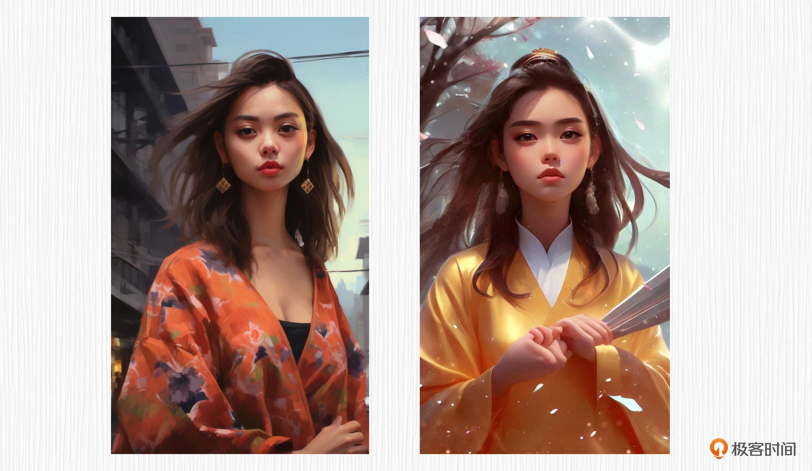

很多趣味相机产品，也凭借新奇的风格化效果吸引用户付费订阅。

可以说，从 GAN 的时代到扩散模型时代，图像风格化技术的商业化价值已经得到了充分的验证。我们可以做个预判，随着基础 AI 绘画模型生成能力的不断提高，未来还会有更多新奇的风格呈现在我们面前。对于技术从业者而言，风格化算法也是一个很好的切入点，作为进入AIGC 行业的敲门砖。

另外，融合不同风格的 Stable Diffusion 模型，就可以调制出各种千奇百怪的新风格。有了这个技巧的加持，我们就可以通过 DIY 的形式得到自己独特的模型。

今天这一讲，我们就来深入聊聊图像风格化这个话题，探讨不同 Stable Diffusion 模型的融合技巧，并通过实战的形式为我们的照片注入心仪的风格。

## 初识风格化

风格化算法有两个目标，第一是保持原始图像的整体构图，第二是修改图像的整体风格。为了实现这两个目标，无数算法工程师绞尽了脑汁。我们这就来学习一些有代表性的风格化技术。

我们不妨看看 GAN 时代的风格化算法。时间倒回 2020 年，当时流行一种特效玩法，叫做实时变漫画，效果是后面图中展示的样子。

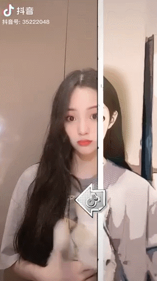

我们在第 5 讲曾经提到过，这种实时特效背后的算法是 Pix2Pix。不过使用它的前提是生产大量成对训练数据，然后用 Pix2Pix 算法来学习其中的模式转换。后面的图片中展示了Pix2Pix 算法的输入和输出，对于实时变漫画这个特效，输入是真人脸部区域，输出则是漫画风格的脸部效果。

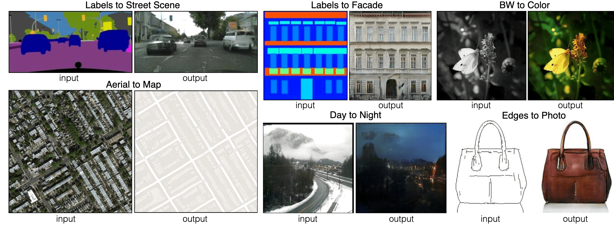

对于彼时的实时变漫画技术，大量的成对数据要怎么获得呢？答案是找设计师来画。 你可以想象这背后的艰辛。好在，2021 年开始出现了一些技术，用不到 100 张图，就能训练一个特殊的 GAN，输入你的照片，输出你要的风格。

比如后面这个工作叫做 AgileGAN（敏捷的 GAN），发布于图形学顶会 SIGGRAPH。使用这样的方法便可以低成本地生产海量成对数据。然后配合 Pix2Pix，就可以把这个能力实现为一个手机端特效。

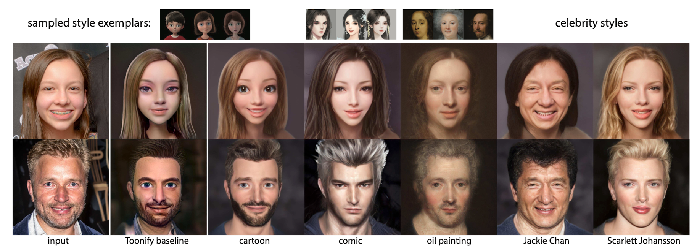

事实上，上面呈现的算法效果都只能实现脸部区域的风格化，并不能稳定地处理全部图像区域。这便引出了一个大家都想解决的技术难题——全图风格化。这个难题直到 2022 年 9 月VToonify 这个技术提出后，才算是被解决。

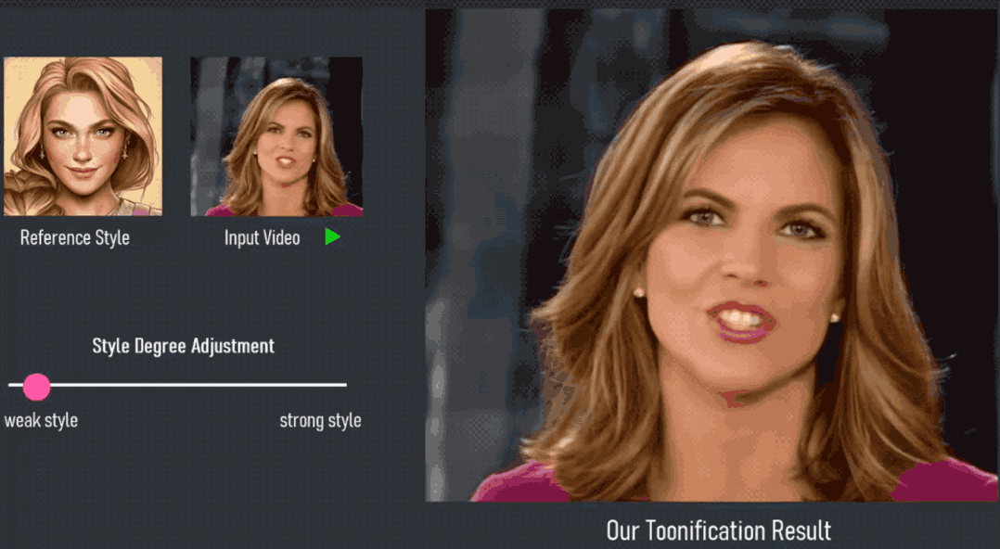

VToonify 本质上仍旧是 StyleGAN 系列工作的扩展，也就是想办法在 GAN 的生成器中注入风格信息。它的整体思路你可以结合后面的图片来理解。

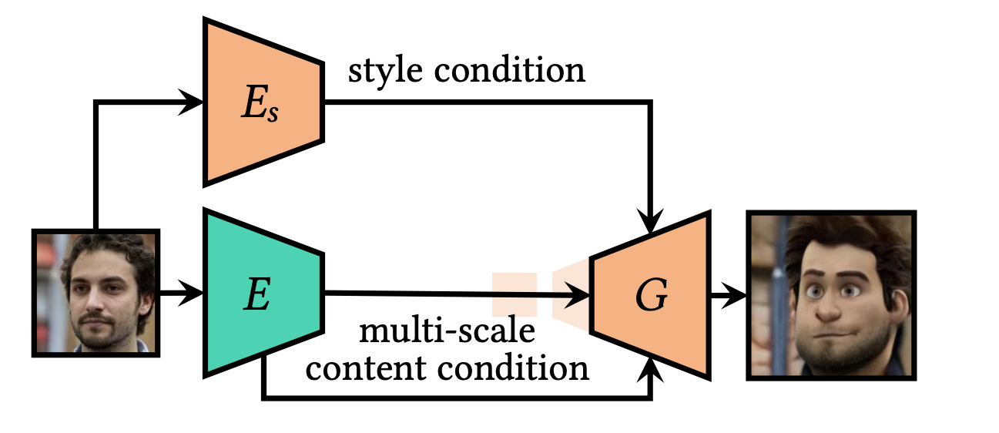

但巧合的是，与 VToonify 几乎同时出现的，是我们这门课程的主角——开源的 StableDiffusion 模型。算法工程师们很快发现，使用 Stable Diffusion 模型的图生图技术能够快捷地实现全图风格化的效果，并且只用改改 prompt 和重绘强度，就能任意控制风格化的输出。

### 风格化效果举例

在进入实战前，我们可以先来感受下各种各样的图像风格。MidLibrary 这个网站提供了上百种不同的图像风格，每一种都带有鲜明的特色。

你可以点开后面的图片，查看我挑选的 6 种我比较偏爱的风格，包括抽象画、美漫风格、生态建筑、夸张画、流行艺术和后印象主义风格。需要指出，这些风格都是凭借 Midjourney 生成的效果，在现实世界中，每个设计师、插画师都可以创造出属于自己的风格。

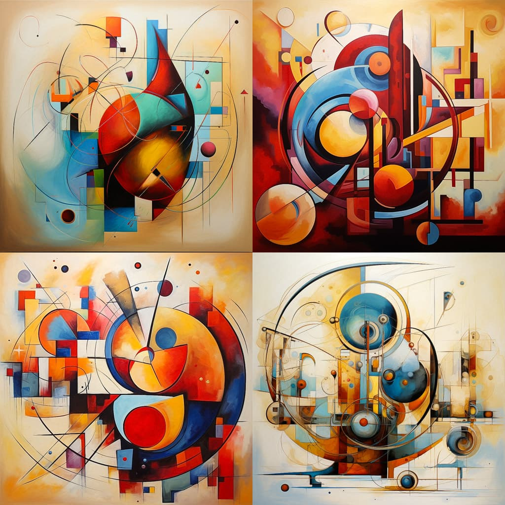

- https://midlibrary.io/styles/abstract-art

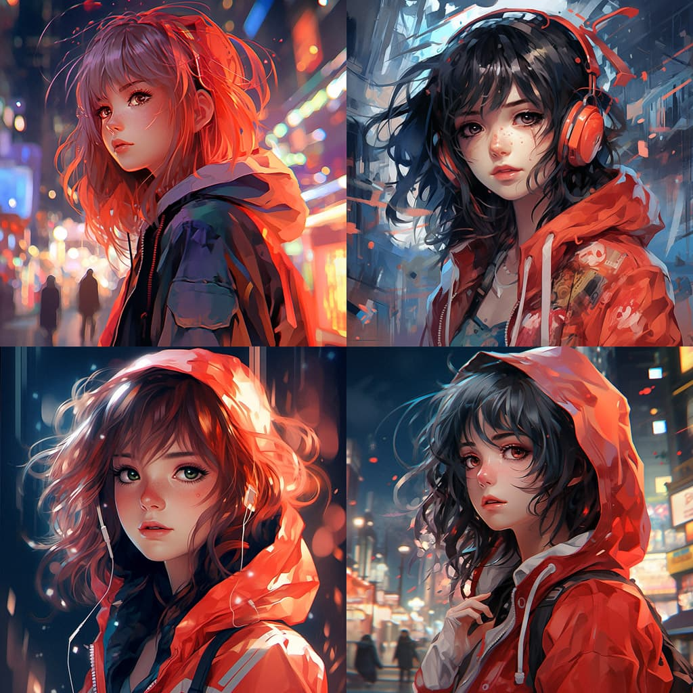

- https://midlibrary.io/styles/anime-style

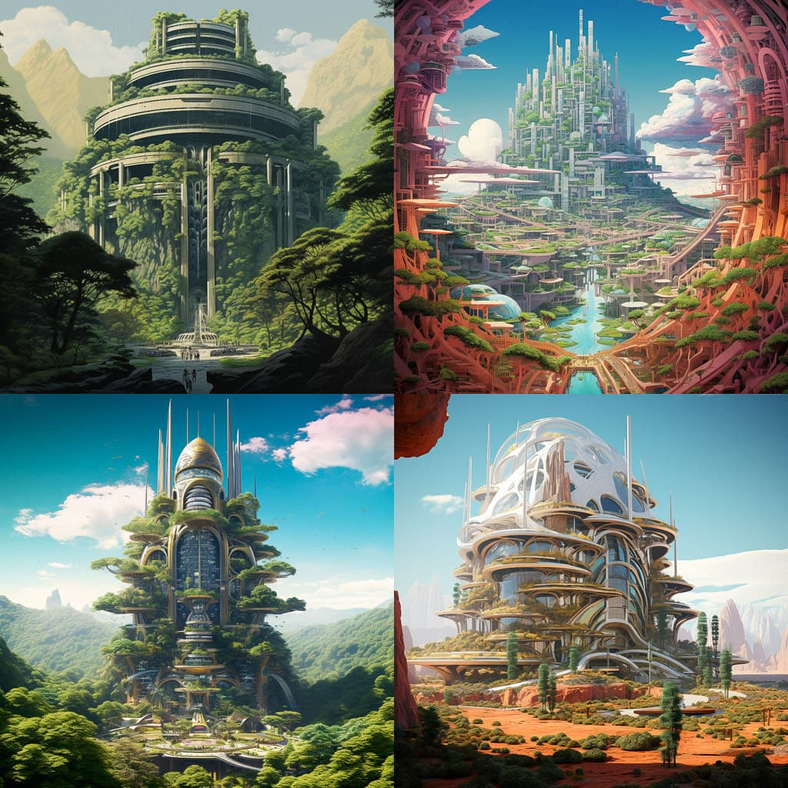

- https://midlibrary.io/styles/arcology

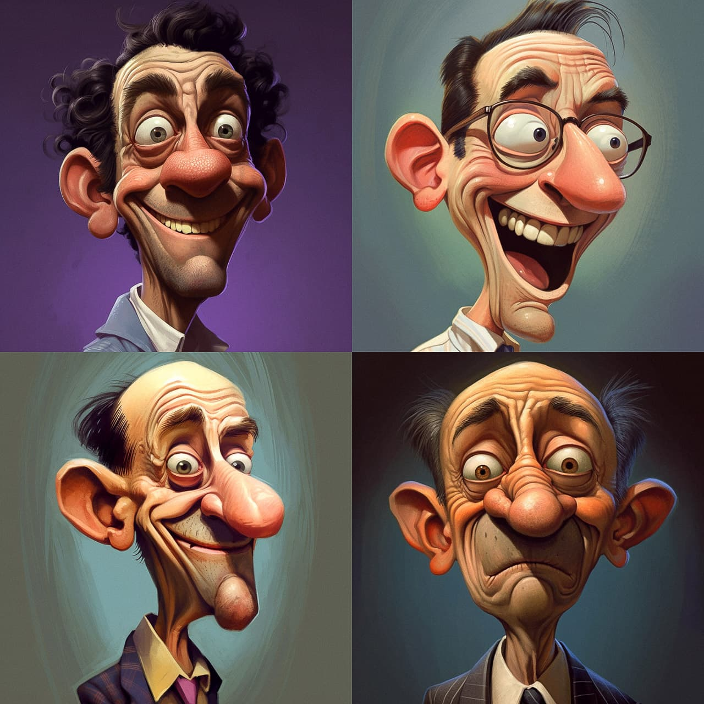

- https://midlibrary.io/styles/caricature

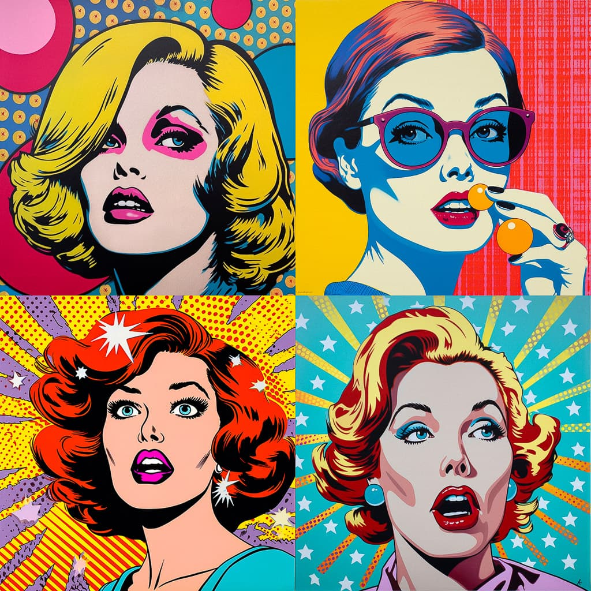

- https://midlibrary.io/styles/pop-art

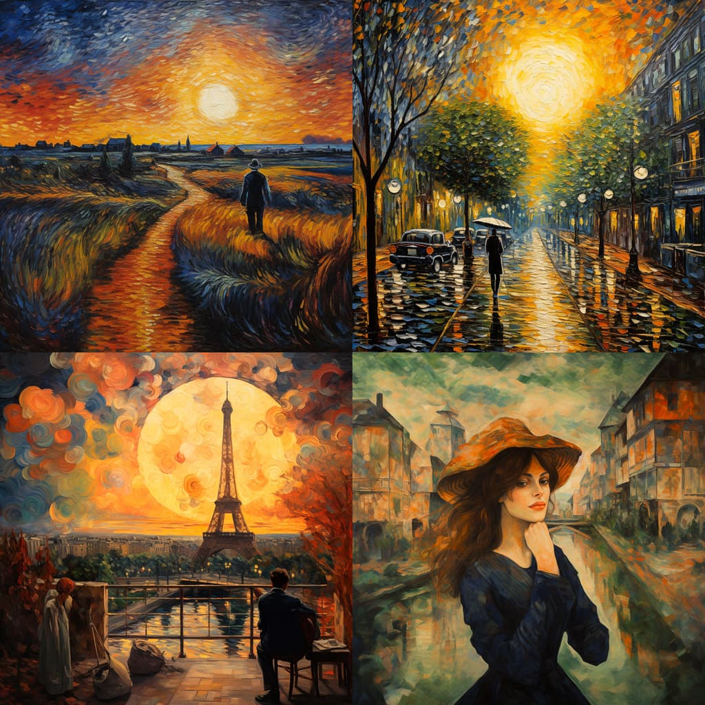

- https://midlibrary.io/styles/post-impressionism

看过这些图片，想必你也和我有一样的感慨，这些风格都是如此鲜明有趣！我们在第 19 讲时已经学习了如何用 3-5 张图完成风格化 LoRA 模型的训练，如果你想调制出 MidLibrary 中的某款风格，推荐你使用 3-5 张图完成一个风格化 LoRA 模型的训练。

### 风格化实现方案

我们看过了不同风格，也搞懂了图像风格化的概念，那么，该如何随心所欲地对我们手中的照片进行风格化呢？根据我们之前学过的知识，我们至少有 4-5 种不同的方案。

先来说说最简单的方式，我们可以利用 Stable Diffusion 模型的图生图功能。或者，我们也可以使用 ControlNet 的基本控制模式，比如各种轮廓控制、姿态条件控制等。

还有更复杂、但控制更精细一些的方式——使用 ControlNet 的指令级修图模式，抑或是InstructPix2Pix 的修图功能。当然，我们还可以将第 22 讲里学到的图像编辑的知识活学活用，将 Null-Text Inversion 技术和 Prompt2Prompt 技术相结合，为你的图片加入 prompt 中指定的风格。

这些风格化方法背后的算法原理不同，能够实现出的效果也存在差异。我们今天的实战内容将通过写代码完成 3 种图像风格化的方案。它们分别是使用 SD 模型图生图的方式、使用ControlNet 的基本控制模式和使用 ControlNet 的指令修图模式。

## 图生图代码实战

关于图生图背后的原理，我们前面的课程已经有了很多讨论。在 ControlNet 提出之前，我们在各种短视频平台上看到的图像风格化效果，大多是使用图生图的方法来完成的。

我们简单回顾一下图生图背后的原理。在图生图中，我们对原始图像进行加噪，通过重绘强度这个参数控制加噪的步数，并把加噪的结果作为图像生成的初始潜在表示，然后使用你提供的prompt 来引导输出图像的风格。更多细节你可以回顾课程的第 15 讲。

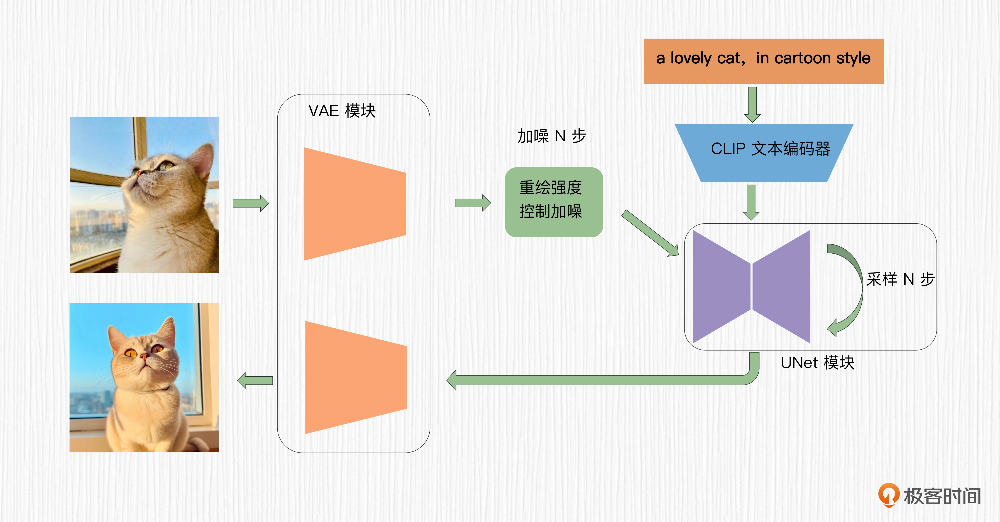

我们以蒙娜丽莎为例，使用图生图的方式完成图像的风格化。你可以点开Colab和我一起练习。

首先，我们加载了 ToonYou 这个卡通风格模型，将重绘强度设置为不同的数值，得到不同风格强度的蒙娜丽莎图片。

```python
import requests
import torch
from PIL import Image
from io import BytesIO
from diffusers import StableDiffusionImg2ImgPipeline
device = "cuda"
pipe = StableDiffusionImg2ImgPipeline.from_pretrained("zhyemmmm/ToonYou")
pipe = pipe.to(device)
url = "https://ice.frostsky.com/2023/08/26/2c809fbfcb030dd8a97af3759f37ee29.png"#
response = requests.get(url)
init_image = Image.open(BytesIO(response.content)).convert("RGB")
init_image = init_image.resize((512, 512))
prompt = "1girl, fashion photography"
images = []
# 我们的重绘强度分别设置为0.05, 0.15, 0.25, 0.35, 0.5, 0.75
for strength in [0.05, 0.15, 0.25, 0.35, 0.5, 0.75]:
 image = pipe(prompt=prompt, image=init_image, strength=strength, guidance_scale
 images.append(image)
```

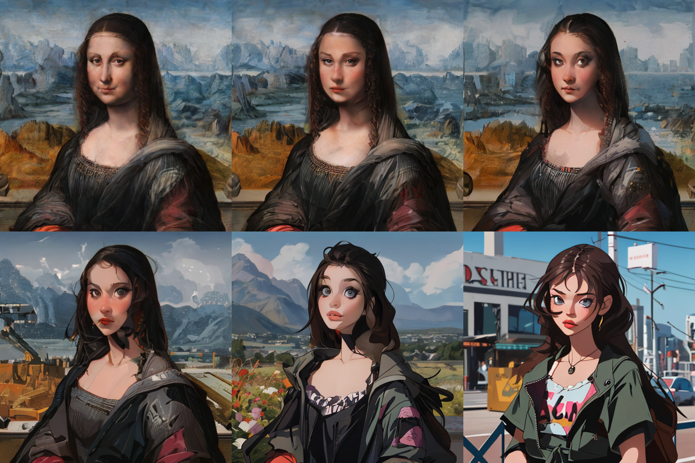

如果想生成其他风格要怎么办呢？在图生图模式下，我推荐的做法是更换基础模型。比如我们希望生成写实机器人风格，可以选择 SemiRealMix 这个模型。我们使用后面代码展示的方式加载模型。你可以点开图像查看生成效果。

```
pipe = StableDiffusionImg2ImgPipeline.from_pretrained("robotjung/SemiRealMix")
prompt = "1girl, robot"
images = []
for strength in [0.05, 0.15, 0.25, 0.35, 0.5, 0.75]:
 image = pipe(prompt=prompt, image=init_image, strength=strength, guidance_scale
 images.append(image)
```

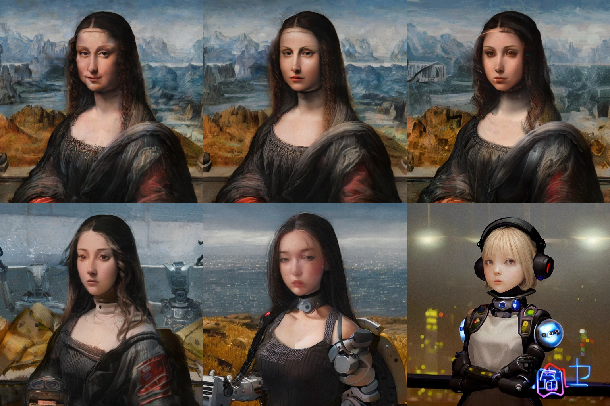

通过前面的操作我们发现，以图生图的方式进行风格化需要涉及较多的技巧，包括基础模型选择、重绘强度设置和 prompt 设计等。尤其是重绘强度，设置过大会丢失原始图像构图信息，设置过小则会导致生成的图像风格不强。也正是基于这些原因，在 ControlNet 推出之前的风格化特效，总给人一种“不太像”的感觉。

## ControlNet 风格化技巧

深入探讨了使用图生图完成风格化的算法原理后，我们再来看看怎么利用 ControlNet 完成风格化任务，有了它的帮助我们能实现出更好的效果。

### 使用边缘轮廓条件

我们仍旧以蒙娜丽莎的图片为例，分别使用 SDXL 模型的 Canny 控制模式和 SD1.5 模型的指令级修图控制模式。你可以点开Colab和我一起进行操作。需要说明的是，运行这段 Colab代码需要大约 20G 的 RAM 资源，因此需要使用付费的 Colab 资源。

首先，我们可以加载蒙娜丽莎的图片，并使用 Canny 算子提取图片的轮廓线。这个操作我们第 21 讲也尝试过，你应该并不陌生。

```
# 加载原始图片，这里你也可以使用自己的图片
original_image = load_image("https://ice.frostsky.com/2023/08/26/2c809fbfcb030dd8
# 提取Canny边缘
image = np.array(original_image)
image = cv2.Canny(image, 100, 200)
image = image[:, :, None]
image = np.concatenate([image, image, image], axis=2)
image = Image.fromarray(image)
```

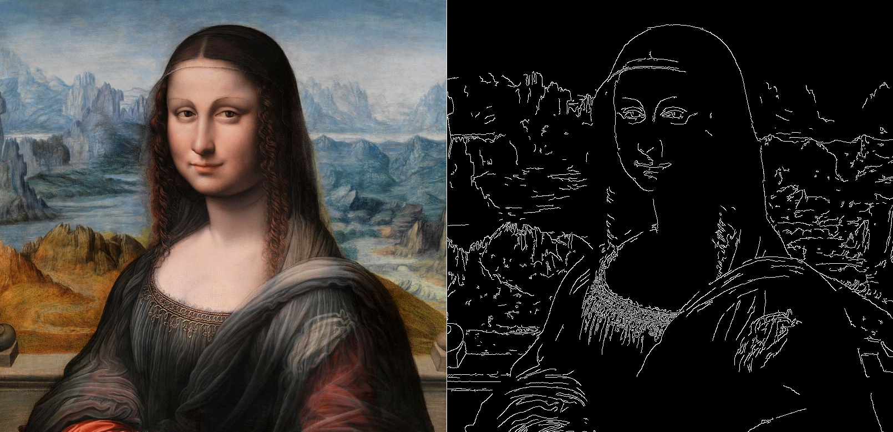

然后，我们使用 SDXL-1.0 模型和 Canny 控制条件的 ControlNet 模型。

```
controlnet = ControlNetModel.from_pretrained(
   "diffusers/controlnet-Canny-sdxl-1.0-mid",
   torch_dtype=torch.float16
)
vae = AutoencoderKL.from_pretrained("madebyollin/sdxl-vae-fp16-fix", torch_dtype=
pipe = StableDiffusionXLControlNetPipeline.from_pretrained(
   "stabilityai/stable-diffusion-xl-base-1.0",
   controlnet=controlnet,
   vae=vae,
   torch_dtype=torch.float16,
)
pipe.enable_model_cpu_offload()
```

搞定了这些，我们便可以通过 prompt 控制生成图像的风格了。比如我们可以使用后面的 4 条prompt，依次将蒙娜丽莎的图片转换为卡通风格、梵高风格、赛博朋克风格和机器人风格。当然，也推荐你发挥创造力，实现出更多有意思的风格。

```
# 结合ControlNet进行文生图
# 这里可以更换为你想要的风格，只需要修改prompt即可
prompt = "a smiling woman, winter backbround, cartoon style"
# prompt = "a smiling woman, summer backbround, van gogh style"
# prompt = "a smiling woman, busy city, cyberpunk style"
# prompt = "a smiling robot"
generator = torch.manual_seed(1025)
negative_prompt = "lowres, bad anatomy, bad hands, text, error, missing fingers,
controlnet_conditioning_scale = 0.6
images = pipe(
   [prompt]*2, num_inference_steps=50, negative_prompt=[negative_prompt]*2, imag
).images
```

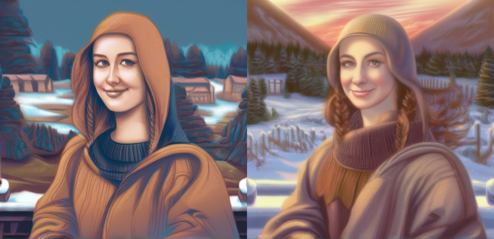

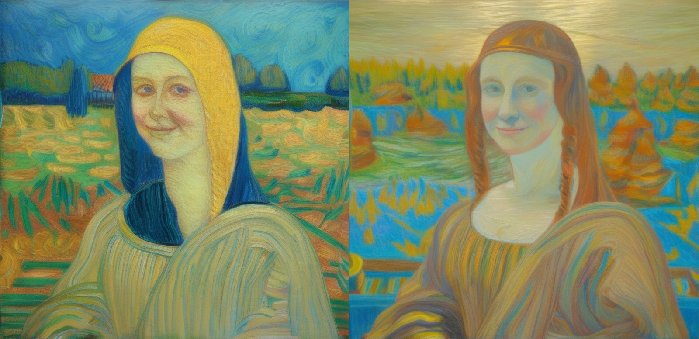

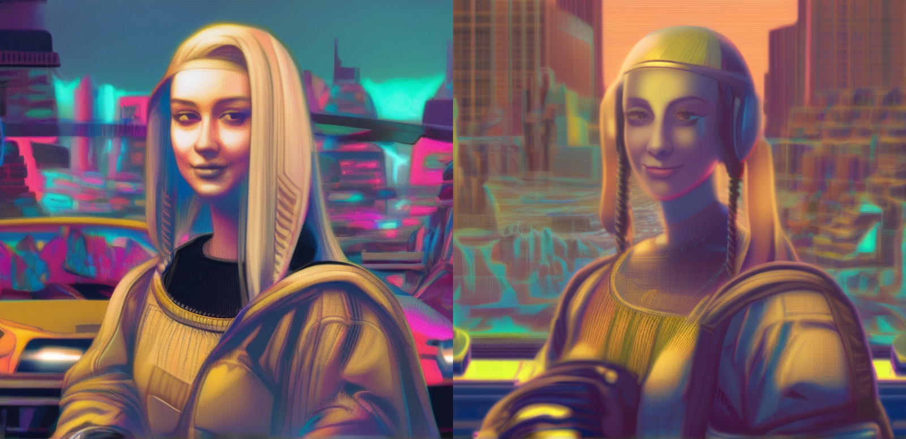

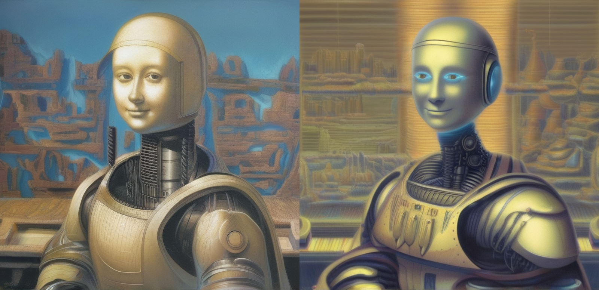

需要指出，基于 Canny 的 ControlNet 模型并不是唯一的选择。我们也可以使用 HED、OpenPose、Depth 等其他控制条件，完成图像风格化的任务。

### 使用指令级修图模式

我们在第 20 讲中已经学过 ControlNet 的指令修图模式。在指令修图模式下，我们只需要提供一个指令式 prompt，说明需要执行的转换操作，ControlNet 便可以生成目标图像。比如，让图像着火，我们不需要添加很多复杂的信息，只需要在指令修图模式中说明 “add fire”，整个画面就瞬间燃起来了。

显然，指令修图的模式更加灵活和高效，我们不需要额外的控制条件输入（比如轮廓线等）便可以生成新图像。能否用这个能力来实现图像风格化呢？当然可以。

我们仍旧以蒙娜丽莎的图片为例，我们首先加载 SD1.5 这个基础模型和与之对应的ControlNet 指令修图模型。

```
checkpoint = "lllyasviel/control_v11e_sd15_ip2p"
controlnet = ControlNetModel.from_pretrained(checkpoint, torch_dtype=torch.float1
pipe = StableDiffusionControlNetPipeline.from_pretrained(
   "runwayml/stable-diffusion-v1-5", controlnet=controlnet, torch_dtype=torch.fl
)
pipe.enable_model_cpu_offload()
```

然后我们依次给出修图指令，将这张图片转换为四种季节不同的风格。你可以点开图片查看生成的效果。

```
prompt = "make it spring"
prompt = "make it summer"
prompt = "make it autumn"
prompt = "make it winter"
generator = torch.manual_seed(0)
image_style1 = pipe(prompt, num_inference_steps=30, generator=generator, image=or
```

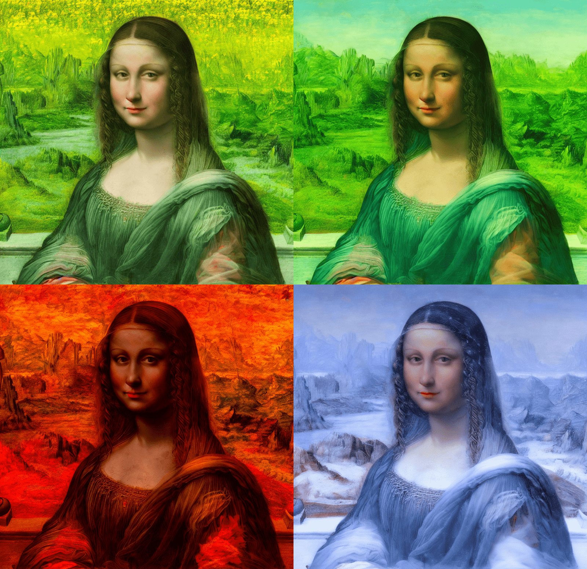

我们也可以尝试通过指令将图片调整为更多有意思的风格。

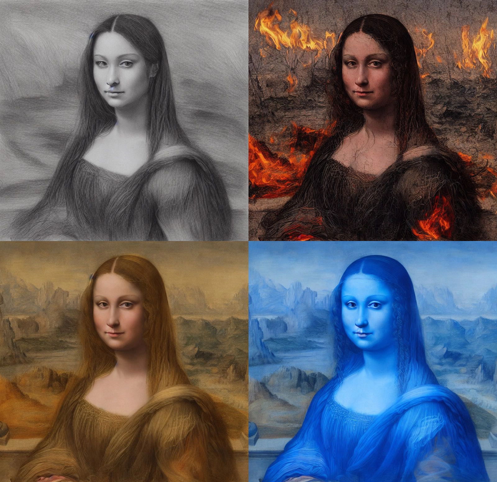

可以看到，ControlNet 的指令级修图功能使用非常简便，并且能得到特色鲜明的风格化效果。

我们在前面第 19 讲曾经学过如何训练自己的 LoRA 风格模型，比如我们的彩铅风格模型。在 WebUI 中，推荐你将自己训练的 LoRA 风格模型和 ControlNet 相结合，实现出独有的风格化效果。

## 模型融合的技巧

实际上，除了使用我们自己训练的风格化模型，使用不同的 SD 模型进行融合也是一种常用的技巧，能够帮助我们快速调制出特色鲜明的 AI 绘画风格。

所谓模型融合，本质上就是对多个模型进行加权混合，从而得到一个合并后的模型。比如说，我们希望将 Anything V5 和 ToonYou 这两个模型进行合并，只需要给每个模型的所有权重值分别乘以一个系数，然后加在一起。

在 WebUI 中，你可以选择 Checkpoint Merger 这个窗口，完成模型融合的过程。比如，在Weighted sum 这个模式下，融合后模型权重的计算方式可以看后面的公式，公式中的 M 就是加权系数。

新模型权重 = 模型 A * (1 - M) + 模型 B * M

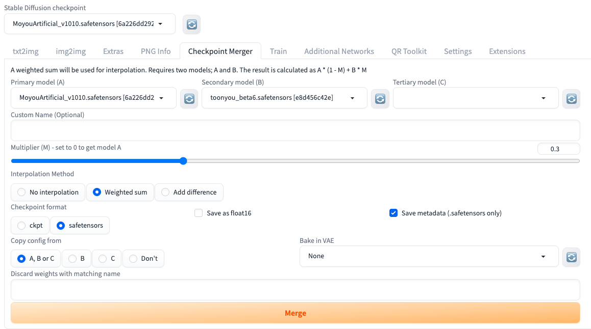

在 Add difference 这个模式下，我们需要提供三个模型，将模型 B 和模型 C 的权重差值以一定的权重加到原始模型 A 上。融合后模型权重的计算方式你可以看后面的公式，公式中的 M仍是加权系数。

新模型权重 = 模型 A + (模型 B - 模型 C) * M

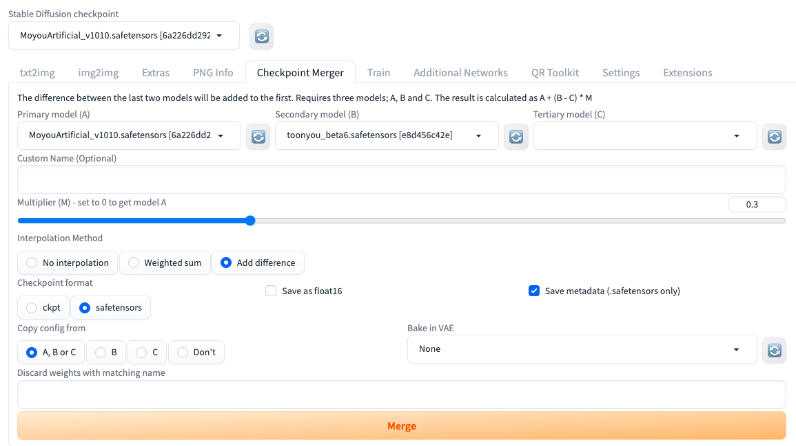

我们可以分别测试一下融合模型的生成效果。对于 Weighted sum 模式，我们将 AnythingV5 模型和 ToonYou 模型按照加权系数 0.5 的方式进行融合。你可以点开图片查看我的参数设置。

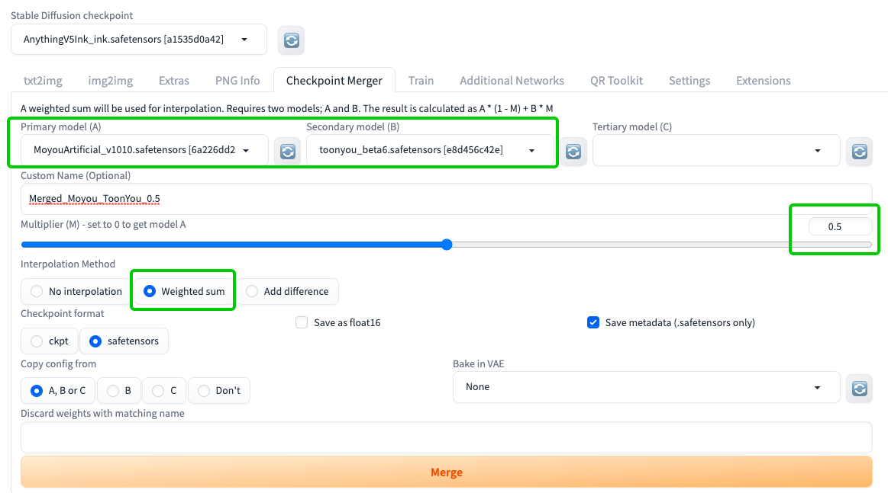

然后我们使用融合后的模型生成图像，用相同的 prompt 与原始模型做一个对比。可以看到，我们调制的新风格与用于融合的两个模型是有明显差异的。

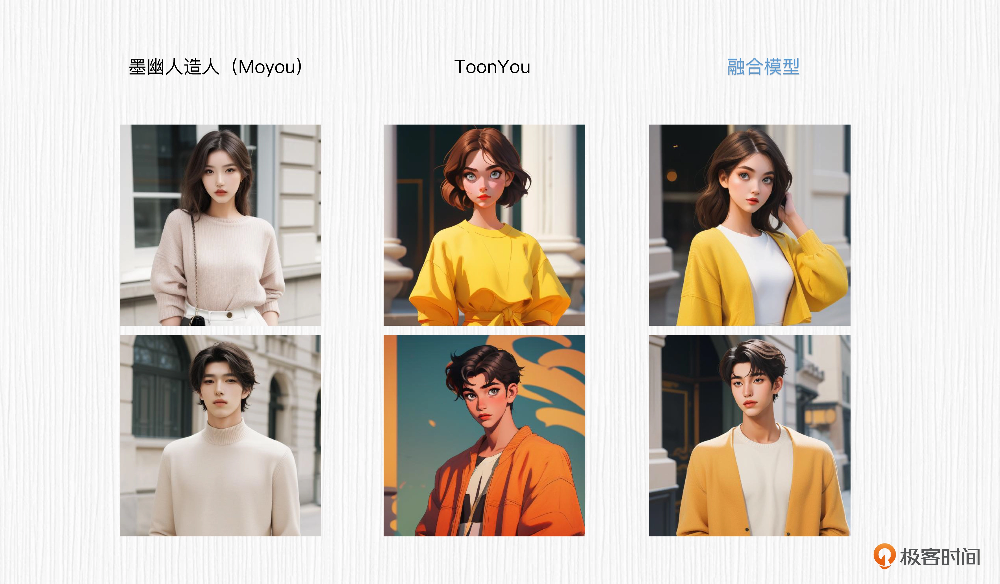

```
Prompt：1girl, fashion photography [女生形象]
Prompt：1boy, fashion photography  [男生形象]
Negative Prompt：EasyNegative
采样器：Eular a
随机种子：603579160
采样步数：20
分辨率：512x512
CFG Scale: 7
```

## 总结时刻

今天这一讲，我们系统探讨了图像的风格化技术。

首先，我们回顾了 GAN 时代的图像风格化技术，从最早期的手工绘制图像对到 AgileGAN 快速生成图像对，再到 VToonify 实现出全图风格化的效果。

然后，我们对基于扩散模型方案的图像风格化进行了汇总，包括图生图、ControlNet、InstructPix2Pix、Null-Text Inversion 配合 Prompt2Prompt 等。基于扩散模型的风格化技术，可以轻松为全图渲染上新风格，而不是像早期的 GAN 技术一样，只局限于人脸区域。

之后，我们分别以图生图、ControlNet 边缘条件和 ControlNet 指令修图为例，完成了图像风格化的项目实战，并探讨了多模型融合调制新模型的原理和 WebUI 操作技巧。

通过这一讲的学习，相信你对于图像风格化这个技术一定有了更多的思考。推荐你课后为我们自己的“创意照相馆”，渲染上各种各样的特色风格！

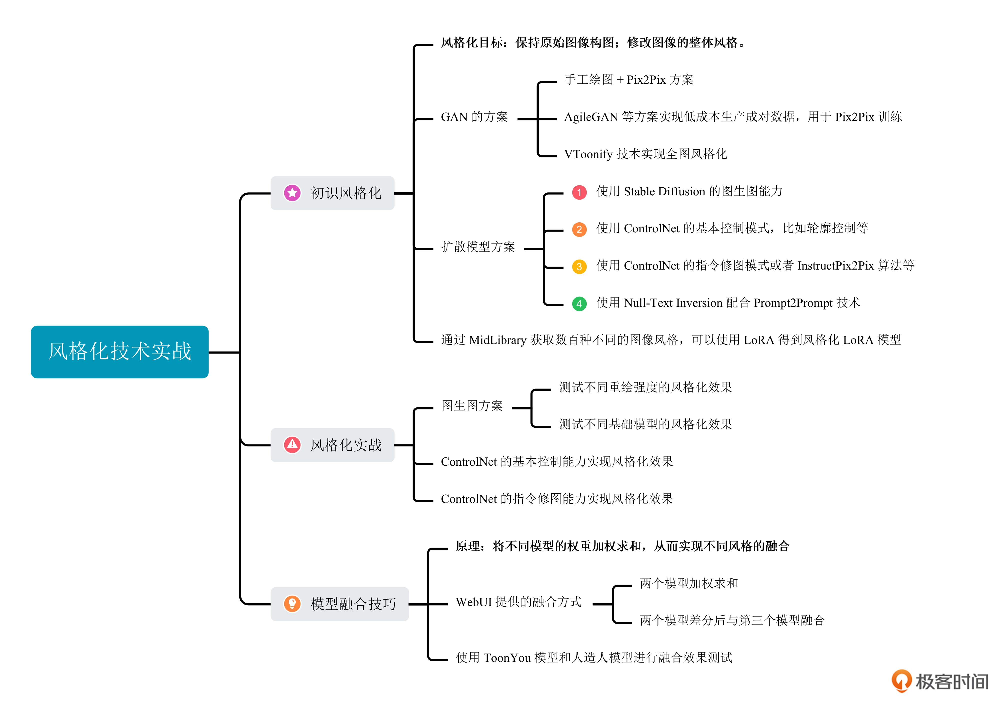

## 思考题

对于模型融合中 Add difference 这个模式，需要对两个模型的权重相减处理，比如 B-C，然后加到另一个模型 A 的权重上。这种方式的融合模型，在风格上会呈现出怎样的特点呢？

欢迎你在留言区和我交流互动，也推荐你把这一讲分享给身边的朋友。
