# 25 | 视频-3D-数字人：探索AI绘画的N种可能

你好，我是南柯。

在之前的课程中，我们已经探讨了 AI 绘画的各种常见技巧，包括文生图、图生图、定制化图像生成、ControlNet 构图控制、图像编辑等。

其实这些图像相关的技能仅仅是 AI 绘画的基本能力。今天这一讲我会带你了解三个更高阶的AI 绘画能力，分别是文生视频技术、通用 3D 生成技术和数字人技术。见识了这些更高级的技术，你对于 AI 绘画的无限潜能一定会有更清晰的认识。在之后的求职择业中，你也可以选择一个感兴趣的切入点，持续地深入下去。

## 视频类技能

对我们来说，无论是使用 SD 模型或者 Midjourney，生成一张 2D 图像似乎并不费劲。很自然地我们会想：对于输入的 prompt，如果生成一系列连续的 2D 图像以后，再将它们连在一起，能否得到精致的视频呢？这其实就是 AI 绘画的视频类技能。

### 体验文生视频

使用 prompt 来生成视频的技术，我们一般称之为文生视频（Text-to-Video）。事实上，这并不是一件容易的事情。文生视频需要满足两个约束条件。第一，生成的视频整体需要符合prompt 指定的内容。第二，需要确保 AI 绘画模型生成的每一帧图像都连贯一致，这样最终生成的视频看起来才不会违和。

你可以点开 Colab 链接，和我一起体验下文生视频的算法效果。首先，我们使用Hugging Face 中能够实现文生视频的模型。

```python
import torch
from diffusers import DiffusionPipeline, DPMSolverMultistepScheduler
from diffusers.utils import export_to_video
# 加载模型文件
pipe = DiffusionPipeline.from_pretrained("cerspense/zeroscope_v2_576w", torch_dty
pipe.scheduler = DPMSolverMultistepScheduler.from_config(pipe.scheduler.config)
pipe.enable_model_cpu_offload()
```

然后，我们写下几组 prompt，测试文生视频的效果。

```
# 使用prompt进行视频创作
prompt = "Darth Vader is surfing on waves"
video_frames = pipe(prompt, num_inference_steps=40, height=320, width=576, num_fr
video_path = export_to_video(video_frames, output_video_path="video1.mp4")
prompt = "A dog wearing a superhero cape flying through the sky"
video_frames = pipe(prompt, num_inference_steps=40, height=320, width=576, num_fr
video_path = export_to_video(video_frames, output_video_path="video2.mp4")
prompt = "A spaceship landing on Mars"
video_frames = pipe(prompt, num_inference_steps=40, height=320, width=576, num_fr
video_path = export_to_video(video_frames, output_video_path="video3.mp4")
prompt = "A horse drinking water"
video_frames = pipe(prompt, num_inference_steps=40, height=320, width=576, num_fr
video_path = export_to_video(video_frames, output_video_path="video4.mp4")
```

我们可以将生成的 mp4 视频文件下载到本地查看生成效果。你需要注意，这些视频文件需要安装 vlc 播放器才能正常播放。我们可以通过后面的 Python 代码将视频转为 GIF 格式，这样查看时更方便。

```python
from moviepy.editor import VideoFileClip
def convert_mp4_to_gif(input_file, output_file, start_time, end_time):
   """
   Convert mp4 video to gif.
   Parameters:
   input_file (str): The path of the input video file.
   output_file (str): The path of the output gif file.
   start_time (int): The start time (in seconds) for gif.
   end_time (int): The end time (in seconds) for gif.
   Returns:
   None
   """
   clip = VideoFileClip(input_file).subclip(start_time, end_time)
   clip.write_gif(output_file, fps=10)
# 使用函数，指定原始文件、目标输出、原始视频中从哪一秒到哪一秒需要转换为GIF
# 这里我们选择第0秒开始，第3秒截止。
convert_mp4_to_gif("video1.mp4", "output1.gif", 0, 3)
convert_mp4_to_gif("video2.mp4", "output2.gif", 0, 3)
```

你可以点开图片查看我们使用 prompt 生成的视频效果。可以看到，这些视频不仅符合我们prompt 所描述的内容，而且内容上是连贯一致的。

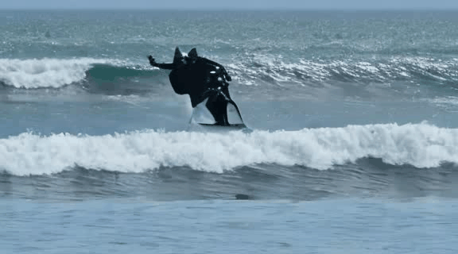

- Darth Vader is surfing on waves

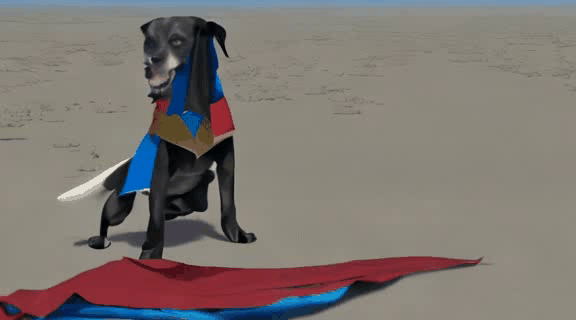

- A dog wearing a superhero cape flying through the sky

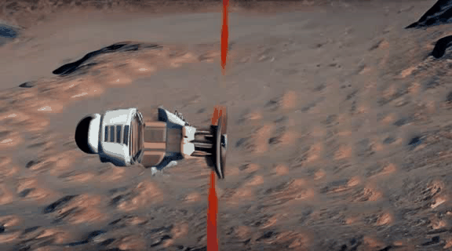

- A spaceship landing on Mars

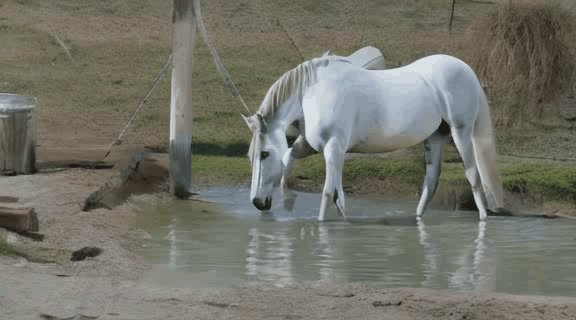

- A horse drinking water

### 技术细节探究

那么，文生视频技术究竟是如何实现的呢？和我们熟悉的文生图相比，它又有哪些不同？

2022 年 9 月底 Meta 提出了 Make-A-Video 技术，我们就以这个算法为例加以说明。如果说 DALL-E 2 是文生图领域的里程碑，Make-A-Video 无疑是文生视频领域的里程碑。整个模型的训练过程可以分为后面两个阶段。

首先，需要使用我们第 13 讲中学过的 DALL-E 2 方案训练一个文生图模型，得到先验模型

## SR

## SR

P、解码器模型 D 和两个超分模型

- 和，这个过程的训练需要用到我们熟悉的图像文​l​h

本对数据。这里推荐你回看第 13 讲，复习 DALL-E 2 的训练过程。

之后，为了让文生图模型能同时生成多帧图像，需要将模型中的 2D 卷积层改造成 3D 时空卷积层，并在帧间引入注意力机制。

经过这样的改造，我们输入一个 prompt，先验模型 P 就可以得到 16 个图像表征。在这个阶段，我们的先验模型 P 已经能够将文本表征转换为图像表征，因此只需要使用一些视频片段数据微调新增加的时空卷积参数和注意力权重，不再需要图文成对数据。

你可以点开后面的图像，进一步了解 Make-A-Video 实现文生视频的过程。首先输入一个prompt，先验模型 P 根据 prompt 生成 16 个图像表征。然后解码器模型对图像表征进行解

## SR

码，得到 16 张 64x64 分辨率的图像。之后经过视频插帧模块、连续两个上采样模块

- 和​l

## SR

- ，最终得到一段高分辨率的视频。​h

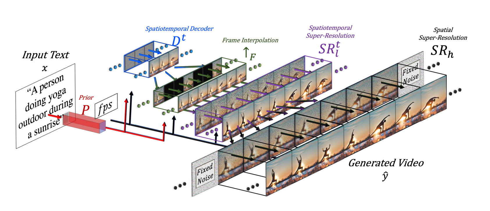

- 图片来源：https://arxiv.org/pdf/2209.14792.pdf

你可以点开图片，看看 Make-A-Video 生成的多帧图片效果。

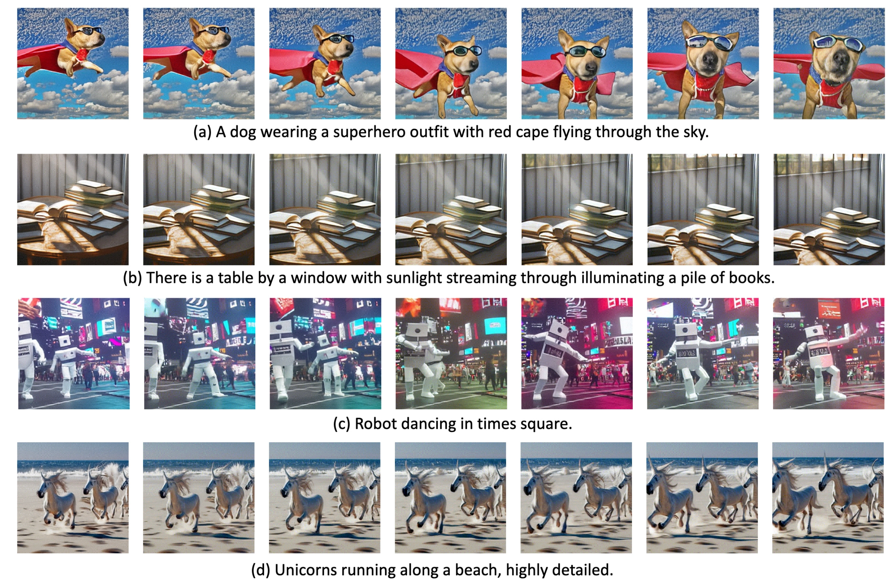

- 图片来源：https://arxiv.org/pdf/2209.14792.pdf

我们可以看到，每一帧图像都满足 prompt 指令的限制，并且前后帧之间有着良好的连续性。这里的连续性，你可以理解为将这些图像帧按照顺序连接成视频，“剧情”是连贯的。

本质上，文生视频技术是文生图技术的延伸。基础的文生图模型负责理解 prompt 文本指令，在此基础上，引入 3D 时空卷积层和一些视频片段，便可以将文生图模型升级为文生视频模型。

### 更多应用延展

如果说文生视频对应的图像任务中文生图的能力，那么有没有对应图生图能力的视频技术呢？答案是肯定的！视频风格化技术解决的正是这个问题。提到视频风格化技术，你可能听说过Runway 公司提出的 Gen-1 和 Gen-2 模型。我们一起看看视频风格化算法的效果。

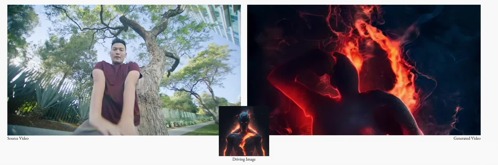

- 视频来源：https://research.runwayml.com/gen2

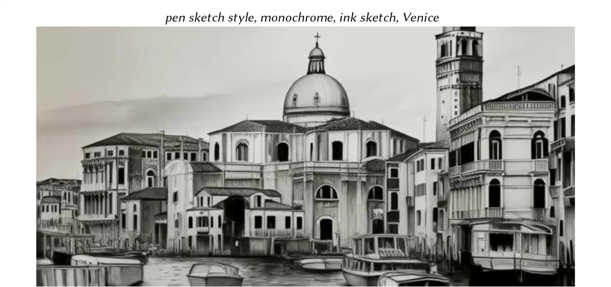

- 视频来源：https://anonymous-31415926.github.io/

除了上面的例子，在短视频平台你可能也看到过一些视频风格化的效果，比如后面这个例子。相比于图像风格化技术，视频风格化需要解决的核心问题是不同帧间的身份一致性问题，以及连续帧的闪动问题。


视频创作的能力为我们带来无限的可能性，各个公司都看到了视频创作的巨大潜力，加速了视频 AIGC 技术的发展。比如，2023 年 4 月，NVIDIA 推出了 Align your Latents 技术，可以产生 4K 高清视频，你可以查看后面的视频效果。


- 视频来源：https://research.nvidia.com/labs/toronto-ai/VideoLDM/

想象一下，Text-to-Video 未来或许可以进化成为 Text-to-Movie，那将是一件鼓舞人心的事情，每个人都有可能成为自己生活的导演。

## 3D 类技能

我们熟悉的 prompt 不仅可以用来生成 2D 图像和连续的视频，还也可以用来生成 3D 模型，完成 3D 内容创作。

### 初识 3D 生成

这就引出了我们接下来的话题——文生 3D（Text-to-3D）。在深度学习技术爆发前，物体的3D 建模主要靠人工完成，整个过程费时费力。随着生成对抗网络（GANs）和自编码器（AEs）等技术的发展，我们逐渐能够通过学习大量的训练数据生成新的 3D 模型。

2020 年NeRF 技术的提出更是将 3D 生成带入了全新的阶段，使用一个物体的一些图片，便可以训练一个神经网络来恢复高质量的 3D 模型。你可以看后面的图片了解一下 NeRF 算法的效果。

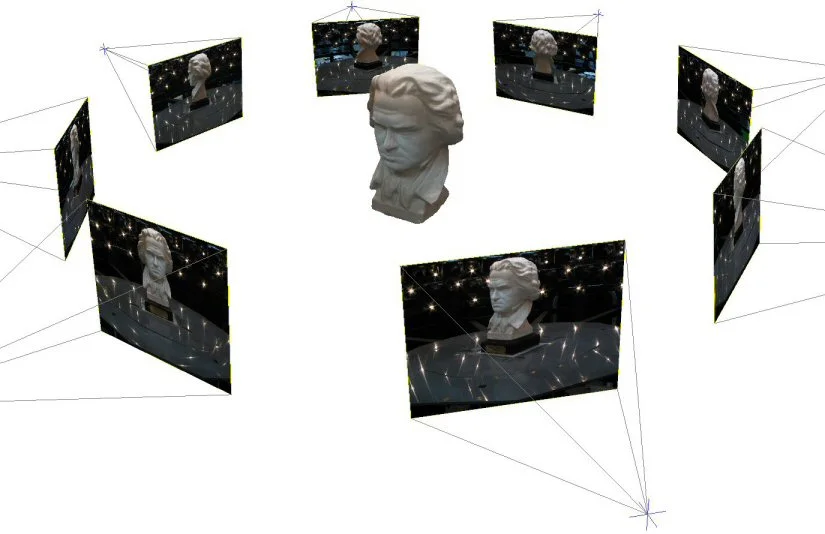

- 图片来源：https://lmb.informatik.uni-freiburg.de/lectures/seminar_brox/seminar_ss16/3DR2N2_3Dreconstruction.pdf

我们这门课程的主角——扩散模型，非常擅长生成天马行空的创意图像。那么它能否用于指导3D 模型的生成呢？答案是肯定的。

无论是 Google 在 2022 年 9 月推出的 DreamFusion，还是英伟达在 2022 年 11 月推出的Magic3D，抑或是字节在 2023 年 8 月提出的 AvatarVerse，都可以通过 prompt 生成完整的 3D 模型。这些算法的生成效果是后面这样。

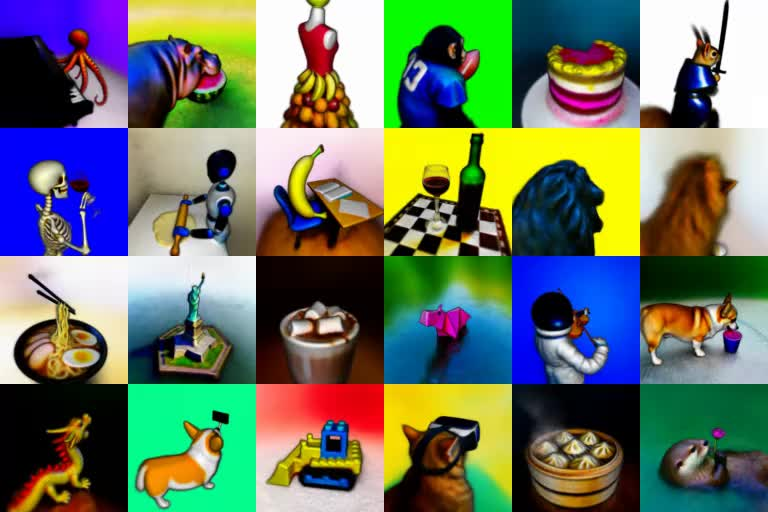

- 视频来源：https://dreamfusion3d.github.io/

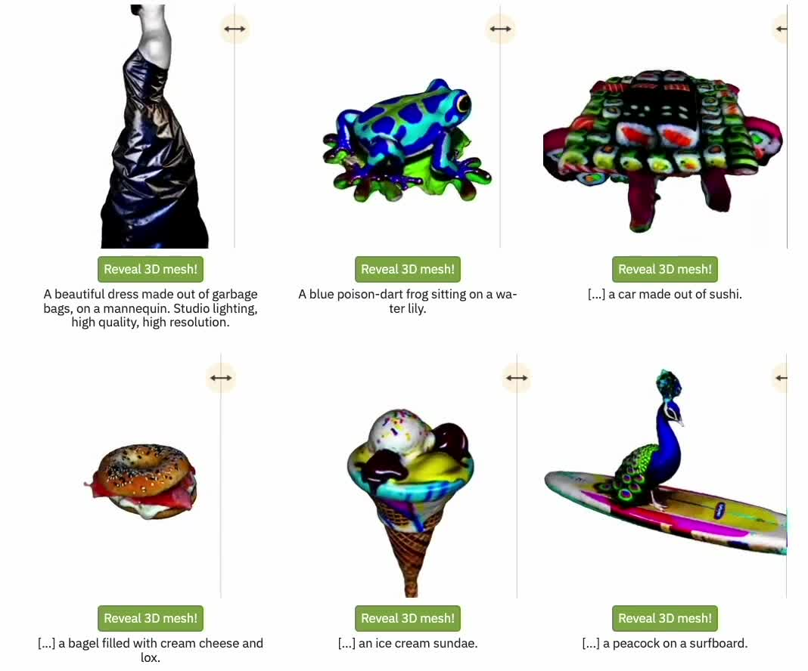

- 视频来源：https://research.nvidia.com/labs/dir/magic3d/

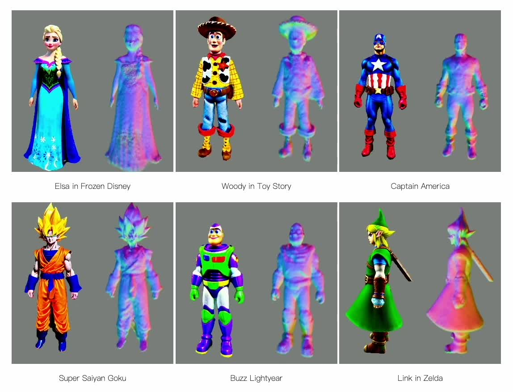

- 视频来源：https://avatarverse3d.github.io/

### 技术细节探究

简单的一行 prompt 是如何完成通用 3D 模型生成的呢？我们这就以 DreamFusion 算法为例，来揭密背后的技术。

我们刚刚说过，NeRF 技术只需要一组图像，便可以重建物体的 3D 模型。如果我们用 AI 绘画模型来生成这样的一组图像，再用 NeRF 来恢复背后的 3D 模型，不就实现了文生 3D 的过程么？这就是 DreamFusion 这个算法背后的原理。

后面的这张算法原理图，展示的就是这个过程，左半部分是 NeRF 结构，右半部分是我们熟悉的一个预先训练好的扩散模型。

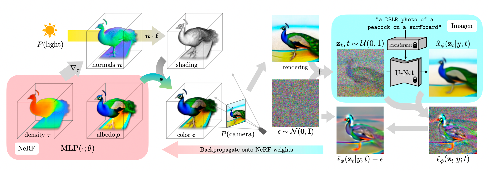

- 图片来源：https://dreamfusion3d.github.io/

简单来说，NeRF 生成的 3D 模型，经过渲染可以得到 2D 图像，而方案中的 AI 绘画模型能够根据 prompt 生成目标 2D 图像。这样我们就可以用 AI 绘画生成的图像和 NeRF 渲染后得到的图像计算损失函数，从而优化 NeRF 模型的参数。

但当前的 3D 生成算法有一个普遍的缺点，就是生成速度慢。比如我们使用 DreamFusion 算法，根据一句 prompt 完成 3D 生成，即使在英伟达高端显卡上也需要花费大约 1 个小时。如何降低文生 3D 算法的耗时，也是当下的研究热点之一。

### 数字人技术

在 3D 物体生成方向，有一个特殊的领域一直备受追捧，那就是数字人（Avatar）技术。更具体而言，数字人技术可以分为两个大方向，分别是数字人创建和数字人驱动。我们今天的讨论主要聚焦于数字人创建技术。

在游戏行业，为用户制作数字人形象已是标配，许多 3D 游戏都实现了这项功能。然而，用户在细节调整中常常感到困扰，花费大量时间选择发型、眼睛、鼻子、嘴巴、眼镜等素材后，所创造的角色可能仍然与用户的形象存在较大差距。

那么能不能通过 3D 生成算法，输入一张照片，自动创建用户的数字人形象呢？这就是数字人创建技术要解决的核心问题。

在扩散模型技术爆发之前，行业内已经有了很多基于物理引擎的数字人创建方案，这些系统通常需要 3D 建模师手工设计数字人模型。2022 年 12 月，微软亚洲研究院推出的 3D 生成扩散模型——RODIN，不仅可以根据输入图片创建数字人形象，还率先实现了从 prompt 创建数字人的能力。你可以点开图像查看这个算法的效果。


- 输入用户图片


- 生成3D虚拟形象 图片来源：https://3d-avatar-diffusion.microsoft.com/

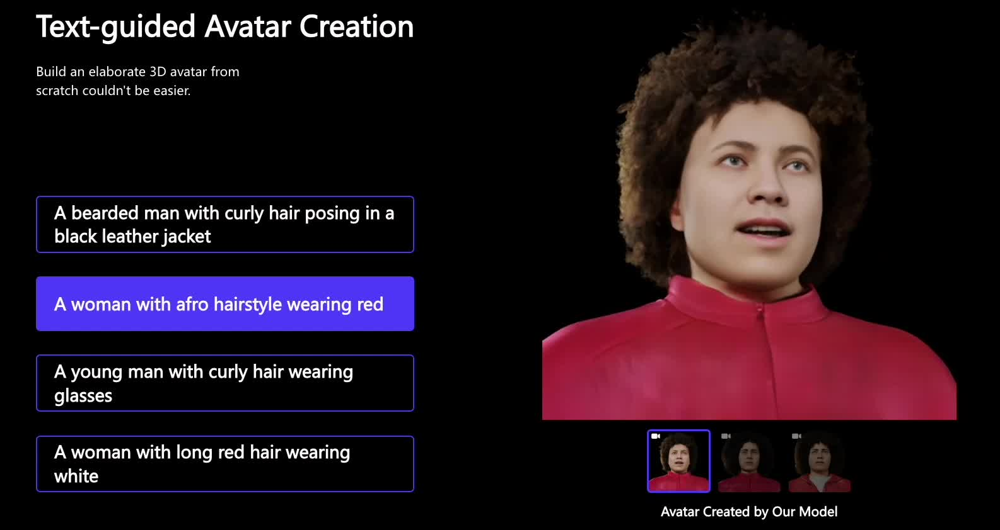

- 图片来源：https://3d-avatar-diffusion.microsoft.com/

那么，Rodin 算法是如何实现这些功能的呢？你可以点开图片，边看原理图边听我讲解。

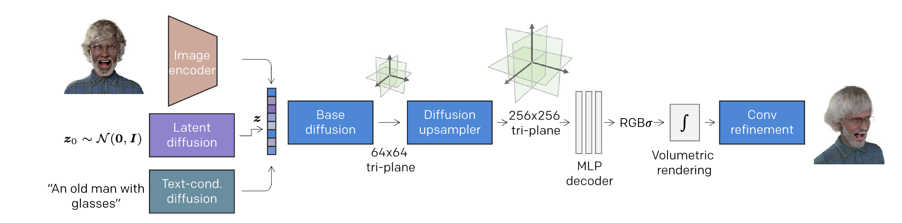

- 图片来源：https://3d-avatar-diffusion.microsoft.com/

首先，Rodin 算法团队引入了大量设计师设计的 3D 素材，构建了一个数字人物理引擎。这个引擎可以组合各种属性（发型、脸型、服饰等），生成 3D 数字人形象，进一步渲染出 2D 形象。同时，论文作者借助一些简单的遣词造句规则，将选择的属性写成 prompt，比如“一个戴眼镜的老年男人”。

然后，使用 2D 图片、prompt 作为算法输入，使用级联模型的形式引入两个扩散模型，最终得到一个名为 tri-plane 的 3D 表征。这样，我们便可以用渲染后的 2D 图像和上一步物理引擎渲染的 2D 图像设计损失函数，对 Rodin 算法的参数进行优化了。

通过这种方式训练出来的模型，无论我们输入一张照片，或者是输入一个 prompt，都可以完成 3D 数字人创建的任务。但这个算法有两个显而易见的缺点。第一，算法生成的 3D 数字人风格单一，只能是训练数据中包含的风格。第二，算法生成的数字人形象无法被驱动，也就是不能做出表情和动作。

相信在不久的将来，会有技术人员提出可以指定任意风格、可以直接被驱动的数字人创建技术。让我们拭目以待！

## 总结时刻

今天这一讲，我们学习了 AI 绘画能力的三项高阶技能：视频创作、3D 生成和数字人技术。这一讲我们主要探讨了这三项技能中最有代表性的技术。

视频创作的代表性技术是 Make-a-Video，我们一起探讨了它背后的算法原理。当前视频生成技术已经可以生成 4K 效果，并且在持续演进。某种意义上说，文生视频也许是 AI 绘画技术的下一个爆发点。

对于 3D 生成，我们探讨了经典解决方案 DreamFusion，搞懂了这个算法如何将 NeRF 技术与 AI 绘画模型相结合，从而实现文生 3D 的神奇效果。之后我们讨论了数字人创建这个特殊的 3D 生成技术，课程里的例子是微软的 Rodin 算法，通过该技术可以实现用图片或者prompt 去生成一个数字人形象。

无论是图像、视频、通用 3D 或者数字人技术，AI 绘画技术都是在高速狂飙。相信很快，使用单图无需训练的创意相册技术、更高清连贯的长视频生成技术、直接生成可驱动的 3D 数字人等技术都会走进我们的视野。对于 AI 绘画这个话题而言，我们今天所见所学都还只是刚刚开始，未来仍旧值得我们期待。

非常鼓励你去读读今天课程中涉及的论文，加深对这些技术的理解。这一讲的知识我整理成了后面的思维导图，方便你课后复习。


## 思考题

经过我们课程的学习，你能否总结下当前广义的 AI 绘画（2D、3D、视频等）有哪些核心问题待解决？这些问题的解决将带来怎样的产品机会？

欢迎你在留言区和我交流互动，也推荐你把这一讲分享给身边更多朋友。
