# 26 | DALL-E3技术探秘（一）：用OpenAI的方式搞数据

你好，我是南柯。

时隔一年半，在 2023 年 9 月 OpenAI “悄悄”发布了 DALL-E 3 这个 AI 绘画模型。相比Midjourney V5.2、SDXL 等时下最强模型，DALL-E 3 在长文本文生图、图中写入文字（也就是我们常说的 Text-in-Image）等方面优势非常明显。

就在这个月（10 月份），OpenAI 相继放出了 DALL-E 3 的安全审核方案和技术方案。它背后所用的技术方案也终于公之于众，刷新了算法工程师对于 AI 绘画模型的理解。接下来的两讲内容，我们就一起探秘 DALL-E 3，带你搞清楚它的技术方案、局限性以及发展趋势。

在我看来，DALL-E 3 有两方面的探索最值得我们关注。一个是如何用生成数据来训练模型，另一个是如何将各种 AI 绘画模型训练技巧有机地组合起来。这节课，我会先为你分享 DALL-E 3 的使用体验，然后结合论文为你深入解读 DALL-E 3 如何用 OpenAI 的方式生成数据。

这两年，技术圈围绕能否使用生成数据训练大模型的话题一直争论不休。使用 BLIP 这类模型为图像生成的描述，无论是用于训练文生图模型，还是训练类似 GPT-4 Vision 这样的图文问答模型，都没有带来显著的收益。如今 DALL-E 3 的成功无疑证实了生成数据用于模型训练的可行性，也将引领下一波用生成数据优化 AI 绘画模型的趋势。

因此，了解了 OpenAI 的数据构造思路，不仅能给微调 Stable Diffusion 模型带来新思路，也能帮你提前预判下一步国内各文生图团队的模型升级方案。

## 初识 DALL-E 3

如果你现在想要体验 DALL-E 3，有两种推荐做法。第一种是使用 NewBing 的 AI 聊天功能，比如我们要求 DALL-E 3 为我们画一幅画，描述一块写着 “GeekBang” 的标志板。你可以点开图片查看生成效果。


点开生成图像看细节，我们会发现生成的图像效果一般，甚至图中的人脸都是糊掉的。这是怎么回事呢？别急，我们接着往下看。


第二种体验 DALL-E 3 的方法是使用 ChatGPT 的 DALL-E 3 功能，这种方案需要开通ChatGPT 的 plus 会员，对于普通用户来说，有一定的运气会命中 DALL-E 3 的内测。如果想通过这种方式体验，可以设法购买已经命中内测的 DALL-E 3 账号。

还是沿用前面的测试案例，这次我们在 ChatGPT 上进行 AI 绘画。你可以点开图片查看我们生成的效果。


可以发现，ChatGPT 和 NewBing 同样使用 DALL-E 3，生成的效果完全不同。

我个人认为造成这种差异的可能原因有两个：第一，NewBing 背后使用的 DALL-E 3 可能是某个“阉割版”，效果不如 ChatGPT 提供的完整版；第二，ChatGPT 会针对我们提供的prompt，做一个详细扩展，将扩展后的 prompt 提供给 DALL-E 3 生成图像，DALL-E 3 对于经过 ChatGPT 扩展后的 prompt 更友好。

你可以点开图片，查看 ChatGPT 对于我们提供的 prompt 作出的拓展（图片右侧的文字）。

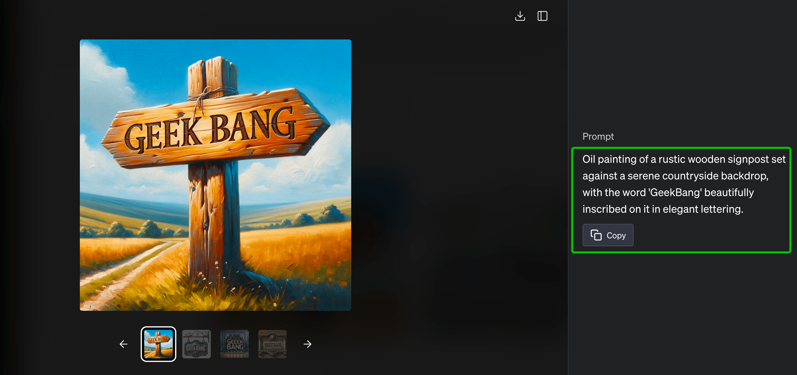

动手体验完，我们再来看看 OpenAI 提供的文生图效果。通过分析这些图像，我们可以得出一个初步结论：配合 ChatGPT 的 prompt 增强能力，DALL-E 3 模型尤其擅长 Text-in-Image 任务、长文本图像生成任务。熟悉 Midjourney、SDXL 等模型的同学应该更容易感受到 DALL-E3 带来的能力提升。

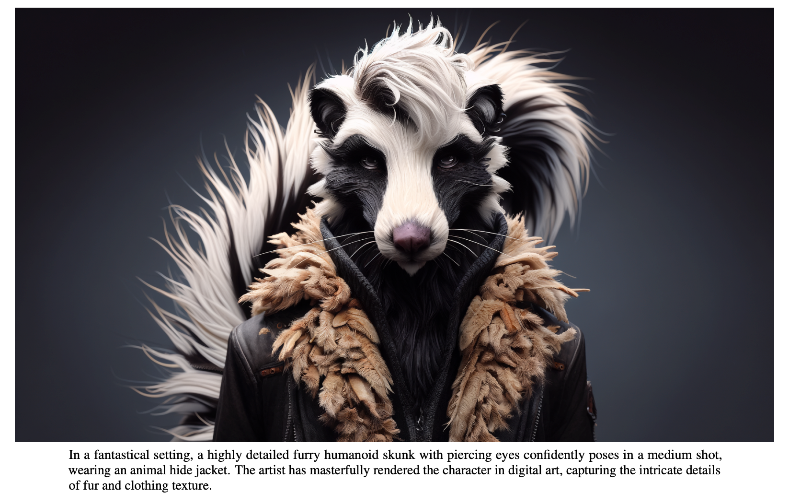

- 图片来源：https://cdn.openai.com/papers/dall-e-3.pdf

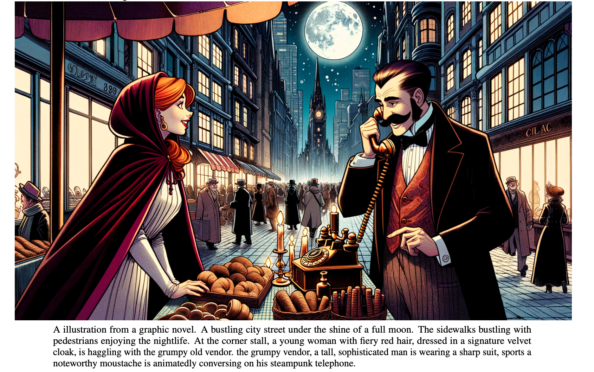

- 图片来源：https://cdn.openai.com/papers/dall-e-3.pdf

总的来说，DALL-E 3 能力的提升主要源自更好的数据策略，同时丢弃掉 DALL-E 2 所采用的unCLIP 结构，选择在 Stable Diffusion 方案的基础上做出定制化改进。现在我们就来看看数据背后的“黑魔法”。

## 基础概念介绍

在正式开始前，我先简单解释一下我们接下来会用到的术语——caption、Alt Text、prompt 和图像描述，有图像描述生成基础的同学可以快速浏览。

对于模型训练而言，使用的数据为图文成对数据，其中的文本部分我们称为 caption，也就是图像标题。从互联网爬取的成对图文数据，其中的 caption 最常用的是 Alt Text（或“alternatetext”“alternative text”）。Alt Text 是一个 HTML 属性，它提供了对图片内容的文本描述。比如后面代码片段中展示的样子。

```xml

```

Google 这类搜索引擎在展示搜索到的图片时，通常会显示与图片相关的描述信息，比如下面图像中柯基犬的例子。

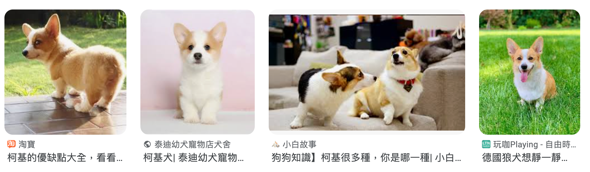

训练 CLIP 模型使用的就是互联网上的这些图像文本数据，其中的文本部分多数情况下就是图像的 Alt Text。

为什么说多数情况呢？是因为部分图像没有 Alt Text，这时候搜索引擎需要根据网页中图片周围的文本内容，或者由机器学习模型提供的图像分析信息等，为图像生成描述信息。在 DALL-E 3 论文中，基线方案使用的就是 Alt Text 作为训练数据的 caption。

认真观察上面图片中的图像 caption，我们会发现图文一致性并不是很理想，比如第一张图看不出“柯基犬的优缺点”。此时，我们可以使用 BLIP 等模型为图像生成 caption，这个过程称为图像描述。

当完成 AI 绘画模型的训练，用户便可以提供文本描述完成文生图任务，这里的文本描述我们更习惯称为 prompt。

搞定了这些稍显复杂的概念，我们便可以进一步了解 OpenAI 的技巧了。

## 数据集重新描述

在数据维度，DALL-E 3 重新描述了用于训练的图像数据，也就是丢弃掉图片的 Alt Text，用专门的模型生成更准确的 caption。作者将这个技术称为 Dataset Recaptioning。

互联网图文数据存在图文一致性差的问题，通过前面柯基犬的例子我们已经有了初步认识。

我们熟悉的 Stable Diffusion 模型是使用互联网数据训练得到的，尽管 Stable Diffusion 模型不停迭代，但从下面的图中可以看出，最初 Stable Diffusion 的迭代主要围绕丰富图像的美学质量展开（直白一点说就是让图像更美观）。

所以，虽然 Stable Diffusion 模型文生图的效果在不断提升，但是我们在使用 Stable Diffusion时，还是会经常遇到生成图像很难准确遵循 prompt 内容的情况，也就是模型“不够听话”。

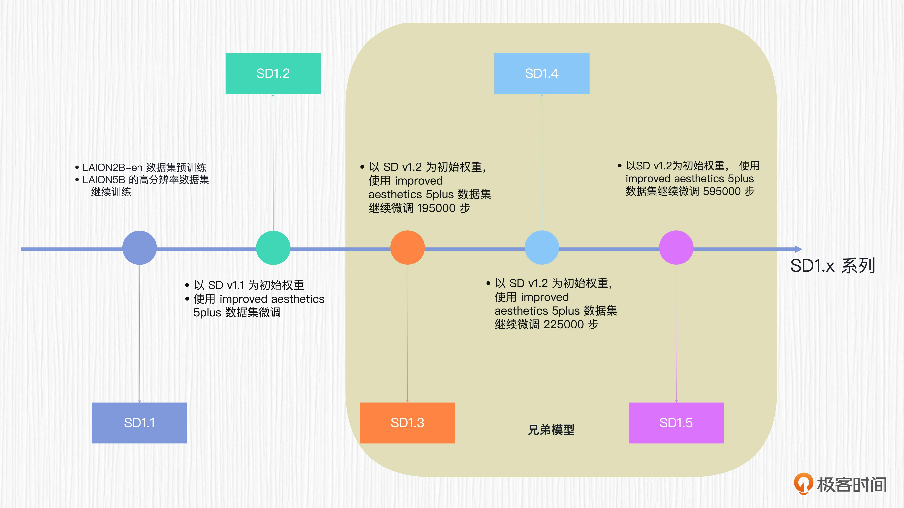

DALL-E 3 的作者认为“不听话”的问题主要是由于训练数据造成的，具体来说，原始数据至少存在后面这四个问题。

第一，caption 通常只关注图像主体部分而忽略细节，比如厨房中的水槽、人行道的标志牌。

第二，caption 中对于图像物体的位置信息、数量信息常常会给出不准确的描述。

第三，caption 中对于图像物体的颜色、大小等常识性知识会有缺失。

第四，caption 通常不会描述图像中展示的文字内容。

如果 caption 内容更完整，训练出来的 AI 绘画模型能否更听话？正是基于这样的考量，DALL-E 3 使用了 Dataset Recaptioning 策略，也就是丢弃掉图片的 Alt Text，用专门的模型生成更准确的 caption。

那具体要用什么模型生成图片描述呢？在 DALL-E 3 之前最常用的做法是使用 BLIP、DeepDanbooru 这些模型。用过这些模型的同学会发现，BLIP 生成的 caption 像是一个模子刻出来的，通常就一句话。而 DeepDanbooru 这类模型生成的 prompt 通常是一系列标签，所以使用这类模型时，我们需要使用 “1girl” 这类奇奇怪怪的 prompt。

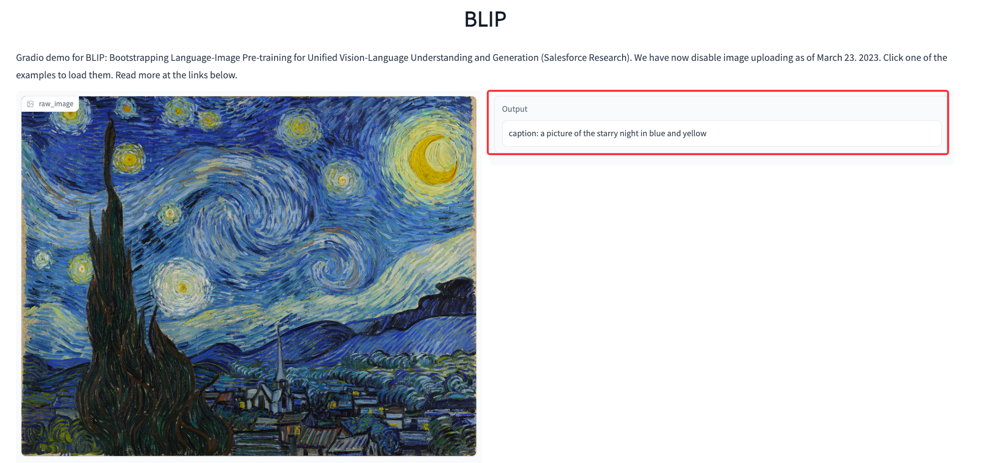


既然常用的模型不能生成理想的 caption，DALL-E 3 便重新训练了描述生成模型。训练过程分为预训练和模型微调两个阶段。

在预训练阶段，使用 CLIP 图像编码器提取的图像特征作为输入，使用源自互联网的原始caption 作为目标输出，通过自回归的方式进行 caption 生成，也就是每次预测下一个 token。

你可以点开后面的图像深入了解。图中的图像编码器（Image Encoder）是一个预训练的CLIP 模型，单模态文本解码器（Unimodal Text Decoder）可以提取文本特征，用于和图像特征计算相似度。然后，图像编码器输出的特征会通过交叉注意力机制（第 7 讲）的形式作用于多模态文本解码器，为图像生成描述。

因此整个训练过程有两个损失函数：CLIP 对比学习损失（Contrastive Loss）和描述预测的损失（Captioning Loss）。

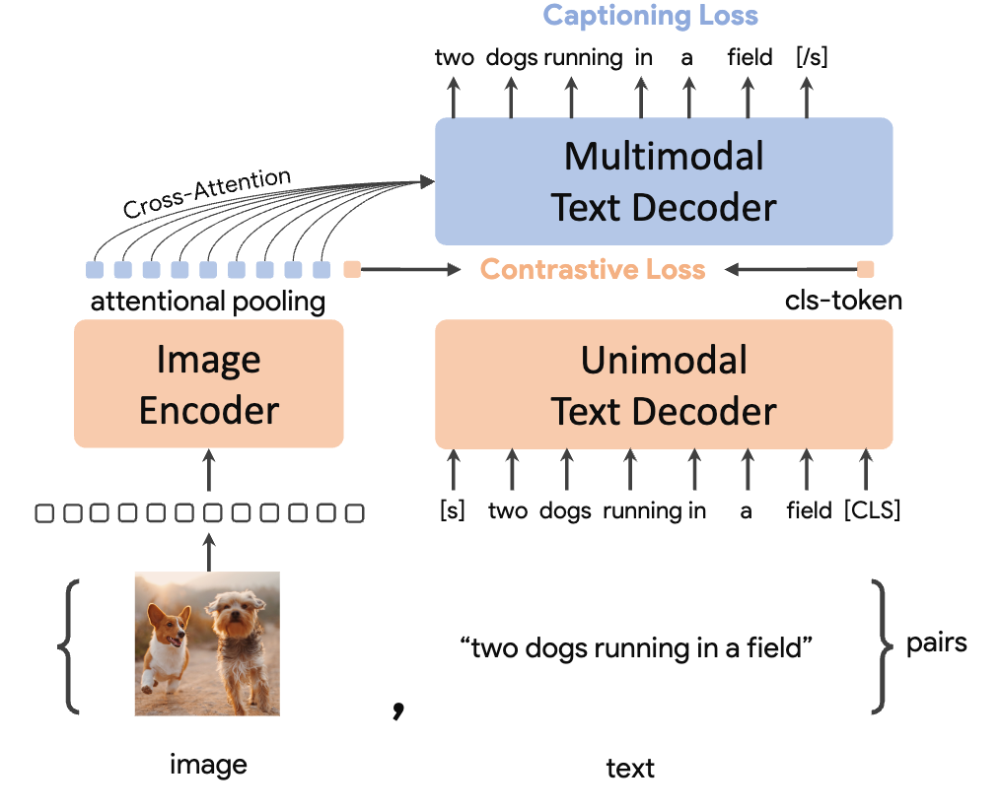

- 图片来源：https://arxiv.org/abs/2205.01917

由于用于训练的目标描述存在前面提到的四个问题，预训练模型为图像生成的 prompt 同样存在这四个问题。

正因如此，作者提出需要对预训练模型进行第二阶段的微调。预训练模型的目的是使用大量数据让模型具备基本的图像理解能力，微调的目的则是通过少部分数据让模型输出信息丰富的caption，这点我想提醒你注意区分一下。

在模型微调阶段，作者使用两种不同的 caption 语料得到两个描述生成模型，问题的关键还是如何构造高质量的训练语料。

第一个模型使用的语料仅包含图像主体内容描述，第二个模型使用的语料则包括内容翔实的图像内容描述，包括文字信息、颜色细节等。训练过程和预训练阶段相同，两个微调模型生成的caption 分别被称为 SSC（短合成语料，short synthetic captions）和 DSC（详细合成语料，descriptive synthetic captions）。

你可以点开图片查看原始 caption（Alt Text）、SSC 语料和 DSC 语料，需要说明，图片中展示的是用于训练模型的 caption，而非模型生成的结果。

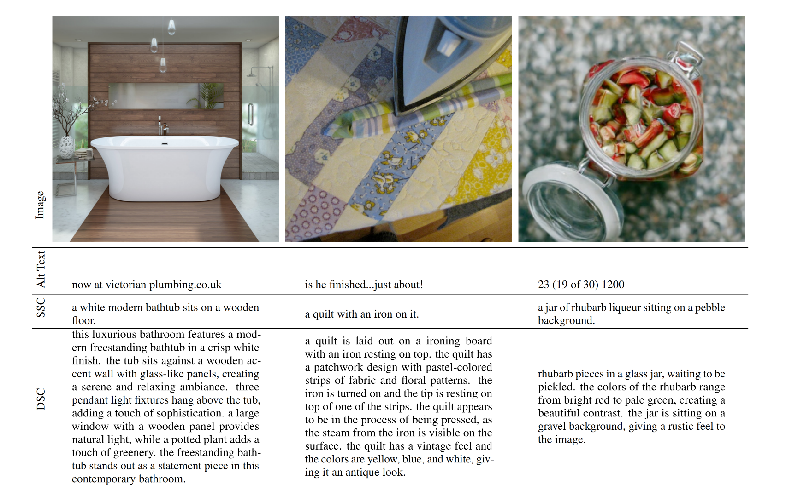

虽然论文中没有说明这两份训练语料是如何获得的，我们还是可以大胆猜测，这两份训练语料是由 GPT-4 Vision 模型生成的。

我们不妨通过 ChatGPT 模拟一下这个过程。首先上传一张图片（示例截图自原始论文，你也可以选自己手里的图片测试），然后我们要求 GPT 帮我们生成两份训练语料，对应 DALL-E3 论文中的 SSC 和 DSC 语料。你可以点开下面的图片查看数据生成效果，对比 DALL-E 3 论文给出的样例，是不是有点相似？


## 生成数据有效性

完成了对图片数据的重新描述，下一步就是验证生成数据的有效性，需要通过实验回答下面两个问题。

第一，使用生成数据是否会影响 AI 绘画模型的最终表现。

第二，生成数据和真实数据的最佳混合比例是多少。

针对第一个问题，作者设计了三个实验，分别使用真实数据、SSC 数据和 DSC 数据训练文生图任务，分别用 50000 条未参与训练的真实 prompt、DSC prompt 进行文生图测试。

针对测试的 prompt 和生成的图像，使用我们第 10 讲学过的 CLIP 模型计算图文一致性。具体来说，就是用 CLIP 的图像编码器提取图像特征，文本编码器提取文本特征，然后计算它们归一化之后的余弦相似度，用 1 减去余弦相似度便是余弦距离。余弦距离越小，表示图像和文本的一致性越强，也就代表了 AI 绘画模型“更听话”。

关于余弦距离的计算，你可以参考后面这段代码来理解。

```python
import numpy as np
def cosine_distance(a, b):
   dot_product = np.dot(a, b)
   norm_a = np.linalg.norm(a)
   norm_b = np.linalg.norm(b)
   cosine_similarity = dot_product / (norm_a * norm_b)
   # 由于精度问题，有时候cosine_similarity可能略大于1，所以进行一下clip操作
   cosine_similarity = np.clip(cosine_similarity, -1.0, 1.0)
   cosine_distance = 1.0 - cosine_similarity
   return cosine_distance
# 使用示例
a = np.array([1,2,3])
b = np.array([4,5,6])
print(cosine_distance(a, b))
```

后面这组图中，左图是使用 50000 真实 caption 数据测试的结果，右图是使用 50000 DSC 数据测试的结果，图像的 y 轴代表的是余弦相似度。可以看出，在实验里，使用 DSC 数据做文生图训练，测试时图文一致性表现更好。

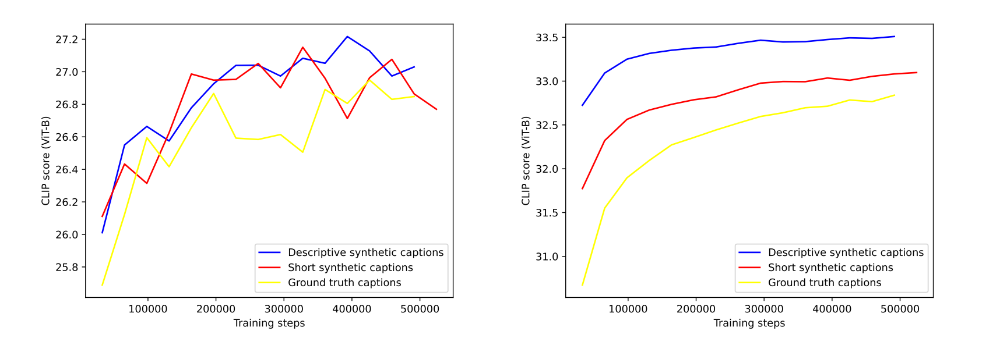

至于为什么没有使用 SSC 数据做测试，作者在论文中的说法是 SSC 数据测试的表现和真实caption 数据非常接近，所以就没有把结果贴出来。

## 数据混合策略

既然生成数据比真实数据更优质，那我们自然会想到这样一个问题——在训练的时候能否只使用生成数据？答案是不能。

这是因为如果只使用生成数据，模型很容易过拟合到某个我们不知道的范式上，比如首字母大小写、prompt 必须以句号结尾等，这些范式与使用的描述生成模型息息相关。在这种情况下，用户自己写 prompt 进行 AI 绘画的时候，由于不满足训练数据的范式，文生图的效果就会大打折扣。

针对这个问题，DALL-E 3 给出了两个有趣的解决思路。

第一个解决思路很简单，既然互联网图片的文本信息多数都是人工撰写的，那就让模型既学习合成数据，也学习真实数据，即使真实数据质量不高。那混合比例怎么确定呢？

论文中设计了多组 DSC 数据和真实数据的混合实验，DSC 数据占比为 65%、80%、90%、95% 等，仍旧使用 CLIP 特征的余弦相似度评估图文一致性。

后面的图片就是实验结果，可以看到，DSC 数据占比 95% 训练得到的模型效果最好。DALL-E 3 的模型便是使用这个数据配比训练得到的。

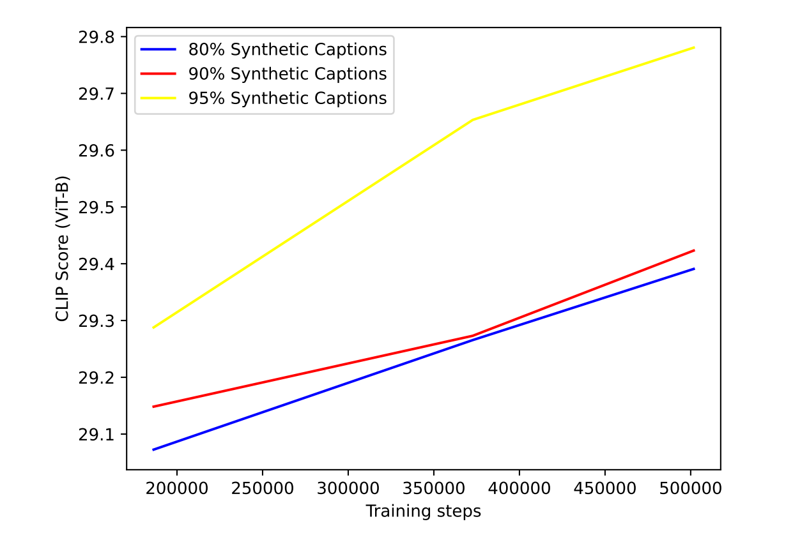

第二个解决思路是使用 ChatGPT 对用户输入的 prompt 进行“扩写”，论文中称为“upsample”。后面图片中第一行是原始 prompt 及其文生图效果，第二行是扩写后的 prompt及其文生图效果。

可以看到，扩写后的 prompt 不仅包含了更多细节信息，而且能够帮助模型处理复杂的逻辑关系。比如第二列图“披萨大小”的硬币，使用原始 prompt 没有生成出要求的硬币大小，而使用扩写后的 prompt 生成的图像则符合我们的要求。

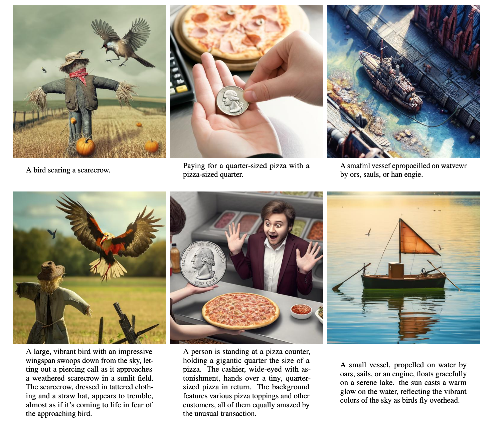

我个人认为，大概率 DSC、SSC 的训练数据就是用 ChatGPT 生成的，所以使用 ChatGPT对用户提供的 prompt 扩写，也是为了让 DALL-E 3 的输入 prompt 更加贴近训练数据范式，避免模型出现“翻车”的现象。

## 总结时刻

今天我们探讨了 DALL-E 3 惊艳效果背后的关键技巧：为图像数据重新生成描述。DALL-E 3不仅证明了更高质量的文本描述可以训练出更“听话”的模型，也成功论证了使用合成数据训练多模态大模型是可行的。

关于描述生成模型的训练，DALL-E 3 采用两阶段的训练模式，第一阶段使用原始图文数据进行预训练，第二阶段使用高质量描述文本进行模型微调，最终得到一个优于 BLIP、DeepDanbooru 这类方案的描述模型，重新对文生图训练数据进行描述生成。

在使用 DALL-E 3 模型进行文生图时，同样会利用 ChatGPT 对用户输入的 prompt 进行扩写，这是为了提升文生图的算法效果。

对于 Midjourney 这类产品来说，遵循 DALL-E 3 的数据构造范式，可能是提升 AI 绘画模型的下一步举措。

## 思考题

我想请你思考这样一个问题：既然 OpenAI 能用自家的 GPT-4 Vision 输入图片生成 DSC 和SSC 语料，为什么不直接用 GPT-4 Vision 为所有训练数据生成描述，而是舍近求远，微调一个单独的描述生成模型呢？

期待你在留言区里和我交流互动，如果你觉得这一讲对你有启发，也推荐你分享给身边更多的朋友。
