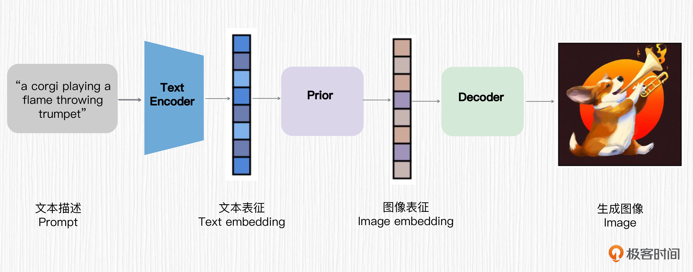
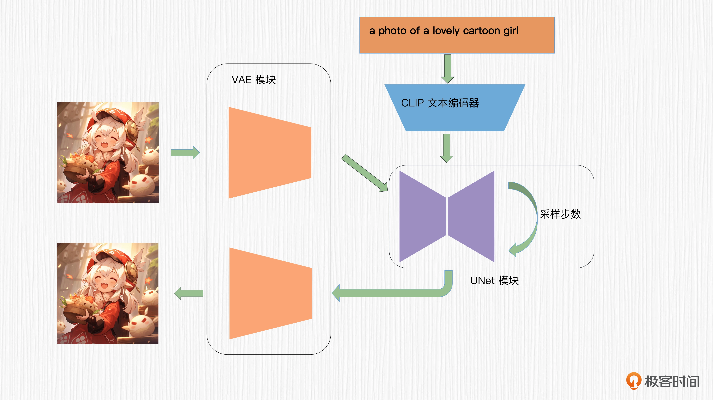
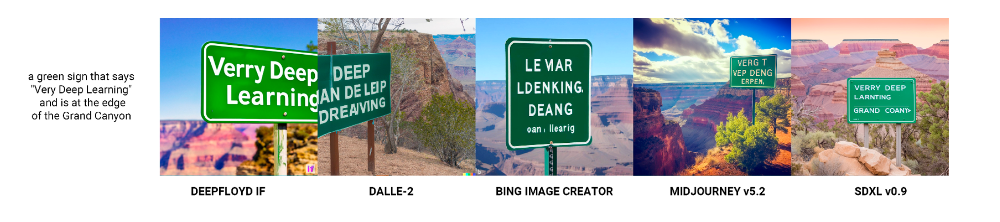
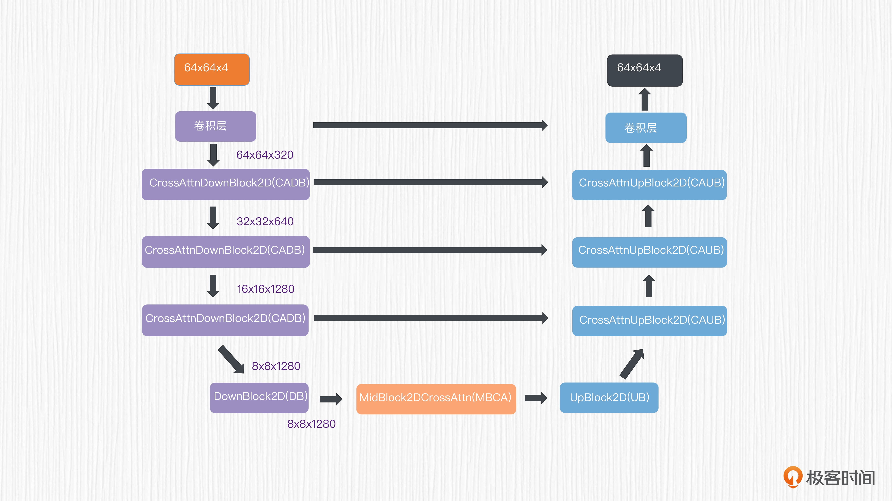
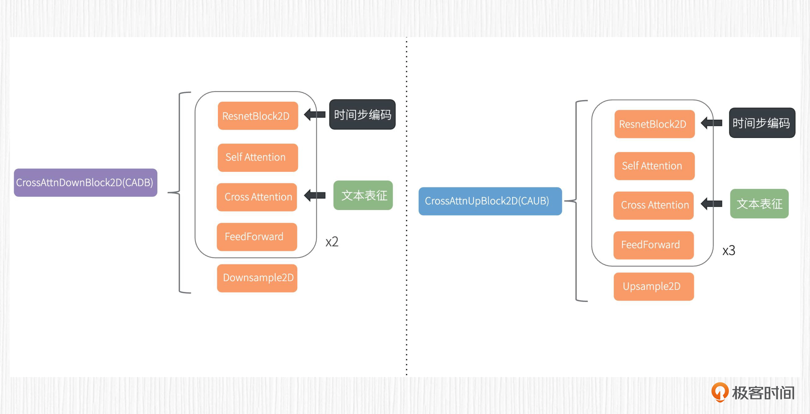
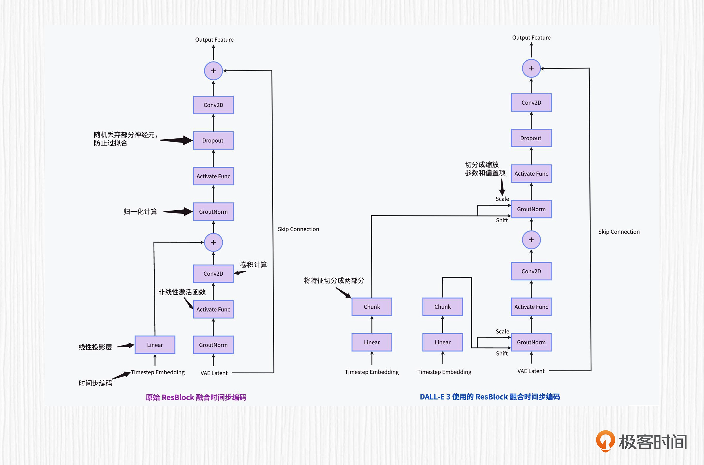
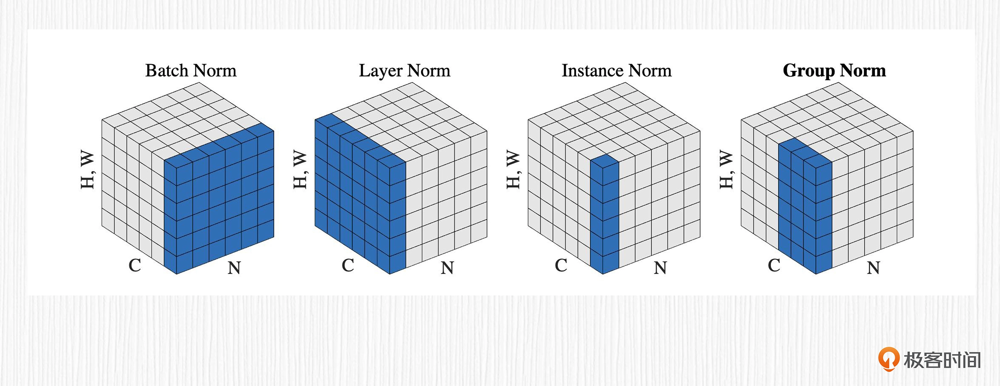
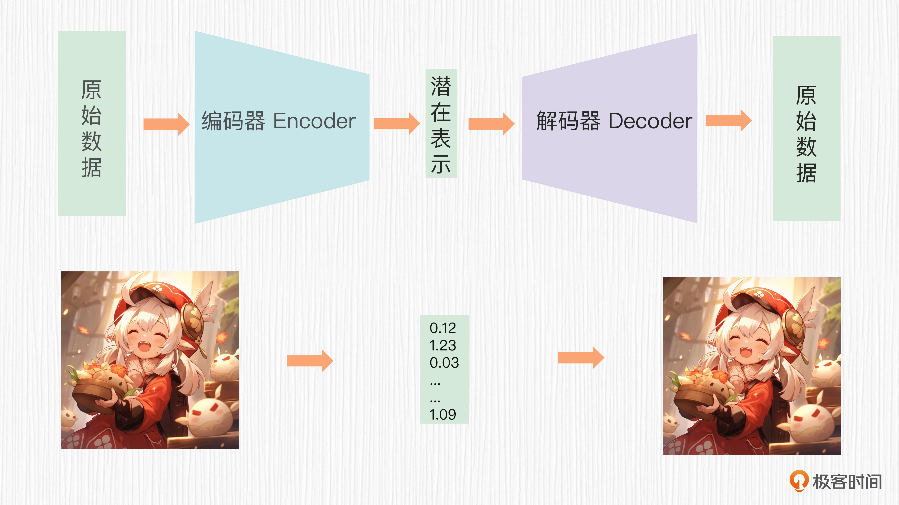
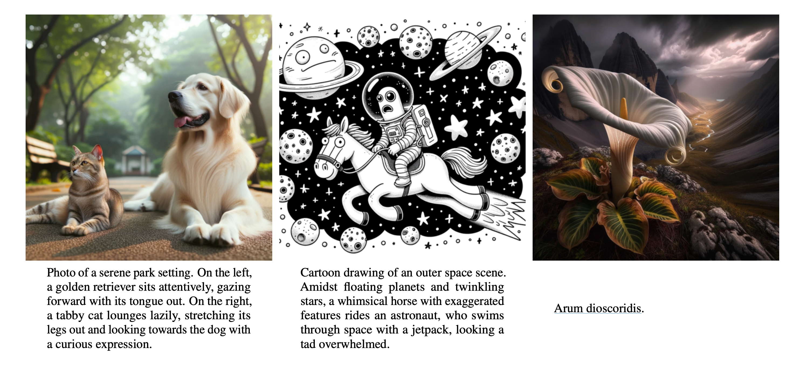
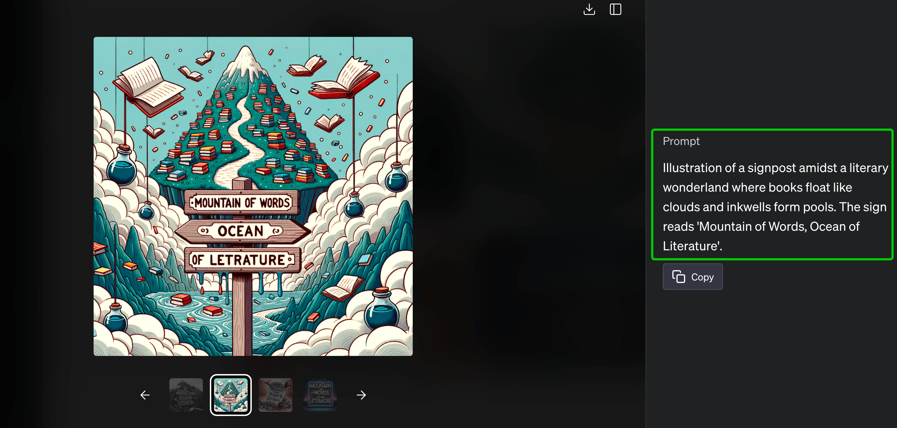

# 27 | DALL-E3技术探秘（二）：从unCLIP到缝合怪方案

你好，我是南柯。

上一讲，我们已经了解了 DALL-E 3 针对训练数据使用的策略，也就是重新生成图像描述。事实上，除了数据策略，相比 DALL-E 2，DALL-E 3 还在方法上大刀阔斧地做了很多改变。它放弃了 unCLIP 的模型设计思路，转而借鉴了 Imagen、Stable Diffusion 等模型的方案，成为了新一代“缝合怪”。

这一讲我们继续揭密 DALL-E 3，深入探究它背后的技术方案。我们先从 DALL-E 3 的模型结构说起。

## 加入 VAE 结构

通过第 13 讲我们知道，DALL-E 2 使用的是 unCLIP 结构。这个方法可以概括为用 CLIP 提取文本表征，通过一个扩散模型将文本表征转换为图像表征，然后通过另一个扩散模型指导图像的生成。



不过 DALL-E 3 没有采用这种结构，而是借鉴了 Stable Diffusion 的思路，引入了 VAE 模块，在潜在空间进行加噪和去噪。关于 Stable Diffusion 的算法原理，你可以回顾课程的第 15讲。在 DALL-E 3 中，VAE 的编码器对训练图像进行 8 倍下采样，提升了扩散模型的训练效率。



DALL-E 3 生成图片的分辨率是不固定的，比如我们使用两个不同 prompt 生成图像，并没有指定生成图像的分辨率，得到的图像分辨率分别为 1024x1024、1792 × 1024，你可以点开图片查看效果。


检查 ChatGPT 扩写后的 prompt，我们也没有发现分辨率相关的信息。

```
左图原始prompt：山重水复疑无路，轻舟已过万重山 [说明：源自两首诗]
ChatGPT扩写prompt：Photo of a vast landscape with towering mountains that seem to
右图原始prompt：写着“Midjourney is scared”的标志板
ChatGPT扩写prompt：Illustration of a rectangular wooden board hanging by chains, w
```

结合上述信息，我推测 DALL-E 3 训练时使用了不同分辨率的图像数据，比如 512x512、892x512 等分辨率，经过 8 倍降采样后得到潜在表示训练扩散模型。

之后，DALL-E 3 也有可能采用类似 DALL-E 2、Imagen 等方案的扩散模型超分方法，进一步提高输出图像的分辨率。在生成图像时，根据用户输入的 prompt，确定文生图任务的宽和高，类似于我们在 WebUI 中指定图像宽高的过程。

## CLIP 换 T5

在 DALL-E 3 技术报告放出来之前，我曾经猜测它背后的文本编码器是某个比 T5-XXL 更强大的模型。

这样猜测的依据是，即使使用 Imagen、DeepFloyd 等模型，能在图像中写入的文字不超过 3-4 个，当我们要求更多文字时，生成的效果就会比较诡异。而当我测试 DALL-E 3 时，发现写入更多文字的任务它也能胜任。

比如下面两张图，是 DALL-E 3 和 ideogram 两个模型采用相同 prompt 的效果，对比之后就能看到 DALL-E 3 的生成效果要更好一些。


但论文中对于文本编码器的介绍否定了我的推测，OpenAI 将 DALL-E 2 的 CLIP 文本编码器换成了 Google 的 T5-XXL 模型。

我们在第 14 讲学习 Imagen 的时候详细讨论过，T5-XXL 模型是纯文本语料训练得到的模型，参数量共计 110 亿，是 DALL-E 2 用到的 CLIP 文本编码器的 175 倍。可以说 T5-XXL 文本编码器是现在所有能实现 Text-in-Image 能力的模型的首要选择，比如 Imagen、DeepFloyd 模型，我推测 Imagen 团队成员推出的 ideogram 模型用的也是 T5-XXL。

值得一提的是，想要增强 AI 绘画模型的文本理解能力，除了使用 T5-XXL 模型这种策略，还有一种策略是组合使用多个 CLIP 模型。

表面上看是“三个臭皮匠，顶个诸葛亮”，实际效果上似乎差点意思。比如，我们熟悉的 SDXL（第 16 讲）便是将多个 CLIP 模型提取的文本表征拼接起来，这样做虽然让 AI 绘画模型更听话一些，但仍旧不能胜任 Text-in-Image 的任务。你可以点开后面的图片，观察下这些经典模型的 Text-in-Image 能力。



问题来了：为什么同样是 T5-XXL 模型，用在 DALL-E 3 里就能呈现出更强的 Text-in-Image能力呢？我推测答案仍旧是 DSC 数据本身包含了训练图片中的文字，数据质量的提升让DALL-E 3 能更好地发挥 T5-XXL 的能力。

值得一提的是，T5 模型提取的文本表征，并没有直接通过交叉注意力机制作用于 UNet 结构（这里建议回顾第 15 讲），而是通过一个 xfnet 的结构完成的。遗憾的是我并没有检索到xfnet 相关信息，论文中也没有给出 xfnet 的参考论文，目前我推测它的作用是处理 DSC 语料文本较长的问题，从而提升交叉注意力机制的计算效率。

## 改进时间步编码

此外，DALL-E 3 还升级了时间步编码的作用机制。我们首先回顾下 Stable Diffusion 中的UNet 模型结构。以 512x512 分辨率的生成任务为例，经过 VAE 的 8 倍降采样编码后，潜在表示维度为 64x64x4，然后使用降采样、上采样和跳跃连接，完成 UNet 预测噪声的过程。



prompt 文本表征和时间步编码作用于所有降采样和上采样模块。其中时间步编码作用于ResnetBlock 模块，文本表征通过交叉注意力完成信息注入。



想要搞清楚 DALL-E 3 对于时间步编码的改进，我们还需要了解时间步编码作用于ResnetBlock 模块的原理。下面这张图展示了常规文本表征注入形式和 DALL-E 3 改进后的注入形式。



顺便说一句，这张图我画了一个小时，你头一次看可能觉得很复杂，但跟上我的思路一定可以看明白。我们这就来分析其中的细节。

先看图中的左半部分，可以发现，原始的时间步编码经过全连接投影（Dense）后，直接“加到”了图像特征上。

然后再观察图中的右半部分，我们可以发现在 DALL-E 3 中，时间步编码通过两个可学习的线性投影层（Linear），拆分（Chunk）成两块，分别得到缩放参数（Scale）和偏置项（Shift），作用于原始 ResnetBlock 模块的 GroupNorm 部分。简言之，不同时间步可以得到不同的缩放参数和偏置项，从而影响这一步的 GroupNorm 的计算。

这里我们顺路复习下四种常见的归一化（Norm）计算方法，对于图像任务来说，特征一般包含四个维度，分别是批次大小（Batch）、通道数（Channel）、特征宽度（Width）和特征高度（Height）。归一化的本质就是给特征在特定维度上减去均值再除以方差，这四种归一化在计算时，用于计算均值和方差的部分如图中蓝色区域所示。



我们可以结合代码进一步理解这四种归一化计算方法，对比各自的计算方式我们会发现，这四种归一化最大的差别便是计算均值和方差的维度。

```python
# x的形状应为 [batch_size, channels, height, width]
def custom_batchnorm2d(x, gamma, beta, epsilon=1e-5):
   # 计算批量均值和方差
   mean = torch.mean(x, dim=(0, 2, 3), keepdim=True)
   var = torch.var(x, dim=(0, 2, 3), unbiased=False, keepdim=True)
   # 归一化
   x_normalized = (x - mean) / torch.sqrt(var + epsilon)
   # 伸缩偏移变换
   out = gamma * x_normalized + beta
   return out
def custom_groupnorm(x, gamma, beta, num_groups, epsilon=1e-5):
   N, C, H, W = x.size()
   G = num_groups
   # reshape the input tensor to shape: (N, G, C // G, H, W)
   x_grouped = x.reshape(N, G, C // G, H, W)
   # 计算组均值和方差
   mean = torch.mean(x_grouped, dim=(2, 3, 4), keepdim=True)
   var = torch.var(x_grouped, dim=(2, 3, 4), unbiased=False, keepdim=True)
   # 归一化
   x_grouped = (x_grouped - mean) / torch.sqrt(var + epsilon)
   # 伸缩偏移变换
   out = gamma * x_grouped + beta
   # reshape back to the original input shape
   out = out.reshape(N, C, H, W)
   return out
def custom_layernorm2d(x, gamma, beta, epsilon=1e-5):
   # 计算批量均值和方差
   mean = torch.mean(x, dim=(1, 2, 3), keepdim=True)
   var = torch.var(x, dim=(1, 2, 3), unbiased=False, keepdim=True)
   # 归一化
   x_normalized = (x - mean) / torch.sqrt(var + epsilon)
   # 伸缩偏移变换
   out = gamma * x_normalized + beta
   return out
def custom_instancenorm2d(x, gamma, beta, epsilon=1e-5):
   # 计算批量均值和方差
   mean = torch.mean(x, dim=(2, 3), keepdim=True)
   var = torch.var(x, dim=(2, 3), unbiased=False, keepdim=True)
   # 归一化
   x_normalized = (x - mean) / torch.sqrt(var + epsilon)
   # 伸缩偏移变换
   out = gamma * x_normalized + beta
   return out
```

说完了归一化，我们再来看看 DALL-E 3 中使用的 GroupNorm 的实现方式。你可以通过阅读后面这几行代码，来了解这个过程。观察 forward 函数，我们可以看到，图像特征和时间步编码作为函数输入，缩放参数（代码中第 45 行的 “1+scale”，对应于前面代码片段中的“gamma”）和偏置项（代码中第 45 行的 “shift”，对应于前面代码片段中的 “beta”）都是时间步编码经过线性投影获得的。

```python
class AdaGroupNorm(nn.Module):
   """
   GroupNorm layer modified to incorporate timestep embeddings.
   """
   def __init__(
       self, embedding_dim: int, out_dim: int, num_groups: int, act_fn: Optional
   ):
       super().__init__()
       self.num_groups = num_groups
       self.eps = eps
       if act_fn is None:
           self.act = None
       else:
           self.act = get_activation(act_fn)
       self.linear = nn.Linear(embedding_dim, out_dim * 2)
   def forward(self, x, emb):
       '''
       x是输入latent
       emb是时间步编码
       '''
       if self.act:
           emb = self.act(emb)
       # DALL-E 3中提到的
       # "a learned scale and bias term that
       # is dependent on the timestep signal
       # is applied to the outputs of the
       # GroupNorm layers"
       # 对应就是下面这几行代码
       emb = self.linear(emb)
       emb = emb[:, :, None, None]
       scale, shift = emb.chunk(2, dim=1)
       # 需要说明，下面这行代码中没有传weight(gamma)和bias(beta)参数，此时
       # F.group_norm只进行减均值+除方差操作，没有进行下面这一行的伸缩偏移变换：
       # out = gamma * x_grouped + beta
       x = F.group_norm(x, self.num_groups, eps=self.eps)
       # 使用根据时间步编码计算得到的scale和shift完成group_norm的伸缩偏移变换：
       x = x * (1 + scale) + shift
       return x
```

关于这样做的好处，我说说个人理解。原始的 GroupNorm 中的缩放和偏移参数同样可学习，一旦 UNet 训练完成，对所有时间步 t 都是唯一确定的。通过时间步 t 来精细化调整GroupNorm 的计算，不同时间步 t 得到的缩放和偏移不同，可以调控不同时间步 t 对应的GroupNorm 数值范围，这有助于稳定扩散模型预测噪声、去除噪声的过程。

## 扩散模型解码器

在论文的最后，作者还提到一个有意思的技术细节，那就是引入了一个扩散模型解码器，放在完成 UNet 去噪后的潜在表示和 VAE 解码器之间。

这个解码器的结构也是一个扩散模型，训练过程和标准扩散模型相同，这个模型的输出通过VAE 解码后便得到了 DALL-E 3 最终输出的图像。论文中使用了名为一致性模型（Consistency Model）的采样技巧，可以在两步内完成扩散模型解码器的采样。

一致性模型背后的数学推导非常复杂，这里我们可以不做细究。作者说通过新增加的扩散模型解码器，改善了 Text-in-Image、脸部细节生成的效果。关于这个解码器，我也说说我的理解。

在第 11 讲我们了解过 VAE 的训练方式，VAE 编码器会预测出一个用于解码器的潜在表示。试想一下，此时如果我们对潜在表示再加入一些数据干扰，破坏掉潜在表示的分布，解码后的图像效果就会大打折扣。



类似地，在 Stable Diffusion 中，解码器的输入是扩散模型去噪后获得的，因此我们无法保证扩散模型输出的潜在表示能“完美兼容”VAE 解码器，文生图的效果可能会变差。

DALL-E 3 的扩散模型解码器，更像是一个“分布调整器”，将扩散模型输出的潜在表示做一个微调，让它更合 VAE 解码器的“口味”。我的个人看法是，这里的重点不在于一致性模型，而是这种“修正数据分布”的设计思路。

## 局限性

尽管 DALL-E 3 在指令跟随方面取得了重要的进步，但它也存在自己的局限性。

首先，DALL-E 3 不擅长处理关于定位和空间相关的 prompt。比如，使用“在……的左边”“在……的下面”“在……. 的背后”等 prompt 生成的效果经常翻车，对应后面图片中前两个例子。究其原因是因为用于训练的 DSC 语料在描述对象位置方面并不可靠。正所谓“成也数据、败也数据”。

其次，DALL-E 3 对于一些特殊的 prompt 会翻车，例如生成某个特定品种的植物或者鸟类。后面的第三张图，DALL-E 3 没有成功生成一朵名为“腐肉花”的植物。出现这个问题同样是由于 DSC 语料在描述特定品种时不可靠导致的。



再次，DALL-E 3 相比于其他 AI 绘画模型已经算是很擅长在图中写文字了，但作者认为表现还不够好。我们的测试也佐证了这一点。

比如下面这张 DALL-E 3 生成的“文山会海（Mountain of words, ocean of literature）”的例子，“literature” 这个单词的模型就没有准确写入到图片中。作者指出这是因为 T5 模型对句子进行分词造成的，未来会探索文字级别（character-level）的文本编码模型。



此外，放弃了原有的 unCLIP 结构转而采用 Stable Diffusion 这类方案，使得 DALL-E 3 丧失了 DALL-E 2 的图像变体功能，也算是一点小小的遗憾。

## 总结时刻

这两讲我们追了一把热点，详细讨论了刚刚放出的 DALL-E 3 这个最新 AI 绘画模型，包括它的生成效果、技术方案和算法局限性。

在生成效果上，DALL-E 3 尤其擅长处理复杂指令下的图像生成，并且它的 Text-in-Image 能力也是时下最强。

在技术方案上，DALL-E 3 的重点放在了优化训练数据上，使用预训练 + 微调的方式得到了一个专门的图像描述生成模型，并使用该模型重新生成了训练数据的 caption。

同时，DALL-E 3 放弃了上一代的 unCLIP 方案，转而引入 VAE 结构，使用类似 StableDiffusion 的方案。它还提出几个有意思的技术细节，比如引入 T5-XXL 模型、使用带时间步的GroupNorm 方案、训练单独的扩散模型解码器等。

关于算法局限性，DALL-E 3 在空间相关生成任务、特定动植物种类、图中写文字等方面偶有翻车，并且失去了图像变体的能力。

不过总的来说，DALL-E 3 仍然在文生图任务上表现出众，相比于 Midjourney 也毫不逊色，为后来者提供了诸多启发。简言之，高质量图片、精细化文本、强大的文本编码器，三者缺一不可，共同决定 AI 绘画模型的最终效果。

## 思考题

假如你是国内某大厂的技术负责人，想要训练出效果对标 Midjourney v5.2、DALL-E 3 的 AI绘画模型，可以从 DALL-E 3 的论文中得到哪些启发？

期待你在留言区里和我交流互动，如果你觉得这一讲对你有启发，也推荐你分享给身边更多的朋友。
