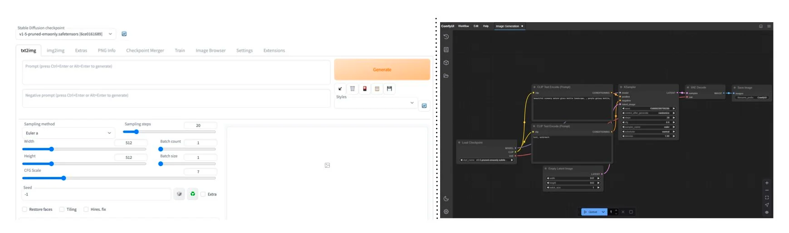
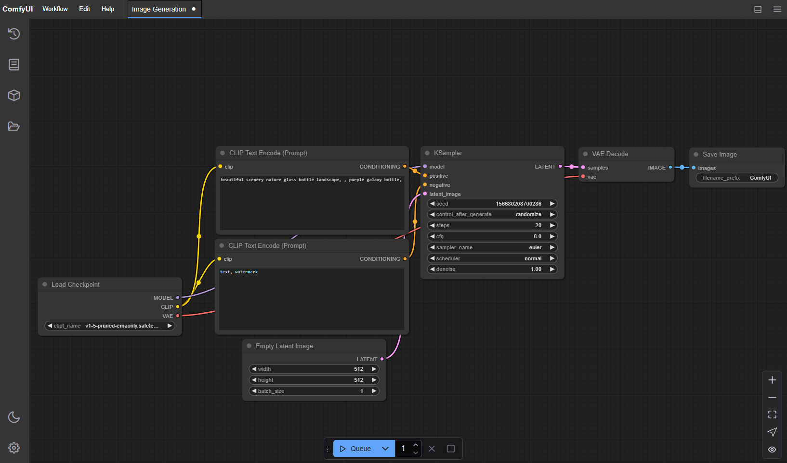
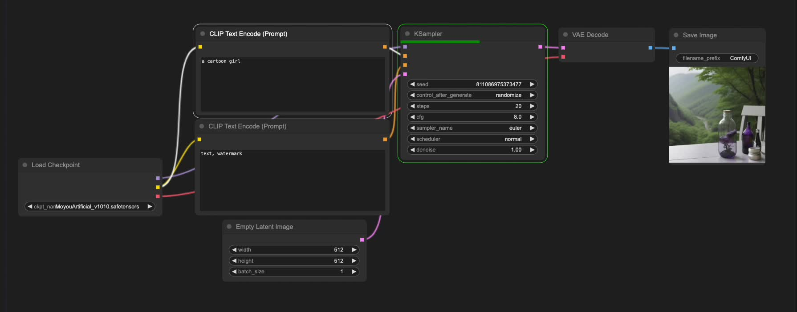
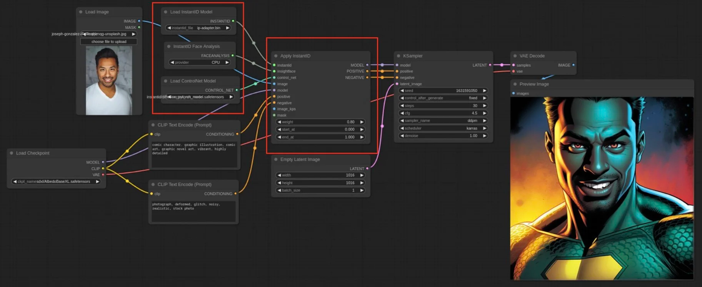
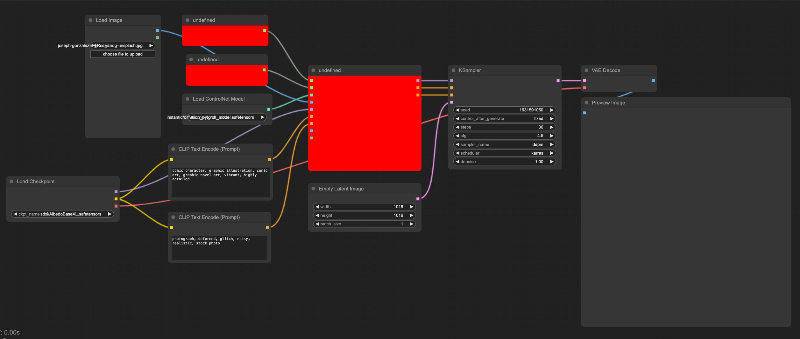
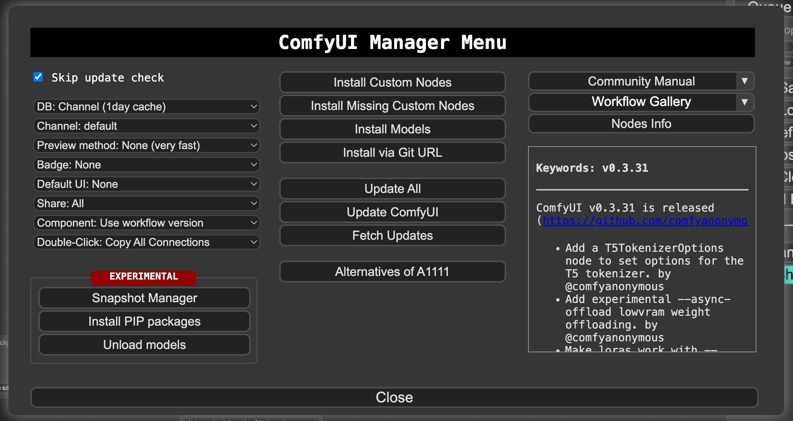

# ComfyUI：节点式生图的效率革命

你好，我是南柯。

在专栏中我们着重学习过 WebUI 这个文生图的工具箱，新手用户即使不懂 Stable Diffusion 的技术原理，也可以通过点击各种按键，使用不同的模型和不同的插件来生成图像。今天我们要介绍的 ComfyUI，要达成的目标和 WebUI 类似。

ComfyUI 是一款基于节点式工作流的开源文生图模型操作工具，将 AI 绘画的过程拆解为可自由组合的模块化流程。用户通过拖拽节点、连接数据流，实现从文本输入到图像输出的全流程定制化控制。

相比于 WebUI，ComfyUI 在搭建各种图像生成解决方案的时候更加灵活，推出不久便成为了更流行的生图工具。值得一提的是，如今的 ComfyUI 也支持各种开源文生视频模型，比如Wan 2.1 模型、Hunyuan Video 模型的使用。

今天这一讲主要探讨以下几个问题。

1. ComfyUI 与 WebUI 有哪些相同点和不同点。

2. ComfyUI 的工程原理与实现框架。

3. ComfyUI 的基础使用说明，以及比较常用的外部资源库。

4. 通过分析一个有趣的 ComfyUI 写真链路，讨论学习 ComfyUI 的方法。

5. 如何实现一个自己的功能节点。

我们开始吧！

## 对比 WebUI 与 ComfyUI

下图所示为 WebUI 与 ComfyUI 的界面对比，二者都是开源的生图工具。基础模型如 StableDiffusion、Flux 等，生图插件如 IPAdapter、ControlNet 等，都可以在 WebUI 和 ComfyUI 这两种工具中使用。

你可以理解为，二者都是将模型和插件组织到一起的工具，目的是让用户通过非代码的形式进行图像创作。



- WebUI（左）与 ComfyUI（右）的界面对比，图片来源网络

我们从交互逻辑、资源占用、功能扩展这三个维度对 WebUI 和 ComfyUI 进行比较。

在交互逻辑方面，WebUI 采用表单式操作，界面简洁直观，适合初学者快速上手。功能通过标签页进行分类，比如文生图、图生图等，操作流程固定，适合单次生成任务。

ComfyUI 采用节点式可视化编程，每个节点代表一个技术模块，比如加载模型、显示图片等，支持灵活组合和复杂流程设计。虽然 ComfyUI 的学习曲线较陡，但更适合高级用户和批量任务。

在性能与资源占用方面，ComfyUI 显存占用比 WebUI 低 30%～50%，生成速度则要快出20%。造成这种差异的原因是，ComfyUI 采用异步计算机制和更优化的显存分配策略，尤其适合低显存设备和批量生图。

在功能扩展方面，WebUI 依赖插件生态，插件数量庞大，比如 ControlNet、LoRA 等，适合快速扩展功能。但复现他人效果需要手动填写参数，工作流复现性较差。而 ComfyUI 通过导入JSON 工作流文件便可实现功能复用，支持跨模型协作，比如将 Stable Diffusion 和 Flux 结合使用。

简言之，WebUI 比较适合初学者上手文生图任务，ComfyUI 则更适合高级用户或者需要复杂工作流的场景。如果你未来希望从事 AI 图像生成的工作，我更推荐你直接学习 ComfyUI。

## 工程原理

接下来我们探讨 ComfyUI 的工作原理。想要搞懂 ComfyUI，需要搞懂两个概念：节点和工作流。以下图为例，图中展示的便是一个完整的文生图工作流，它由加载模型、VAE 解码器、保存图像等 7 个节点组成。



- 一个完整的文生图工作流示例，图片来源网络

我们点击运行指令（对应图中正下方的的 Queue 按键），各个节点会逐一运行，直到最后一个节点完成生图功能。正在运行中的节点会有绿色的边框效果，整个过程如下面的视频所示。



你可能已经注意到，在上面的视频中，当我们没有修改任何参数，第二次运行生图任务时，只有采样器以后的节点需要重新运行，这样在参数不变的情况下节点不会重复运行。能避免重复运行是因为 ComfyUI 在底层设计的时候故意为之，下文会解释，这里先卖个关子。

在我们看来，ComfyUI 的运行过程是从前到后，但实际上，它的后台执行却不是如此。

ComfyUI 首先定位到所有的“结果节点”（代码中的 output_node 属性为 True），然后不断做深度优先搜索，遍历到最开始的节点，得到一个待执行的节点列表。当有多个结果节点时，会得到多个节点列表。

此时的规则是长度小的列表先执行，如果长度相等，则按照结果节点的序号决定（在 ComfyUI中，每个节点都有一个序号），序号的字符串数值较小的先执行。

比如上面例子中的工作流对应的节点编号表如下面代码所示。

```
unique_id class_type             output_node
10        PreviewImage           True
9         SaveImage              True
8         VAEDecode              False
7         CLIPTextEncode         False
6         CLIPTextEncode         False
5         EmptyLatentImage       False
4         CheckpointLoaderSimple False
```

可以发现这个工作流中存在两个结果节点，也就是节点 10 和节点 9。经过深度优先搜索，我们会得到两个带执行的节点列表，如下面代码所示。以列表 1 为例，最开始需要加载模型，对应节点 4；然后在文本编码器节点（对应节点 6）中同样需要用到节点 4 中的 CLIP 模型，所以列表 1 的开头是 4、4、6。列表中的其他节点以此类推。

```
列表1：4,4,6,4,7,5,3,4,8,10
列表2：4,4,6,4,7,5,3,4,8,9
```

由于两个列表的长度相等，因此比较两个输出节点的字符串大小。由于“10”的字符串数值小于“9”，因此列表 1 会优先执行。

在执行过程中，各个节点的实例会被缓存到一个字典中。每个节点运行时，会优先从这个字典中复用实例，如果没有找到缓存的实例才会进行这个节点的实例化。同时每个节点的执行结果也会被存在字典中。

有了这种机制，列表中的重复节点便可以被直接复用了。同时，当我们第二次点击生图指令时，如果你只微调了部分节点，ComfyUI 会自动计算列表中最早被改变参数的位置，这个位置前的计算结果会被直接复用。这便解释了上面卖关子的问题。

## 使用说明

下面我们来介绍 ComfyUI 如何使用。

首先根据代码仓中的教程完成 ComfyUI 的安装。ComfyUI 的基本操作可以分为拖拽节点、连接工作流、参数调整、运行与保存四部分。

拖拽节点时，我们右键单击空白面板，可以根据门类选择需要使用的节点，比如加载模型节点、提示词输入节点等。双击左键可以直接换出节点搜索功能，如果你很清楚要用到的节点名字，推荐你使用这个功能。

连接工作流时，将节点的输出端口连接到下一个节点的输入端口，比如将潜在表示的输出端口连接到采样器的输入端口。搞懂了 Stable Diffusion 的工作原理，理解连线逻辑会更加简单，我推荐你去看课程的第 15 讲和第 16 讲。

很多节点的面板上都有单独的参数控制，比如采样器节点中可以选择采样步数、CFG 数值等，你可以根据生图任务的需要灵活调整这些参数。

搞定了上面这些，点击运行按钮（Queue），便可以进行图像的生成。我们的工作流可以保存为 JSON 文件同步给其他伙伴来复现。

关于 ComfyUI 的使用细节，在 B 站或者油管上有大量教程，推荐你按照相关视频教程逐步操作，熟悉这个工具的使用流程。在 Civitai、OpenArt 等平台上，我们也能找当各式各样的工作流，用于电商产品图生成、AI 人像写真等任务。

## 分析一个写真链路

我们以 instantID 的换脸工作流为例进行分析。这个工作流如下面的图片所示，输入一张人像照片和一个文本描述，生成一张换脸效果图片。


- 图片来源网络

相比于 SDXL 模型文生图工作流，这个工作流的核心是一个名为 Apply InstantID 的节点，对应下图中右侧红框里的节点。左侧红框中的 3 个节点依次是加载 instantid 模型、人脸检测节点和加载 controlnet 模型的节点。

左侧红框的 3 个节点分别提取输入图片的人脸特征、人脸位置和 controlnet 的控制条件（比如深度图、轮廓线等），将这些信息和文本描述一起输入到 Apply InstantID 节点，完成生图过程。



- InstantID工作流的关键节点示例，图片来源网络

以这个工作流的本地运行为例，我们进一步熟悉 ComfyUI 的使用。

首先，我们通过以下指令在本地或者服务器环境运行 ComfyUI。

```bash
cd /你的ComfyUI安装路径/
python main.py
# 然后在浏览器访问对应端口地址，例如：http://127.0.0.1:8188/
```

然后，我们需要将这个工作流下载到本地并将下载好的工作流拖到 ComfyUI 中，下载地址我附在了链接里。因为我们没有安装 InstantID 这个节点，所有工作流中会有红色报错区域，如下图所示。



- 节点没有安装的情况下会有红色报错显示,图片来源网络

遇到这种报错，我们可以通过 ComfyUI 自带的插件管理器进行搜索安装，如下图所示。



- 插件管理器安装缺失节点，图片来源网络

这里我们介绍通过 git 指令手动安装插件的方法，操作指令如下面代码所示。安装完成后，重新启动 ComfyUI 即可修复工作流的插件缺失报错。

```bash
cd /你的ComfyUI安装路径/custom_nodes/
# 下载你要安装的插件
git clone https://github.com/cubiq/ComfyUI_InstantID.git
# 安装这个插件需要的依赖环境
cd ComfyUI_InstantID
pip install -r requirements
```

当我们搞定了工作流的各种插件报错，便可以运行这个工作流了。设计师的工作经常要设计非常复杂的工作流，串联各种各样的功能节点，从而实现出精致可控的生图效果。

## 做自己的节点

相信通过上面的介绍，你也一定意识到了节点的重要性。下面我们来探讨如何开发一个你自己的节点，具体分为三个步骤。

第一，在 ComfyUI 代码仓的 custom_nodes 目录下，新建一个文件夹作为你的节点目录。

第二，新节点目录下添加两个文件，分别为“init.py” 和“你的节点.py”。其中“ init.py” 中按照如下代码做修改。

```
from .yournode import NODE_CLASS_MAPPINGS, NODE_DISPLAY_NAME_MAPPINGS
__all__ = ['NODE_CLASS_MAPPINGS', 'NODE_DISPLAY_NAME_MAPPINGS']
```

第三，“你的节点.py”文件中完成你的节点功能实现，下面代码展示的是一个将图像颜色翻转的代码，其中我加入了大量的注释供你参考。

```python
class SimpleCustomNode:
   def __init__(self):
       pass
   @classmethod
   def INPUT_TYPES(cls):
       """
       Return a dictionary which contains config for all input fields.
       Some types (string): "MODEL", "VAE", "CLIP", "CONDITIONING", "LATENT", "I
       Input types "INT", "STRING" or "FLOAT" are special values for fields on t
       The type can be a list for selection.
       Returns: `dict`:
           - Key input_fields_group (`string`): Can be either required, hidden o
           - Value input_fields (`dict`): Contains input fields config:
               * Key field_name (`string`): Name of a entry-point method's argum
               * Value field_config (`tuple`):
                   + First value is a string indicate the type of field or a lis
                   + Secound value is a config for type "INT", "STRING" or "FLOA
       """
       return {
           "required": {
               "image_in": ("IMAGE",),  ## image_in 代表节点显示的名字, 后续的"IMAGE
               "int_field": ("INT", {
                   "default": 0,
                   "min": 0, #Minimum value
                   "max": 4096, #Maximum value
                   "step": 64, #Slider's step
                   "display": "number" # Cosmetic only: display as "number" or "
               }),
               "float_field": ("FLOAT", {
                   "default": 1.0,
                   "min": 0.0,
                   "max": 10.0,
                   "step": 0.01,
                   "round": 0.001, #The value represeting the precision to round
                   "display": "number"}),
               "string_field": ("STRING", {
                   "multiline": False, #True if you want the field to look like
                   "default": "Hello World!"
               }),
           },
       }
   RETURN_TYPES = ("IMAGE",) ## 节点返回的数据类型, 注意一定要有逗号
   RETURN_NAMES = ("image_out",) ## 节点返回的显示名称，注意一定要有逗号，上线两部分需要一
   FUNCTION = "invert"  #节点执行的入口函数, 跟下面定义的函数名称一致
   CATEGORY = "examples" ## 定义节点的类别，一个类别下面是相似操作的一组节点的集合
   def invert(self, image_in, string_field, int_field, float_field):
       '''
       此处string_field， int_field， float_field没有用到，只是为了示例给出。
       '''
       image_out = 1 - image_in
       return (image_out,)
# A dictionary that contains all nodes you want to export with their names
# NOTE: names should be globally unique
NODE_CLASS_MAPPINGS = { "my unique name" : SimpleCustomNode }
# A dictionary that contains the friendly/humanly readable titles for the nodes
NODE_DISPLAY_NAME_MAPPINGS = { "my unique name" : "Image inverter" }
```

完成了上面 3 步，当我们重新启动 ComfyUI，双击左键搜索你的节点，便可以将它拖入工作流中使用了。

## 总结时刻

今天我们介绍了 ComfyUI 这个图像创作工具，包括它的工作原理、与 WebUI 的差异、使用说明。之后我们分析了一个基于 InstantID 的换脸工作流，并编码实现了一个自定义节点。了解了这些知识，你对于 ComfyUI 便有了基础的认识。

对于想深入研究工作流的同学，我推荐你仔细研读下 ComfyUI 官方仓库里的使用说明、快捷键用法，并通过 B 站、油管等途径学习一些更复杂的工作流，加深你对于 ComfyUI 的理解。
