# 从UNet到DiT：文生图模型的华丽转身

你好，我是南柯。

今天咱们要聊一场正在发生的技术革命——AI 绘画的「心脏」扩散模型正在从用了多年的UNet 结构，悄悄换成更强大的 DiT 结构。

在前面的课程中，我们已经介绍过 Stable Diffusion 1.5、SDXL 这些基于 UNet 结构的老牌选手。现在，SoRA、SD3、Flux 这些新秀全都换上了 DiT 结构。这场变革不是简单的零件替换，而是让 AI 绘画从「局部描细节」到「全局拼构图」的关键一跃。

两年前，UNet 还是行业标配。它就像个精密的显微镜，擅长捕捉像素级的纹理细节。但当我们要生成 4K 高清图、处理复杂文字描述、或者让图片和语音指令对齐时，UNet 就有点力不从心了。

因为 UNet 天生更关注局部，缺乏对画面整体布局的把控。这时候，原本用在语言模型里的Transformer 进入了算法工程师的视野。这个擅长理解上下文关系的架构，终于在 Meta 2022年提出的 DiT 模型中跟扩散模型完美结合。

举个栗子，UNet 画人脸就像先描眉毛再画眼睛，而 DiT 是先把整张脸的比例布局规划好。当你要画「蒙娜丽莎在太空站吃火锅」这种复杂场景时，DiT 的全局把控力就体现出来了。

DiT 是一种特殊的 Transformer 结构，它做了件很聪明的事情：把图片切成小块，像处理文字一样排列成序列。这种「化整为零」的操作，让 DiT 的自注意力机制能捕捉整张图的构图逻辑。

后来的 SD3、Pixart 等模型证明，这种结构不仅能画出更自然的手部细节和文字，还能处理视频、3D 等复杂格式——这正是 SoRA 能生成多分辨率视频的秘诀。

不过要实现这个魔法可不容易，今天我们会分成三步来拆解：

1. 从“显微镜”到“望远镜”：看看 CNN 和 Transformer 处理图像的根本区别。

2. 图片变文字：ViT 如何把像素块变成 Transformer 能理解的“语言”。

3. 时间魔法：DiT 是怎么把扩散过程的时间步、文本提示，揉进注意力机制的。

搞明白这些，你就能看懂为什么说这是 AI 生成从「手工作坊」到「工业化生产」的转折点。准备好你的代码编辑器，咱们这就出发！

## 从“显微镜”到“望远镜”

既然今天我们要讨论模型结构，不妨先来梳理下视觉模型结构演化的历史。

在我看来，这一轮 AI 热潮从 AlexNet 被提出开始，到如今扩散模型文生图和文生视频大行其道，中间有这样几个关键里程碑，如下图所示。

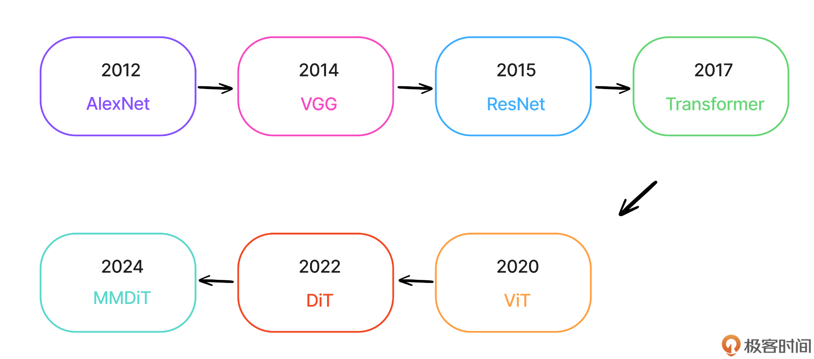

- 模型结构演化的关键里程碑

Transformer 被提出前，CNN（卷积神经网络）结构出现了 AlexNet、VGG、ResNet 三代经典结构。算法工程师使用这些结构或者它们的变体，基本解决了图像分类、目标检测、图像分割等经典视觉任务，我们熟悉的 UNet 便是为图像分割定制的 CNN 网络结构。

我们回顾下 AlexNet、VGG、ResNet 三代经典结构，熟悉这部分的同学可以直接跳过。

### AlexNet：深度学习的觉醒

AlexNet 结构在 2012 年被提出，在当时的图像分类任务上拔得头筹。值得一提，这个架构的作者包含 OpenAI 的前首席科学家 IIya Sutskever（代表作 ChatGPT，他提出 AlexNet 的时候还在多伦多大学读书）和 AI 三巨头之一的 Hinton。

AlexNet 结构在今天看起来非常简单，由 5 个卷积层和 3 个全链接层组成。如下图所示。

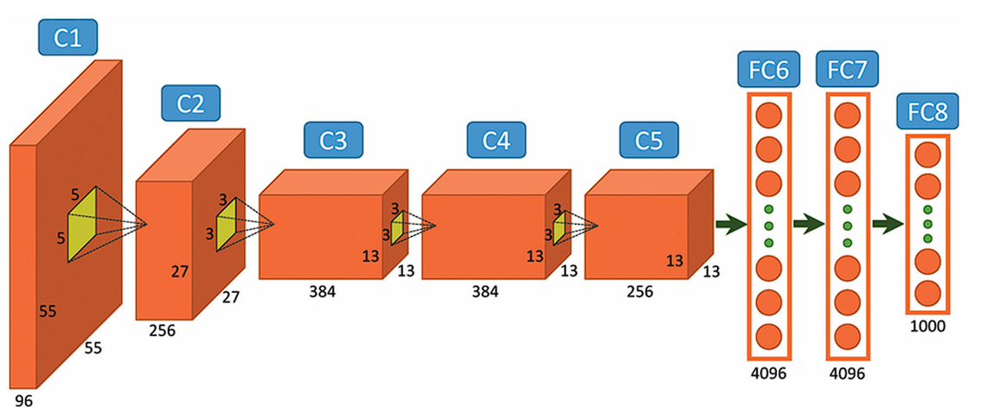

- 图片来源：https://viso.ai/deep-learning/alexnet/ AlexNet由5层卷积层和3层全连接层组成

在下面的代码中，我们通过 Pytorch 搭建了 AlexNet 的结构。类似的，更多 CNN 架构说明和用法你可以参考 Pytorch 官方模型说明。

```python
class AlexNetConv(nn.Module):
   def __init__(self):
       super().__init__()
       self.features = nn.Sequential(
           nn.Conv2d(3, 96, kernel_size=11, stride=4),  # [图片1：AlexNet结构示意图
           nn.ReLU(inplace=True),
           nn.MaxPool2d(kernel_size=3, stride=2),
           nn.Conv2d(96, 256, kernel_size=5, padding=2),
           nn.ReLU(inplace=True),
           nn.MaxPool2d(kernel_size=3, stride=2),
           # ... 后续层省略
       )
```

### VGGNet：深层神经网络的胜利

AlexNet 提出之后的几年里，关于模型结构有两个趋势，一个是将模型做大做深，比如后来提出的 VGG 架构；另一个趋势是将模型做小，甚至是放到手机上，比如后来提出的 MobileNet架构（2017 年被提出）。

有趣的是，今天 AIGC 大模型这波热潮，仍旧是在朝着做大和做小两个方向在演化，只不过衡量参数量的单位从 Million 换成了 Billion。

2014 年被提出的 VGG 模型通过堆叠 3x3 小卷积核，构建了 16~19 层的均匀结构，证明了网络深度的重要性。

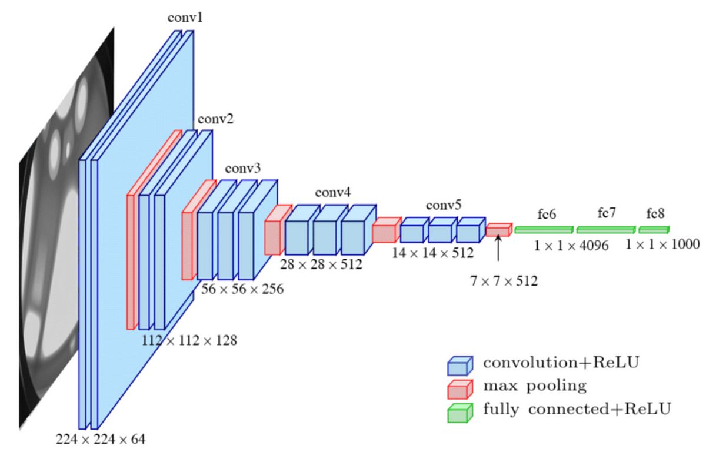

- 图像来源：Researchgate.net VGG由多个卷积层和全连接层组成

在下面的代码中，我们展示了一个 VGG 卷积层的实现方式。

```python
def make_vgg_layers(cfg: list):
   layers = []
   in_channels = 3
   for v in cfg:
       if v == 'M':
           layers += [nn.MaxPool2d(kernel_size=2, stride=2)]
       else:
           layers += [
               nn.Conv2d(in_channels, v, kernel_size=3, padding=1),
               nn.BatchNorm2d(v),  # [图片2：VGG块结构示意图]
               nn.ReLU(inplace=True)
           ]
           in_channels = v
   return nn.Sequential(*layers)
```

### ResNet：残差连接的革命

“大就是好”这个结论在 10 年前同样备受追捧，更深的 CNN 通常意味着更好的性能。然而，想要通过加深网络深度来进一步提升模型性能时，出现了“梯度消失”问题，这限制了深层神经网络的效果。

关于“梯度消失”，我们做个比喻帮助理解：一群人传递一块巧克力，每个人都要吃一口。巧克力在传递过程中逐渐变小，到了最后几个人手中时，可能已经所剩无几。在神经网络中，这就像是训练时，梯度在逐层回传时逐渐减弱，导致网络前面的层难以学习。

2015 年何恺明提出了 ResNet，由一个个相似结构的 Block 构成，通过在网络中引入残差结构，让梯度传播可以不受网络深度的限制，如下图所示。

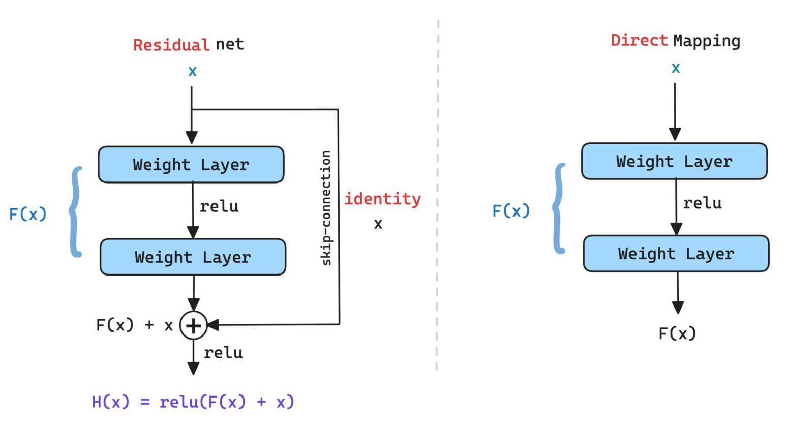

- 图片来源：https://x.com/akshay_pachaar/status/1762463410422476935/photo/1 ResNet的Block VS ResNet提出前的模型Block

在下面的代码中，我们展示了一个 ResNet 模块的实现方式。完整的 ResNet 结构由连续多个这样的模块堆叠而成。

```python
class BasicBlock(nn.Module):
   def __init__(self, in_planes, planes, stride=1):
       super().__init__()
       self.conv1 = nn.Conv2d(in_planes, planes, kernel_size=3, stride=stride, p
       self.bn1 = nn.BatchNorm2d(planes)
       self.conv2 = nn.Conv2d(planes, planes, kernel_size=3, stride=1, padding=1
       self.bn2 = nn.BatchNorm2d(planes)
       # 残差连接
       self.shortcut = nn.Sequential()
       if stride != 1 or in_planes != planes:
           self.shortcut = nn.Sequential(
               nn.Conv2d(in_planes, planes, kernel_size=1, stride=stride),
               nn.BatchNorm2d(planes)
           )
   def forward(self, x):
       out = F.relu(self.bn1(self.conv1(x)))
       out = self.bn2(self.conv2(out))
       out += self.shortcut(x)  # [图片3：ResNet残差块示意图]
       return F.relu(out)
```

从 2012 年到 2020 年，算法工程师们通过改变 CNN 模型的输出、修改损失函数等操作，用CNN 结构来解决各种计算机视觉的问题，比如图像分类、图像分割、目标检测、深度估计、GAN 图像生成等。我们课程中学过的 GAN、UNet、VAE 等模型，便是典型代表。

### Transfomer：序列建模的新范式

2017 年 Google 提出的 Transformer 正是今天大语言模型背后的网络结构。最初的Transformer 主要用于处理文本任务，由 6 层编码器和 6 层解码器构成，通过自回归的方式完成文本生成任务，比如翻译、总结、问答等。

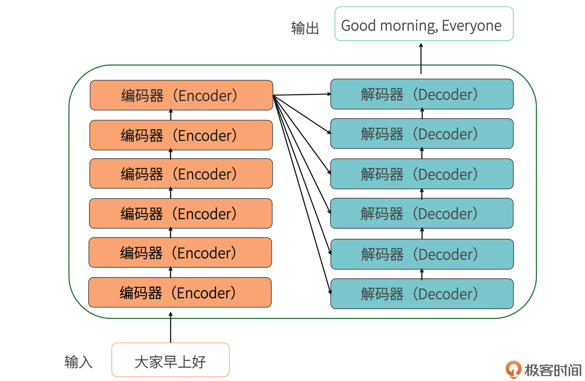

- Transformer完整结构示意

编码器部分使用多头自注意力机制，第 6 层编码器最终会输出一个特征向量，然后这个向量通过多头交叉注意力作用于解码器部分。解码器每次会根据当前文本序列，预测下一个 token。关于这个过程，你可以复习下课程的第 7 讲。

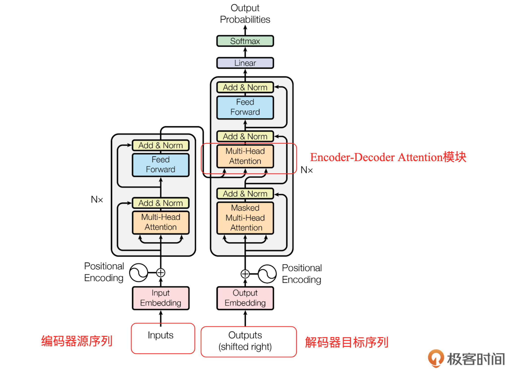

- Transformer的一层编码器和一层解码器结构

在 Transformer 的编码器结构中，自注意力机制用于实现全程依赖建模。下面展示的便是多头自注意力机制的代码实现。划考点，这段代码在面试中经常被考到。

```python
class SelfAttention(nn.Module):
   def __init__(self, embed_size, heads):
       super().__init__()
       self.embed_size = embed_size
       self.heads = heads
       self.head_dim = embed_size // heads
       self.values = nn.Linear(embed_size, embed_size)
       self.keys = nn.Linear(embed_size, embed_size)
       self.queries = nn.Linear(embed_size, embed_size)
       self.fc_out = nn.Linear(embed_size, embed_size)
   def forward(self, x):
       N, seq_len, _ = x.shape
       # 拆分多头
       values = self.values(x).view(N, seq_len, self.heads, self.head_dim)
       keys = self.keys(x).view(N, seq_len, self.heads, self.head_dim)
       queries = self.queries(x).view(N, seq_len, self.heads, self.head_dim)
       # 计算注意力得分
       energy = torch.einsum("nqhd,nkhd->nhqk", [queries, keys])
       attention = torch.softmax(energy / (self.embed_size ​**​ (1/2)), dim=3)
       # 聚合Value
       out = torch.einsum("nhql,nlhd->nqhd", [attention, values])
       out = out.reshape(N, seq_len, self.embed_size)
return self.fc out(out)
```

在文本任务中，Transformer 模型的输入是文本的序列向量。如何将一段文本转化为序列向量呢？这就需要用到分词器和词向量字典。这个过程如下图所示。

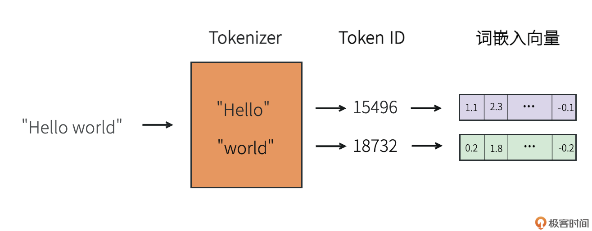

- 从文本到词嵌入向量的过程

我们通过下面的代码来熟悉这个过程。这里我们使用了一个名为 MarinaTokenizer 的分词器，对“大家早上好”这句话进行分词。

```python
from transformers import MarianMTModel, MarianTokenizer
import torch
import torch.nn.functional as F
# 指定源语言和目标语言
src_text = ['大家早上好']
# 使用Huggingface transformers的预训练模型 "Helsinki-NLP/opus-mt-zh-en"
model_name = 'Helsinki-NLP/opus-mt-zh-en'
tokenizer = MarianTokenizer.from_pretrained(model_name)
model = MarianMTModel.from_pretrained(model_name)
# 对源文本进行编码
inputs = tokenizer(src_text, return_tensors="pt")
# 翻译源语言
translated = model.generate(**inputs)
# 输出翻译结果
tgt_text = [tokenizer.decode(t, skip_special_tokens=True) for t in translated]
print(tgt_text)
# 检查下源文本编码后的token id和词向量
for token_id in inputs["input_ids"][0]:
   # 使用decode方法
   token_word = tokenizer.decode(token_id)
   print(f"decode result of {token_id} is: {token_word}")
   embedding = model.get_input_embeddings()
   token_id_tensor = torch.tensor([token_id])
   word_vector = F.embedding(token_id_tensor, embedding.weight)
   print(word_vector.shape)
```

分词得到的结果是“大家”、“早上”、“好”，还有终止符，总计 4 个 token id。在MarianMTModel 模型中，包含预训练好的词向量字典和 Transformer 模型权重。然后 4 个token id 通过查字典的方式转换为 512 维度向量（其他预训练模型维度可能不同），再添加一个 batch 维度后以 [1,4,512] 的序列形状输入到 Transformer 部分。

总结下，对于文本任务而言，“一句话”经过 Tokenizer 进行分词，然后每个分词按照查字典的方式获得词向量。这些词向量组成一个序列作为 Transformer 的输入。Transformer 连续预测出 Token，每个 Token 通过查字典的方案得到对应文字。这便可以解释为何我们在和ChatGPT 对话的时候，答案是一个一个字“蹦出来”的。

在我们课程代码仓库对应这一讲的部分，我为你准备了一个 Transformer 结构的完整实现代码，并基于 Transformer 结构，实现了一个机器翻译任务的自回归推理代码示例。推荐你运行并深入理解这两部分代码，从而掌握 Transformer 结构和自回归推理的原理。

## ViT：图像即序列

在 Transformer 论文的结尾，作者预言了未来 Transformer 结构可以用于处理其他模态的任务，比如视觉、音频等领域。2020 年 Google 提出的 ViT 技术便是这个预言的兑现。

如果说 CNN 是上一代处理视觉任务的架构，ViT 则是基于 Transformer 的新一代视觉任务处理架构。

### 图像分块技术

我们知道，ChatGPT 背后的技术就是 Transformer。在使用 ChatGPT 的时候，随意输入一段文字便可以得到回复。那么是否可以通过某种技术，先把我们输入的图片转换成方便 GPT 理解的“特殊的文字”，再进入 GPT 处理文字的常规环节呢？

没错，下面我们将要学习的 ViT 技术便可以胜任这个任务。

ViT 首先要解决的问题就是如何将“一张图片”变成一个“类似的词向量序列”。

具体怎么做呢？首先我们要对原始图片进行切片处理，得到一系列切片（patch）图片。这里的切片大小可以指定，比如下面图片中，分别按照 256x256 和 128x128 分辨率进行切片。

我们可以将切片的过程想象为一个滑动窗口，切片大小（patch size）和滑动步长（stride）两个参数共同决定了切片结果。可以想象，当滑动步长小于滑动窗口大小时，得到的一系列切片结果之间存在重叠。

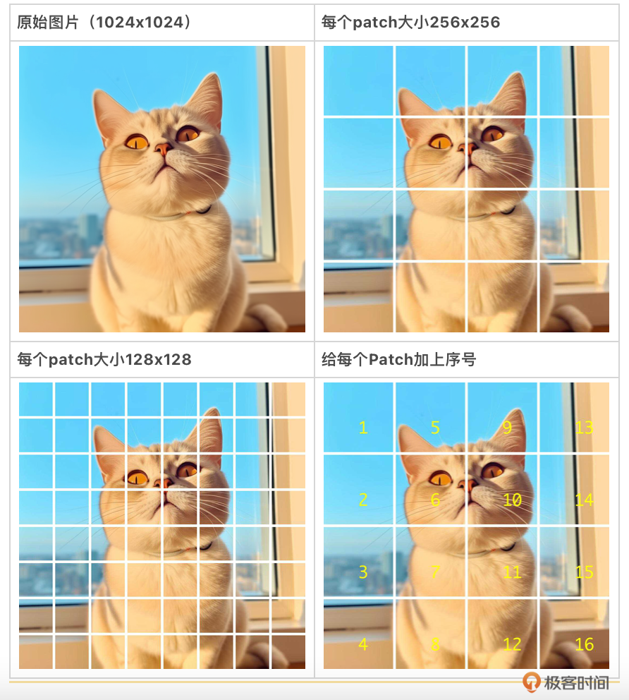

对于切块后得到的一系列切片，我们先编号，然后重新排列，这样一个图像就转换为了一个“序列”。这里每一个小切片，可以类比为文本任务中的一个字符。

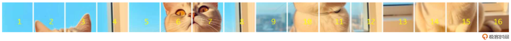

搞定了图片序列，我们还要解决如何针对每个切片获取“词向量”的问题。对于上面这张猫咪的RGB 图像来说，原始维度是 1024x1024，窗口大小取 256 并且滑动步长也取 256，得到 16个切片，每个切片大小为 256x256x3。

假定我们的目标“词向量”维度是 512 维，此时我们只需要用一个输出通道维度为 512、卷积核尺寸为 256x256 的 2D 卷积对图像进行一次卷积计算，便可以获得 1x1x512 维度的词向量。这个过程通过后面的代码即可完成。

```
in_channels = 3
emb_size = 512
nn.Conv2d(in_channels, emb_size, kernel_size=patch_size, stride=patch_size)
```

我们依次对 16 个 patch 提取“词向量”，便得到了 16 个 512 维度的向量。这时我们再来看一下 ViT 这篇论文的题目：An image is worth 16x16 words，背后的含义自然一目了然。

小结一下，一张图片经过切片处理和 2D 卷积运算，就能转换成一个向量序列。

这两个步骤可以通过下面这段代码实现。需要指出，在这段代码中，所有切片共用同一个 2D卷积核，并且没有使用任何非线性激活函数。

```python
import torch
from torch import nn
class PatchEmbedding(nn.Module):
   def __init__(self, in_channels: int = 3, patch_size: int = 16, emb_size: int
       super().__init__()
       self.patch_size = patch_size
       self.projection = nn.Sequential(
           nn.Conv2d(in_channels, emb_size, kernel_size=patch_size, stride=patch
           nn.Flatten(2, 3),
           nn.Transpose(1, 2)
       )
   def forward(self, x: torch.Tensor) -> torch.Tensor:
       return self.projection(x)
```

### CLS 特殊 Token

在前面猫咪的例子中，我们得到了序列长度为 16、特征维度为 512 的向量。通过第 7 讲我们知道，Transformer 编码器部分的输出和输入维度相同，对于 16*512 的特征向量，输出还是这个维度，输出的每个特征向量对应于我们最初的 16 个切片。

那如果我们想用其中一个特征去做图像分类任务，该选择哪个呢？

选哪个都不公平。这个问题该怎么解决呢？

在 ViT 中，模型会在输入给 transformer 的向量序列之前插入一个名为 CLS（Classify）的特殊 token。这个 CLS token 的特征向量会作为整个输入序列或整个图像的总体表示。这个方法的设计，在很大程度上是借鉴了 BERT 模型的设计。

为了方便你理解，我把实现这个过程的三行代码贴在了后面。在我们的例子中，把 CLS 的特征向量插入到 16 * 512 维度的最开头，就会得到一个 17 * 512 的特征向量。

```
cls_token = nn.Parameter(torch.randn(1, 1, emb_size))
cls_tokens = cls_token.expand(x.shape[0], -1, -1)
x = torch.cat((cls tokens, x), dim=1)
```

Transformer 编码器的自注意力机制，本质上是按元素的方式计算输入与其他所有元素之间的相关性，并对这些关系进行加权求和。

CLS token 与所有的图像切片都会进行交互，因此它的特征向量会收集并融入其他所有输入元素的信息。所以，在进行图像分类等任务时，我们选择直接使用 CLS token 对应的特征向量。

### 可学习的位置编码

除了前面说的这些，还有一个关键技术是位置编码。

所谓位置编码，就是在输入 Transformer 编码器前，将图像切片的序号编码成向量，加入到对应切片的特征向量中。

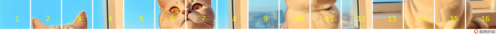

至于为什么要这样做，我举个简单的例子你就明白了。

注意力机制并不关注输入序列的顺序信息。如果输入元素的顺序被改变，例如从“cat chasesdog”变成 “dog chases cat”，但其元素的内容不变，那么这两个序列经过完全相同的自注意力运算后，可能会得到相同的结果。

所以在文本任务中，需要给每个 token 加个位置编码。同理，在 ViT 中，我们要给每个切片加个位置编码。

理解了前面这些，你可以通过后面的图片观察 ViT 的结构。相信到这里你也已经发现，相比于原始 Transformer 结构，ViT 并没有大的革新。本质上，ViT 就是使用图像输入的Transformer 编码器部分。

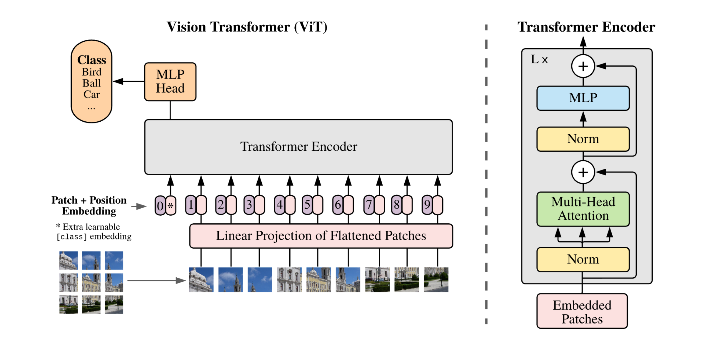

- 图片来源：https://arxiv.org/pdf/2010.11929 ViT结构示意

关于位置编码，有一些细节需要指出，对理解后面几篇专栏会有帮助。

在原始的 Transformer 中，位置编码通过正弦函数的方式生成，是预先设定好的。下面的代码中给出了 Transformer 的位置编码实现，其中我加入了详细注释和每个变量的矩阵维度，原始代码见课程代码仓库 Transformer 的完整实现部分。

```python
# 为输入序列添加位置信息，弥补 Transformer 对顺序不敏感的问题
class PositionalEncoding(nn.Module):
   def __init__(self, d_model, max_len=5000):
       """
       d_model:模型的隐藏层大小
       max_len:最大的输入序列长度
       """
       super(PositionalEncoding, self).__init__()
       # [max_len, d_model]
       pe = torch.zeros(max_len, d_model)
       # [max_len, 1]
       position = torch.arange(0, max_len, dtype=torch.float).unsqueeze(1)
       # [d_model // 2]
       div_term = torch.exp(torch.arange(0, d_model, 2).float() * -(math.log(100
       # sin 位置编码， [max_len, d_model // 2]
       pe[:, 0::2] = torch.sin(position * div_term)
       # cos 位置编码， [max_len, d_model // 2]
       pe[:, 1::2] = torch.cos(position * div_term)
       """这里的操作我们举例说明一下:
       # pe[:, 0::2]  ->  pe[i, 0], pe[i, 2], pe[i, 4], ...
       # pe[:, 1::2]  ->  pe[i, 1], pe[i, 3], pe[i, 5], ...
       #  position * div_term -> pe[i, 0] = sin(i / 10000^0)
       #  position * div_term -> pe[i, 1] = cos(i / 10000^0)
       #  position * div_term -> pe[i, 2] = sin(i / 10000^1)
       #  position * div_term -> pe[i, 3] = cos(i / 10000^1)
       #  ...
       """
       # [1, max_len, d_model]
       pe = pe.unsqueeze(0)
       # 将pe tensor注册到模型的buffer中，避免在每次forward时重新计算position encoding
       """
       register_buffer这个函数的作用主要有3点: 避免被优化器更新; 确保设备一致性(CPU\GPU);
       """
       self.register_buffer('pe', pe)
```

通过这段代码你会发现，当我们指定了 Transformer 编码器、解码器的隐藏层大小以及最大输入序列长度后，位置编码便可以唯一确定。

并且这个位置编码不会随着模型的训练而更新，因此它属于绝对位置编码，它的维度是最大输入长度 x 隐藏层大小。可以理解为一张图二维图像，每一行表示的是一个输入 token 的位置向量，都是唯一的。

在上面的代码中，位置编码的计算看似唬人，背后的数学公式实则很简单，如下所示。


在下面代码中，我们设置不同的隐藏层大小和最大输入序列长度，使用绘图工具对位置编码进行可视化。可以看到，每一行与其他行都有所不同，也就是说在最长输入序列长度内，每个编码是唯一的。

```python
def plot_positional_encoding(d_model, max_len):
   pe = PositionalEncoding(d_model, max_len)
   pe_matrix = pe.pe.squeeze(0).numpy()
   plt.figure(figsize=(10, 6))
   plt.imshow(pe_matrix, cmap='viridis', aspect='auto')
   plt.xlabel('Dimension')
   plt.ylabel('Position')
   plt.title(f'Positional Encoding (d_model={d_model}, max_len={max_len})')
   plt.colorbar()
   plt.show()
# 示例：可视化不同的 d_model 和 max_len
plot_positional_encoding(d_model=64, max_len=100)
plot_positional_encoding(d_model=128, max_len=200)
plot positional encoding(d model=256, max len=500)
```

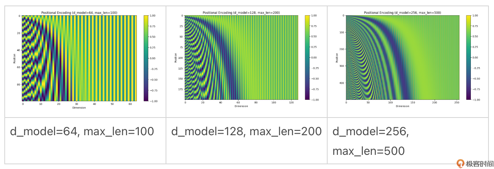

- 位置编码可视化说明

在 ViT 中，使用的是可学习的位置编码（Learnable Positional Enbedding），代码如下所示。

```python
# 相比于绝对位置编码，可学习的位置编码在实现上变得极为简单。
class LearnablePositionalEncoding(nn.Module):
   def __init__(self, max_seq_len, embed_size):
       super().__init__()
       self.pos_embed = nn.Parameter(torch.randn(1, max_seq_len, embed_size))
   def forward(self, x):
       return x + self.pos_embed[:, :x.size(1)]
```

相比于原始 Transformer 结构中的绝对位置编码，使用可学习的位置编码有几个好处。

1. 文本数据是一维的，而图像数据具有二维空间结构，可学习的位置编码能够更好地捕捉图像切片之间的空间关系，而不仅仅是简单的绝对位置关系。

2. ViT 的设计目标是尽可能简化模型结构，使其更接近原始的 Transformer。使用可学习的位置编码避免了复杂的数学公式（如正弦 / 余弦函数），同时保持了位置信息的有效性。

3. 在 ViT 中，当输入图像的分辨率发生变化时，可学习的位置编码可以通过插值等方法进行调整，从而支持更高分辨率的微调。这种灵活性在处理不同分辨率的图像时尤为重要。

4. ViT 的设计目标是减少对 CNN 归纳偏置（如局部性和平移不变性）的依赖。可学习的位置编码进一步减少了模型对固定位置编码的依赖，使模型能够从数据中学习到更灵活的位置表示。

综合图像切片、CLS Token 和文本编码技术，ViT 结构的完整实现可以参考下面的代码。

```python
class PatchEmbedding(nn.Module):
   def __init__(self, img_size=224, patch_size=16, in_chans=3, embed_dim=768):
       super().__init__()
       self.proj = nn.Conv2d(in_chans, embed_dim, kernel_size=patch_size, stride
       num_patches = (img_size // patch_size) ​**​ 2
       self.cls_token = nn.Parameter(torch.zeros(1, 1, embed_dim))  # [图片6：ViT
       self.pos_embed = LearnablePositionalEncoding(num_patches + 1, embed_dim)
   def forward(self, x):
       x = self.proj(x).flatten(2).transpose(1, 2)  # (B, C, H, W) → (B, N, D)
       cls_tokens = self.cls_token.expand(x.shape[0], -1, -1)
       x = torch.cat((cls_tokens, x), dim=1)
       return self.pos_embed(x)
class LearnablePositionalEncoding(nn.Module):
   def __init__(self, max_seq_len, embed_size):
       super().__init__()
       self.pos_embed = nn.Parameter(torch.randn(1, max_seq_len, embed_size))
   def forward(self, x):
       return x + self.pos_embed[:, :x.size(1)]
class ViT(nn.Module):
   def __init__(self, num_layers=12, num_heads=12):
       super().__init__()
       self.patch_embed = PatchEmbedding()
       self.encoder = nn.ModuleList([
           nn.TransformerEncoderLayer(d_model=768, nhead=num_heads)
           for _ in range(num_layers)
       ])
       self.mlp_head = nn.Linear(768, 1000)
   def forward(self, x):
       x = self.patch_embed(x)
       for layer in self.encoder:
           x = layer(x)
       cls_output = x[:, 0]  # 取CLS Token作为分类特征
       return self.mlp_head(cls_output)
```

在论文中，作者的实验证明 ViT 在分类任务上可以击败 CNN 结构。但有一个前提条件，那就是预训练数据集足够大，至少需要 1 亿图片量级。并且随着数据集的增大，ViT 的优势会更加明显。关于实验设计，感兴趣的同学可以去翻阅原始论文。

### ViT vs CNN

掌握了 CNN 和 ViT 结构的基础知识，我们可以在模型结构、优缺点、应用场景等维度对二者进行对比。

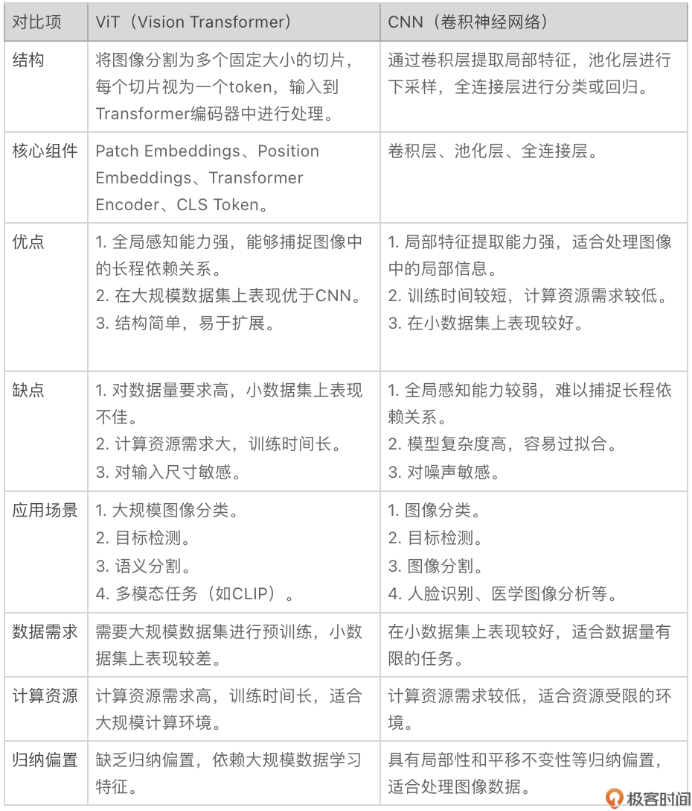

总结下，​ViT​ 在大规模数据集上表现优异，适合需要全局感知的任务，但对计算资源和数据量要求较高；​CNN​ 在局部特征提取和小数据集上表现较好，适合资源有限的任务，但全局感知能力较弱。

## DiT 背后的时间魔法

2022 年被提出的 DiT 结构进一步改造了 ViT 结构。

DiT 的核心创新在于将 ViT 架构（或者说 Transformer 架构）引入扩散模型，替代了传统UNet 的卷积结构，实现了对潜在空间的高效建模。关于扩散模型中的 UNet 结构和潜在空间概念，在我们课程中已有详细阐述，这里不做赘述。

### DiT 的结构设计

我们知道，在 Stable Diffusion 的训练中，图像需要先经过 VAE 的编码器得到潜在表示，目的是对像素空间进行压缩，从而加速模型的训练和推理过程。

类似于 ViT 的处理方式，DiT 将输入的潜在表示分割为固定大小的切片，通过线性嵌入转换为序列化的 token，并加入可学习的位置编码。

以生成 256x256 分辨率的图片为例，假定我们的 VAE 编码器可以实现 4 通道输出的 8 倍压缩，则我们得到的潜在表示维度为 32x32x4。

假定切片大小为 2x2，则序列长度 T=256（32/2 x 32/2）。假定每个切片经过线性嵌入转换，得到的特征维度是 512，则我们最终得到输入到 Transformer 编码器的特征维度是 256x512。

这里需要指出，位置编码是直接加到序列化的向量上，因此这个过程并不改变输入到Transformer 的特征维度。

下图所示为 DiT 结构。第 15 讲中详细讨论过在 UNet 扩散模型中，时间步 t 和文本编码需要通过交叉注意力的形式注入到 UNet 结构。

在 DiT 结构中，这些信息的注入在原始论文中给出了三种不同实现方式，下图展示的是效果最好的注入方式。生图的类别信息 y（例如猫对应类别 100、狗对应类别 101）和当前时间步t 作为待注入的条件信息，这些条件信息经过编码后作用于 DiT 的每个 Block 结构。

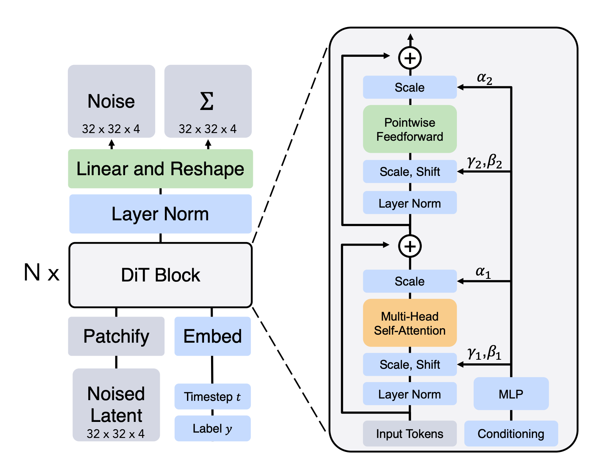

- 图片来源：https://arxiv.org/pdf/2212.09748 DiT模型结构示意

下面代码所示为 DiT 结构的简易代码实现。其中 mudulate 函数用于对输入进行缩放和平移，这是 DiT 中条件化操作的核心，这个操作也被称为自适应层归一化（adaLN-Zero）。

DiTBlock 类对应上图中一个 DiT 模块的实现，DiT 类对应模型的完整前向传播过程，时间步 t和类别信息 y 作为扩散模型的输入条件。

```python
import torch
import torch.nn as nn
def modulate(x, shift, scale):
   return x * (1 + scale.unsqueeze(1)) + shift.unsqueeze(1)
class DiTBlock(nn.Module):
   def __init__(self, hidden_size, num_heads):
       super().__init__()
       self.norm1 = nn.LayerNorm(hidden_size)
       self.attn = nn.MultiheadAttention(hidden_size, num_heads)
       self.norm2 = nn.LayerNorm(hidden_size)
       self.mlp = nn.Sequential(
           nn.Linear(hidden_size, hidden_size * 4),
           nn.GELU(),
           nn.Linear(hidden_size * 4, hidden_size)
       )
       self.adaLN_modulation = nn.Sequential(
           nn.SiLU(),
           nn.Linear(hidden_size, 6 * hidden_size)
       )
   def forward(self, x, c):
       shift_msa, scale_msa, gate_msa, shift_mlp, scale_mlp, gate_mlp = self.ada
       x = x + gate_msa.unsqueeze(1) * self.attn(modulate(self.norm1(x), shift_m
       x = x + gate_mlp.unsqueeze(1) * self.mlp(modulate(self.norm2(x), shift_ml
       return x
class FinalLayer(nn.Module):
   """
   The final layer of DiT.
   """
   def __init__(self, hidden_size, patch_size, out_channels):
       super().__init__()
       self.norm_final = nn.LayerNorm(hidden_size, elementwise_affine=False, eps
       self.linear = nn.Linear(hidden_size, patch_size * patch_size * out_channe
       self.adaLN_modulation = nn.Sequential(
           nn.SiLU(),
           nn.Linear(hidden_size, 2 * hidden_size, bias=True)
       )
   def forward(self, x, c):
       shift, scale = self.adaLN_modulation(c).chunk(2, dim=1)
       x = modulate(self.norm_final(x), shift, scale)
       x = self.linear(x)
       return x
class DiT(nn.Module):
   def __init__(self, input_size=32, patch_size=2, in_channels=4, hidden_size=11
       super().__init__()
       self.x_embedder = nn.Conv2d(in_channels, hidden_size, kernel_size=patch_s
       self.blocks = nn.ModuleList([DiTBlock(hidden_size, num_heads) for _ in ra
       self.final_layer = FinalLayer(hidden_size, patch_size, in_channels)
   def unpatchify(self, x):
       """
       x: (N, T, patch_size**2 * C)
       imgs: (N, H, W, C)
       """
       c = self.out_channels
       p = self.x_embedder.patch_size[0]
       h = w = int(x.shape[1] ** 0.5)
       assert h * w == x.shape[1]
       x = x.reshape(shape=(x.shape[0], h, w, p, p, c))
       x = torch.einsum('nhwpqc->nchpwq', x)
       imgs = x.reshape(shape=(x.shape[0], c, h * p, h * p))
       return imgs
   def forward(self, x, t, y):
       """
       Forward pass of DiT.
       x: (N, C, H, W) tensor of spatial inputs (images or latent representation
       t: (N,) tensor of diffusion timesteps
       y: (N,) tensor of class labels
       """
       x = self.x_embedder(x) + self.pos_embed  # (N, T, D), where T = H * W / p
       t = self.t_embedder(t)                   # (N, D)
       y = self.y_embedder(y, self.training)    # (N, D)
       c = t + y                                # (N, D)
       for block in self.blocks:
           x = block(x, c)                      # (N, T, D)
       x = self.final_layer(x, c)               # (N, T, patch_size ** 2 * out_c
       x = self.unpatchify(x)                   # (N, out_channels, H, W),解码到潜
       return x
```

DiT 通过增加 Transformer 块数（深度）或隐藏层维度（宽度）实现模型扩展。例如，DiT-XL（6.75 亿参数）在 ImageNet 上生图质量指标显著优于 UNet 架构。

### MMDiT：多模态 DiT 的扩展

你可能已经发现了，上面的 DiT 结构并没有针对文生图任务做针对性改造，输入给 DiTBlock的条件是时间步 t 和类别序号 y 的编码信息。

这种任务我们一般称为类别生图，例如让 DiT 模型可以根据序号 1-1000 生成 1000 类不同的物体图片。通常我们会使用类别生图实验验证算法的有效性，然后再考虑如何实现复杂文本指令的编码，从而实现文生图能力。

SD3 中提出的 MMDiT 完成的便是类别生图到文生图的能力升级。类似于其他 Transformer 结构，MMDiT 同样由一系列相同结构的 Block 堆叠而成，MMDiT 的一个 Block 结构如下图所示。

图中的 y 表示融合了文本指令和时间步 t 的特征向量，c 表示文本指令的特征向量，x 表示带噪声的图像潜在表示。

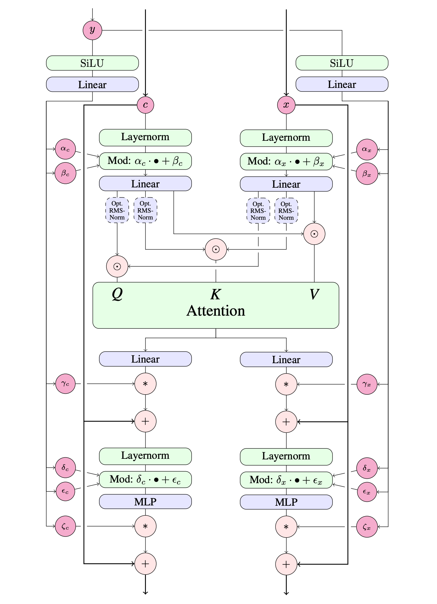

- 图片来源：https://arxiv.org/pdf/2403.03206 一个MMDiT的Block结构示意

可以发现，在 MMDiT 中，将文本 condition 看作与图像的 noised latent 同等重要，自注意力部分的 Q、K、V 矩阵由文本条件、带噪图像潜在表示分别经过投影后相乘得到。

MMDiT 模块的输出包含两部分：文本部分（与文本条件维度相同）、噪声预测部分（与图像潜在表示维度相同），多个 MMDiT 模块堆叠，最终的噪声预测部分输出被用做文生图。理解了这些，再来看 SD3 的完整结构就一目了然了，如下图所示。

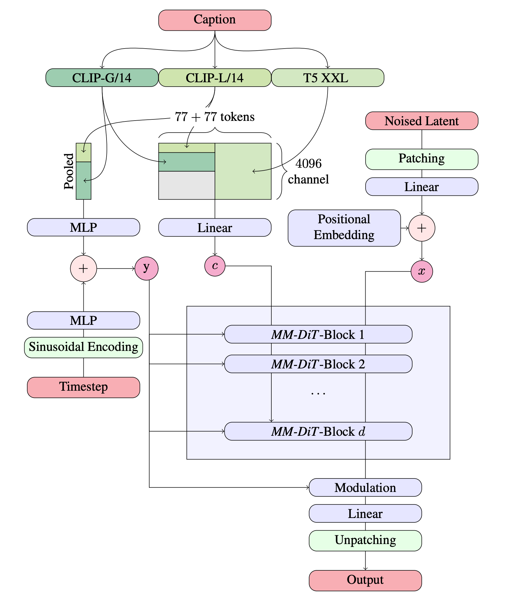

- 图片来源：https://arxiv.org/pdf/2403.03206 SD3的模型结构说明

需要指出，在 SD3 中，同时使用了两个 CLIP 和一个 T5XXL 模型提取文本特征，得到的文本特征信息更综合，通过这种方式，最终得到的文生图模型也能够更好的响应指令。

### DiT vs UNet

讲了这么多，我们来分析下 DiT 结构与 UNet 结构的差异。

从主干结构来看，DiT 与 UNet 的核心差异在于架构设计理念。DiT 采用纯 Transformer 作为主干网络，将图像分割为切片并通过自注意力机制进行全局建模，而 UNet 基于编码器 - 解码器结构，通过下采样压缩特征维度再逐步上采样恢复细节，依赖跳跃连接弥补信息损失。

这种差异使得 DiT 能够捕捉图像中的长距离依赖关系，尤其在处理复杂构图时更具优势；而UNet 的局部卷积操作更擅长提取局部特征，但在多主体交互场景中易受感受野限制。

在条件注入机制上，DiT 通过自适应层归一化​将时间步嵌入和文本条件整合到模型中，直接在归一化层中动态调整参数。

相比之下，UNet 需依赖交叉注意力层将文本条件与图像特征对齐，并将时间步嵌入注入残差块。这种设计使 DiT 的条件融合更高效，计算复杂度更低。

实验表明，DiT 的自适应层归一化方案比 UNet 的交叉注意力机制减少约 30% 的计算量，同时还能提升生成内容与文本的一致性。

计算复杂度方面，UNet 通过空间下采样显著降低特征分辨率，在低算力场景中更具实用性。然而，DiT 虽单次注意力计算开销较大，但其并行化能力更强，且随着硬件加速技术发展，Transformer 的算力瓶颈逐渐弱化。换言之，DiT 架构本身具备更高的优化潜力。

生成质量上，DiT 在复杂语义理解和细节一致性方面表现更优。UNet 受限于局部卷积的归纳偏置，难以处理包含多个主体或复杂空间关系的提示词，而 DiT 的全局注意力机制可协调画面整体构图。

定量数据显示，DiT-XL/2 在 ImageNet 256×256 任务中 FID 值达 2.27，远超同期 UNet 架构模型。此外，DiT 生成图像的质感、光影层次和空间透视也更接近真实摄影。

扩展性维度，DiT 展现出与 Transformer 一致的 Scaling Law，即模型参数和数据量增加时性能持续提升。

例如，腾讯混元文生图模型升级至 DiT 后，参数量达 15 亿，画面真实感提升 20%。反观UNet，其性能随参数增加易陷入瓶颈，且难以适配视频生成等跨模态任务。OpenAI 的 Sora和 Stability AI 的 SD3 均采用 DiT 架构，也印证了其在多模态扩展中的优势。

DiT 凭借全局建模能力、高效条件注入和强扩展性，正逐步取代 UNet 成为文生图领域的主流架构。下面的表格对比了 UNet 和 DiT 的核心差异。

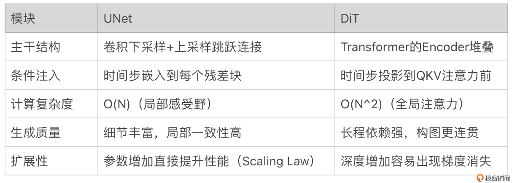

## 总结时刻

今天我们探讨了文生图模型从 UNet 结构向 DiT 结构的转变趋势。

首先，我们分析了 CNN 时期的经典模型架构，分别是 AlexNet、VGG 和 ResNet。这些模型结构被广泛应用于图像分类、目标检测、图像分割等任务，文生图中的 UNet 结构便是 CNN时期的产物。

然后，我们回顾了 Transformer 结构的基本原理，并详细分析了 Transformer 之后视觉模型如何从 CNN 转变为 ViT 结构。ViT 将图像看作文字进行处理的设计模式，这为跨模态的学习打开了大门。

ViT 架构的整体流程可以归纳为图像切片、切片向量化、添加 CLS token、添加位置编码、经过 Transformer 编码器、提取 CLS token 对应的特征向量并用于下游任务这样一系列环节。

之后，围绕图像生成，我们讨论了 ViT 结构如何进化为 DiT 结构实现类别生图，以及 SD3 如何将 DiT 结构进一步升级为 MMDiT 结构实现高质量的文生图能力。

如果你还想深入探究 DiT 类模型的技术原理，推荐你课后阅读这些资料：

- Transformer 的论文和代码实现

- ViT 的论文和代码

- DiT 论文和代码

- MMDiT 和 SD3 的技术原理：

## 思考题

在这一篇的最后，我给你布置两个思考题目：

1. 上面关于 ViT 的代码实现中，由于位置编码的限制，模型只能处理固定的分辨率。该如何实现动态分辨率呢？也就是一个 ViT 模型，可以自由支持任意分辨率图像的输入。欢迎你对这个问题做出思考。

2. 分析下 Flux 和 Pixart 使用的 DiT 结构是怎样的？

你可以查阅相关论文进行分析，也推荐你把想法和 DeepSeek 进行讨论。
