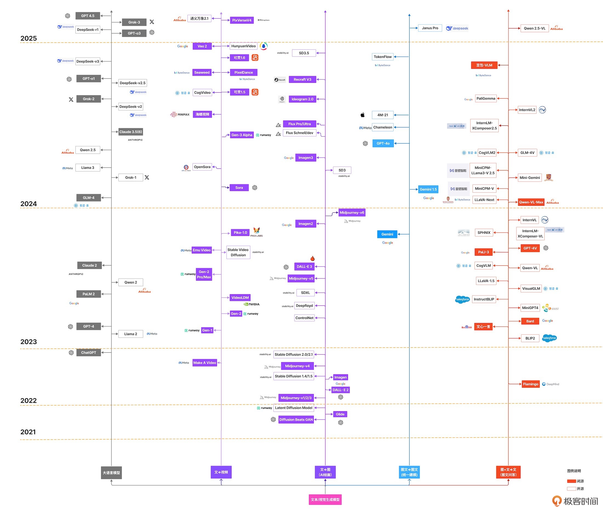

# 再次前行 | 紧跟AI绘画技术趋势

你好，我是南柯。

好久不见！自从 2023 年 8 月《AI 绘画核心技术与实战》专栏完结后，我一直在做一些 AI 生图方向的算法和应用探索。这段时间里，AI 绘画技术迎来了许多令人兴奋的突破，新模型、新工具和新趋势层出不穷，为创作带来了无限可能。

新模型如 Flux、Recraft-V3 等，展现了更强大的生成能力和更细腻的细节表现；新工具如ComfyUI，凭借其高效的节点式操作和灵活的定制能力，成为创作者的新宠；新趋势如自回归文生图方案和愈发真实的 AI 人像写真，正在重新定义艺术创作的边界。

与此同时，视频生成技术也取得了显著进展。可灵、Veo2、通义万象等模型生成的视频效果惊艳，大量高质量生成内容在各类社区中涌现；DeepSeek 等大语言模型则进一步赋能创作者，显著提升了创意生成的效率。 下面这张图是我整理的过去几年里大语言模型、视觉模型的关键里程碑，能看到技术在飞速发展。

基于这些背景，我决定为我们的专栏进行一次迭代加餐，深入探讨图像和视频生成领域的最新进展。本次加餐将围绕以下几个方面展开：

1. 探讨算法原理：重点解析 DiT 类结构、Flow Matching 以及自回归生图背后的核心技术，帮助你理解这些前沿技术的底层逻辑。

2. 介绍新模型与新工具：回顾专栏完结后 AI 绘画模型的发展历程，分析当前趋势，并详细介绍 ComfyUI 这一高效生图工具的使用技巧与优势。

3. 讨论主体保持类技术：深入探讨 IPAdapter、InstantID、Flux-Pulid 等算法的实现原理，并推演 AI 写真未来的发展方向。

4. 介绍工程技巧：分享如何优化生图模型的训练和推理过程，总结常见的工程问题及其解决方案。

5. 讨论视频生成技术：介绍主流视频生成模型的训练与使用经验，帮助你快速上手并应用于实际创作中。

希望这些内容能为你的创作之路提供新的灵感和工具支持。就像我在专栏结束语中写到的那样，期待与你再次并肩，开启这段全新的旅程！
