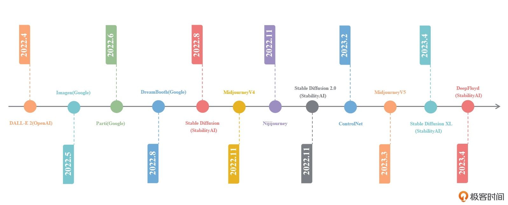
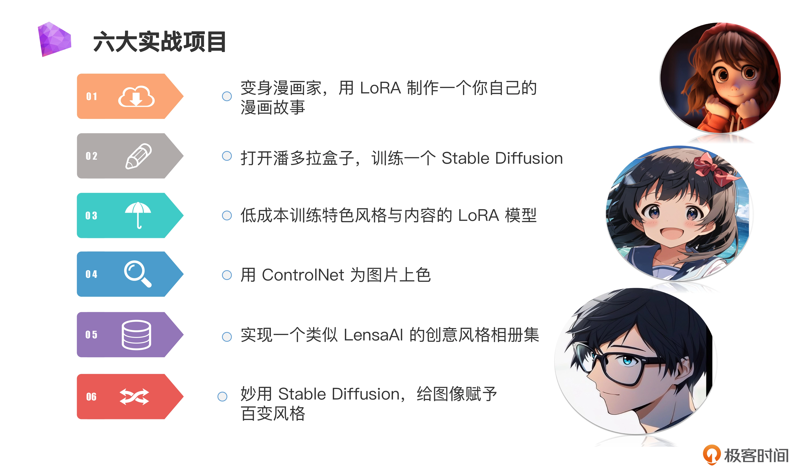
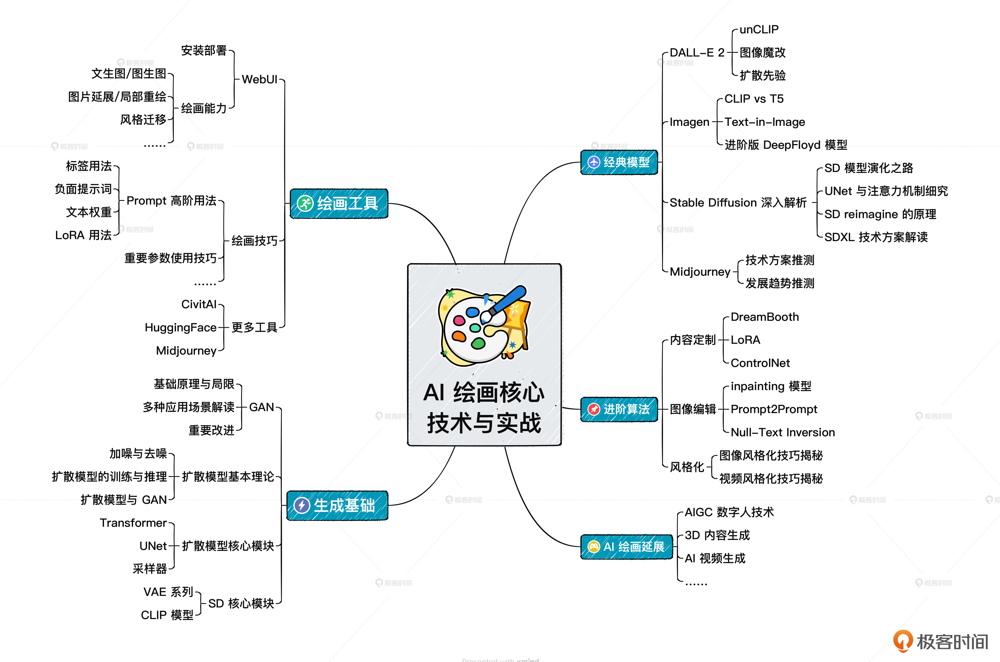

# 开篇词 | AI技术爆发，如何实现绘画模型自由？

你好，我是南柯，非常欢迎你加入我的课程，与我一起探索 AI 绘画技术背后的奥秘。

先做个自我介绍，作为一名计算机视觉从业者，我一直活跃在 AI 绘画技术领域。这么多年的工作里，我在图像风格化、图像生成、数字人等技术方向积累了丰富经验。目前我在一家头部互联网公司工作，正带领我的团队全力推动多模态大模型领域的能力建设。

我们后面要讨论的 AI 绘画，是 AIGC 技术的一部分。AI 绘画正处在百花齐放的上升期，就在2022 年，一系列的天才画师模型相继推出，比如 DALL-E 2、Imagen、Parti、StableDiffusion 等。更让人兴奋的是，这些新技术并非昙花一现，而是为更多更出色的工作铺平了道路，比如 AI 绘画领域的 MidjourneyV5。

可以预见，在未来几年 AI 绘画模型的生成能力、编辑能力仍将持续演进。现在选择入场做 AI绘画技术是一个好时机。

## 一起迎接 AI 绘画的浪潮

结合近期我的一些工作经历和线下交流经历，不难看到大家对 AI 绘画非常好奇。让我比较意外的一点就是，除了正在研发和探索 AI 绘画算法、应用的专业人士之外，很多算法工程师、产品经理、艺术创作者，甚至我的老板们，也非常热衷和我讨论 AI 绘画背后的技术原理和未来的发展趋势。

设计师朋友正在担心“卷不过” AI 画师。未来 AI 绘画工具的普及程度，差不多会和现在的 CAD技术一样。如果不尽快掌握 AI 绘画工具，并把它融合到自己的个人风格，就要面临被 AI 绘画工具挑战的风险。

有多年工作经验的资深产品经理正在负责 AI 绘画项目，却发现自己几乎听不懂算法同学的讨论了。想要追问，却常常得到“产品不需要深入了解这个”的回应，这让他深感无奈。

即便是有基础的算法工程师、技术同学，也很容易发现过往的传统深度学习方法和 AI 新技术中间有很大的知识鸿沟。因为缺乏指导，最多只能调用现成的 AI 绘画模型简单玩玩，新技术的原理仍然还是黑盒。

就连投资人、CEO 这样的角色也在有意识地培养自己对于 AI 绘画技术原理的理解、能力边界的认识，闲暇时间会拉着一线同学请教相关知识。搞懂了 AI 绘画背后的逻辑，有助于他们从公司视角去调整下一步的产品战略。

我自己也常常思考类似的问题。

- 为什么像 Stable Diffusion 这样的 AI 绘画模型一出现，GAN 就显得黯然失色了？

- 随着 AI 绘画和 GPT 技术的不断突破，图像编辑未来的交互形式是怎样的？

- Midjourney 靠 AI 绘画取得了巨大成功，他们可能采用了哪些独特的算法方案？

- 我能否训练一个自己专属的 AI 绘画模型，随心所欲创造富有创意的内容？

如果你也在脑子里也闪过类似想法，那加入我的专栏将会是一个绝佳的选择。在接下来的学习中，我们将一同揭开这些问题的答案，探索 AI 绘画技术的奥秘。

## 我们课程是怎么安排的？

不过，对于初学者来说，想要系统了解学习 AI 绘画并不容易，主要障碍包括后面这几方面。

- 没有合适的系统学习资料。网上随便搜到的资料过于零散，不够深入，更不要说建立自己的知识体系；而 AIGC 方向的论文啃起来也很晦涩，而且读论文的方式并不适合所有人。

- 止步简单体验，无法做进阶尝试。只能简单体验开源模型，无法更进一步理解 AI 模型的技术原理，那么自然也就没办法随心所欲地做能力扩展。

- 缺少从业级别的指导。接触不到企业级的 AI 绘画项目和技术，自己摸索制作的只是“玩具水准”，难以达到各种 APP 上看到的从业者实现出的效果。

为了摆脱上述困境，这门课程将理论与实战相结合，在帮你搞懂 AI 绘画技术原理的基础上，通过多次实战课将 AI 绘画转化为你自己的工具。

具体来说，在这门课程中我们要一起经历四个阶段。

首先是热身阶段，相当于 AI 绘画旅程中的“新手村”，我会引领你熟悉各种令人着迷的免费开源AI 绘画工具和模型，感受超参数在效果中的差异。此外，我们还会探索 Stable Diffusion 和WebUI 的来龙去脉，一起安装和部署 WebUI，探索 AI 绘画的无限潜能。

接下来的基础篇，我会为你夯实 AI 绘画技术的基本原理，让你真正了解 AI 算法从业者需要掌握的理论技术基础，理解图像生成如何从 GAN 过渡到扩散模型的全过程，并掌握扩散模型各个模块的算法原理。产品和设计同学固然可以跳过理论，直接到下一章，但如果想搞明白 AI绘画背后的黑魔法，多少需要了解这一章的基础知识。

有了前面的基础，我们就可以运用已学内容来解读分析业界主流的 AI 绘画模型了。进阶篇里，DALL-E 2、Imagen、Stable Diffusion、DeepFloyd、Midjourney 等业界最新最火的模型都会涉及到。掌握了这些模型的设计原理，不但能让我们充分学习、发掘这些模型的长处为己所用，还能为我们训练自己的专属 AI 绘画模型、实现“模型自由”打下坚实基础。

在下面的图中，我整理了从 DALL-E 2 推出以来，AI 绘画领域一些有影响力的模型和算法。你可以点开查看。

了解了 AI 绘画的基本原理、常见模型方案，也熟悉了开源工具和代码仓的使用，下一步便是如何“炼丹”，即自己定义风格训练模型，完成类似于 AI 绘画这类的项目。

我们将一起完成 DreamBooth、LoRA 模型的训练，使用 ControlNet 精细化控制内容的生成，做出类似于 LensaAI 这样的相册类效果，借助 Stable Diffusion 给你的照片渲染出各色风格。经过这些实战课的洗礼，相信你对 AI 绘画的应用能力会得到质的飞跃。

下面，我为你梳理了一个简化的 AI 绘画知识体系图，也是这门课程涉及的全部知识点。这些概念、模型、算法、工具，乍一看好像是孤立的，但串联起来就是一张大网，能帮助我们在AI 绘画的浪潮下释放创意、做出很多有意思的事情。

## 你能获得什么？

正如你看到的，AI 绘画是个很大的话题，背后涉及的理论体系非常庞杂，领域相关的论文浩如烟海，并且每周都还在大量涌现出新的研究工作。在我的职业生涯之初，经常用很多个周末去啃英文版原汁原味的算法书籍，日积月累有不少的收获，可是这种方法实践下来，也经常会发现一些知识晦涩难懂，花费了大量时间却收获甚微。

幸运的是，后来在工作中我遇到了很多良师益友，他们能够深入浅出、三言两语把知识点讲清楚，帮助我积累了很多有用的经验、少走了很多弯路。后来我也开始渐渐成为了别人请教的对象，比如我曾被邀请和一些艺术家、企业家分享对于 AI 绘画技术的理解与思考，碰撞出很多有趣的火花。

因此，极客时间邀请我开设这门课程的时候，我们一拍即合。我非常期待在这门课里，用最简单的描述和例子，帮助你理解那些晦涩难懂的公式和理论，系统入门 AI 绘画这个领域。

学完整个课程，我们最终的目的地是这样的：真正打开 AI 绘画领域的大门，理解 AI 绘画的黑魔法背后的支撑技术和算法原理，搭建起自己的知识体系，未来遇到新的 AI 绘画论文、代码、模型，也能举一反三。实战方面，让主流 AI 绘画工具成为我们发挥创意的强大助力，做出我们在各种 App 看到的、从业者实现出的商用级算法效果。

AI 绘画技术实战之旅即将开启，期待你的加入！
