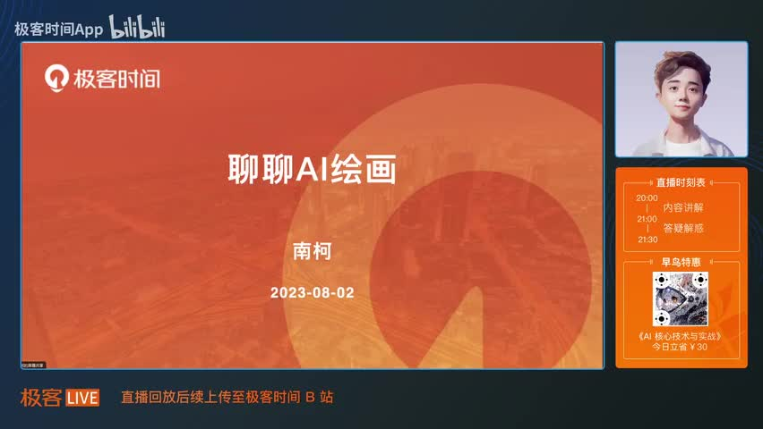

# 直播回放 | AI绘画发展脉络与LoRA模型训练实战

直播主要话题：

1. 从 GAN 到扩散模型，AI 绘画为什么突然就爆发了？

2. 我们是不是仅仅能够使用 Midjourney 和 WebUI 就足够了？

3. 新技术每天都在涌现，让人眼花缭乱。我们该怎样上手学习 AI 绘画呢？

下方视频是直播回放，如果对上述这些问题感兴趣的话可以点开视频观看。

Colab：https://colab.research.google.com/github/NightWalker888/ai_painting_journey/blob/main/live/LoRA_train_v2.ipynb
