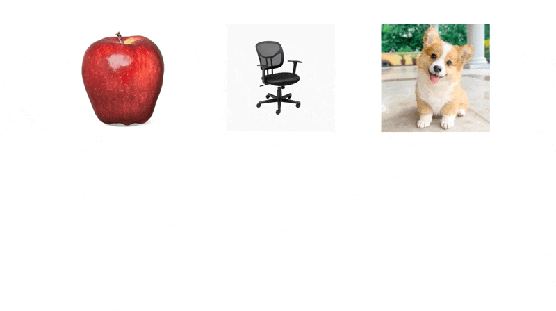
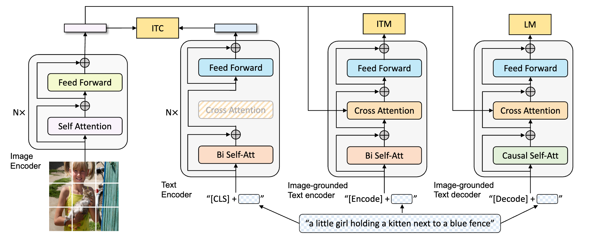
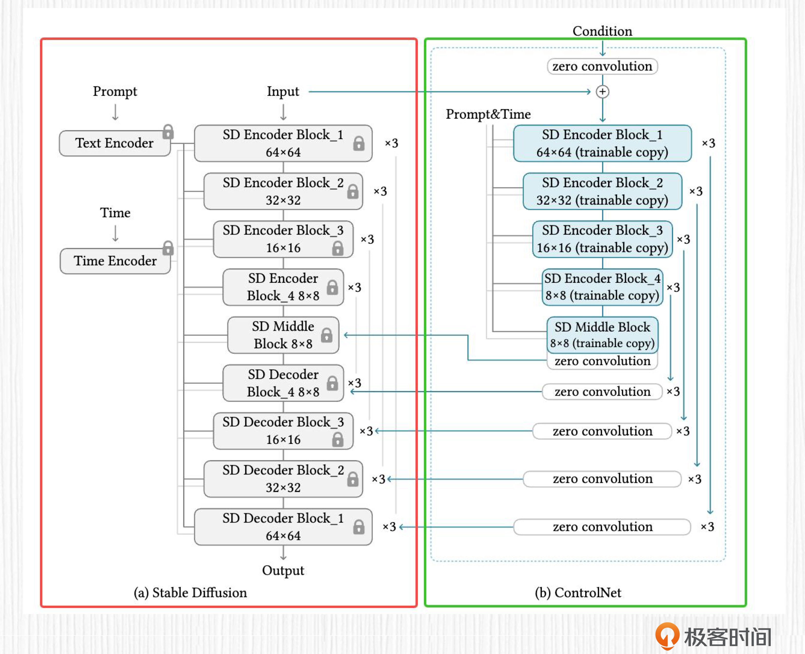

# 答疑课堂2 | 热点问题答疑&第三、四章思考题答案

你好，我是南柯。

现在，我们已经完成了进阶篇和综合演练篇的学习。在更新过程中，我也看到了很多同学的留言评论。这次加餐，我精选了评论区中的高频问题做个回复，希望能帮你答疑解惑。

另外，第 13 讲到第 25 讲的思考题答案，我也放在了这篇加餐中。我希望你可以独立思考之后再查看答案，把答案和自己的想法做个对比。有一些没提供参考答案的是实操练习题，希望你课后多动手尝试，也欢迎你把你的实验成果用 Colab 链接等方式，在留言区分享出来。

## 热点问题答疑

Q1：在 AI 绘画中，如何缓解手部生成的瑕疵问题？

我们使用 SD1.4、SD1.5 等模型时确实很容易生成畸形手指，即使如今最新的 SDXL 模型、Google 的 ideogram 模型，生成的手部仍旧容易出现瑕疵。

对于手部生成的瑕疵问题，我提供两个解决的思路。

第一，在 negative prompt 中指定“bad hands, bad fingers”，引导模型关注手部区域的生成。

第二，使用针对手部的修复插件 Depth Library，这个插件中提供了各种不同的手势深度图，用于配合 ControlNet 的 Depth 控制条件。你可以通过 这个视频 了解 WebUI 中如何使用 Depth Library 插件。

Q2：CLIP 和 BLIP 模型有哪些差别？

CLIP（Contrastive Language-Image Pretraining）和 BLIP（Bootstrapping Language-Image Pre-training）这两个模型的名字比较像，但两个模型的用途是不同的。

CLIP 模型我们在第 10 讲中已经详细探讨过，使用海量图文对通过对比学习的方式进行训练，最终得到一个图像编码器和一个文本编码器。两个编码器相互配合可以用于跨模态检索任务，文本编码器则可以提取 prompt 文本表征，用于指导 AI 绘画模型生成目标效果。



- 图片来源：https://www.assemblyai.com/blog/how-dall-e-2-actually-works/

BLIP 模型也是使用海量图像文本对进行训练，最终得到一个图像编码器（Image Encoder）、两个文本编码器（Text Encoder、Image-grounded Text Encoder）以及一个文本解码器（Image-grounded Text Decoder）。你可以一边看下面的方案图，一边听我说。



- 图片来源：https://github.com/salesforce/BLIP

BLIP 实际上有三个功能，分别对应图中的 3 个损失函数：ITC、ITM 和 LM。

ITC 损失和 CLIP 的对比学习损失是一回事，所以 BLIP 的图像编码器和文本编码器也可以完成 CLIP 模型的功能。

ITM 损失用于训练一个二分类任务，具体就是用于训练图中的第二个文本编码器，判断图像和文本是否匹配。图像编码器提取的特征通过交叉注意力机制作用于 BLIP 的第二个文本编码器。LM 损失用于训练文本解码器，预测图像的描述信息。

我们可以将 BLIP 理解为 CLIP 的升级版，除了能完成 CLIP 的功能外，还能直接判别图文是否匹配、为图像生成 prompt 信息。

Q3：如何在 Colab 中运行 SDXL、DeepFloyd、ControlNet 等模型？

我们课程中大多数代码都可以使用 Google 免费的 Colab 资源（15G GPU、12G 左右 RAM）来运行，但对于 SDXL、DeepFloyd IF、适配 SDXL 的 ControlNet 模型等任务，免费的Colab 就无法完成了。推荐你两个方法。

第一，在某宝上购买 Colab 计算单元，获取更多 GPU 资源和 RAM 资源。

第二，使用 ModelScope 提供的 36 小时免费计算资源，当前最多能申请到 24G GPU 资源和32G RAM 资源。

Q4：ControlNet 能否独立使用？能否用于 SD 之外的 AI 绘画模型？

我们在第 20 讲中已经学过 ControlNet 的基本原理。在后面的图中，红框中是 StableDiffusion 模型，或者也可以是 Imagen 等其他 AI 绘画模型。右侧的绿框中就是我们熟悉的ControlNet 模型。当前的 ControlNet 还不能独立使用，需要配合基础模型使用。



在实际使用过程中，我们仍旧可以选择自己喜欢的基础模型，与 SD1.5 训练得到的ControlNet 模型搭配使用。这里需要保证我们使用的模型与 SD1.5 模型之间具有相近的亲缘关系，这一点和 LoRA 选择基础模型的原则是相同的。

## 思考题答案

第 13 讲

思考题：DALL-E 2 使用两个基于扩散模型的上采样模块，相比于不使用扩散模型的超分算法，有哪些优势？（提示：了解超分算法有助于回答这个问题）

思考题答案：在扩散模型大火之前，很多方案被用于解决图像超分的问题，比如 ESRGAN 等工作。这类经典的图像超分算法往往只使用到低分图像作为输入，通过 GAN 等方案试图补全图像中的细节。

基于扩散模型的上采样模块则与之不同，在训练维度，扩散上采样模块相比于经典超分算法使用了更多训练数据；在算法输入维度，扩散模型超分模块的输入既包含低分辨率的图像、也包含用于引导生成图像的文本。

扩散模型上采样模块不仅能将图像变清晰，也能根据输入的文本描述对低分辨率图像中遗失的内容进行补全。因此，扩散模型在图像超分问题上更具潜力，也是当前各种 AI 绘画模型在后处理阶段普遍采取的做法。

第 14 讲

思考题：除了我们今天学习的 Google T5 模型，你还知道哪些优秀的大语言模型，可以用于AI 绘画模型的文本编码？

思考题答案：

AI 绘画模型需要的文本编码器主要作用是获取文本表征。我推荐一些优秀的编码器模型。

- BERT：BERT 模型是一个深度双向编码器，能捕获文本中单词的上下文信息。

- RoBERTa：它是一个对 BERT 模型进行了优化的变体，提供了更强大的文本编码能力。

- GPT-3 的编码器部分：ChatGPT 强大的文本理解能力有目共睹，它的前身 GPT-3 的编码器模型也可用于文本表征提取，提升 AI 绘画效果。

第 15 讲

思考题：除了标准的图生图，SD 模型还有一种常见用法，是图像补全。根据今天学到的知识，你能推测一下图像补全这个功能是怎么实现的么？

思考题答案：图像补全（inpainting）这个操作和图生图整体思路一致。先说共同点，需要使用 VAE 编码器将输入图像编码为潜在表示，然后通过重绘强度添加噪声，再进行去噪生成图像。

再说不同点，对于图像补全这个任务，为了保证 mask 之外的区域不发生变化，在加噪过程中，我们需要保留每一步的加噪结果。在去噪过程中，针对补全区域外的部分，需要用保留的加噪结果替换掉经过扩散模型预测得到的结果，保证 AI 绘画的过程仅作用于待补全区域。

第 16 讲

思考题：SD 图像变体与 SDXL 分别具有哪些优势和特点，可以应用于哪些场景中？

思考题答案：SD 图像变体的优势是不仅可以直接使用图像生成图像变体，还能用 prompt 语句提升可控性和生成效果。SDXL 的优势是可以生成更逼真、更高分辨率的图像。

对于基本的文生图模型，应当选择 SDXL 模型，而对于一些已有图像的艺术创作和变化，则可以选择 SD 图像变体模型。

第 17 讲

思考题 1：除了我们已经介绍过的 Midjourney 的使用功能，你还了解哪些有趣的用法？或者你希望 Midjourney 未来能加入哪些能力呢？

思考题答案：这是一个开放性题目。就我个人而言，我希望 Midjourney 早日提供图像风格化的能力。当前 Midjourney 虽然可以上传图片，对图片进行二次创作，通过–iw 的参数控制输出图像和参考图像的相似度，但这种方式并不能胜任保持构图的风格化任务。

思考题 2：请你尝试参考今天课程里的思路，分析一下妙鸭相机的技术方案？

思考题答案：首先看产品提出的技术背景，DreamBooth 和 LoRA 是时下已经开源的热点技术。关于产品团队透露的产品细节，推荐你去做一些检索获取有效信息。然后是最关键的产品呈现效果。我们知道妙鸭相机需要上传 20 多张图片、不排队的情况下等待半小时左右，整体画风都是证件照样式。

从这几个点我们可以推测，妙鸭相机背后的技术是 LoRA，基础模型是一个偏写实风格的 SD模型（比如我们提到的人造人模型）。

第 18 讲

思考题：除了我们今天提到的 LensaAI 和妙鸭相机，你还知道哪些 AI 产品，用到了我们今天学习的定制化图像生成技术？

思考题答案：开放性题目。除了 LensaAI 和妙鸭相机，百度、美图、TikTok 等公司也纷纷推出过自己的 AI 相册类产品，背后使用的也都是定制化图像生成技术。

第 20 讲

思考题：这一讲中我们介绍了 ControlNet 的几种控制条件，比如边缘轮廓、分割图、人体关键点等。你还知道 ControlNet 有哪些控制条件？这些控制条件我们需要通过怎样的方式获得？

思考题答案：ControlNet 还可以使用深度图（Depth）、法线图（Normal）、图像的直线轮廓等。提取这些条件，我们需要采用对应的算法，比如使用深度估计模型、法线估计模型、M-LSD 提取算法等。

这里我提供一个使用的代码。

```python
from transformers import pipeline
# Depth
depth_estimator = pipeline('depth-estimation')
image = load_image("图片路径")
image = load_image("https://huggingface.co/lllyasviel/sd-controlnet-depth/resolve
image = depth_estimator(image)['depth']
image = np.array(image) # Depth条件
# 直线轮廓
from controlnet_aux import MLSDdetector
mlsd = MLSDdetector.from_pretrained('lllyasviel/ControlNet')
image = load_image("图片路径")
image = mlsd(image) # 直线轮廓
# Normal
from controlnet_aux import NormalBaeDetector
image = load_image("图片路径")
processor = NormalBaeDetector.from_pretrained("lllyasviel/Annotators")
control image = processor(image) # Normal
```

此外，我们可以根据第 20 讲学习的 ControlNet 训练方法，根据我们的需求训练ControlNet，比如使用人脸关键点来控制人脸表情等。

第 22 讲

思考题：假如你手中有一张图片，是一个站着的女孩子抱着一只宠物狗，希望改变女孩子黑发为红发，同时将宠物狗变成猫咪，该如何实现？可以说说你的思路，也可以在评论区贴出你的Colab 实验链接。

思考题答案：利用我们今天学习的方法，这个过程有 3 种实现思路。

第一，可以使用 SD 模型的图像补全能力。首先将女孩子的头发和怀中的宠物狗做遮罩处理，然后写这样一个 prompt “a girl with red hair, with a small cat”，利用 SD 模型对遮罩区域做补全。

第二，可以使用 ControlNet 的指令级修图能力或者 InstructPix2Pix 的指令修图能力，指令中要求修改发色和怀中的宠物。

第三，可以使用 Null-Text Inversion 配合 Prompt2Prompt。首先指定一个原始 prompt “a girlwith black hair, with a small dog”，利用 Null-Text Inversion 算法优化得到 Null-TextEmbedding，然后指定目标 prompt “a girl with red hair, with a small cat”，利用Prompt2Prompt 完成修图。

第 24 讲

思考题：对于模型融合中 Add difference 这个模式，需要对两个模型的权重相减处理，比如B-C，然后加到另一个模型 A 的权重上。这种方式的融合模型，在风格上会呈现出怎样的特点呢？

思考题答案：按照后面这个公式得到的融合模型会呈现以下两个特点。

新模型权重 = 模型 A + (模型 B - 模型 C) * M

第一，A 模型作为基础模型，新模型会保留 A 模型的风格。

第二，从模型 B 减去模型 C 的权重，意味着吸取模型 B 的风格，但是排除掉模型 C 的风格。

因此，融合后的模型在风格上更靠近 A 和 B，并且避免呈现出 C 模型的风格。靠近 B 和远离C 的程度，则是由系数 M 决定。

第 25 讲

思考题：经过我们课程的学习，你能否总结下当前广义的 AI 绘画（2D、3D、视频等）有哪些核心问题待解决？这些问题的解决将带来怎样的产品机会？

思考题答案：首先看 2D 方向。我认为待解决的技术问题包括图像中写入长文本、更高速度的图像生成、更可控自然的图像编辑、单图不训练的定制化图像生成等。解决了这些问题，将会孵化出下一代的 PS 技术、Midjourney、LensaAI 或者妙鸭相机类产品。

然后看视频方向。长视频的生成问题仍未被解决，视频风格化的效果还存在一定的抖动。这些问题的解决将为用户带来更高效的视频创作方式。

最后看 3D 方向。3D 生成的精致度、速度问题，3D 数字人这个特殊垂类的风格指定、可驱动性问题都是当下亟待解决的热点问题。这些问题的解决，将为 VR、游戏领域带来更多新的创意素材，大大提高内容生产的效率。

好，以上就是这次加餐的全部内容。欢迎你在留言区继续和我交流互动，也可以试着写下你的学习心得，留下学习的足迹。
