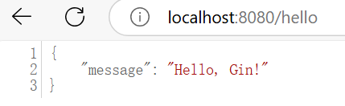
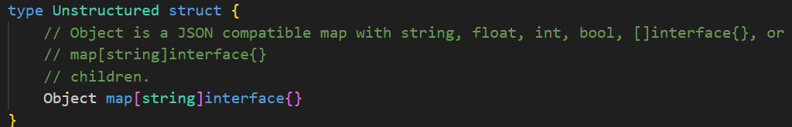
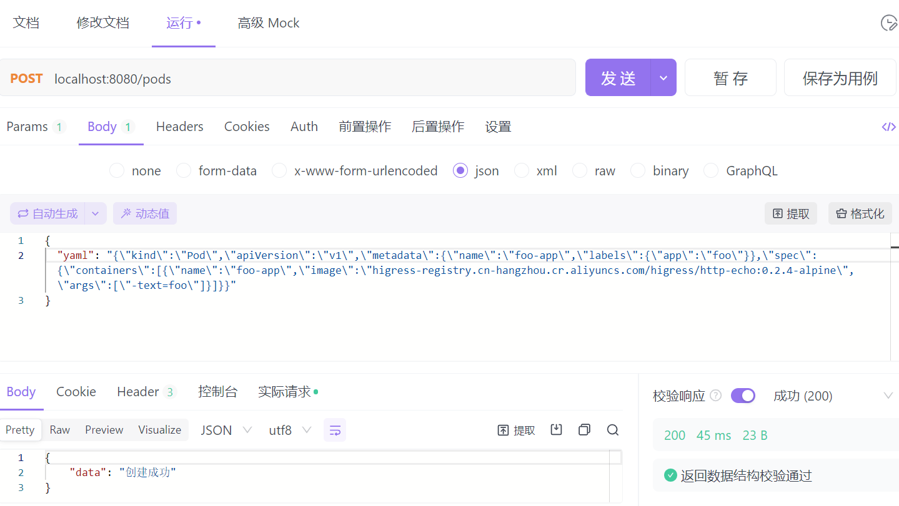
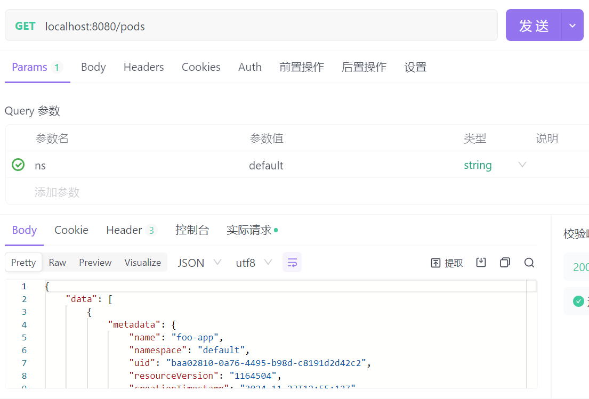
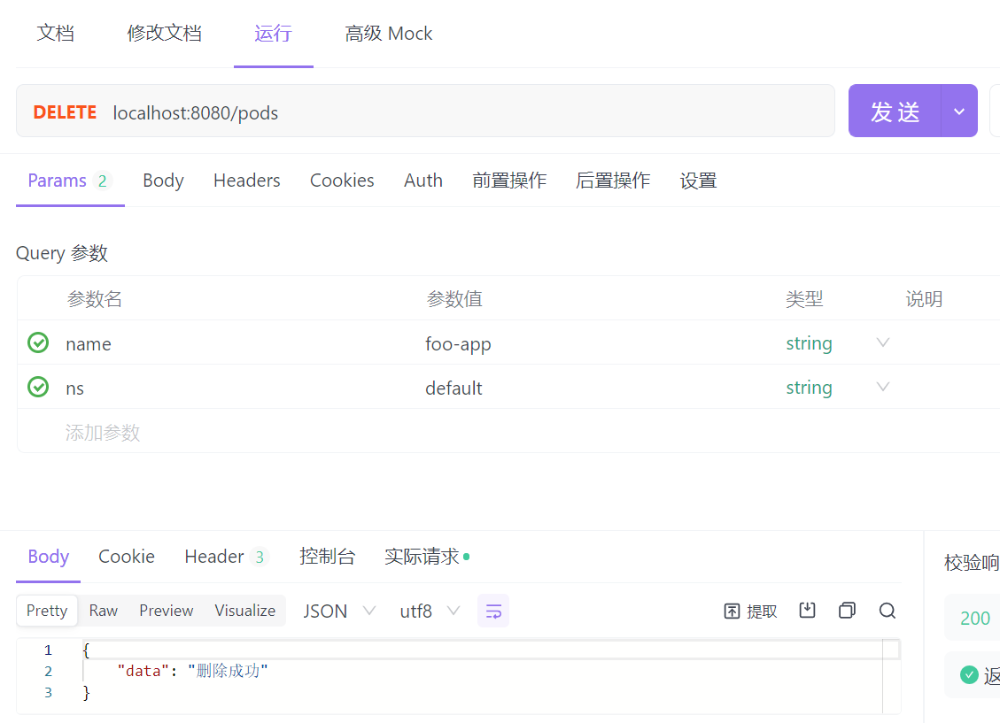
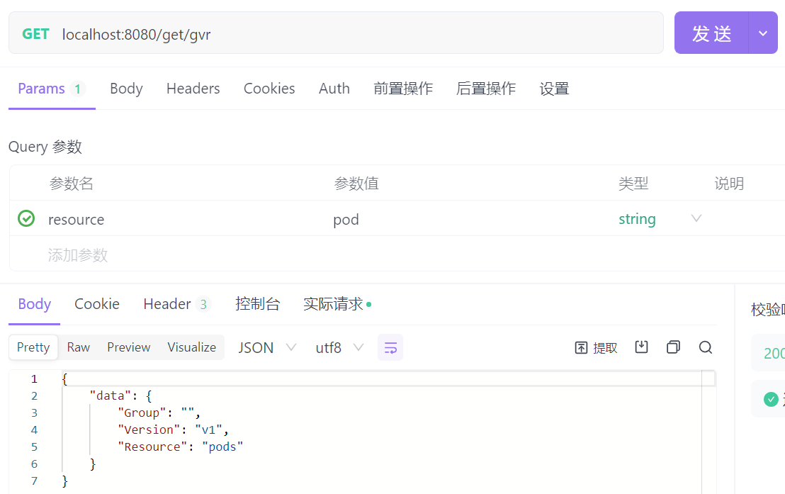
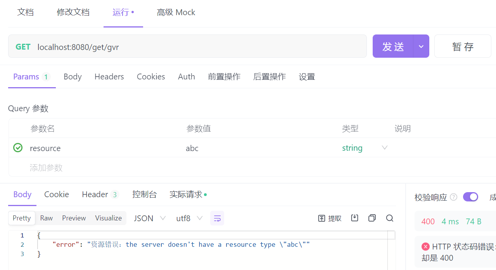

# 08 | Gin+client-go：构建API工具

你好，我是邢云阳。

在前两节课中，我们介绍了 client-go 的两种进阶使用技巧。但需要强调的是，“存在即合理”——client-go 中每种操作资源的方法都有其特定的使用场景。是否在项目中采用这些进阶技巧，最终还需要根据需求来判断。例如，如果项目中并不需要高频查询，就没有必要通过Informer 将资源缓存到本地。分享这些技巧的目的，是为了拓宽你的知识面，让你在实际工作中多一些选择，提高应对的灵活性。

与此同时，正如我反复提到的，API 是 AI 时代的一等公民。因此本节课，我们将在前面内容的基础上，完成资源的创建、删除和查询三种操作的代码实现，并使用 Gin 框架构建一个HTTP Server，将这些功能封装成三个独立的 API。这些 API 将为后续 Agent 的调用提供工具支持。

## Gin 简介

首先，我们来简单介绍一下 Gin。Gin 是一个用 Go 语言编写的高性能、轻量级 Web 框架。它的设计灵感来自于 Python 的 Flask 框架，以简洁易用著称，非常适合构建 RESTful API。可以说 gin 已经成为了 Go 语言编写 Web 后端的最佳实践。

以下是一段最简单的 Gin 示例代码，展示如何快速搭建一个返回 “Hello, Gin!” 的 HTTPServer：

```go
package main
import (
 "github.com/gin-gonic/gin"
)
func main() {
 // 创建一个默认的 Gin 路由引擎
 r := gin.Default()
 // 定义一个简单的 GET 路由
 r.GET("/hello", func(c *gin.Context) {
   c.JSON(200, gin.H{
     "message": "Hello, Gin!",
   })
 })
 // 启动 HTTP 服务，监听 8080 端口
 r.Run(":8080") // 默认监听 0.0.0.0:8080
}
```

可以看到，几行代码就可以构建出一个 HTTP Server，非常简单易懂。我们在浏览器输入“localhost:8080/hello” 看一下效果：



## 代码讲解

### API 设计

了解了什么是 Gin 之后，我们进入今天的代码实践环节。首先，我们需要设计 API。这次设计的目标是实现增、删、查三种通用 API，用于通过自然语言操控 Kubernetes 服务，除此之外，我们还要设计一个验证 API，用于在创建资源时，验证用户传入的 resource 是否正确。

首先来看增删查三个 API。在实际使用场景中，对于这三种操作，用户一般会这么说：

```
//创建
帮我在 default 命名空间下创建一个名为 nginx 的 Pod。
//查询
帮我列出 default 命名空间下的 configmap 列表。
//删除
帮我删除 default 命名空间下名为 ng-svc 的 service。
```

从这样的提问方式中可以总结出一个特点，用户通常只会明确告诉我们要操作的资源的 kind或 resource 名称，例如 pod、service 等等，而不会提及 group 和 version。并且用户要操作的资源是随机不固定的。因此，我们可以设计成通用路由，比如：

```sql
// 创建
POST http://<host>:<port>/:resources?ns=<资源命名空间>
Body: json格式
数据结构: yaml string类型 存放资源 yaml 文件内容
// 删除
DELETE http://<host>:<port>/:resources?ns=<资源命名空间>&name=<资源名称>
// 查询
GET http://<host>:<port>/:resources?ns=<资源命名空间>
```

这样设计的思路是，路径参数 resources 直接填入从用户那里获取的待操作资源名称，实现通用化，而不需要针对每一种资源都设计一条路由，比如 GET http://:/pods、GEThttp://:/services 等等。有了这个前提，针对这三种操作所需的不同参数，就很好设计了。

针对创建 API，需要知道命名空间来创建动态客户端，也需要传输一个资源 yaml，才能做具体的创建工作。而删除需要命名空间和资源名称，查询需要命名空间。当然查询也可以做得再复杂一点，比如加上标签过滤，在这里我就不演示了。

接下来看一下验证 API。验证 API 的作用主要是验证用户输入的 resource 是否是一个 K8s 支持的 resource。例如用户说 “我要创建一个 pod ”，这是没问题的，但如果用户说“我要创建一个 abc”，那就有问题了，我们可以通过验证 API 直接验证出错误就拦截掉，无需再进行后续的步骤了。

验证的原理，实际上就是我们在第 6 节课讲过的通过 resource 获取 GVR 的原理，如果能获取到说明没问题，如果获取不到，则说明用户填错了。

因此 API 可以这么设计：

```
// 查询
GET http://<host>:<port>/get/gvr?resource=<资源名称>
```

### 目录结构

设计完成后，我们来写代码，首先来看一下目录结构。

```
.
|-- pkg
| |-- config
| | |-- k8sconfig.go
| |-- controllers
| | |-- resourceCtl.go
| |-- services
| | |-- resourceService.go
|-- go.mod
|-- go.sum
|-- main.go
```

根目录包含 pkg 文件夹，用于编写业务代码。pkg 下面包含了 config、controllers，以及services 三个文件夹。config 主要是做配置相关的代码，目前包含 k8sconfig.go，做 client,restMapper 等初始化操作；controllers 主要是做路由处理相关工作，包含 resourceCtl.go，用于做创建、删除、查询资源三个 API 的路由处理；services 做具体的与底层 K8s 交互的业务，也就是 client-go 部分的代码，包含 resourceService.go。最后在 main.go 中定义路由并启动 gin 服务器。

接下来我就按照 config、services、controllers 这三层的顺序开始讲解。

### config

k8sconfig.go 还是沿用上一节课的链式调用的代码结构，整体变动不大。只是如下所示在K8sConfig 结构体中，增加了 clientSet、restMapper 以及 SharedInformerFactory。

```
type K8sConfig struct {
   *rest.Config
   *kubernetes.Clientset
   *dynamic.DynamicClient
   meta.RESTMapper
   informers.SharedInformerFactory
   e error
}
```

这些成员的初始化在之前的两节课中都已经讲过，在这里不做赘述。我会将本节课的代码放到Github 上，你可以自行查看。

### services

services 层的代码是具体的业务实现，需要使用 client-go 来完成增删改三种操作以及验证操作。

对于创建操作和删除操作，我们可以使用第 6 节课讲解的 restMapper + DynamicClient 的方式。将路由传入的 resources 利用 restMapper 映射取得 GVR，之后通过 DynamicClient 完成资源创建删除。

在 第 6 节课的课后思考题中，我曾经提到过，如果 mapping 函数传入的 resourceOrKindArg

参数不是 resource 而是 Kind，我们在代码中如何处理。实际上，非常简单，因为 schema 包不只提供了 ParseResourceArg 方法用于根据 resource 取出 groupResource，还提供了ParseKindArg 方法用于根据 Kind 取出 groupKind。我们可以将代码这样完善一下：

```go
func (r *ResourceService) mappingFor(resourceOrKindArg string, restMapper *meta.R
   // 之前的处理 resource 的代码
   ...
   //处理 Kind 的新代码
   fullySpecifiedGVK, groupKind := schema.ParseKindArg(resourceOrKindArg)
   if fullySpecifiedGVK == nil {
       gvk := groupKind.WithVersion("")
       fullySpecifiedGVK = &gvk
   }
   if !fullySpecifiedGVK.Empty() {
       if mapping, err := (*restMapper).RESTMapping(fullySpecifiedGVK.GroupKind(
           return mapping, nil
       }
   }
   mapping, err := (*restMapper).RESTMapping(groupKind, gvk.Version)
   if err != nil {
       if meta.IsNoMatchError(err) {
           return nil, fmt.Errorf("the server doesn't have a resource type %q",
       }
       return nil, err
   }
   return mapping, nil
}
```

有了 mapping 之后，就可以通过 mapping.Resource 拿到 GVR。之后通过我们封装的getResourceInterface 函数，设置好 DynamicClient。

```go
func (r *ResourceService) getResourceInterface(resourceOrKindArg string, ns strin
   var ri dynamic.ResourceInterface
   restMapping, err := r.mappingFor(resourceOrKindArg, restMapper)
   if err != nil {
       return nil, fmt.Errorf("failed to get RESTMapping for %s: %v", resourceOr
   }
   // 判断资源是命名空间级别的还是集群级别的
   if restMapping.Scope.Name() == "namespace" {
       ri = client.Resource(restMapping.Resource).Namespace(ns)
   } else {
       ri = client.Resource(restMapping.Resource)
   }
   return ri, nil
}
```

我们利用动态客户端，可以通过 Create 可以创建资源，通过 Delete 可以删除资源，这都很简单了。比如创建这样写：

```go
func (r *ResourceService) CreateResource(resourceOrKindArg string, ns string, yam
   obj := &unstructured.Unstructured{}
   _, _, err := scheme.Codecs.UniversalDeserializer().Decode([]byte(yaml), nil,
   if err != nil {
       return err
   }
   ri, err := r.getResourceInterface(resourceOrKindArg, ns, r.client, r.restMapp
   if err != nil {
       return err
   }
   _, err = ri.Create(context.Background(), obj, metav1.CreateOptions{})
   if err != nil {
       return err
   }
   return nil
}
```

我们唯一需要关注的是 ri.Create 需要传入一个 obj，代表待创建的资源实体，它的类型是*unstructured.Unstructured，通过源码可以看出，其本质就是一个 map[string]interface{}。



那么如何将 string 类型的 yaml 转化成这种格式呢？scheme 包中给我们封装好了 Decode 函数，即代码第三行的 scheme.Codecs.UniversalDeserializer().Decode，直接调用即可完成转换。

创建和删除都清晰后，再顺便说一下验证操作。验证是很简单的，直接利用上面的mappingFor 函数获取 GVR 即可。

最后我们沿着上一节课的课后思考题看一下查询如何写。上一节课最后，我说你可以思考一下如何将 restMapper 和 SharedInformerFactory 结合起来，实现根据 resource 或其他 kind 从informer 中查询资源。

现在我们来一起做一下这个功能。

首先需要在 k8sconfig.go 中初始化 SharedInformerFactory，代码如下：

```go
func (k *K8sConfig) InitInformer() informers.SharedInformerFactory {
   fact := informers.NewSharedInformerFactory(k.InitClientSet(), 0) //创建通用inf
   informer := fact.Core().V1().Pods()
   informer.Informer().AddEventHandler(&cache.ResourceEventHandlerFuncs{})
   ch := make(chan struct{})
   fact.Start(ch)
   fact.WaitForCacheSync(ch)
   return fact
}
```

在初始化中创建监听 pods 的 informer。之后来写查询业务代码。

```go
func (r *ResourceService) ListResource(resourceOrKindArg string, ns string) ([]ru
   restMapping, err := r.mappingFor(resourceOrKindArg, r.restMapper)
   if err != nil {
       return nil, err
   }
   informer, _ := r.fact.ForResource(restMapping.Resource)
   list, _ := informer.Lister().ByNamespace(ns).List(labels.Everything())
   return list, nil
}
```

首先，先使用 mappingFor，获取 restMapping，restMapping.Resource 就是 GVR。之后通过 SharedInformerFactory 的 ForResource 方法获取监听的 informer，最后通过 informer 的Lister 就能获取资源列表。

services 部分，我们就讲到这里，有了前面两节课的基础，理解这个代码还是很简单的。

### controllers

最后来看一下，路由处理部分。路由处理代码在 resourceCtl.go 中，我依然使用了面向对象思想，创建了 ResourceCtl 以及构造函数。

```go
type ResourceCtl struct {
   resourceService *services.ResourceService
}
func NewResourceCtl(service *services.ResourceService) *ResourceCtl {
   return &ResourceCtl{resourceService: service}
}
```

由于 client-go 相关的业务代码，放在了 services 中，在路由处理函数中需要调用，因此我在ResourceCtl 结构中添加了 resourceService 作为成员。

路由处理的逻辑很简单，我们看一下相对最复杂的创建处理逻辑的实现套路，学会了套路，查询和删除就不难了。

```go
func (r *ResourceCtl) Create() func(c *gin.Context) {
   return func(c *gin.Context) {
       var resource = c.Param("resource")
       ns := c.DefaultQuery("ns", "default")
       type ResouceParam struct {
           Yaml string `json:"yaml"`
       }
       var param ResouceParam
       if err := c.ShouldBindJSON(&param); err != nil {
           c.JSON(400, gin.H{"error": "解析请求体失败: " + err.Error()})
           return
       }
       err := r.resourceService.CreateResource(resource, ns, param.Yaml)
       if err != nil {
           c.JSON(400, gin.H{"error": "创建失败：" + err.Error()})
           return
       } else {
           c.JSON(200, gin.H{"data": "创建成功"})
       }
   }
}
```

由于 gin 在定义路由时，需要填写 func(c *gin.Context) 类型的回调函数，因此这里的 Create方法的返回值就是 func(c *gin.Context)。代码的第 3～14 行做了对 HTTP Request 请求的参数解析工作。在 gin 中，使用 c.Param() 来解析路径参数；使用 c.DefaultQuery() 与 c.Query()来解析查询参数，不同的是 c.DefaultQuery() 可以赋默认值；使用 c.ShouldBindJSON() 来解析 json 格式的 Body。

参数解析完成后， 调用 services 包的 CreateResource 方法处理具体业务逻辑。

### 路由定义与启动

全部业务代码完成后，就可以在 main.go 中定义路由以及启动服务器了。代码如下：

```go
r := gin.New()
r.GET("/:resource", ctl.List())
r.DELETE("/:resource", ctl.Delete())
r.POST("/:resource", ctl.Create())
r.GET("/get/gvr", resourceCtl.GetGVR())
r.Run(":8080")
```

我们将四条路由定义好，然后启动 gin server。

### 测试

使用 Apifox 工具做一下测试。首先测试 pod 创建。



我们在 body 中传入了一个 名字为 foo-app 的 pod 的 yaml 内容，点击发送后，返回创建成功。

之后测试 一下 pod 查询，验证刚才创建的 pod 是否存在。



可以看到返回的 body 中含有 foo-app 这个 pod。

再测试一下 pod 删除，删除刚才创建的 pod。



返回删除成功。

最后测试一下验证 API。先输入一个正确的 resource，结果如下：



再输入一个错误的 resource，结果如下：



OK，全部测试完毕。

## 总结

这节课是对前两小节 client-go 知识的一个小的应用实战。我结合着 gin 框架，沿着前两小节的课后思考题，带你完成了创建、删除、查询 Kubernetes 资源以及验证用户输入四个 API 的编写，并做了测试。这节课的代码我已经上传到 GitHub 了，供你参考。

在传统应用中，将后端业务封装成 API，可以实现前后端的解耦。而在 AI 时代，则可以实现与 Agent 的解耦，也就是说，Agent 不管是用 ReAct 还是用 ReWoo，是用 Go 语言还是用Python 与 API 工具都没关系。再进一步，Agent 将会形成一个类似“网关”的效果，“网关”的后面是各种工具 API，而前端是一个能输入自然语言的界面，这个界面具体是使用 UI 还是命令行，是使用 Python、Java，还是 Go 实现，我们并不关心，只要它能和我们的 Agent 连接即可。

这些思路，我们会在后面的课程中，为你一步步展现。

## 思考题

本节课的查询代码只能够查询到 pods 资源，查询其他资源会返回空。这是什么原因呢？如果我们要查询 deployments 该如何做？

欢迎你在留言区展示你的思考和测试结果，我们一起来讨论。如果你觉得这节课的内容对你有帮助的话，也欢迎你分享给其他朋友，我们下节课再见！
