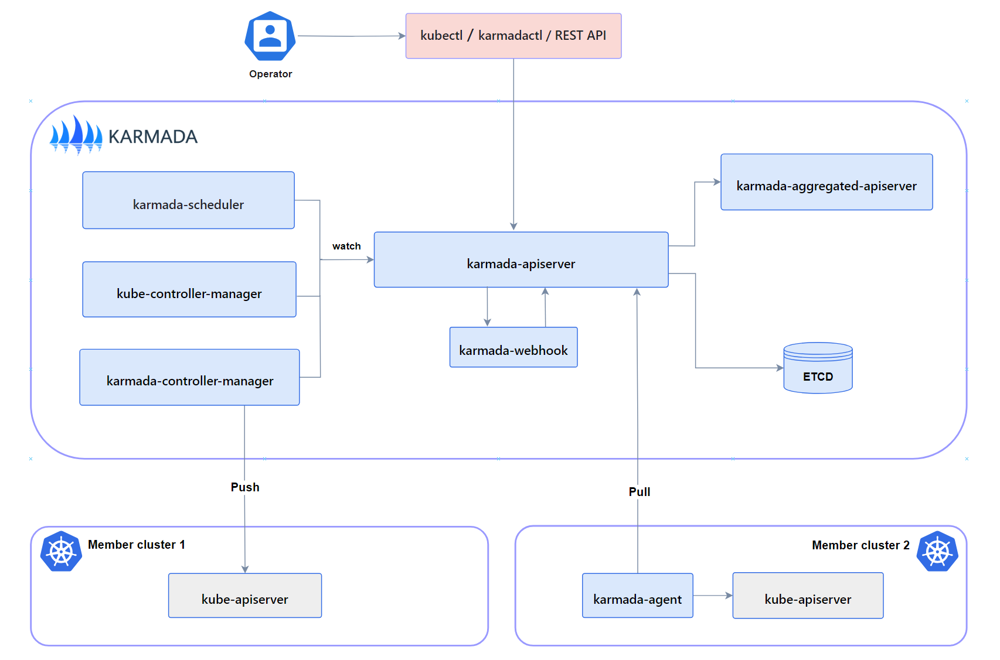
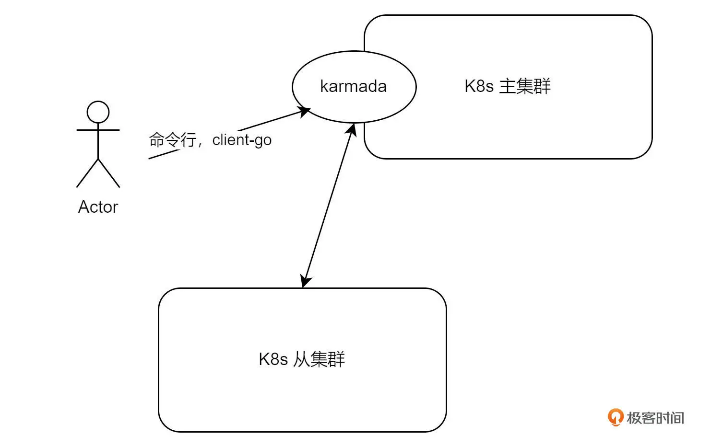
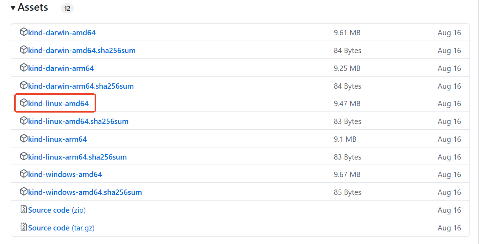
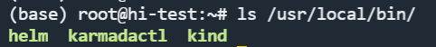
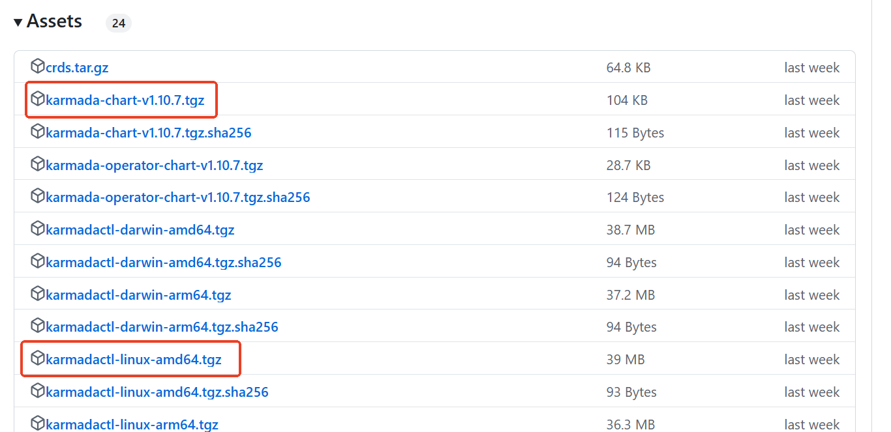
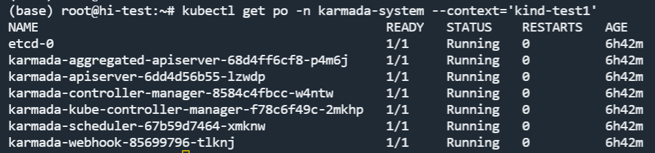
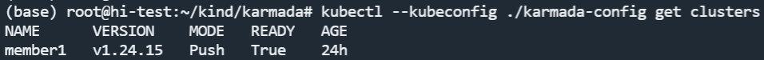
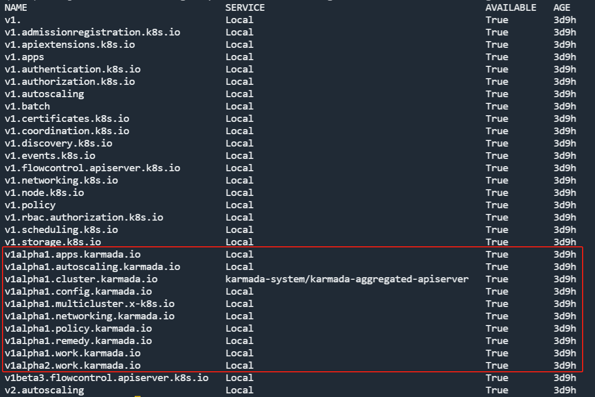
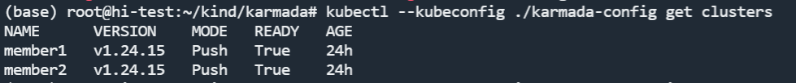

# 09 | 多集群资源管理Karmada

你好，我是邢云阳。

在前几节课中，我们围绕单 Kubernetes 集群的资源如何操控，做了详细的介绍以及代码实践。但随着企业业务的发展和对云原生技术应用的深入，越来越多的企业开始面临管理多个Kubernetes 集群的需求。这些集群可能分布在不同的云供应商、地理位置或边缘设备上，以满足不同场景下的性能、成本及合规性要求。因此，本节课我将为你介绍一款由华为开源的多集群管理软件–Karmada，并讲解如何通过动态客户端等方式通过 Karmada 来操作多集群。

首先我们先来认识一下 Karmada。

## 什么是 Karmada？

Karmada 是一个由华为开源的云原生多云容器编排平台，目标是让开发者像使用单个Kubernetes 集群一样使用多个 Kubernetes 集群。开发者可以在多个 Kubernetes 集群和云中运行云原生应用程序，而无需更改应用程序。Karmda 的架构图如下：



可以看到 Karmada 在架构上，参考了很多 Kubernetes 的设计，比如 apiserver、调度器scheduer、controller-manager、etcd 等等。因此用户可以像访问普通 Kubernetes 一样，通过命令行，Rest API（client-go）等方式来访问 karmada。

Karmada 纳管集群的方式有两种，一种是 Push 模式，一种是 Pull 模式。使用 Push 模式，Karmada 会直接访问成员的 apiserver。而 Pull 模式，则需要在成员集群上，安装一个 agent代理，通过代理访问 apiserver。

总的来说，由于 Karmada 使用聚合 API 技术，使得它能够兼容原生 K8s API，因此对于开发者来说，使用起来非常友好，用 Karmada 来做多集群资源的查询、差异化分发等等操作都很方便。

在了解了什么是 Karmada 后，我们来看看如何安装。

## Karmada 环境搭建

这节课我们会使用两台 Kubernetes 集群来测试 Karmada。其中一台作为主集群，Karmada会运行在该集群上，另外一台集群当作从集群。架构如下：



如果你的手上没有这么多服务器，可以使用 Kind 工具在一台服务器上创建出多个集群。

### Kind

Kind 是 Kubernetes In Docker 的缩写，是将 Kuberntes 各节点运行在 docker 容器内，从而快速拉起集群的一种工具。我们可以用 Kind 来快速创建不同版本的集群，从而方便测试。

环境与工具准备

使用 Kind ，首先需要有一台安装了 docker 的服务器。在这里，我使用的是云服务器，操作系统是 Ubuntu 20.04，docker 版本是 27.0.2。之后需要安装 Kind 命令工具来帮助我们创建删除集群等。

那 Kind 工具如何安装呢？首先，我们需要打开 Github 链接：Releases · kubernetes-sigs/kind，选择自己喜欢的版本下载，我使用的版本是 v0.24.0，如果你想要跟我一样的效果，建议和我的版本保持一致。



我们点开对应版本的 Asserts，下载自己操作系统版本的压缩包。以 linux 系统为例，下载后，将压缩包放到 linux 系统的 /usr/local/bin 下解压，得到 Kind 二进制文件，之后给 Kind 赋可执行权限即可。



创建集群

准备好 Kind 工具后，我们来通过 Yaml 模板的方式创建两个集群，一个是主集群，一个是从集群。

首先是主集群的 Yaml 模板。

```
kind: Cluster
apiVersion: kind.x-k8s.io/v1alpha4
name: test1  #第1个集群
nodes:
 - role: control-plane
   image: kindest/node:v1.24.15
   extraPortMappings:
     - containerPort: 6443
       hostPort: 36443  #安全组开放
       protocol: tcp
     - containerPort: 31443
       hostPort: 31443  #安全组开放   这是karmada的 apiserver端口 ,装在 test1上的
       protocol: tcp
 - role: worker
   image: kindest/node:v1.24.15
networking:
 apiServerAddress: "192.168.67.99" # 云服务器内网地址
 apiServerPort: 6443
 podSubnet: "10.6.0.0/16" #自定义 pod IP 地址范围
 serviceSubnet: "10.96.0.0/16"
 kubeProxyMode: "ipvs"
```

模板中，集群包含两个 Node，一个是控制面 control-plane，也就是 master 节点，另一个是worker 节点，节点的版本都是 v1.24.15。其中 master 节点映射出了两个端口，分别是 6443->36443，31443->31443 ，这是因为 Kubernetes 是安装到 docker 容器内的，如果想要外部访问，必须映射端口。6443 表示 apiserver 端口，31443 表示 karmada apiserver 端口。

在网络方面，apiserver 的地址，我填写了云服务器内网地址。然后在 podSubnet 自定义了pod 的 ip 网段，在 serviceSubnet 自定义了 服务网络网段。

从集群的配置与主集群基本一致，只是无需映射 31443 端口，同时 podSubnet 和serviceSubnet 尽量与主集群不一致，方便做一些 pod 互通之类的操作。

准备好配置文件后，只需执行下面这行代码：

```
kind create cluster --config=c.yaml
```

即可完成集群创建，完成创建后，会自动在 ~/.kube/ 目录下创建 config 文件，此时使用kubectl 就可以操作集群了。

这节课的所有配置以及代码，我都会上传到 Github，届时你用我的配置做测试即可。

### Karmada 创建

Karmada 我使用的版本是 v1.10.7，安装官方提供了很多方式，比如通过 Karmadactl 命令行，或者 helm 等等。今天我们来讲一下使用 helm chart 安装的方法。

安装

Helm 部署首先需要下载 chart 包。



找到 v1.10.7 版本，下载 karmada-chat-v1.10.7.tgz 压缩文件，在服务器上解压即可。你也顺便将 karmadactl 下载下来，放到 /usr/local/bin 中，后面纳管集群等操作会用到。

解压 chart 包后，我们需要修改 values.yaml 中的几个点：

1. 由于网络原因，global 下的 imageRegistry，需要改成 DockerHub 的国内代理地址，如果你手里没有国内可用代理地址，可以在留言区留言。

2. apiServer 的 image 下的 repository 改成 myifeng/k8s.gcr.io_kube-apiserver。

3. apiServer 的 serviceType 改成 NodePort，nodeport 端口改成 31443。

4. kubeControllerManager 的 image 下的 repository 改成 myifeng/k8s.gcr.io_kube-controller-manager。

5. etcd 的 image 下的 repository 改成 myifeng/k8s.gcr.io_etcd。

6. certs 下的 hosts，添加上云服务器的公网 ip，否则无法通过公网访问 Karmada。

修改完成后，执行命令，进行安装：

```
helm install karmada karmada -n karmada-system --create-namespace
```

使用 kubectl get po -n karmada-system 查看 pod 状态。当所有 pod 都 running 时，安装就成功了。



通过下面的命令，可以将 karmada 的 kubeconfig 文件保存下来。

```bash
kubectl get secret karmada-kubeconfig  -n karmada-system  -o jsonpath={.data.kube
```

之后修改 karmada-config 文件的 server，从 https://karmada-apiserver.karmada-system.svc.cluster.local:5443 改为 https://< 公网 ip>:31443，使得可以通过公网访问karmada。

纳管集群

方便起见，我们使用 Push 方法来纳管集群。执行如下命令，纳管集群 test1。

```
karmadactl join member1 --kubeconfig=/root/kind/karmada/karmada-config --cluster-
```

该命令的含义是通过 karmadactl 工具，用上面保存下来的 karmada-config 文件来访问Karmada 的 apiserver，之后通过 join 命令，利用 test1 集群的 config 文件，访问 test1 的apiserver，从而实现集群纳管，纳管后，该集群在 Karmada 中命名为 member1。

纳管后，我们通过 kubectl 可以查询集群列表。

```bash
kubectl --kubeconfig ./karmada-config get clusters
```

效果如下：



此时，你可能会问，为什么查看集群列表是用 kubectl 呢？这是因为上文讲过 Karmada 是使用了聚合 API 技术，相当于自己造了一个小型 apiserver 挂到了 Kubernetes 集群的 apiserver上，因此通过 kubectl 可以查到 karmada 的 自定义 API。查询方法是输入命令：

```bash
kubectl get apiservice --kubeconfig kind/karmada/karmada-config
```

结果：



可以看到红框中的 API，全是 karmada 自定义的。

在完成第一个集群纳管后，你可以使用我代码中的 c2.yaml 创建出第二个 kind 集群，然后使用如下命令将第二个集群纳管进来。

```
karmadactl join member2 --kubeconfig=/root/kind/karmada/karmada-config --cluster-
```

得到如下的效果：



至此，Karmada 的环境搭建部分就完成了。

## Karmada 代码实战

由于我们要让 Agent 来进行多集群管理，因此需要通过代码的方式操作 Karmada，以便封装成工具。

通过前面 client-go 部分的学习，我们知道动态客户端可以操作任意资源，包括自定义资源CRD。因此使用动态客户端操控 Karmada，一定是没问题的。但实际上， Karmada 本身也有自己实现的 client，可以更加方便地操作 Karmada 资源，接下来，我以获取集群列表为例，为你演示一下这两种方法。

### 动态客户端

首先演示一下使用动态客户端操作 Karmada 的代码实现。动态客户端的初始化大家已经很熟悉了，我就不再演示。只需要注意一点，客户端所使用的 config 文件，要替换成 karmada-config。

获取集群列表的代码这样写：

```go
func main() {
   config := config.NewK8sConfig().InitRestConfig()
   ri := config.InitDynamicClient()
   clusterGvr := schema.GroupVersionResource{
       Group:    "cluster.karmada.io",
       Version:  "v1alpha1",
       Resource: "clusters",
   }
   list, err := ri.Resource(clusterGvr).List(context.TODO(), v1.ListOptions{})
   if err != nil {
       panic(err)
   }
   for _, item := range list.Items {
       fmt.Println(item.GetName())
   }
}
```

代码没什么稀奇的，主要是 GVR 我是怎么知道的呢？我是通过如下命令查到的：

```bash
kubectl api-resources --kubeconfig kind/karmada/karmada-config | grep cluster
```


### Karmada client

如果你用 kubebuilder 等脚手架开发过 operator 就会知道，脚手架会帮助我们生成框架代码，其中就包括 client。而通过阅读源码可以得知 Karmada 的 client 也是自动生成的，这里我给出了https://karmada/pkg/generated/clientset/versioned/clientset.go at v1.10.7 · karmada-io/karmada"> 代码的链接，我们只需要在代码中初始化该客户端，就可以使用。初始化代码如下：

```go
import (
   karmadaversiond "github.com/karmada-io/karmada/pkg/generated/clientset/versio
)
func (k *K8sConfig) InitClientSet() *karmadaversiond.Clientset {
   if k.Config == nil {
       k.e = errors.Wrap(errors.New("k8s config is nil"), "init k8s client faile
       return nil
   }
   clientSet, err := karmadaversiond.NewForConfig(k.Config)
   if err != nil {
       k.e = errors.Wrap(err, "init karmada clientSet failed")
       return nil
   }
   return clientSet
}
```

首先需要 import 一下 client 包，之后与 clientSet 一样调用 NewForConfig 进行客户端初始化。初始化完成后，列出集群列表就更简单了，代码如下：

```go
func main() {
   config := config.NewK8sConfig().InitRestConfig()
   client := config.InitClientSet()
   clusters, err := client.ClusterV1alpha1().Clusters().List(context.TODO(), v1.
   if err != nil {
       panic(err)
   }
   for _, item := range clusters.Items {
       fmt.Println(item.GetName())
   }
}
```

可以说会用 clientSet，就会用 Karmada Client。

## 总结

今天这节课，我为你介绍了多 Kubernetes 集群管理工具 Karmada，并带你实操了 Karmada的安装以及多集群的纳管。最后以获取集群列表为例，介绍了两种用代码实现访问 Karmada资源的手法。通过 Karmada，我们可以在多个集群之间实现高效的资源调度与管理，解决跨集群操作的复杂性。本节课的 Kind 以及 Karmada 创建的 YAML 以及代码，我已经上传至Github，你可以把代码下载下来，实操一遍，加深理解。

随着企业 IT 架构逐步向云边端一体化转型，Karmada 展现出的不仅仅是集群管理的能力，它在云边端多云环境的管理上也具有巨大的潜力。比如，随着 5G、物联网等新兴技术的发展，边缘计算逐渐成为云计算的重要补充。边缘设备的部署通常分布在远程地区，且面临着带宽、延迟、可靠性等挑战。通过 Karmada，用户可以更轻松地将 Kubernetes 管理的能力延伸到边缘集群，实现跨云、跨地域、跨边缘设备的统一调度和管理，从而提升业务的可靠性和灵活性。

Karmada 与 AI Agent 结合后，更是如虎添翼，AI Agent 能够为 Karmada 提供智能化的决策支持与自动化操作，使 Karmada 从被动的管理模式转变为主动的智能调度和优化模式。

## 思考题

有兴趣的话你可以通过阅读文档，学习一下 PropagationPolicy，也就是 Karmada 的资源分发策略，并尝试使用 YAML 的方式，在两个集群上同时拉起 nginx deployment。

欢迎你在留言区展示你的 YAML 和测试结果，我们一起来讨论。如果你觉得这节课的内容对你有帮助的话，也欢迎你分享给其他朋友，我们下节课再见！
