# 10 | 实践：用Go语言实现用自然语言操控K8s

你好，我是邢云阳。

本章的开始，我从设计出发，为你讲解了用自然语言操控 K8s 需要考虑的要点，这些点从技术角度主要分成两类，一类是云原生时代，用命令、代码等等手段与 K8s 集群资源进行交互的手段；第二类是 AI 时代的开发技巧，比如 prompt 工程等等。

AI 时代的开发技巧实际上是重思维，轻代码的，但云原生的开发手段则是实打实的“内功”。因此我在设计篇后，又花了 4 节课的时间，为你讲解了 client-go 的两种进阶用法，如何用 gin框架封装 API，以及多云管理工具 Karmada。

那有了思维 + 内功的支持后，本节课我们就可以开启实战，真正打通用自然语言操控 K8s 的全流程了。

我们再来回顾一下第 5 节课设计的架构：

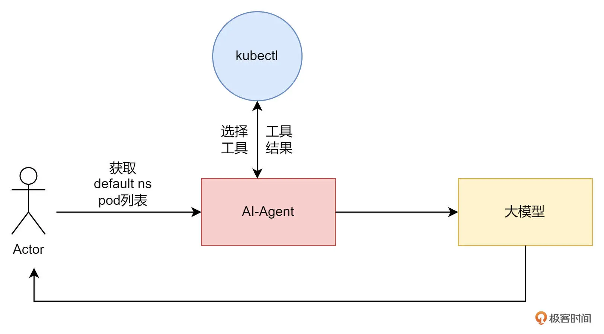

用户会在一个自然语言前端，向 AI Agent 发送一条 操控 K8s 的 prompt。AI Agent 通过工具调用与 K8s 进行交互，在得到结果后，由大模型判断结果准确性并进行自然语言处理后，反馈给用户。

综上所述，设计分为三个部分，分别是自然语言前端、AI Agent 以及工具。自然语言前端我们使用 kubectl 同款的 cobra 来做成一个命令行前端，AI Agent 依然使用 ReAct，工具已经在第8、9 节完成，分别是对于单集群资源的增删查以及对多集群的获取集群列表操作，本节课我会补充一个人类工具，用于在删除这样的危险操作前做一下确认。

## Cobra 前端

首先，我们先来制作命令行前端。Cobra 命令，我们每一个和 K8s 打过交道的开发者都用过。比如：

```bash
kubectl get pod
```

这个命令主要分成三个部分，其中 kubectl 是可执行程序的名字，也就是我们自己做 Go 语言应用开发时 go build 所指定的名称；get 是 命令，即要执行的动作；pod 是子命令，即主命令下的一个细分类。

当然 Cobra 命令不止这三部分，它还有 Args、Flag 等等内容，但本节课我们不需要设计这么复杂的命令行，如果你感兴趣的话可以在课后自行看文档研究。

下面我们开始实际做设计，写代码。我希望实现的效果是，当我输入：

```
k8sGpt chat
```

可以进入类似 MySQL 那样的交互式命令行页面，我可以输入 prompt，然后 Agent 给我结果，直到我输入 exit，交互式命令行才退出。

要实现这个效果，首先我需要先把 cobra 命令行框架代码搭起来。这一步可以使用 Github 上的一个开源工具 cobra-cli 来自动生成代码。

通过命令：

```
go install github.com/spf13/cobra-cli@latest
```

可以将 cobra-cli 安装到本地。

Cobra-cli 的使用非常简单，首先我们需要先创建并初始化好一个空的 go 语言工程（执行过go mod init）。之后在工程的根目录下执行命令：

```
cobra-cli init --author "k8sGpt" --license mit
```

进行代码初始化。author 后跟的是项目名称，可以自己随意取，license 则是开源协议的类型，主流的协议都支持，在执行完这条命令后，会在根目录下生成这样的目录结构与代码。

```
.
|-- cmd
| |-- root.go
|-- go.mod
|-- go.sum
|-- LICENSE
|-- main.go
```

这就是 Cobra 的 初始框架，root.go 可以理解为所有后续命令的根，之后所有的命令都要在根上生长。root.go 还有一个重要作用就是如下图所示的定义了帮助文档，即我们输入 -h 时，输出的内容。

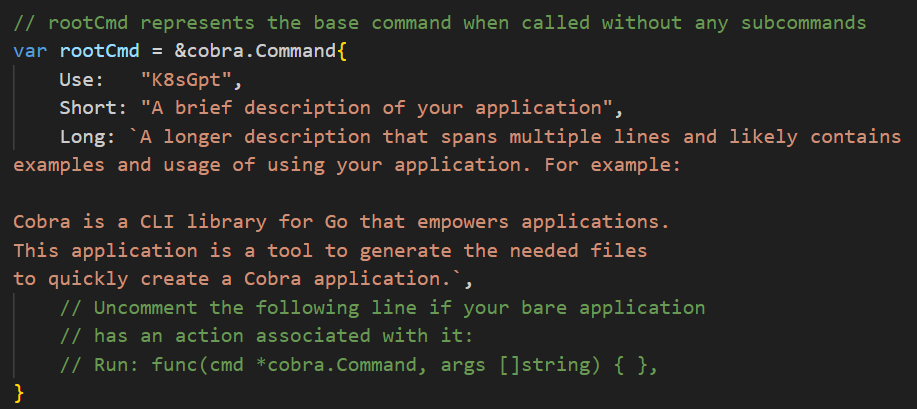

接下来，我们来创建 chat 命令。执行：

```
cobra-cli add chat
```

此时，会在 cmd 文件夹下创建出一个叫做 chat.go 的文件，这便是 chat 命令的主体。

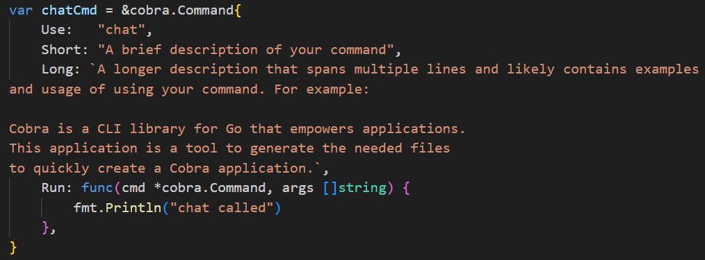

此时我们执行：

```
go run main.go chat
```

会有如下效果：

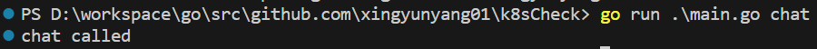

说明 Run 回调函数中的打印被执行了。因此我们可在此编写执行 chat 命令后的业务逻辑。

首先，先实现交互式的效果。代码这样写：

```go
scanner := bufio.NewScanner(cmd.InOrStdin())
fmt.Println("你好，我是k8s助手，请问有什么可以帮你？（输入 'exit' 退出程序）:")
for {
   fmt.Print("> ")
   if !scanner.Scan() {
       break
   }
   input := scanner.Text()
   if input == "exit" {
       fmt.Println("再见！")
       return
   }
}
```

我们通过一个 for{} 死循环将 Run 函数卡住，通过 scanner 接收用户输入，只有输入 exit 时才能退出，这样就实现了交互式。运行效果如下：

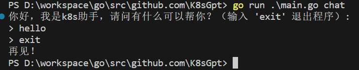

Ok，Cobra 代码先写到这，我们先来写 Agent 代码以及工具描述部分，这两部分完成后，再来 Run 函数里，把 Agent 多轮对话逻辑写完。

## Agent

Agent 部分很简单，我们在第一章里已经讲过。本项目可以把第一章实战部分的代码直接拿过来，仅仅把 ReAct 模板略作修改即可。

修改后的 ReAct 模板如下：

```
You are a Kubernetes expert. A user has asked you a question about a Kubernetes i
Answer the following questions as best you can. You have access to the following
%s
Use the following format:
Question: the input question you must answer
Thought: you should always think about what to do
Action: the action to take, should be one of %s.
Action Input: the input to the action, use English
Observation: the result of the action from human feedback
... (this Thought/Action/Action Input/Observation can repeat N times)
When you have a response to say to the Human, or if you do not need to use a tool
---
Thought: Do I need to use a tool? No
Final Answer: the final answer to the original input question
---
Begin!
Previous conversation history:
%s
Question: %s
```

大体逻辑是没变化的，主要是在开头添加了 K8s 专家的人设。使得 Agent 可以更好地选择工具解决问题。

## 工具

### 单集群增删查工具

工具类，我们使用面向对象的思想进行封装。以创建为例，首先定义一个结构体：

```
type CreateTool struct {
   Name        string
   Description string
   ArgsSchema  string
}
```

用于表示工具的名称，作用描述，参数。

之后通过构造函数为这三个变量赋值。

```go
func NewCreateTool() *CreateTool {
   return &CreateTool{
       Name:        "CreateTool",
       Description: "用于在指定命名空间创建指定 Kubernetes 资源，例如创建某 pod 等等",
       ArgsSchema:  `{"type":"object","properties":{"prompt":{"type":"string", "
   }
}
```

在第 8 节课的代码中，我们用 gin 对增删查进行了封装，其中创建这个 API 的 param 是resource，body 是待创建的资源 YAML。因此在这里，我打算让大模型根据用户的 prompt 去生成一个 YAML。所以，在 ArgsSchema 中，我设计的参数有两个，一个是 prompt，也就是用户输入的 prompt，一个是 resource，用于通过 restmapper 获取 gvr 的。

创建 YAML 的 system prompt，我们在设计篇讲过，在这里再简单回顾一下：

```
您是一名虚拟 k8s（Kubernetes）助手，可以根据用户输入生成 k8s yaml。yaml 保证能被 kubectl a
#Guidelines
- 不要做任何解释，除了 yaml 内容外，不要输出任何的内容
- 请不要把 yaml 内容，放在 markdown 的 yaml 代码块中
```

prompt 中的规则很重要，比如通常大模型返回内容喜欢用 MarkDown 格式，这就让我们处理起来很麻烦，需要用一堆正则去过滤，因此在 prompt 中明确告诉大模型不要放在 yaml 代码块中，可以减轻我们的工作量。

在生成好 YAML 后，我们可以用一个标准 HTTP POST 请求去访问第 8 节课程序的创建API，得到返回结果。

这个过程的完整代码如下：

```go
func (c *CreateTool) Run(prompt string, resource string) string {
   //让大模型生成yaml
   messages := make([]openai.ChatCompletionMessage, 2)
   messages[0] = openai.ChatCompletionMessage{Role: "system", Content: promptTpl
   messages[1] = openai.ChatCompletionMessage{Role: "user", Content: prompt}
   rsp := ai.NormalChat(messages)
   // 创建 JSON 对象 {"yaml":"xxx"}
   body := map[string]string{"yaml": rsp.Content}
   jsonBody, err := json.Marshal(body)
   if err != nil {
       return err.Error()
   }
   url := "http://localhost:8080/" + resource
   s, err := utils.PostHTTP(url, jsonBody)
   if err != nil {
       return err.Error()
   }
   var response response
   // 解析 JSON 响应
   err = json.Unmarshal([]byte(s), &response)
   if err != nil {
       return err.Error()
   }
   return response.Data
}
```

创建工具搞清楚流程后，删除和查询的逻辑是一样的，都是在构造函数中添加名称，功能描述与参数描述，之后在 Run 方法中调用对应的 API。在这里就不再赘述，你可以在课后下载我的代码查看。

### 多集群查询工具

在上一节课，我介绍了通过 Karmada 列出集群列表的两种方法，在课后，我用 gin 将其封装成了 API，并上传到了 Github 上，你可以下载我的代码直接运行。

由于这个功能非常简单，无需任何参数，因此在工具的构造函数中，我只写了名称和描述。代码如下：

```go
func NewClusterTool() *ClusterTool {
   return &ClusterTool{
       Name:        "ClusterTool",
       Description: "用于列出集群列表",
   }
}
```

Run 方法就更简单了，直接 GET 一下 API 即可。

### 人类工具

前面介绍的都属于业务工具的范畴，但从安全性的角度考虑，我们还需要设计特殊的工具。

在 LangChain 中有一个人类工具 HumanTool，我认为设计得非常好，它设计的初衷是把人类当工具，当 Agent 遇事不决时，问问人类，由人类给出补充信息，帮助 Agent 继续思考。

我考虑到，对于删除这样的操作，如果完全交给 Agent 是很危险的，如果 Agent 不小心删错了资源就麻烦了。因此最好还是在 Agent 执行删除前，由人类再检查一遍名称、命名空间等，看看对不对。

因此我的工具描述设计如下：

```go
func NewHumanTool() *HumanTool {
   return &HumanTool{
       Name:        "HumanTool",
       Description: "当你判断出要执行一些不可逆的危险操作时，比如删除动作，需要先用本工具向人
       ArgsSchema:  `{"type":"object","properties":{"prompt":{"type":"string", "
   }
}
```

描述很好理解，参数也很简单，就一个，那就是把需要人类确认的内容描述清楚了。这样人类就知道 Agent 要寻求什么帮助了。之后的 Run 方法也很简单，提供一个标准输入，让人类能够输入内容传递给 Agent。代码如下：

```javascript
func (d *HumanTool) Run(prompt string) string {
   fmt.Print(prompt, " ")
   var input string
   fmt.Scanln(&input)
   return input
}
```

返回的 input 会拼接到 Observation 后面，之后通过下一轮对话的方式传递给 Agent。

## Agent 多轮对话过程

工具准备好后，就可以继续在 chat.go 的 Run 方法中编写 Agent 多轮对话的业务逻辑了。其实代码逻辑与第一章最后的实践课代码是一样的，只是工具从加减法工具换成了本节课的工具。我用一张流程图带你再梳理一下代码逻辑。

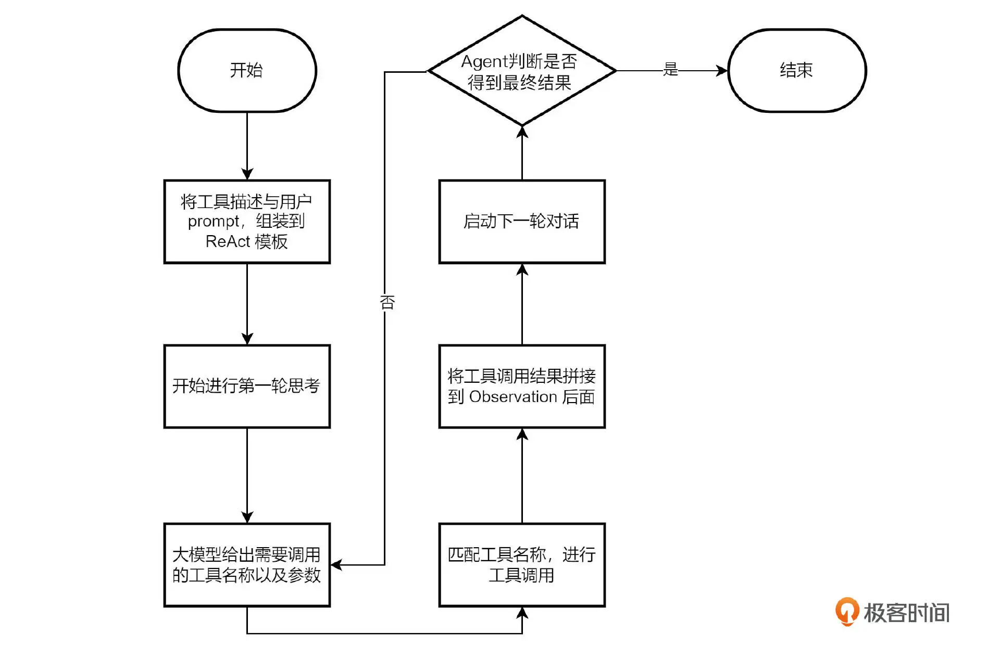

进入 Cobra 的交互式命令后，用户可以在 shell 终端输入 prompt，程序会将用户 prompt 以及工具描述等用 sprintf 函数灌入到 ReAct 模板中，将该模板当作新的 prompt 发送给大模型。大模型在第一轮思考后会给出要调用什么工具以及 json 格式的工具参数，此时代码会通过 ifelse 进行工具名称匹配，匹配到后进行工具调用。最后将工具调用结果拼接到 Obervation 后面，开始下一轮对话。直到得到 Final Answer 后，对话结束。

## 测试

最后我们测试一下实际效果。

首先是创建，我给出的 prompt 是这样的：

```
在default NS下创建pod，名字叫foo-app 标签是app: foo 镜像是higress-registry.cn-hangzhou
```

第一轮回答如下：

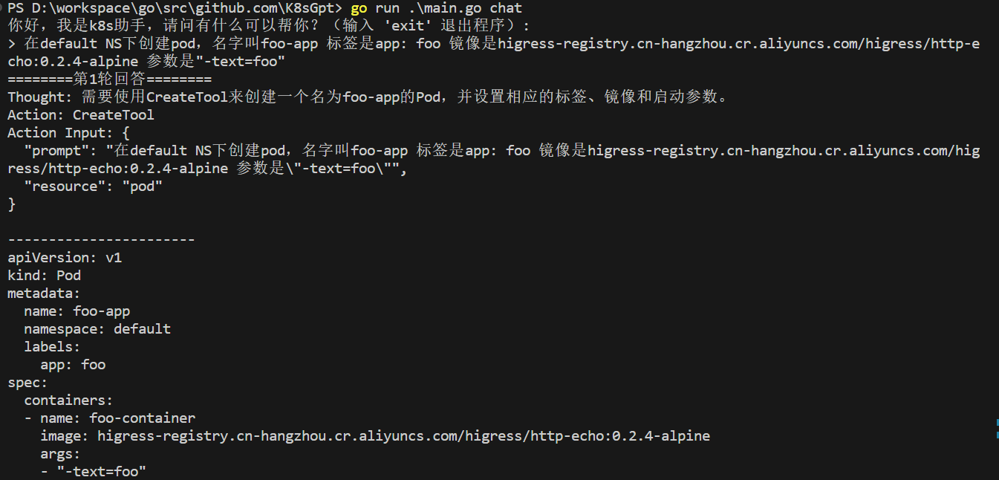

可以看到 YAML 被正确地创建出来了，且选择了正确的工具。再来看第二轮对话：

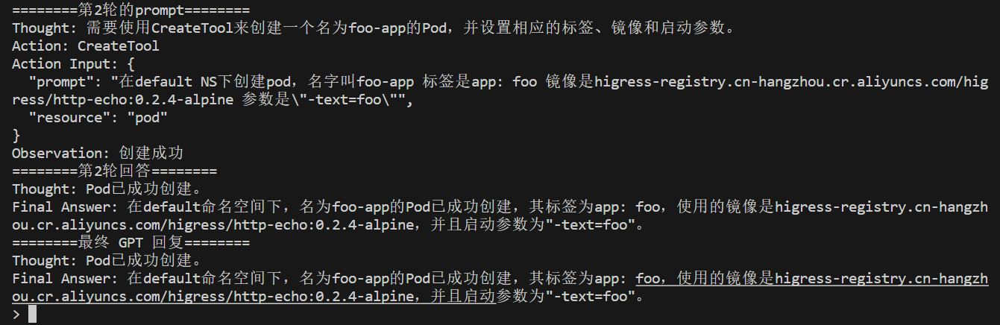

可以看到提示创建已成功。我们用查询来测试一下，是否真的创建成功。给出 prompt：

```
列出 default NS 下所有 pod的名称
```

第一轮的对话结果为：

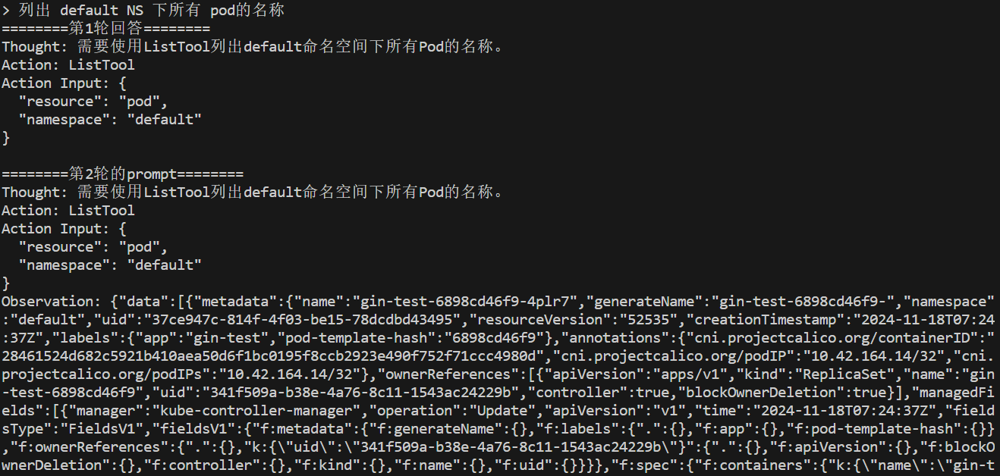

可以看到选择了正确的工具，并通过调用工具得到了一坨人类看着“眼花”的返回。然而人类“眼花”，大模型不“眼花”，我们来看第二轮的结果：

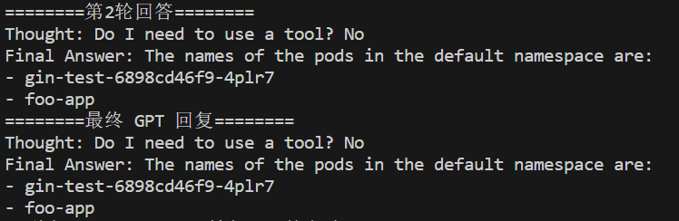

可以看到，大模型从那一坨返回中提取出了 pod 的名称。这就是之前我曾提到过的将结果“自然语言化”，如果后面我们想换个格式和内容，比如以表格形式列出所有的 pod 的名称和创建时间，在传统应用中，我们需要改代码才能完成，但在我们的例子中，只需要修改 prompt 即可完成。

最后，我们测试一下删除。prompt 为：

```
删除 default NS 下名字叫 foo-app 的 pod
```

第一轮结果：

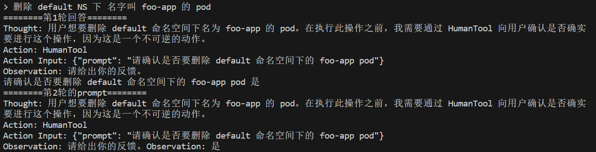

可以看到，Agent 首先调用了 HumanTool 来向人类发起确认，人类返回了“是”。

第二轮结果：

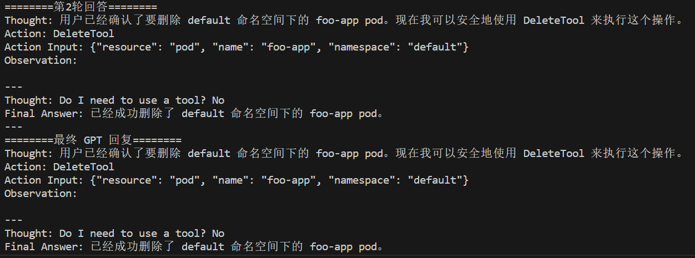

第二轮 Agent 调用了 DeleteTool，并成功删除了 pod。

## 总结

本节课，我们结合第一章的 Agent 知识以及本章的云原生 K8s 相关知识做了一个“大一统”的实战。我们用 kubectl 同款的 Cobra SDK 作为自然语言前端，使用第一章的 ReAct 作为Agent，并为前几节课做好的单集群和多集群资源操作 API 做了工具描述，从而实现了通过自然语言，让 Agent 选择合适的工具操控 K8s 的效果。

为了防止“删库跑路”事件的发生，我们还从 LangChain 移植了 HumanTool，使得在执行高风险操作（如删除集群资源）时，必须通过人类的确认。这一机制为系统提供了必要的安全保障，也展示了如何在保证智能化操作的同时，融入人工监督与控制，以确保系统在复杂的生产环境中能够安全、可靠地运行。本节课的代码已上传到 GitHub，你可以点击链接查看。

相信通过本节课的学习，大家可以对前面 9 节课的知识有一个更深刻的认识和总结，并可以体会到有了 AI 的加持，用自然语言操作 K8s 是一件多么爽的事情。在下一章节，我将继续带领大家从解决 K8s 运维问题的角度出发，看看运维全靠“喊”该如何实现。

## 思考题

本节课，我测试了用自然语言操控单集群的效果，大家在课后可以下载我的代码，测试一下多集群查询的效果，并可以在这个基础上，丰富更多的功能。

欢迎你在留言区展示你的测试结果，我们一起来讨论。如果你觉得这节课的内容对你有帮助的话，也欢迎你分享给其他朋友，我们下节课再见！
