# 11 | 实践：如何让Agent联网以及利用kubectl排查问题？

你好，我是邢云阳。

在上一章节，我带你深入实践了 AI + 云原生的第一个实战项目，用自然语言操控 K8s。该项目相比传统的 K8s 管理系统而言，最大的变化就是前端从命令行或网页页面按钮等变成了聊天界面。而带来的好处除了显而易见的无需记忆复杂命令行或者摒弃复杂的界面操作外，还有一点就是让内容的呈现变得智能化。

在传统的 K8s 管理系统中，呈现的数据内容与格式都是固定的，例如 Pod 资源有很多字段，但在前端上，通常会选取部分字段做展示。如果某一天需求变更，需要修改格式或者变更字段，则前后端代码都得修改。而自然语言前端就不一样了，用户想要什么字段，完全是看prompt 如何编写，非常灵活。

OK，以上是对上一章节的一个简单回顾。这一章我们将会花两个课时的时间继续沿着这个主题进行实践，会把重点放在让 AI 辅助人类解决 K8s 运维问题上。第一节课，我们先简单一点，不写任何 API，而是用 kubectl 当工具来分析问题。而第二节课，我们将尝试进行日志和事件的分析。

首先，我们先来做个测试，看看通义千问大模型到底会不会使用 kubectl。你可以看一下设计的 prompt。

```
SYSTEM
你是一个K8s运维专家，请使用kubectl工具来一步步的思考帮我解决运维问题。
#Guidelines
- 每一步都列出对应的kubectl命令
HUMAN
The user's input is: 我在default命名空间下有一个叫foo-service的service不工作，应如何排查
```

输出如下：

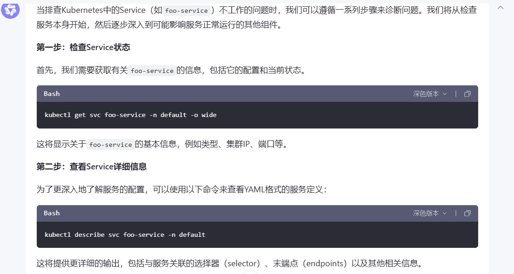

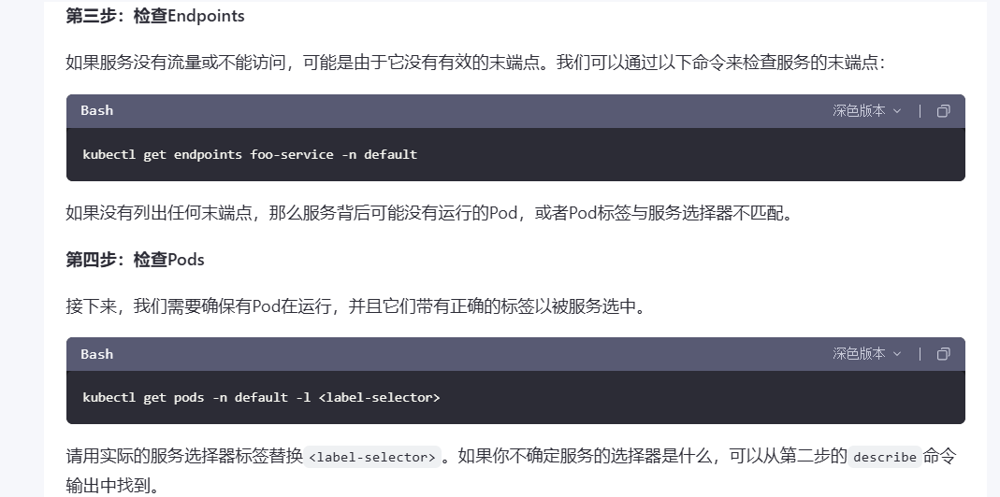

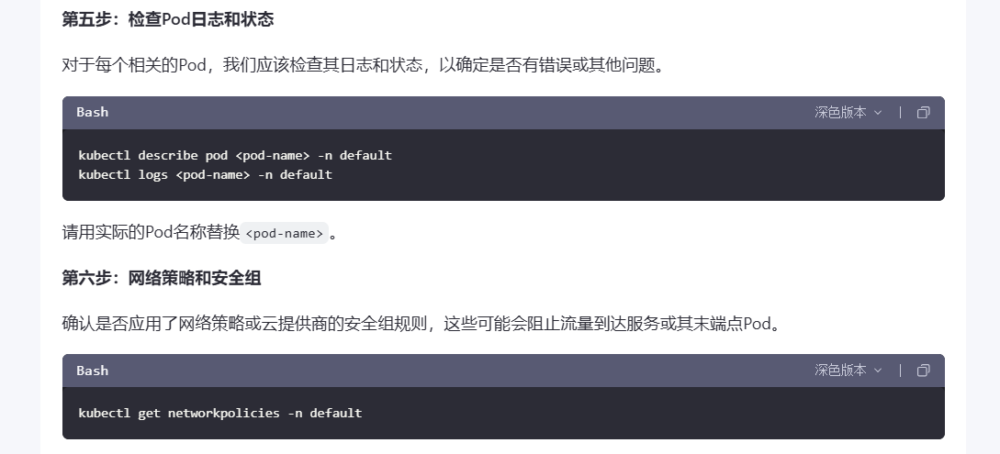

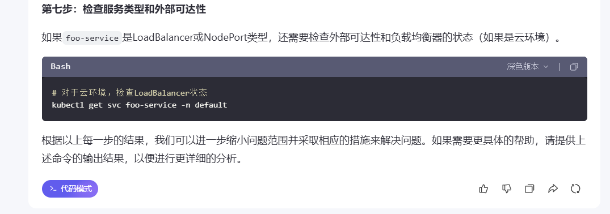

可以看到通义千问表现还不错，在没有真实集群数据的情况下，把所有可能的原因基本都分析了一遍，而且给出的 kubectl 命令都是可执行的。因此，我们完全可以把 kubectl 当作 Agent工具，结合真实集群来辅助我们排查问题。接下来，我们还是边写代码，边讲解。

## Cobra 前端

前端依然使用 Cobra，我们来添加一条名字叫 kubecheck 的命令。

```
cobra-cli add kubechat
```

业务代码依然是在生成的 Run 方法中完成。

## 工具

### kubetool

工具依然延续上节课的面向对象的思想去构建。首先是结构体：

```
type KubeTool struct {
   Name        string
   Description string
   ArgsSchema  KubeInput
}
```

之后用构造函数来赋值名称、工具描述和参数描述。

```go
func NewKubeTool() *KubeTool {
   return &KubeTool{
       Name:        "KubeTool",
       Description: "用于在 Kubernetes 集群上运行 k8s 相关命令（kubectl、helm）的工具。
       ArgsSchema:  KubeInput{`description: "要运行的 kubectl/helm 相关命令。" exam
   }
}
```

我们知道 kubectl 是操作 K8s 资源的命令，而 helm 是 K8s 上的包管理工具。因此我在工具描述中，将这两个命令都放上了。kubetool 的参数也很简单，直接传入完整的命令行即可，例如kubectl get pod。

工具的描述已经定义好了，接下来需要编写具体的工具执行函数，这样当 Agent 选择了工具后，程序可以调用工具得到具体的结果。

执行函数的入参我们已经知道了，就是完整的命令行，但是大模型有时会在命令行前后加引号反引号，比如：“kubectl get pod”，因此我们需要先做数据清洗，你可以参考我给出的代码。

```
func (k *KubeTool) parseCommands(commands string) string {
   return strings.TrimSpace(strings.Trim(commands, "\"`"))
}
```

用 strings 包中的 TrimSpace 函数来将两端的引号反引号去掉。这样就得到了一条干净的命令行。那命令行如何执行呢？我们需要使用 exec 包的 Command 方法。下面是 Command 方法的定义。

```go
func exec.Command(name string, arg ...string) *exec.Cmd
```

其入参的第一个参数是命令名称，第二个参数是命令的参数列表。对于 kubectl get pod 这样的命令，第一个参数要填 kubectl，第二个参数要填入[get pod]。因此我们还需要用一个字符串分割函数，将 kubectl get pod 按空格分割后，放到一个字符串数组中。

```
func (k *KubeTool) splitCommands(commands string) []string {
   return strings.Split(commands, " ")
}
```

然后就可以用 exec 包执行命令了。

```go
cmd := exec.Command(splitedCommands[0], splitedCommands[1:]...)
output, err := cmd.Output()
if err != nil {
   fmt.Printf("Error: %s\n", err)
   return "", err
}
```

首先用 Command 拼接出命令对象 cmd，之后调用 cmd 的 Output 方法来执行命令并得到返回结果。到这里 kubetool 就可用了。

### 网络搜索工具–Tavily

有时，用户问的问题并不是通过和集群资源交互就能解决的。比如用户问：我的集群目前可升级到的最新版本是多少？这时就需要让 Agent“百度一下”，才有可能得到答案。注意是有可能，因为就像我们平时自己去百度一样，也不一定每次都能得到想要的结果。

能在代码中通过 API 调用的网络搜索工具有很多，之前我比较喜欢使用 DuckDuckGo，因为它免费。但最近因为不可描述的原因，大陆用户网络不稳定了。所以今天我来介绍一个有1000 次免费请求额度的网络搜索工具–Tavily，供你测试。Tavily 的官方文档我也放在这里了——Introduction | Tavily AI，你打开链接后，需要点击右上方的 Get API Key 去注册一下，并拿到一个 API Key，之后才可以使用 REST API 的方式去调用这个工具。

执行网络搜索的 API 是 POST，其 Request 参数主要包含 API Key，待搜索内容 query 等等；Response 参数包含很多内容，但我们只需要取标题 Title 和 链接 URL 即可。这是因为我们拿到 URL 后，还需要用网络请求工具去访问该 URL，就相当于我们点开链接查看链接内容。

接下来，我们来写代码实现一下这个工具。首先还是构造函数：

```go
func NewTavilyTool() *TavilyTool {
   return &TavilyTool{
       Name: "TavilyTool",
       Description: `
       Search the web for information on a topic
       `,
       ArgsSchema: `description: "要搜索的内容，格式是字符串" example: "C罗是谁？"`,
   }
}
```

这个就很好懂了，和我们使用百度一样，需要输入待搜索内容。工具执行方法也很简单，就是用 Go 语言标准的 HTTP 包来请求搜索 API。下面是具体的代码。

```go
func (k *TavilyTool) Run(query string) ([]FinalResult, error) {
   url := "https://api.tavily.com/search"
   apiKey := "tvly-xxxxxxxxxxxxxx"
   params := RequestParams{
       APIKey:      apiKey,
       Query:       query,
       Days:        7,
       MaxResults:  5,
       SearchDepth: "basic",
   }
   //初始化client
   client := &http.Client{}
   // 将请求参数编码为JSON
   jsonBody, err := json.Marshal(params)
   if err != nil {
       return nil, fmt.Errorf("error marshalling JSON: %w", err)
   }
   // 创建新的HTTP请求
   req, err := http.NewRequest("POST", url, bytes.NewBuffer(jsonBody))
   if err != nil {
       return nil, fmt.Errorf("error creating request: %w", err)
   }
   req.Header.Set("Content-Type", "application/json")
   // 发送请求
   resp, err := client.Do(req)
   if err != nil {
       return nil, fmt.Errorf("error sending request: %w", err)
   }
   defer resp.Body.Close()
   // 解析响应
   var response Response
   if err := json.NewDecoder(resp.Body).Decode(&response); err != nil {
       return nil, fmt.Errorf("error decoding response: %w", err)
   }
   finalResult := make([]FinalResult, 0)
   for _, result := range response.Results {
       finalResult = append(finalResult, FinalResult{
           Title: "title: " + result.Title,
           Link:  " link: " + result.URL,
       })
   }
   return finalResult, nil
}
```

你可以对照 API 文档以及我的代码，理解一下参数的含义。

最后需要注意的是，tavily 工具有一个特点，如果你输入的 query 是中文的，tavily 基本会给你返回一些中文搜索结果，比如你用中文问一个技术问题，tavily 给的网站都是 CSDN、知乎这样的中文网站。但如果你输入的 query 是英文的，tavily 则会给出一些英文搜索结果，比如www.kubernetes.io 这样的英文网站。因此提问技术问题最好使用英文，或者在 prompt 上做一些手脚，将 query 转成英文。

### 网络请求工具

有了网站的 URL 后，我们就需要“打开”这个网站，浏览一下内容，看看有没有有用的。网络请求工具没有类似 tavily 这样封装好，我自己用 Go 语言简单写了一个，我们还是先从构造函数开始一步步看。

```go
func NewRequestsTool() *RequestsTool {
   return &RequestsTool{
       Name: "RequestsTool",
       Description: `
       A portal to the internet. Use this when you need to get specific
   content from a website. Input should be a url (i.e. https://www.kubernetes.io
   The output will be the text response of the GET request.
       `,
       ArgsSchema: `description: "要访问的website，格式是字符串" example: "https://w
   }
}
```

工具的描述是需要从网站获取特定内容，输入必须是 URL。至于我为什么要用英文，是因为通义千问大模型在处理英文 prompt 的表现上要好于中文。

接下来我们看看如何访问网页，获取内容。先使用 HTTP GET 方法，获取到网页内容，读出Body。

```go
func (r *RequestsTool) Run(url string) (string, error) {
   resp, err := http.Get(url)
   if err != nil {
       return "", err
   }
   defer resp.Body.Close()
   if resp.StatusCode != http.StatusOK {
       return "", fmt.Errorf("获取 URL 失败: %s", resp.Status)
   }
   body, err := ioutil.ReadAll(resp.Body)
   if err != nil {
       return "", err
   }
   return r.parseHTML(string(body)), nil
}
```

由于拿到的 Body 是 HTML 格式的，其中会夹杂很多无用的内容，干扰 Agent 理解有用的内容。因此我们可以使用 Github 上一个开源的 HTML 解析库 goquery 来进行数据清洗。下面是具体的代码。

```go
func (r *RequestsTool) parseHTML(htmlContent string) string {
   doc, err := goquery.NewDocumentFromReader(strings.NewReader(htmlContent))
   if err != nil {
       return ""
   }
   // 移除不需要的标签
   doc.Find("header, footer, script, style").Each(func(i int, s *goquery.Selecti
       s.Remove()
   })
   // 获取处理后的纯文本
   return doc.Find("body").Text()
}
```

这个库会将 HTML 中不需要的标签内容移除掉，然后从 Body 标签中获取内容并转成纯文本。

## 测试

由于 Agent 代码的套路与上一章一模一样，仅仅是工具发生了变化，因此这部分代码我就不再重复讲了，你可以在课后下载我的代码自行查看。现在我们就直接来看一下这三个工具的测试效果吧。

### kubetool 测试

首先，我准备了一个 YAML 文件，用于在 K8s 上创建一个 pod 和 一个 service。下面是对应的 YAML 内容。

```
kind: Pod
apiVersion: v1
metadata:
 name: foo-app
 labels:
   app: foo-app
spec:
 containers:
 - name: foo-app
   image: higress-registry.cn-hangzhou.cr.aliyuncs.com/higress/http-echo:0.2.4-a
   args:
   - "-text=foo"
---
kind: Service
apiVersion: v1
metadata:
 name: foo-service
spec:
 selector:
   app: foo
 ports:
 # Default port used by the image
 - port: 5678
```

注意看 pod 的标签，我设置的是 app: foo-app，而 service 的 selector，我故意写成了 app:foo，这样的话，service 无法通过标签选择器匹配到上面的 pod，也就不会起作用。接下来，我们试一下，Agent 能否借助 kubetool 帮我们解决这个问题。用户 prompt 如下：

```
为什么我的 default NS 下的名叫foo-service的service不工作？
```

第一轮回答与工具调用结果：

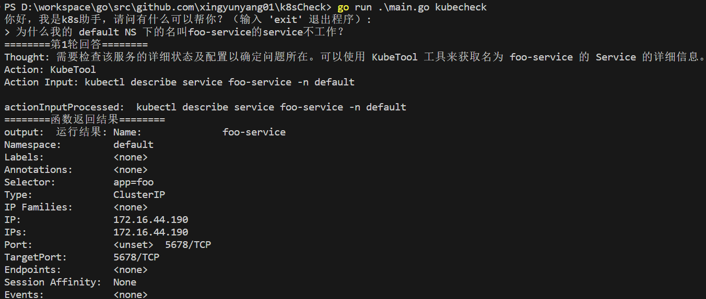

第二轮问答和工具调用结果：

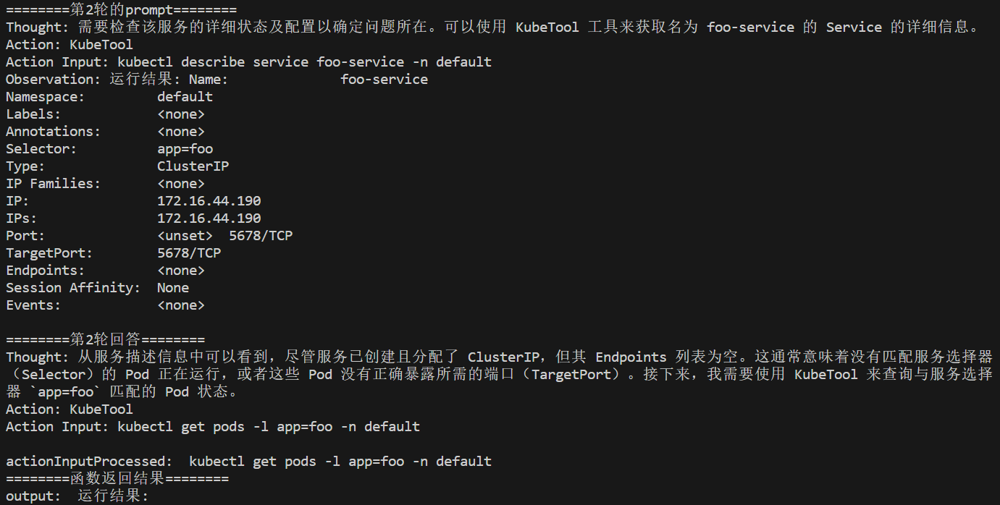

第三轮问答和工具调用结果：

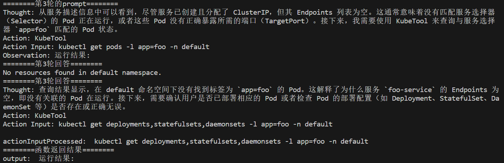

第四轮问答和工具调用结果：

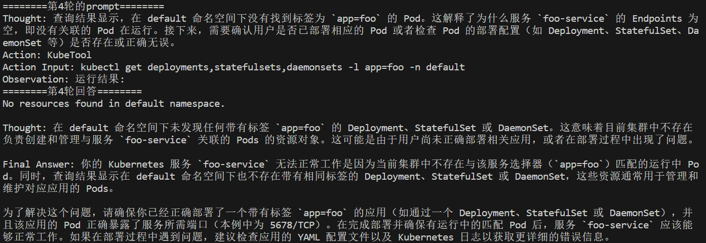

可以看到 Agent 的排查思路基本和人类一样，它在前两轮就确认了是标签不匹配的问题，之后又检查了 pod、deployment 等资源，确定没有符合标签规则的，最终建议我们要符合标签规则。这个效果还是非常惊艳的。

### 联网搜索测试

这个功能原本我准备的 prompt 是这样的：

```
What is the latest patch version that the cluster can be upgraded to?
```

当前集群可升级到的 patch 版本是多少？我在 chatgpt-4o 上测试时，效果非常理想，chatgpt-4o 会先使用 kubetool 获取当前集群版本，之后通过 tavilytool 搜索可升级的版本是什么，最后用网络请求工具访问具体的网站，拿到信息。但是我使用通义千问的 qwen-max 和 qwen-max-0403 模型，效果都不稳定。因此，我稍微修改了一下 prompt：

```
Please do a web search to find out what is the latest patch version that the curr
```

加了一个请联网搜索，引导 Agent 通过网络搜索的方式解决该问题。我们来看一下效果。

第一轮回答与工具调用结果：

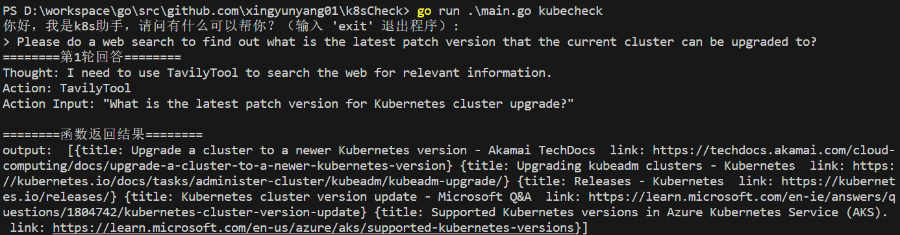

可以看到在搜索结果中包含了 https://kubernetes.io/releases 这个网址，这是 K8s 官方记录版本发布的网页。、

第二轮问答和工具调用结果：

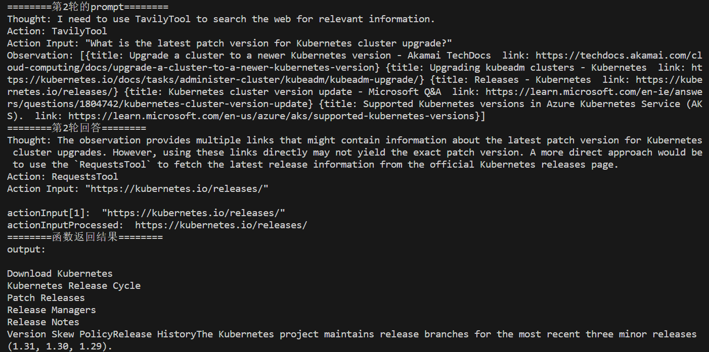

第三轮问答和工具调用结果：

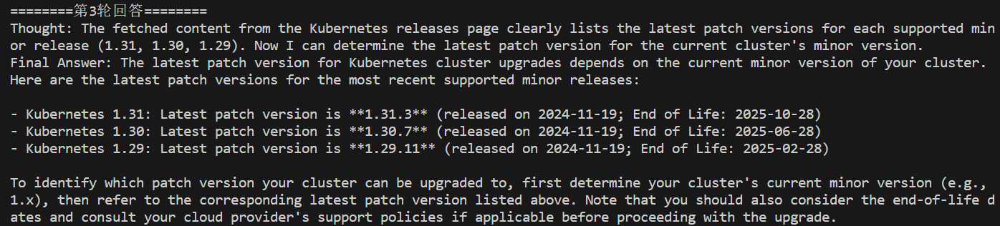

可以看到 Agent 通过联网搜索找到了 K8s 官网，并访问了 releases 页面，得到了可升级的版本信息。总体效果中规中矩，但也是解决了问题。

## 总结

本节课我们沿着上一章用自然语言操控 K8s 的设计思维和套路，从运维解决问题的角度入手，使用了 kubectl 工具以及联网工具完成了一个简单的 AI 运维助手。效果总体来说还是很惊艳的。本节课的代码已经上传到 GitHub，你可以看一下。

为什么 Agent 在遇到问题时，能给出正确的 kubectl 命令从集群获取信息呢？通过我们在文章开头的测试，可以得知用于支撑 Agent 的通义千问大模型本身对于如何使用 kubectl 命令行以及遇到 K8s 问题时如何借助 kubectl 解决问题是很有心得的，因此才能有本项目的测试效果。换句话说，如果我们的 Agent 使用的是一个只用 K8s 知识训练过，而没有用 kubectl 相关知识训练过的小模型，就可能会出现 Agent 有解决方案的思路，但就是不知道命令该怎么写的尴尬局面。

当然，通义千问模型在我们测试联网工具用例时，对于问题的思考能力就表现的中规中矩了，因此结合自身业务，选择一个合适的模型还是很重要的。

## 思考题

本节课我们实现了用 kubectl 当作工具来帮我们解决运维问题。实际上在 K8s 中，可操控的工具有很多，比如 Helm、Kustomize 等等，有兴趣的话，你可以试试提问某个 chart 支持的版本有哪些，看看 Agent 能如何应对。

欢迎你在留言区展示你的测试结果，我们一起来讨论。如果你觉得这节课的内容对你有帮助的话，也欢迎你分享给其他朋友，我们下节课再见！
