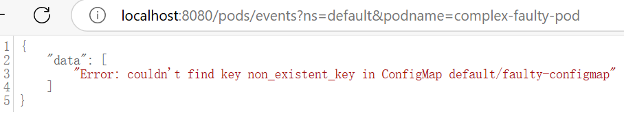
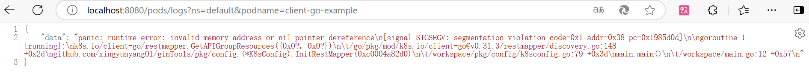
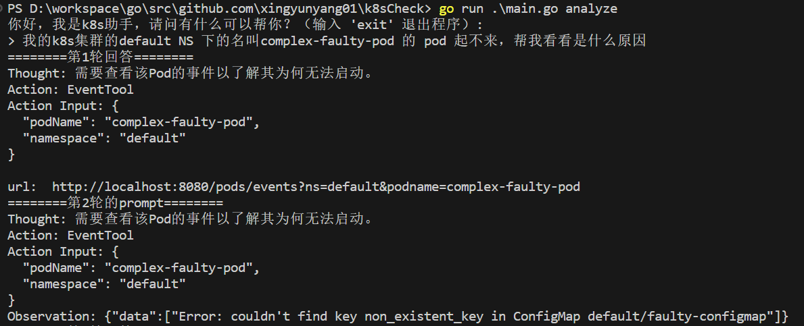
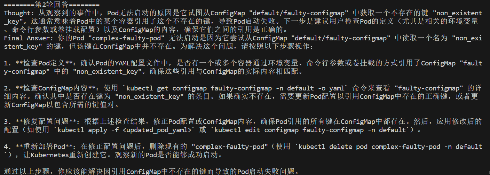
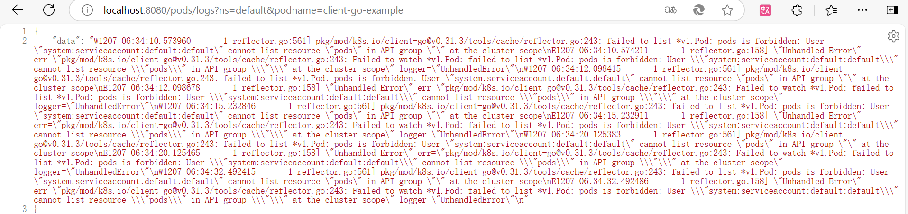
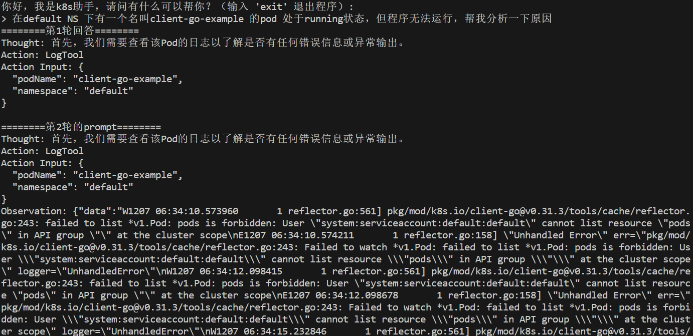
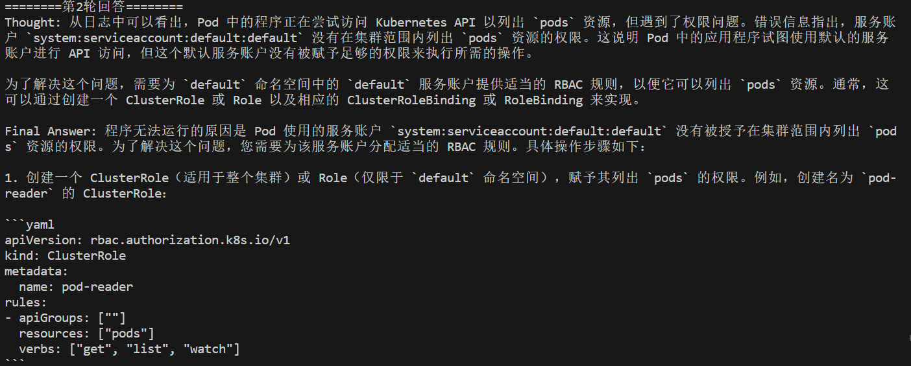
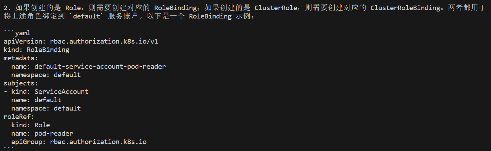
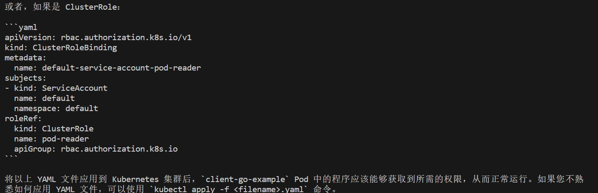

# 12 | 实践：如何让Agent利用日志和事件排查问题？

你好，我是邢云阳。

在上一节课我们是直接使用了 kubectl 作为工具，让 Agent 通过执行命令行的方式，帮我们解决运维问题。这种方法对于优秀的大模型来说，问题不大，因为它们已经熟练掌握了如何使用kubectl ，以及如何根据 kubectl 的执行结果，分析问题。

但任何事物都有其两面性，这种方法虽然简单，但缺乏了一定的灵活性。比如，如果让 Agent帮我们排查一个 pod 为什么起不来，Agent 可能会使用 kubectl get event 或者 kubectldescribe pod xxx 来获取 pod 的事件。无论使用哪条命令，其中都会夹杂着一些无用信息，因为我们想要的只有 Type 是 Warning 的 Message。

这些无用信息一方面可能会影响大模型的理解，另一方面太多的信息会占用上下文窗口以及耗费更多的 token。因此本节课我们让 Agent 帮我们分析日志和事件的项目，与上一章一样，采用自己封装 API 的手法，从而达到工具返回的信息可筛选的目的。

## Cobra 前端

为了和上一节课的手法区分开，我们来添加一条名字叫 analyze 的命令。

```
cobra-cli add analyze
```

业务代码依然是在生成的 Run 方法中完成。

## 工具

### EventTool

我们在利用 Event 事件排查问题时，通常需要指定具体的命名空间下的 pod 名字。因此如果用户要通过自然语言让 Agent 帮助排查问题，其 prompt 可能会这么写：

```
我的 default 命名空间下的名叫 xxx 的 pod 一直处于 CreateContainerConfigError 状态，请帮我
```

因此获取 Event 事件这条 API，可以这么设计：

```
// 获取 Event
GET http://<host>:<port>/pods/events?ns=<pod 命名空间>&podname=<pod 名称>
```

现在我们来做一下代码实现。代码我是在第 8 节课的基础上增加的接口，因此代码目录与第 8节课的一致，仅仅是在 services 目录下新增了 podLogEventService.go，在 controllers 目录下新增了 podLogEventCtl.go，以及最后在 main.go 中增加了路由。

我们先来看一下 service 部分。service 部分的代码是使用 client-go 与 K8s 交互的代码。由于Event 不是一个经常被查询的资源，因此在本节课，我就不使用 informer 机制了，而是直接使用 clientSet 来获取 Event，代码如下：

```go
func (this *PodLogEventService) GetEvents(ns, podname string) ([]string, error) {
   events, err := this.client.CoreV1().Events(ns).List(context.TODO(), metav1.Li
   if err != nil {
       return nil, fmt.Errorf("failed to list events: %w", err)
   }
   var podEvents []string
   for _, event := range events.Items {
       if event.InvolvedObject.Kind == "Pod" && event.InvolvedObject.Name == pod
           podEvents = append(podEvents, event.Message)
       }
   }
   return podEvents, nil
}
```

代码首先在第二行使用 clientSet 获取到了日志，其效果等同于执行 kubectl get event。之后在第 8～12 行做了两件事，一是进行事件过滤，过滤出类型是 Pod，名字是传入的podname，类型是 Warning 的日志。二是只取出 Message 字段放入到字符串数组中，这样就可以大大减少返回的 Event 数量。

之后我们来看一下 controllers 的代码：

```go
func (p *PodLogEventCtl) GetEvent() func(c *gin.Context) {
   return func(c *gin.Context) {
       ns := c.DefaultQuery("ns", "default")
       podname := c.DefaultQuery("podname", "")
       e, err := p.podLogEventService.GetEvents(ns, podname)
       if err != nil {
           c.JSON(http.StatusInternalServerError, gin.H{
               "error": err.Error(),
           })
           return
       }
       c.JSON(200, gin.H{"data": e})
   }
}
```

代码很简单，通过 DefaultQuery 拿到 url 参数，并设置了默认值，防止用户不传，导致查询Event 失败。最后将结果以 json 格式返回给前端。

我们做一个简单测试，看一下效果。



结果符合预期。

最后是在 k8sCheck 项目中进行工具描述以及工具执行部分的编写。工具描述部分的代码如下：

```go
func NewEventTool() *EventTool {
   return &EventTool{
       Name:        "EventTool",
       Description: "用于查看 k8s pod 的 event 事件",
       ArgsSchema:  `{"type":"object","properties":{"podName":{"type":"string",
   }
}
```

工具描述简单粗暴，参数也是根据 Event API 需要的参数来设计的。工具执行部分就是拼凑url 然后使用标准 HTTP GET 来执行，与前面课程讲述的一致，不再赘述。到此就完成了EventTool 的设计和实现。

### LogTool

```
接下来看看日志工具的编写。我们在查询日志时，使用的命令是 kubectl logs <pod 名称
> -n <命名空间>，当然如果在一个 pod 中有多个容器，还需要加 -c 参数执行容器名称，本
```

节课为了演示简单，就只考虑一个 pod 只有一个容器的情况。

既然用 kubectl 需要 pod 名称和命名空间，那使用 client-go 就也需要这两个参数，因此 API可以这么设计。

```
// 获取 Log
GET http://<host>:<port>/pods/logs?ns=<pod 命名空间>&podname=<pod 名称>
```

代码结构在 EventTool 工具中已经介绍了，在这里直接看代码。首先是 services 部分：

```go
func (this *PodLogEventService) GetLogs(ns, podname string, tailLine int64) *rest
   req := this.client.CoreV1().Pods(ns).GetLogs(podname, &v1.PodLogOptions{Follo
   return req
}
```

代码很好懂，使用 clientSet 获取日志，其中关键是 Follow 和 TailLines 这两个参数。

Follow 表示是否持续获取日志，如果设置为 true，效果等同于 kubectl logs 命令加 -f 参数的效果。在传统的 K8s 管理系统项目中，通常会使用 -f 的效果，配合一个 HTTP 长连接做到持续刷新日志的效果。但对于我们这个项目，Agent 获取日志是一个一次性事件，无需持续获取日志，将 Follow 置为 false 即可。

TailLines 参数表示获取近 xx 行的日志，例如 TailLines 是 100，则表示获取近 100 行的日志，这样可以控制返回的日志量，防止挤爆大模型的上下文窗口。

接下来我们来编写 controllers 部分。你可以看一下对应的代码。

```go
func (p *PodLogEventCtl) GetLog() func(c *gin.Context) {
   return func(c *gin.Context) {
       ns := c.DefaultQuery("ns", "default")
       podname := c.DefaultQuery("podname", "")
       var tailLine int64 = 100
       req := p.podLogEventService.GetLogs(ns, podname, tailLine)
       rc, err := req.Stream(context.Background())
       if err != nil {
           c.JSON(http.StatusInternalServerError, gin.H{
               "error": err.Error(),
           })
           return
       }
       defer rc.Close()
       logData, err := ioutil.ReadAll(rc)
       if err != nil {
           c.JSON(http.StatusInternalServerError, gin.H{
               "error": err.Error(),
           })
           return
       }
       c.JSON(200, gin.H{"data": string(logData)})
   }
}
```

该代码的整体效果是一次性获取 100 行日志，之后读取出来后，返回给客户端。

简单测试一下效果：



可以看到日志显示出来了。

最后是 LogTool 的工具描述部分，依然是简单粗暴：

```go
func NewLogTool() *LogTool {
   return &LogTool{
       Name:        "LogTool",
       Description: "用于查看 k8s pod 的 log 日志",
       ArgsSchema:  `{"type":"object","properties":{"podName":{"type":"string",
   }
}
```

至此，两个工具就全做好了。接下来就可以进入到测试环节了。

## 测试

### Event 测试

首先是 Event 测试，我们需要制造一个含有 Warning 类型的 Event 事件的 Pod。我使用的方法是给 Pod 挂载一个 configmap，引用一个不存在的键 non_existent_key，下面是具体的YAML。

```
apiVersion: v1
kind: Pod
metadata:
 name: complex-faulty-pod
spec:
 containers:
 - name: faulty-container
   image: docker.1ms.run/nginx:1.18
   command: ["/bin/sh", "-c", "while true; do echo 'Running...'; sleep 10; done"
   env:
     - name: FAULTY_ENV
       valueFrom:
         configMapKeyRef:
           name: faulty-configmap
           key: non_existent_key
   ports:
     - containerPort: 80
   volumeMounts:
     - name: faulty-volume
       mountPath: /data
 volumes:
   - name: faulty-volume
     emptyDir: {}
---
apiVersion: v1
kind: ConfigMap
metadata:
 name: faulty-configmap
data:
 existing_key: "value"
```

这样这个 Pod 会一直处于 CreateContainerConfigError 状态，并且会产生 Warning 事件。


我们来测试一下 Agent 是如何调用 EventTool 以及给出分析的，下面是对应的 prompt。

```
我的k8s集群的default NS 下的名叫complex-faulty-pod 的 pod 起不来，帮我看看是什么原因
```

第一轮问答结果：



可以看到 Agent 已经拿到了 Event 日志。

第二轮问答结果：



Agent 通过分析 Event，给出了问题原因和解决步骤。这个步骤是可行的。

### Log 测试

接下来测试一下分析日志的效果。我们造一个能输出错误日志的例子。

本节课使用的 ginTools 代码，一直以来都是使用了本地的 kubeconfig 文件来访问 K8s 的。但如果将其打包成 docker 镜像，然后以 pod 形式部署到 K8s 上，就会报找不到 kubeconfig 文件的错误。通常的解决方案是，用 incluster 模式初始化客户端，然后在 pod 上设置一个ServiceAccount 来提供账户服务。你可以看一下具体的代码。

```go
func (k *K8sConfig) InitConfigInCluster() *K8sConfig {
   // 加载 in-cluster 配置
   config, err := rest.InClusterConfig()
   if err != nil {
       k.e = errors.Wrap(errors.New("k8s config is nil"), "init k8s client faile
   }
   k.Config = config
   return k
}
```

dockerfile 文件：

```
FROM golang:1.22.9-alpine AS builder
WORKDIR /workspace
# Copy the Go Modules manifests
COPY go.mod go.mod
COPY go.sum go.sum
# Cache deps before building and copying source so that we don't need to re-downl
# and so that source changes don't invalidate our downloaded layer
ENV GOPROXY=https://goproxy.cn,direct GO111MODULE=on
RUN go mod download
# Copy the go source code
COPY main.go main.go
COPY pkg/ pkg/
# Build
RUN CGO_ENABLED=0 GOOS=linux GOARCH=amd64 GO111MODULE=on go build -a -o /usr/bin/
FROM scratch
WORKDIR /
COPY --from=builder /usr/bin/test .
ENTRYPOINT ["/test"]
```

pod 部署 YAML：

```
apiVersion: v1
kind: Pod
metadata:
 name: client-go-example
spec:
 serviceAccountName: default
 containers:
 - name: example
   image: registry.cn-hangzhou.aliyuncs.com/aitools/client-go-example:v1.0
   imagePullPolicy: IfNotPresent
   ports:
   - containerPort: 8080
```

此时 pod 内的 ginTool 能否有权限访问 K8s，就取决于配置的 default 这个账户的具体权限了。这里我故意设置一个没有权限的 default 账户，因此当这个 pod 运行起来后，会有错误日志输出。



我们用 Agent 测试一下效果。

```
在default NS 下有一个名叫client-go-example 的pod 处于running状态，但程序无法运行，帮我分析
```

第一轮问答效果：



可以看到 Agent 调用 LogTool 拿到了日志。

第二轮问答效果：







可以看到 Agent 分析出了是权限问题导致的，并给出了解决方案，方案是可行的。

## 总结

在这一节课中，我向你展示了如何通过 client-go 抓取 Kubernetes 的日志和事件，并结合Agent 进行分析，从而自动给出解决方案。相关的代码已经上传到 GitHub，由于本次修改了ginTool 和 k8sCheck 两个工程，因此会有两个下载链接：

- https://github.com/xingyunyang01/Geek/tree/main/k8sCheck

- https://github.com/xingyunyang01/Geek/tree/main/ginTools

这节课是我们整个“Agent + K8s 运维级开发”系列课程的最后一课。在这一个大篇章中，我们从设计的角度出发，详细列出了需要掌握的关键知识点，复习和深化了云原生 Kubernetes 的相关内容，同时也补充了 AI 开发的一些实用技巧和套路。最后，我们通过几个小项目的实践，帮助你更好地理解和应用这些知识。

相信如果你从第一章的“Agent 原理”一路跟随我们的步伐，那么在这一课的学习中，应该会有一种一点就透，一通百通的感觉。其实，AI 应用开发并不复杂，更多的是套路和思维方式。尤其是在如今，国内外涌现了许多优秀的编码 Copilot 工具，比如 Cursor 和 通义灵码等，这些工具完全可以用来处理云原生领域的业务代码，开发者只需专注于架构设计和代码审核。AI时代的“内卷”，将是一场“思维的竞赛”。

## 思考题

Agent 在调用工具解决问题的过程中，会根据工具的回复结果决定要多少轮对话才能得到“Final Answer”。那如果工具不给力，导致一直得不到“Final Answer”，就会陷入到死循环中。我们该如何处理这种情况呢？

欢迎你在留言区展示你的思考结果，我们一起来讨论。如果你觉得这节课的内容对你有帮助的话，也欢迎你分享给其他朋友，我们下节课再见！
