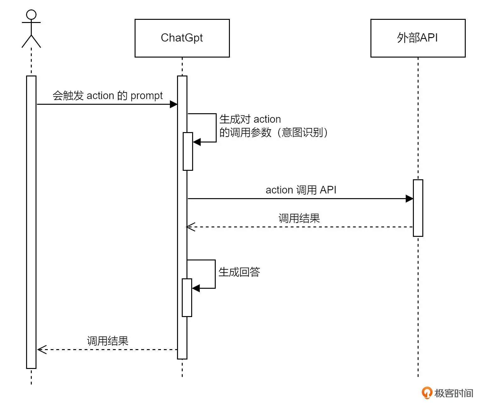
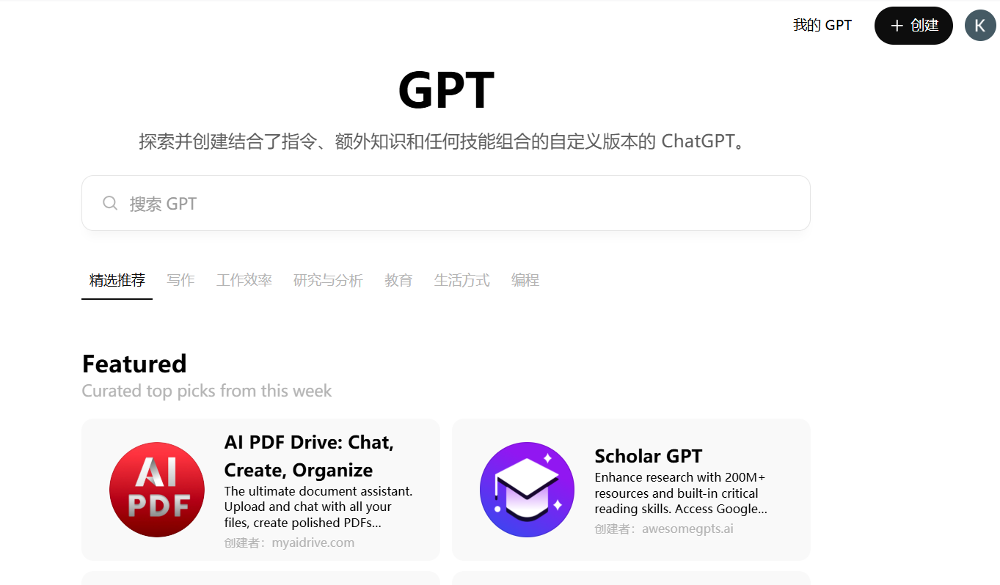
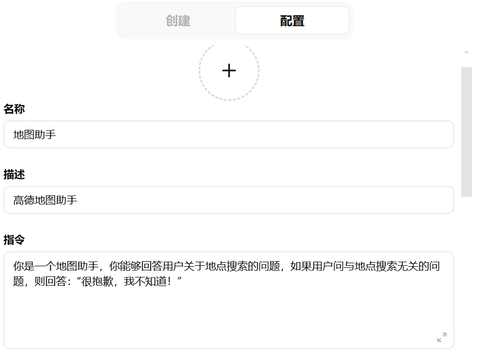
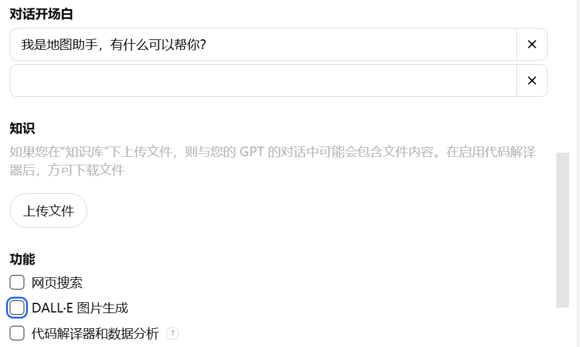
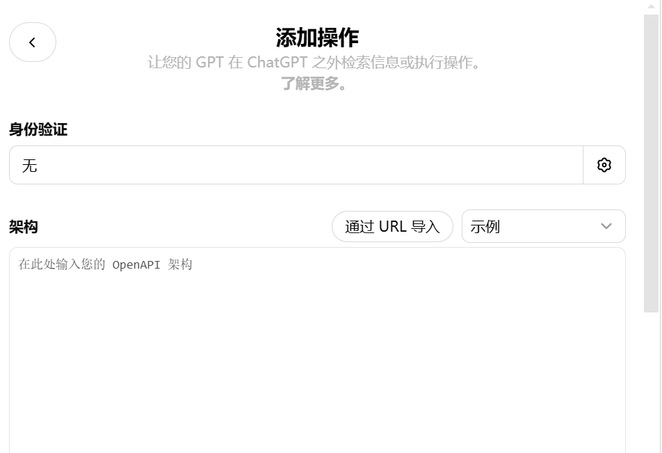
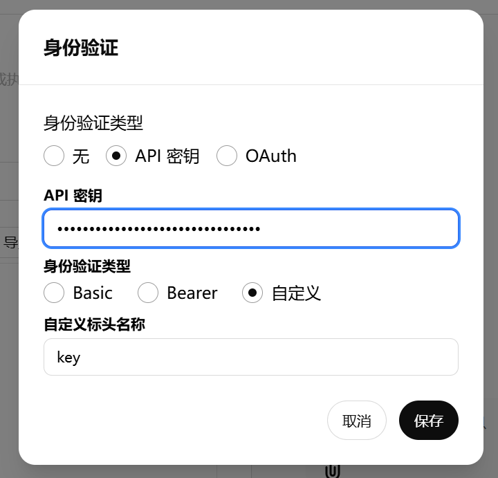
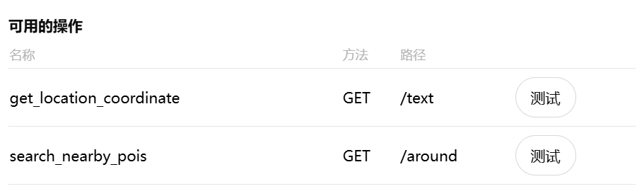
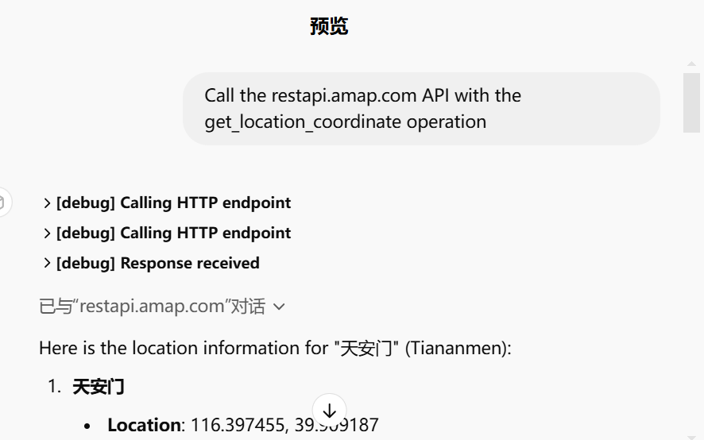
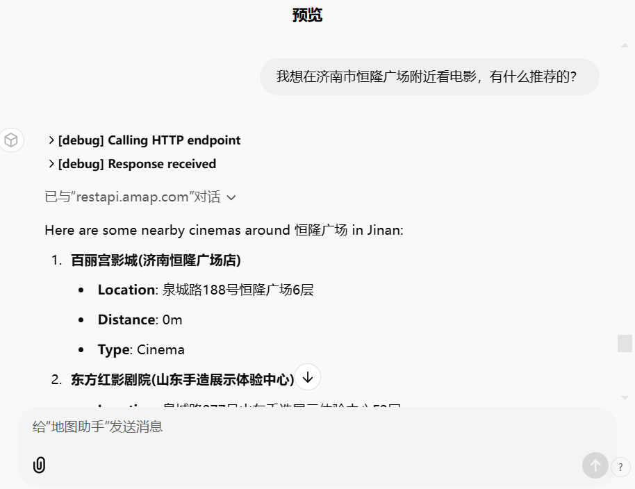

# 13 | 1分钟构建一个地图助手应用：GPTs详解

你好，我是邢云阳。

在前两个章节，我们通过深入探讨 prompt 工程、Agent 等相关 AI 技术与传统的云原生工具的配合，完成了 AI + 云原生的第一个实战项目。 这一过程中，我们不仅掌握了如何利用大模型进行智能决策，还体会到了 AI 与云原生技术融合所带来的强大生产力。

在开篇词中，我曾经提到过在 AI 驱动的新时代，API 不仅是技术接口，更是构建智能应用的核心载体，被称为“AI 时代的一等公民”。不论是构建复杂业务逻辑的企业服务，还是面向用户的创新产品，API 都是连接大模型与外部能力的关键纽带，实现从“知识到行动”的转化。因此我也是刻意在前两章的实战项目中将访问 K8s 资源的工具封装成了 API 让 Agent 调用，目的就是让你对于目前比较流行的 API 类的 Agent 应用产品的编写范式有一个大概的认识。

当然，前两章的项目应用做得还是相对比较粗糙的，目前一些业内比较火的平台化产品比如GPTs、Dify 等基本都形成了风格比较一致的范式模板。因此我将专门拿出一个章节的内容来为你详细讲解和梳理这些优秀的 API Agent 产品是怎么设计的，原理是什么，最后我们会使用Go 语言来尝试复刻一下这类 Agent 产品。

这节课我们就先从这类产品的“鼻祖”——GPTs 开始讲起。

我们先来区分几个日常口语化表达时容易混为一谈的名词，分别是 GPT、ChatGPT、GPTs以及 GPT Store。GPT 的英文是 Generative Pre-trained Transformer，即生成式预训练模型，是 OpenAI 公司发明的，比如常用的 GPT-3.5、GPT-4o 等大模型都属于 GPT 家族。ChatGPT 是 OpenAI 基于 GPT 模型做的一款对话应用。GPTs 是 ChatGPT 开放平台，用户可以自己定制个性化的 ChatGPT 应用，例如天气助手、股票助手等。GPT Store 则是应用商店，商店里放的是全球用户基于 GPTs 自己定制和发布的 ChatGPT 应用。区分了这几个名词后，有助于我们继续讨论后面的内容。

## Actions

我们知道 OpenAI 是行业龙头，很多大模型的新鲜玩法都是 OpenAI 先发明出来，然后其他公司顺势兼容了的。早在 2023 年 3 月 24 日，OpenAI 公司为了让大模型能够与外界进行交互就上线了 Plugins 功能，使得模型可以调用外部 API。但由于这种插件的模式有一定复杂性，对于初级用户不是很友好，因此仅仅过了一年多的时间，就被 Actions 功能取代了。

Actions 是 GPTs 内置的功能，也可以理解为是 ChatGPT 的扩展。你可以看一下它的官方文档，其主要作用有两个：一是用户可以像类似配置 Function Callings 工具的描述那样，使用标准 OpenAPI 文档为 GPT 配置 API（工具），二是由 GPT 理解 API 文档后，可以调用API，从而实现与外部环境交互的功能。下面是配置了 API 文档之后，ChatGPT 处理用户prompt 的时序图。



GPT 拿到用户 prompt，分析出是否要调用 API 才能解决问题。如果要调用 API，就生成调用参数。之后由 ChatGPT（注意，不是 GPT）调用 API。API 返回结果，GPT 读懂结果，整合到回答中。

你对这个过程有没有感觉到似曾相识？没错，我们前面反复在使用的 Agent 基本执行流程就和这幅图的流程在大框架上差不多。其实，在这个过程中，GPT 已经是一个 Agent 了。只不过它是基于 Function Calling 的 Agent，对于大模型的推理能力要求比较高。

这个功能出了一段时间之后，OpenAI 就上线了 GPT Store 功能，旨在让大家都能利用Actions 能力定制和发布自己的定制化的 ChatGpt，从而丰富其生态。该功能是需要开通ChatGpt Plus 才可以使用的，如果你不会开通的话可以在留言区评论，我单独发教程给你。

接下来，我就为你演示一下创建一个定制化 ChatGPT 的过程，我们一起来体会一下其产品设计思路。

## 构建 GPTs 应用

首先点击左侧侧边栏的“探索 GPT”，进入到 GPT Store。



GPT Store 中会分门别类放置许许多多的应用。点击右上角的“创建”按钮，就可以进入到GPTs 应用的构建界面。





在“配置”页面，可以设置“名称”“描述”，这是为了后期发布应用后，便于查找以及了解应用的作用。之后可以设置“指令”，这个实际上就是 System prompt。接下来还可以设置“对话开场白”，用于开启一个新对话时，给出一个提示。“知识”是用来上传文件后，做文件对话使用的，属于 RAG 的范畴。最后，还扩展了三个非常实用的小功能。完成设置后，点击添加操作，就会进入到下图的界面。



这一部分便是 Actions API 文档的配置，是整个自定义 ChatGpt 应用的核心，包含身份验证与架构两个部分。

我们先说架构部分，可以看到这里需要填入 OpenAPI 文档。做过前后端项目的同学，可能都接触过 Swagger（OpenAPI），它是现代 Web 服务接口设计和文档生成的标准工具。通过OpenAPI，我们能够高效地定义和描述 API 的请求、响应格式、身份验证方式等细节，从而让前后端的对接变得更加规范和高效。

例如，我要构建一个高德地图助手，当我问：“我想在济南泉城广场附近吃烤鱼，有什么推荐的？”这类问题时，它可以给出我准确的回答。此时我要做的事情有两个，一是去高德地图开发平台官网（概述 -Web 服务 API | 高德地图 API）注册一个账户，拿到 APIKey。第二是查看其 API 文档，看看哪条 API 能够满足我的需求，将其写成 OpenAPI 的格式，填充到“架构”中。你可以看一下这个例子里高德地图的 OpenAPI 文档。

```
openapi: 3.1.0
info:
 title: 高德地图
 description: 获取 POI 的相关信息
 version: v1.0.0
servers:
 - url: https://restapi.amap.com/v5/place
paths:
 /text:
   get:
     description: 根据POI名称，获得POI的经纬度坐标
     operationId: get_location_coordinate
     parameters:
       - name: keywords
         in: query
         description: POI名称，必须是中文
         required: true
         schema:
           type: string
       - name: region
         in: query
         description: POI所在的区域名，必须是中文
         required: false
         schema:
           type: string
     deprecated: false
 /around:
   get:
     description: 搜索给定坐标附近的POI
     operationId: search_nearby_pois
     parameters:
       - name: keywords
         in: query
         description: 目标POI的关键字
         required: true
         schema:
           type: string
       - name: location
         in: query
         description: 中心点的经度和纬度，用逗号分隔
         required: false
         schema:
           type: string
     deprecated: false
components:
 schemas: {}
```

之后便是“身份验证”部分，我们知道通常 API 服务商都会让我们注册后，提供一个 API Key，作为识别我们身份的工具。这样做一是出于安全角度考虑，防止恶意攻击，二是也便于计费。

API Key 在 HTTP 请求中的存放位置，通常有两种，第一种是以一个自定义 key 的形式拼接到URL 中。

```
http://restapi.amap.com/v3/place/text?key=xxxxxxxxxxxxxxxxx
```

第二种是存放到请求头中。

```
GET /some-endpoint HTTP/1.1
Host: api.example.com
Authorization: Bearer YOUR_API_KEY
```

具体使用哪种，需要看文档说明。由于高德地图是使用的第一种，因此“身份验证”我是这么配置的。



都配置好后，可以在下方看到自动梳理好的 API 工具列表，点击测试按钮可以测试 API 是否可用。



测试第一条 API 的效果如下：



测试没问题后，就可以在预览窗口向 ChatGPT 提问，测试我们这个地图小应用的效果了。



我这个老济南表示这回答没毛病。

最后我们来梳理一下 GPTs 的产品设计思路。相比于之前我们讲过的 AI Agent 应用开发的方式，GPTs 采用了低代码的设计模式，极大降低了开发门槛。用户只需要配置好 OpenAPI 文档，就能够生成定制化的 Agent 应用。这种方式特别适用于业务场景相对简单或者需求变化频繁的情况，用户无需编写大量代码，就能快速搭建起符合自己需求的 AI Agent。

此外，GPTs 还可以帮助用户进行快速验证和迭代，从而加速产品的研发周期。对于那些不具备深厚技术背景的用户而言，这种设计提供了一种便捷的方式来实现个性化的 AI 解决方案，同时也为开发者节省了大量的开发和调试时间，提升了工作效率和灵活性。

## 总结

本节课，我们深入解析了可定制 API Agent 产品的“鼻祖”——GPTs 的原理，并通过高德地图API 演示了定制化 ChatGPT 应用的完整制作过程。GPTs 的产品设计思路独具匠心，敏锐地洞察到 API 在 AI 时代中的重要性，创新性地提出了从配置 OpenAPI 文档、理解到调用 API的“Actions”功能，使用户可以零代码快速构建 Agent 应用。

自 GPTs 发布以来，其优秀的设计理念广受国内外企业和团队的关注和追捧，许多公司纷纷借鉴这一思路，推出了类似的 Agent 应用平台和工具。例如 Coze、Dify 等。下节课，我将为你深入分析 Dify 的设计思路，为后续我们使用 Go 语言复刻同款应用打下坚实基础。

## 思考题

你可以自己动手利用 GPTs 做一个应用，并尝试配置多个不同功能的 API，例如同时配置DeepL 翻译以及高德地图，看看会是什么样的效果。

欢迎你在留言区展示你的思考过程，我们一起探讨。如果你觉得这节课的内容对你有帮助的话，也欢迎你分享给其他朋友，我们下节课再见！
