# 14 | 国产之光：开源项目Dify详解

你好，我是邢云阳。

上节课，我为你介绍了行业龙头 OpenAI 公司为了让大模型具备与外界环境交互的能力，而发明的 Actions。并展示了如何使用内嵌了 Actions 的 GPTs 开发平台，来快速构建一个定制化的 ChatGPT 应用的过程。相信你对于其产品设计思路也有了一个清晰的认识。

那我们知道，汽车有国产品牌也有进口品牌，API Agent 也是一样。这节课我们就以国产开源项目 Dify 为例，看一下 GPTs 这种零代码实现 Agent 的思路，在 Dify 上又是如何做的。

## Dify 是什么？

我们先来了解一下 Dify 是什么。很多公司和团队在做 AI 应用开发时，会使用纯编码的方式去做，例如使用 LangChain 等框架；但还有一些公司，会基于已有的平台，做一些配置化，二开或者插件的形式来完成 AI 应用开发，Dify 就是用来做这些事的平台。

Dify 的中文使用手册的地址在这儿——欢迎使用 Dify，它提供了从 Agent 构建到 AIWorkFlow 编排、RAG 检索、模型管理等能力，使用 Dify 可以轻松构建和运营生成式 AI 原生应用。

## Dify 环境搭建

那简单了解了 Dify 是什么之后，接下来，我们需要将 Dify 环境搭建起来，试用一下，从而直观感受其功能。Dify 的安装方式有好几种，其中最快捷方便测试的，就是在 Linux 服务器上使用 docker-compose 来直接启动。

首先，我们打开 Dify 的 GitHub 地址，将源码下载下来，在这里我使用的版本是 0.13.2。下载下来之后，我们进入到 dify-0.13.2 文件夹的 docker 文件夹中，启动文件 docker-compose.yaml，就在该文件夹中存放。通过查阅这个文件，可以看到它会拉起很多容器，其中就包括 Nginx。

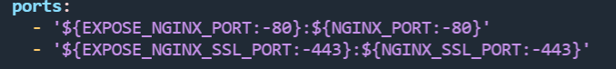

如图所示，Nginx 的暴露端口是可以改动的，如果你的 Linux 服务器的 80 端口被占用了，可以将 EXPOSE_NGINX_PORT 后面的 80 改成其他的端口。除此之外，无需进行其他修改。

执行以下命令就可以开始自动部署：

```bash
docker compose up -d
```

完成后执行以下命令查看是否容器都已成功拉起：

```bash
docker ps
```

如果看到下图所示的这些容器，就代表已安装成功。

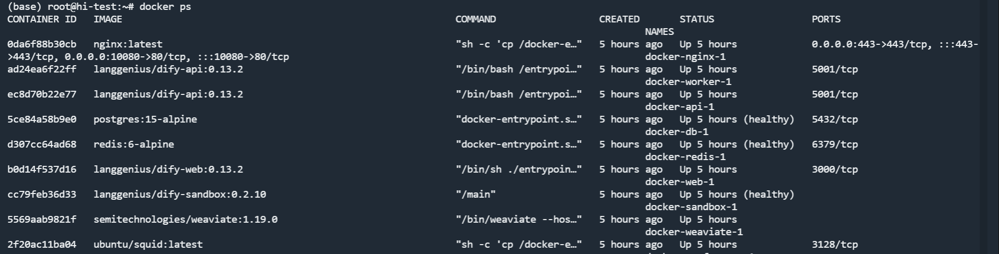

在安装完成后，首次登陆需要设置管理员账户，可在浏览器输入http://<your_server_ip>/install，进入设置页。在这里我推荐使用 360 极速浏览器 X，使用Edge、Chrome 等浏览器可能会打不开。

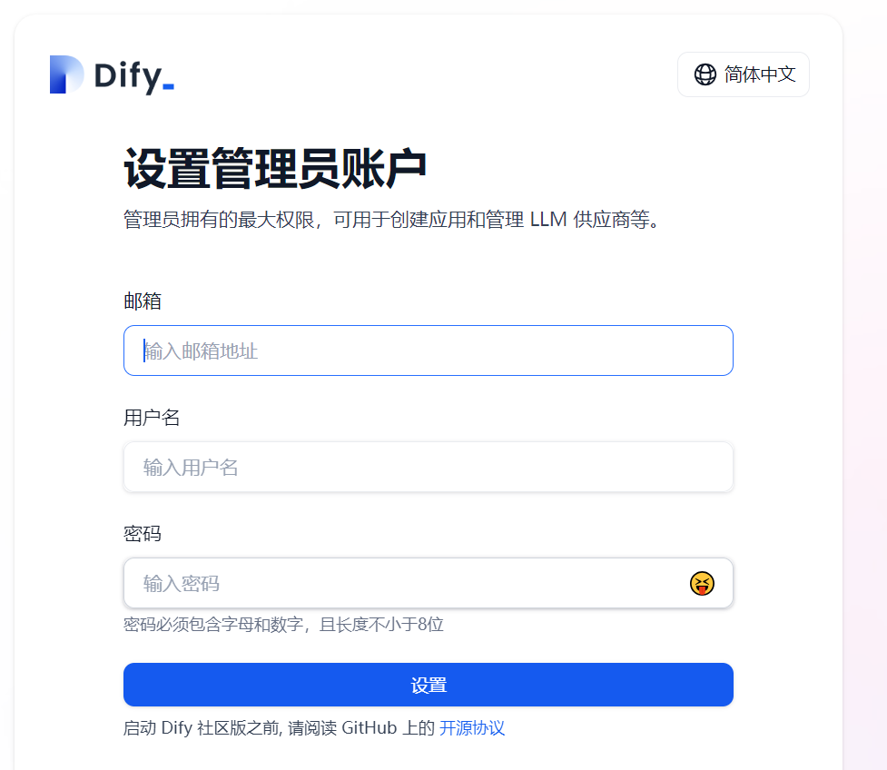

在注册完成后，会跳转到工作室的页面，这时候就可以体验 Dify 的功能了。

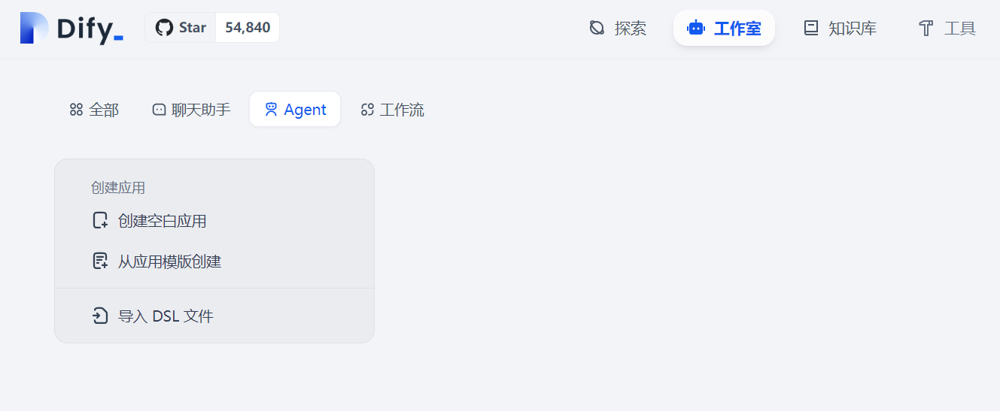

Dify 作为一个 AI 应用开发平台，功能还是非常全面的。首先是涵盖了 Agent 和知识库（RAG）两大 AI 热门应用点，在此基础上还有工作流的功能，适用于复杂应用逻辑场景下的低代码编排。接下来，我们使用它的 Agent 功能构建一个地图应用，看一下它是怎么做的。

## 使用 Agent 构建地图助手

Dify 的 Agent，支持 Function Calling 与 ReAct 两种模式，这样可以做得比较通用化，使得任意大模型都可以使用 Agent 能力。在这里，我们先不用关心具体的推理方案，而是着重看一下其零代码制作 Agent 应用的产品设计思路。

在使用 Agent 服务之前，要先设置一下要使用什么大模型。设置的路径如下图所示：

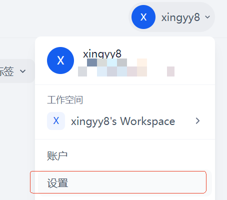

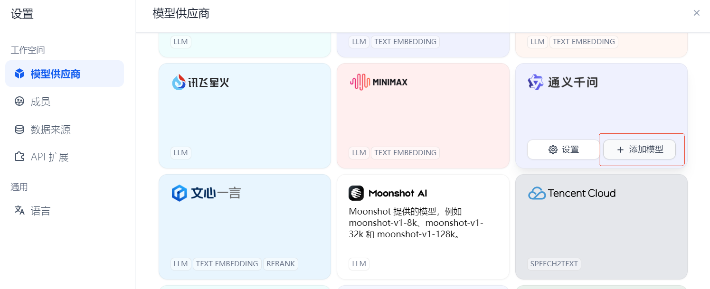

点开设置 - 模型供应商后，可以看到 Dify 支持了非常多的模型供应商，非常方便。在这里我使用的是通义千问，你可以根据自己的情况去选择合适的模型。

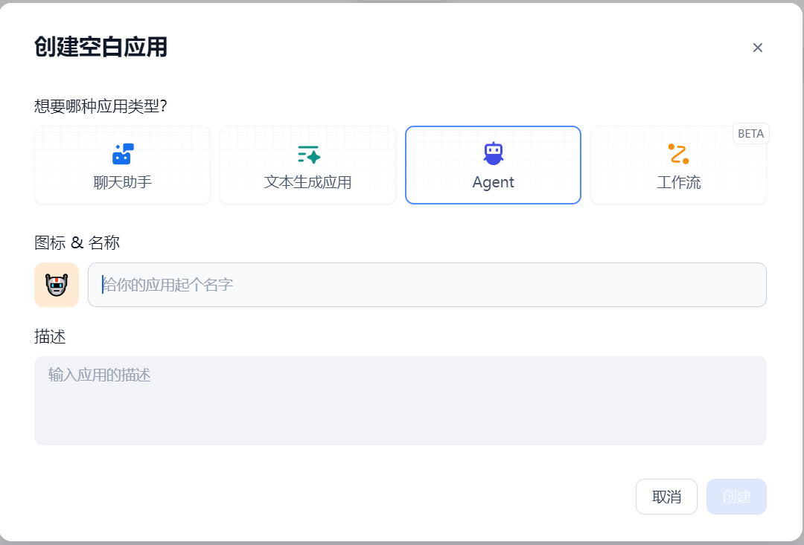

完成模型设置后，点击创建空白应用，选择 Agent，此时可以输入名称和描述，点击创建按钮，进入到 Agent 应用配置页面。

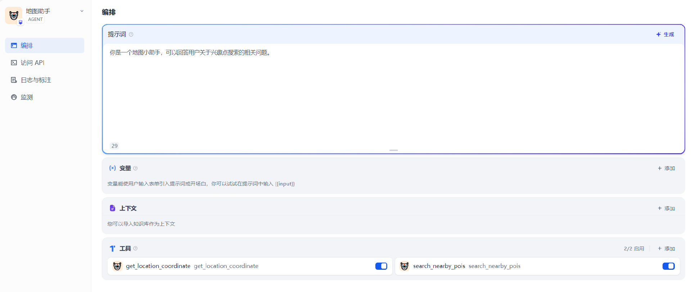

在这个页面可以填写提示词，也就是为我们的自定义应用赋一个人设。之后可以通过添加工具，为 Agent 赋予与外部环境沟通的能力。

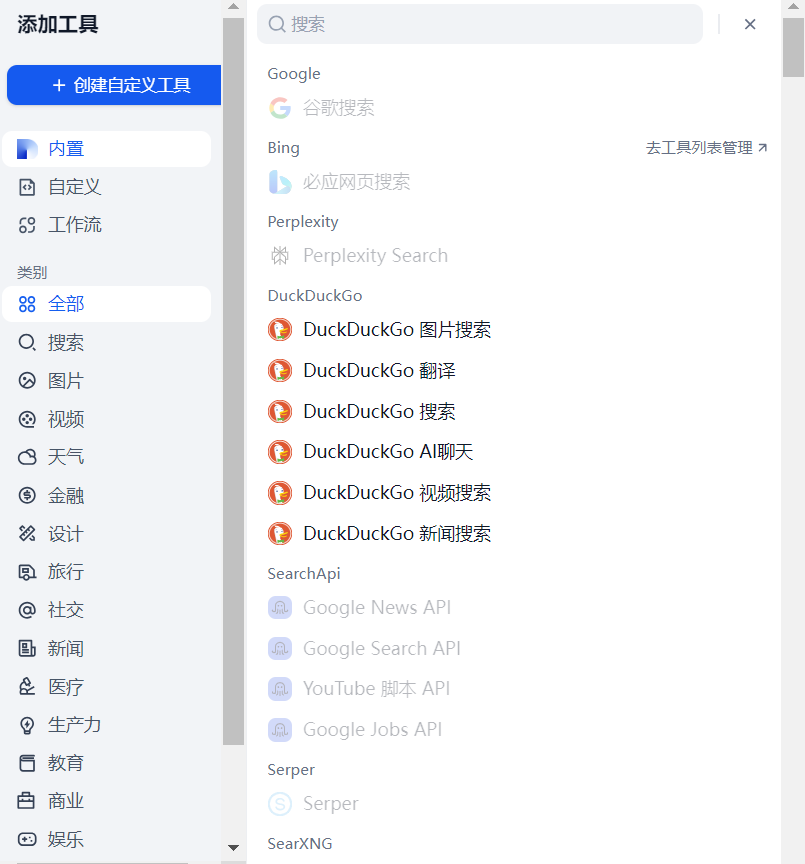

在工具添加页面，可以看到 Dify 已经内置了非常多工具了，这些我们可以直接用，也可以创建自定义工具。我们还是以上一节课中高德地图的两个工具为例，来看一下 Dify 的工具配置页面的设计思路。

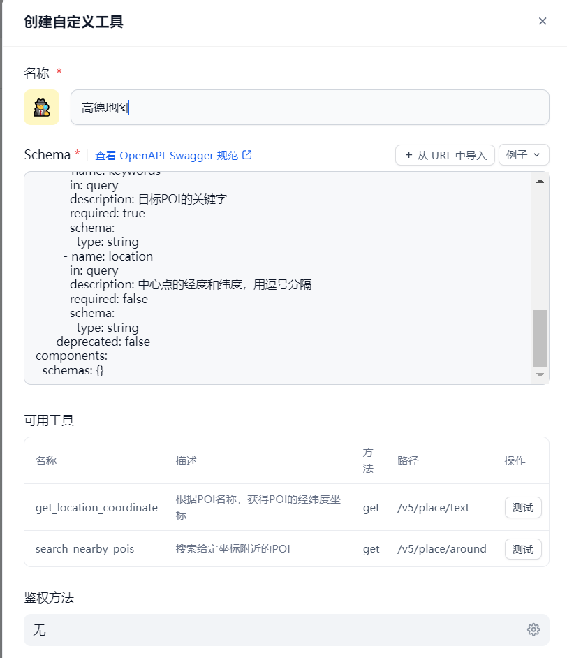

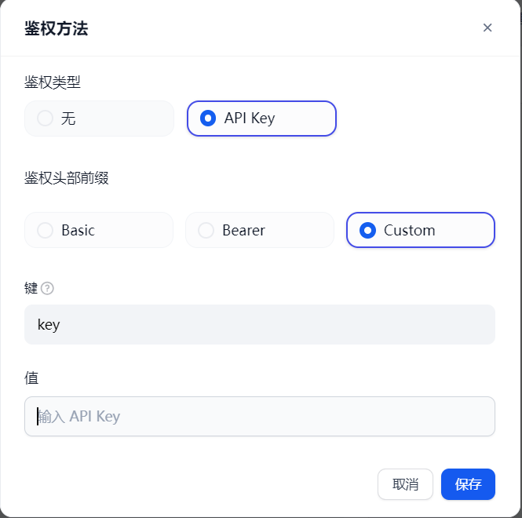

可以看到它也是通过 OpenAPI 文档来进行工具配置，在 API 的识别、测试、鉴权等方面与GPTs 是基本一致的，这也说明了业界对于 GPTs 这种 API Agent 标准的认可。

最后我们在调试窗口测试一下效果，如下图所示，可以看到 Agent 调用了我们的两个工具，输出了正确的结果。

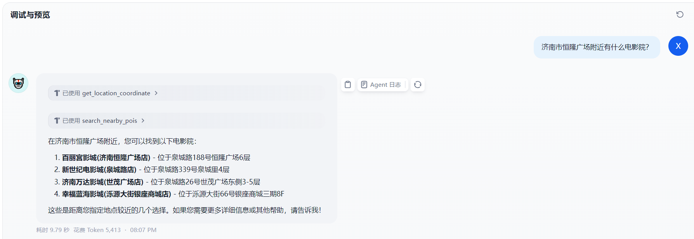

之后点击发布，这个应用就被保存了，以后可以在探索页面找到这个应用，直接进行对话。

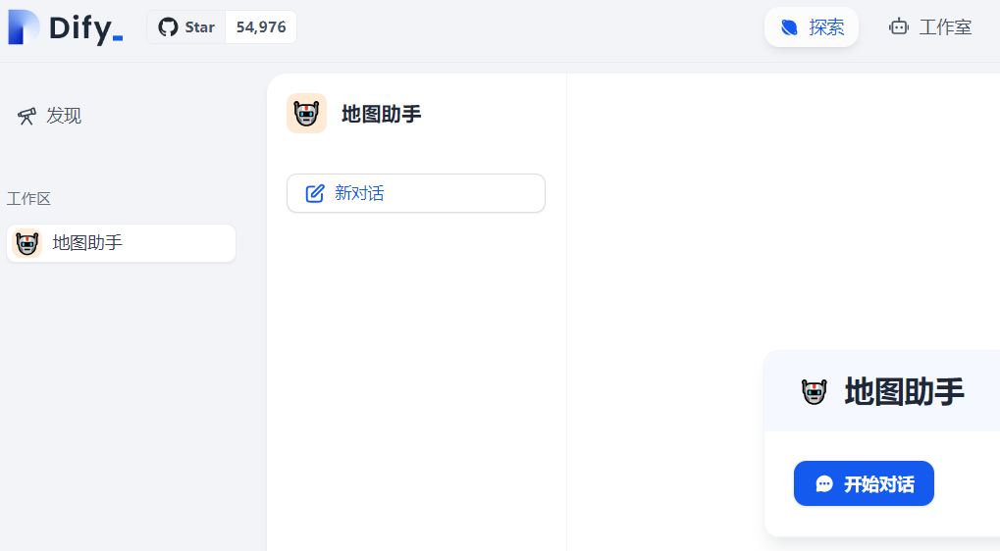

## 多种发布方式

除了这种发布应用的方式外，Dify 还提供了三种我认为非常有用的方式。第一种是 iframe 嵌入网站，第二种是通过 API 访问，第三种是使用 SDK。

### 嵌入网站

其中嵌入网站有三种方式，分别是全屏嵌入、气泡嵌入以及以 Chrome 浏览器插件的方式嵌入。

气泡嵌入很有意思，比如有时我们在浏览一些网页，例如极客时间的某训练营，在右边会有一个联系客服之类的气泡，点击就可以与在线客服对话。

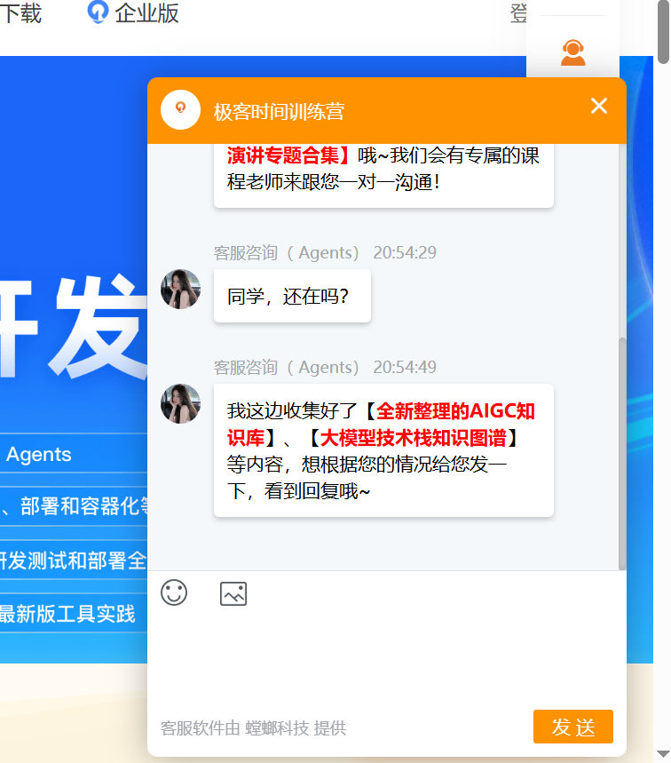

Dify 提供了一段嵌入代码，我们只需要粘贴到前端的 HTML 中，就可以出现这样的效果。这个功能让我们能够以非常低的成本，快速为网站集成客服问答助手等智能应用，而且当后端的AI 应用的数据、功能等发生变更时，对于前端来说，也是完全无感知的，非常方便。

### 访问 API

我们再来看一下访问 API 方式。Dify 提供了如下图所示的一系列的标准 API 文档，覆盖了与大模型应用对话的全部功能，用户只需要针对每一个应用拿到对应的 API key，就可以通过API 与应用进行交互。

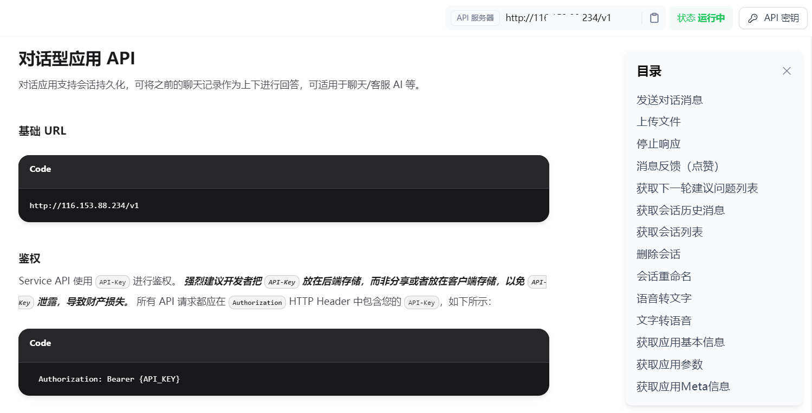

我们以刚刚构建的地图助手为例，测试一下这种方式。首先点击右上角的 API 密钥，获取地图助手的 API Key。之后通过 curl 命令来使用对话 API 发送一条对话消息：

```bash
curl -X POST 'http://<your_server_ip>/v1/chat-messages' \
--header 'Authorization: Bearer <your_api_key>' \
--header 'Content-Type: application/json' \
--data-raw '{
   "inputs": {},
   "query": "济南市泉城广场附近有什么电影院？",
   "response_mode": "streaming",
   "conversation_id": "",
   "user": "xingyy8"
}'
在这里，<your_server_ip> 就是 Dfiy nginx 组件的访问 IP，端口默认是 80，假如在最开
```

始，你把 Nginx 的暴露端口改为了 10080，那么此时就需要写成

```xml
<your_server_ip>:10080 的形式。另外，参数 response_mode 设置成了该对话采用的
```

是流式模式。稍等片刻后会得到一段以流式形式返回的 HTTP Response。

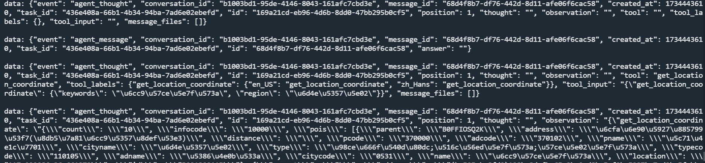

这里的 response 做了 Encode，所有的中文以及特殊字符等都被编码成了类似 \u98ce\ 这样的格式，因此可能肉眼看上去有点眼花看不懂。在实际业务中，通常是需要做一下 Decode 操作的。

### SDK

除了直接调用 API 的方式，Dify 还提供了 SDK，可以帮我们省去写 HTTP 代码的麻烦。SDK位于 Dify 源码的 sdks 文件夹下，目前包含 nodejs、php、python 三种语言。

我们以 python client 为例，做一下简单测试。首先安装 sdk：

```
pip install dify-client
```

之后编写代码如下：

```python
import json
import os
from dify_client import ChatClient
api_key = os.getenv('dify')
base_url = "http://116.153.87.224:10080/v1"
# Initialize ChatClient
chat_client = ChatClient(api_key)
chat_client.base_url = base_url
# Create Chat Message using ChatClient
chat_response = chat_client.create_chat_message(inputs={},
                                               query="济南市恒隆广场附近有什么电影院？
                                               user="user_id", response_mode="st
chat_response.raise_for_status()
for line in chat_response.iter_lines(decode_unicode=True):
   line = line.split('data:', 1)[-1]
   if line.strip():
       line = json.loads(line.strip())
       print(line.get('answer'))
```

首先，从环境变量中读取 API Key，这是因为我已经提前将地图助手的 API Key 放到我的环境变量中了。之后还要设置 base_url 为你的 Dify 服务地址。之后在初始化 client 后可以直接通过 create_chat_message 与地图助手对话。由于对话采用流式模式，因此最后需要循环解析返回的内容，并打印出来。注意一点，在第 18 行，设置了 decode_unicode 为 True，这就是前面我说到的需要对返回内容做 Decode 操作。

看一下效果：

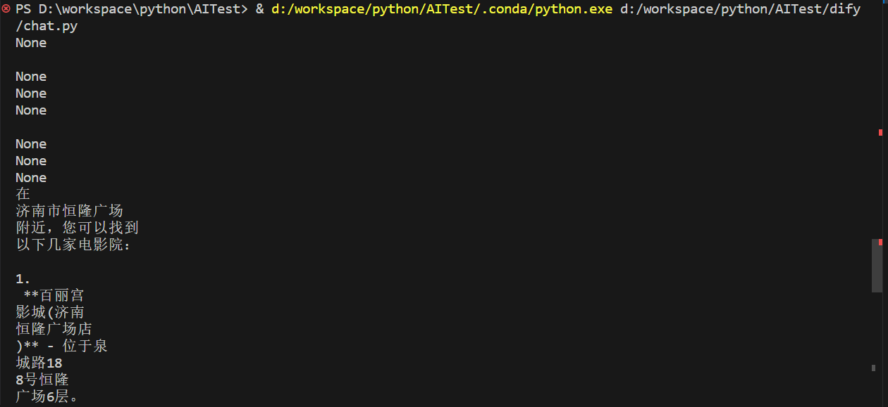

可以看到返回结果是以流的形式一点一点给我们的。

最后，我用一张图简化一下用 API 或 SDK 访问 Agent 应用的架构。

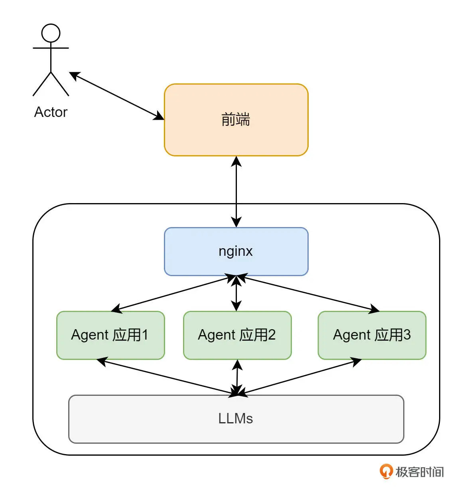

Dify 用 Nginx 反代了外部的所有 HTTP 请求，并通过 Header 中的 API Key 来决定要访问哪一个 Agent 应用。这其实是有了一点 AI 网关的味道了。

## 总结

今天这节课，我们介绍了国产 GPTs —— Dify 平台，并带你一起进行了 docker compose 的环境搭建，并试用了其 Agent 功能，成功复现了上一节课地图助手的功能。

不得不说，就像同等价位的汽车，通常国产的要比进口车的内饰、功能等更加豪华一样。Dify平台这台“国产车”也确实很豪华，其不仅对标了 GPTs 的功能，并且还提供了多种发布方式以及工作流、RAG 等功能，结合 Agent，我们可以实现更丰富的玩法。

对于许多企业来说，员工大多都是熟悉传统业务和技术的人员，对于 AI 开发可能一时难以快速上手。但如何让企业的产品快速接入 AI 能力呢？这类 API Agent 就非常合适。研发人员可以将老业务中的 API 抽离出来作为工具，通过这种零代码配置或者拖拉拽工作流的方式，快速构建 AI 应用。而 Dify 提供的嵌入网站以及 API 等发布方式，也可以方便快捷地将 AI 应用对接到企业前端门户网站或产品客户端等，同时实现对于后端基础大模型的良好封装和私有数据的保护。当后端应用有改动时，前端也可以实时生效。

那么在连续试驾了“进口车” GPTs 以及“国产车” Dify 之后，相信你对于此类产品设计思路已经有了一个很清晰的认识。那么下节课，我们就来扒一扒 Dify 的 Agent 到底是如何实现的，从而为之后我们模仿着做一个 Go 语言版本的 API Agent 打下基础。

## 思考题

工具再好，也终究要落地到实际业务上，我们这个课程的业务就是云原生 K8s。因此你可以用Dify 配一下之前我们写过的操控运维 K8s 的 Tool，来试试效果。

欢迎你在留言区展示你的测试效果，我们一起探讨。如果你觉得这节课的内容对你有帮助的话，也欢迎你分享给其他朋友，我们下节课再见！
