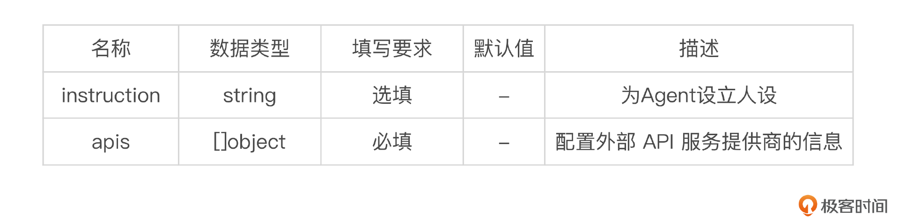
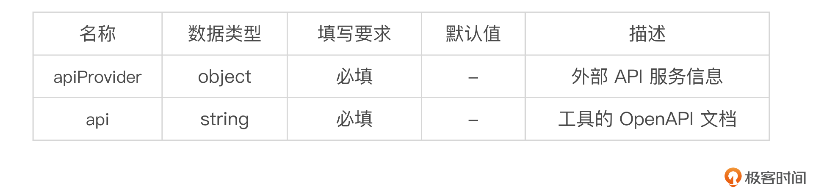
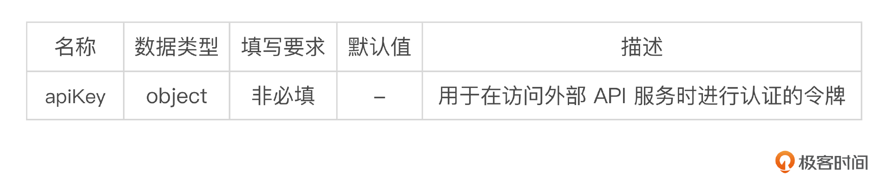
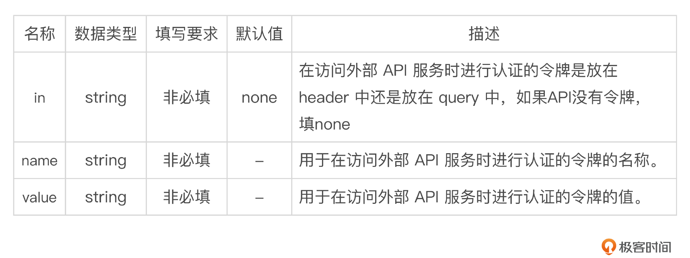
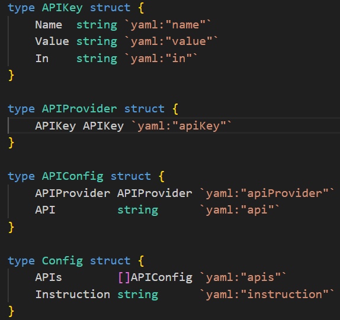
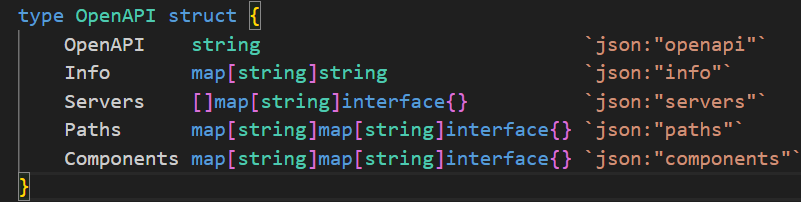
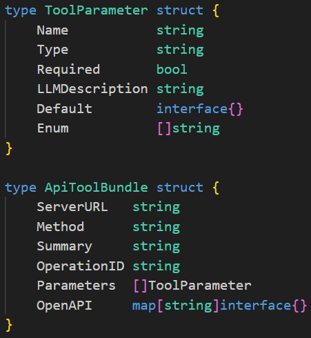
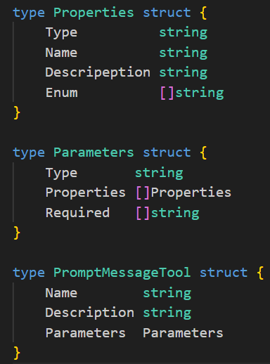
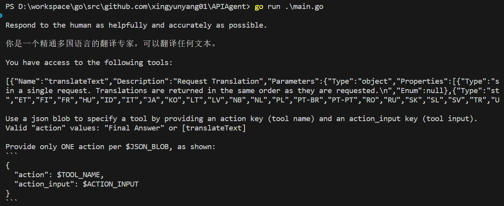

# 16 | 实践：用Go语言手写可定制APIAgent（上）

你好，我是邢云阳。

经过了几节课的产品体验和源码学习后，终于要来到实践环节了。在本节课以及下一节课，我会带你参考 Dify Agent 的思路，用 Go 语言做一个零代码可配置的 API Agent 产品出来。

之前有同学问过我，这个课程为什么要用 Go 语言来做，做 AI 开发的主流语言不应该是Python 吗？在这里，我做一下统一回答。

我们知道云原生应用开发的“母语”是 Go，而学习这个课程的同学大多数是做云原生开发，希望额外学习 AI 相关的知识提升自己的。因此，使用 Go 语言来做课程，会让大多数同学上手更加方便，理解起来也会更加容易。试想，如果原理真的理解了，能用自己最熟悉的语言零框架手撸出来了，那需要用到 Python 或者一些第三方框架，比如 LangChain 时，上手也会非常的快。

第二点是在云原生的某些场景下，无法使用 Python 语言进行开发，比如下一章节要给你讲解的云原生网关以及 wasm 技术，就暂时不支持 Python 语言。所以我在综合考虑后，决定全程用 Go 语言来做课程。在这里也希望你能够摆脱语言的束缚，重点学习原理以及套路，将来不管用到什么工具时都能够从容应对。

那么言归正传，我们开始进入今天的实战编码环节。

## ReAct 模板

首先来搞定 Agent 的大脑。Dify 的 ReAct 模板是用 python 写的，因此它可以使用类似模板的语法，就像这样：

```
ENGLISH_REACT_COMPLETION_PROMPT_TEMPLATES = """Respond to the human as helpfully
{{instruction}}
You have access to the following tools:
{{tools}}
"""
```

这里我只是截取了模板中的几行，你理解我要表达的意思即可，完整模板可以去上节课查看。在这个模板中，{{instruction}} 和 {{tools}} 作为占位符，让我们明确知道在模板中的哪个部分需要插入特定的信息。那么，使用 Go 语言能否实现类似的效果呢？答案是肯定的。

Go 语言本身提供了强大的模板引擎，text/template 包可以帮助我们动态填充模板内容。这使得我们可以在 Go 中轻松实现与 Python 类似的功能，动态生成所需的字符串输出。Go 的模板引擎不仅支持基础的字符串替换，还能处理复杂的逻辑和条件判断，从而让模板更加灵活和智能。

在 Go 中，我们可以这样定义一个类似的模板：

```javascript
const EN_Template = `
Respond to the human as helpfully and accurately as possible.
{{.Instruction}}
You have access to the following tools:
{{.Tools}}
`
```

那为了填充这个模板，我们可以使用如下测试代码所示的方法：

```go
package main
import (
 "fmt"
 "text/template"
 "os"
)
type PromptData struct {
 Instruction string
 Tools       string
}
func main() {
 // 创建模板对象
 tmpl, err := template.New("reactPrompt").Parse(EN_Template)
 if err != nil {
   fmt.Println("Error parsing template:", err)
   return
 }
 // 定义模板数据
 data := PromptData{
   Instruction: "Provide a detailed explanation of how AI can improve cloud-nati
   Tools:       "AI tools, Cloud-Native tools",
 }
 // 执行模板并输出到标准输出
 err = tmpl.Execute(os.Stdout, data)
 if err != nil {
   fmt.Println("Error executing template:", err)
 }
}
```

通过这种方式，我们能够在 Go 语言中实现与 Python 相似的模板功能，使模板增加可阅读性，还便于调整字段。

## OpenAPI 文档解析

### 配置导入

在 Dify 中，是通过在 UI 上填写工具信息的方式来完成工具创建的。在我们的代码中，没有前端，就使用本地 YAML 配置文件解析的方式来大概模拟一下。

YAML 配置文件，用来存放 OpenAPI 文档，API Key 等信息。先定义字段描述如下：



apis 的配置字段说明如下：



apiProvider 的配置字段说明如下：



apiKey 的配置字段说明如下：



最后形成的样式如下所示：

```
instruction: xxxx
apis:
- apiProvider：
   apikey:
     name: key
     value: xxx
     in: header
 api: |
   openapi: 3.1.0
   info: xxx
```

设计好具体的格式后，代码就很简单了。定义结构体如下：



之后初始化一下结构体，将 YAML 文件从本地加载进来，反序列化到结构体即可，代码如下：

```go
func InitConfig() *models.Config {
   config := newSysConfig()
   if b := LoadConfigFile(); b != nil { //读取 system.yaml文件内容
       err := yaml.Unmarshal(b, config) //将byte反序列化成结构体
       if err != nil {
           log.Fatal(err)
       }
   }
   return config
}
```

### OpenAPI 解析

在完成配置文件的导入后，我们就拿到了 OpenAPI 文档。在这里，我就不做 Swagger 到OpenAPI 的转换了。我们规定用户只能使用 OpenAPI 3.0 及以上版本的格式，低版本的Swagger 格式不支持。

### 结构体定义

OpenAPI 解析的过程，是将 OpenAPI 文档转化成 APIToolBundle 的过程，我们首先需要定义好结构体。根据上节讲过的 OpenAPI 文档的格式，其主要包含 OpenAPI、Info、Servers、Paths、Components 等五个部分。因此我们可以定义结构体如下：



Info、Servers 下都是 k-v 形式的参数，使用 map 最合适。Paths 和 Components 稍微复杂一点，是 map 嵌套的形式。在配置导入环节，我们已经得到了字符串格式的 OpenAPI 文档，在这里同样可以利用 YAML 反序列化，将文档的各段注入到结构体中。、

我们再来看一下 APIToolBundle 的结构体定义。



APIToolBundle 参考 Dify 的设计，需要将 URL、Method、Summary、OperationID、Parameters 拆解出来，一方面需要拼接 ReAct 模板的工具部分，另一方面在后面调用通用HTTP 方法时也会使用。除此之外，还设计了 OpenAPI 参数，这个参数在上节课讲过，存储的是每一条路由的 Method 所对应的值，目的是在后续做参数解析拼装时，判断参数是 query参数还是 requestBody 参数。

### 解析函数

清楚结构体功能后，我们来看解析函数。在解析这一部分，其他的常规 k-v 映射都比较简单，在上一节课的原理篇讲过，麻烦的是参数的处理。参数首先分为 parameters 和 requestBody两种类型，分别针对的是参数在 url 中以及参数在请求体中情况。除此之外，参数还会涉及到公共参数被放置到 Components 的 schema 中，之后用 $ref 去寻址的过程。

首先看一下 parameters 的处理，我将 parameters 的示例文档和代码都放上，我们对比着看会更加清晰。

文档：

```
parameters:
- name: keywords
 in: query
 description: POI名称，必须是中文
 required: true
 schema:
   type: string
```

代码：

```go
if params, ok := operation["parameters"].([]interface{}); ok {
   for _, param := range params {
       paramMap := param.(map[string]interface{})
       toolParam := models.ToolParameter{
           Name:           paramMap["name"].(string),
           Type:           "string", // 默认类型
           Required:       paramMap["required"].(bool),
           LLMDescription: paramMap["description"].(string),
           Default:        getDefault(paramMap),
       }
       // 类型处理
       if typ := getParameterType(paramMap); typ != "" {
           toolParam.Type = typ
       }
       parameters = append(parameters, toolParam)
   }
}
```

代码逻辑还是很简单的，就是从 map 中取值，赋值到 ToolParameter 实例的过程，这其中涉及到了比较多的强制类型转换，我是直接就用了，没有做是否存在的验证。但实际上都应该用像第一行代码一样的 if xx,ok 的方式做一下判断，避免因访问一个不存在的地址而出现panic。

下面我们再来看一下 requestBody 以及 ref 引用的处理逻辑。

文档：

```
requestBody:
 required: true
 content:
   application/json:
     schema:
       type: object
       required:
         - text
         - target_lang
       properties:
         text:
           $ref: '#/components/schemas/TranslationText'
...
components:
 schemas:
   TranslationText:
     description: |
       Text to be translated. Only UTF-8-encoded plain text is supported. The pa
       up to 50 times in a single request. Translations are returned in the same
     type: array
     maxItems: 50
     items:
       type: string
       example: Hello, World!
```

代码：

```go
if requestBody, ok := operation["requestBody"].(map[string]interface{}); ok {
   if content, ok := requestBody["content"].(map[string]interface{}); ok {
       for _, contentType := range content {
           if bodySchema, ok := contentType.(map[string]interface{})["schema"].(
               required := bodySchema["required"].([]interface{})
               properties := bodySchema["properties"].(map[string]interface{})
               for name, prop := range properties {
                   propMap := prop.(map[string]interface{})
                   // 处理引用，如果有
                   if ref, ok := propMap["$ref"].(string); ok {
                       root := openAPI.Components["schemas"]
                       segments := strings.Split(ref, "/")[1:]
                       lastSegment := segments[len(segments)-1]
                       propMap = root[lastSegment].(map[string]interface{})
                   }
                   toolParam := models.ToolParameter{
                       Name:           name,
                       Type:           "string", // 默认类型
                       Required:       contains(required, name),
                       LLMDescription: propMap["description"].(string),
                       Default:        propMap["default"],
                   }
                   // 如果参数包含 enum，则添加枚举值
                   if enum, ok := propMap["enum"].([]interface{}); ok {
                       var enumValues []string
                       for _, e := range enum {
                           enumValues = append(enumValues, e.(string))
                       }
                       toolParam.Enum = enumValues
                   }
                   // 类型处理
                   if typ := getParameterType(propMap); typ != "" {
                       toolParam.Type = typ
                   }
                   parameters = append(parameters, toolParam)
               }
           }
       }
   }
}
```

代码首先通过 map 进行一层层地拆解，得到 schema，并进一步得到 properties。之后便开始遍历 properties，如果包含 ref 字段，则首先通过 strings.Split(ref, “/”)[1:] 将#/components/schemas/TranslationText 切分成数组，即[componentes schemasTranslationText]，这样便可以取数组的最后一个元素的方式拿到参数的名字。之后再通过openAPI.Components[“schemas”][lastSegment] 得到参数的文档，将其替换掉 ref。最终文档会变成如下形式：

```
...
properties:
 text:
   TranslationText:
     description: |
       Text to be translated. Only UTF-8-encoded plain text is supported. The pa
       up to 50 times in a single request. Translations are returned in the same
     type: array
...
```

接下来的部分就很简单了，代码类似上面的 parameters 的处理，也是通过从 map 中取值并赋值 ToolParameter 的方式完成拆解。

## 组装工具

在得到 APIToolBundle 后，便可以组装 tools 描述，并测试一下填充到 ReAct 模板。在之前的课程中，我们组装 tools 时会用到三件套，即 name、description、param，其中 param 会用json 格式进行描述。Dify 也差不多，只不过比我们课程中的还要再丰富一点，我们就借鉴一下Dify 的格式。定义结构体如下：



三件套是一样的，区别在于 Dify 增加了 Required 字段，用来告诉大模型哪个参数是必填的。参数描述中也增加了 Enum 枚举字段，便于处理带可选值的参数的情况。

代码非常简单，就是从 APIToolBundle 取相关值并复制到上述结构体中即可。在这就不再贴代码演示了，你可在我的 Github 上查看完整代码。最后，将结构体进行 JSON 序列化，转成JSON 字符串。使用配置导入小节讲解的 template 赋值语法填充到 ReAct 模板即可。

## 测试

我找了一个 DeepL 翻译的 OpenAPI 例子来测试一下效果。YAML 配置文件如下：

```bash
instruction: 你是一个精通多国语言的翻译专家，可以翻译任何文本。
apis:
- apiProvider:
   apiKey:
     name: DeepL-Auth-Key
     value: xxxxxxxxxxxxxxxxxxx
     in: header
 api: |
   openapi: 3.1.0
   info:
     title: DeepL API Documentation
     description: The DeepL API provides programmatic access to DeepL’s machine
     version: v1.0.0
   servers:
     - url: https://api-free.deepl.com/v2
   paths:
     /translate:
       post:
         description: Request Translation
         operationId: translateText
         requestBody:
           required: true
           content:
             application/json:
               schema:
                 type: object
                 required:
                   - text
                   - target_lang
                 properties:
                   text:
                     $ref: '#/components/schemas/TranslationText'
                   target_lang:
                     $ref: '#/components/schemas/LanguageCode'
         responses:
           '200':
             description: Successful response
   components:
     schemas:
       TranslationText:
         description: |
           Text to be translated. Only UTF-8-encoded plain text is supported. Th
           up to 50 times in a single request. Translations are returned in the
         type: array
         maxItems: 50
         items:
           type: string
           example: Hello, World!
       LanguageCode:
         description: The language into which the text should be translated.
         type: string
         enum:
           - BG
           ...
           - ZH-HANS
         example: DE
```

解析并注入 ReAct 模板后的效果是这样的：



可以看到解析得没有问题。

## 总结

本节课，我们开始用 Go 语言仿照 Dify Agent 的思路手撸可定制 API Agent。由于代码量以及细节比较多，因此我拆分成了两个课时。

本课时我讲解了如何设计本地 YAML 配置文件的方式来模仿 Dify 前端配置工具参数的过程，以及用 Go 模板语法实现 python 模板的同款效果，从而让 ReAct 模板变得直观，易扩展。此外我还讲解了 OpenAPI 文档的解析，这一部分在 Python 中由于有字段数据类型，因此非常容易实现，但在 Go 语言中只能使用大量的 map[string]interface{} 来进行模拟。最后，我们组装了工具并映射到 ReAct 模板中做了测试。本节课的代码，我已经上传到了我的 Github上，你可下载我的源码了解更多的实现细节并做测试。

在下一节课，我会继续带你完成 output_parser，通用 HTTP 方法，以及 Agent 多轮对话逻辑的代码编写，最后我们用 gin 进行封装，模拟一下 Dify 通过 API 访问 Agent 的方式。

## 思考题

你可以思考一下 output_parser 部分的代码该如何写，用非流式模式实现即可。在下一节课，我会放出代码并做讲解。

欢迎你在留言区分享你的代码设计思路，我们一起来讨论。如果你觉得这节课的内容对你有帮助的话，也欢迎你分享给其他朋友，我们下节课再见！
