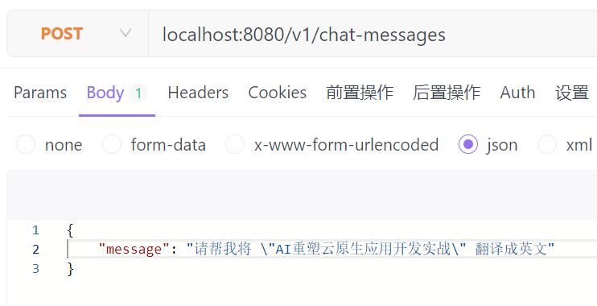
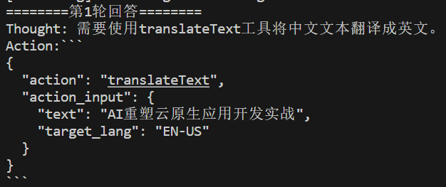
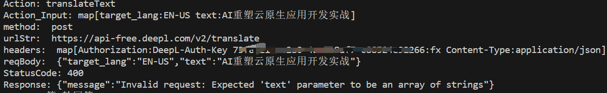
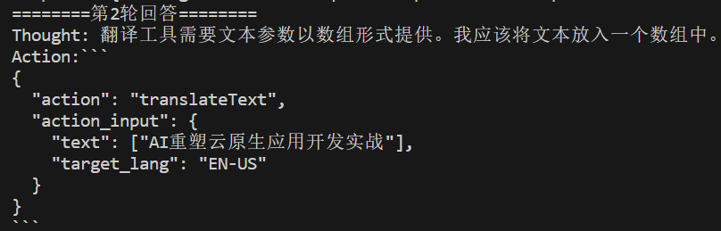
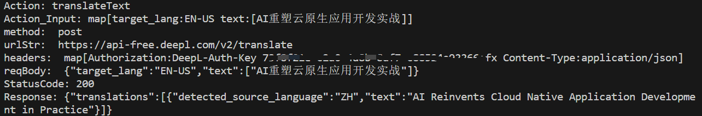
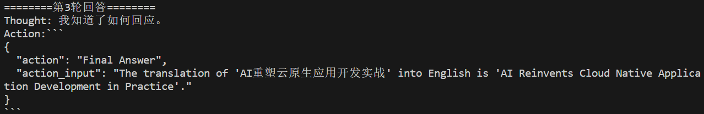
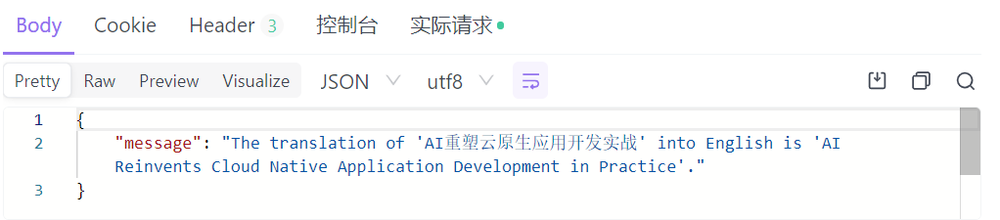
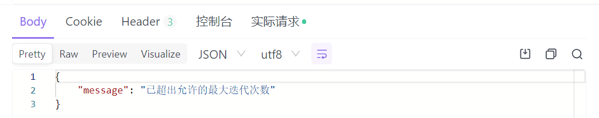
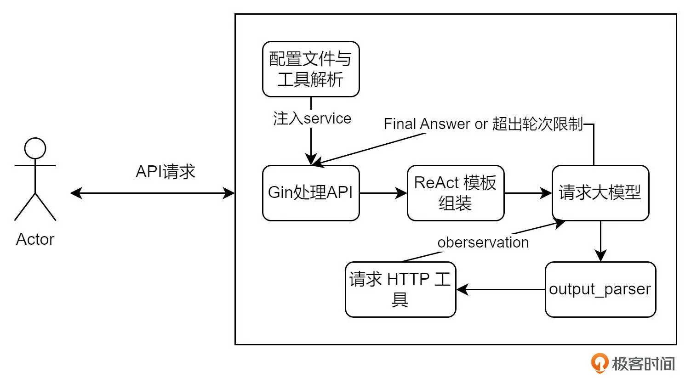

# 17 | 实践：用Go语言手写可定制APIAgent（下）

你好，我是邢云阳。

上节课，我们搞定了 OpenAPI 的配置、解析以及 ReAct 模板的填充，相当于初始化的工作都已经完成了。那今天这节课，我们就来完成剩余的部分。

## Output_parser

如何与 Agent 进行多轮对话，在之前的课程中，我们曾反复练习过，相信你已经比较熟悉了。在每一轮对话结束时，Agent 都会按照 ReAct 模板规定的格式给出回答。本章节的 ReAct 模板，是采用的 Dify 的模板，其使用的是 JSON 模式。 输出格式如下：

```
Action:
```
$JSON_BLOB
```
```

也就是说，JSON 输出会被夹在三个反引号（```）代码块之间。而根据 Agent 是选择工具还是得到了 Final Answer，上述格式会产生两种输出。

如果是选择工具，就会输出以下示例中的格式：

```
Action:
```
{
 "action": "search_nearby_pois",
 "action_input": {
   "keywords": "游泳馆",
   "location": "117.120308,36.656973"
 }
}
```
```

即 action_input 对应的值也是一个 JSON。如果是得到了 Final Answer，则是如下格式：

```
Action:
```
{
 "action": "Final Answer",
 "action_input": "Final response to human"
}
```
```

即 action_input 对应的值是一个字符串。

格式特点搞清楚后，就是写代码来进行解析了。在第 15 节课，我们分析过 Dify 解析output_parser 的代码，由于其与大模型的对话采用的是流式模式，因此需要先进行流式解析，然后才是解析 Action。在这里，我偷个懒，就不用流式模式了，我们把重点放在 Action的解析工作上。

解析的第一步，我们应通过正则表达式，从三个反引号 ``` 中把 JSON_BLOB 拿出来。之后直接通过 JSON 反序列化的方法将其注入到一个 map[string]interace{} 结构中。这样就可以得到action 与 action_input 了。但需要区分的是 action_input 输出的是工具参数时，其类型是map[string]interface{}，如果是 Final Answer 则是 string。我为了在后面组装 HTTP 请求参数时，方便解析，就把 action_input 统一为 map[string]interface{} 类型。完整代码如下：

```go
// 提取 action 和 action_input
action, ok := actionData["action"].(string)
if !ok {
   fmt.Println("JSON 中缺少 'action' 字段，或类型不匹配")
   return "", nil, err
}
// 检查 action 是否是 "Final Answer"
if action == "Final Answer" {
   actionInput, ok := actionData["action_input"].(string)
   if !ok {
       fmt.Println("JSON 中缺少 'action_input' 字段，或类型不匹配")
       return "", nil, err
   }
   actionInputMap := map[string]interface{}{
       "finalAnswer": actionInput,
   }
   return action, actionInputMap, nil
}
actionInput, ok := actionData["action_input"].(map[string]interface{})
if !ok {
   fmt.Println("JSON 中缺少 'action_input' 字段，或类型不匹配")
   return "", nil, err
}
return action, actionInput, nil
```

## 通用 HTTP 方法

需要调用什么工具以及工具参数获取到之后，接下来就是执行 HTTP 请求了。这个过程分三个步骤，第一是要处理 header 和 apiKey；第二是处理参数，包括 query 参数、path 参数以及requestBody；第三才是进行 HTTP 请求。首先来看第一步，先上代码：

```go
func assembingRequest(apiKey models.APIKey, url string) (map[string]string, strin
   if apiKey.In == "header" {
       headers := make(map[string]string, 2)
       headers["Content-Type"] = "application/json"
       headers["Authorization"] = apiKey.Name + " " + apiKey.Value
       return headers, url
   } else if apiKey.In == "query" {
       url += "?" + apiKey.Name + "=" + apiKey.Value
       return nil, url
   } else {
       return nil, url
   }
}
```

我们知道 apiKey 分成三种情况，第一种是存于 header 中，第二种是放在 url query 中，第三种则是不需要 apiKey。因此在代码中需要做一个判断，如果是存于 header 中，就将其拼接到Authorization 后面。如果是 query 形式，就当作 url 的第一个 query 参数，拼接到 url 后面。如果不需要 apiKey，则不处理 url，直接返回。

接下来看一下第二步。首先需要处理 path 参数，也就是类似如下格式的路由花括号里的参数。

```
https://api-free.deepl.com/v2/document/{document_id}
```

我是这么做的，代码如下：

```go
// 解析URL模板以查找路径参数
urlParts := strings.Split(urlStr, "/")
for i, part := range urlParts {
   if strings.Contains(part, "{") && strings.Contains(part, "}") {
       for _, param := range toolBundle.Parameters {
           paramNameInPath := part[1 : len(part)-1]
           if paramNameInPath == param.Name {
               if value, ok := actionInput[param.Name]; ok {
                   // 删除已经使用过的
                   delete(actionInput, param.Name)
                   // 替换模板中的占位符
                   urlParts[i] = url.QueryEscape(value.(string))
               }
           }
       }
   }
}
urlStr = strings.Join(urlParts, "/")
```

首先把路由按照 / 打散，放到数组 urlParts 中。例如将 document/{document_id} 变为{“document”, “{document_id}”}。之后开始遍历数组，如果遇到带花括号的元素，就把花括号中的元素拿出来，也就是 document_id，之后就从参数中开始匹配，如果能匹配到，则从actionInput 中把对应的值取出来替换掉 {document_id}。例如替换完成后该路由变成了/document/1。这些参数在 path 中使用过后，需要在 action_input 中删掉，以免在 query 或requestBody 中重复使用。

接下来处理 query 和 requestBody 的参数。

```go
if toolBundle.OpenAPI["requestBody"] != nil {
   reqBody, err = json.Marshal(actionInput)
   if err != nil {
       return nil, 400, err
   }
} else {
   reqBody = nil
   for _, param := range toolBundle.Parameters {
       urlStr += "&" + param.Name + "=" + actionInput[param.Name].(string)
   }
}
```

首先通过 OpenAPI[“requestBody”]，来判断 OpenAPI 文档是否有 requestBody，如果有则直接把 action_input JSON 序列化就得到了 requestBody。如果没有，则把参数拼接到 query中。这样，参数部分就处理完毕了。

最后是执行 HTTP 请求的部分。使用的是 Go 语言自带的 HTTP 包完成的。代码如下：

```go
func call(method, url string, headers map[string]string, reqBody []byte) ([]byte,
   method = strings.ToUpper(method)
   // 创建请求体
   var body *bytes.Reader
   if reqBody != nil {
       body = bytes.NewReader(reqBody)
   } else {
       body = bytes.NewReader([]byte{})
   }
   // 创建 HTTP 请求
   req, err := http.NewRequest(method, url, body)
   if err != nil {
       return nil, 0, fmt.Errorf("创建请求失败: %v", err)
   }
   // 设置请求头
   for key, value := range headers {
       req.Header.Set(key, value)
   }
   // 创建 HTTP 客户端，并设置超时时间
   client := &http.Client{
       Timeout: 30 * time.Second,
   }
   // 发送请求
   resp, err := client.Do(req)
   if err != nil {
       return nil, 0, fmt.Errorf("发送请求失败: %v", err)
   }
   defer resp.Body.Close()
   // 读取响应体
   respBody, err := ioutil.ReadAll(resp.Body)
   if err != nil {
       return nil, resp.StatusCode, fmt.Errorf("读取响应体失败: %v", err)
   }
   return respBody, resp.StatusCode, nil
}
```

代码整体不复杂，唯一要说的几个点是，http 包中执行 HTTP 请求时，Method 要求大写，因此使用了一个 strings.ToUpper(method) 转了一下。第二，入参 headers 和 reqBody 可以是空的，取决于之前的两个步骤是怎么处理的。其他的就很简单了。

## 轮次限制

接下来我们看一下轮次限制。在上节课的代码中，我们已经在本地 YAML 配置文件中设置了轮次限制 max_iteration_steps。我们只需要设置一个 iteration_steps，之后每进行完一轮对话后，都让它和 max_iteration_steps 的值比较一下，如果大于等于 max_iteration_steps，就退出，不再进行下一轮对话，否则就 iteration_steps++。这样就完成了轮次限制，避免陷入死循环。

## Gin 封装 API

Dify 的 Agent 提供了 API 的访问方式，在前面的课程中我分析过其优点是什么。因此，这节课，我也用 Gin 封装一个 API，让用户也可以通过 API 来访问 Agent。

设计的 API 如下：

```
POST http://<host>:<port>/v1/chat-messages
Body: json格式
数据结构: message string类型 表示用户query
```

接下来我们看代码设计。service 层负责调用 agent，开启多轮对话的过程，直到得到答案。因此 service 层“类”的定义如下：

```
type ChatCompletionService struct {
   sc    *models.Config
   tools []models.ApiToolBundle
}
```

需要在 service 初始化时注入 YAML 反序列化后的结构 sc 以及通过 OpenAPI 解析出来的APIToolBundle。Agent 对话还需要用户的 query，这个参数是用户调用 API 时在 Body 中传入的，因此会在控制器中解析，然后传给 service 层。控制器的代码如下：

```go
func (chat *ChatCompletionCtl) ChatCompletion() func(c *gin.Context) {
   return func(c *gin.Context) {
       var message models.ChatMeessage
       if err := c.ShouldBindJSON(&message); err != nil {
           c.JSON(400, gin.H{"error": "解析请求体失败: " + err.Error()})
       }
       response, err := chat.chatCompletionService.ChatCompletion(message.Messag
       if err != nil {
           c.JSON(400, gin.H{"error": "询问失败: " + err.Error()})
       }
       c.JSON(200, gin.H{"message": response})
   }
}
```

## 测试

代码到这基本上就写完了，我用一个 DeepL 的 OpenAPI 文档来测试一下。DeepL 是一款在线翻译软件，其翻译效果十分不错，号称全世界最准确的翻译。如果你想要开通其 API 试用，可以访问链接获取密钥。

下面是配置了 DeepL 工具的本地 YAML 配置文件。

```bash
instruction: 你是一个精通多国语言的翻译专家，可以翻译任何文本。
max_iteration_steps: 5
apis:
 apiProvider:
   apiKey:
     name: DeepL-Auth-Key
     value: 7xxxxxxxxxxxxxxxxxxx
     in: header
 api: |
   openapi: 3.1.0
   info:
     title: DeepL API Documentation
     description: The DeepL API provides programmatic access to DeepL’s machine
     version: v1.0.0
   servers:
     - url: https://api-free.deepl.com/v2
   paths:
     /translate:
       post:
         description: Request Translation
         operationId: translateText
         requestBody:
           required: true
           content:
             application/json:
               schema:
                 type: object
                 required:
                   - text
                   - target_lang
                 properties:
                   text:
                     $ref: '#/components/schemas/TranslationText'
                   target_lang:
                     $ref: '#/components/schemas/LanguageCode'
         responses:
           '200':
             description: Successful response
   components:
     schemas:
       TranslationText:
         description: |
           Text to be translated. Only UTF-8-encoded plain text is supported. Th
           up to 50 times in a single request. Translations are returned in the
         type: array
         maxItems: 50
         items:
           type: string
           example: Hello, World!
       LanguageCode:
         description: The language into which the text should be translated.
         type: string
         enum:
           - BG
           - CS
           - DA
           - DE
           - EL
           - EN-GB
           - EN-US
           - ES
           - ET
           - FI
           - FR
           - HU
           - ID
           - IT
           - JA
           - KO
           - LT
           - LV
           - NB
           - NL
           - PL
           - PT-BR
           - PT-PT
           - RO
           - RU
           - SK
           - SL
           - SV
           - TR
           - UK
           - ZH
           - ZH-HANS
         example: DE
```

首先设置了人设，并设置了轮次限制为 5 轮。之后配置了 DeepL 工具。该工具相比之前的高德地图的 OpenAPI 文档是要复杂一点的，其参数是定义在 requestBody 中，且使用了components，并且参数中还包含了枚举。

程序运行起来后，我使用 apifox 工具进行 POST 请求，让 Agent 帮我翻译一句话：



第一轮回答：



组装工具并进行 HTTP 请求：



从回复中可以看到，第一次请求出错了，原因是 text 参数的类型是一个字符串数组。

第二轮回复：



可以看到 Agent 进行了自我纠错。



并且得到了正确的回复。

第三轮：



得到了最终答案。同时我们在 apifox 工具上也得到了最终答案。



如果，将轮次限制设置为 1，则会得到“已超出允许的最大迭代次数”的回复。



## 总结

今天这节课，我们沿着上节课的思路，完成了剩余模块的代码编写以及测试。本节课的模块包括 output_parser，即对大模型的返回内容的解析模块；以及通用 HTTP 方法模块，即在不知道本次 HTTP 请求是 POST 还是 GET、有无 header、参数是 query 还是 requestBody 的情况下，如何通用化地处理这些内容的模块。之后还介绍了轮次限制功能的代码编写思路。最后将整个 Agent 应用用 Gin 封装成了 API。本节课的代码已经上传到了 GitHub，你可以点击链接查看代码。

最后我用一张图总结一下可定制 API Agent 的模块架构图以及控制流，你可对照着这张图以及代码再理一下思路。



本章节不管是 GPTs 还是 Dify Agent，其重要意义都在于提供了一种 Agent 的范式标准。即所有的工具都是用统一的 OpenAPI 规范来进行配置与管理。代码基于 OpenAPI 实现了标准的从文档解析到 HTTP 工具调用的全流程，因此也就实现了用户可以零代码快速创建一个 Agent应用的效果。

而 Dify 提供的这种 API 访问的方式，更是间接地有了 AI 微服务的雏形。即网关具备 Agent 能力，管理着后端的各个 API，用户通过 API 以自然语言的方式访问网关（Agent），网关（Agent）给出自然语言化的回答。这种思想既是对传统 API 网关的变革，也将会是未来 AI应用实现方式的重要组成部分。关于这些内容，我将在下一章节进行详细讲解。

## 思考题

本节课，我们与大模型对话采用的是非流式模式，你可以去尝试实现一下流式模式。

欢迎你在留言区分享你的代码设计思路，我们一起来讨论。如果你觉得这节课的内容对你有帮助的话，也欢迎你分享给其他朋友，我们下节课再见！
