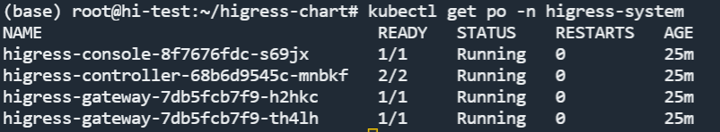
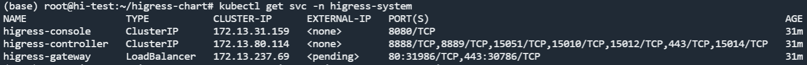
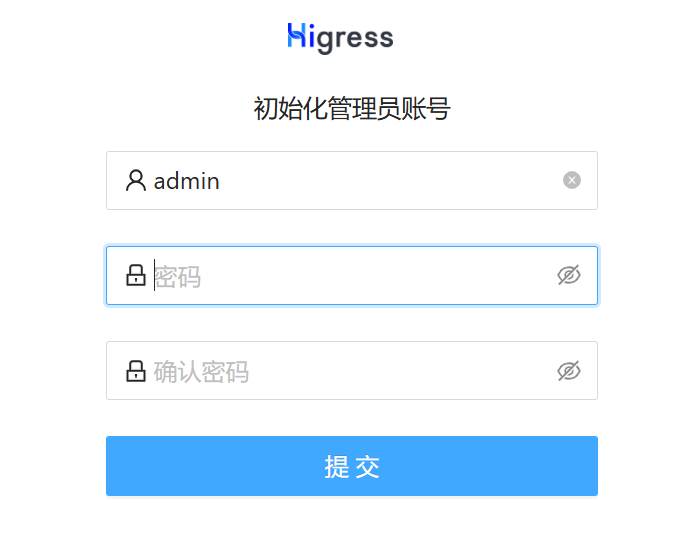
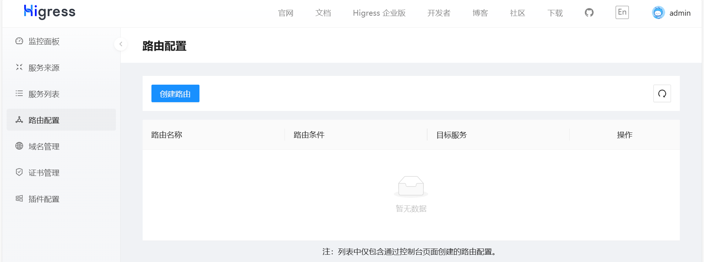
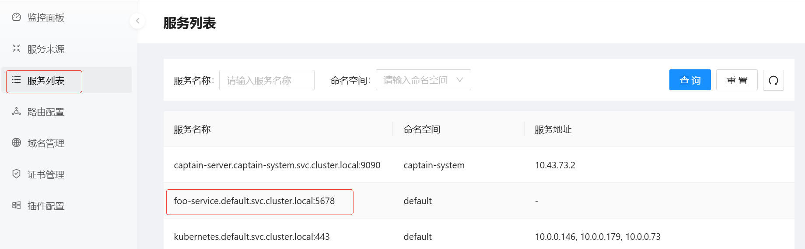
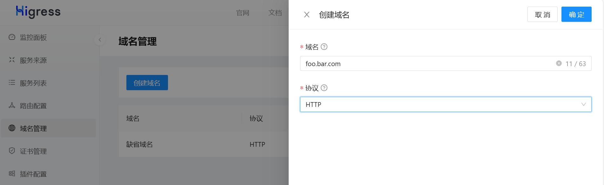
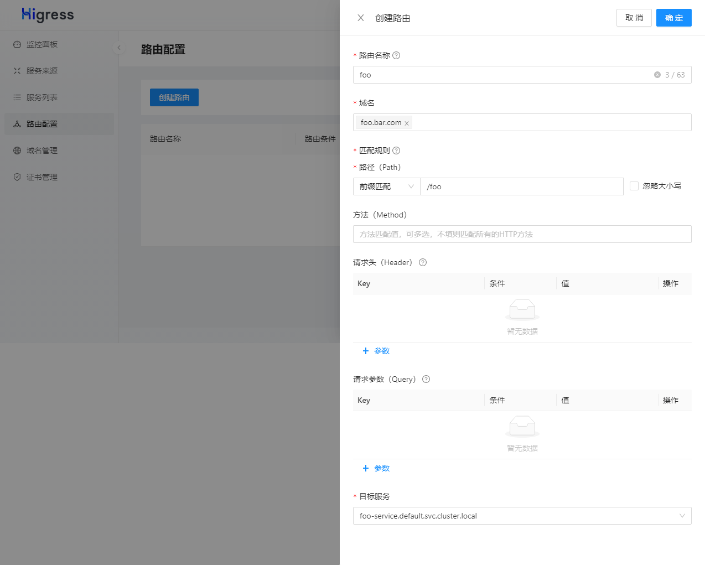
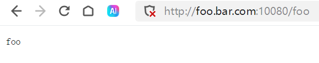

# 18 | 开源项目：云原生API网关Higress

你好，我是邢云阳。

在前面 17 节课的学习过程中，相信你已经深入理解了 Agent 的核心原理，并掌握了如何运用Agent 进行实际的应用开发。现在，我们终于来到了课程的收官阶段。如果你一直跟随课程循序渐进地学习，想必已经注意到我经常强调的一个重要观点：API 是 AI 时代的一等公民。

实际上，我们的课程设计也是围绕着这个理念展开的。从第一个实战项目“用自然语言操控K8s”开始，我们就通过 API 来封装工具供 Agent 调用。在后续的“手撸可定制 API Agent”项目中，我们不仅基于 OpenAPI 实现了工具配置封装和调用的标准化，还为整个 Agent 的访问封装了 API，让用户可以通过 API 用自然语言与 Agent 交互。这种模式已经具备了 AI 微服务的雏形 ，即用户通过 API 调用，服务内部则由 Agent 实现具体功能。

说到微服务，就不得不提到 API 网关。传统的 API 网关作为微服务架构中的核心组件，负责处理所有外部请求，并将请求路由到相应的服务。在 AI 时代，API 网关也在不断进化，开始承载更多 AI 相关的功能。由阿里巴巴开源的 Higress 项目就是一个很好的例子，它已经从传统 API 网关演进成为了一个成熟的 AI 网关产品，我本人也是在该社区任职。本节课，我们就来探讨 AI 时代对网关的新需求，以及 Higress 是如何应对这些挑战的。

## AI 时代的新挑战

AI 应用，特别是 LLM 应用与传统 Web 应用相比，面临着几个主要挑战。

1. 服务连续性

LLM 应用通常需要较长的内容生成时间，用户体验很大程度上依赖于对话的连续性。因此，如何在后端系统更新时保持服务不中断成为了一个关键问题。

2. 资源安全

与传统应用相比，LLM 服务处理单个请求时需要消耗大量计算资源。这种特性使得服务特别容易受到攻击，攻击者可以用很小的成本发起请求，却会给服务器带来巨大负担。如何保障后端系统的稳定性变得尤为重要。

3. 商业模式保护

很多 AGI 企业会提供免费调用额度来吸引用户，但这也带来了风险，部分黑灰产会利用这些免费额度封装成收费 API 牟利。如何防范这类商业损失是一个现实问题。

4. 内容安全

不同于传统 Web 应用的简单信息匹配，LLM 应用通过 AI 推理来生成内容。如何确保这些自动生成的内容安全合规，需要特别关注。

5. 多模型管理

当需要接入多个大模型时，如何统一管理不同厂商的 API，降低开发和维护成本也是一个重要课题。

在网关层面，AI 应用还具有三个显著的技术特征：

1. 长连接

- 大量使用 WebSocket 和 SSE 等长连接协议

- 网关配置更新时需要保持连接稳定

- 必须确保业务连续性不受影响

2. 高延时

- LLM 推理响应时间远高于传统应用

- 容易受到慢速请求和并发攻击的影响

- 面临着攻击成本低但防御成本高的安全挑战

3. 大带宽

- LLM 上下文传输需要大量带宽

- 高延时场景下带宽消耗倍增

- 需要高效的流式处理能力

- 必须做好内存管理以防止系统崩溃

## Higress 的应对之策

在了解 AI 时代的新挑战后，我们看一下 Higress 是如何应对的。

首先对于长连接的问题，Higress 的内核是基于 envoy 和 istio 的，实现了连接无损的热更新，可以避免类似 nginx 等网关变更配置时需要 reload，导致连接断开。

对于高延时带来的安全问题，Higress 提供了 IP/Cookie 等多维度的 CC 防护能力，面向 AI 场景，除了 QPS，还支持面向 Token 吞吐的限流防护。

对于大带宽的问题，解决方案是流式输出。因此 Higress 也支持了完全流式转发，并且数据面是基于 C++ 编写的 Envoy，在大带宽场景下，所需的内存占用极低。内存虽然相比 GPU 很廉价，但内存控制不当导致 OOM，业务宕机，损失不可估量。

除此之外，Higress 还开发了数十个开箱即用的 Wasm 插件，涵盖了安全防护、多模型适配、可观测、缓存、提示词工程，智能体，RAG 等多个方向。核心能力如下：

1. AI 代理插件：支持对接多厂商协议，共支持 15 家 LLM 提供商，基本涵盖国内外主流大模型厂商。

2. AI 内容审核插件：支持对接阿里云内容安全云服务，可以拦截有害语言、误导信息、歧视性言论、违法违规等内容。

3. AI 统计插件：支持统计 Token 吞吐，支持实时生成 Promethus metrics，以及在访问日志中打印相关信息。

4. AI 限流插件：支持基于 Token 吞吐进行后端保护式限流，也支持面向调用租户配置精确的调用额度限制。

5. AI 开发插件集：提供包含 Agent、 LLM 结果缓存、提示词装饰等相关能力，可以助力 AI应用的开发构建。

这些能力使得 Higress 完全适配了 AI 时代的技术要求，实现了从云原生 API 网关到 AI 网关的进化。

## Higress 安装与体验

接下来，我们就来安装一下 Higress，并体验一下其功能。

首先来看安装。Higress 支持在 K8s 中部署以及使用 docker 在非 K8s 环境中部署。本节课，我们就在 K8s 环境中部署一下。

Higress 提供了 Helm Chart 包，可以通过 Helm 命令一键安装。

```
helm repo add higress.cn https://higress.cn/helm-charts
helm install higress -n higress-system higress.cn/higress --create-namespace --re
```

Higress 的镜像都是存在阿里云的镜像仓库的，因此不受 DockerHub 境内访问受限的影响。

执行命令后，会有几分钟的拉取镜像的时间，等到下图中四个 pod 都 running 后，就说明安装好了。



再来查看一下 service。



higress 会暴露三个 service，其中 higress-console 是控制台的访问端口，如果想在外部通过浏览器使用控制台，需要将其 8080 端口使用 NodePort 或者 LoadBalancer 暴露出来。Higress-controller 是控制器，这个不用关心。Higress-gateway 是网关对外暴露的端口，包含80 和 443 两个端口，如果想要外部访问，也需要暴露出来。

我使用的是云服务器，我会通过 LoadBalancer 方式将上述两个服务暴露，然后通过公网 IP +端口的方式访问。暴露完成后，在浏览器输入 < 公网 IP> + 8080，会进入到系统初始化页面，需要设置密码。



设置好密码，登录后便进入到了控制台主页面。



可以看到，控制台整体布局比较简单清晰，所有功能都集中到了左侧侧边栏。包括了监控（可观测）、服务发现、路由配置、域名证书管理，以及插件功能。本节课我们先来体验 Higress作为云原生 API 网关的基本路由转发功能。

假设在 defualt 命名空间下，已经存在一个 foo 服务。你可以用以下 YAML 进行创建。

```
kind: Pod
apiVersion: v1
metadata:
 name: foo-app
 labels:
   app: foo
spec:
 containers:
 - name: foo-app
   image: higress-registry.cn-hangzhou.cr.aliyuncs.com/higress/http-echo:0.2.4-a
   args:
   - "-text=foo"
---
kind: Service
apiVersion: v1
metadata:
 name: foo-service
spec:
 selector:
   app: foo
 ports:
 # Default port used by the image
 - port: 5678
```

创建完成后，可以在 Higress 的服务列表中自动被发现。



接下来，我们可以在域名管理中，创建一个域名。如果你没有真域名的话，则需要在本地hosts 文件中，做一下映射。



之后就可以创建路由转发规则，将 /foo 路由映射到 foo 服务了。



完成后，可以在浏览器做一下测试。



由于我的服务器的 80 端口已经被占用了，所以我在之前配置 higress-gateway 的服务暴露时，将默认的 80 改成了 10080。

以上就是一个简单的路由转发的测试。如果你之前用过 Ingress，应该会对这个过程比较熟悉，实际上这就是一个通过界面可视化配置 Ingress 的过程。目前 Higress 已经兼容了绝大部分的 Ingress Annocation，因此对于之前已经通过 Nginx Ingress 创建的路由，在注解兼容的情况下，可以直接将 ingressClassName 从 nginx 改为 higress，就可以无缝切换到 Higress。具体的 Higress 对于 Ingress Annocation 的支持情况，可以查看 Ingress Annotation 配置说明。

## 总结

今天这节课，我们开启了最后一个章节 AI 微服务与网关的学习。我们一起讨论了 AI 时代，对于传统的网关提出的新挑战，总结来说就是三个词：长连接，高延时，大带宽。

之后我介绍了 Higress 项目，了解了它是如何与时俱进，应对上述的三个挑战的。同时，我们通过实际操作，体验了 Higress 作为云原生 API 网关的基本路由转发功能。我们创建了一个示例服务，并通过 Higress 控制台配置了域名和路由规则，成功实现了服务的访问。此外，我们还了解到 Higress 对 Ingress Annotation 的良好兼容性，这使得从其他网关（如 NginxIngress）迁移变得更加便捷。

下节课，我将会介绍 Higress 上主打的 Wasm 插件功能，我们一起来聊聊什么是 Wasm，以及 Wasm 插件在 Higress 中是如何使用的。

## 思考题

感兴趣的话你可以先阅读官方文档，了解一下 Higress Wasm 插件的使用。

欢迎你在留言区分享你的使用体验，我们一起来讨论。如果你觉得这节课的内容对你有帮助的话，也欢迎你分享给其他朋友，我们下节课再见！
