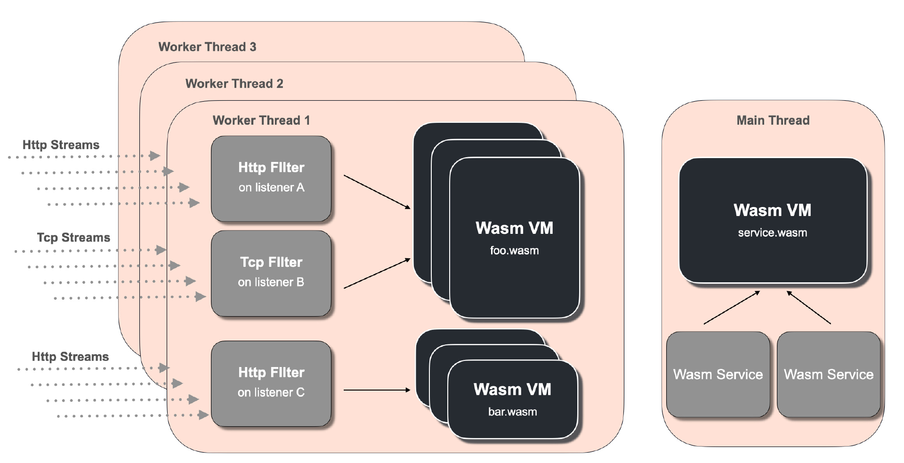
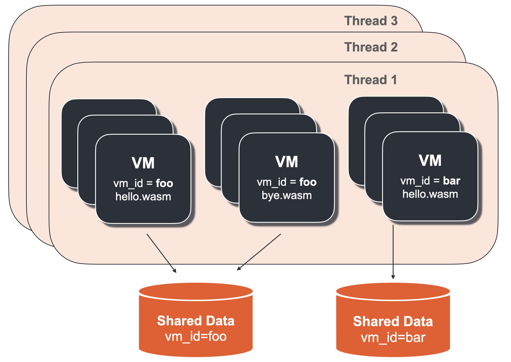
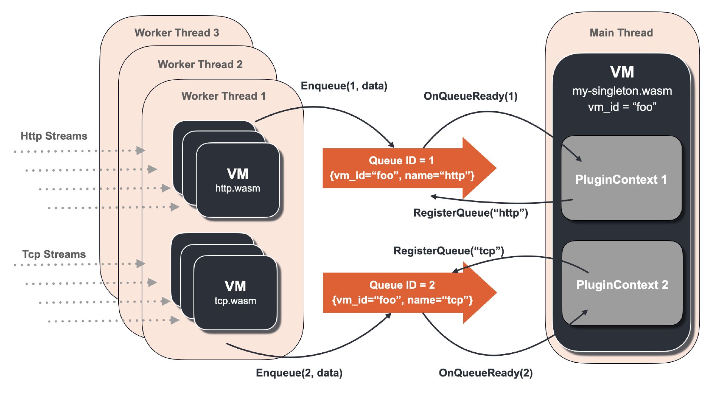

# 19 | 轻量级网关插件Wasm初体验

你好，我是邢云阳。

在上一节课中，我们深入探讨了 Higress 这款云原生 API 网关，了解了它如何应对 AI 时代带来的诸多挑战，包括服务连续性、资源安全、商业模式保护、内容安全以及多模型管理等方面。

今天这节课，我们将聚焦于 Higress 的一个重要特性——WebAssembly（简称 Wasm）插件机制。Wasm 不仅为 Higress 带来了强大的扩展能力，还能确保插件在高性能和安全性方面达到极致的平衡。通过 Wasm 插件，开发者可以使用自己熟悉的编程语言来扩展 Higress 的功能，同时又不会影响网关的稳定性和性能。

本节课的内容偏科普性质，是基于 Higress 社区推出的一些 Wasm 开发经验总结而来的，以便让感兴趣的同学对 Wasm 有一个了解。当然不感兴趣也没关系，可以直接跳过学习后面的Wasm 编程，会用即可。

## 认识 Wasm

### 什么是 Wasm？

首先，我们一起来了解一下什么是 Wasm。Wasm 可以理解为是一种轻量级的编码格式，它可以由多种语言编写的程序编译而来。最初 Wasm 是用于 Web 浏览器中，为了解决前端 JS 性能不足而发明的，但是在后面逐渐扩展到了后端以及云原生等多个领域。Wasm 有以下特点：

- 高效性能：提供了接近机器码的性能。

- 跨平台：Wasm 是一种与平台无关的格式，可以在任何支持它的平台上运行，包括浏览器和服务器。

- 安全性：Wasm 在一个内存安全的沙箱环境中运行，这意味着它可以安全地执行不受信任的代码，而不会访问或修改主机系统的其他部分。

- 可移植性：Wasm 模块可以被编译成 WebAssembly 二进制文件，这些文件可以被传输和加载到支持 Wasm 的任何环境中。

- 多语言支持：Wasm 支持多种编程语言，开发者可以使用 C、C++、Rust、Go 等多种语言编写代码，然后编译成 Wasm 格式。

### Wasm VM

在简单了解了 Wasm 之后，我们再来看一下加载 Wasm 程序的实例——Wasm VM。

在 Envoy 中，VM 通常在每个线程中创建并相互隔离。因此 Wasm 程序将复制到 Envoy 所创建的线程里，并在这些虚拟机上加载并执行。插件提供了一种灵活的方式来扩展和自定义Envoy 的行为。Proxy-Wasm 规范允许在每个 VM 中配置多个插件。因此一个 VM 可以被多个插件共同使用。Envoy 中有三种类型插件：Http Filter、Network Filter 和 Wasm Service。

- Http Filter 是一种处理 Http 协议的插件，例如操作 Http 请求头、正文等。

- Network Filter 是一种处理 Tcp 协议的插件，例如操作 Tcp 数据帧、连接建立等。

- Wasm Service 是在单例 VM 中运行的插件类型（即在 Envoy 主线程中只有一个实例）。它主要用于执行与 Network Filter 或 Http Filter 并行的一些额外工作，如聚合指标、日志等。这样的单例 VM 本身也被称为 Wasm Service。其架构如下：



## Proxy-Wasm Go SDK

了解了前面的理论后，我们来看一下在 Envoy 上开发 Wasm 插件所使用的 SDK–Proxy-Wasm Go SDK。

Proxy-Wasm Go SDK 为我们提供了一个理想的开发工具，它基于 Proxy-Wasm ABI 规范设计，专门用于扩展网络代理功能。通过这个 SDK，我们可以直接进行 Envoy 插件开发，而无需深入了解底层的 Proxy-Wasm ABI 规范细节，大大降低了开发门槛。下面，我来介绍一下Proxy-Wasm Go SDK API 中的一些重要概念。

### Contexts

上下文（Contexts） 是 Proxy-Wasm Go SDK 中的接口集合，它们在 types 包中定义。有四种类型的上下文：VMContext、PluginContext、TcpContext 和 HttpContext。它们的关系如下图：

```
                   Wasm Virtual Machine
                     (.vm_config.code)
┌────────────────────────────────────────────────────────────────┐
│  Your program (.vm_config.code)                TcpContext      │
│          │                                  ╱ (Tcp stream)     │
│          │ 1: 1                            ╱                   │
│          │         1: N                   ╱ 1: N               │
│      VMContext  ──────────  PluginContext                      │
│                                (Plugin)   ╲ 1: N               │
│                                            ╲                   │
│                                             ╲  HttpContext     │
│                                               (Http stream)    │
└────────────────────────────────────────────────────────────────┘
```

1. VMContext 对应于每个 .vm_config.code，每个 VM 中只存在一个 VMContext。

2. VMContext 是 PluginContexts 的父上下文，负责创建 PluginContext。

3. PluginContext 对应于一个 Plugin 实例。一个 PluginContext 对应于 Http Filter、NetworkFilter、Wasm Service 的 configuration 字段配置。

4. PluginContext 是 TcpContext 和 HttpContext 的父上下文，并且负责给处理 Http 流的 HttpFilter 或 处理 Tcp 流的 Network Filter 创建上下文。

5. TcpContext 负责处理每个 Tcp 流。

6. HttpContext 负责处理每个 Http 流。

因此，自定义插件要实现 VMContext 和 PluginContext。同时 Http Filter 或 NetworkFilter，要分别实现 HttpContext 或 TcpContext。

### Hostcall API

Hostcall API 是指在 Wasm 模块内调用 Envoy 提供的功能。这些功能通常用于获取外部数据或与 Envoy 交互。在开发 Wasm 插件时，需要访问网络请求的元数据、修改请求或响应头、记录日志等，这些都可以通过 Hostcall API 来实现。

Hostcall API 在 proxywasm 包的 hostcall.go 中定义。Hostcall API 包括配置和初始化、定时器设置、上下文管理、插件完成、共享队列管理、Redis 操作、Http 调用、TCP 流操作、HTTP 请求 / 响应头和体操作、共享数据操作、日志操作、属性和元数据操作、指标操作。

### 插件调用入口 Entrypoint

当 Envoy 创建 VM 时，在虚拟机内部创建 VMContext 之前，它会在启动阶段调用插件程序的 main 函数。所以必须在 main 函数中传递插件自定义的 VMContext 实现。proxywasm 包的 SetVMContext 函数是入口点。main 函数如下：

```go
func main() {
 proxywasm.SetVMContext(&myVMContext{})
}
type myVMContext struct { .... }
var _ types.VMContext = &myVMContext{}
// Implementations follow...
```

## 跨虚拟机通信

Envoy 中的跨虚拟机通信（Cross-VM communications）允许不同线程在运行 的 Wasm 虚拟机（VMs）之间进行数据交换和通信。这在需要在多个 VMs 之间聚合数据、统计信息或缓存数据等场景中非常有用。跨虚拟机通信主要有两种方式：

- 共享数据（Shared Data）：

- 共享数据是一种在所有 VMs 之间共享的键值存储，可以用于存储和检索简单的数据项。

- 它适用于存储小的、不经常变化的数据，例如配置参数或统计信息。

- 共享队列（Shared Queue）：

- 共享队列允许 VMs 之间进行更复杂的数据交换，支持发送和接收更丰富的数据结构。

- 队列可以用于实现任务调度、异步消息传递等模式。

### 共享数据（Shared Data）

如果想要在所有 Wasm 虚拟机（VMs）运行的多个工作线程间拥有全局请求计数器，或者想要缓存一些应被所有 Wasm VMs 使用的数据，那么共享数据（Shared Data）或等效的共享键值存储（Shared KVS）就会发挥作用。共享数据本质上是一个跨所有 VMs 共享的键值存储（即跨 VM 或跨线程）。

共享数据 KVS 是根据 vm_config 中指定的创建的。可以在所有 Wasm VMs 之间共享一个键值存储，而它们不必具有相同的二进制文件 vm_config.code，唯一的要求是具有相同的vm_id。



在上图中，可以看到即使它们具有不同的二进制文件（ hello.wasm 和 bye.wasm），“vm_id=foo”的 VMs 也共享相同的共享数据存储。hostcall.go 中定义共享数据相关的 API如下：

```go
// GetSharedData 用于检索给定 "key" 的值。
// 返回的 "cas" 应用于 SetSharedData 以实现该键的线程安全更新。
func GetSharedData(key string) (value []byte, cas uint32, err error)
// SetSharedData 用于在共享数据存储中设置键值对。
// 共享数据存储按主机中的 "vm_config.vm_id" 定义。
//
// 当给定的 CAS 值与当前值不匹配时，将返回 ErrorStatusCasMismatch。
// 这表明其他 Wasm VM 已经成功设置相同键的值，并且该键的当前 CAS 已递增。
// 建议在遇到此错误时实现重试逻辑。
//
// 将 cas 设置为 0 将永远不会返回 ErrorStatusCasMismatch 并且总是成功的，
// 但这并不是线程安全的，即可能在您调用此函数时另一个 VM 已经设置了该值，
// 看到的值与存储时的值已经不同。
func SetSharedData(key string, value []byte, cas uint32) error
```

共享数据 API 是其线程安全性和跨 VM 安全性，这通过“cas”（Compare-And-Swap）值来实现。

### 共享队列（Shared Queue）

如果要在请求 / 响应处理的同时跨所有 Wasm VMs 聚合指标，或者将一些跨 VM 聚合的信息推送到远程服务器，可以通过 Shared Queue 来实现。

Shared Queue 是为 vm_id 和队列名称的组合创建的 FIFO（先进先出）队列。并为该组合（vm_id，名称）分配了一个唯一的 queue id，该 ID 用于入队 / 出队操作。

“入队”和“出队”等操作具有线程安全性和跨 VM 安全性。在 hostcall.go 中与 Shared Queue相关 API 如下：

```go
// DequeueSharedQueue 从给定 queueID 的共享队列中出队数据。
// 要获取目标队列的 queue id，请先使用 "ResolveSharedQueue"。
func DequeueSharedQueue(queueID uint32) ([]byte, error)
// RegisterSharedQueue 在此插件上下文中注册共享队列。
// "注册" 意味着每当该 queueID 上有新数据入队时，将对此插件上下文调用 OnQueueReady。
// 仅适用于 types.PluginContext。返回的 queueID 可用于 Enqueue/DequeueSharedQueue。
// 请注意 "name" 必须在所有共享相同 "vm_id" 的 Wasm VMs 中是唯一的。使用 "vm_id" 来分隔共享
//
// 只有在调用 RegisterSharedQueue 之后，ResolveSharedQueue("此 vm_id", "名称") 才能成功
// 通过其他 VMs 检索 queueID。
func RegisterSharedQueue(name string) (queueID uint32, err error)
// EnqueueSharedQueue 将数据入队到给定 queueID 的共享队列。
// 要获取目标队列的 queue id，请先使用 "ResolveSharedQueue"。
func EnqueueSharedQueue(queueID uint32, data []byte) error
// ResolveSharedQueue 获取给定 vmID 和队列名称的 queueID。
// 返回的 queueID 可用于 Enqueue/DequeueSharedQueue。
func ResolveSharedQueue(vmID, queueName string) (queueID uint32, err error)
```

RegisterSharedQueue 和 DequeueSharedQueue 由队列的“消费者”使用，而ResolveSharedQueue 和 EnqueueSharedQueue 是为队列“生产者”准备的。请注意：

- RegisterSharedQueue 用于为调用者的 name 和 vm_id 创建共享队列。使用一个队列，那么必须先由一个 VM 调用这个函数。这可以由 PluginContext 调用，因此可以认为“消费者”= PluginContexts。

- ResolveSharedQueue 用于获取 name 和 vm_id 的 queue id。这是为“生产者”准备的。

这两个调用都返回一个队列 ID，该 ID 用于 DequeueSharedQueue 和EnqueueSharedQueue。同时当队列中入队新数据时消费者 PluginContext 中有OnQueueReady(queueID uint32) 接口会收到通知。还强烈建议由 Envoy 的主线程上的单例Wasm Service 创建共享队列。否则 OnQueueReady 将在工作线程上调用，这会阻塞它们处理 Http 或 Tcp 流。

下图展示了共享队列的工作原理。



## 总结

本节课是一节理论科普课，我们一起从 Wasm 是什么、Wasm SDK 以及跨虚机通信三个方面认识了 Wasm。

Wasm 作为一种高效的二进制指令集，不仅在浏览器中运行高效，还能在服务器端等多种环境中执行，展现了其跨平台和高性能的特性。通过介绍 Wasm SDK 和跨虚机通信机制，我们了解到 Wasm 如何通过共享数据和队列实现线程安全和跨 VM 安全性。这些特性使得 Wasm 在云原生应用中具有广泛的应用前景，特别是在需要高性能和安全性的场景中。

那从下节课开始，我会为你讲解 Higress 的 Wasm 编程，为后面我们开发 AI 插件打下基础。

## 思考题

在 Higress 社区中，针对 proxy-wasm-go-sdk 写了很多样例，有兴趣的话你可以点击https://proxy-wasm-go-sdk/examples at main · higress-group/proxy-wasm-go-sdk"> 链接查看代码。

欢迎你在留言区分享你的感受，我们一起来讨论。如果你觉得这节课的内容对你有帮助的话，也欢迎你分享给其他朋友，我们下节课再见！
